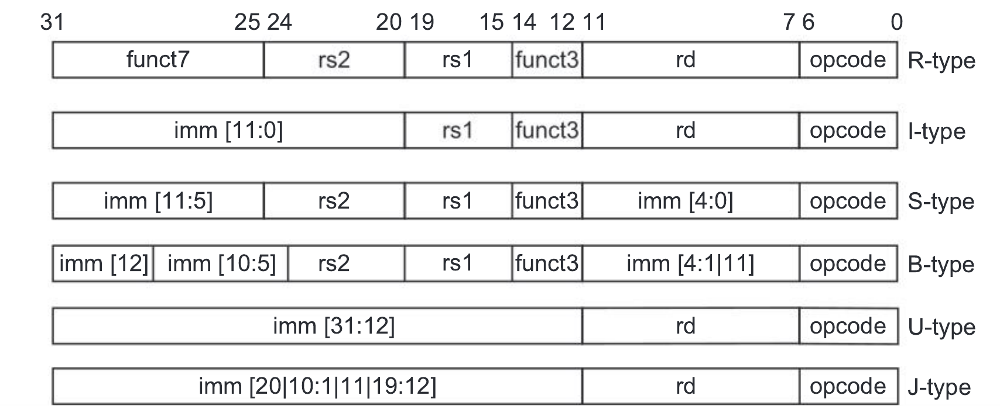

## 计算机体系结构的定义 {#sec-1-3}

计算机设计者面对的是一项复杂的任务：先确定一台新计算机的哪些属性是重要的，再在成本、功耗和可用性的约束之内设计这台计算机，让它的性能和能效尽可能高。这项任务涉及许多方面，包括指令集设计、功能组成、逻辑设计和实现。实现又可能包括集成电路设计、封装、供电和冷却。要优化设计，就必须熟悉非常广泛的技术，从编译器、操作系统一直到逻辑设计和封装。

几十年前，*计算机体系结构*这个术语一般只指指令集设计。计算机设计的其他方面称为*实现*，言下之意往往是实现缺乏趣味，或者挑战性较小。

我们认为这种看法是错误的。体系结构设计者的工作远远不止指令集设计；而且，项目其他方面的技术难关，很可能比指令集设计中遇到的更有挑战性。下面我们先简要回顾指令系统结构，再介绍计算机体系结构设计者面临的更大挑战。

### 指令系统结构：短视的计算机体系结构观 {-}

本书用*指令系统结构*（ISA）这个术语，指程序员实际可见的指令集。ISA 是软件和硬件的分界，因此是计算机最重要的接口。下面简要回顾 ISA，用 80x86、ARMv8 和 RISC-V 的例子来说明 ISA 的七个方面。最流行的 RISC 处理器来自 ARM（Advanced RISC Machine）。2023 年出货的芯片中，有 300 亿片用的是 ARM 处理器，是用 80x86 处理器（常简写为 x86）的芯片的 100 多倍。附录 A 和附录 K 对这三种 ISA 有更详细的介绍。

RISC-V（读作「RISC Five」）是 2010 年在加州大学伯克利分校开发的一种现代 RISC 指令集。应工业界的要求，RISC-V 免费、开放，任何人都可以采用。RISC-V 不仅有完整的软件栈（编译器、操作系统和模拟器），还有多种可以免费使用的 RISC-V 实现，可用于定制芯片或现场可编程门阵列（FPGA）。RISC-V 是在第一批 RISC 指令集出现 30 年后开发的。它继承了前辈的优秀思想，即大量的寄存器、便于流水线实现的指令和精简的操作集合，同时避免了前辈的疏漏和错误。它是前面提到的 RISC 体系结构的一个免费、开放而又优雅的范例。正因为如此，已有 200 多家公司加入了 RISC-V 国际基金会，其中包括阿里巴巴、AMD、谷歌、Intel、MIPS、诺基亚、英伟达、高通、三星、希捷、西门子、索尼和西部数据。2024 年出货的 RISC-V 片上系统（见 [1.6 节](#sec-1-6)）有 20 亿个，预计到 2031 年将增加到每年 300 亿个。本书以 RISC-V 的整数核心 ISA 作为示例 ISA。

*ISA 的类型*：今天几乎所有的 ISA 都属于通用寄存器体系结构，操作数要么是寄存器，要么是存储单元。x86 有 16 个通用寄存器，另有 16 个寄存器可以存放浮点数据；RISC-V 有 32 个通用寄存器和 32 个浮点寄存器（见[图 1.4](#fig-1-4)）。这一类中流行的有两种：一种是*寄存器-存储器*型 ISA，如 x86，许多指令在执行中都可以访存；另一种是 *load-store* 型 ISA，如 ARMv8 和 RISC-V，只有 load 指令和 store 指令才能访存。1985 年以后发布的 ISA 全都是 load-store 型。

[图 1.4　RISC-V 的寄存器、名称、用途和调用约定。除了 32 个通用寄存器（x0–x31），RISC-V 还有 32 个浮点寄存器（f0–f31），每个浮点寄存器既可以存放一个 32 位的单精度数，也可以存放一个 64 位的双精度数。过程调用前后必须保持不变的寄存器，标为「被调用者」（Callee）保存。]{#fig-1-4 .caption}

| 寄存器 | 名称 | 用途 | 保存者 |
|---|---|---|---|
| `x0` | `zero` | 常数 0 | 不适用 |
| `x1` | `ra` | 返回地址 | 调用者 |
| `x2` | `sp` | 栈指针 | 被调用者 |
| `x3` | `gp` | 全局指针 | – |
| `x4` | `tp` | 线程指针 | – |
| `x5-x7` | `t0-t2` | 临时寄存器 | 调用者 |
| `x8` | `s0/fp` | 保存寄存器/帧指针 | 被调用者 |
| `x9` | `s1` | 保存寄存器 | 被调用者 |
| `x10-x11` | `a0-a1` | 函数参数/返回值 | 调用者 |
| `x12-x17` | `a2-a7` | 函数参数 | 调用者 |
| `x18-x27` | `s2-s11` | 保存寄存器 | 被调用者 |
| `x28-x31` | `t3-t6` | 临时寄存器 | 调用者 |
| `f0-f7` | `ft0-ft7` | 浮点临时寄存器 | 调用者 |
| `f8-f9` | `fs0-fs1` | 浮点保存寄存器 | 被调用者 |
| `f10-f11` | `fa0-fa1` | 浮点函数参数/返回值 | 调用者 |
| `f12-f17` | `fa2-fa7` | 浮点函数参数 | 调用者 |
| `f18-f27` | `fs2-fs11` | 浮点保存寄存器 | 被调用者 |
| `f28-f31` | `ft8-ft11` | 浮点临时寄存器 | 调用者 |

1. *存储器寻址*：几乎所有的桌面计算机和服务器，包括 x86、ARMv8 和 RISC-V，都用字节编址来访问存储器操作数。有些体系结构，如 ARMv8，要求对象必须*对齐*。在字节地址 $A$ 处访问一个大小为 $s$ 字节的对象，如果 $A \bmod s = 0$，这次访问就是对齐的（见 A-8 页的图 A.5）。80x86 和 RISC-V 不要求对齐，但操作数对齐时，访问一般会快一些。
2. *寻址方式*：寻址方式除了指定寄存器和常数操作数，还指定存储器对象的地址。RISC-V 的寻址方式有寄存器寻址、立即数寻址（用于常数）和偏移量寻址；偏移量寻址是把一个常数偏移量加到一个寄存器上，形成存储器地址。x86 支持这三种方式，外加偏移量寻址的三种变形：不用寄存器（绝对寻址），用两个寄存器（基址变址加偏移量寻址），以及用两个寄存器、其中一个寄存器乘以操作数的字节数（基址加比例变址加偏移量寻址）。x86 还有更多类似后三种的寻址方式：去掉偏移量字段，就是寄存器间接寻址、变址寻址和基址加比例变址寻址。ARMv8 有 RISC-V 的三种寻址方式，再加上 PC 相对寻址、两个寄存器相加，以及两个寄存器相加且其中一个寄存器乘以操作数的字节数。ARMv8 还有自增寻址和自减寻址，即用计算出的地址替换形成地址时所用的某个寄存器的内容。
3. *操作数的类型和大小*：和大多数 ISA 一样，x86、ARMv8 和 RISC-V 支持的操作数大小有 8 位（ASCII 字符）、16 位（Unicode 字符或半字）、32 位（整数或字）、64 位（双字或长整数），以及 32 位（单精度）和 64 位（双精度）的 IEEE 754 浮点数。x86 还支持 80 位浮点数（扩展双精度）。近来 AI 受到广泛关注，新近的处理器因此把 16 位（半精度）乃至更短的浮点格式作为可选功能（见第 7 章）。
4. *操作*：操作大致分为数据传送、算术逻辑、控制（下面讨论）和浮点几类。RISC-V 是一种简单、便于流水线实现的 ISA，可以代表今天使用的 RISC 体系结构。[图 1.5](#fig-1-5) 总结了 RISC-V 的整数 ISA，[图 1.6](#fig-1-6) 列出了浮点 ISA。x86 的操作集合要丰富得多，也大得多（见附录 K）。
5. *控制流指令*：几乎所有的 ISA，包括这三种在内，都支持条件转移、无条件跳转、过程调用和返回。三者都用 PC 相对寻址，即转移地址由一个地址字段指定，这个字段要加到 PC 上。三者之间有一些小差别。RISC-V 的条件转移（`BE`、`BNE` 等）检测的是寄存器的内容；x86 和 ARMv8 的转移检测的是条件码位，这些位作为算术/逻辑运算的副作用而置位。ARMv8 和 RISC-V 的过程调用把返回地址放在寄存器里，而 x86 的调用指令（`CALLF`）把返回地址放在内存中的栈上。

[图 1.5　RISC-V 指令的一个子集。RISC-V 有一个基本指令集（R64I），并提供几种可选扩展：乘除（RVM）、单精度浮点（RVF）和双精度浮点（RVD）。本图包括 RVM，下一张图给出 RVF 和 RVD。附录 A 详细介绍 RISC-V。]{#fig-1-5 .caption}

| 指令类型/操作码 | 指令含义 |
|---|---|
| *数据传送* | *在寄存器和存储器之间，或者在整数寄存器与浮点寄存器、特殊寄存器之间传送数据；唯一的存储器寻址方式是 12 位偏移量加 GPR 的内容* |
| `lb`, `lbu`, `sb` | 取字节，取无符号字节，存字节（取到整数寄存器/从整数寄存器存出） |
| `lh`, `lhu`, `sh` | 取半字，取无符号半字，存半字（取到整数寄存器/从整数寄存器存出） |
| `lw`, `lwu`, `sw` | 取字，取无符号字，存字（取到整数寄存器/从整数寄存器存出） |
| `ld`, `sd` | 取双字，存双字（取到整数寄存器/从整数寄存器存出） |
| `flw`, `fld`, `fsw`, `fsd` | 取 SP 浮点数，取 DP 浮点数，存 SP 浮点数，存 DP 浮点数 |
| `fmv._.x`, `fmv.x._` | 在整数寄存器和浮点寄存器之间相互复制；「\_」= S 表示单精度，D 表示双精度 |
| `csrrw`, `csrrwi`, `csrrs`, `csrrsi`, `csrrc`, `csrrci` | 读计数器、写状态寄存器，计数器包括时钟周期数、时间和已提交的指令数 |
| *算术/逻辑* | *操作 GPR 中的整数数据或逻辑数据* |
| `add`, `addi`, `addw`, `addiw` | 加，加立即数（立即数都是 12 位），只加 32 位并符号扩展到 64 位，只对 32 位加立即数 |
| `sub`, `subw` | 减，只减 32 位 |
| `mul`, `mulw`, `mulh`, `mulhsu`, `mulhu` | 乘，只乘 32 位，乘取高半部分，有符号与无符号相乘取高半部分，无符号乘取高半部分 |
| `div`, `divu`, `rem`, `remu` | 除，无符号除，求余，无符号求余 |
| `divw`, `divuw`, `remw`, `remuw` | 除和求余：同上，但只对低 32 位做除法，产生符号扩展的 32 位结果 |
| `and`, `andi` | 与，与立即数 |
| `or`, `ori`, `xor`, `xori` | 或，或立即数，异或，异或立即数 |
| `lui` | 取高位立即数：用立即数装入寄存器的第 31–12 位，然后符号扩展 |
| `auipc` | 把放在第 31–12 位、低位补零的立即数加到 PC 上；与 `JALR` 配合使用，可以把控制转到任意 32 位地址 |
| `sll`, `slli`, `srl`, `srli`, `sra`, `srai` | 移位：逻辑左移，逻辑右移，算术右移；移位量可以是变量，也可以是立即数 |
| `sllw`, `slliw`, `srlw`, `srliw`, `sraw`, `sraiw` | 移位：同上，但对低 32 位移位，产生符号扩展的 32 位结果 |
| `slt`, `slti`, `sltu`, `sltiu` | 小于置位，小于立即数置位，有符号和无符号 |
| *控制* | *条件转移和跳转；PC 相对或通过寄存器* |
| `beq`, `bne`, `blt`, `bge`, `bltu`, `bgeu` | GPR 相等/不相等则转移；小于；大于或等于，有符号和无符号 |
| `jal`, `jalr` | 跳转并链接：保存 PC+4，目标是 PC 相对的（`JAL`）或在寄存器中（`JALR`）；如果指定 `x0` 为目的寄存器，就成为简单的跳转 |
| `ecall` | 向支持它运行的执行环境发出请求，这个执行环境通常是操作系统 |
| `ebreak` | 调试器用它把控制转回调试环境 |
| `fence`, `fence.i` | 同步线程，保证访存的顺序；为向指令存储器写数据的 store 同步指令和数据 |

[图 1.6　RISC-V 的浮点指令。RISC-V 有一个基本指令集（R64I），并提供单精度浮点（RVF）和双精度浮点（RVD）两种可选扩展。DP 表示双精度，SP 表示单精度。]{#fig-1-6 .caption}

| 指令类型/操作码 | 指令含义 |
|---|---|
| *浮点* | *对 DP 和 SP 格式的数做浮点操作* |
| `fadd.d`, `fadd.s` | DP、SP 数相加 |
| `fsub.d`, `fsub.s` | DP、SP 数相减 |
| `fmul.d`, `fmul.s` | DP、SP 浮点乘 |
| `fmadd.d`, `fmadd.s`, `fnmadd.d`, `fnmadd.s` | DP、SP 数乘加；DP、SP 数取负乘加 |
| `fmsub.d`, `fmsub.s`, `fnmsub.d`, `fnmsub.s` | DP、SP 数乘减；DP、SP 数取负乘减 |
| `fdiv.d`, `fdiv.s` | DP、SP 浮点除 |
| `fsqrt.d`, `fsqrt.s` | DP、SP 浮点平方根 |
| `fmax.d`, `fmax.s`, `fmin.d`, `fmin.s` | DP、SP 浮点最大值和最小值 |
| `fcvt._._`, `fcvt._._u`, `fcvt._u._` | 转换指令：`FCVT.x.y` 把类型 `y` 转换成类型 `x`，其中 `x` 和 `y` 是 `L`（64 位整数）、`W`（32 位整数）、`D`（DP）或 `S`（SP）；整数可以是无符号的（`U`） |
| `feq._`, `flt._`, `fle._` | 比较两个浮点寄存器中的浮点数，把布尔结果记录在整数寄存器中；「\_」= `S` 表示单精度，`D` 表示双精度 |
| `fclass.d`, `fclass.s` | 向整数寄存器写一个 10 位的掩码，指明这个浮点数的类别（$-\infty$、$+\infty$、$-0$、$+0$、NaN 等） |
| `fsgnj._`, `fsgnjn._`, `fsgnjx._` | 符号注入指令，只改变符号位：复制另一个源操作数的符号位，取另一个源操作数符号位的反，两个符号位的异或 |

*ISA 的编码*：编码基本上有两种选择：*定长*和*变长*。ARMv8 和 RISC-V 的指令全都是 32 位长，这简化了指令译码。[图 1.7](#fig-1-7) 给出了 RISC-V 的指令格式。x86 的编码是变长的，从 1 字节到 18 字节。变长指令占的空间可以比定长指令少，所以为 x86 编译的程序通常比为 RISC-V 编译的同一个程序小。注意，前面提到的那些选择会影响指令如何编码成二进制表示。例如，寄存器的数目和寻址方式的数目对指令的长度都有很大影响，因为在一条指令中，寄存器字段和寻址方式字段可能出现多次。（ARMv7 和 RISC-V 后来分别推出了 Thumb-2 和 RV64IC 扩展，提供 16 位和 32 位长指令的混合，以减小程序的大小。ARMv8 仍然只有 32 位指令。这些 RISC 体系结构紧凑版本的代码量比 x86 小。见附录 K。）

{#fig-1-7 width=90%}

除 ISA 设计以外，计算机体系结构设计者面临的其他挑战在当前尤其突出，因为现在各种指令集之间的差别很小，而应用领域又各不相同。因此，从本书第 4 版开始，除了这里的快速回顾，指令集方面的大部分内容都放到了附录中（见附录 A 和附录 K）。

### 真正的计算机体系结构：设计组成和硬件以满足目标和功能需求 {-}

计算机的实现包括两部分：组成和硬件。*组成*（organization）这个术语涵盖计算机设计中的高层方面，如存储系统、存储器互连，以及处理器即 CPU（中央处理器，算术、逻辑、转移和数据传送都在这里实现）内部的设计。也可以用*微结构*（microarchitecture）这个术语来代替组成。例如，AMD EPYC 和 Intel Xeon 就是 ISA 相同、组成不同的两种处理器。两者都实现 x86 指令集，但流水线和 Cache 的组成很不一样。

一个微处理器中改为集成多个处理器以后，*核*这个术语也用来指处理器。人们不说「多处理器微处理器」，而是普遍采用了*多核*这个术语。中央处理器（CPU）这个术语，一般指微处理器中的一个核，因为 PMD、PC 和服务器里的微处理器几乎全都是多核的。

*硬件*指计算机的具体细节，包括计算机的详细逻辑设计和封装技术。同一系列的计算机常常 ISA 完全相同，组成也非常相似，只是硬件实现的细节不同。例如，Intel Core i7（见第 3 章）和 Intel Xeon E7（见第 5 章）几乎完全相同，但时钟频率和存储系统不同，因此 Xeon E7 用作服务器更有效。

本书中，*体系结构*一词涵盖计算机设计的全部三个方面：ISA、组成或微结构，以及硬件。

计算机体系结构设计者设计计算机时，既要满足功能需求，又要达到价格、功耗、性能和可用性目标。[图 1.8](#fig-1-8) 总结了设计一台新计算机时要考虑的需求。体系结构设计者常常还要确定功能需求是什么，这可能是一项繁重的任务。这些需求可能是由市场催生的具体特性。应用软件决定了计算机的使用方式，因此通常会左右某些功能需求的选择。如果某种 ISA 上已经有大量软件，体系结构设计者可能会决定让新计算机实现现有的指令集。某一类应用如果有很大的市场，就可能促使设计者纳入一些需求，使计算机在这个市场上具有竞争力。后面各章会深入讨论其中许多需求和特性。

[图 1.8　体系结构设计者面对的部分关键功能需求。左栏说明需求的类别，右栏给出具体的例子。右栏还注明了讨论这些具体问题的章节和附录。]{#fig-1-8 .caption}

| 功能需求 | 需要的或支持的典型特性 |
|---|---|
| *应用领域* | *计算机的目标* |
| 物联网/嵌入式计算 | 往往需要对图形或视频（或其他面向具体应用的扩展）提供专门支持；可能需要功耗限制和功耗控制；实时约束（第 2、3、5、7 章；附录 A 和附录 E） |
| 个人移动设备 | 一系列任务的实时性能，包括图形、视频和音频的交互性能；能效（第 2–5 章和第 7 章；附录 A） |
| 通用桌面 | 一系列任务的均衡性能，包括图形、视频和音频的交互性能（第 2–5 章；附录 A） |
| 服务器 | 支持数据库和事务处理；增强可靠性和可用性；支持可扩展性和安全性（第 2、5、7 章；附录 A、D、F） |
| 集群/仓库级计算机 | 许多独立任务的吞吐率性能；内存纠错；能耗正比性；安全性（第 2、6、7 章；附录 F） |
| *软件兼容的层次* | *决定计算机可以使用多少现有软件* |
| 程序设计语言级 | 对设计者最灵活；需要新的编译器（第 3、5、7 章；附录 A） |
| 目标代码或二进制兼容 | 指令系统结构完全确定，灵活性很小，但不需要在软件或移植程序上投入（附录 A） |
| *操作系统需求* | *支持所选操作系统必需的特性（第 2 章；附录 B）* |
| 地址空间大小 | 非常重要的特性（第 2 章）；可能限制应用 |
| 存储管理 | 现代操作系统必需；可以是分页的，也可以是分段的（第 2 章） |
| 保护 | 操作系统和应用的需要各不相同：分页还是分段；虚拟机（第 2 章） |
| *标准* | *市场可能要求符合某些标准* |
| 浮点 | 格式和算术：IEEE 754 标准（附录 J），用于图形、信号处理或 AI 的特殊算术 |
| I/O 接口 | 用于 I/O 设备：Serial ATA、Serial Attached SCSI、PCI Express（附录 D 和附录 F） |
| 操作系统 | UNIX、Windows、Linux、iOS、Android |
| 网络 | 需要支持各种网络：以太网、Infiniband（附录 F） |
| 程序设计语言 | 语言（ANSI C、C++、Java、Fortran）会影响指令集（附录 A） |

体系结构设计者还必须了解工艺和计算机使用两方面的重要趋势，因为这些趋势不仅影响未来的成本，也影响一种体系结构的寿命。
