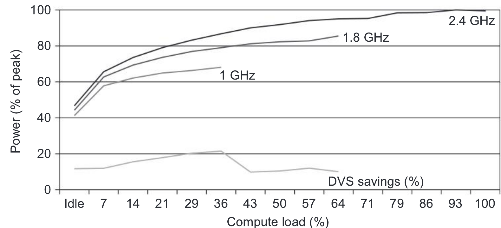

## 集成电路功耗和能耗的发展趋势 {#sec-1-5}

今天，几乎每一类计算机的设计者面临的最大挑战都是能耗。第一，电源要引入芯片并分配到芯片各处，现代微处理器仅电源和地就要占用几百个引脚和多个互连层。第二，功耗会转化为热量散发出来，这些热量必须排走。

### 功耗和能耗：系统的视角 {-}

系统设计者或用户应该怎样看待性能、功耗和能耗？从系统设计者的角度看，主要关心三个问题。

第一，处理器最多需要多大的功率？满足这个需求对保证系统正确工作可能很重要。例如，如果处理器试图汲取的功率超过供电系统所能提供的功率（即需要的电流超过系统所能供给的电流），结果通常是电压下降，可能导致器件工作失常。现代处理器的功耗变化范围很大，峰值电流很高，因此提供了电压索引（voltage indexing）方法，让处理器降低速度，在更宽的范围内调节电压。显然，这样做会降低性能。

第二，持续功耗是多少？这个指标通常称为*热设计功耗*（TDP），因为它决定了散热要求。TDP 既不是峰值功耗（峰值功耗往往是 TDP 的 1.5 倍），也不是某次计算中实际消耗的平均功耗（平均功耗很可能还要更低）。系统电源的额定功率一般高于 TDP，散热系统通常按等于或高于 TDP 来设计。如果散热不足，处理器的结温就会超过最大值，导致器件失效，甚至可能造成永久损坏。最高功耗（以及由此带来的发热和温升）可能超过 TDP 规定的长期平均值，因此现代处理器提供了两项功能来帮助管理发热。一是温度接近结温上限时，电路会降低时钟频率，从而降低功耗。二是如果这种方法仍不能奏效，就触发第二级热过载保护，切断芯片的电源。

设计者和用户要考虑的第三个因素是能耗和能效。回忆一下，功耗就是单位时间的能耗：1 W = 1 J/s。比较处理器时，应该用能耗还是功耗作为指标？一般来说，能耗总是更好的指标，因为它与一项具体任务以及完成这项任务所需的时间联系在一起。具体来说，完成一个工作负载的能耗，等于平均功耗乘以这个工作负载的执行时间。

所以，要想知道两个处理器中哪个完成某项任务的效率更高，我们需要比较执行这项任务的能耗，而不是功耗。例如，处理器 A 的平均功耗可能比处理器 B 高 20%，但如果 A 执行这项任务只用 B 所需时间的 70%，A 的能耗就是 1.2 × 0.7 = 0.84，显然更好。

有人可能会说，在大型服务器或云里，人们常常假定工作负载是无限的，因此只考虑平均功耗就够了。但这种看法是有误导性的。如果云中配置的是处理器 B 而不是 A，那么消耗同样多的能量，云完成的工作就更少。用能耗来比较各种方案，就能避免这个陷阱。只要工作负载是固定的，不管是仓库那么大的云还是一部智能手机，比较能耗都是比较不同计算机方案的正确方法，因为云的电费和智能手机的电池续航都由所消耗的能量决定。

功耗什么时候是一个有用的度量？它主要的正当用途是作为约束条件，例如，一块风冷芯片的功耗可能限制在 300 W 以内。工作负载固定时，功耗也可以用作指标，但这时它只是真正的指标「每项任务的能耗」的一种变形。

### 微处理器内部的能耗和功耗 {-}

CMOS 芯片的能耗传统上主要来自晶体管的开关，称为*动态能耗*。每个晶体管所需的能量与它驱动的容性负载和电压平方的乘积成正比：

$$
\text{能耗}_{\text{动态}} \propto \text{容性负载} \times \text{电压}^2
$$

这个式子给出的是 0→1→0 或 1→0→1 这样一个逻辑跳变脉冲的能量。于是，单次跳变（0→1 或 1→0）的能量是：

$$
\text{能耗}_{\text{动态}} \propto 1/2 \times \text{容性负载} \times \text{电压}^2
$$

每个晶体管所需的功率，就是一次跳变的能量乘以跳变的频率：

$$
\text{功耗}_{\text{动态}} \propto 1/2 \times \text{容性负载} \times \text{电压}^2 \times \text{开关频率}
$$

任务固定时，降低时钟频率能降低功耗，但不能降低能耗。

显然，降低电压能大幅降低动态功耗和动态能耗，因此 20 年里电压从 5 V 降到了略低于 1 V。容性负载取决于连接到一个输出端的晶体管数和工艺，工艺决定了连线和晶体管的电容。

**例题**　现在有些微处理器设计成电压可调，电压降低 15% 时，频率可能随之降低 15%。这对动态能耗和动态功耗有什么影响？

**解答**　电容不变，因此能耗之比就是电压之比的平方：

$$
\frac{\text{能耗}_{\text{新}}}{\text{能耗}_{\text{旧}}} = \frac{(\text{电压} \times 0.85)^2}{\text{电压}^2} = 0.85^2 = 0.72
$$

动态能耗降到原来的 72% 左右。功耗还要再乘上频率之比：

$$
\frac{\text{功耗}_{\text{新}}}{\text{功耗}_{\text{旧}}} = 0.72 \times \frac{\text{开关频率} \times 0.85}{\text{开关频率}} = 0.61
$$

动态功耗降到原来的 61% 左右。

从一代工艺过渡到下一代工艺时，发生开关的晶体管数和开关频率都在增加，这种增加的作用超过了负载电容和电压降低的作用，因此功耗和能耗总体上是增长的。最早的微处理器功耗不到 1 W，最早的 32 位微处理器（如 Intel 80386）大约用 2 W，而 2.4 GHz 的 Intel Xeon Platinum 8380 要消耗 270 W。这些热量要从一块边长约 2.5 cm 的芯片上散发出去，已经接近风冷所能达到的极限，而这种状况已经持续了将近十年。（Intel 和 NVIDIA 最近发布的产品中有 TDP 接近 1000 W 的芯片，需要液冷。）

由上面的式子可以预料，如果不能降低电压，也不能提高每块芯片的功耗，时钟频率的增长就会放慢。[图 1.11](#fig-1-11) 表明，2003 年以来情况确实如此，就连[图 1.1](#fig-1-1) 中每年性能最高的微处理器也是这样。注意，时钟频率趋于平缓的这段时期，正对应着[图 1.1](#fig-1-1) 中性能提高缓慢的那几段。

 中微处理器时钟频率的增长。1978 年到 1986 年，时钟频率每年提高不到 15%，性能每年提高 22%。1986 年到 2003 年是性能每年提高 52% 的「复兴时期」，这期间时钟频率迅速提高，每年将近 40%。此后时钟频率几乎没有变化。从 2008 年起，Intel 提供了 Turbo 模式，芯片可以临时以更高的时钟频率运行，直到温度过高为止。即使是 Turbo 模式，2011 年到 2022 年也只是每年提高约 2%。](images/ch01/fig-1-11.png){#fig-1-11 width=90%}

配电、散热和防止热点已经成为越来越难的挑战。现在，使用晶体管的主要约束是能耗；过去则是硅片面积本身。因此，尽管时钟频率不再提高、电源电压保持不变，现代微处理器还是提供了许多技术来设法提高能效：

1. *把「什么都不做」做好*（Do nothing well）。今天的大多数微处理器会关掉不工作模块的时钟，以节省能耗和动态功耗。例如，如果没有浮点指令在执行，就关掉浮点部件的时钟。如果有些核空闲，就停掉它们的时钟。
2. *动态电压频率调节*（DVFS）。第二种技术直接来自前面的公式。PMD、笔记本电脑乃至服务器都有活动较少的时期，这时不需要以最高的时钟频率和电压运行。现代微处理器通常提供几档可供选用的时钟频率和电压，以较低的功耗和能耗运行。[图 1.12](#fig-1-12) 画出了一台服务器在 2.4 GHz、1.8 GHz 和 1 GHz 三种时钟频率下，工作负载减小时 DVFS 可能节省的功耗。每降一档，服务器总功耗大约节省 10% 到 15%。
3. *针对常见情况设计*。PMD 和笔记本电脑经常处于空闲状态，因此内存和存储设备提供低功耗模式来节省能耗。例如，DRAM 有一系列功耗逐级降低的模式，用来延长 PMD 和笔记本电脑的电池续航；也有人提出让磁盘在不用时转得慢一些，以节省功耗。但是，在这些模式下不能访问 DRAM 或磁盘，所以不管访问频率多低，读写时都必须回到完全活动的模式。前面说过，PC 的微处理器则是按高温下高负荷运行来设计的，依靠片上温度传感器检测何时应自动降低活动，以免过热。有了这种「紧急降速」，制造商可以按更典型的情况来设计，如果真有人运行了功耗远高于一般水平的程序，再依靠这一安全机制。
4. *超频*。Intel 从 2008 年开始提供 *Turbo 模式*：芯片判断可以安全地短时间以更高的时钟频率运行，可能只在少数几个核上这样做，直到温度开始上升为止。例如，2.8 GHz 的 Xeon E-2378G 可以短时间以 5.1 GHz 运行（见[图 1.11](#fig-1-11)）。事实上，[图 1.1](#fig-1-1) 中 2008 年以来每年性能最高的微处理器都提供临时超频，到 2016 年为止大约比标称时钟频率高 10%，此后 Turbo 模式要高 30% 到 80%。运行单线程代码时，这些微处理器可以关掉除一个核以外的所有核，让这个核运行得更快。注意，操作系统虽然可以关掉 Turbo 模式，但 Turbo 模式启用后并不会发出通知，所以程序员可能会惊讶地发现，自己程序的性能会随室温变化！
5. *异构核*。手机早就同时配有快速、高功耗的核和慢速、高能效的核。例如，苹果 iPhone 14 Pro 智能手机的芯片有两个高性能核和四个高能效核。这样做的目的是节省能耗：在保持用户期望的响应速度的前提下，用能效最高的处理器来运行应用。智能手机甚至还有专用于特定窄领域的处理器，进一步提高这些任务的能效。

{#fig-1-12 width=90%}

虽然传统上认为动态功耗是 CMOS 功耗的主要来源，但静态功耗正在成为一个重要问题，因为即使晶体管关断，也有漏电流流过：

$$
\text{功耗}_{\text{静态}} \propto \text{静态电流} \times \text{电压}
$$

也就是说，静态功耗与器件数成正比。

因此，即使晶体管处于空闲状态，增加晶体管数也会增加功耗；而且晶体管尺寸越小，处理器的漏电流越大。结果，功耗非常低的系统甚至会切断不工作模块的电源（称为*电源门控*），以控制漏电造成的损耗。2011 年，漏电的目标是占总功耗的 25%，而高性能设计中的漏电有时远远超过这个目标。这类芯片的漏电可能高达 50%，部分原因是大容量的 SRAM Cache 需要供电才能保住存储的值。（SRAM 中的 S 就是 static，即静态。）要制止漏电，唯一的希望是切断芯片中部分电路的电源。

最后，处理器只是系统总能耗的一部分，所以用一个更快但能效较低的处理器，让系统其余部分得以进入睡眠模式，可能是合理的。这种策略称为*冲刺到停机*（race-to-halt）。

功耗和能耗的地位提高了，人们对一项创新的效率也就审视得更加严格。因此，现在的主要评价指标是每焦耳完成的任务数或每瓦性能，而不是过去的每平方毫米硅片的性能。这个新指标影响到利用并行性的方法，我们将在第 4 章和第 5 章看到。

### 能耗限制带来的计算机体系结构转变 {-}

晶体管的改进放慢了，于是计算机体系结构设计者必须另找办法来提高能效。事实上，在能耗预算的限制下，今天很容易设计出一个晶体管多到无法同时全部打开的微处理器。这种现象称为*暗硅*，意思是由于散热的约束，芯片的很大一部分在任何时刻都不能使用（是「暗」的）。这一现象促使体系结构设计者重新审视处理器设计的基本原理，以求更好的能耗-成本性能。

[图 1.13](#fig-1-13) 列出了现代计算机各种基本构件的能耗代价，从中可以看出它们之间的比例大得惊人。例如，一次 32 位浮点加法的能耗是一次 8 位整数加法的 50 倍。但差别最大的是存储器：一次 32 位 DRAM 访问的能耗将近 8 位加法的 200,000 倍。小容量 SRAM 的能效是 DRAM 的 175 倍，这说明了用好 Cache 和存储缓冲区的重要性。

[图 1.13　比较：TSMC 7 nm 工艺节点下各种算术运算以及访问 SRAM 和 DRAM 的能耗（Jouppi 等，2021）。]{#fig-1-13 .caption}

| 序号 | 操作 | 能耗（pJ） | 相对能耗 |
|---|---|---:|---:|
| 1 | Int 8 加法 | 0.007 | 1 |
| 2 | Int 32 加法 | 0.030 | 4 |
| 3 | BFloat 16 加法 | 0.110 | 16 |
| 4 | IEEE FP 16 加法 | 0.160 | 23 |
| 5 | IEEE FP 32 加法 | 0.380 | 54 |
| 6 | Int 8 乘法 | 0.070 | 10 |
| 7 | Int 32 乘法 | 1.480 | 211 |
| 8 | BFloat 16 乘法 | 0.210 | 30 |
| 9 | IEEE FP 16 乘法 | 0.340 | 49 |
| 10 | IEEE FP 32 乘法 | 1.310 | 187 |
| 11 | 从 8 KB SRAM 读 32 位 | 7.500 | 1,071 |
| 12 | 从 1 MB SRAM 读 32 位 | 14.000 | 2,000 |
| 13 | 从 DDR4 DRAM 读 32 位 | 1,300.000 | 185,714 |

每项任务能耗最小这一新的设计原则，加上[图 1.13](#fig-1-13) 中的相对能耗，为计算机体系结构开辟了一个新方向，我们在第 7 章介绍。领域专用处理器节省能耗的办法，一是减少宽位浮点运算，二是部署专用存储器来减少 DRAM 访问。省下来的能耗用于配置更多（位宽更窄的）运算部件，数量是传统处理器的 10～1000 倍。这类处理器虽然只能完成有限的一组任务，但完成这些任务比通用处理器快得多，能效也高得多。

就像医院里既有全科医生又有专科医生一样，在这个讲究能耗的世界里，计算机已经变成了通用核和专用核的组合：通用核什么任务都能做，专用核只做少数几件事，但做得极好，能效还更高。

### 计算机能耗对全球气候变化的影响 {-}

全球气候变化是当今社会面临的一个巨大挑战。计算的快速增长让人们对它的碳足迹产生了担忧，这种担忧是有道理的。

碳排放可以分成两类：

* *运行排放*，即运行硬件的能耗代价，对服务器来说还包括数据中心的开销；
* *隐含排放*，即在运行排放之外，再加上所涉及的全部部件在制造过程中排放的隐含碳，从芯片一直到数据中心的建筑。

隐含排放要难算得多，因为它要求把排放一层层追溯到最初的制造源头，再把中间各个环节直到最终产品的排放累加起来。

运行能耗为：

$$
\text{能耗} = \text{执行时间} \times \text{计算机台数} \times \text{每台计算机的平均功耗}
$$

（对数据中心来说，还要再乘一个因子，反映把能量输送给里面计算机的效率，这个因子叫作电源使用效率，第 6 章会介绍。）

能耗以千瓦时为单位，排放则以千克*二氧化碳当量*（CO~2~e）为单位，它把甲烷这类温室气体也包括在内。排放的计算公式为：

$$
\text{CO}_2\text{e} = \text{以 KWh 计的能耗} \times \text{每 KWh 的 CO}_2\text{e}
$$

能耗相对容易算出，最后一项却很难确定，因为它随主要能源的不同，在不同地区之间相差 5～10 倍（Patterson 等，2022）。煤是最脏的能源；天然气干净一些，但仍然含碳；太阳能、风能、核能和水电则是无碳能源的例子。以谷歌的能源为例，2020 年新加坡的数据中心所用能源只有 4% 是无碳的，而芬兰的数据中心用的能源有 94% 是无碳的。即使在同一个国家内，差别也可能很大：在美国，内华达州数据中心所用能源有 19% 是无碳的，艾奥瓦州则是 93%。谷歌之所以能达到这么高的比例，是因为它与可再生能源供应方签订合同，以减少当地电网电力的碳排放。就艾奥瓦州而言，那里昼夜都有充足的风能。

计算机体系结构设计者可以从两方面帮助减少信息技术的碳足迹：一是提高自己所设计计算机的运行能效，二是学会在制造自己的设计时减少隐含碳足迹。
