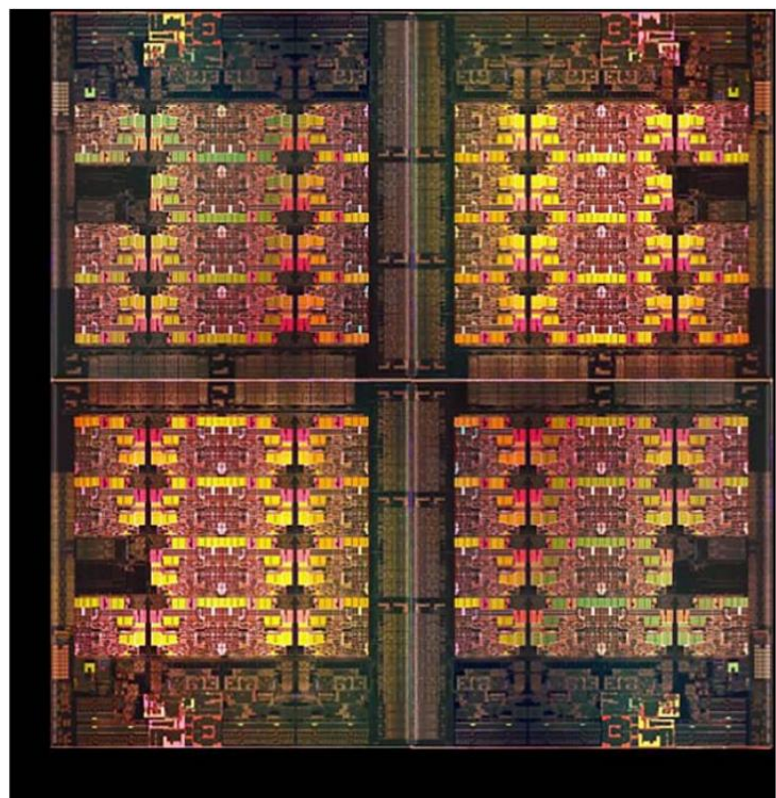
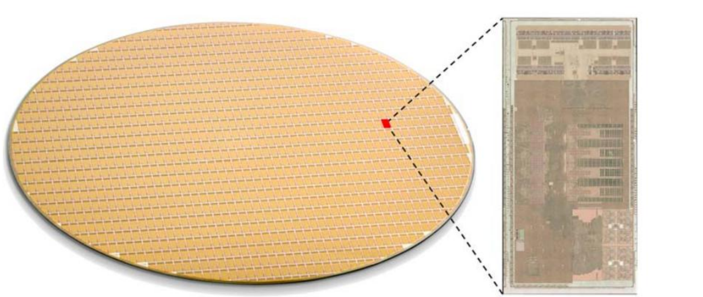
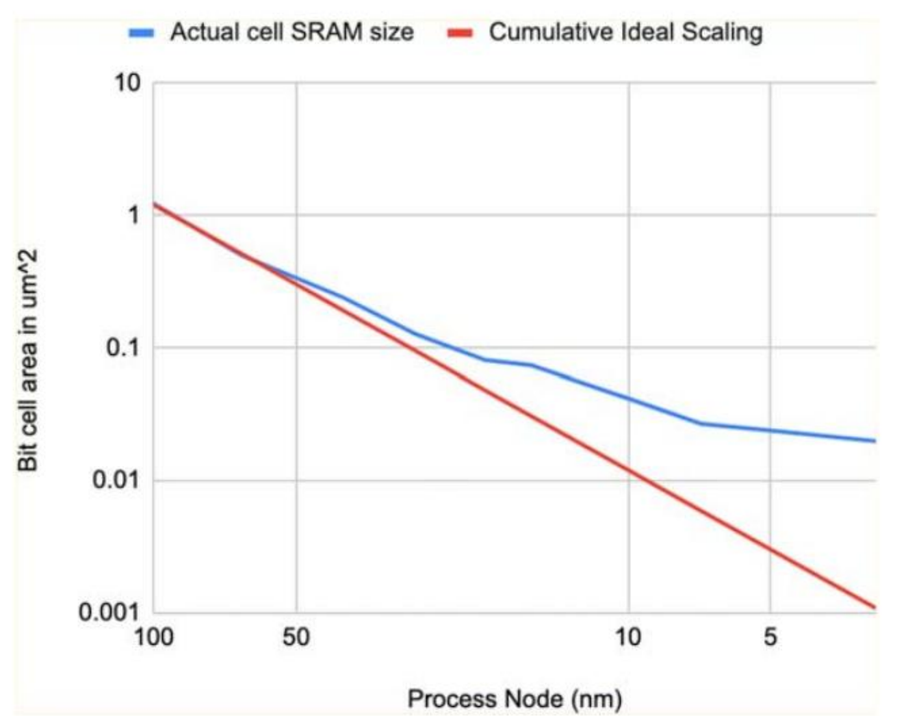

## 成本的变化趋势 {#sec-1-6}

有些计算机设计不太看重成本，特别是超级计算机。但对成本敏感的设计越来越重要。事实上，过去 40 年里，计算机产业的一条主线就是利用工艺进步，既提高性能，也降低成本。

教科书讲性价比时，常常只讲性能，不讲成本。原因有两个：一是成本总在变化，写进书里很快就会过时；二是成本问题很微妙，不同的行业领域情况又各不相同。尽管如此，计算机体系结构设计者必须了解成本和影响成本的因素。在成本是重要考量的设计中，一项新功能是否应当加入，要靠这些知识才能作出明智的判断。（想象一下，建筑师设计摩天大楼，却对钢梁和混凝土的价格一无所知！）

本节讨论影响计算机成本的主要因素，以及这些因素随时间发生的变化。

### 时间、产量和商品化的影响 {-}

即使基本的实现工艺没有明显改进，制造出来的计算机部件成本也会随时间下降。推动成本下降的基本原理是*学习曲线*：制造成本随时间不断降低。学习曲线本身最好用*成品率*（yield）的变化来衡量。成品率是指制造出来的器件中通过测试的百分比。不论是芯片、电路板还是整个系统，成品率提高一倍的设计，成本就降低一半。

要预测一个产品在整个生命周期里的成本，关键是弄清学习曲线如何提高成品率。例如，DRAM 每 GB 的价格长期以来一直在下降。除了缺货或供过于求的时期，DRAM 的定价往往与成本紧密相关，因此 DRAM 的价格和成本走势基本一致。

微处理器的价格也随时间下降。但微处理器的标准化程度不如 DRAM，因此价格和成本的关系更复杂。在竞争激烈的时期，价格往往紧跟成本，不过微处理器厂商大概很少亏本销售。

决定成本的第二个关键因素是产量。产量增加会从几个方面影响成本。首先，产量增加会缩短走完学习曲线所需的时间，因为这段时间部分地与制造出的系统（或芯片）数量成正比。其次，产量增加提高了采购和制造的效率，从而降低成本。有些设计者根据经验估计，产量每翻一番，成本大约降低 10%。此外，产量越大，每台计算机要分摊的开发成本就越少，成本和售价因此可以更接近，同时仍有利润。

*大宗商品*是指由多家厂商大批量销售、彼此基本相同的产品。杂货店货架上出售的几乎所有商品都是大宗商品，标准 DRAM、闪存、显示器和键盘也是。过去 40 年里，个人计算机产业的很大一部分已经成为大宗商品业务，主要是制造台式机和笔记本电脑，这些机器通常运行微软的 Windows。

许多大宗商品厂商出售的产品几乎完全相同，因此市场竞争非常激烈。这种竞争当然会缩小成本和售价之间的差距，但它也降低了成本本身。成本之所以下降，是因为大宗商品市场既有产量，产品定义又明确，于是多家供应商可以竞相为这种产品制造部件。部件供应商之间相互竞争，供应商又能借助产量提高效率，整个产品的成本因此更低。这种竞争使计算机行业的低端能够取得比其他领域更好的性价比，低端市场也增长得更快，只是利润非常有限（任何大宗商品业务通常都是如此）。

### 集成电路的成本 {-}

一本讲计算机体系结构的书，为什么要用一节来讲集成电路的成本？计算机市场的竞争越来越激烈，磁盘、闪存、DRAM 等标准部件在每个系统的成本中都占了相当大的比重。于是，在不同计算机之间存在差别的那部分成本中，集成电路所占的比重越来越大，在产量大、对成本敏感的那部分市场中尤其如此。事实上，个人移动设备（PMD）依赖*片上系统*（SOC），集成电路的成本因此占了 PMD 成本的大部分。所以，计算机设计者要了解当今计算机的成本，就必须了解芯片的成本。

集成电路的成本已经呈指数下降，但硅片制造的基本流程没有变：*晶圆*（wafer）仍然要先测试，再切成一个个*晶片*（die），然后封装（见[图 1.14](#fig-1-14)～[图 1.16](#fig-1-16)）。因此，一个封装好的集成电路的成本为

$$
\text{集成电路成本} = \frac{\text{晶片成本} + \text{晶片测试成本} + \text{封装和终测成本}}{\text{终测成品率}}
$$

本节着重讨论晶片的成本，测试和封装方面的关键问题放在最后概括介绍。

要预测每片晶圆上有多少个好的芯片，首先要知道一片晶圆上能放下多少个晶片，然后要学会预测其中有多大比例能正常工作。有了这两项，预测成本就很简单了：

$$
\text{晶片成本} = \frac{\text{晶圆成本}}{\text{每片晶圆的晶片数} \times \text{晶片成品率}}
$$

芯片成本公式中这第一项最值得关注的特点是它对晶片尺寸很敏感，下面就会看到这一点。

每片晶圆的晶片数大约等于晶圆面积除以晶片面积。更精确的估算公式是

$$
\text{每片晶圆的晶片数} = \frac{\pi \times (\text{晶圆直径}/2)^2}{\text{晶片面积}} - \frac{\pi \times \text{晶圆直径}}{\sqrt{2 \times \text{晶片面积}}}
$$

第一项是晶圆面积（$\pi r^2$）与晶片面积之比。第二项用来修正「方钉插圆孔」的问题，也就是圆形晶圆边缘附近的那些矩形晶片。用周长（$\pi d$）除以正方形晶片的对角线，得到的大约就是沿边缘分布的晶片数。

{#fig-1-14 width=70%}

 的微处理器晶片上标出各部分的功能。*UPI*（Ultra Path Interconnect）是 Intel 在插座之间使用的点对点互连。*PCIe* 是一种标准的高速串行扩展总线，用来连接 GPU、网络接口和存储设备。*Memory* 块是 DDR5 DRAM 的内存控制器。*Accelerators* 块包括对高级矩阵扩展（AMX）和高级向量扩展（AVX）的硬件支持、一个用于加速加密和数据压缩/解压缩的引擎（QuickAssist 技术），以及名副其实的数据流加速器（DSA）。（Sapphire Rapids 还有一个与高带宽存储器（HBM）封装在一起的版本，HBM 接口也在 Accelerators 块中。）](images/ch01/fig-1-15.png){#fig-1-15 width=80%}

{#fig-1-16 width=90%}

**例题**　一片 300 mm（30 cm）的晶圆，晶片边长分别为 1.5 cm 和 1.0 cm 时，每片晶圆各有多少个晶片？

**解答**　晶片面积为 2.25 cm² 时：

$$
\text{每片晶圆的晶片数} = \frac{\pi \times (30/2)^2}{2.25} - \frac{\pi \times 30}{\sqrt{2 \times 2.25}} = \frac{706.9}{2.25} - \frac{94.2}{2.12} = 270
$$

大晶片的面积是小晶片的 2.25 倍，所以每片晶圆上的小晶片数大约是大晶片的 2.25 倍（640/270 = 2.37）：

$$
\text{每片晶圆的晶片数} = \frac{\pi \times (30/2)^2}{1.00} - \frac{\pi \times 30}{\sqrt{2 \times 1.00}} = \frac{706.9}{1.00} - \frac{94.2}{1.41} = 640
$$

不过，这个公式给出的只是每片晶圆上晶片数的最大值。关键问题是：一片晶圆上*好的*晶片占多大比例，也就是*晶片成品率*是多少？一个简单的集成电路成品率模型假设缺陷在晶圆上随机分布，并且成品率与制造工艺的复杂度成反比，由此得到：

$$
\text{晶片成品率} = \text{晶圆成品率} \times 1/(1 + \text{单位面积缺陷数} \times \text{晶片面积})^N
$$

这个 Bose-Einstein 公式是通过观察许多条生产线的成品率总结出来的经验模型（Sydow，2006），至今仍然适用。*晶圆成品率*考虑的是整片报废的晶圆，这些晶圆上的晶片不必逐个测试。为简单起见，我们假设晶圆成品率为 100%。单位面积缺陷数衡量的是制造中随机出现的缺陷。2022 年，7 nm 和 5 nm 工艺的这一数值一般都是每平方英寸 0.075 个缺陷，换成公制是每平方厘米 0.012 个缺陷。最后，$N$ 是一个称为工艺复杂度因子的参数，用来衡量制造的难度。2022 年 7 nm 工艺的 $N$ 为 33，5 nm 工艺的 $N$ 为 35。

**例题**　假设缺陷密度为每平方厘米 0.012 个，$N$ 为 35，求边长为 1.5 cm 和 1.0 cm 的晶片的成品率。

**解答**　两种晶片的面积分别是 2.25 cm² 和 1.00 cm²。大晶片的成品率为

$$
\text{晶片成品率} = 1/(1 + 0.012 \times 2.25)^{35} \times 270 = 109
$$

小晶片的成品率为

$$
\text{晶片成品率} = 1/(1 + 0.012 \times 1.00)^{35} \times 640 = 427
$$

最终要看的是每片晶圆上好晶片的个数。大晶片只有 40% 是好的，小晶片却有三分之二是好的。小芯片的面积不到大芯片的一半，好晶片的个数却是大芯片的 4 倍左右。

许多微处理器的面积在 1.00 cm² 到 2.25 cm² 之间。低端的嵌入式 32 位处理器有时只有 0.05 cm²，用于嵌入式控制（面向廉价的 IoT 设备）的处理器常常不到 0.01 cm²，而高端服务器芯片和 GPU 芯片可以大到 8 cm²。一个芯片能够复制的最大尺寸称为*光罩极限*（reticle limit），也就是光刻设备一次掩膜步骤所能曝光的面积，大约是 8.5 cm²。

DRAM 和 SRAM 这类大宗商品面临巨大的价格压力，因此设计者用冗余来提高成品率。多年来，DRAM 一直按惯例设置一些冗余的存储单元，从而能够容忍一定数量的瑕疵。设计者在微处理器内部用作 Cache 的大型 SRAM 阵列中也用了类似的技术。出于同样的原因，GPU 芯片上大约 100 个处理器中有 4 个是冗余的。显然，有了冗余单元，成品率可以大大提高。

2022 年，用 7 nm 工艺加工一片直径 300 mm（12 英寸）的晶圆大约需要 10 000 美元，5 nm 晶圆大约需要 16 000 美元。假设加工好的晶圆成本为 16 000 美元，那么 1.00 cm² 的晶片每个大约 35 美元，2.25 cm² 的晶片每个则大约 135 美元。

关于芯片成本，计算机设计者应该记住什么？晶圆成本、晶圆成品率和单位面积缺陷数都由制造工艺决定，设计者能控制的是晶片面积和冗余。实际上，由于单位面积缺陷数很小，每片晶圆上好晶片的个数，以及由此决定的每个晶片的成本，大致按晶片面积的平方变化。计算机设计者从两个方面影响晶片尺寸，进而影响成本：一是哪些功能放进晶片、哪些不放，二是 I/O 引脚的数量。从环境的角度看，一片晶圆的隐含碳成本与晶圆上晶片的成品率无关，因此，降低每个晶片隐含碳成本的一个好办法，是提高每片晶圆上晶片的成品率。

晶片要成为可以装进计算机使用的部件，必须先经过测试（把好晶片和坏晶片分开），再封装，封装后还要再测试一次。这些测试大大延长了从流片到获得可用芯片的时间，也大大增加了制造芯片的成本。

前面的分析着重讨论的是制造一个可用晶片的可变成本，这对大批量生产的集成电路是合适的。但固定成本中有一个非常重要的部分，在产量小（少于 100 万片）时会显著影响集成电路的成本，这就是一套掩膜的成本。集成电路工艺的每一步都需要一块单独的掩膜。现代高密度制造工艺最多有 10 层金属，因此掩膜成本在 7 nm 时约为 1000 万美元，在 5 nm 时约为 2000 万美元。

[图 1.17](#fig-1-17) 给出了商用芯片开发总成本的分项构成，并表明这些成本在最近几代工艺节点上大幅上升。这些成本统称为*一次性工程*（NRE）成本，也就是开发新产品时只需支出一次的成本。

{#fig-1-17 width=100%}

好消息是，半导体公司提供「班车」流片（shuttle run），可以大幅降低微小测试芯片的成本。办法是把许多小设计放到同一个晶片上，分摊掩膜成本，之后再把晶片切成小块，分给各个项目。例如，2022 年台积电用 28 nm 工艺交付 80～100 个 1 mm × 1 mm 的未测试晶片，收费 12 000 美元。这些晶片虽然很小，却能为体系结构设计者提供几百万个晶体管，一个这样的晶片上就能放下好几个 RISC-V 处理器。

班车流片有助于制作原型和调试，但解决不了几万到几十万片的小批量生产问题。掩膜成本很可能还会继续上升，因此一种新方法正越来越受欢迎，下面就讨论这种方法。

### 芯粒 {-}

本书前几版记录了工艺尺寸不断缩小所付出的代价。第 6 版列出的 28 nm 工艺加工一片 300 mm 晶圆的成本是 4000～5000 美元，与第 5 版中 90 nm 晶圆的价格相近。到了 5 nm，一片晶圆要 16 000 美元，价格约为原来的 4 倍。第 6 版中 28 nm 的掩膜成本是 150 万美元，同样与第 5 版中 90 nm 的掩膜成本相近。到了 5 nm，掩膜成本达到 2000 万美元，上升为原来的 13 倍。事实上，AMD 发现，从 45 nm 到 5 nm，一个 250 mm² 的合格晶片的成本上升为原来的 5 倍（Naffziger，2021）。

掩膜成本上升，对大批量芯片（如 1000 万片以上）的成本影响相对较小，却为小批量芯片（如 100 万片以下）的成本设定了一个相当高的下限。第 7 章将会看到，专用处理器能够大幅改善性价比，通用处理器则做不到，于是人们转而制造许多种小批量芯片，而不只是大批量生产少数几种芯片。体系结构走向专用化的趋势，与当前偏向更大批量制造的半导体经济趋势相互冲突。

此外，最新的、更昂贵的工艺仍在不断改进逻辑门，芯片的其他部分却没能跟上（见[图 1.13](#fig-1-13)）。导线单位长度的能耗改进得慢得多，SRAM 密度的缩放也比过去慢。[图 1.18](#fig-1-18) 比较了从 65 nm 到 3 nm 的情况：每平方毫米的 SRAM 容量只有理想缩放应达到密度的大约 1/20，而早期的工艺尺寸是能够达到理想缩放的。模拟电路的缩放也在减速，这意味着过了 7 nm 以后，I/O 的改进将很缓慢。

{#fig-1-18 width=75%}

工艺的趋势与体系结构的趋势方向相反，一种解决办法是*芯粒*（chiplet）。传统办法是按摩尔定律的预期把晶片越做越大；芯粒的办法则是把几个较小的晶片集成在一个封装里，其中有些晶片采用较老、较便宜的工艺节点。这种新颖的封装方案带来了新的挑战：

* 芯片设计更复杂，因为需要把一个逻辑上的整体设计划分成若干个独立的、更小的部件。
* 芯粒之间需要新的通信通路。与片内通信相比，这些通路更长，功耗或延迟更高，带宽更低。
* 有些功能在单个大晶片里只需一份，现在可能每个芯粒都要复制一份。

尽管如此，与单个大芯片的设计相比，明智地选用芯粒仍然可以降低成本，并增加有效的硅片总面积。

例如，第一代 AMD EPYC CPU 用了 4 个 14 nm 的芯粒（Naffziger，2021）。AMD 估计，如果用 14 nm 工艺做一个 32 核的单芯片，需要 777 mm²。实际做法是每个芯粒 213 mm²，4 个芯粒的总面积大约多出 10%（4 × 213 = 852）。把成品率考虑进去以后，AMD 估计芯粒方案能把成本降为原来的 1/1.7。此外，借助芯粒，AMD 用一套设计就能同时推出 16 核和 32 核两种产品。到了第二代 EPYC Rome CPU，AMD 发现 I/O 在 7 nm 下改进不大，因此更合理的做法是把这些功能合并到一个用更便宜的工艺制造的 I/O 芯粒中（12 nm 工艺，416 mm²），而 8 核的芯粒在 7 nm 下可以缩小到 74 mm²。芯粒又一次让 AMD 用一套设计推出了多种产品：16 核、24 核、48 核和 64 核。AMD 估计，16 核到 48 核的产品如果各自做成单独的定制芯片，成本大约是芯粒方案的 1.8～2 倍；64 核的产品如果做成单个定制芯片，则根本无法制造，因为它的面积超过 1000 mm²，超出了掩膜的光罩极限。芯粒之间通信的功耗比单个大芯片内部通信的功耗高，但这部分功耗只占整个系统功耗的一小部分，可以在系统设计中统筹考虑。

AMD、Intel、NVIDIA 等许多公司都在使用为特定产品专门设计的定制芯粒。除了定制芯粒，对整个产业可能大有好处的是把芯粒标准化，使之能够在许多产品线中重复使用，从而提高芯粒的产量，降低相对的掩膜成本。熟悉芯片历史的人都知道，德州仪器的《TTL 数据手册》就是通用积木标准的一个成功例子。手册里收录的是 74xx 系列芯片，那时是 20 世纪 70 年代，摩尔定律正处于小规模集成阶段。今天，许多项目正在尝试启动一个通用芯粒产业。如果取得成功，定制硬件设计的成本和开发时间都可能大幅降低。不过到目前为止，这与其说是一种很可能实现的前景，不如说是一种理论上很有吸引力的可能。

为了避免把系统中的芯片和芯粒混淆，后面各章用*插座*（socket）这个词来指一个 CPU，不管它是一个单独的大芯片，还是一组封装在一起的芯粒。

### 成本与价格 {-}

计算机商品化以后，产品的制造成本与售价之间的差额一直在缩小。公司的研发（R&D）、市场营销、销售、制造设备维护、房屋租金、融资成本、税前利润和税款，都要从这部分差额中支付。许多工程师惊讶地发现，大多数公司只把收入的 4%（大宗商品化的 PC 业务）到 12%（高端服务器业务）用于研发，而全部工程开支都出自这笔研发经费。

### 制造成本与运营成本 {-}

本书前四版说的成本，是指制造一台计算机的成本；说的价格，是指购买一台计算机的价格。WSC 出现后，情况发生了变化。一个 WSC 有几万台服务器，除了购买成本，运营这些计算机的成本也很可观。经济学家把这两种成本分别称为资本支出（CAPEX）和运营支出（OPEX）。

第 6 章将会说明，假设 IT 设备的使用寿命较短，只有 3～4 年，那么服务器和网络的购买价格分摊下来，大约占 WSC 每月运营成本的一半。这样，总拥有成本（TCO）就是 CAPEX 加上 3～4 倍的 OPEX。每月运营成本中大约 40% 用于电费，以及供电和 IT 设备冷却等基础设施的分摊费用，尽管这些基础设施是按 10～15 年分摊的。因此，要降低 WSC 的运营成本，计算机体系结构设计者需要高效地利用能量。另外，摩尔定律放缓以后，有些公司开始把 IT 设备的使用寿命延长到 6～8 年。
