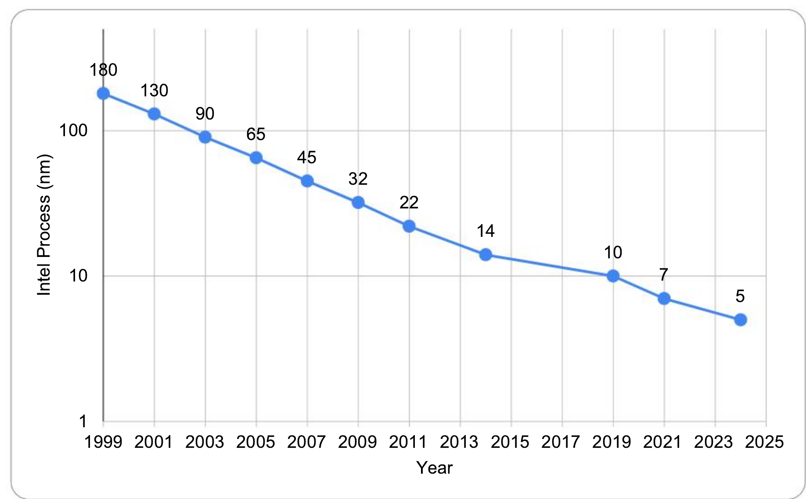

## 谬误与陷阱 {#sec-1-12}

每章都有这样一节，目的是澄清一些流传很广、应当避免的错误观念。我们把这类错误观念称为*谬误*（fallacy）。讨论谬误时，我们尽量给出反例。我们也讨论*陷阱*（pitfall），也就是容易犯的错误。陷阱往往来自对某些原理的推广，而这些原理只在有限的范围内成立。设置这些小节，是为了帮助读者在自己设计计算机时避开这些错误。本章涉及的话题中，错误观念和一犯再犯的错误比比皆是。

**陷阱**　*所有指数定律都必然会放缓。*

最先终结的是 Dennard 缩放。Dennard 在 1974 年观察到，电压和电流应当与晶体管的线性尺寸成正比。动态功耗与 $CV^2f$ 成正比，因此他的观察意味着：CMOS 工艺按比例缩小时，电路可以使用更多的晶体管，工作在更高的频率上，而功耗保持不变。30 年后 Dennard 缩放终结了，原因是阈值电压和漏电流使每个晶体管的功耗有了一个无法再按比例缩小的下限。于是，现代芯片受到功耗的限制，频率基本上不再提高，利用更高的晶体管密度也就越来越昂贵。

接下来放缓的是硬盘。磁盘并没有什么定律，但在过去 30 年里，硬盘的最大面密度（它决定了磁盘容量）每年提高 30% 到 100%。最近十年，每年的提高已不到 5%。每块硬盘容量的增加，主要靠在硬盘里多装几张盘片。

再往后就轮到久负盛名的摩尔定律了。每块芯片上的晶体管数每 1 到 2 年翻一番，已经是一段时间以前的事了。例如，2014 年推出的 DRAM 芯片有 80 亿个晶体管；而直到 2019 年，才有 160 亿个晶体管的 DRAM 芯片投入量产。按照摩尔定律，那时的 DRAM 芯片应当至少有 640 亿个晶体管。

[图 1.24](#fig-1-24) 是 Intel 对 1999 年以来各代新工艺节点推出时间的估计。从 180 nm 到 22 nm，节奏稳定在每 2 年一代；到 14 nm 拉长到 3 年，下一个节点用的时间更长。

[图 1.25](#fig-1-25) 画出了带宽提高幅度随时间的变化，对象既有微处理器和 DRAM（它们受到 Dennard 缩放终结和摩尔定律终结的影响），也有网络和磁盘。从曲线的弯折可以明显看出，工艺改进正在放慢。大约从 1980 年起，微处理器和网络带宽的提高幅度是内存带宽提高幅度的 10 倍以上；内存带宽的提高幅度又差不多是磁盘带宽提高幅度的 10 倍。

{#fig-1-24 width=90%}

**陷阱**　*工艺线宽已经不再对应晶体管的实测宽度。*

大约 2005 年以前，工艺的纳米数是芯片内部一个真实的物理尺寸。后来，传统的平面晶体管到了 20 nm 性能令人失望，于是在同样的几何尺寸下改用 FinFET 晶体管。为了表明基于 FinFET 的新晶体管更好，厂商出于营销考虑，把它改称为 16 nm 工艺，尽管它仍然是同一代工艺。节点编号一旦不再对应某个实测尺寸，命名也就可以随意了。以两条金属线之间的间距为例，台积电 7 nm 工艺是 40 nm，Intel 10 nm 工艺却是 36 nm。因此，Intel 的 10 nm 工艺做出的芯片可能比台积电的 7 nm 工艺还小。所谓 5 nm 及更小的节点能带来多少好处，现在很难预测，因为这些名称已经成了营销用语，而且在仍在生产最先进逻辑芯片的三家公司（Intel、三星和台积电）之间，含义可能并不一致。

。注意，2021 年网络和微处理器的带宽与内存带宽相差 10 倍，内存带宽与磁盘带宽又相差将近 10 倍。](images/ch01/fig-1-25.png){#fig-1-25 width=90%}

**谬误**　*多处理器是灵丹妙药。*

2005 年前后，处理器转向在每块芯片上放多个处理器。这并不是因为出现了什么突破，使并行编程大为简化，或者使多核计算机变得容易制造。之所以转向，是因为 ILP 墙和功耗墙摆在面前，别无选择。每块芯片放多个处理器并不保证功耗更低；设计出一块功耗更高的多核芯片，完全是可能的。多核的潜力仅仅在于：用几个时钟频率较低、效率较高的核，取代一个时钟频率很高、效率很低的核，性能就有可能继续提高。

我们在第 4 章和第 5 章会看到，提高性能现在成了程序员的负担。程序员坐在躺椅上不动一根手指，靠硬件设计者让自己的程序跑得更快，这样的时代已经正式结束。程序员要想让程序一代比一代快，就必须提高程序的并行度。

摩尔定律的通俗说法是「每一代工艺都使性能提高」，现在这一点有一部分要取决于程序员了。

**陷阱**　*成为令人心碎的 Amdahl 定律的牺牲品。*

几乎每一位在一线工作的计算机体系结构设计者都知道 Amdahl 定律。尽管如此，我们几乎每个人都偶尔会在还没有测量某个特性原先的使用情况时，就花大力气去优化它。直到总体加速比令人失望，我们才想起来，在花这么大力气改进它之前，本该先测量一下！

**陷阱**　*单点故障。*

第 53 页用 Amdahl 定律计算了可靠性的改进，结果表明，可信性不会比链条上最薄弱的一环更强。正如那个例子所示，无论把电源做得多么可信，那唯一的一个风扇都会限制磁盘子系统的可靠性。由 Amdahl 定律的这一观察，产生了容错系统的一条经验法则：确保每个部件都有冗余，这样任何单个部件失效都不会使整个系统瘫痪。第 6 章介绍 WSC 内部怎样用一个软件层来避免单点故障。

**谬误**　*能提高性能的硬件改进也能提高能效，最坏也不会增加能耗。*

Esmaeilzadeh 等人（2011）在一台 2.67 GHz 的 Intel Core i7 上只用一个核，打开 Turbo 模式（见[1.5 节](#sec-1-5)），测量了 SPEC2006。时钟频率提高到 2.94 GHz（即提高到 1.10 倍）时，性能提高到 1.07 倍，但 i7 消耗的焦耳数增加到 1.37 倍，瓦时数增加到 1.47 倍！工程师在给[图 1.23](#fig-1-23) 中的两台服务器运行 SPECPower 基准测试程序时关掉了 Turbo 模式，原因也许就是这样的能效低下。

**谬误**　*基准测试程序永远有效。*

一个基准测试程序能否很好地预测真实性能，受几个因素影响，其中有些因素会随时间变化。一个很重要的因素，是基准测试程序抵御「基准测试工程」（benchmark engineering）或者说「基准营销」（benchmarketing）的能力。一个基准测试程序一旦标准化并流行起来，人们就会面临巨大的压力，要通过针对性的优化或者对运行规则的激进解读来提高它的性能。短小的核心程序（kernel），或者大部分时间都花在少量代码上的程序，尤其容易受到这种影响。

例如，尽管初衷再好不过，最初的 SPEC89 基准测试程序集里还是收入了一个叫 matrix300 的小核心程序，它由 8 个不同的 $300 \times 300$ 矩阵乘法组成。这个核心程序 99% 的执行时间都花在一行代码上（见 SPEC，1989）。IBM 的一个编译器优化了这个内层循环（用的是一种叫分块的好方法，第 2 章和第 4 章会讨论），性能提高到这个编译器上一个版本的 9 倍！这个基准测试程序测的是编译器调优的效果，它当然不能很好地反映总体性能，也不能反映这项优化通常的价值。

如果我们忽视历史，就可能不得不重蹈覆辙。SPEC Cint2006 十年没有更新，编译器开发者有充足的时间针对这套程序打磨自己的优化器。在一款 Intel 微处理器上，SPEC Cint2006 中除 libquantum 以外的所有基准测试程序，得分比值都落在 22 到 78 之间。libquantum 却快了 7300 倍！这个「奇迹」来自 Intel 编译器的优化：它把代码自动并行化到所有核上，还用位压缩（bit packing）来优化内存。位压缩把多个取值范围很窄的整数紧挨着存放在一起，从而节省内存空间，进而节省内存带宽。

为了说明基准测试程序寿命之短，第 43 页的[图 1.19](#fig-1-19) 列出了 SPEC 各个版本中全部 82 个基准测试程序的状况；SPEC89 的程序中只有 gcc 一个留到了现在。令人吃惊的是，SPEC2000 及更早版本的全部程序中，大约 70% 在下一个版本中就被淘汰了。

**谬误**　*磁盘的额定平均无故障时间是 1 200 000 小时，差不多 140 年，所以磁盘实际上永远不会坏。*

磁盘厂商目前的营销做法可能会误导用户。这样的 MTTF 是怎么算出来的呢？在早期阶段，厂商会把几千块磁盘放进一个房间，让它们运行几个月，然后统计坏了多少块。他们计算 MTTF 的方法，是用这些磁盘累计工作的总小时数除以坏掉的块数。

一个问题是，这个数字远远超过了磁盘的寿命，而磁盘寿命通常按 5 年即 43 800 小时计算。为了让这么大的 MTTF 讲得通，磁盘厂商辩称，这个模型对应的是这样一位用户：他买了一块磁盘，此后每 5 年（磁盘的设计寿命）换一块新的。按照他们的说法，如果许多客户（以及他们的曾孙辈）在接下来的一个世纪里都这样做，那么平均要换 27 块磁盘才会遇到一次故障，也就是大约 140 年。

更有用的度量是磁盘失效的百分比，即年故障率（见[1.7 节](#sec-1-7)）。假设有 1000 块 MTTF 为 1 000 000 小时的磁盘，每天 24 小时使用。如果每坏一块就换上一块可靠性特征相同的新磁盘，那么一年（8760 小时）内会坏掉的磁盘数为

$$
\begin{aligned}
\text{失效磁盘数} &= \frac{\text{磁盘数} \times \text{时间长度}}{\text{MTTF}} \\
&= \frac{1000\ \text{块磁盘} \times 8760\ \text{小时/块}}{1\,000\,000\ \text{小时/次失效}} = 9
\end{aligned}
$$

换句话说，每年有 0.9% 的磁盘会坏，5 年寿命内会坏 4.5%。

而且，厂商给出这些很高的数字时，假定温度和振动都在有限的范围内。一旦超出这个范围，这些数字就失去了意义。一项针对实际环境中磁盘驱动器的调查（Gray 和 van Ingen，2005）发现，每年有 3% 到 7% 的驱动器失效，相当于 MTTF 约为 125 000～300 000 小时。另一项规模更大的研究发现，磁盘的年故障率为 2% 到 10%（Pinheiro 等，2007）。因此，实际使用中的 MTTF 大约比厂商给出的 MTTF 差 2～10 倍。

**谬误**　*峰值性能能反映实测性能。*

峰值性能唯一普遍成立的定义是「计算机保证不会超过的性能水平」。[图 1.26](#fig-1-26) 给出了四个程序在四台多处理器上达到的峰值性能百分比，从 5% 到 58% 不等。差距这么大，而且随基准测试程序的不同变化很大，因此峰值性能一般不能用来预测实测性能。

{#fig-1-26 width=90%}

**陷阱**　*故障检测可能降低可用性。*

这个陷阱听起来有些讽刺。它之所以存在，是因为计算机硬件中有相当多的状态，并不总是对正确运行至关重要。例如，转移预测器出错并不致命，因为受影响的只可能是性能。

在激进地利用 ILP 的处理器中，并不是所有操作都是程序正确执行所必需的。Mukherjee 等人（2003）发现，在 SPEC2000 基准测试程序中，可能处在关键路径上的操作不到 30%。

程序也是如此。如果一个寄存器在程序中是「死」的，也就是说，程序再次读它之前会先写它，那么这个寄存器出错就无关紧要。如果在死寄存器中检测到瞬时故障就让程序崩溃，可用性就会无谓地降低。

2000 年，Oracle 的 Sun Microsystems 部门就落入过这个陷阱。它的 Sun E3000 到 Sun E10000 系统中，L2 Cache 带有奇偶校验，但没有纠错功能。他们用来构建 Cache 的 SRAM 有间歇性故障，奇偶校验能把它检测出来。如果 Cache 中的数据没有修改过，处理器只需从 Cache 中重新读一遍数据。但设计者没有用纠错码（ECC）来保护 Cache，因此脏数据出错时，操作系统只能报告错误，让程序崩溃。现场工程师检查后发现，90% 以上的情况根本没有问题。

为了降低这类错误的频率，Sun 修改了 Solaris 操作系统，用一个进程主动把脏数据写回内存，以此来「擦洗」（scrub）Cache。由于处理器芯片没有足够的引脚来增加 ECC，针对脏数据唯一的硬件办法，是把片外 Cache 复制一份，用没有奇偶错的那一份来纠正错误。

陷阱就在于只检测故障，却不提供纠正故障的机制。这些工程师大概不会再设计片外 Cache 不带 ECC 的计算机了。

**陷阱**　*高估计算机技术对碳排放的影响。*

全球气候变化事关重大，考虑信息技术在其中的作用无疑很重要。但我们必须把数字算对，一是为了确保解决的是最重要的问题，二是为了维护我们所提建议的可信度。具有讽刺意味的是，计算一旦出错，结果反而可能更有新闻价值，于是受到大量关注。即使后来有文章纠正了记录，也得不到同样的关注，于是这些有缺陷的「伪事实」（factoid）就在互联网上自行流传下去。

「Brandolini 定律」幽默地道出了这种讽刺：*驳斥*错误信息所需的精力，是*制造*错误信息所需精力的 10 倍。

Koomey 和 Masanet 指出了估算排放时的四个常见错误（Koomey 和 Masanet，2021）：

1. 忽视、误解或错误描述关键参数随时间的变化。
2. 假定计算领域的*短期*变化必然导致用电量立即发生成比例的变化。
3. 信息技术变化极快，连预测未来几年都有很大的不确定性，却仍要作长期预测。
4. 只根据信息技术生态系统中一个部分的趋势，就得出宽泛的结论。

下面是落入这些陷阱的三个例子：

* 2010 年到 2018 年，云数据中心的工作负载增加到 26 倍，估计的用电量增加到 5 倍。有人据此预言云计算会带来可怕的后果。但是，尽管云计算增长迅速，全球*所有*数据中心的实际能耗只增长了不到 10%。这两个观察之所以都成立，是因为 2010 年到 2018 年间，大量计算从效率相对较低的本地数据中心转移到了效率高得多的云数据中心（Masanet 等，2020）。这个估计犯了上面的第四个错误。
* 报纸声称「看 30 分钟 Netflix 产生的排放 [1.6 kg CO~2~e] 相当于开车将近 4 英里」。更准确的估计是 36 克 CO~2~e，只有前者的 1/45（Kamiya，2020）。这次高估主要可以用第一个错误，即忽视关键参数的变化来解释。
* 报纸报道说，「训练一个深度神经网络模型的排放是一辆汽车整个寿命期排放 [284 019 kg] 的 5 倍」。实际数字只有 2.4 kg CO~2~e，只有前者的 1/120 000（Patterson 等，2022）。第 7 章的谬误与陷阱一节会解释这个有缺陷的高估是怎样推算出来的，它主要是落入了四个常见错误中的第一个。
