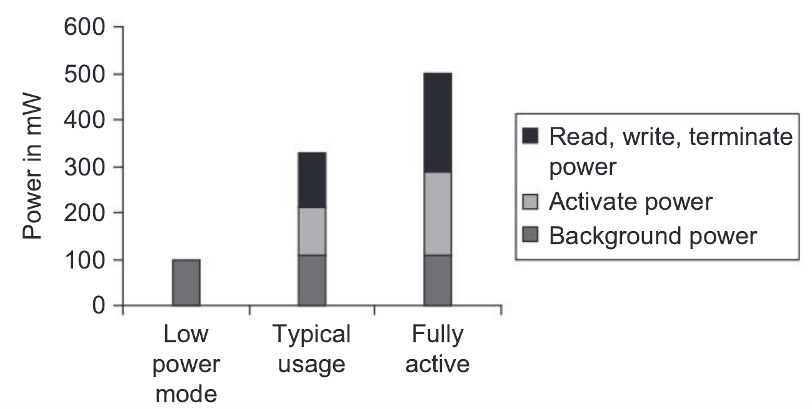
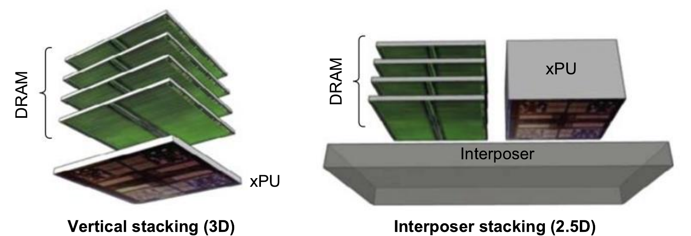

## 存储技术及其优化 {#sec-2-2}

> ……真正让计算机站稳脚跟的，是一项发明：一种可靠的存储器，也就是磁芯存储器。……它的价格合理，工作可靠；正因为可靠，它后来才能做得很大。（第 209 页）
>
> ——Maurice Wilkes，《一位计算机先驱的回忆》（*Memoirs of a Computer Pioneer*，1985）

本节介绍构建存储层次（具体说就是构建 Cache 和主存）所用的技术，主要有三种：

* SRAM（静态随机访问存储器），用于 Cache；
* DRAM（动态随机访问存储器），用于主存；
* Flash，用于非易失性存储。

Flash 是用来替代硬盘的，但它的特性建立在半导体技术之上，所以也放在本节介绍。

Cache 失效时，数据要尽快从主存调进来，这就要求存储器有很高的带宽（HBM）。提高带宽的办法有两种：一是把构成主存的众多 DRAM 芯片组织成多个存储体（bank）和多个 rank，二是加宽存储总线；两种办法也可以同时采用。

为了跟上现代处理器的带宽需求，存储技术的创新已经深入到 DRAM 芯片内部。本节介绍的就是存储器芯片内部的技术。在此之前，先说明一个术语：*访问时间*，即从发出读请求到所需的字送达所经过的时间。Flash 和 DRAM 都支持突发传输，采用突发传输时，传送整个块的时间可能比取得块中第一部分数据的时间长。

1975 年以来，几乎所有计算机都用 DRAM 作主存、用 SRAM 作 Cache，其中一到三级 Cache 与 CPU 集成在同一块处理器芯片上。今天，所有 PMD 和笔记本电脑，以及大多数台式机，都已用 Flash 取代磁盘驱动器；许多服务器则把 Flash 和磁盘驱动器结合起来使用。

### SRAM 技术 {-}

SRAM 中的 S 代表*静态*（static）。DRAM 是动态电路，读出数据后必须写回，不过只有下一个请求访问同一个存储体时，才会遇到这段延迟。SRAM 则不同，它每位通常用 6 个晶体管，读出时信息不会受到干扰；在待机模式下，只需极少的功耗就能保持电荷。

早期大多数台式机和服务器用 SRAM 芯片构成一级、二级或三级 Cache，今天三级 Cache 都已集成到处理器芯片上。高端服务器芯片采用芯粒时，可能多达 60 个核、100 MiB 以上的 Cache；采用堆叠晶片时，可能超过 100 个核、1 GB 以上的 Cache。这类系统通常为每块处理器芯片配置 256～512 GiB 的 DRAM。大容量的片上三级 Cache，访问时间一般是二级 Cache 的 4 到 8 倍；即便如此，DRAM 的访问时间通常仍至少是 L3 的 5 倍。

片上 Cache 所用的 SRAM，宽度通常与 Cache 块大小一致，每个块的 tag与块并排存放，因此一个周期就能读出或写入一整块。把失效后取回的数据写入 Cache，或者把必须逐出的块写回时，这一点特别有用。Cache 的访问时间（不计组相联 Cache 中的命中检测和选择）与块数成正比；能耗则取决于两方面：一是 Cache 的位数，决定漏电造成的静态功耗；二是块数，决定每次访问产生的动态功耗。为了提高带宽、改善访问时间并降低功耗，许多多级 Cache 采用多存储体组织，这个问题留到 [2.3 节](#sec-2-3)讨论。

### DRAM 技术 {-}

**地址复用。** 早期 DRAM 的容量不断增大，要把所需的地址线全部引出，封装成本就成了问题。解决办法是复用地址线，使地址引脚数减少一半。[图 2.3](#fig-2-3) 是 DRAM 的基本组成。地址分两半先后送出：前一半在*行访问选通*（RAS）期间送出，后一半在*列访问选通*（CAS）期间送出。这两个名称来自芯片的内部组成：存储器是一个按行、列寻址的矩形阵列。

{#fig-2-3 width=90%}

**预充电与写回。** DRAM 中的 D 代表*动态*（dynamic），这一特性给 DRAM 带来了另一项要求。为了在一块芯片上放下更多的位，DRAM 只用一个晶体管存储一位，这个晶体管实际上起电容的作用。这带来两个后果。第一个后果是，检测电荷的读出线必须预充电，使它处于逻辑 0 和 1 的「中间」，这样单元中存储的少量电荷才能让读出放大器检测出 0 或 1。读出时，整行先放进行缓冲，再由 CAS 信号选出其中一部分，从 DRAM 读出。读一行会破坏这一行的信息，所以这一行不再需要时必须写回。写回与其他操作重叠进行，但在早期 DRAM 中，这意味着读新的一行之前要等的周期时间，比读一行并访问其中一部分的时间还长。

**刷新。** 第二个后果是，单元中的电荷会逐渐泄漏（假定这段时间没有读写它），为了不丢失信息，每一位都必须定期「刷新」。好在读出一行再写回，就能同时刷新这一行的所有位。因此，存储系统中的每块 DRAM 都必须在一定的时间窗口（例如 64 ms）内访问一遍所有行。DRAM 控制器和 DRAM 芯片中都有定期刷新的硬件。

刷新意味着存储系统偶尔不可用，因为这时它正在向每块芯片发出刷新信号。刷新一行需要一次行激活和一次预充电，预充电的同时把这一行写回；由于不需要列选择，这大约是取一个数据所需时间的 2/3。DRAM 的每一行都要这样刷新一遍。DRAM 的存储阵列在概念上是正方形的，因此一次刷新的步数通常是 DRAM 容量的平方根。DRAM 设计者力求让刷新时间不超过总时间的 5%。前面介绍主存时，仿佛它像瑞士的火车一样，始终严格按时刻表送达货物。实际上，使用 SDRAM 时，DRAM 控制器（通常在处理器芯片上）会尽量不打开新行，并尽可能使用块传输，以此优化访问；刷新又增加了一个不可预测的因素。

**容量与性能。** Amdahl 提出过一条经验法则：为了保持系统平衡，存储容量应当随处理器速度线性增长，例如 1000 MIPS 的处理器应当配 1000 MiB 内存。处理器设计者靠 DRAM 来满足这一需求。过去，人们预期 DRAM 容量每 3 年提高到原来的 4 倍，即每年提高 55%。但 DRAM 性能的增长要慢得多，主要原因是行访问时间缩短得不多，而行访问时间又受功耗限制、单个存储单元的电荷容量（也就是单元尺寸）等因素制约。在详细讨论这些性能趋势之前，先介绍 20 世纪 90 年代中期以来 DRAM 发生的几项重大变化。

### 在 DRAM 芯片内部提高存储性能：SDRAM {-}

**同步接口与突发传输。** 很早的 DRAM 就带有缓冲，可以对同一行做多次列访问，不必重新访问行。但这些 DRAM 采用异步接口，每次列访问和传送都要付出与控制器同步的开销。20 世纪 90 年代中期，设计者给 DRAM 接口加上时钟信号，重复的传送就不再承担这项开销，这就是*同步 DRAM*（SDRAM）。除了减少开销，SDRAM 还增加了突发传输模式，不必指定新的列地址就能连续传送多次。例如，让 DRAM 进入突发模式后，不发送任何新地址，就能完成 8 次或更多次 16 位传送。有了突发传输，一连串随机访问所得到的带宽，与访问一个数据块所得到的带宽相差很大。

**更宽的接口与 DDR。** DRAM 密度提高后，要从存储器获得更多带宽就成了问题，解决办法之一是把 DRAM 做宽。起初 DRAM 提供 4 位的传送模式；到 2024 年，DDR DRAM 的总线最多有 4、8、16 或 32 位。21 世纪初又出现了一项创新，即*双倍数据率*（DDR）：DRAM 在存储器时钟的上升沿和下降沿都传送数据，峰值数据率因此提高到原来的 2 倍。

**存储体。** SDRAM 还引入了*存储体*，用来帮助功耗管理、改善访问时间，并允许对不同存储体交叉访问和重叠访问。不同存储体的访问可以相互重叠；每个存储体都有自己的行缓冲，因此不同存储体中可以同时打开多行。在 DRAM 内部设置多个存储体，实际上是给地址又加了一段，地址于是由存储体号、行地址和列地址三部分组成。如果送来的地址指定某个存储体中的一个新行，就必须先打开这一行，这会带来额外的延迟。现代存储控制接口完全负责管理存储体和行缓冲，后续访问如果指定的是某个存储体中已经打开的行，只需发送列地址，访问很快就能完成。

**一次访问的过程。** 开始一次新的访问时，DRAM 控制器发送存储体号和行号。这条命令在 SDRAM 中称为 *Activate*（激活），以前称为 RAS，即行选择。它打开该行，把整行读入缓冲。随后控制器发送列地址，SDRAM 根据请求是单项请求还是突发请求，传送一个或多个数据项。访问新行之前，存储体必须先预充电。新行如果在同一个存储体中，就要承受预充电延迟；如果在另一个存储体中，关闭原来的行和预充电就可以与访问新行重叠进行。在 SDRAM 中，上述每个命令周期都占整数个时钟周期。

**发展趋势。** 1980 年到 1995 年，DRAM 按摩尔定律发展，容量每 18 个月翻一番，即每 3 年提高到原来的 4 倍。20 世纪 90 年代中期到 2010 年，容量增长放慢，大约每 26 个月翻一番。此后，容量用了 6 年（2010—2016 年）才再翻一番，下一次翻番直到 2024 年底才出现。[图 2.4](#fig-2-4) 给出了各代 DDR SDRAM 的容量和访问时间。从 DDR1 到 DDR3，访问时间缩短为原来的大约 1/3，相当于每年改进约 7%。DDR4 和 DDR5 在功耗和带宽上比 DDR3 有所改进，访问延迟则与 DDR3 相近。

[图 2.4　各代 DDR SDRAM 的容量和访问时间，按投产年份排列。访问时间指随机访问一个存储字的时间，并假定必须打开一个新行。新行在另一个存储体中时，假定该存储体已经预充电；行没有打开时，需要预充电，访问时间也更长。存储体越多，隐藏预充电时间的能力越强。DDR4 SDRAM 原先预计 2014 年推出，直到 2016 年初才投产。注意，DDR5 最初的容量与 DDR4 相同，但到 2024 年，它每块芯片的密度已是 DDR4 的 4 倍。]{#fig-2-4 .caption}

| 投产年份 | 芯片容量 | DRAM 类型 | 最好情况（不需预充电）：RAS 时间（ns） | 最好情况（不需预充电）：CAS 时间（ns） | 最好情况（不需预充电）：合计（ns） | 需要预充电：合计（ns） |
|---|---|---|--:|--:|--:|--:|
| 2000 | 256M bit | DDR1 | 21 | 21 | 42 | 63 |
| 2002 | 512M bit | DDR1 | 15 | 15 | 30 | 45 |
| 2004 | 1G bit | DDR2 | 15 | 15 | 30 | 45 |
| 2006 | 2G bit | DDR2 | 10 | 10 | 20 | 30 |
| 2010 | 4G bit | DDR3 | 13 | 13 | 26 | 39 |
| 2016 | 8G bit | DDR4 | 13 | 13 | 26 | 39 |
| 2021 | 8G bit | DDR5 | 13 | 13 | 26 | 39 |

从[图 2.4](#fig-2-4) 可以看出，DDR 是一系列标准：

* DDR2 把电压从 DDR1 的 2.5 V 降到 1.8 V，功耗随之降低，时钟频率也提高到 266、333 和 400 MHz；
* DDR3 把电压降到 1.5 V，最高时钟频率为 800 MHz；
* DDR4 原先预计 2014 年推出，实际到 2016 年初才大批量出货，电压降到 1.2 V，预期最高时钟频率为 1600 MHz；
* DDR5 使用 1.1 V 电压，直到 2022 年才达到量产规模；
* DDR6 看来要到 2025 年才能上市。

**DIMM 与命名。** DDR 出现以后，访问时间很难再改进，存储器设计者越来越关注带宽。更宽的 DRAM、突发传输和 DDR 共同推动了存储带宽的快速提高。DRAM 通常装在称为*双列直插存储模块*（DIMM）的小电路板上出售，每个 DIMM 上有 4～16 块 DRAM 芯片；用于台式机和服务器时，通常组织成 8 字节宽（另加 ECC）。DDR SDRAM 封装成 DIMM 后，按 *DIMM* 的峰值带宽命名，这很容易让人混淆。例如，DIMM 型号 PC3200 来自 200 MHz × 2 × 8 字节 = 3200 MiB/s，DIMM 上装的是 DDR SDRAM 芯片。更容易混淆的是，芯片本身不按时钟频率命名，而按*每秒传送的位数*命名，所以 200 MHz 的 DDR 芯片称为 DDR400。[图 2.5](#fig-2-5) 列出了 I/O 时钟频率、每块芯片每秒传送次数、芯片带宽、芯片名称、DIMM 带宽和 DIMM 名称之间的关系。

[图 2.5　2024 年 DDR DRAM 和 DIMM 的时钟频率、带宽和名称。注意各列数值之间的关系：第 3 列是第 2 列的 2 倍，第 4 列的 DRAM 芯片名称取自第 3 列的数值；第 5 列是第 3 列的 8 倍，取整后用作 DIMM 名称。DDR5 在 2022 年首次得到大量使用。]{#fig-2-5 .caption}

| 标准 | I/O 时钟频率 | 每秒传送次数（M） | DRAM 名称 | 每个 DIMM 的带宽（MiB/s） | DIMM 名称 |
|---|--:|--:|---|--:|---|
| DDR1 | 133 | 266 | DDR266 | 2128 | PC2100 |
| DDR1 | 150 | 300 | DDR300 | 2400 | PC2400 |
| DDR1 | 200 | 400 | DDR400 | 3200 | PC3200 |
| DDR2 | 266 | 533 | DDR2-533 | 4264 | PC4300 |
| DDR2 | 333 | 667 | DDR2-667 | 5336 | PC5300 |
| DDR2 | 400 | 800 | DDR2-800 | 6400 | PC6400 |
| DDR3 | 533 | 1066 | DDR3-1066 | 8528 | PC8500 |
| DDR3 | 666 | 1333 | DDR3-1333 | 10,664 | PC10700 |
| DDR3 | 800 | 1600 | DDR3-1600 | 12,800 | PC12800 |
| DDR4 | 1333 | 2666 | DDR4-2666 | 21,300 | PC21300 |
| DDR5 | 2400 | 4800 | DD5-4800 | 38,400 | PC38400 |

#### 降低 SDRAM 的功耗 {-}

动态存储器芯片的功耗由两部分组成：一是读写时的动态功耗，二是静态功耗（即待机功耗）。两者都取决于工作电压。DDR5 SDRAM 的工作电压已降到 1.1 V，功耗比 DDR4 略低，比 DDR3 降低约 25%。增加存储体也能降低功耗，因为每次只读出一个存储体中的行。

除此之外，近来所有的 SDRAM 都支持*掉电模式*：通知 DRAM 忽略时钟，就进入这种模式。掉电模式下，SDRAM 除了内部自动刷新以外全部停止工作；如果没有自动刷新，在掉电模式下停留的时间一旦超过刷新时间，存储器的内容就会丢失。[图 2.6](#fig-2-6) 给出了一块 2 GB DDR3 SDRAM 在三种情况下的功耗。从低功耗模式返回所需的确切延迟因 SDRAM 而异，典型值是 200 个 SDRAM 时钟周期。此外还有专为便携设备设计的低功耗 DDR（LPDDR1～5）。与 DIMM 相比，LPDDR 的电源电压更低、时钟更快，但每个通道上能直接连到 CPU 的存储器芯片较少。

{#fig-2-6 width=75%}

图形数据 RAM（GDRAM，即 GDDR1～6）以 SDRAM 为基础，但接口更宽、时钟频率更高，因此带宽是 SDRAM 的 2～5 倍。时钟频率高，限制了每个存储通道上 GDRAM 的数量，而且与 LPDDR 一样需要直接连接。2024 年，GDRAM 正在被采用 HBM 的新设计取代，HBM 是下一小节的主题。

这些改进降低了 DRAM 的功耗，但访问时间和功耗主要都取决于访问芯片外部的代价。从[图 2.1](#fig-2-1) 可以看到，访问片外 DRAM 的时间是访问小型 L1 Cache 的 50 到 100 倍，是访问大型 L3 的 5 到 10 倍。能耗的比例与此相仿：访问一次片外 DRAM 的能耗大约是访问小型 L1 的 100 倍，是访问大型 L3 的 10 到 20 倍。片外访问既慢又耗能，这就促使人们采用大容量的末级 Cache（LLC，Last-Level Cache），并用各种技术优化它们的性能。

### 封装创新：堆叠或嵌入式 DRAM 或 SRAM {-}

DRAM 最近的一项创新在封装上，而不在电路上：把多块 DRAM 叠成堆栈，嵌入与处理器相同的封装中。（*嵌入式 DRAM* 一词也指把 DRAM 做在处理器芯片上的设计。）DRAM 和处理器放进同一个封装有两点好处：一是缩短了 DRAM 与处理器之间的延迟，访问延迟随之降低；二是处理器和 DRAM 之间可以有更多、更快的连接，带宽有可能提高。这种技术称为*高带宽存储器*（HBM）。

HBM 的主要用法是借助一块含有连线的基板，即*中介层*（interposer），把 DRAM 堆栈紧挨着 CPU 放在同一个封装里。假定 CPU 有多个存储通道，就可以放 4 个堆栈（每边一个），每个堆栈最多叠 8 块 DRAM。采用专门版本的 SDRAM 和 4 个堆栈，一个封装可以容纳 32 GiB 存储器，数据传输率达到 4 TB/s。由于芯片必须专门为堆叠而制造，早期的应用大多在高端服务器、GPU 和领域专用体系结构（DSA）中。[图 2.7](#fig-2-7) 给出了中介层方式，以及另一种把芯片直接叠在处理器上面的结构。[图 2.7](#fig-2-7) 中的 3D 结构面临散热和电噪声两项挑战，到目前为止，垂直堆叠唯一的用途是把用作 L3 的 SRAM 叠在处理器上面。

{#fig-2-7 width=90%}

在某些应用中，封装内部也许能放下足够的 DRAM，满足应用的全部需要。例如，一种用作专用集群节点的 NVIDIA GPU 正在用 HBM 开发；在较高端的应用中，HBM 很可能成为 GDDR5 的后继者。有些情况下或许可以用 HBM 作主存，但成本限制和散热问题目前使它还不能用于某些嵌入式应用。下一节将讨论把 HBM 用作额外一级 Cache，或用作额外的主存单元的可能性。

### Flash 存储器 {-}

Flash 存储器是一种 EEPROM（电可擦除可编程只读存储器），通常只读，但可以擦除。Flash 的另一项关键特性是不加电也能保存内容。本书重点讨论 NAND Flash。与 NOR Flash 相比，NAND Flash 密度更高，更适合用作大容量非易失性存储器；缺点是只能顺序访问，写入也较慢，原因见下文。

在 PMD 和大多数台式机中，Flash 用作二级存储，作用相当于服务器中的磁盘。此外，大多数 PMD 的 DRAM 容量有限，Flash 还可能充当存储层次中的一级。台式机或服务器的主存可能是 PMD 的 10～100 倍，Flash 在其中承担这一角色的程度要小得多。

Flash 的体系结构与标准 DRAM 很不相同，特性也不同。最重要的区别有以下几点：

1. **读出。** 读 Flash 是顺序的，每次读出一整页，一页可以是 512 字节、2 KiB 或 4 KiB。NAND Flash 访问随机地址的第一个字节延迟很长（约 25 μs），此后能以约 40 MiB/s 的速度送出这一页的其余部分。相比之下，DDR5 SDRAM 取得第一个字节约需 40 ns，此后能以 5 GiB/s 的速度传送这一行的其余部分。传送 2 KiB 时，NAND Flash 约需 75 μs，DDR SDRAM 不到 450 ns，Flash 所需时间是 DRAM 的 150 倍以上。但与磁盘相比，从 Flash 读 2 KiB 的速度是磁盘的 300 到 500 倍。这些数字说明了为什么 Flash 不能替代 DRAM 作主存，却在许多系统中取代了磁盘：两者每位的成本已经接近，容量较小时尤其如此。

2. **擦除与写入。** Flash 存储器改写之前必须先擦除（flash（闪速）这个名称就来自「闪电式」的擦除过程），而且只能按块擦除，不能单独擦除某个字节或字。所以向 Flash 写数据时必须凑齐一整块：要么整块都是新数据，要么把待写数据与块中其余内容合并。写入速度只有 SDRAM 的约 1/1500，是磁盘的约 8～15 倍。

3. **非易失与低功耗。** Flash 存储器是非易失性的，即不加电也能保存内容；不读不写时，它的功耗也低得多（待机模式下不到一半，完全不活动时为零）。

4. **写入次数有限。** 每个块的写入次数有限，通常至少为 100,000 次。系统让写入的块均匀分布在整个存储器中，就能使 Flash 存储系统的寿命最长。这种技术称为*写均衡*（write leveling），由 Flash 存储器控制器负责。

5. **成本。** 高密度 NAND Flash 比 SDRAM 便宜，但比磁盘贵：Flash 大约是每 GiB 0.12～0.20 美元，SDRAM 是每 GiB 5 到 10 美元，磁盘是每 GiB 0.02～0.05 美元。过去 5 年里，Flash 成本下降的速度几乎是磁盘的 2 倍。

与 DRAM 一样，Flash 芯片也带有冗余块，有少量缺陷的芯片仍然可以使用；块的重映射在 Flash 芯片内部完成。Flash 控制器负责页的传送，提供页的缓存，并负责写均衡。

高密度 Flash 的快速进步，对低功耗 PMD 和笔记本电脑的发展至关重要，也大大改变了台式机和大型服务器：台式机越来越多地使用固态盘，大型服务器则常常把磁盘和基于 Flash 的存储结合使用。

### 相变存储器技术 {-}

几十年来，相变存储器（PCM）一直是活跃的研究领域。这种技术通常用一个小加热元件，使块状衬底在晶态和非晶态之间转换，两种状态的电阻特性不同。衬底上覆盖着一张二维网格，每一位对应网格中的一个交叉点。读出时检测 x 点与 y 点之间的电阻（PCM 因此又称*忆阻器*，memristor）；写入时施加电流，改变材料的相态。PCM 不需要晶体管之类的有源器件，因此成本应当比 NAND Flash 低，密度应当比 NAND Flash 高。

2017 年，美光和 Intel 开始供应基于这种技术的 Xpoint 存储器芯片。与 Flash 相比，PCM 有两大优势：一是随机写性能更好，因为不需要擦除步骤；二是写入寿命可能更长。读延迟比 Flash 略好。但由于「谬误与陷阱」一节将要讨论的原因，PCM 没有形成发展势头，至少目前已基本被搁置。

### 提高存储系统的可信性 {-}

**硬错误与软错误。** Cache 和主存容量很大，无论在制造过程中还是在运行期间，出错的可能性都大大增加。按成因，错误分为两类：

* 电路改变引起、能够重复出现的错误，称为*硬错误*或*永久性故障*。硬错误可能在制造时产生，也可能由运行期间的电路改变引起（例如 Flash 存储单元经多次写入后失效）。所有 DRAM、Flash 存储器和大多数 SRAM 在制造时都带有备用行，通过编程用备用行替换有缺陷的行，就能容忍少量制造缺陷。
* 单元内容的改变（而不是电路的改变）引起的动态错误，称为*软错误*或*瞬时故障*。如果没有某种形式的错误检测，这类错误就会成为静默数据错误，[第 1 章](#ch-fundamentals)讨论过这一点。

**奇偶校验与 ECC。** 动态错误可以用奇偶校验位检测，也可以用纠错码（ECC）检测并纠正。指令 Cache 是只读的，用奇偶校验就够了；较大的数据 Cache 和主存则用 ECC，既能检测错误，又能纠正错误。奇偶校验只需 1 位开销，就能检测出一串位中的单个错误；但它检测不出多位错误，这类错误会成为静默错误，所以一个奇偶校验位保护的位数必须有限，典型比例是每 8 个数据位配 1 个奇偶校验位。ECC 每 64 个数据位付出 8 位开销，能检测 2 个错误并纠正 1 个错误。ECC 在 DDR5 中已成为标准配置。

**Chipkill。** 在规模非常大的系统中，出现多位错误以及单块存储器芯片完全失效的可能性都不容忽视。为了解决这个问题，IBM 推出了 Chipkill，许多规模非常大的系统，如 IBM 服务器和谷歌集群，都使用这项技术（Intel 把自己的版本称为 SDDC）。Chipkill 的原理与磁盘所用的 RAID 方法类似：把数据和 ECC 信息分散存放，单块存储器芯片完全失效时，可以用其余芯片重建丢失的数据。按照 IBM 的分析，假定一台服务器有 10,000 个处理器，每个处理器配 4 GiB 内存，那么运行 3 年中出现的不可恢复错误如下：

* 只用奇偶校验：约 90,000 次，即每 17 分钟发生一次不可恢复（或未检测出）的故障。
* 只用 ECC：约 3500 次，即大约每 7.5 小时发生一次未检测出或不可恢复的故障。
* Chipkill：大约每 2 个月发生一次未检测出或不可恢复的故障。

换个角度，也可以问：要达到 Chipkill 那样的错误率，最多能保护多少台服务器（每台 4 GiB）？只用奇偶校验时，即使只有一个处理器的服务器，不可恢复错误率也高于一个由 10,000 台服务器组成、采用 Chipkill 保护的系统。只用 ECC 时，17 台服务器的系统，故障率就与 10,000 台服务器的 Chipkill 系统大致相同。因此，仓库级计算机中的 50,000～100,000 台服务器必须采用 Chipkill（见第 6 章 6.8 节）。
