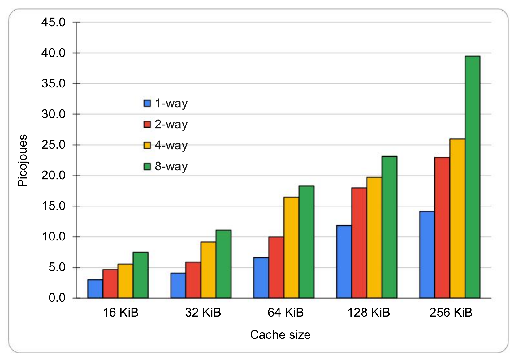
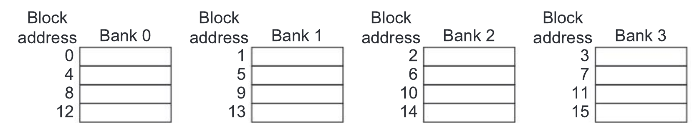
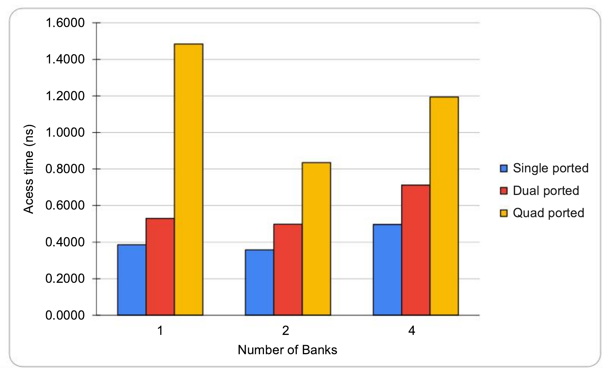

## 存储层次的十种高级性能优化 {#sec-2-3}

前面的平均访存时间公式给出了衡量 Cache 优化的三个指标：命中时间、失效率和失效开销。结合近年来的发展趋势，我们再加上两个指标：Cache 带宽和功耗。按这 5 个指标，本节要讨论的 10 种高级存储系统优化可以分为 5 类：

1. *降低命中时间和功耗*：采用容量较小的 Cache，命中时间和功耗都能降低，代价是命中率下降。采用多个存储体也能降低命中时间和功耗，这在容量较大的 L2 和 L3 Cache 中尤为明显。
2. *提高 Cache 带宽*：包括流水化 L1 Cache、多体 Cache 和非阻塞 Cache。这几种技术对功耗的影响各不相同；如果存储系统支持多个未完成的失效，它们还可能降低失效开销。
3. *降低失效开销*：包括关键字优先和合并写缓冲，这两种优化对功耗影响很小。此外，采用多个存储体和 HBM 存储器可以缩短从存储器访问一个块的延迟，无论是访问单个块还是并行访问多个块，失效开销都能因此降低。
4. *降低失效率*：包括编译器优化和相联度。编译时所做的任何改进，显然都能降低功耗。采用组相联会使命中时间略有增加，但能降低失效率。优化组相联 Cache 的替换策略，也可能降低失效率。
5. *利用并行降低失效开销或失效率*：包括硬件预取和编译器预取。这类优化通常会增加功耗，主要原因是预取来的数据有一部分没有用上。

总的来说，按这个顺序往下，所需硬件越来越复杂。另外，有几种优化需要复杂的编译器技术，有一种要依靠 HBM。本节最后在[图 2.17](#fig-2-17) 中汇总这 10 种技术的实现复杂度和性能收益。其中比较简单的几种只作简要介绍，其余的则要多讲一些。

### 第一种优化：采用虚拟索引和组相联的流水化 L1 Cache {-}

L1 流水化以后，时钟频率可以提高，代价是延迟略有增加。以 Intel 处理器访问指令 Cache 的流水线为例：20 世纪 90 年代中期的 Pentium 需要 1 个时钟周期；20 世纪 90 年代中期到 2000 年的 Pentium Pro 到 Pentium III 需要 2 个时钟周期；2000 年推出的 Pentium 4 以及现在的 Intel i7 和 i9 需要 4 个时钟周期。指令 Cache 流水化，实际上就是增加了流水线的级数，转移预测错误的代价也随之增大。同样，数据 Cache 流水化以后，从发射 load 指令到使用数据，中间要隔更多的时钟周期（见第 3 章）。今天，所有处理器的 L1 都在一定程度上实现了流水化，最简单的也会把访问和命中检测分开；许多高速处理器的 Cache 流水线达到三级或更多。

Cache 流水化以后，实现组相联变得比较容易，命中时间几乎不受影响或完全不受影响，L1 Cache 的命中率因此得以提高。此外，Cache 采用虚拟索引时会出现别名问题，提高相联度也能避免这一问题。

这种 Cache 的访问流水线，典型的做法是把 Cache 访问和命中检测分成四步：

1. 地址译码，得到选择 Cache 字线所需的地址。
2. 访问指令 Cache 或数据 Cache 的 SRAM。
3. 把组内各个元素的 tag与 TLB 送来的物理 tag 比较，判断命中还是失效；如果命中，还要确定命中的是组内哪个元素。
4. 用多路选择器选出相应的 Cache 块，把所需的字与块中被访问的部分对齐，然后送给 CPU。

**用 CACTI 估算。** 要在芯片制造之前了解设计对命中时间和功耗的影响，一种办法是借助 CAD 工具。CACTI 就是这样一个估算程序，它能估算 CMOS 微处理器上各种 Cache 结构的访问时间和能耗，结果与更精细的 CAD 工具相差不到 10%。给定最小特征尺寸后，CACTI 把 Cache 的命中时间表示为以下参数的函数：Cache 容量、相联度、读写端口数以及其他更复杂的参数。[图 2.8](#fig-2-8) 是 CACTI 估算的命中时间随 Cache 容量和相联度变化的情况。这些估算值既与 Cache 容量有关，也与工艺有关，所以 CACTI 必须按所用工艺仔细校准；[图 2.8](#fig-2-8) 反映的是某一种工艺下的相对权衡。

{#fig-2-8 width=90%}

**例题**　利用附录 B 中图 B.8 的数据和[图 2.8](#fig-2-8)，判断 32 KiB 4 路组相联 L1 Cache 的访存时间是否比 32 KiB 2 路组相联 L1 Cache 更短。假设到 L2 的失效开销是较快的那个 L1 Cache 访问时间的 15 倍，忽略 L2 以外的失效。哪一种 Cache 的平均访存时间更短？

**解答**　设 2 路组相联 Cache 的访问时间为 1。对 2 路 Cache，有

$$
\begin{aligned}
\text{平均访存时间}_\text{2 路} &= \text{命中时间} + \text{失效率} \times \text{失效开销} \\
&= 1 + 0.038 \times 15 = 1.38
\end{aligned}
$$

4 路 Cache 的访问时间是 2 路的 1.4 倍，失效开销所占的实际时间折合为 15/1.4 = 10.1，为简单起见取 10：

$$
\begin{aligned}
\text{平均访存时间}_\text{4 路} &= \text{命中时间}_\text{2 路} \times 1.4 + \text{失效率} \times \text{失效开销} \\
&= 1.4 + 0.037 \times 10 = 1.77
\end{aligned}
$$

从结果看，提高相联度显然得不偿失。不过，现代处理器的 Cache 访问往往是流水化的，它对时钟周期时间的确切影响很难评估，相联度提高了也未必影响周期时间。如果再加上其他 Cache 优化，权衡还会更复杂。

**能耗。** 选择 Cache 容量和相联度时还要考虑能耗，见[图 2.9](#fig-2-9)。从 2 路改为 4 路，能耗增加到原来的 1.1～1.7 倍，具体倍数取决于 Cache 容量。

{#fig-2-9 width=90%}

能耗已经成为关键问题，设计者因此致力于降低 Cache 访问的能耗。除了相联度，Cache 访问能耗还取决于另一个关键因素：Cache 中的块数，因为块数决定了每次要访问的「行」数。在 Cache 总容量不变的前提下，设计者可以增大块来减少行数，但这样可能提高失效率，容量较小的 L1 Cache 尤其如此。

**路预测。** *路预测*（way prediction）既利用了相联度，又能保持直接映射 Cache 的命中速度。它的做法是在 Cache 中保存一些额外的位，用来预测下一次 Cache 访问落在哪一路（即组内哪一块）。根据预测，多路选择器可以提前设置好，选出所要的块；这个时钟周期内只做一次 tag 比较，并且与读 Cache 数据并行进行。如果预测失误，就在下一个时钟周期检查其他块是否匹配。模拟表明，路预测的准确率在 2 路组相联 Cache 中超过 90%，在 4 路组相联 Cache 中为 80%，指令 Cache 的准确率高于数据 Cache。对 2 路组相联 Cache 来说，只要路预测能使访问速度提高 10% 以上，平均访存时间就会缩短，而这很有可能做到。路预测最早用于 20 世纪 90 年代中期的 MIPS R10000，在采用 2 路组相联的处理器中很常见，几款 Cache 为 4 路组相联的 ARM 处理器也采用过。要让路预测的代价保持在较低水平，关键是预测失误时只停顿一个周期，而这在速度很高的处理器中可能很难实现。

**牺牲 Cache。** 要获得组相联的部分优点，另一种办法是使用*牺牲 Cache*（victim cache）。所谓牺牲 Cache，就是一个小型 Cache，用来保存最近被逐出的少数几行的内容。Jouppi（1990）证明，对于小型直接映射 L1，一个只有 8 项的小型牺牲 Cache 就能使失效率大幅下降。如今 L1 和 L2 的容量都大了，提高 L1 相联度和采用预取的效果都比牺牲 Cache 好。后面还会看到，近来有些处理器实际上把末级 Cache（LLC，Last-Level Cache）当作牺牲 Cache 使用。

### 第二种优化：用多存储体和多端口提高 L1 数据 Cache 的带宽 {-}

处理器每个时钟周期能执行的最大指令数增加以后，数据 Cache 每个周期能接受的 load 和 store 次数也必须相应增加。早期的多发射处理器每个时钟周期能执行一条 load 和一条 store，较新的处理器每个时钟周期能执行两条 load 和两条 store，这就要求数据 Cache 每个时钟周期接受四次访问！（指令 Cache 的情况不同：[2.5 节](#sec-2-5)会讲到，它依靠空间局部性和转移预测，采用先行取指和预取，来满足增长了的取指需求。）

寄存器堆设置多个读写端口是合理的，但 Cache 的存储容量大得多，同样的方案代价要高得多。因此，大多数设计者选择采用多个存储体，可能再辅以有限的多端口。

{#fig-2-10 width=90%}

存储体最初用来提高主存的性能，现在不仅用在现代 DRAM 芯片内部，也用在 Cache 内部。Intel Core i7 的 L1 数据 Cache 有 4 个存储体（每个时钟周期最多支持两次访存）；i9 的 L1 数据 Cache 则采用双端口和 8 个存储体，以应对每个时钟周期四次访存的峰值。

**地址映射。** 访问自然地分散到各个存储体上时，多体结构的效果最好，因此地址到存储体的映射方式会影响存储系统的表现。一种简单而有效的映射是把块地址依次分配到各个存储体，这称为*顺序交叉*（sequential interleaving）。例如，有 4 个存储体时，存储体 0 存放地址模 4 余 0 的所有块，存储体 1 存放地址模 4 余 1 的所有块，依此类推。[图 2.10](#fig-2-10) 画出了这种交叉方式。

读者也许会以为，即使采用多体结构，数据 Cache 中各次访问之间的冲突仍然会很多。实际上，有两种情况可以减少冲突：一是处理器很少能持续地每个时钟周期访存四次，其他流水线停顿和 Cache 失效都会打断它；二是即使数据 Cache 同时收到四次访问，由于数据的局部性，其中很可能有两次或更多次访问的是同一个 Cache 块，这些访问可以合并成一次 Cache 访问。

**例题**　假设有 8 个存储体和 4 次访问，其中 1、2 或 3 次访问的是同一个块，求发生冲突的概率。

**解答**　如果数据 Cache 收到的 4 次访问分别访问不同的块，那么在 8 个存储体下不发生冲突的概率，就是第 2、3、4 次访问都不落在之前访问过的存储体上的概率：

$$
\frac{7}{8} \times \frac{6}{8} \times \frac{5}{8} = 41\%
$$

如果有两次访问的是同一个 Cache 块（另两次访问不同的块），这个概率为

$$
\frac{7}{8} \times \frac{6}{8} = 66\%
$$

如果只涉及两个存储体，发生冲突的概率降为 12.5%（7/8）。某个存储体发生冲突时，其中一次访存推迟，其他访存照常进行。

此外，只要某个周期准备好访问 Cache 的访存不到四次，冲突的概率也会降低。采用双端口同样能提高带宽，而且不需要解决冲突。如果 4 个存储体都是双端口的，冲突概率会低得多，因为要有三次访问落在同一个存储体才会发生冲突。

采用双端口总会增加访问时间，多个存储体的影响则取决于相联度、Cache 容量等其他因素。那么，从访问时间看，这几种提高 L1 Cache 带宽的方案孰优孰劣？[图 2.11](#fig-2-11) 给出了 CACTI 估算的访问时间，存储体数取 1、2、4，端口数取 1、2、4。

{#fig-2-11 width=90%}

**例题**　为简单起见，假设任何冲突的效果都是使 Cache 访问时间增加 1 ns（即使发生四次冲突也是如此）。利用[图 2.11](#fig-2-11) 的数据，假设同时有四次访问，下面哪种设计的访问时间最短：

* 单端口，4 个存储体
* 双端口，2 个存储体（两个存储体都是双端口的）
* 四端口

**解答**　先看单端口的情况，发生冲突的概率为 $1 - \frac{3}{4} \times \frac{2}{4} \times \frac{1}{4} = 90\%$。

$$
\text{访问时间}_\text{单端口} = 0.5\ \text{ns} + 0.9 \times 1\ \text{ns} = 1.4\ \text{ns}
$$

双端口时，发生冲突的概率为 37.5%。有兴趣的读者可以逐一检查全部 16 种可能的访问组合，验证其中只有 6 种出现三次访问落在同一个存储体的情况。

$$
\text{访问时间}_\text{双端口} = 0.5\ \text{ns} + 0.375 \times 1\ \text{ns} = 0.875\ \text{ns}
$$

最后，四端口时只有一个存储体，访问时间为 1.5 ns。在这组参数（以及冲突代价）下，双端口、2 个存储体的方案最好。

### 第三种优化：用更好的替换策略降低失效率 {-}

直接映射 Cache 的替换策略无须选择，因为一个块只能放在一个位置。相联度提高以后，发生失效时 Cache 系统必须决定替换组内的哪个元素。选得好可以降低失效率，相联度越高效果越明显，因为可供替换的块更多。但要选得好，就要为每个 Cache 块额外记录一些信息。L1 Cache 的占空比很高，很难做到这一点，所以 L1 Cache 通常采用随机替换或某种简单的近似方法。L2 和 L3 Cache 的占空比较低，失效开销又较高，采用优化的替换策略就是合理的。

**MIN 与 LRU。** 最优的替换策略是存在的，称为 Belady 的 MIN 策略：替换将来最晚才会用到的块。遗憾的是，正如 Yogi Berra 所说：「预测是很难的，尤其是预测未来。」尽管如此，MIN 既为设计替换策略提供了一种思路，也为衡量实用算法提供了一个基准。另一种常被提出的方案是 LRU（Least Recently Used，最近最少使用），它替换过去最久没有用过的块。精确的 LRU 很难实现，因为它要求对组内所有块维护一个先后次序。

**NRU。** 因此，实际采用的是更新更简单的伪 LRU（或称近似 LRU）方案，其中比较简单的一种是 NRU（Not Recently Used，最近未使用）。NRU 为组内每个元素保留一位，表示这个块最近没有用过；某个元素一被访问，就把它的这一位清零。发生失效时，从 NRU 位为 1 的块中选一个替换，然后把除新换入的块以外的所有 NRU 位都置 1。如果组内有多个块的 NRU 位为 1（意味着所有块都最近访问过，或者都没有访问过），就随机替换组内的一个元素。NRU 实现起来很简单，一次访问与某个组匹配之后，只需要写一位。几款较早的 Intel 处理器在 L2 和 LLC 中采用过 NRU，L1 Cache 也常用 NRU。

**最近引用预测计数器。** 另一种代价不高的近似 LRU 方法是对 NRU 的推广：每个块用更多的位组成一个计数器，设法预测将来最晚才会用到的块。例如，每个块可以用 2 位构成一个饱和计数器，这种计数器称为*最近引用预测计数器*（recently referenced prediction counter）。它的规则如下：

* Cache 命中时，把这个块的计数器置为 0。
* Cache 失效时，如果有块的计数值为 3，就替换这个块，并把它的计数器置为 2。值 2 表示这个块不久之后可能再次使用，也可能不会。
* 如果没有块的计数器为 3，就把组内所有计数器加 1，直到至少有一个块的计数器为 3，再替换这个块。

这种方案的关键思想是设法区分两类访问：一类是只使用一次块的流式访问，另一类是反复使用块的访问。

Jaleel 等人（2010）模拟了多种这类引用预测替换方案，包括 NRU、LRU 和 2 位最近引用方案。在 2 MB、16 路的 L2（大致相当于 Intel i7 单个核的 L2）上，NRU 的性能比 LRU 差约 1%，2 位最近引用预测器则比 LRU 好约 5%。在 4 个核、LLC 为 8 MB 的多核多道程序环境下，2 位方案的改进达到 7%。原因可能是多道程序的活动使 LLC 中只使用一次的访问增多，而 2 位方案处理这类流式访问比 1 位方案好。这种方案可以推广到 $n$ 位计数器，$n$ 越大，方案越接近真正的 LRU。像 2 位方案那样对计数器加权，就可以优先保留失效之后至少命中过一次的块，这些块不大可能是只访问一次的流式数据。

人们还提出了许多更复杂的替换策略，力求比基于 LRU 的方案选得更准，其实质是像操作系统管理虚拟存储那样，对工作集的行为建模。有些研究表明改进很显著。如果这些策略的实现开销足够低，性能又仍然优于加权的近似 LRU 方案，就有可能用于将来的 LLC。

### 第四种优化：用多体 L2 和 L3 Cache 降低功耗和延迟、提高带宽 {-}

L1 数据 Cache 采用多个存储体，主要是为了提高 load/store 带宽；多个存储体还能为非阻塞 Cache 的失效提供更高的回填带宽，这项优化稍后介绍。在容量更大的 L2 和 L3 Cache 中，多个存储体有三方面的作用：一是降低功耗（与在 DRAM 中的作用一样），二是缩短延迟，三是提高响应 L1 或 L2 非阻塞失效的带宽。Intel Core i9 的 L2 有 8 个存储体，Arm Cortex 处理器采用的 L2 Cache 则有 1～4 个存储体。Intel 多核处理器把 LLC 分布在各个核上，所以存储体数随核数增加而增加。

### 第五种优化：用非阻塞 Cache 提高 Cache 带宽 {-}

允许乱序执行的流水线计算机（见第 3 章）在数据 Cache 失效时不必停顿。例如，处理器在等待数据 Cache 送回失效数据的同时，可以继续从指令 Cache 中取指令。*非阻塞 Cache*（nonblocking cache）又称*无锁 Cache*（lockup-free cache），它在失效期间仍能继续提供命中，使这种做法的潜在收益更大。这种「失效下命中」（hit under miss）优化让 Cache 在失效期间继续发挥作用，而不是让处理器完全停顿，从而降低了有效失效开销。还有一种更精巧也更复杂的做法：如果 Cache 能让多个失效相互重叠，有效失效开销还能进一步降低，这就是「多重失效下命中」（hit under multiple miss）或「失效下失效」（miss under miss）优化。第二种做法只有在存储系统能够同时处理多个失效时才有好处。所有高性能处理器（如近来的 Intel 和 AMD 处理器）通常两种都支持，而许多低端处理器只在 L2 中提供有限的非阻塞支持。

**效果评估。** Farkas 和 Jouppi（1994）研究了非阻塞 Cache 降低失效开销的效果，假设 Cache 为 8 KiB，失效开销为 14 个周期（符合 20 世纪 90 年代初的情况）。他们发现，允许一次失效下命中时，SPECINT92 基准测试程序的有效失效开销降低了 20%，SPECFP92 降低了 30%。Li 等人（2011）在三方面更新了这项研究：改用多级 Cache，对失效开销采用更符合现代情况的假设，并改用规模更大、要求更高的 SPECCPU2006 基准测试程序。这项研究以 Intel i7 的单个核为模型（峰值速度下每个时钟周期能发出两次数据访存请求），运行 SPECCPU2006 基准测试程序。[图 2.12](#fig-2-12) 给出了允许 1 次、2 次和 64 次失效下命中时数据 Cache 访问延迟的降低情况，存储系统的其他细节见图注。与早先的研究相比，Cache 容量更大，又增加了 L3 Cache，所以收益变小了：SPECINT2006 基准测试程序的 Cache 延迟平均降低约 9%，SPECFP2006 平均降低约 12.5%。

{#fig-2-12 width=90%}

**有效失效开销。** 在非阻塞 Cache 中，Cache 失效不一定使处理器停顿，因此很难判断单次失效的影响，平均访存时间也很难计算。有效失效开销不是各次失效时间之和，而是处理器停顿时间中没有被重叠掉的部分。非阻塞 Cache 的收益取决于三个因素：一是失效开销（有多个失效时），二是访存模式，三是在有失效未完成时处理器还能执行多少条指令。

一般来说，L1 数据 Cache 失效而 L2 Cache 命中时，乱序处理器能隐藏大部分失效开销；但如果更低一级的 Cache 也失效，乱序处理器就很难隐藏大部分失效开销了。要支持多少个未完成的失效，取决于多种因素：

* 失效流中的时间局部性和空间局部性。它决定了一次失效是否会向更低一级 Cache 或存储器发起新的访问。
* 响应请求的存储器或 Cache 的带宽。
* 处理器在最低一级 Cache（失效时间最长）允许的未完成失效数。最低一级允许多少，更高一级至少也要支持多少，因为失效必定从最高一级 Cache 开始。
* 存储系统的延迟。

下面用一个简化的例题说明其中的关键思想。

**例题**　假设主存访问时间为 36 ns，存储系统的持续传输率为 16 GiB/s。块大小为 64 字节，假设在给定的请求流下能够维持峰值带宽，并且各次访问从不冲突，那么最多需要支持多少个未完成的失效？如果一次访问与前四次访问之一冲突的概率为 50%，并假设这次访问必须等到先前的访问完成，估计最多有多少个未完成的访问。为简单起见，忽略失效之间的时间。

**解答**　第一种情况，假设能够维持峰值带宽，存储系统每秒可以支持 $(16 \times 10)^9/64 = 2.5$ 亿次访问。每次访问需要 36 ns，因此可以同时支持 $250 \times 10^6 \times 36 \times 10^{-9} = 9$ 次访问。如果冲突概率大于 0，就需要更多的未完成访问，因为冲突的访问无法开始处理；存储系统需要的独立访问只会更多，而不是更少！作近似估计时，可以简单地假设有一半访存不必发给存储器。这样，要支持的未完成访问数就要加倍，即 18 次。

Li、Chen、Brockman 和 Jouppi 的研究还发现：对整数程序，允许一次失效下命中时 CPI 降低约 7%，允许 64 次时降低约 12.7%；对浮点程序，允许一次失效下命中时 CPI 降低 12.7%，允许 64 次时降低 17.8%。这些降幅与[图 2.12](#fig-2-12) 中数据 Cache 访问延迟的降幅非常接近。

#### 非阻塞 Cache 的实现 {-}

非阻塞 Cache 有可能提高性能，但实现起来并不简单。首先要解决两类难题：一是仲裁命中与失效之间的争用；二是跟踪未完成的失效，以便知道 load 或 store 何时可以继续执行。

**命中与失效的争用。** 在阻塞 Cache 中，失效使处理器停顿，失效处理完之前不会再有对 Cache 的访问。在非阻塞 Cache 中则不然，命中可能与从存储层次下一级返回的失效发生冲突。如果允许多个未完成的失效（近来几乎所有处理器都允许），失效与失效之间也可能冲突。这些冲突必须解决，通常的办法是让命中优先于失效，再对相互冲突的失效（如果有）排定次序。

**跟踪未完成的失效。** 第二个问题源于要同时跟踪多个未完成的失效。在阻塞 Cache 中，未完成的失效最多只有一个，返回的是哪个失效总是清楚的；在非阻塞 Cache 中，这种情况很少见。乍看起来，失效似乎总是按顺序返回，只需维护一个简单的队列，把返回的失效与等待最久的请求对应起来就行了。但考虑 L1 中发生的一次失效：它在 L2 中可能命中，也可能失效；如果 L2 也是非阻塞的，失效返回 L1 的顺序就不一定与它们发生的顺序相同。Cache 访问时间不一致的多核系统和其他多处理器系统（称为 NUCA）也会带来同样的复杂情况。

失效返回时，处理器必须知道两件事：一是哪条 load 或 store 引起了这次失效，这样这条指令才能继续执行；二是数据应当放到 Cache 的什么位置（以及这个块的 tag 如何设置）。近来的处理器把这些信息保存在一组寄存器中，通常称为*失效状态处理寄存器*（MSHR）。允许 $n$ 个未完成的失效，就有 $n$ 个 MSHR。每个 MSHR 记录的信息包括：这次失效的数据放到 Cache 的什么位置，这次失效的各个 tag 位的值，以及引起这次失效的是哪条 load 或 store（下一章会介绍如何跟踪这一信息）。处理过程如下：

* 发生失效时，分配一个 MSHR 来处理这次失效，填入这次失效的有关信息，并用这个 MSHR 的编号给访存请求打上标记。
* 存储系统返回数据时带上这个标记，Cache 系统据此把数据和 tag 信息送到相应的 Cache 块，并「通知」引起失效的 load 或 store：数据已经可用，可以恢复执行。

非阻塞 Cache 显然需要额外的逻辑，因此要付出一定的能耗代价。但这一代价很难精确评估，因为非阻塞 Cache 可能减少停顿时间，从而缩短执行时间，能耗也随之降低。

除了上述问题，多处理器的存储系统，无论是在单个芯片内还是跨多个芯片，还必须解决与 Cache 一致性（coherency）和存储一致性（consistency）有关的复杂实现问题。此外，Cache 失效不再是原子操作（请求和响应是分开的，可能与多个请求交错进行），因此有可能发生死锁。第 5 章还会讨论这些问题，在线附录 I 的 I.7 节则讨论得更详细。
