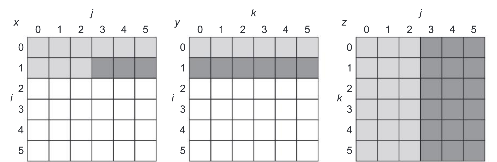
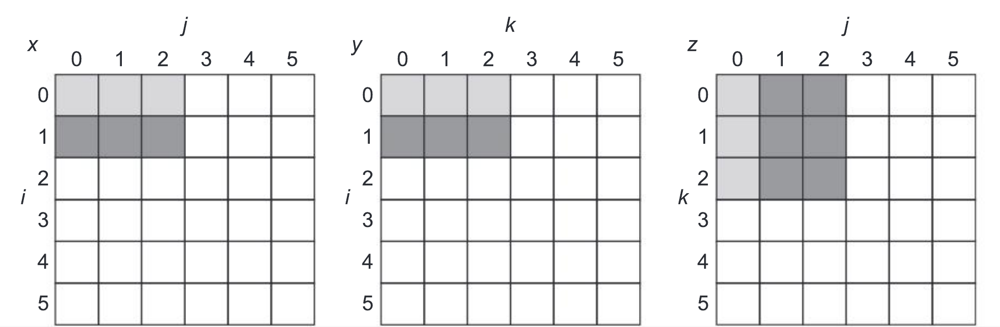
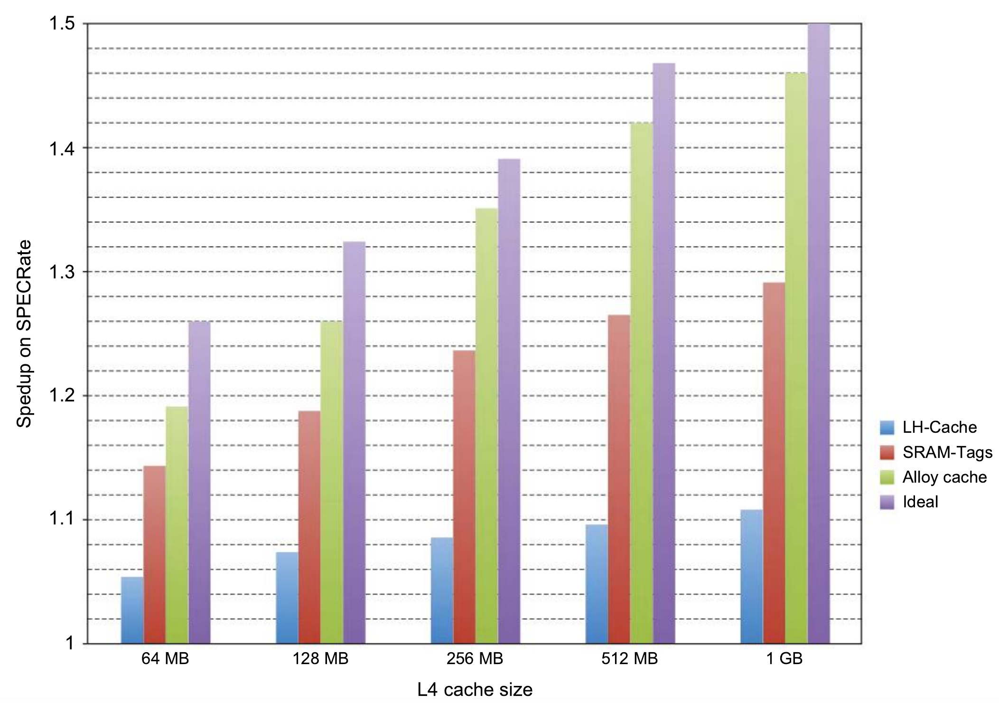

### 第六种优化：关键字优先和提前重启，降低失效开销 {-}

处理器通常一次只需要块中的一个字。这项技术就是基于这一点，它的思路是「不等」：不必等整个块装入，先把所请求的字送给处理器，让处理器重新启动。具体有两种做法：

* *关键字优先*（critical word first）：先向存储器请求失效的那个字，它一到达就送给处理器；处理器继续执行，同时填充块中其余的字。
* *提前重启*（early restart）：仍按正常顺序取块中的字，但所请求的字一到达，就立即送给处理器，让处理器继续执行。

块不大时，这两种技术的收益很小，因此一般只有 Cache 块较大的设计才能从中受益。块的其余部分在填充时，Cache 通常仍能继续响应对其他块的访问。

不过，由于空间局部性，下一次访问很可能就落在这个块的其余部分。这时的失效开销与非阻塞 Cache 一样，不容易计算。采用关键字优先时，如果出现了第二个请求，有效失效开销就是从这次访问开始、到第二部分数据到达为止，其间没有被重叠掉的那段时间。所以，关键字优先和提前重启的收益取决于两点：一是块的大小，二是块中尚未取回的部分再次被访问的可能性。以 i7 6700 为例，它采用了提前重启和关键字优先；在它上面运行 SPECint2006，对失效尚未完成的块，访问次数超过一次（平均 1.23 次，范围为 0.5～3.0 次）。[2.6 节](#sec-2-6)将更详细地考察一个先进存储层次的性能。

### 第七种优化：通过编译器优化降低失效率 {-}

前面介绍的技术都要修改硬件，下面这种技术则不改动任何硬件，就能降低失效率。

这种神奇的效果来自软件优化，这也正是硬件设计者最喜欢的解决办法。处理器与主存之间的性能差距越来越大，促使编译器设计者仔细研究存储层次，看能否通过编译时的优化提高性能。这方面的研究同样分两类：一类减少指令失效，一类减少数据失效。下面介绍的优化，许多现代编译器都已采用。

#### 循环交换 {-}

有些程序含有嵌套循环，访问存储器中数据的次序与数据的存放次序不一致。只要交换循环的嵌套次序，就能让程序按存放次序访问数据。在数组装不进 Cache 的前提下，这一技术通过改善空间局部性来减少失效：调整次序以后，一个 Cache 块中的数据在被丢弃之前能得到最充分的利用。例如，`x` 是大小为 [5000,100] 的二维数组，`x[i,j]` 与 `x[i,j+1]` 相邻存放（数组按行排列，这种次序称为行优先）。下面两段代码说明了怎样优化对它的访问：

```c
/* 修改前 */
for (j = 0; j < 100; j = j + 1)
    for (i = 0; i < 5000; i = i + 1)
        x[i][j] = 2 * x[i][j];
/* 修改后 */
for (i = 0; i < 5000; i = i + 1)
    for (j = 0; j < 100; j = j + 1)
        x[i][j] = 2 * x[i][j];
```

修改前的代码以 100 个字为步长在存储器中跳跃；修改后的代码先访问完一个 Cache 块中的所有字，再转到下一个块。这一优化改善了 Cache 性能，执行的指令数却不受影响。

#### 分块 {-}

分块通过改善时间局部性来减少失效。这里处理的同样是多个数组，但有的按行访问，有的按列访问。由于每次循环迭代既要用到行又要用到列，数组无论逐行存放（*行优先顺序*）还是逐列存放（*列优先顺序*），都解决不了问题。访问方向这样相互正交，即使做了循环交换之类的变换，仍有很大的改进余地。

分块算法不对数组的整行或整列操作，而是对子矩阵，即二维的*块*操作，目标是让装入 Cache 的数据在被替换之前尽可能多地得到访问。下面这段矩阵乘法代码说明了为什么需要这种优化：

```c
/* 修改前 */
for (i = 0; i < N; i = i + 1)
    for (j = 0; j < N; j = j + 1)
        {r = 0;
         for (k = 0; k < N; k = k + 1)
             r = r + y[i][k]*z[k][j];
         x[i][j] = r;
        };
```

两个内层循环要读取 `z` 的全部 N×N 个元素，反复读取 `y` 中同一行的 N 个元素，并写入 `x` 的一行 N 个元素。[图 2.13](#fig-2-13) 是这三个数组访问情况的一个快照：深色表示最近访问过，浅色表示较早访问过，白色表示尚未访问。

容量失效的次数显然取决于 N 和 Cache 的大小：

* Cache 能装下全部三个 N×N 矩阵时，只要没有 Cache 冲突，就不会有问题；
* Cache 能装下一个 N×N 矩阵和一行 N 个元素时，至少 `y` 的第 `i` 行和数组 `z` 有可能留在 Cache 中；
* Cache 比这还小时，`x` 和 `z` 都可能发生失效。

最坏情况下，$N^3$ 次运算要访问 $2N^3 + N^2$ 个存储字。

为了保证正在访问的元素能装进 Cache，把原来的代码改成对 B×B 的子矩阵计算。这样，两个内层循环每次只按 B 的步长计算，而不是走完 `x` 和 `z` 的全长。B 称为*分块因子*。（假设 `x` 已初始化为 0。）

```c
/* 修改后 */
for (jj = 0; jj < N; jj = jj + B)
for (kk = 0; kk < N; kk = kk + B)
for (i = 0; i < N; i = i + 1)
    for (j = jj; j < min(jj + B,N); j = j + 1)
    {r = 0;
     for (k = kk; k < min(kk + B,N); k = k + 1)
         r = r + y[i][k]*z[k][j];
     x[i][j] = x[i][j] + r;
    };
```

{#fig-2-13 width=90%}

{#fig-2-14 width=90%}

[图 2.14](#fig-2-14) 是分块以后三个数组的访问情况。只考虑容量失效时，访问的存储字总数为 $2N^3/B + N^2$，大约降为原来的 1/B。可见分块同时利用了空间局部性和时间局部性：`y` 得益于空间局部性，`z` 得益于时间局部性。例子中用的是正方形块（B×B），也可以用矩形块；矩阵不是方阵时，就必须用矩形块。

我们的目标是减少 Cache 失效，但分块也能帮助寄存器分配：把分块尺寸取得足够小，使一个块能放进寄存器，就能使程序中 load 和 store 的数目最少。

第 4 章的 4.8 节将会看到，在基于 Cache 的处理器上运行以矩阵为主要数据结构的应用，必须采用 Cache 分块才能获得良好的性能。

### 第八种优化：指令和数据的硬件预取，降低失效开销或失效率 {-}

非阻塞 Cache 让执行与访存重叠，从而有效地降低了失效开销。另一种办法是*预取*：在处理器请求*之前*，就把所需的内容取进来。指令和数据都可以预取，既可以直接取到 Cache 中，也可以取到一个访问速度比主存快的外部缓冲器中。

**指令预取。** 指令预取常常由 Cache 之外的硬件完成。典型的做法是：发生失效时，处理器取回两个块，一个是所请求的块，另一个是紧随其后的块。所请求的块返回后放入指令 Cache，预取的块放入指令流缓冲器。如果所请求的块已经在指令流缓冲器中，就取消原来的 Cache 请求，从流缓冲器中读出这个块，同时发出下一个预取请求。

**数据预取。** 类似的方法也可以用于数据访问（Jouppi，1990）。Palacharla 和 Kessler（1994）用一组科学计算程序做了研究，所考虑的多个流缓冲器既能处理指令，也能处理数据。他们发现，对于有两个 64 KiB 四路组相联 Cache（一个存指令、一个存数据）的处理器，8 个流缓冲器能够捕获全部失效的 50%～70%。

**Intel 处理器的硬件预取。** Intel Core i7 和 i9 支持向 L1 和 L2 的硬件预取，最常见的情形是预取下一行。L1 和 L2 失效率都较低的应用，预取带来的改进不大。即使 L1 或 L2 的失效率相当高，预取也必须谨慎使用，因为「坏」的预取可能替换掉有用的 Cache 块，还要占用 Cache 或存储器的带宽。Xeon Skylake-SP 的硬件预取与 Sapphire Rapids 非常相似，有四个数据预取器：L1 数据 Cache 单元预取器（DCUI）、L1 数据 Cache 指令指针步长预取器（DCUP）、L2 数据 Cache 空间预取器（L2A）和 L2 数据 Cache 流预取器（L2P）。在访存较密集的 SPECCPU2017 基准测试程序中，L2P 最为重要，CPI 的改进有 70% 来自它。L2 预取器从 L3 或存储器取数据，结果直接放入 L2；如果预取访问的是存储器，结果不放入 L3。

[图 2.15](#fig-2-15) 给出了多核 Xeon 处理器 Skylake-SP 打开硬件预取以后，SPECCPU2017 中部分程序的总体性能改进（以 CPI 的降低来衡量）。各程序的结果差别很大：两个基准测试程序性能略有下降，五个改进约 10% 或更少，还有两个性能提高到原来的两倍以上。[图 2.15](#fig-2-15) 还给出了 L3 每千条指令失效数（MPKI，Misses Per K Instructions）的降低情况，它与 CPI 的降低高度相关。

预取不计为失效。因此，L2P 向 L2 Cache 预取时，既能消除在 L3 中命中的 L2 失效，也能消除在 L3 中同样失效的 L2 失效。L3 失效的时间大约是 L2 失效的 4 倍，所以如[图 2.15](#fig-2-15) 所示，性能改进主要来自 L3 失效的减少。去掉预取，这些被消除的 L3 失效中有很多甚至全部都会发生；但预取方案并不完美，本身也会引起一些额外的失效。比较打开和关闭预取时 L3 请求的数据总量，就能看出这一点：打开预取后，L3 Cache 请求的数据比关闭时多 19%。在少数程序中（如 bwaves 和 lbm），预取器看来非常准确，L3 流量增加不到 1%。

**对功耗的影响。** 预取效果好时，对功耗的影响可以忽略不计，甚至略有好处；如果预取的数据没有用到，或者有用的数据被替换出去，预取就会明显增加功耗。

{#fig-2-15 width=90%}

### 第九种优化：编译器控制的预取，降低失效开销或失效率 {-}

除了硬件预取，也可以由编译器插入预取指令，在处理器需要数据之前就发出请求。预取有两种：

* *寄存器预取*：把值装入寄存器；
* *Cache 预取*：只把数据装入 Cache，不装入寄存器。

两种预取都可以是*引发异常的*（faulting），也可以是*不引发异常的*（nonfaulting），区别在于遇到虚拟地址故障和保护违例时，预取的地址是否引发异常。不引发异常的预取在本应引发异常时直接变成空操作，这正是我们所希望的。

最有效的预取对程序是「语义上不可见的」：它不改变寄存器和存储器的内容，*也*不会引起虚拟存储故障。今天大多数处理器都提供不引发异常的 Cache 预取。本节假定采用这种预取，它也称为*非绑定*（nonbinding）预取。

只有处理器在预取数据的同时能够继续执行，预取才有意义。也就是说，Cache 在等待预取数据返回期间不能停顿，而要继续提供指令和数据。因此，这类计算机的数据 Cache 通常是非阻塞的。

编译器控制的预取与硬件预取的目标相同，都是让执行与数据预取重叠。循环便于做预取优化，是主要的优化对象：失效开销较小时，编译器只需把循环展开一两次，把预取和执行调度在一起；失效开销较大时，编译器采用软件流水（见附录 H），或把循环展开多次，为后面的迭代预取数据。

不过，发出预取指令本身有指令开销，编译器必须保证开销不超过收益。程序只对可能发生 Cache 失效的访问做预取，就能避免不必要的预取，同时显著缩短平均访存时间。

**例题**　对于下面的代码，先判断哪些访问可能引起数据 Cache 失效，再插入预取指令以减少失效，最后计算执行的预取指令数和通过预取避免的失效次数。假设数据 Cache 为 8 KiB、直接映射、块大小 16 字节，采用写回和写分配。`a` 和 `b` 都是双精度浮点数组，元素长 8 字节。`a` 有 3 行 100 列，`b` 有 101 行 3 列。程序开始时，两个数组都不在 Cache 中。

```c
for (i = 0; i < 3; i = i + 1)
    for (j = 0; j < 100; j = j + 1)
        a[i][j] = b[j][0] * b[j + 1][0];
```

**解答**　编译器首先要确定哪些访问可能引起 Cache 失效，否则就会把时间浪费在为本来会命中的数据发预取指令上。

`a` 的元素按存放次序写入，因此 `a` 能得益于空间局部性：`j` 为偶数时失效，为奇数时命中。`a` 有 3 行 100 列，对它的访问引起 3 × (100/2) 即 150 次失效。

`b` 的访问次序与存放次序不同，得不到空间局部性的好处，但两次得益于时间局部性：一是 `i` 的每次迭代访问的都是同样的元素，二是 `j` 的每次迭代都要用到上一次迭代用过的 `b` 值。不考虑可能的冲突失效，`b` 的失效发生在两处：`i` = 0 时对 `b[j+1][0]` 的访问，以及 `j` = 0 时对 `b[j][0]` 的第一次访问。`i` = 0 时 `j` 从 0 变到 99，因此 `b` 引起 100 + 1 即 101 次失效。

这样，这个循环的数据 Cache 失效大约是 `a` 的 150 次加上 `b` 的 101 次，共 251 次。

为了简化优化，我们不考虑为循环最初的几次访问做预取：这些数据可能已经在 Cache 中，否则就为 `a` 或 `b` 的前几个元素付出失效开销。我们也不考虑在循环末尾屏蔽那些越过 `a` 末尾（`a[i][100]` … `a[i][106]`）和 `b` 末尾（`b[101][0]` … `b[107][0]`）的预取；如果这些预取会引发异常，就不能这样省事了。假设失效开销很大，至少要提前比如 7 次迭代开始预取，换句话说，到第 8 次迭代之前预取都没有收益。为加入预取而对前面代码所做的改动用下划线标出。

```c
for (j = 0; j < 100; j = j + 1) {
    prefetch(b[j + 7][0]);
    /* 7 次迭代之后要用的 b(j,0) */
    prefetch(a[0][j + 7]);
    /* 7 次迭代之后要用的 a(0,j) */
    a[0][j] = b[j][0] * b[j + 1][0];};
for (i = 1; i < 3; i = i + 1)
    for (j = 0; j < 100; j = j + 1) {
        prefetch(a[i][j + 7]);
        /* 7 次迭代之后要用的 a(i,j) */
        a[i][j] = b[j][0] * b[j + 1][0];}
```

修改后的代码预取了 `a[i][7]` 到 `a[i][99]`，以及 `b[7][0]` 到 `b[100][0]`，没有预取到的失效减少为：

* 第一个循环中元素 `b[0][0]`, `b[1][0]`, …, `b[6][0]` 的 7 次失效；
* 第一个循环中元素 `a[0][0]`, `a[0][1]`, …, `a[0][6]` 的 4 次失效（$\lceil 7/2 \rceil$；由于空间局部性，每个 16 字节的 Cache 块只失效 1 次）；
* 第二个循环中元素 `a[1][0]`, `a[1][1]`, …, `a[1][6]` 的 4 次失效（$\lceil 7/2 \rceil$）；
* 第二个循环中元素 `a[2][0]`, `a[2][1]`, …, `a[2][6]` 的 4 次失效（$\lceil 7/2 \rceil$）。

没有预取到的失效共 19 次。用执行 400 条预取指令的代价，避免了 232 次 Cache 失效，这很可能是一个合理的权衡。

**例题**　计算上一个例题节省的时间。忽略指令 Cache 失效，并假设数据 Cache 中没有冲突失效和容量失效。假设各次预取之间、预取与 Cache 失效之间都可以重叠，从而按最大存储带宽传输数据。不计 Cache 失效时，各循环的关键时间是：原来的循环每次迭代 7 个时钟周期，第一个预取循环每次迭代 9 个时钟周期，第二个预取循环每次迭代 8 个时钟周期（含外层 for 循环的开销）。一次失效需要 100 个时钟周期。

**解答**　原来的双重循环执行乘法 3 × 100 即 300 次，每次迭代 7 个时钟周期，共 300 × 7 即 2100 个时钟周期；Cache 失效再增加 251 × 100 即 25,100 个时钟周期，总计 27,200 个时钟周期。

第一个预取循环迭代 100 次，每次 9 个时钟周期，共 900 个时钟周期；Cache 失效增加 11 × 100 即 1100 个时钟周期，总计 2000 个时钟周期。第二个循环执行 2 × 100 即 200 次，每次 8 个时钟周期，共 1600 个时钟周期；Cache 失效增加 8 × 100 即 800 个时钟周期，总计 2400 个时钟周期。

由上一个例题可知，执行这两个循环共需 2000 + 2400 即 4400 个时钟周期，其间执行了 400 条预取指令。假设预取与其余执行完全重叠，预取代码的速度就是原来代码的 27,200/4400 即 6.2 倍。

**指针的预取。** 数组优化容易理解，但现代程序更多地使用指针。Luk 和 Mowry（1999）证明，基于编译器的预取有时也能推广到指针。他们研究了 10 个使用递归数据结构的程序，访问一个结点时预取它的所有指针，结果一半程序的性能提高了 4%～31%，其余程序的性能与原来相差也在 2% 以内。问题在于两点：一是预取的数据是否已经在 Cache 中，二是预取是否足够早，使数据在需要时已经到达。

许多处理器都提供 Cache 预取指令，高端处理器（如 Intel Core i7 和 i9）通常还会在硬件中做某种形式的自动预取。

### 第十种优化：多条存储总线和多个存储模块，提高带宽 {-}

台式机中的高速处理器（如 Intel i9 和 AMD Ryzen）、服务器中的高速处理器（Intel Xeon 和 IBM Power 系列），以及用于图形或深度学习的领域专用处理器，常常使用多个存储通道来提高可用的存储带宽。多个存储通道可以独立访问，一次访问不会使另一次访问停顿，因此也能有效地降低失效开销。

**SDRAM 与 HBM 混合。** 有了多条存储总线，就可以设计两种总线结构不同的存储通道，让系统同时使用 SDRAM 和 HBM。HBM 要求的信号约定与普通 SDRAM 不同，这样混合使用，既能发挥 HBM 存储器在速度和带宽上的优势，又不会使存储器的总容量受限于少数几个 HBM 堆叠。以这种方式混用不同类型的存储器，确实会形成非一致存储结构（NUMA，NonUniform Memory Architecture）；要利用这种能力，就必须把关键数据放到较快的 HBM 存储器中。在领域专用处理器中，这项工作通常由软件控制完成，一般还需要一种领域专用语言来指导软件在不同存储器之间分配和移动数据（见第 7 章）。

**HBM 用作 Cache。** 除了显式管理的 NUMA，另一种做法是把 HBM 存储器用作 Cache，最新的 Intel 和 AMD 处理器也支持这种做法。

HBM Cache 实质上是新增的 L4，即末级 Cache（LLC，Last-Level Cache），容量可以达到最大的片上 L3 Cache 的 10 倍以上。但这么大的、基于 DRAM 的 Cache 带来一个问题：tag放在哪里？这取决于 tag 的数量。假设块大小为 64B，1 GiB 的 L4 Cache 就需要 96 MiB 的 tag，大致相当于一个大型多核处理器全部 Cache 所用的 SRAM。增大块可以减少 tag 数，但块很大时失效率可能升高，冲突失效和一致性失效尤其如此。

**L-H 方案。** 如果把 LLC 的 tag 存放在 HBM 中而不是片上，就可以采用较小的块和较多的 tag。乍看起来这行不通，因为每次访问 L4 都要访问两次 DRAM：一次取 tag，一次取数据。Loh 和 Hill（2011）为此提出了一个巧妙的方案（我们称之为 L-H 方案）：把 tag 和数据放在 HBM SDRAM 的同一行中。打开一行（以及最终关闭它）需要很长时间，但在已打开的行中访问另一部分，CAS 延迟只有访问新行时间的三分之一左右。因此，可以先访问块的 tag 部分，命中以后再用一次列访问选出所需的字。

**合金 Cache。** Qureshi 和 Loh（2012）提出了一种缩短命中时间的改进方案，称为*合金 Cache*（alloy cache）。合金 Cache 把 tag 和数据熔铸在一起，并采用直接映射结构。这样，直接索引 HBM Cache，用一次突发传输同时送出 tag 和数据，就能把 LLC 的访问时间缩短到一个 HBM 周期。与 L-H 方案相比，合金 Cache 的命中时间降为不到原来的一半，代价是失效率提高到原来的 1.1～1.2 倍。

遗憾的是，这两种方案发生失效时，都需要两次完整的 DRAM 访问：先访问一次取得 tag，接着再访问更慢的主存。[图 2.16](#fig-2-16) 给出了以 SPECRate 方式运行 10 个访存密集的 SPECCPU2006 基准测试程序得到的加速比。合金 Cache 增加了一个小型失效预测器，预测到会失效时，就设法省去最初那次 HBM 访问。加上失效预测器以后，合金 Cache 的性能超过了 L-H 方案，甚至超过了不实用的 SRAM tag 方案。原因在于失效预测器访问时间短，预测结果又好，因此判定一次失效所需的时间更短，失效开销也就更低。合金 Cache 的性能接近理想情况（Ideal），即失效预测完美、命中时间最短的 LLC。

{#fig-2-16 width=90%}

HBM 很可能以多种配置得到广泛应用：在某些高性能专用系统中承担整个存储系统，在有多条存储总线的设计中则把一部分存储器用作 LLC。

### 存储层次优化小结 {-}

改进命中时间、带宽、失效开销和失效率的技术，一般也会影响平均访存时间公式中的其他组成部分，以及存储层次的复杂度。[图 2.17](#fig-2-17) 对这些技术做了总结，并估计了它们对复杂度的影响：+ 表示改进了这一因素，– 表示损害了这一因素，空白表示没有影响。一般来说，没有哪一种技术能改进一个以上的类别。

[图 2.17　高级 Cache 优化小结：各技术对 Cache 性能、功耗和复杂度的影响。一种技术一般只对一个因素有帮助，但预取是例外：预取足够早时可以减少失效，不够早时也能降低失效开销。+ 表示该技术改进了这一因素，– 表示损害了这一因素，空白表示没有影响。复杂度的衡量是主观的，0 表示最容易，3 表示有挑战性。]{#fig-2-17 .caption}

| 技术 | 命中时间 | 带宽 | 失效开销 | 失效率 | 功耗 | 硬件成本/复杂度 | 说明 |
|---|:-:|:-:|:-:|:-:|:-:|:-:|---|
| 小而简单的 Cache | + | | | – | + | 0 | 很简单；广泛使用 |
| 路预测 Cache | + | | | | + | 1 | 用于 Pentium 4 |
| 流水化 Cache 和多体 Cache | – | + | | | | 1 | 广泛使用 |
| 非阻塞 Cache | | + | + | | | 3 | 广泛使用 |
| 关键字优先和提前重启 | | | + | | | 2 | 广泛使用 |
| 合并写缓冲 | | | + | | | 1 | 与写直达配合使用，广泛采用 |
| 减少 Cache 失效的编译器技术 | | | | + | | 0 | 软件实现有难度，但许多编译器能处理常见的线性代数计算 |
| 指令和数据的硬件预取 | | | + | + | – | 指令 2，数据 3 | 大多数处理器提供预取指令；现代高端处理器还在硬件中自动预取 |
| 编译器控制的预取 | | | + | + | | 3 | 需要非阻塞 Cache；可能有指令开销；许多 CPU 已采用 |
| HBM 作为附加的一级 Cache | | +/– | – | + | + | 3 | 依赖新的封装技术；效果在很大程度上取决于命中率的改善 |
