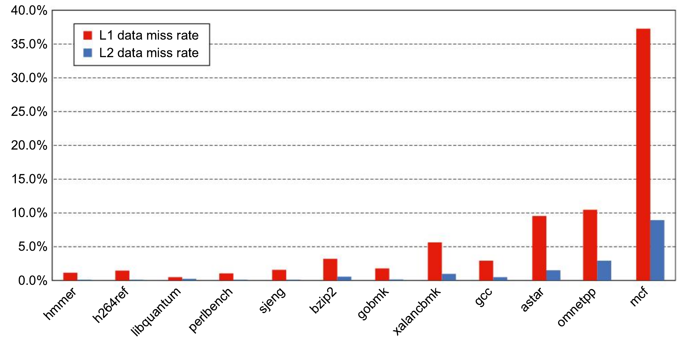
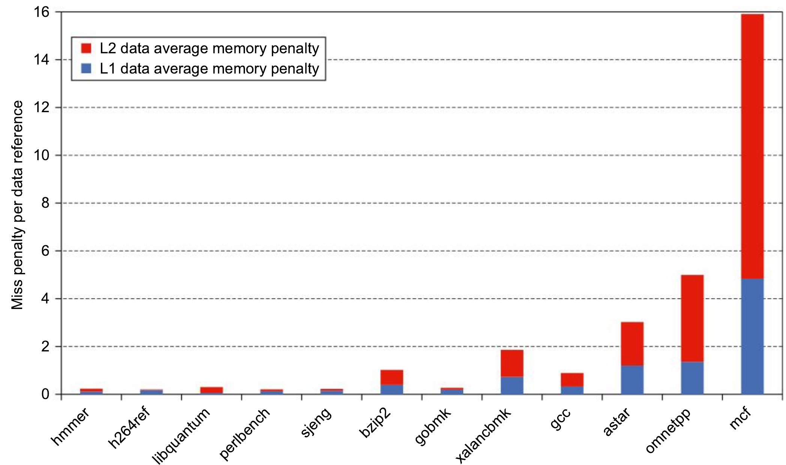
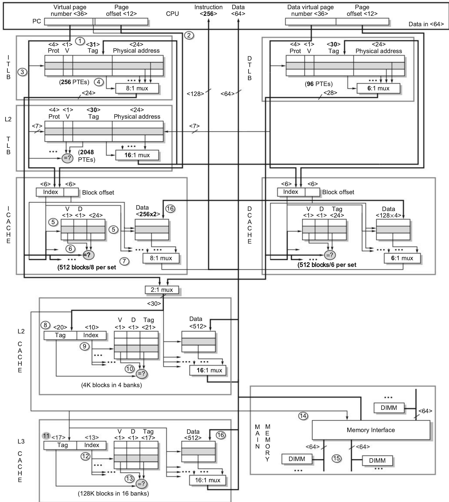
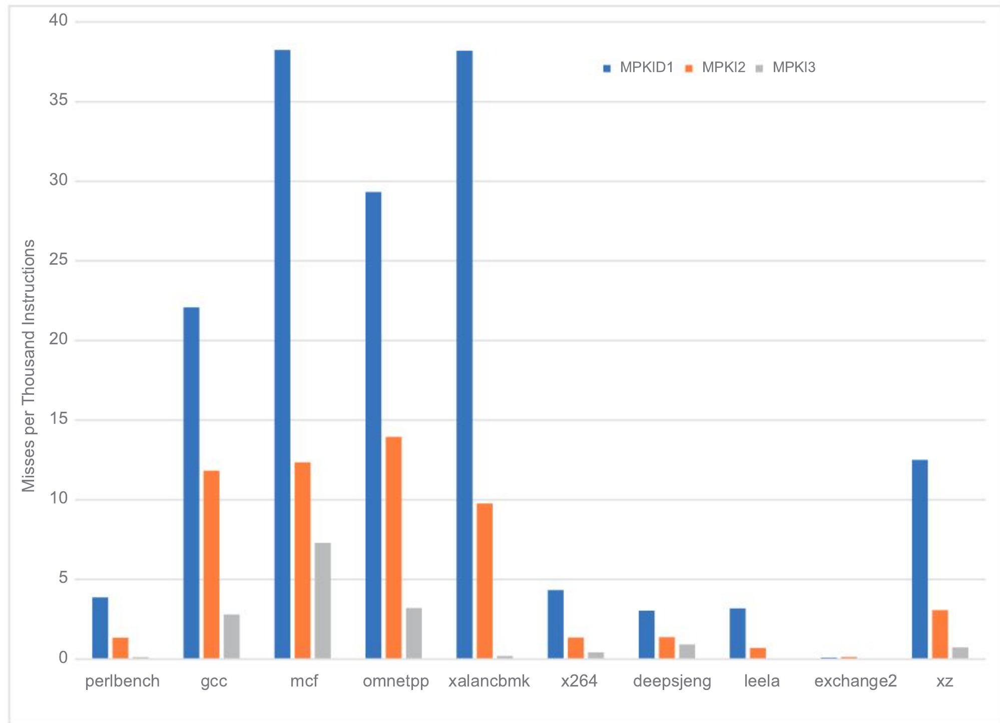
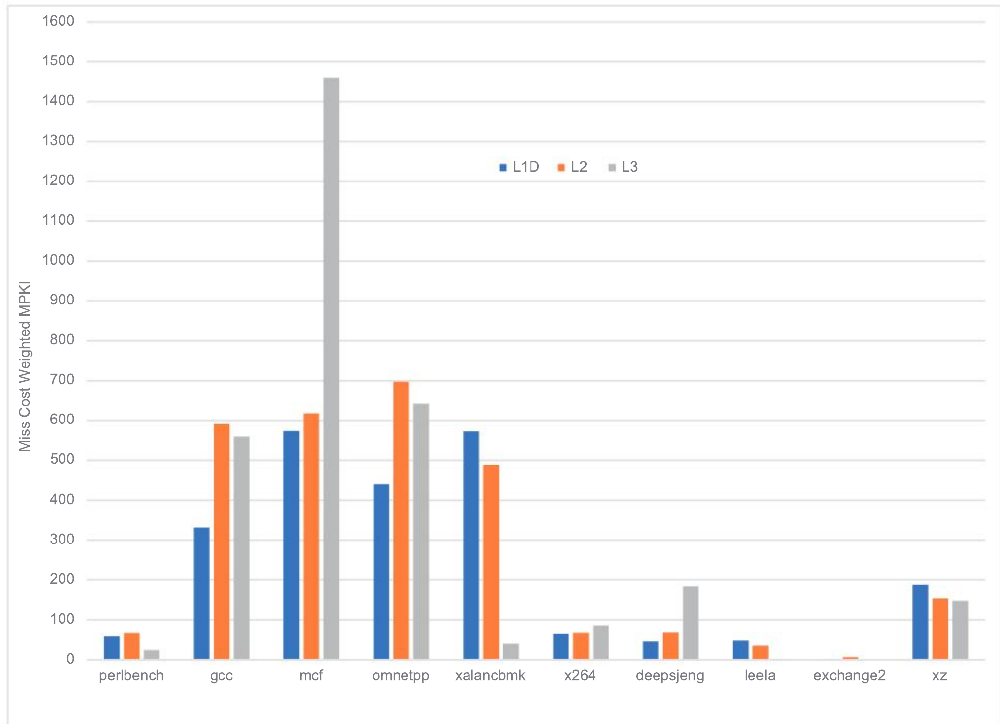

## 融会贯通：ARM Cortex-A53 和 Intel Core i9 12900 的存储层次 {#sec-2-6}

本节考察两种处理器的存储层次：ARM Cortex-A53（下文简称 A53）和 Intel Core i9 12900（下文简称 i9），并给出各个部件在一组单线程基准测试程序上的性能。A53 的存储系统比较简单，所以先讲；i9 讲得更细，要完整地跟踪一次访存的全过程。阅读本节需要熟悉采用虚拟索引 Cache 的两级 Cache 层次是怎样组成的。这类存储系统的基础知识在附录 B 中有详细讲解；对它的组成还把握不准的读者，强烈建议先复习附录 B 中的 Opteron 例子。A53 的存储系统与 Opteron 相似，弄懂了 Opteron，下面对 A53 的简要说明就很容易看懂。

### ARM Cortex-A53 {-}

Cortex-A53 是一种可配置的核，支持 ARMv8A ISA，包括 32 位和 64 位两种模式。它以知识产权（IP）核的形式交付。在嵌入式、PMD 及相关市场上，IP 核是交付技术的主要形式，由 ARM、MIPS 和 RISC-V 的 IP 核制造出的处理器已达数十亿个。

IP 核与 Intel i7、AMD Athlon 等多核处理器中的核不是一回事。IP 核本身也可能是多核，它的用途是与其他逻辑集成在一起，成为一块芯片的核心。这些逻辑包括专用处理器（如视频编码器或解码器）、I/O 接口和存储器接口；集成之后再拿去制造，得到针对某种应用优化的处理器。例如，多种平板电脑和智能手机都使用 Cortex-A53 IP 核。它在设计上追求很高的能效，而能效正是靠电池供电的 PMD 的一项关键指标。A53 核用得很广，一块芯片上可以配置多个 A53 核，用于高端 PMD；这里只讨论单个核。

**硬核与软核。** IP 核一般有两种形式：

* *硬核*针对某一家半导体厂商优化，是一个黑盒，对外提供接口（接口仍在芯片上）。硬核通常只允许设置核外逻辑的参数，如 L2 Cache 的容量，IP 核本身不能修改；
* *软核*通常以标准逻辑单元库的形式交付，可以针对不同的半导体厂商编译，也可以修改。不过现代 IP 核十分复杂，要大规模修改非常困难。

总的来说，硬核性能更高、晶片面积更小；软核则可以改由其他厂商制造，修改起来也更容易。

**存储层次的组成。** Cortex-A53 每个时钟周期可以发射两条指令，时钟频率最高 1.3 GHz。它有两级 TLB 和两级 Cache，[图 2.18](#fig-2-18) 总结了存储层次的组成。发生失效时，关键字最先返回，处理器不必等失效处理完就可以继续执行；存储系统最多可以有 4 个存储体。D-Cache 为 32 KiB、页大小为 4 KiB 时，Cache 索引 7 位、块内偏移 6 位，合起来比页内偏移多一位，因此每个物理页可能映射到两个不同的 Cache 地址。和附录 B 的 B.3 节一样，A53 在失效时用硬件检测这种别名，从而避免它。[图 2.19](#fig-2-19) 给出了 32 位虚拟地址怎样用来索引 TLB 和 Cache，这里假设一级 Cache 为 32 KiB、二级 Cache 为 1 MiB，页大小为 16 KiB。

[图 2.18　Cortex A53 的存储层次包括多级 TLB 和多级 Cache。页映射 Cache（page map cache）记录一组虚拟页所对应的物理页位置，用来降低 L2 TLB 的失效开销。L1 Cache 采用虚拟索引、物理 tag；L1 D-Cache 和 L2 都采用写回策略，默认写分配。各级 Cache 的替换策略都是近似 LRU。微 TLB 和 L1 同时失效时，到 L2 的失效开销更大。L2 到主存的总线宽 64–128 位，总线较窄时失效开销更大。]{#fig-2-18 .caption}

| 结构 | 容量 | 组成 | 典型失效开销（时钟周期） |
|---|---|---|---|
| 指令微 TLB | 10 项 | 全相联 | 2 |
| 数据微 TLB | 10 项 | 全相联 | 2 |
| L2 统一 TLB | 512 项 | 4 路组相联 | 20 |
| L1 指令 Cache | 8–64 KiB | 2 路组相联；64 字节块 | 13 |
| L1 数据 Cache | 8–64 KiB | 2 路组相联；64 字节块 | 13 |
| L2 统一 Cache | 128 KiB–2 MiB | 16 路组相联；LRU | 124 |

{#fig-2-19 width=90%}

### Cortex-A53 存储层次的性能 {-}

Cortex-A8 存储层次的测量条件是：一级 Cache 32 KiB，L2 Cache 1 MiB，运行 SPECInt2006 基准测试程序。这些程序的指令 Cache 失效率很低，只看 L1 也是如此：大多数接近于零，全部低于 1%。原因大概有两个：一是 SPECCPU 程序属于计算密集型；二是两路组相联 Cache 消除了大部分冲突失效。

数据 Cache 的情况见[图 2.20](#fig-2-20)，L1 和 L2 的失效率都相当高：

* L1 失效率在 0.5% 到 37.3% 之间，最高值是最低值的 75 倍，中位数为 2.4%；
* L2 全局失效率在 0.05% 到 9.0% 之间，最高值是最低值的 180 倍，中位数为 0.3%。

上限都由号称「Cache 杀手」的 MCF 决定，它对平均值的影响也很大。要注意，L2 的全局失效率比局部失效率低得多。例如，单独计算 L2 的失效率，中位数是 15.1%，而全局失效率的中位数只有 0.3%。

{#fig-2-20 width=90%}

### 用这些失效开销计算 {-}

用[图 2.18](#fig-2-18) 中的失效开销计算，得到每次数据访问的平均开销，如[图 2.21](#fig-2-21) 所示。L1 的失效率约为 L2 的 7 倍，但 L2 的失效开销是 L1 的 9.5 倍，所以在对存储系统压力较大的基准测试程序中，L2 失效略占主导。Cache 失效对总体 CPI 的影响留到下一章研究。

{#fig-2-21 width=90%}

### Intel Core i9 {-}

i9 支持 x86-64 ISA，即 80x86 体系结构的 64 位扩展。i9 12900 采用 Alder Lake 微结构，是一种 *big.little* 设计，也就是把两类核组合在一起：8 个性能核（P-core）和 8 个能效核（E-core）。P-core 的时钟频率更高，并且支持多线程（见第 3 章）。本章从单个 P-core 的角度讨论存储系统的设计和性能；i9 的流水线和多线程性能在第 3 章研究，多处理器性能在第 5 章研究。

i9 的每个核每个时钟周期最多执行 4 条 80x86 指令，采用多发射、动态调度的 16 级流水线，第 3 章将详细介绍。2024 年，最快的 i9 单个 P-core 的时钟频率为 5.1 GHz（Turbo Boost 模式）。不过，多个 P-core 不能同时工作在 Turbo Boost 模式，否则会过热。

i9 可以支持两个存储通道，每个通道由一组独立的 DIMM 构成，各通道可以并行传输，DDR4 或 DDR5 均可。采用 DDR5-4800 时，最大存储带宽为 77 GB/s。

i9 的虚拟地址为 48 位，物理地址为 36 位，物理内存最大为 36 GiB。存储管理由两级 TLB 负责（见附录 B 的 B.4 节），[图 2.22](#fig-2-22) 对它作了总结。

[图 2.22　i9 TLB 结构的特点。一级指令 TLB 和数据 TLB 分开设置，而且各自又分为多个，后面共用一个二级 TLB。一级 TLB 支持标准的 4 KiB 页，其他页大小另设单独的 TLB。数据 TLB 中还有 load 和 store 各自专用的小 TLB。i9 用硬件实现页表遍历器（page table walker），能够并行处理 4 次 L2 TLB 失效。多级 TLB、对多种页大小的支持以及硬件 TLB 失效处理，详见在线附录 L。]{#fig-2-22 .caption}

| 特性 | 指令 TLB | 数据 TLB | 二级 TLB |
|---|---|---|---|
| 项数 | 256 项（4 KiB 页）；32 项（2/4 MiB 页） | 96 项（4 KiB 页）；32 项（2/4 MiB 页）；8 项（1 GiB 页） | 2048 项，用于 4 KiB、2 MiB 和 1 GiB 页 |
| 相联度 | 8 路 | 6 路、4 路、8 路 | 16 路 |
| 替换 | 伪 LRU | 伪 LRU | 伪 LRU |
| 访问延迟 | 1 个周期 | 1 个周期 | 8 个周期 |
| 失效 | 8 个周期 | 8 个周期 | 访问页表需要几十到几百个周期 |

i9 的三级 Cache 层次见[图 2.23](#fig-2-23)。一级 Cache 采用虚拟索引、物理 tag（见附录 B 的 B.3 节），L2 和 L3 采用物理索引。与前几代 Skylake 微结构相比，最近的高端处理器把 L2 的容量大幅增加到原来的 2～4 倍，L3 的容量则增加得较少。这样一来，L2 的总容量与 L3 的总容量更加接近，于是 L3 改为非包含方式。有些型号的 i9 还将支持用 HBM 封装的第四级 Cache。

[图 2.23　i9 P-core 三级 Cache 层次的特点。三级 Cache 都采用写回，块大小都是 64 字节。L1 和 L2 由各核私有，L3 由芯片上的所有核共享。L3 在物理上分成多个存储体，分布在各个核旁边，用一个简单的散列函数把地址分配到各个存储体。三级 Cache 都是非阻塞的，允许有多个未完成的写。L1 配有合并写缓冲：写 L1 时如果该行不在 L1 中，数据就暂存在写缓冲里（即 L1 写失效不分配 Cache 行）。L3 不是包含式的，因此各核 L2 与 L3 合起来存放的数据量可以超过 L3 的容量，L3 若是包含式的就做不到这一点。（非包含性对 Cache 一致性有影响，第 5 章讨论这个问题。）替换采用伪 LRU 和近似 LRU 的变体：L1 用 1 位方案（一种 NRU），L2 和 L3 用多位方案。]{#fig-2-23 .caption}

| 特性 | L1 I-Cache | L1 D-Cache | L2 | L3 |
|---|---|---|---|---|
| 容量 | 32 KiB | 48 KiB；双端口；8 个存储体 | 每核 1.25 MiB | 30 MiB，所有核共享；非包含 |
| 相联度 | 8 路 | 6 路 | 10 路 | 15 路 |
| 访问延迟 | 4 个周期 | 5 个周期 | 15 个周期 | 50 个周期 |
| 替换方案 | 伪 LRU | 伪 LRU | 加权 n 位 LRU | 加权 n 位 LRU |

**取指与指令 TLB。** [图 2.24](#fig-2-24) 标出了一次访存经过存储层次的各个步骤，这里假设页大小为 4 KiB。首先，PC 送往指令 Cache。指令 Cache 的索引为

$$
2^{\text{索引}} = \frac{\text{Cache 容量}}{\text{块大小} \times \text{组相联度}} = \frac{32\text{ K}}{64 \times 8} = 64 = 2^{6}
$$

即 6 位。指令地址的页帧号（36 = 48 − 12 位）送往指令 TLB（步骤 1）；与此同时，虚拟地址中 12 位的页内偏移送往指令 Cache（步骤 2）。指令 Cache 为 8 路组相联，Cache 地址需要 12 位：6 位 Cache 索引，加上 64 字节块的 6 位块内偏移，所以不会出现别名。

早期的 i7 采用 4 路组相联的 I-Cache，对应的物理地址在这一位上可能是 0，也可能是 1，所以一个虚拟地址对应的块可能出现在 Cache 中两个不同的位置。对指令来说这不成问题：同一条指令即使在 Cache 中有两份，内容也一定相同。数据则不同。如果允许数据这样重复存放，也就是允许别名，那么每次修改页映射都必须检查 Cache，好在修改页映射并不常见。只要非常简单地运用页着色（见附录 B 的 B.3 节），就能根除这种别名：把偶数地址的虚拟页映射到偶数地址的物理页，奇数页也一样，虚拟页号和物理页号的最低位就总是相同，别名永远不会出现。

{#fig-2-24 width=100%}

指令 TLB 查找与地址相匹配的有效 PTE（步骤 3 和 4）。除了转换地址，TLB 还要检查这个 PTE 是否表明这次访问违反了访问权限、应当引发异常。

指令 TLB 失效时，先访问 L2 TLB（又称 STLB）。L2 TLB 为 16 路组相联，含有 2048 个 4 KiB 页的 PTE。从 L2 TLB 装入 L1 TLB 需要 8 个时钟周期，再加上最初访问 L1 TLB 的 1 个周期，失效开销共 9 个周期。L2 TLB 也失效时，由硬件算法遍历页表并更新 TLB 项；页表遍历器和页结构 Cache（page structure cache）见在线附录 L 的 L.5 节和 L.6 节。最坏的情况是页面不在内存中，操作系统要从外存取得该页。处理一次缺页的时间里可以执行数百万条指令，因此如果有其他进程在等待运行，操作系统就换入那个进程。如果 TLB 没有异常，就继续访问指令 Cache。

**L1 指令 Cache。** 地址中的索引字段送往指令 Cache 的全部 8 个存储体（步骤 5）。指令 Cache 的 tag 为 36 位 − 6 位（索引）− 6 位（块内偏移），即 24 位。这 4 个 tag 连同有效位与指令 TLB 送来的物理页帧号比较（步骤 6）。i9 每次取指要取 32 字节，所以 6 位块内偏移之外还要再用 1 位，从块中选出所需的 32 字节，也就是用 6 + 1 即 87 位把 32 字节指令送给处理器。L1 Cache 采用流水线方式，命中延迟为 4 个时钟周期（步骤 7）。失效则访问二级 Cache。

**L2 Cache。** 指令 Cache 采用虚拟寻址、物理 tag，而二级 Cache 采用物理寻址，所以要把 TLB 给出的物理页地址与页内偏移拼起来，形成访问 L2 的地址。L2 的索引为

$$
2^{\text{索引}} = \frac{\text{Cache 容量}}{\text{块大小} \times \text{组相联度}} = \frac{1.25\text{ M}}{64 \times 10} = 2^{11}
$$

于是，30 位的块地址（36 位物理地址 − 6 位块内偏移）分为 19 位 tag 和 11 位索引（步骤 8）。索引和 tag 同样送往本核的 L2 Cache（步骤 9），并行比较。如果有一个 tag 匹配且有效（步骤 10），L2 经过最初 15 个周期的延迟后，以每个时钟周期 8 字节的速率按顺序返回这个块。

**L3 Cache。** L2 失效则访问 L3。i9-12900 有 8 个 P-core 和 8 个 E-core，L3 为 30 MiB，分成 8 个存储体。为了减少冲突，存储体由散列选择：取散列结果中的 3 位选出一个存储体，只访问这一个存储体。每个存储体内的索引为

$$
2^{\text{索引}} = \frac{\dfrac{\text{Cache 容量}}{8}}{\text{块大小} \times \text{组相联度}} = \frac{3.75\text{ M}}{64 \times 15} = 4096 = 2^{12}
$$

12 位索引（步骤 11）送往所选存储体的全部 15 路（步骤 12）。L3 的 tag 为 36 − (12 + 6) = 18 位，与 TLB 给出的物理地址比较（步骤 13）。命中时，L3 经过最初 50 个时钟周期的延迟后，以每个时钟周期 16 字节的速率返回这个块，并把它同时放入 L1 和 L2。L3 失效则启动一次访存。

**主存。** i9 有两个相互独立的存储通道（Xeon 服务器处理器更多），可以连接 HBM 存储器或标准 DIMM。由主存处理的失效，总延迟约为两部分之和：判定 L3 失效所需的 50 个处理器周期，加上取关键指令的 DRAM 延迟。以单存储体的 DDR5-4800 SDRAM 和 4.0 GHz 的 CPU 为例，取到前 16 字节的 DRAM 延迟约为 40 ns，即 160 个时钟周期，总失效开销约为 200 个时钟周期。随后，存储控制器以每个 I/O 总线时钟周期 32 字节的速率填充 64 字节 Cache 块的其余部分，又需要 2.5 ns，即 10 个时钟周期。取回的块写入 L2 和 L1，但不放入 L3，因为前面说过，末级 Cache（LLC，Last-Level Cache）是非包含的。

LLC 主要用来存放从 L2 逐出的块。如果不考虑多个核之间的共享，L2 和 L3 存放的是不同的块，因此 Cache 中的数据总量等于 L2 与 L3 的容量之和，而不只是 L3 的容量。L2 和 L3 都是写回 Cache，所以任何一次失效都可能把一个旧块写回下一级：L2 的旧块写回 L3，L3 的旧块写回内存。i9 有一个合并写缓冲，在下一级 Cache 没有读操作时把脏 Cache 行写回。发生失效时要检查写缓冲，如果所需的 Cache 行在缓冲中，就直接从缓冲中取数据处理失效。

**store 的处理。** 如果这条指令不是 load 而是 store，那么 store 发射时，也像 load 一样查找数据 Cache。失效时，由于 L1 Cache 写失效不分配块，这个块就放进写缓冲。命中时，store 也不立即更新 L1（或 L2）Cache，而要等到确认它不是推测执行之后才更新。在此期间，store 存放在 load-store 队列中，这个队列是处理器乱序控制机制的一部分。

i9 还支持从层次中的下一级向 L1 和 L2 预取。i9 的预取器与 i7 的相似，i7 预取器的性能前面已经考察过。

### i9 存储系统的性能 {-}

我们用 SPECINT2017 基准测试程序（SPECINTRate）评估 i9 Cache 结构的性能。i9 的流水线很复杂，有自主的取指部件，采用推测执行，还有指令预取和数据预取，所以很难拿它的 Cache 性能与较简单的处理器比较。前面说过，使用预取的处理器会产生与程序执行的访存无关的 Cache 访问。由实际的指令访问或数据访问引起的 Cache 访问，有时称为*按需访问*，以区别于*预取访问*。按需访问既可能来自推测的取指，也可能来自推测的数据访问，其中有些后来会被取消（推测执行和指令毕业详见第 3 章）。推测处理器产生的失效至少和顺序执行的非推测处理器一样多，通常还更多。

由于这些复杂因素，讨论失效率意义不大。我们改用现在常用的每千条指令失效数（MPKI）：分子是失效次数，分母是提交的指令数。MPKI 可以按 Cache 层次分别给出：MPKID1 表示一级数据 Cache 的失效，MPKI2 和 MPKI3 分别表示 L2 和 L3 的失效。

除了按需失效，指令预取和数据预取也会产生等效的失效。如果预取器非常有效，去掉预取反而会产生别的失效。发出一次预取，即使得到一次「预取失效」，只要因此避免了后来的按需失效，处理器就能运行得更快。i9 P-core 的预取器是 Skylake 预取器的扩展，Skylake 预取器的性能在第 23 页开始的硬件预取一节讨论过。

**指令 Cache。** i9 的取指部件每个周期试图取 32 字节。每个周期要取多条指令，这使得比较指令 Cache 失效率变得复杂。实际上，Cache 每次读出的是整个 64 字节的 Cache 行，后续的 32 字节取指不需要再访问 Cache，所以失效只按 64 字节块统计。32 KiB、8 路组相联的指令 Cache 使 SPECintRate 程序的指令失效率非常低。为简单起见，把 SPECintRate 的失效率计为 64 字节块的失效次数除以完成的指令数，那么除了一个基准测试程序（XALANCBMK），失效率都低于 1%。一个 64 字节块通常含有 16–20 条指令，因此按每条指令计算的有效失效率要低得多，具体低多少取决于指令流的空间局部性。

**数据 Cache。** [图 2.25](#fig-2-25) 给出了 SPECCPUINT2017 基准测试程序在 L1 数据 Cache、L2 和 L3 上的 MPKI。有 4 个基准测试程序的 L1D 失效相当多，每千条指令超过 20 次（前面说过，Skylake 的 L1 预取器效果不太好）；尽管 L2 Cache 容量达 1.25 MiB，这 4 个程序的 L2 失效也相当多，每千条指令达到 10 次或更多。

{#fig-2-25 width=90%}

**失效的潜在影响。** [图 2.25](#fig-2-25) 没有反映失效可能造成的影响。在采用非阻塞 Cache 和乱序执行的处理器中，这种影响几乎不可能准确测量：相互重叠的失效代价较低，而且处理器可能仍然保持忙碌，在较短的 L1 失效期间尤其如此。为了粗略估计 L1、L2 和 L3 失效可能造成的影响，[图 2.26](#fig-2-26) 把 L1D、L2 和 L3 的 MPKI 分别乘以到下一级存储层次的平均失效延迟。这并不是对代价的测量，只能说明各级失效可能有多重要。公认的「Cache 杀手」mcf 有大量 L3 失效；其他访存密集的基准测试程序，L1、L2 和 L3 失效的影响比较均衡。前面考察 i7 上的预取时说过，有些 SPEC 浮点基准测试程序的 Cache 失效率也很高。i9 的 CPI 与 Cache 失效之间的关系，以及流水线的其他影响，留到下一章研究。

{#fig-2-26 width=90%}
