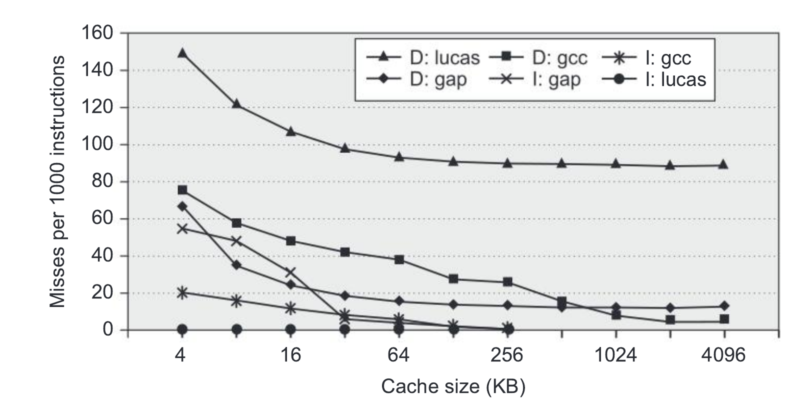

## 谬误与陷阱 {#sec-2-7}

存储层次是计算机体系结构中最便于定量分析的领域，按说不容易出现谬误和陷阱。可是写这一节时，我们缺的不是可举的警示，而是篇幅！

**谬误**　*根据一个程序的 Cache 性能预测另一个程序的 Cache 性能。*

[图 2.27](#fig-2-27) 取 SPEC2000 基准测试程序集中的三个程序，给出了它们的指令失效率和数据失效率随 Cache 容量的变化。三个程序差别很大：Cache 为 4096 KiB 时，每千条指令的数据失效次数分别是 9、2 和 90；Cache 为 4 KiB 时，每千条指令的指令失效次数分别是 55、19 和 0.0004。数据库等商业程序即使配上很大的二级 Cache，失效率也相当高，SPECCPU 程序一般不会这样。可见，用一个程序的 Cache 性能去推断另一个程序是不可取的。[图 2.23](#fig-2-23) 也表明，程序之间的差异很大，甚至整数程序和浮点密集型程序哪一类失效率更高，这样的判断也可能出错，mcf 和 sphnix3 就是例子！

{#fig-2-27 width=90%}

**陷阱**　*模拟足够多的指令，以准确测量存储层次的性能。*

这一条实际上包含三个陷阱：

* 一是用很短的踪迹去预测大容量 Cache 的性能；
* 二是程序的局部性行为在整个运行过程中并非一成不变；
* 三是程序的局部性行为可能随输入不同而变化。

[图 2.28](#fig-2-28) 给出了 SPEC2000 中同一个程序在五组输入下每千条指令的累计平均指令失效次数。对这几组输入而言，前 19 亿条指令的平均失效率与后续执行过程的平均失效率相差很大。

{#fig-2-28 width=90%}

**陷阱**　*在基于 Cache 的系统中不提供高存储带宽。*

Cache 能降低平均访存延迟，但应用如果必须访问主存，Cache 未必能为它提供高存储带宽。面对这类应用，体系结构设计者必须在 Cache 之后配置 HBM。第 4 章和第 5 章还会回到这个陷阱。

**陷阱**　*引入一种「介于」两种现有技术之间、但在速度和价格上都没有明显优势的存储技术。*

人们多次尝试引入新的存储技术，目的有两种：一是取代某种现有技术，二是「插入」两种现有技术之间，例如 DRAM 和磁盘之间。这些尝试大多失败了，原因是新技术没有带来显著而持久的优势：有时每位成本更低，但速度慢得多；有时速度更快，但成本更高。相变存储器（Micron 和 Intel 称之为 Xpoint）看来是最近一个落入这个陷阱的技术，在它之前还有很多，包括电荷耦合器件、磁泡存储器和光盘。相比之下，Flash 是唯一一个大获成功的例子。它胜出的原因有三：它是非易失的；它比磁盘快得多，读操作尤其如此；随着时间推移，它与磁盘在每位成本上的差距也缩小了大半。到 2022 年，除大规模归档存储之外，Flash 已经基本取代了硬盘。
