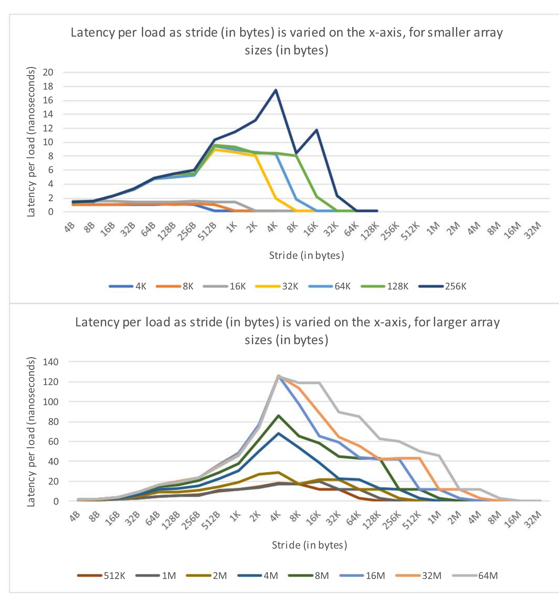

## 案例研究与习题（Rajeev Balasubramonian、Norman P. Jouppi、Naveen Muralimanohar、Sheng Li） {- #sec-2-exercises}

### 案例研究 1：用高级技术优化 Cache 性能 {-}

*本案例研究涉及的概念*

* 非阻塞 Cache
* 面向 Cache 的编译优化
* 软件预取和硬件预取
* 计算 Cache 性能对更复杂处理器的影响

所谓矩阵转置，就是把矩阵的行和列互换，如下所示：

完成转置的简单 C 循环如下：

```c
for (i = 0; i < 3; i++) {
 for (j = 0; j < 3; j++) {
 output[j][i] = input[i][j];
 }
}
```

2.1　[10/15/15/12/20] <2.3> 输入矩阵和输出矩阵都按行主序存放。所谓*行主序*，就是同一行中相邻的元素占据内存中相邻的地址。在一个处理器上执行 256 × 256 的双精度矩阵转置，条件如下：

* L1 数据 Cache 容量为 16 KB，全相联（不必考虑 Cache 冲突），采用最近最少使用（LRU）替换，块大小为 64 字节；一个双精度数占 8 字节；
* L1 Cache 的失效或预取需要 16 个周期，而且总在 L2 Cache 中命中；L2 Cache 每 2 个处理器周期可以处理一个请求；
* 数据在 L1 Cache 中时，上面内层循环的每次迭代需要 4 个周期；
* 写失效时 Cache 采用写分配、写时取块的策略；
* 写回脏 Cache 块需要 0 个周期（这一假设并不现实）。

按上面的简单实现，这样的执行顺序对输出矩阵不理想；如果作循环交换，执行顺序又会对输入矩阵不理想。可见只靠循环交换无法提高这段代码的性能，必须改用分块。

a.　[10] <2.3> 要发挥分块执行的好处，Cache 至少应当多大？

b.　[15] <2.3> 在上面这个最小容量的 Cache 中，分块版本和不分块版本的失效次数相比如何？

c.　[15] <2.3> 编写执行转置的代码，以块大小 *B* 为参数，使用 *B* × *B* 的块。

d.　[12] <2.3> 要让性能稳定，不随两个数组在内存中的位置变化，L1 Cache 至少需要多大的相联度？

e.　[20] <2.3> 在一台计算机上分别运行分块和不分块的 256 × 256 矩阵转置。根据你对这台计算机存储系统的了解，结果与你的预期吻合到什么程度？如果可能，解释其中的差异。

2.2　[10] <2.3> 为上面*不分块*的矩阵转置代码设计一个硬件预取器。硬件预取器有简单和复杂之分：最简单的一种只在失效后预取顺序相邻的 Cache 块；更复杂的「非单位步长」硬件预取器能够分析失效访问流，检测出非单位步长并据此预取。软件预取则不同，确定非单位步长和确定单位步长一样容易，例如可以在 C 代码中用 `__builtin_prefetch( )` 函数插入软件预取。假设预取的数据直接写入 Cache，而且没有「污染」，即不会覆盖在预取数据之前就要用到的数据。采用非单位步长预取器时，为了获得最好的性能，内层循环进入稳定状态后，任一时刻必须有多少个尚未完成的预取？

2.3　[15/20] <2.3> 使用软件预取要兼顾两方面：一是预取必须及时完成，赶得上使用；二是尚未完成的预取要尽量少，既不超出微结构的能力，也尽量减少 Cache 污染。不同处理器的能力和限制各不相同，问题就更复杂了。

a.　[15] <2.3> 编写带软件预取的分块矩阵转置代码。

b.　[20] <2.3> 估算分块和不分块的转置代码在有、无软件预取时的性能，并加以比较。

### 案例研究 2：融会贯通：高度并行的存储系统 {-}

*本案例研究涉及的概念*

* 交叉问题：存储层次的设计
* 现代处理器中的存储层次参数

[图 2.29](#fig-2-29) 中的程序可以用来评估存储系统的行为，[图 2.29](#fig-2-29) 给出的是它的 C 代码。关键有两点：一是计时要准确；二是让程序以不同的步长遍历内存，从而访问到存储层次的不同级。

程序由三部分组成：

* 第一部分是一个过程，调用标准工具准确测量用户 CPU 时间。在某些系统上，可能要修改这个过程才能运行。
* 第二部分是一个嵌套循环，以不同的步长和 Cache 容量读写内存。为了得到准确的 Cache 计时，这段代码要重复执行许多次。
* 第三部分只测量嵌套循环本身的开销，以便从测得的总时间中减去，得出访存所用的时间。

结果以 `.csv` 文件格式输出，便于导入电子表格。根据所要回答的问题和被测系统的内存容量，可能需要修改 `CACHE_MAX`。在单用户模式下运行，或者至少不运行其他活动的应用，结果会更稳定。在现代机器上，这段代码可能要运行几分钟。

[图 2.29](#fig-2-29) 中的代码源自加州大学伯克利分校 Andrea Dusseau 编写的程序，依据的是 Saavedra-Barrera（1992）中的详细描述。为了解决在较新机器上出现的一些问题，代码作过修改；与 Linux 和 Microsoft Visual C++ 平台兼容的版本可以从 <https://users.cs.utah.edu/~rajeev/HP-code/> 获得。程序假设程序地址与物理地址一致，这只在少数使用虚拟地址 Cache 的机器上成立。一般来说，机器刚重启后，虚拟地址往往与物理地址一致，因此可能要重启机器，结果中的曲线才会平滑。

回答下面的问题时，作如下假设：存储层次中所有部件的容量都是 2 的幂；页的大小远大于二级 Cache（如果有的话）的块大小；二级 Cache 的块大小大于或等于一级 Cache 的块大小。

[图 2.29　用于评估存储系统的 C 程序]{#fig-2-29 .caption}

```c
#include <stdio.h>
#include <time.h>
#define ARRAY_MIN (1024) /* 1/4 smallest cache */
#define ARRAY_MAX (4096*4096) /* 1/4 largest cache */
int x[ARRAY_MAX]; /* array going to stride through */

double get_seconds() { /* routine to read time in seconds */
  time_t ltime;
  time(&ltime);
  return (double) ltime;
}

int label(int i) { /* generate text labels */
  if (i<1e3) printf("%ldB,",i);
  else if (i<1e6) printf("%ldK,",i/1024);
  else if (i<1e9) printf("%ldM,",i/1048576);
  else printf("%ldG,",i/1073741824);
  return 0;
}

int main(int argc, char* argv[]) {
  int register nextstep, i, index, stride;
  int csize;
  double steps, tsteps;
  double loadtime, lastsec, sec0, sec1, sec; /* timing variables */

  /* Initialize output */
  printf(" ,");
  for (stride=1; stride <= ARRAY_MAX/2; stride = stride*2)
    label(stride*sizeof(int));
  printf("\n");

  /* Main loop for each configuration */
  for (csize=ARRAY_MIN; csize <= ARRAY_MAX; csize=csize*2) {
      label(csize*sizeof(int)); /* print cache size for this loop */
      for (stride=1; stride <= csize/2; stride=stride*2) {
            /* Lay out path of memory references in array */
            for (index=0; index < csize; index=index+stride)
              x[index] = index + stride; /* pointer to next */
            x[index-stride] = 0; /* loop back to beginning */

            /* Wait for timer to roll over */

            lastsec = get_seconds();
            sec0 = get_seconds();
            while (sec0 == lastsec) {
              sec0 = get_seconds();
            }

            /* Walk through path in array for twenty seconds */
            /* This gives 5% accuracy with second resolution */
            steps = 0.0; /* number of steps taken */
            nextstep = 0; /* start at beginning of path */
            sec0 = get_seconds(); /* start timer */
            do { /* repeat until 20 seconds of execution */
              for (i=stride;i!=0;i=i-1) { /* keep samples same */
                   nextstep = 0;
                   do nextstep = x[nextstep]; /* dependency */
                   while (nextstep != 0);
              }
              steps = steps + 1.0; /* count loop iterations */
              sec1 = get_seconds(); /* end timer */
            } while ((sec1 - sec0) < 20.0); /* collect 20 seconds */
            sec = sec1 - sec0;

            /* Repeat empty loop to loop subtract overhead */
            tsteps = 0.0; /* used to match number of while iterations */
            sec0 = get_seconds(); /* start timer */
            do { /* repeat until same number of iterations as above */
              for (i=stride;i!=0;i=i-1) { /* keep samples same */
                   index = 0;
                   do index = index + stride;
                   while (index < csize);
              }
              tsteps = tsteps + 1.0;
              sec1 = get_seconds(); /* - overhead */
            } while (tsteps < steps); /* until = number of iterations above */
            sec = sec - (sec1 - sec0);
            loadtime = (sec*1e9)/(steps*csize);
            /* write out results in .csv format for Excel */
            printf("%4.1f,", (loadtime<0.1) ? 0.1 : loadtime);
      }; /* end of inner for loop */
      printf("\n");
  }; /* end of outer for loop */
  return 0;
}
```

2.4　[12/12/12/10/12] <2.6> [图 2.30](#fig-2-30) 画出了这个程序的一个输出样例，x 轴列出的是所测试数组的大小。根据[图 2.30](#fig-2-30) 中的结果样例回答下列问题。

{#fig-2-30 width=90%}

a.　[12] <2.6> 二级 Cache 的总容量和块大小各是多少？

b.　[12] <2.6> 二级 Cache 的失效开销是多少？

c.　[12] <2.6> 二级 Cache 的相联度是多少？

d.　[10] <2.6> 主存的容量是多少？

e.　[12] <2.6> 页大小为 4 KB 时，换页时间是多少？

2.5　[12/15/15/20] <2.6> 必要时修改[图 2.29](#fig-2-29) 中的代码，测量下列系统特征。画出实验结果：y 轴为所用时间，x 轴为访存步长，两个坐标轴都用对数刻度，每种 Cache 容量画一条曲线。

a.　[12] <2.6> 系统的页大小是多少？

b.　[15] <2.6> TLB 有多少项？

c.　[15] <2.6> TLB 的失效开销是多少？

d.　[20] <2.6> TLB 的相联度是多少？

2.6　[20/20] <2.6> 在多处理器存储系统中，单个处理器也许无法让存储层次的较低几级达到饱和，多个处理器协同工作时则应当可以。修改[图 2.29](#fig-2-29) 中的代码，同时运行它的多个副本，看能否确定：

a.　[20] <2.6> 你的计算机系统中有多少个真正的处理器？有多少个处理器只是额外的多线程上下文？

b.　[20] <2.6> 你的系统有多少个存储控制器？

2.7　[20] <2.6> 你能想出一种用程序测试指令 Cache 某些特征的办法吗？*提示*：编译器可能从一段代码生成大量不易察觉的指令，所以尽量使用你的指令系统结构（ISA）中长度已知的简单算术指令。

### 案例研究 3：研究各种存储系统组织方式的影响 {-}

*本案例研究涉及的概念*

* DDR3/DDR4 存储系统
* rank、存储体和行缓冲对性能和功耗的影响
* DRAM 时序参数
* DRAM 调度策略

处理器芯片通常支持几个 DDR3 或 DDR4 存储通道。本案例研究只考虑一个存储通道，探讨改变几个参数会怎样影响它的性能和功耗。

**存储通道的组织。** 一个通道上插有一个或多个 DIMM，每个 DIMM 支持一个或多个 rank。所谓 rank，就是一组协同工作、共同响应存储控制器一条命令的 DRAM 芯片。例如，一个 rank 可以由 16 片 DRAM 芯片组成，每片在通道时钟的每个边沿处理 4 位输入或输出，这样的芯片称为 x4（by four）芯片；一个 rank 也可以由 8 片 x8 芯片或 4 片 x16 芯片组成。无论哪种组成方式，一个 rank 都能处理 64 位存储通道上传送的数据。rank 内部又分为 8 个（DDR3）或 16 个（DDR4）存储体（bank）。每个存储体有一个行缓冲，它实际上保存着从这个存储体最后读出的一行。

**读操作的命令序列。** 从一个存储体读数据，典型的命令序列如下：

(i)　存储控制器发出预充电（Precharge）命令，让存储体做好访问新行的准备。预充电在经过时间 tRP 后完成。

(ii)　存储控制器接着发出激活（Activate）命令，从存储体中读出相应的行。激活在经过时间 tRCD 后完成，这时这一行就算进入了行缓冲。

(iii)　然后存储控制器可以发出列读命令（即 CAS 命令），把行缓冲中特定的一部分送到存储通道上。经过时间 CL 后，数据突发的最初 64 位出现在存储通道上。一次突发通常包含 8 次 64 位传输，在 4 个存储时钟周期的上升沿和下降沿完成，这段时间称为传输时间。

(iv)　如果存储控制器接下来要访问同一存储体中另一行的数据，称为行缓冲失效，这时要重复步骤 (i) 到 (iii)。这里暂且假设 CL 一过就可以发出步骤 (i) 的预充电命令；有些情况下还需要再加一段延迟，这里忽略不计。如果存储控制器要访问同一行中的另一块数据，称为行缓冲命中，这时只需再发一条 CAS 命令。两条背靠背的 CAS 命令至少要间隔 4 个周期，保证第一次数据传输完成后第二次才开始。

存储控制器可以在相继的周期里向不同的存储体发出命令，因此能够并行完成许多次读写，而不必闲等单个存储体的 tRP、tRCD 和 CL 过去。后面的问题都假设 tRP = tRCD = CL = 13 ns，存储通道频率为 1 GHz，即传输时间为 4 ns。

2.8　[10] <2.2> 发生行缓冲失效时，存储控制器看到的读延迟是多少？

2.9　[10] <2.2> 发生行缓冲命中时，存储控制器看到的延迟是多少？

2.10　[10] <2.2> 如果存储通道只支持一个存储体，而且访存以行缓冲失效为主，存储通道的利用率是多少？

2.11　[15] <2.2> 假设行缓冲失效率为 100%，要使存储通道利用率达到 100%，存储通道至少应当支持多少个存储体？

2.12　[10] <2.2> 假设行缓冲失效率为 50%，要使存储通道利用率达到 100%，存储通道至少应当支持多少个存储体？

2.13　[15] <2.2> 某个应用有 4 个线程，这些线程完全没有空间局部性，即行缓冲失效率为 100%。每隔 200 ns，4 个线程各自同时向存储控制器队列插入一个读操作。存储通道只支持一个存储体时，平均访存延迟是多少？支持 4 个存储体时又是多少？

2.14　[10] <2.2> 从上面几道题中，你对增加存储体个数的好处和坏处有什么认识？

2.15　[20] <2.2> 下面转向存储器的功耗。从以下链接下载 Micron 功耗计算器：<https://www.micron.com/sales-support/design-tools/dram-power-calculator>

这个链接提供了多种 DDR 技术的电子表格，这里只作 DDR3 的分析。电子表格已经预先配置好，可以估算 Micron 生产的几种 DRAM 芯片的功耗。操作步骤如下：

* 在电子表格的「DDR3 Config」选项卡中选择配置：x8 DDR3 2Gb DRAM 芯片，速度等级 -093，Fast 预充电退出模式；
* 转到「System Config」选项卡，设置负载的行为：页命中率（即行缓冲命中率）50%，读数据总线利用率 45%，写数据总线利用率 25%，其他参数用默认设置；
* 单击「Summary」选项卡，查看在这样的芯片和负载条件下单片 DRAM 芯片的功耗构成。

Micron 会随着工艺的进步定期更新这些电子表格。按 2024 年夏天的快照，这片 DRAM 芯片的功耗为 229 mW，其中激活操作 45 mW，CAS 操作 145 mW，背景功耗 39 mW。

接下来再次单击「System Config」选项卡，修改读写流量和行缓冲命中率，观察功耗构成怎样随之变化。例如，通道利用率为 35%（25% 读、10% 写）时，或者行缓冲命中率提高到 80% 时，功耗各降低多少？

2.16　[20] <2.2> 在默认配置中，一个 rank 由 8 片 x8 2 Gb DRAM 芯片组成，也可以改由 16 片 x4 芯片或 4 片 x16 芯片组成。每片 DRAM 芯片的容量也可以变化，有 1 Gb、2 Gb 和 4 Gb 三种。这些选项都在 Micron 功耗计算器的「DDR3 Config」选项卡中设置。把每种 rank 组织方式的总功耗列成表。对给定容量的 rank，哪种组成方式的功耗效率最高？

2.17　[20] <2.2> 前面讨论过，基于 DDR 的存储系统可以采用两种存储控制器，一种采用开页策略，另一种采用关页策略。两种策略的区别在于某个存储体没有待处理请求时怎么做：

* 开页策略让行缓冲保持打开，期望将来出现行缓冲命中；
* 关页策略发出预充电命令，让存储体为将来访问另一行做好准备（预计空间局部性有限）。

有待处理的请求时，两种策略都优先处理行缓冲命中；没有行缓冲命中时，按先来先服务的策略处理。下表是对一个存储体的一串块读操作，列出了每次读操作访问的 DRAM 行（X、Y、Z），以及该请求进入存储控制器队列的周期。请给出存储控制器发出每条命令的周期。假设预充电、激活和列读都需要 10 个周期；第一个请求在第 20 个周期到来时，存储体已经完成了预充电。

| 存储事务 | 入队周期 | 开页策略下的命令序列 | 关页策略下的命令序列 |
|---|---|---|---|
| Read X | 20 |  |  |
| Read X | 35 |  |  |
| Read X | 90 |  |  |
| Read Y | 95 |  |  |
| Read X | 100 |  |  |
| Read X | 160 |  |  |

### 习题 {-}

有几道习题要用到 Cache 模拟器。公开的模拟器中功能最强的是 CACTI（7.0 版），但它采用的是较旧的工艺（32nm）。这对习题没有根本影响，只是结果与较新的 SRAM 和 DRAM 工艺不符。CACTI 7.0 可以从 GitHub 获得（<https://github.com/topanitanw/Cacti-7.0>）。如果想用更新的工艺（14nm）做这些习题，可以试用 FT-CACTI，它把 CATCI 7.0 的模型更新到了较新的工艺，同样可以从 GitHub 获得（<https://github.com/marg-tools/FN-CACTI>）。

2.18　[12/12/15] <2.3> 下面的问题用 CACTI 7.0 或 FT-CACTI 研究小而简单的 Cache 的效果。

a.　[12] <2.3> 比较块大小为 64 字节、只有一个存储体的 64 KB Cache 的访问时间。以直接映射组织为基准，2 路组相联和 4 路组相联 Cache 的相对访问时间各是多少？

b.　[12] <2.3> 比较块大小为 64 字节、只有一个存储体的 4 路组相联 Cache 的访问时间。以 16 KB 的 Cache 为基准，32 KB 和 64 KB 的 Cache 的相对访问时间各是多少？

c.　[15] <2.3> 对一个 64 KB 的 Cache，在相联度 1 到 8 之间找出平均访存时间最短的一种。已知某个负载集的每条指令失效次数为：直接映射 0.00664，2 路组相联 0.00366，4 路组相联 0.000987，8 路组相联 0.000266。总体上每条指令有 0.3 次数据访问。假设在所有模型中 Cache 失效都需要 10 ns。计算以周期数表示的命中时间时，采用 CACTI 输出的周期时间，它对应 Cache 在流水线中不产生任何气泡时所能工作的最高频率。

2.19　[15] <2.3> 你要为一款新微处理器研究多体 L1 数据 Cache 和流水化 L1 数据 Cache 的相对性能。Cache 容量为 64 KB，2 路组相联，块大小为 64 字节。流水化 Cache 需要 4 个流水段来完成访问、命中检测和组选择；多体实现由两个 32 KB 的 2 路组相联存储体组成。使用 CACTI 或 FT-CACTI，并采用所支持的最好的工艺，比较流水化设计和多体设计的面积，以及每次访问的总动态读能耗。说明哪种设计占用的面积较小、哪种设计需要的功耗较大，并解释可能的原因。

2.20　[12/15] <2.3> 考虑在 L2 Cache 失效时采用关键字优先和提前重启。条件如下：

* L2 Cache 容量为 2 MB，块大小为 64 字节，回填通路宽 16 字节；
* 每 4 个处理器周期可以向 L2 写入 16 字节；
* 从存储控制器收到第一个 16 字节块需要 120 个周期，此后从主存每再取一个 16 字节块需要 16 个周期；
* 数据可以直接旁路到 L2 Cache 的读端口；
* 不计把失效请求传给 L2 Cache 以及把所需数据传给 L1 Cache 所用的周期。

a.　[12] <2.3> 采用和不采用关键字优先和提前重启时，处理一次 L2 Cache 失效各需要多少个周期？

b.　[15] <2.3> 你认为关键字优先和提前重启对 L1 Cache 更重要，还是对 L2 Cache 更重要？哪些因素决定了它们的相对重要性？

2.21　[12/12] <2.3> 你要在写直达的 L1 Cache 和写回的 L2 Cache 之间设计一个写缓冲。L2 Cache 的写数据总线宽 16 B，每 4 个处理器周期可以对一个独立的 Cache 地址完成一次写。

a.　[12] <2.3> 每个写缓冲项应当有多少字节宽？

b.　[15] <2.3> 用 64 位存数指令把内存清零时，如果其他所有指令都能和存数指令并行发射，而且这些块都在 L2 Cache 中，那么在稳定状态下，用合并写缓冲代替不合并的写缓冲，预计能得到多大的加速比？

c.　[15] <2.3> 在采用阻塞 Cache 和非阻塞 Cache 的系统中，可能发生的 L1 失效各会怎样影响所需的写缓冲项数？

2.22　[20] <2.1, 2.2, 2.3> Cache 起着过滤器的作用。例如，一个程序每执行 1000 条指令，平均可能有 20 次访存局部性很差，2 MB 的 Cache 无法满足。这时称这个 2 MB Cache 的 MPKI（每千条指令失效次数）为 20，而且无论 2 MB Cache 前面有哪些较小的 Cache，这个值大体上都不变。各种 Cache 的容量/延迟/MPKI 如下：32 KB/1/100，128 KB/2/80，512 KB/4/50，2 MB/8/40，8 MB/16/10；访问片外存储系统平均需要 200 个周期。对下面几种 Cache 配置，计算访问 Cache 层次所用的平均时间。Cache 层次太浅或太深各有什么坏处？

a.　32 KB L1；8 MB L2；片外存储器

b.　32 KB L1；512 KB L2；8 MB L3；片外存储器

c.　32 KB L1；128 KB L2；2 MB L3；8 MB L4；片外存储器

2.23　[15] <2.1, 2.2, 2.3> 一个 16 MB、16 路的 L3 Cache 由 A、B 两个程序共享。Cache 中有一种机制，监测每个程序的 Cache 失效率，并给每个程序分配 1～15 路，以减少 Cache 失效的总次数。程序 A 分到 1 MB Cache 时 MPKI 为 100，每多分 1 MB，MPKI 减少 1；程序 B 分到 1 MB Cache 时 MPKI 为 50，每多分 1 MB，MPKI 减少 2。各路怎样在程序 A 和 B 之间分配最好？

2.24　[20] <2.1, 2.6> 你要设计一款 PMD，并针对低能耗作优化。处理器核（包括一个 16 KB 的 L1 数据 Cache）只要不在休眠状态，功耗就是 1 W。如果 L1 Cache 命中率是理想的，核执行某项任务的平均 CPI 为 1，即执行 1000 条指令需要 1000 个周期。访问 L2 及更低层级每多用一个周期，核就多一个停顿周期。根据下面的规格，执行这项任务时，L2 Cache 取多大容量能使 PMD（核、L1、L2 和存储器）的能耗最低？

a.　核的频率为 1 GHz，L1 的 MPKI 为 100。

b.　256 KB 的 L2 延迟为 10 个周期，MPKI 为 20，背景功耗为 0.2 W，每次访问 L2 消耗 0.5 nJ。

c.　1 MB 的 L2 延迟为 20 个周期，MPKI 为 10，背景功耗为 0.8 W，每次访问 L2 消耗 0.7 nJ。

d.　存储系统的平均延迟为 100 个周期，背景功耗为 0.5 W，每次访存消耗 35 nJ。

2.25　[20] <2.2> 遵循 DDR 标准的存储系统在存储时钟的每个边沿传输 64 位数据。每次传输中可能有 1 位出错，错误可能来自随机的软错误，也可能来自某个 DRAM 引脚或连线的硬错误。为了容忍这种错误，可靠的存储系统给每次 64 位数据传输附加 8 位编码，通常是用于纠正单个错误、检测两个错误（SECDED）的汉明码。但有些硬件基础设施需要更高的可靠性，例如要求即使整片 DRAM 芯片及其所有输出位都失效，仍能保证纠正，这称为 Chipkill。你能设计一个简单的存储系统，在一片 DRAM 芯片失效时仍能提供正确的数据吗？提供这种更高的可靠性有什么缺点？你也许不是编码理论的专家，但很可能熟悉实现 RAID 存储时用到的奇偶校验和循环冗余校验（CRC）。

2.26　[20] <2.4> 本章介绍旁路时，主要以共享 Cache 访问和填充—探测为例。你能列举存储层次中的其他几种旁路吗？攻击者可能怎样利用它们？处理器体系结构设计者又可能怎样防御这些攻击？

2.27　[20] <2.3> 考虑下面三种 4 路组相联 L2 Cache 设计：

(i)　tag和数据并行访问：4 个周期、20 pJ 的 tag 查找与 20 个周期、1000 pJ 的数据阵列访问同时进行。

(ii)　tag 和数据串行访问：先作 4 个周期、20 pJ 的 tag 查找，再对其中一路作 20 个周期、250 pJ 的数据阵列访问。

(iii)　路预测的 tag 和数据访问：先访问一个 1 个周期、5 pJ 的路预测器，再对预测的那一路并行访问 tag 和数据（tag 查找 4 个周期、5 pJ，数据阵列访问 20 个周期、250 pJ）。如果路预测错误，再对其余三路并行访问 tag 和数据（tag 查找 4 个周期、15 pJ，数据阵列访问 20 个周期、750 pJ）。

假设路预测的准确率为 80%，分别按性能和能耗给这三种设计排序。

2.28　[20] <2.3> 本章讨论了采用大容量 L4 DRAM Cache 的可能性，最后落到「Alloy Cache」的设计上。为了减轻 DRAM 访问的高代价，Alloy Cache 组织成直接映射 Cache。一般认为，直接映射 Cache 可能有很高的冲突失效率。你认为这对 Alloy Cache 是不是问题？如果是，怎样缓解？此外，讨论在 Alloy Cache 中使用较大的数据块有哪些权衡，比如使用 4KB 的数据块会带来什么影响？

2.29　[20] <2.3> 在基准 Alloy Cache 设计中，访问 tag 需要 30 个周期，之后还要 4 个周期才能收到数据；如果访问 tag 后发现失效，就启动一次访存，平均需要 100 个周期。发现一次 Alloy Cache 失效要花这么长时间，因此再引入一个 1 个周期的命中/失效预测器，它与 Alloy Cache 访问并行工作：预测命中时，操作序列与基准设计完全相同；预测失效时，在查找 Alloy Cache 的同时就启动访存。对这两种设计，分别计算 Alloy Cache 及更低层级的平均延迟。命中/失效预测器的表现如下：

(i)　在全部访问中，80% 正确地预测为命中；

(ii)　5% 正确地预测为失效；

(iii)　5% 错误地预测为命中；

(iv)　10% 错误地预测为失效。

2.30　[10/10] <2.1, 2.2, 2.3> 一个组中的各路可以看作一个按优先级从高到低排列的列表。每访问一次这个组，就可以重新组织这个列表，改变各块的优先级。从这个角度看，Cache 管理策略可以分解成三个子策略：

* 插入（Insertion）：新取来的块放在优先级列表的什么位置；
* 提升（Promotion）：每次访问到一个块（Cache 命中）时，这个块在列表中的位置怎样变化；
* 牺牲块选择（Victim Selection）：发生 Cache 失效时，逐出列表中的哪一项，为新块腾出位置。

a.　你能用插入、提升和牺牲块选择这三个子策略来描述 LRU Cache 策略吗？

b.　你能定义其他有竞争力、值得进一步探索的插入策略和提升策略吗？

2.31　[15] <2.1, 2.3> 在运行多个程序的处理器中，末级 Cache（LLC，Last-Level Cache）通常由所有程序共享。这会带来干扰：一个程序的行为和 Cache 占用会影响其他程序可用的 Cache。干扰造成两方面的问题：一是服务质量（QoS），干扰会使一个程序得到的资源和性能低于承诺的水平，比如低于云服务运营商承诺的水平；二是隐私，一个程序可以根据自己观察到的干扰，用旁路攻击推断其他程序的访存模式。你可以在末级 Cache 中加入哪些策略，使一个程序的行为不受共享这个 Cache 的其他程序影响？

2.32　[15] <2.3> 容量达几 MB 的大型 L3 Cache，信号要经过很长的连线，访问可能需要几十个周期，例如访问一个 16 MB 的 L3 Cache 可能需要 20 个周期。这个 16 MB 的 Cache 不一定要组织成每次访问都需要 20 个周期，也可以组织成由较小的 Cache 存储体构成的阵列，其中有些存储体离处理器核较近，有些较远。这就形成了非一致 Cache 访问（NUCA）：最近的 2 MB 可以在 8 个周期内访问，接下来的 2 MB 需要 10 个周期，依此类推，最后的 2 MB 需要 22 个周期。你可以引入哪些新策略，使 NUCA Cache 的性能最高？

2.33　[10/10/10] <2.2> 一个台式机系统的处理器连接着一个 2 GB、带*纠错码（ECC）*的 DRAM。假设只有一个存储通道，宽 72 位（64 位数据，8 位 ECC）。

a.　[10] <2.2> 如果使用 1 Gb 的 DRAM 芯片，DIMM 上有多少片 DRAM 芯片？如果 DIMM 的每个数据引脚只连接一片 DRAM，每片 DRAM 必须有多少个数据 I/O？

b.　[10] <2.2> 要支持 32 B 的 L2 Cache 块，突发长度需要多长？

c.　[10] <2.2> 不计 ECC 开销，计算 DDR2-667 和 DDR2-533 DIMM 从活动页读数据时的峰值带宽。

2.34　[20] <2.3> 在末级 Cache 中准确跟踪 LRU 信息，主要难点是什么？

2.35　[20] <2.3> 晶体管在电源和地之间总在泄漏一些电流。处理器内消耗的能耗分为两类：一类是动态能耗，由晶体管开关时的电流引起，取决于开关活动；另一类是漏电能耗，由每个晶体管在每个周期的漏电流引起，取决于晶体管的数量。现代微处理器一半以上的面积由 Cache 占据，因此 Cache 是总漏电能耗的主要来源。降低漏电能耗的一种技术是切断晶体管的电源，使它不再漏电。问题在于：切断一个 Cache 块中晶体管的电源，这个 Cache 块中存放的数据就会丢失。注意，如果一个 Cache 块在一个周期里消耗 X 个单位的漏电能耗，那么从存储器取回这个 Cache 块要消耗 1000X 个单位的动态能耗。利用上述技术，为末级 Cache 设计一种机制，在尽量不影响性能的前提下，显著降低整个系统的能耗。

2.36　[12] <2.2> 你要为一台服务器配置资源。服务器采用 16 核、3 GHz 的 CMP，执行某个负载时的总 CPI 为 2.0（假设 L2 Cache 失效的回填不会延迟）。L2 Cache 的行大小为 32 字节。这些负载平均每 1K 条指令发生 6.67 次 L2 失效。系统使用 DDR4-2666 DIMM，如果所需带宽有时是平均值的 2 倍，那么应当提供多少个独立的存储通道，系统才不会受存储带宽的限制？

2.37　[15] <2.2> 一个处理器有 4 个存储通道。相邻的存储块应当放在同一个存储体中，还是放在不同通道的不同存储体中？

2.38　[15] <2.2> 计算机空闲时，既可以让它待机（这时 DRAM 仍处于活动状态），也可以让它休眠。假设休眠时只需把 DRAM 的内容复制到 Flash 这样的非易失性介质中。已知向 Flash 读或写一个 64 字节的 Cache 行需要 2.56 J，对 DRAM 读或写一个 Cache 行需要 0.5 nJ；DRAM 的空闲功耗为 1.6 W（8 GB）；主存容量为 8 GB。系统空闲多长时间，休眠才有好处？

2.39　[15] <2.2, 2.7> [2.7 节](#sec-2-7)讲过，Intel i7 处理器有一个激进的预取器。把预取器设计得极为激进，可能有哪些坏处？
