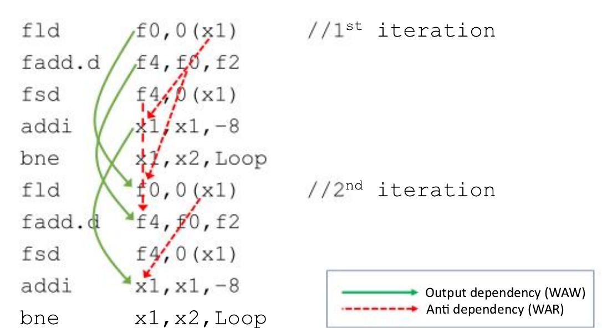
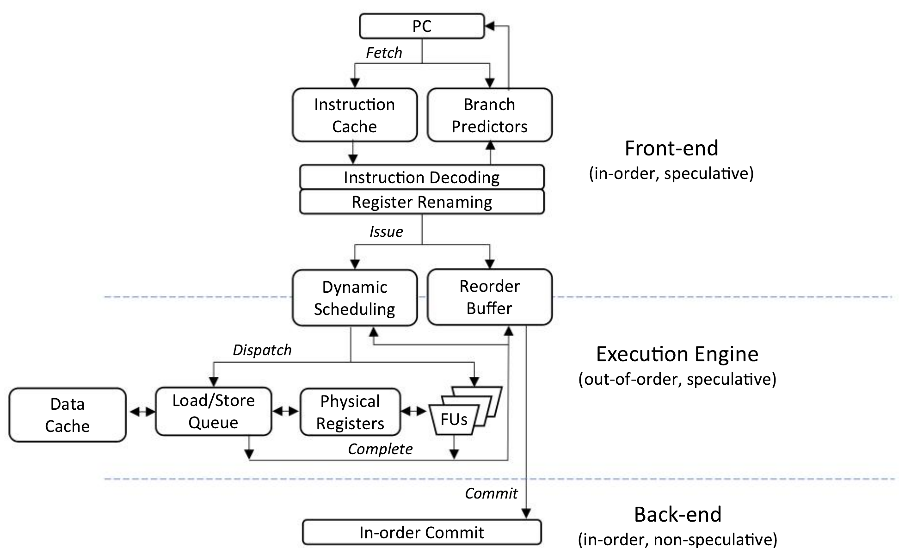

## 揭示 ILP 的基本编译技术 {#sec-3-2}

本节介绍怎样用简单的编译技术提高处理器利用 ILP 的能力。采用静态发射或静态调度的处理器离不开这些技术，后面讨论这类处理器的设计和性能时，也要以它们为基础。附录 H 还会研究更复杂的编译技术和与之配合的硬件方案，目的都是让处理器能利用更多的 ILP。

### 基本流水线调度和循环展开 {-}

要让流水线保持满载，就必须找出能在流水线中重叠执行的无关指令序列，利用指令之间的并行性。为了避免停顿，一条相关指令必须与它所依赖的源指令隔开若干个时钟周期，间隔的周期数等于源指令的流水线延迟。编译器能把这种调度做到什么程度，一方面取决于程序中有多少 ILP 可用，另一方面取决于流水线中各功能部件的延迟。

本章对流水线做如下假设（另有说明的除外）：

* 浮点部件的延迟如[图 3.2](#fig-3-2) 所示；
* 整数流水线是标准的 5 级流水线，因此转移有 1 个时钟周期的延迟；
* 各功能部件都是全流水的，或者有多个副本（副本数与流水线深度相同），因此每个时钟周期都可以发射任何类型的操作，不存在结构冒险。

本节通过一个例子说明编译器怎样变换循环，以增加可用的 ILP。这个例子既用来介绍一项重要的技术，也为附录 H 中更强大的程序变换做铺垫。例子中的代码把一个标量加到一个双精度（64 位）浮点数向量上：

```c
for (i=999; i>=0; i=i-1)
    x[i] = x[i] + s;
```

这个循环每次迭代的循环体都互不相关，所以它是一个并行循环。附录 H 会把这一概念形式化，并介绍怎样在编译时检测各次迭代是否相互独立。下面先分析这个循环的性能，看看在具有上述延迟的 RISC-V 流水线上，怎样利用这种并行性提高性能。

第一步是把这段代码翻译成 RISC-V 汇编语言。代码中，寄存器 `x1` 的初值是数组中地址最高的元素的地址；`f2` 存放标量 *s*；寄存器 `x2` 的初值取得使 `x2+8` 正好是最后一个要处理的数组元素的地址。

[图 3.2　本章使用的浮点操作延迟。最后一列是为避免停顿，两条指令之间需要间隔的时钟周期数。这些数值与浮点部件上常见的平均延迟相近。浮点 load 到 store 的延迟为 0，因为 load 的结果可以旁路给 store，store 不必停顿。整数 load 的延迟仍假设为 1，整数 ALU 操作的延迟仍假设为 0（包括 ALU 操作到转移指令）。]{#fig-3-2 .caption}

| 产生结果的指令 | 使用结果的指令 | 延迟（时钟周期） |
|---|---|--:|
| 浮点 ALU 操作 | 另一个浮点 ALU 操作 | 3 |
| 浮点 ALU 操作 | 存储双精度数（store double） | 2 |
| 取双精度数（load double） | 浮点 ALU 操作 | 1 |
| 取双精度数（load double） | 存储双精度数（store double） | 0 |

不考虑流水线调度、直接翻译得到的 RISC-V 代码如下：

```
Loop: fld    f0,0(x1)     //f0=数组元素
      fadd.d f4,f0,f2     //加上 f2 中的标量
      fsd    f4,0(x1)     //存结果
      addi   x1,x1,-8     //指针减 8 字节（64 位数）
      bne    x1,x2,Loop   //若 x1≠x2 则转移
```

先看这个循环在 RISC-V 简单流水线上调度以后运行得怎样，延迟按[图 3.2](#fig-3-2) 计算。

**例题**　分别给出不调度和调度两种情况下，这个循环在 RISC-V 流水线上的执行过程，标出所有停顿或空闲的时钟周期。调度时要考虑浮点操作的延迟。

**解答**　不做任何调度时，循环的执行过程如下，每个数组元素需要 9 个周期：

```
                          发射的时钟周期
Loop: fld    f0,0(x1)         1
      stall                   2
      fadd.d f4,f0,f2         3
      stall                   4
      stall                   5
      fsd    f4,0(x1)         6
      addi   x1,x1,-8         7
      bne    x1,x2,Loop       8
```

调度以后只剩 2 个停顿，每次迭代缩短为 7 个周期：

```
Loop: fld    f0,0(x1)
      addi   x1,x1,-8
      fadd.d f4,f0,f2
      stall
      stall
      fsd    f4,8(x1)
      bne    x1,x2,Loop
```

把 `addi` 挪到 `fld` 后面，消除了 `fld` 之后的停顿；`fadd.d` 之后的 2 个停顿是在等 `fsd` 使用它的结果。

在这个例题中，每 7 个时钟周期完成一次迭代、写回一个数组元素，但真正处理数组元素的只有 load、add 和 store 这 3 个周期，其余 4 个周期是循环开销（`addi` 和 `bne`）和 2 个停顿。要消除这 4 个周期，就必须让实际操作在指令中所占的比例更大，开销指令所占的比例更小。

**循环展开。** 要提高实际指令相对于转移指令和开销指令的比例，一种简单的办法是*循环展开*：把循环体复制若干份，同时调整循环的结束代码。

循环展开还能改进调度。展开以后转移变少了，多次迭代中的指令就可以放在一起调度。在本例中，把展开后各次迭代的指令交错排列，就能消除使用数据造成的停顿。不过，如果展开时只是照搬指令，各份副本都使用同样的寄存器，就可能妨碍有效的调度。因此，每次迭代要使用不同的寄存器，所需的寄存器数也就增加了。

**例题**　把循环展开成 4 份循环体。假设 `x1 − x2`（即数组的大小）的初值是 32 的倍数，也就是说，迭代次数是 4 的倍数。消除所有明显冗余的计算，并且不要重复使用任何寄存器。

**解答**　下面的代码合并了各次迭代的 `addi` 指令，去掉了展开时复制出来的多余 `bne`。注意，`x2` 的初值现在必须使 `x2+32` 正好是最后 4 个元素的起始地址。

```
Loop: fld    f0,0(x1)      // 第 1 个元素的代码
      fadd.d f4,f0,f2
      fsd    f4,0(x1)      //去掉 addi 和 bne
      fld    f6,-8(x1)     // 第 2 个元素的代码
      fadd.d f8,f6,f2
      fsd    f8,-8(x1)     //去掉 addi 和 bne
      fld    f0,-16(x1)    // 第 3 个元素的代码
      fadd.d f12,f0,f2
      fsd    f12,-16(x1)   //去掉 addi 和 bne
      fld    f14,-24(x1)   // 第 4 个元素的代码
      fadd.d f16,f14,f2
      fsd    f16,-24(x1)
      addi   x1,x1,-32
      bne    x1,x2,Loop
```

这样省掉了 3 条转移指令和 3 次 `x1` 递减。为了把几条修改 `x1` 的 `addi` 合并成一条，各条 load 和 store 的地址偏移都做了相应的补偿。这项优化看似简单，实际上要用到*符号替换和化简*：重新整理表达式，使其中的常数能够合并。例如，表达式 ((*i* + 1) + 1) 可以改写为 (*i* + (1 + 1))，再化简为 (*i* + 2)。附录 H 会介绍这类优化更一般的形式，它们能消除相关的计算。循环展开通常放在编译过程的早期进行，这样优化器才能发现并消除冗余的计算。

如果不调度，展开后的循环中每条浮点 load 或浮点运算后面都紧跟着一条与它相关的操作，因而都会引起停顿。这时循环要运行 26 个时钟周期：每条 `fld` 停顿 1 个周期，每条 `fadd.d` 停顿 2 个周期，再加上 14 个指令发射周期。平均到 4 个元素上，每个元素 6.5 个时钟周期。经过调度，性能还能大幅提高。

**循环上界未知的情况。** 实际程序中，循环的上界通常在编译时并不知道。设上界为 *n*，要把循环展开成 *k* 份循环体，编译器生成的不是一个展开后的循环，而是前后相接的两个循环：

* 第一个循环执行 (*n* mod *k*) 次，循环体就是原来的循环体；
* 第二个循环是展开后的循环体，外面再套一层执行 (*n*/*k*) 次的循环。

*n* 很大时，大部分执行时间都花在展开后的循环体上。第 4 章将会讲到，这种技术与向量处理器编译器中所用的*分段开采*（strip mining）技术类似。

上一个例题中，循环展开消除了开销指令，提高了性能，但代码量也大幅增加。那么，针对前面介绍的流水线调度展开后的循环，性能又会怎样？

**例题**　针对具有[图 3.2](#fig-3-2) 所示延迟的流水线，调度上一例题中展开后的循环，给出调度后的代码。

**解答**

```
Loop: fld    f0,0(x1)
      fld    f6,-8(x1)
      fld    f10,-16(x1)
      fld    f14,-24(x1)
      fadd.d f4,f0,f2
      fadd.d f8,f6,f2
      fadd.d f12,f10,f2
      fadd.d f16,f14,f2
      fsd    f4,0(x1)
      fsd    f8,-8(x1)
      fsd    f12,16(x1)
      fsd    f16,8(x1)
      addi   x1,x1,-32
      bne    x1,x2,Loop
```

调度后，展开的循环总共只需 14 个时钟周期，即每个元素 3.5 个周期。相比之下，既不展开也不调度时每个元素需要 8 个周期，只展开不调度时需要 6.5 个周期。

调度对展开后的循环收益更大，原因是展开暴露出了更多无关指令，调度时可以用它们填满停顿周期；上面的代码已经完全没有停顿。不过，要这样调度，必须先认识到这些 load 和 store 互不相关，可以交换次序。

### 循环展开和调度小结 {-}

本章和附录 H 将介绍多种硬件和软件技术，它们都借助 ILP 来充分发挥处理器中各功能部件的潜力。这些技术大多以一点为关键：知道在什么时候、以什么方式可以改变指令之间的次序。前面的例子中就做了许多这样的改变。在我们看来，这些改变显然是允许的；但实际上，它们必须由编译器或硬件按部就班地完成。为了得到最终展开后的代码，我们做了以下几项判断和变换：

* 发现除了维护循环的代码之外，各次迭代互不相关，从而判断循环展开是有用的；
* 使用不同的寄存器，避免不同的计算共用同一组寄存器而带来不必要的约束（例如名相关）；
* 去掉多余的测试和转移指令，调整循环的结束代码和迭代代码；
* 发现不同迭代中的 load 和 store 互不相关，从而判断展开后的循环中 load 和 store 可以交换次序。这项变换需要分析存储器地址，确认它们不指向同一个地址；
* 调度代码，同时保留必需的相关，保证结果与原来的代码相同。

所有这些变换都建立在一个前提上：要弄清一条指令怎样依赖另一条指令，以及在这些相关的约束下，指令可以怎样修改或重新排序。

**循环展开的限制。** 循环展开的收益受三方面限制：一是每多展开一次，所能分摊的开销越来越少；二是代码量的限制；三是寄存器压力。

先看循环开销。循环展开 4 次以后，指令之间已有足够的并行性，调度后不再有停顿周期。这时 14 个时钟周期中只有 2 个是循环开销：一个是维护下标值的 `addi`，一个是结束循环的 `bne`。如果展开 8 次，每个元素分摊的开销从 1/2 个周期降为 1/4 个周期。

第二个限制是代码量增长。循环本身较大时，代码量增长可能成为问题，特别是在它使指令 Cache 失效率上升的时候。

另一个因素往往比代码量更重要：激进的展开和调度可能使寄存器不够用。在大段代码中调度指令会带来这一副作用，称为*寄存器压力*。为了增加 ILP 而调度代码，会使同时存活的值增多；调度得很激进时，可能无法把所有存活的值都分配到寄存器中。这样，变换后的代码理论上更快，却可能因为寄存器短缺而失去部分甚至全部优势。不展开时，转移本身已经足以限制激进调度，寄存器压力很少成为问题；展开和激进调度结合起来，才可能引起这个问题。多发射处理器需要暴露更多能重叠执行的无关指令序列，这个问题在其中尤其棘手。总的来说，复杂的高层变换在生成具体代码之前很难估计收益，而这类变换的使用已经使现代编译器复杂了许多。

循环展开简单而有用，它能扩大可有效调度的直线代码段。从前面讨论的简单流水线，到本章后面要讨论的多发射超标量处理器和 VLIW 处理器，这项变换在多种处理器上都有用。

## 现代超标量处理器中的 ILP 关键概念 {#sec-3-3}

所谓*超标量处理器*，是指理想 CPI 小于 1、用硬件技术发现和利用 ILP 的处理器。程序即使只经过中等程度的优化，在超标量处理器上也能获得很高的性能，因此在服务器、桌面、笔记本电脑和手机领域，超标量处理器都是主流选择。但超标量处理器有它的局限，设计也很复杂，所以芯片厂商把超标量思想与侧重数据级并行的技术（见第 4 章的 SIMD）和 TLP（见第 5 章的多核）结合起来使用。

**顺序语义与功能等价。** x86、Arm、RISC-V 等流行指令系统结构（ISA）的处理器，必须忠实地实现 ISA 的顺序语义：程序的执行在功能上必须等价于在一台简单处理器上执行，这台处理器按原始程序顺序逐条执行指令，指令之间没有重叠。功能等价包括三方面：一是寄存器和存储单元中产生的值，二是引发的异常，三是这些值和异常变得可见的顺序。下面很快就会看到，许多超标量处理器按数据相关决定的顺序而不是原始程序顺序执行指令，却仍然保持了功能等价，这类设计称为*乱序*（OOO）超标量处理器。现代超标量处理器大多是 OOO 流水线，所以许多人把「超标量」和「OOO 超标量」当成同义词。本章后面还会介绍低功耗的顺序超标量设计，它们按程序规定的顺序执行指令。

冗余代码消除、强度削弱、寄存器分配等基本编译优化，对超标量处理器和标量处理器都有好处。但循环展开这类高级编译技术，超标量处理器依赖得较少，因为它们有硬件机制，能在几十条到几百条指令的窗口内完成类似的优化。现有的二进制程序不必针对新处理器的流水线重新编译、重新优化，就能在新的超标量处理器上获得性能提升。这一优点是超标量体系结构在商业上取得成功的关键因素。

### 更深的流水线和多发射 {-}

CPU 执行时间公式为 $\text{CPU 时间} = \text{IC} \cdot \text{CPI} \cdot \text{CCT}$。超标量处理器针对其中两个因素，取得了比前面的简单流水线更高的性能：

* *更深的流水线*：附录 C 中的简单处理器采用 5 级流水线，超标量处理器的流水线更深，当前的设计为 10～20 级。流水线更深，时钟周期就能更短，现在的时钟频率在 1～5 GHz 之间。两个整数操作数相加这类简单操作仍只占一个流水级；乘法、浮点运算、指令 Cache 或数据 Cache 访问这类延迟较长的操作要占多个流水级，通常是 2～4 级。不过，大多数流水线中约有一半的流水级用于复杂的控制逻辑，负责发现 ILP 并进行动态调度。
* *多发射或宽发射*：附录 C 中的简单处理器每个时钟周期启动一条指令，流水线 CPI 最好也只能达到 1。超标量处理器力图每个时钟周期启动多条指令，当前的设计为每周期 2～16 条。每周期启动 4 条指令的处理器，CPI 最好能达到 1/4，即 IPC 最好能达到 4。这类处理器有加法器、乘法器等多个功能部件，用来并行执行指令。

举例来说，一台宽 4 条指令、深 15 级的超标量处理器，流水线中可以有 60 条指令重叠执行。它需要很高的 ILP，才能比简单流水线有明显的性能提高。

下面先回顾 [3.1 节](#sec-3-1)提出的几个 ILP 难题怎样影响了超标量处理器的设计，后面各节再逐一详细讲解每项技术。

### 控制相关 → 转移预测和推测执行 {-}

典型的程序每 4～7 条指令就有一条转移指令，由此产生的控制相关严重限制了可利用的 ILP。以 [3.1 节](#sec-3-1)中对数组元素做加法的循环为例：

```
Loop: fld    f0,0(x1)     //f0=数组元素
      fadd.d f4,f0,f2     //加上 f2 中的标量
      fsd    f4,0(x1)     //存结果
      addi   x1,x1,-8     //指针减 8 字节
      bne    x1,x2,Loop   //若 x1≠x2 则转移
```

这个循环的一次迭代内部，可利用的并行性很少。要让不同迭代中的无关指令重叠执行，就必须尽快解析循环末尾的 `bne`。本章后面会讲到，15 级流水线的转移延迟通常为 5～10 个周期。结束循环的转移多半是成功的，在宽 4 条指令的流水线中，每个转移延迟周期都意味着失去 4 条指令的执行机会，多发射和深流水线带来的性能收益大部分就丧失了。

编译器做循环展开可以降低转移的频率，从而缓解这个问题，但展开多少次合适，取决于处理器的设计。2 路发射、7 级流水线的处理器，循环展开 4 次可能就够了；4 路发射、15 级流水线的处理器，可能要展开多达 16 次才能暴露足够的并行性。许多程序以二进制形式发布，很难针对每一种处理器流水线重新编译、重新优化。此外，循环中常常有条件语句（if-then-else），循环展开对其中的转移无能为力。

**动态转移预测。** 超标量处理器用*动态转移预测*和*推测执行*来减小控制相关的影响。处理器中有专门的硬件结构，保存转移最近的执行历史，据此预测两件事：转移是否成功（*方向预测*），以及转移成功后的下一条指令是什么（*目标预测*）。对上面这个简单的循环，只需几次迭代、用简单的历史结构，就能以很高的把握断定：这条转移几乎总是成功，而且目标在整个程序执行期间不变。但有的程序含有成千上万条转移，为它们保存历史需要规模大、结构复杂的预测结构。这些结构还要能捕捉嵌套循环、直接和间接函数调用以及条件语句中使转移行为可以预测的模式，即使这些模式在程序执行中发生变化。另外，流水线更深、发射更宽，处理器流水线还必须能同时处理多条在途的已预测转移。

转移预测与取指并行进行：每个时钟周期，硬件都必须确定下一个周期取指用的程序计数器（PC）。第一次预测只能以当前 PC 为唯一输入，这时甚至还不知道 PC 指向的是不是转移指令，也不知道是哪一类转移指令。因此，处理器常常采用多级预测方案，在指令译码过程中，随着所取指令的信息陆续得到，再逐步修正预测。

已预测的转移之后取出的指令以推测方式执行，直到这条转移指令执行、方向预测和目标预测都得到验证为止。两个预测只要有一个错了，*恢复*机制就取消预测错误的转移之后以推测方式取出和执行的所有指令，然后从正确的 PC 继续执行。

**预测准确率的影响。** 超标量处理器要有良好的性能，转移预测必须非常准确。假设前面那台 4 路发射的处理器转移延迟为 10 个周期，对上面这个 5 条指令的循环，预测准确率为 95%。每预测错一次，处理器就要取 10 个周期的错误指令，对 4 路发射的设计来说，相当于损失 40 条指令的执行机会。在宽发射、深流水线中，要让 40 条指令以其他相关所允许的最快速度执行，处理器必须连续预测对 7 条转移，概率为 $(0.95)^7 = 69.8\%$；让 200 条指令执行完而不发生一次预测错误的概率只有 $(0.95)^{39} = 13.5\%$。可见，即使不考虑其他所有的性能难题，95% 的预测准确率也会限定任何超标量处理器持续性能的上限，并限制它流水线的宽度和深度。

### 名相关 → 寄存器重命名 {-}

有了转移预测，硬件就相当于能做循环展开，超标量处理器于是可以让多次迭代的指令重叠执行。在本例中，关键是让多次迭代的 load（`fld`）重叠执行，因为这些指令的延迟相当大，有些在 L1 Cache 中失效时更是如此。但所有 load 指令都写寄存器 `f0`，彼此存在名相关（WAW）。[图 3.3](#fig-3-3) 给出了循环两次迭代之间的全部名相关，包括 WAW 和 WAR，正是这些相关使跨迭代的指令无法有效地重叠执行。

{#fig-3-3 width=70%}

[3.2 节](#sec-3-2)中，编译器把循环展开 4 次时，每次迭代使用一组不同的整数寄存器，从而消除了名相关。*寄存器重命名*用硬件做同样的事，但与编译器有两点主要的不同：

* 一是硬件不能假定 ISA 定义的其他寄存器可以随便使用。示例代码虽然只用到 `f0`、`f2`、`f4` 和 `f6`，但其他所有浮点寄存器和整数寄存器都可能存放着程序前面或后面要用的数据；
* 二是需要的寄存器可能比 ISA 定义的还多。宽发射、深流水线要把循环展开 10 次，就需要 40 个浮点寄存器（每次迭代 4 个），超过了 RISC-V 定义的 32 个。

为了解决这些难题，硬件寄存器重命名设置了数以百计的*物理寄存器*。物理寄存器对软件透明，由硬件动态分配，用来消除名相关。硬件维护一张映射表，记录指令所引用的*体系结构寄存器*与硬件实际设置的物理寄存器之间的对应关系。指令发射时，硬件查这张表，确定指令的输入操作数在哪些物理寄存器中；同时更新映射表，指明由哪个物理寄存器存放指令的输出操作数。[3.4 节](#sec-3-4)将讨论这里的一个难题：怎样判断一个物理寄存器中的值已经不再需要，可以让后面的指令重新使用这个物理寄存器。

### 数据相关 → 采用动态调度的 OOO 执行 {-}

转移预测对控制相关做出推测，寄存器重命名消除了经由寄存器的名相关。在此基础上，超标量处理器采用*动态调度*，按数据相关的顺序执行已取出的指令，这种顺序也称为*数据流顺序*。硬件要完成两项工作：

* 一是跟踪所有待执行指令的输入操作数（物理寄存器）是否已经可用。一条指令的输入操作数全部可用时，它就*可以执行*了。例如在本例的循环中，寄存器 `f4` 和 `x1` 的值都可用时，`fsd` 就可以执行了；
* 二是根据指令的年龄、关键程度等准则，从可以执行的指令中选出一部分，送到空闲的功能部件上执行。

动态调度使指令乱序执行。在本例的循环中，第一次迭代的 load（`fld`）可能在 Cache 中失效，与它相关的加法指令（`fadd.d`）和存储指令（`fsd`）在几十个周期内都无法执行。但 `addi` 与这条 load 没有数据相关，可以先执行，第二次迭代的 load 也就能够执行了。如果第二条 load 在 Cache 中命中，第二次迭代的所有浮点指令很可能比第一次迭代中对应的指令先完成。

动态调度能处理多少条指令，受跟踪操作数的硬件结构容量限制，这一容量通常在几十条到一百条指令之间。编译器的静态调度只在指令的执行延迟能够静态确定时效果才好；动态调度则能应对可变的执行延迟。这一点对调度 load 指令很重要，因为 load 要从多级 Cache 中读数据，延迟从 2 个周期到 100 个周期不等。硬件会动态地绕过失效的 load，先执行后面与它无关的指令。这项优化是现代超标量处理器在性能上的一个关键优势。

### 存储相关 → 推测式存储器消歧 {-}

动态调度还必须遵守经由存储单元的相关。下面是示例循环的另一个版本，目标数组与输入数组不同，两个数组的遍历顺序也不同：

```
Loop: fld    f0,0(x1)     //f0=数组元素
      fadd.d f4,f0,f2     //加上 f2 中的标量
      fsd    f4,40(x3)    //结果存入另一个数组
      addi   x1,x1,-8     //x1 指针减 8 字节
      addi   x3, x3, 8    //x3 指针加 8 字节
      bne    x1, x2, Loop //若 x1≠x2 则转移
```

其余的浮点指令都与 load 数据相关，而 load 访问 Cache 时可能有很长的延迟，所以获得高性能的关键是尽早执行多次迭代中的 load。硬件要把第 (*i* + 1) 次迭代的 load 调度到第 *i* 次迭代的 store 之前，必须先确认两者访问的存储器地址不同。这项检查有几个困难：

* 它不一定能静态完成。寄存器 `x1` 和 `x3` 的值可能无法静态确定，编译器也无法判断输入数组和输出数组是不相交还是有重叠；
* store 的存储器地址不一定能立即得到。只有影响寄存器 `x3` 值的所有先前指令都执行完，并且 store 指令分配到地址生成部件、算出有效地址（`x3+40`）以后，才能进行这项检查。这一约束可能推迟下一条 load 的执行，从而限制硬件能利用的 ILP；
* 即使 load 和 store 的有效地址都已得到，硬件也不一定能安全地交换它们的次序，因为这可能违反多处理器系统中存储一致性的约束（见第 5 章）。

超标量处理器用*推测式存储器消歧*来克服存储相关的不确定性。与跟踪转移历史以便对控制相关做推测类似，硬件也跟踪 load 和 store 指令最近的历史，从中学习哪些 load 可能与尚未算出地址的较早的 store 相关。不大可能存在相关的 load，就以推测方式提到较早的 store 之前执行。等所有较早的 store 的地址都算出来以后，硬件就能验证这次重新排序是否正确。如果不正确，硬件必须从错误的推测中恢复，重新执行这条 load 以及所有与它相关的指令。

### 推测恢复和精确异常 → 重排序缓冲 {-}

程序在超标量处理器上的执行，必须在功能上等价于在一台指令不重叠执行的简单处理器上执行。这样的简单处理器要等一条指令的所有相关都解决了才执行它，因此既不需要预测转移的结果，也不需要预测 load/store 指令的次序。超标量处理器要保持功能等价，就需要一种恢复机制：转移指令预测错误，或者 load 与 store 之间的相关预测错误之后，取消所有错误执行的指令。恢复机制应当保证，错误执行的指令既不影响程序的数据流（不更新寄存器或存储器的值），也不影响控制流（不更新 PC）。

**精确异常。** 功能等价的要求同样适用于程序执行期间引发的各种异常，例如 load 指令发生缺页、浮点指令发生算术溢出。在简单处理器中，发生异常、控制转到操作系统时，引起异常的指令之前的所有指令都已执行完毕，而它之后的指令都还没有修改处理器状态（寄存器或存储单元），也没有引发任何异常。这一性质称为*精确异常*。超标量处理器一律预测指令不会引发异常，这种预测通常非常准确。但在一条*可能*引发异常的指令之后，所有指令都必须当作推测指令对待，直到处理器能够确认不会发生异常为止。

高级超标量处理器有两个特性，使精确异常变得复杂：

* 一是会对指令重新排序。在本例的循环中，第一次迭代的 store 引发缺页异常时，后续迭代中的若干条 load 和浮点指令可能已经执行，甚至已经引发了它们自己的异常；
* 二是对控制相关和存储相关都做推测。如果转移预测器预测错了，在发现并恢复之前，有些错误地全部或部分执行的指令可能会引发异常。如果推测式存储器消歧出了错，有些 load 指令可能返回错误的数据，进而导致错误的计算和错误的异常。

**重排序缓冲。** 超标量处理器用*重排序缓冲*（ROB）从错误推测中恢复。ROB 是一种先进先出（FIFO）结构，它暂存指令的结果，只允许这些结果按原始程序顺序对程序的数据流和控制流产生永久性的影响。ROB 的工作过程如下：

* 指令按程序顺序分配 ROB 表项；
* 指令乱序执行完毕时更新自己的 ROB 表项，同时标记执行中检测到的潜在异常；
* 每个时钟周期，硬件检查 ROB 中最老的几条指令，等它们执行完毕，才让它们的结果对寄存器（丢弃物理寄存器中较旧的值）和存储单元（允许 store 改写存储单元）产生永久性的影响，并释放相应的 ROB 表项。

如果最老的指令是一条转移，而它的结果在流水线较早的阶段预测错了，后面的所有指令都要取消，办法是释放它们的 ROB 表项和其他临时缓冲，比如这些指令为存放结果而分配的物理寄存器。取消了这些指令，错误的转移推测就不会影响程序的数据流和控制流。随后，处理器从这条转移指令执行时得到的正确目标处继续执行。如果最老的指令是一条错误地提到较早 store 之前的 load，就取消这条 load 本身和后面的所有指令，然后从这条 load 指令的地址继续执行。这样处理，存储相关的错误推测也不会影响程序的数据流和控制流。

ROB 提供的推测恢复同时也支持精确异常。如果 ROB 中最老的指令带有会导致异常的标记，例如缺页或算术溢出，这条指令和它后面的所有指令都要取消，然后从操作系统中处理这类异常的处理程序所对应的 PC 开始执行。硬件还会更新有关的寄存器，帮助操作系统识别引起异常的指令和异常的类型。异常要等指令到达 ROB 头部才报告给操作系统，所以错误推测和指令重新排序都不会影响异常报告的顺序。

### 超标量处理器概览 {-}

[图 3.4](#fig-3-4) 概括了现代超标量处理器怎样把多发射和深流水线与推测调度、动态调度技术结合起来。这样的处理器整条流水线中可能有几十到几百条待处理的指令，其中包括多条已预测的转移和多条发生了 Cache 失效的 load/store 指令。处理器流水线分为三部分，每部分都以流水方式每周期处理多条指令。

**前端。** 处理器*前端*每个周期*取出*并*译码*多条指令。前端用转移预测确定每个周期的 PC，所以是推测式的；但它不对指令重新排序，所以又是顺序的。每条指令译码以后，硬件重命名它的寄存器操作数，为它的结果分配一个 ROB 表项，然后把指令*发射*到用于动态调度的硬件结构中。如果没有空闲的物理寄存器、ROB 表项或调度表项，前端就停止取新指令，直到有可用的资源为止。一个时钟周期内并行发射的一组指令，我们称为一个*指令包*（instruction bundle）。在大多数超标量处理器中，同一个指令包中的指令也是并行取出和译码的。

**执行引擎。** *执行引擎*用动态调度，以推测、OOO 的方式每个周期处理多条指令，速度只受数据相关的限制。一条指令的输入操作数全部就绪，而且有合适的功能部件空闲时，硬件就把它*分派*（dispatch）去执行。指令执行完毕，结果（包括可能的异常）暂存在 ROB 表项中，同时通知调度硬件，因为有些相关指令这时可能已经可以执行了。注意，同一个指令包中的指令很可能在不同的时钟周期分派和执行完毕；硬件会对来自多个指令包的指令重新排序，并让它们重叠执行。

{#fig-3-4 width=80%}

**后端。** 处理器*后端*用 ROB 按程序顺序更新处理器状态（寄存器和存储单元），并从各种错误推测或异常中恢复。一条指令只有成为 ROB 中最老的指令，才能*提交*（或称*退休*），它的结果才在体系结构上可见。如果最老的指令导致了异常或预测错误，就用 ROB 撤销它后面的所有指令：释放它们分配的物理寄存器和 ROB 表项，并从正确的 PC 继续执行。被取消的指令中，有些可能已经执行完毕，有些可能还在等待操作数。

了解了现代 OOO 处理器的整体工作过程，后面几节将深入研究其流水线中关键硬件结构的实现。[3.8 节](#sec-3-8)将进一步讨论：复杂性的一个主要来源，是要在每个流水级每个周期处理多条指令，同时不违反任何相关。
