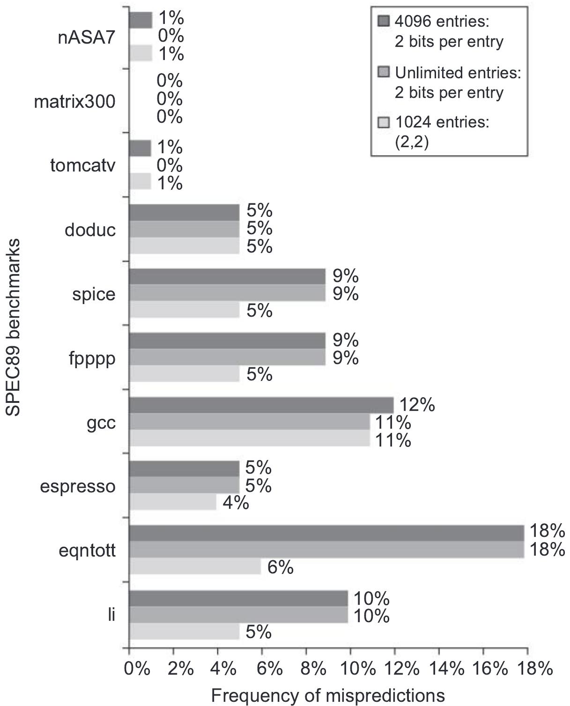
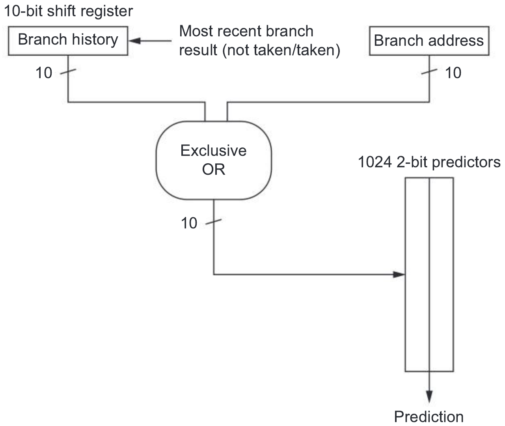
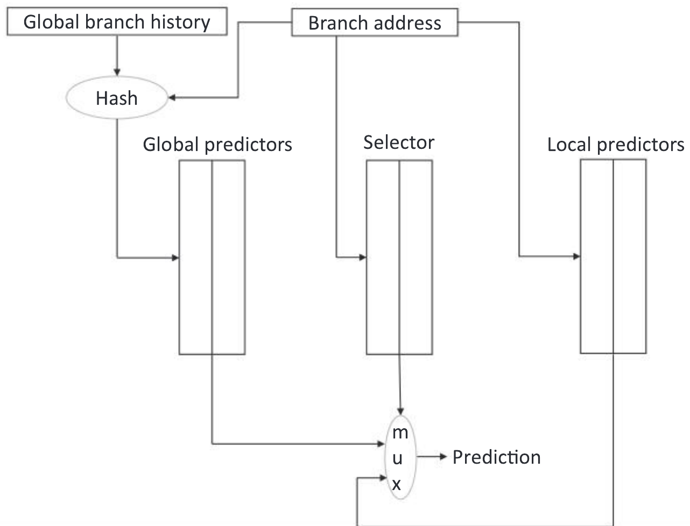
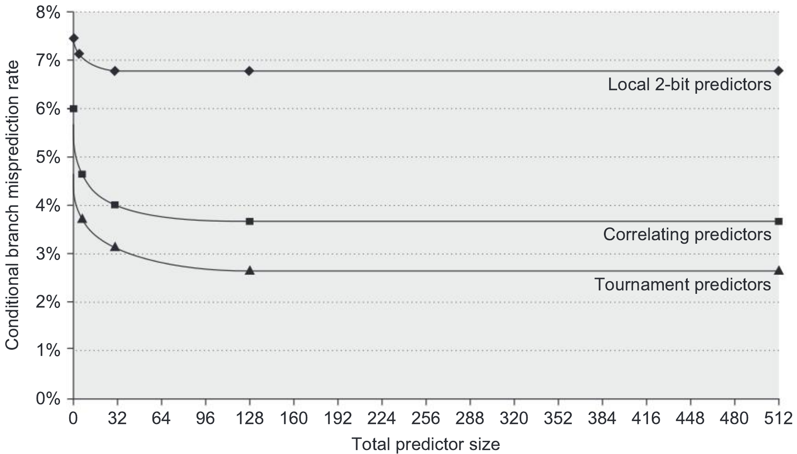

## 用高级转移预测降低转移开销 {#sec-3-4}

程序中转移很多，处理器又必须保证这些转移带来的控制相关，所以要开发 ILP，就离不开转移预测。附录 C 介绍的几种简单转移预测器，要么依靠编译时的信息，要么只观察单条转移自身的动态行为。流水线越来越深，每个时钟周期发射的指令越来越多，处于执行过程中的指令也随之增加，转移预测的准确率因而越来越重要。本节介绍用硬件提高动态预测准确率的技术，包括方向预测（预测转移成功还是不成功）和目标预测两个方面。本节大量用到 C.2 节的简单 2 位预测器，读者务必先弄懂它的工作原理，再往下读。

### 相关转移预测器 {-}

附录 C 的 2 位预测方案只看一条转移最近的行为，据此预测这条转移将来的行为。如果除了要预测的这条转移，还观察*其他*转移最近的行为，预测准确率就有可能提高。下面的代码片段取自 eqntott。eqntott 是早期 SPEC 基准测试程序集中的一个程序，转移预测效果特别差：

```c
if (aa==2)
 aa=0;
if (bb==2)
 bb=0;
if (aa!=bb) {
```

设 `aa` 和 `bb` 分别分配在寄存器 `x1` 和 `x2` 中，我们通常会为这段代码生成下面的 RISC-V 代码：

```asm
    addi x3,x1,-2
    bnez x3,L1       //转移 b1 (aa!=2)
    add  x1,x0,x0    //aa=0
L1: addi x3,x2,-2
    bnez x3,L2       //转移 b2 (bb!=2)
    add  x2,x0,x0    //bb=0
L2: sub  x3,x1,x2    //x3=aa-bb
    beqz x3,L3       //转移 b3 (aa==bb)
```

把这三条转移依次记为 b1、b2、b3。关键在于：b3 的行为与 b1、b2 的行为相关。如果 b1 和 b2 都不成功，即两个 if 条件都为真，`aa` 和 `bb` 都被赋值为 0，那么 `aa` 和 `bb` 必然相等，b3 一定成功。预测器如果只根据一条转移自身的行为来预测它的结果，就永远捕捉不到这种行为。

**相关预测器。** 利用其他转移的行为来作预测的转移预测器，称为*相关预测器*或*两级预测器*。现有的相关预测器在决定怎样预测某条转移时，会加入最近几条转移的行为信息。例如，(1,2) 预测器有一对 2 位转移预测器，预测某条转移时，根据上一条转移的行为从中选用一个。一般地，(*m*,*n*) 预测器根据最近 *m* 条转移的行为，从 $2^m$ 个转移预测器中选用一个，每个都是针对单条转移的 *n* 位预测器。这类相关转移预测器的好处是：预测准确率可以比 2 位方案高，而只需增加极少的硬件。

**硬件实现。** 硬件之所以简单，是因为最近 *m* 条转移的*全局历史*可以用一个 *m* 位移位寄存器记录下来，每一位记录对应的转移是成功（T）还是不成功（NT）。把转移指令地址（PC）的低位与这 *m* 位全局历史拼接起来，就可以作为索引去访问转移预测缓冲。例如，一个共有 64 项的 (2,2) 缓冲，用转移地址（字地址）的低 4 位，加上表示最近执行的两条转移行为的 2 位全局历史，组成 6 位索引，去访问这 64 个计数器。局部信息和全局信息可以拼接，也可以用简单的哈希函数组合，再用组合结果索引预测器表，这样得到预测结果的速度与标准 2 位预测器一样快。下面很快就会用到这种做法。

**与 2 位方案比较。** 相关转移预测器比标准 2 位方案好多少？要比较得公平，必须让两者的状态位数相同。(*m*,*n*) 预测器的位数为

$$
2^m \times n \times \text{由转移地址选择的预测项数}
$$

没有全局历史的 2 位预测器就是 (0,2) 预测器。

**例题**　有 4K 项的 (0,2) 转移预测器共有多少位？位数与它相同的 (2,2) 预测器有多少项？

**解答**　4K 项的预测器共有

$$
2^0 \times 2 \times 4\text{K} = 8\text{K}\ \text{位}
$$

(2,2) 预测器的预测缓冲共有 8K 位时，由转移选择的项有多少？由

$$
2^2 \times 2 \times \text{由转移选择的预测项数} = 8\text{K}
$$

可知，由转移选择的预测项数 = 1K。

[图 3.5](#fig-3-5) 比较了上面两种预测器的预测错误率：4K 项的 (0,2) 预测器和 1K 项的 (2,2) 预测器。从图中可以看出，这个相关预测器不仅优于状态位总数相同的简单 2 位预测器，而且常常优于项数不受限制的 2 位预测器。

{#fig-3-5 width=70%}

**gshare 预测器。** 相关预测器中最有名的，大概要数 McFarling 的 gshare 预测器。gshare 把转移地址与最近几条条件转移的结果做异或（XOR），形成索引，这实际上就是对转移地址和转移历史做哈希。哈希结果用来索引一个由 2 位计数器组成的预测阵列，如[图 3.6](#fig-3-6) 所示。作为一种简单的预测器，gshare 的效果相当好，常被用作基准，与更复杂的预测器比较。把局部转移信息和全局转移历史结合起来的预测器，也称为*合金预测器*或*混合预测器*。

{#fig-3-6 width=75%}

### 竞争预测器：自适应地组合局部预测器和全局预测器 {-}

人们提出相关转移预测器，主要是因为发现标准 2 位预测器只使用局部信息，在一些重要的转移上会预测失败，而加入全局历史有助于弥补这一不足。*竞争预测器*把这一思路又推进了一步：它同时使用多个预测器，通常是一个全局预测器和一个局部预测器，再由选择器从中选用一个，如[图 3.7](#fig-3-7) 所示。两种预测器的区别在于索引：*全局预测器*用最近的转移历史来索引，*局部预测器*用转移地址来索引。竞争预测器也是混合预测器（合金预测器）的一种形式。

{#fig-3-7 width=75%}

竞争预测器在中等规模（8K～32K 位）时准确率更高，而且能有效利用数量很大的预测位。现有的竞争预测器为每条转移设一个 2 位饱和计数器，用它在两个预测器之间选择，依据是最近的预测中哪一个（局部预测器、全局预测器，甚至二者随时间变化的某种组合）最有效。与简单 2 位预测器一样，饱和计数器要发生两次预测错误，才会改换优先选用的预测器。

竞争预测器的优点是能为某条转移选出合适的预测器，这一点对整数基准测试程序尤其关键。在 SPEC 整数基准测试程序上，典型的竞争预测器有将近 40% 的时间选用全局预测器；在 SPEC 浮点基准测试程序上，这一比例不到 15%。竞争预测器最早由 Alpha 处理器采用，此外还有几款 AMD 处理器使用了竞争式的预测器。

[图 3.8](#fig-3-8) 以 SPEC89 为基准测试程序，比较了三种预测器在不同位数下的性能：局部 2 位预测器、相关预测器和竞争预测器。局部预测器最早达到极限；相关预测器有明显改进；竞争预测器的性能又略好一些。换成更新版本的 SPEC，结果也会类似，只是要到预测器规模稍大一些时才进入渐近状态。

{#fig-3-8 width=90%}

**两级局部预测器。** [图 3.8](#fig-3-8) 中评估的局部预测器本身也是两级预测器。上一级是局部历史表，由 1024 个 10 位的项组成，每一项记录这一项最近 10 次转移的结果。也就是说，转移连续成功 10 次或更多次，局部历史表中这一项就全为 1；转移成功与不成功交替出现，这一项就由交替的 0 和 1 组成。有了这 10 位历史，最长 10 条转移的模式都能被发现和预测。从局部历史表中选出的项再去索引一个 1K 项的表，表项是 3 位饱和计数器，由它们给出局部预测。这种组合共用 29K 位，预测准确率很高，而且比达到同样准确率的单级表用的位数少。两级局部预测器对迭代次数少的循环尤其有效。以迭代 3 次的循环为例，借助局部历史，我们可以识别出连续三次成功（TTT）的情况，并训练一个 2 位或 3 位饱和计数器，预测这条转移下一次执行时不成功。因此，频繁执行的少迭代循环可以做到 100% 准确地预测。
