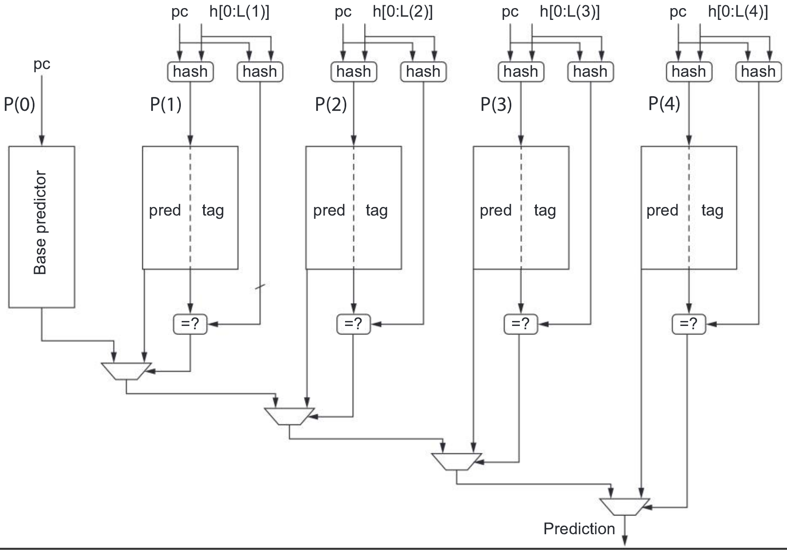
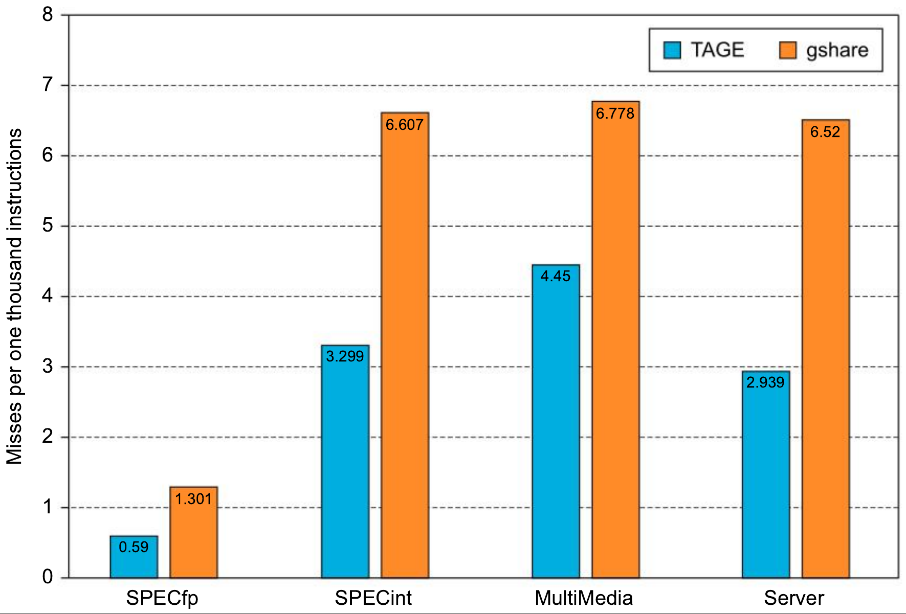
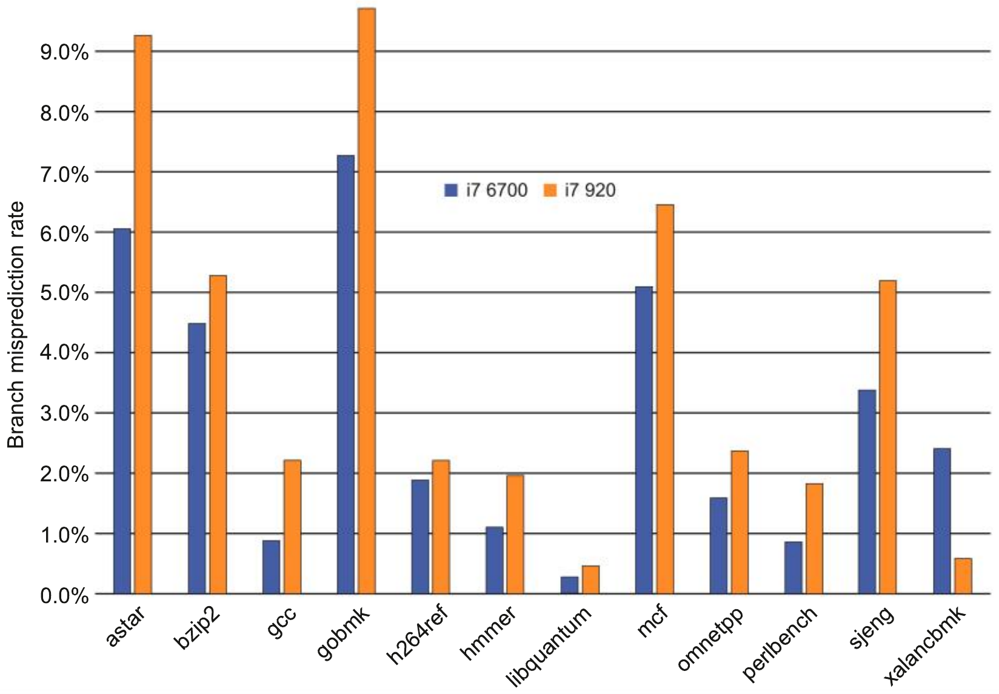
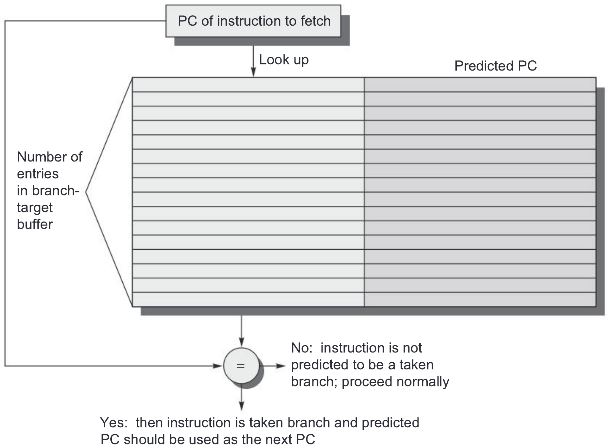
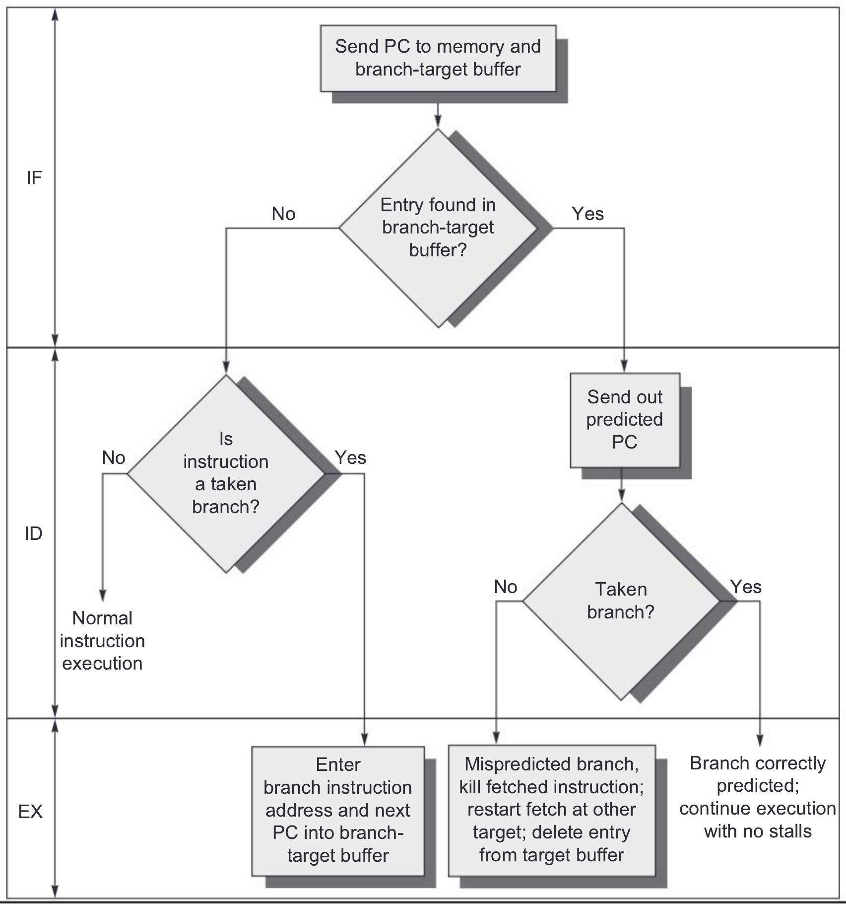
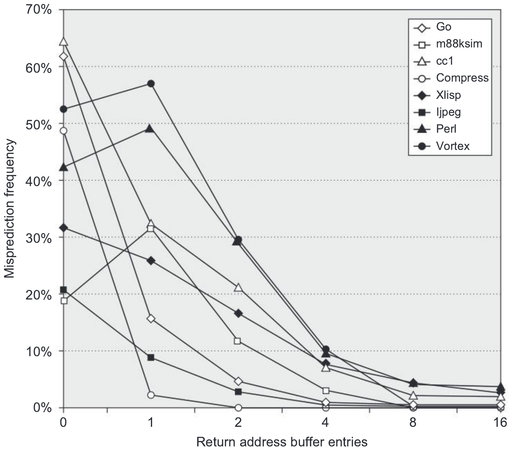

### 带 tag 的混合预测器 {-}

同时保存局部历史和全局历史的预测器，主要的缺点是历史长度很难选准。历史太短，有些重复出现的模式就捕捉不到，例如 4 位局部历史无法准确捕捉一个迭代 5 次的循环。历史太长，饱和计数器表中用到的表项增多，预测器要经过更长时间的训练才能准确捕捉一种模式。以前面 eqntott 的代码为例，若使用 3 位全局历史，为了正确预测 B1、B2、B3 之间的相关性，需要训练两个饱和计数器，即对应全局历史 NNN 和 TNN 的两个计数器。捕捉一种模式所需的计数器越多，就越容易发生*别名*（aliasing），即散列冲突使多条转移指令共用同一个计数器来跟踪历史。如果这几条转移指令的结果相反，执行又频繁交错，别名就会起破坏作用。

截至 2022 年，性能最好的转移预测方案针对上述缺点，把多个预测器结合起来，并跟踪每个预测是否很可能与当前这条转移指令相关。其中重要的一类，大致以统计压缩算法 PPM（部分匹配预测，prediction by partial matching）为基础。PPM（见 Jiménez 和 Lin，2001）和转移预测算法一样，都是根据历史来预测将来的行为。我们把这类预测器称为*带 tag 的混合预测器*（tagged hybrid predictor，见 Seznec 和 Michaud，2006），它由一组全局预测器组成，各自用不同长度的历史来索引。

**五分量的例子。** 如[图 3.9](#fig-3-9) 所示，一个五分量的带 tag 混合预测器有 5 个预测表 P(0)、P(1)、…、P(4)。访问 P(*i*) 时，用 PC 和最近 *i* 条转移指令的历史作散列，历史和 gshare 一样保存在移位寄存器 h 中。它的关键区别有两点：

* 一是用多种长度的历史分别索引各自的预测器；
* 二是 P(1) 到 P(4) 使用 tag（标签）来减少别名。

tag 不要求百分之百匹配，因此可以很短，4～8 位的短 tag 似乎就能获得大部分好处。只有当 tag 与转移地址和全局转移历史的散列值相匹配时，P(1)、…、P(4) 的预测才会被采用。与 Cache 不同，转移预测器的 tag 只用来降低别名的概率，不用来保证正确性。tag 较短时仍有很小的概率发生别名，但这只影响预测准确率，不影响正确性。P(0…*n*) 中的每个预测器都可以是标准的 2 位计数器；实际上，3 位计数器要连续三次预测错误才改变预测，效果比 2 位计数器略好。

{#fig-3-9 width=90%}

**预测的选择。** 对一条给定的转移指令，最终采用的是 tag 匹配的预测器中转移历史最长的那一个。P(0) 不用 tag，总是匹配；P(1) 到 P(*n*) 都不匹配时，就以 P(0) 作为默认预测。这种预测器的带 tag 混合版本，还在每个由历史索引的预测器中增加了一个 2 位的使用字段，表示这个预测最近是否用过。最近用过的预测很可能更准确；所有表项的使用字段可以定期复位，以清除旧的预测。实现这类预测器还涉及许多细节，特别是怎样处理误预测。寻找最优预测器的搜索空间也非常大，因为预测器的个数、索引所用的确切历史和每个预测器的大小都可以变化。

带 tag 的混合预测器（有时称为 TAGE 预测器，即 TAgged GEometric）和更早的基于 PPM 的预测器，是近年历届国际转移预测竞赛的优胜者。存储量适中（32～64 KiB）时，这类预测器就胜过 gshare 和竞争预测器；而且它们似乎还能有效利用更大的预测 Cache，进一步提高预测准确率。

**初始化。** 预测器做大以后，还有一个问题是怎样初始化。如果随机初始化，就要执行相当长的时间，预测器里才能装满有用的预测。有些预测器（包括近年的许多预测器）为表项设了一个有效位，表示这个表项已经设置过，还是处于「未使用状态」。对未使用的表项，可以不用随机的预测，而用某种方法来初始化。办法之一是利用提示位：有些指令系统设有一位，表示相应的转移指令预计是否会转移成功。在动态转移预测出现以前，这种提示位*就是*预测；在近年的处理器中，它可以用来设置初始预测。办法之二是按转移方向设置：向前的转移初始化为不成功；向后的转移很可能是循环转移，初始化为成功。对于运行时间较短的程序和预测器较大的处理器，这种初始设置对预测性能的影响是可以测出来的。

**与 gshare 的比较。** [图 3.10](#fig-3-10) 表明，带 tag 的混合预测器明显优于 gshare，在 SPECint 和服务器应用这类较难预测的程序上尤其如此。图中的性能指标是每千条指令误预测数。假设转移指令占 20%～25%，那么在多媒体基准测试程序上，按每条转移指令计算，gshare 的误预测率为 2.7%～3.4%，带 tag 的混合预测器为 1.8%～2.2%，误预测大约少了三分之一。带 tag 的混合预测器也有缺点：实现比 gshare 复杂；需要检查多个 tag 并从中选出一个预测结果，速度可能稍慢。不过，对于流水线很深、转移误预测开销很大的处理器，准确率的提高足以抵消这些缺点。因此，许多高端处理器的设计者在最新的实现中都采用了带 tag 的混合预测器。

{#fig-3-10 width=90%}

此外，转移预测器在速度与规模、复杂度之间存在权衡，采用多级、多阶段的设计可以绕开这一权衡。

### Intel 处理器中转移预测器的演变 {-}

超标量处理器流水线深，每个时钟周期又发射多条指令，因此同时在流水线中执行的指令很多，近年的设计多达几百条。转移预测因此至关重要，Intel 也一直在这方面不断改进。也许正因为转移预测器对性能影响极大，Intel 往往对它的细节严格保密，即使是 2008 年推出的 Core i7 920 这样较老的处理器，公布的信息也很有限。本节简要介绍已知的情况，并比较两款处理器的预测器性能：一款是采用 Nehalem 微结构的 Core i7 920，另一款是 2016 年发布、采用 Skylake 微结构的 Intel Core i7 6700。

**Core i7 920。** 它采用两级预测器。第一级较小，用来满足每个时钟周期预测一条转移指令的周期约束；第二级较大，作为后备。每一级都结合了三种预测器：

* 一是简单的 2 位预测器，附录 C 介绍过它，前面的竞争预测器也用到了它；
* 二是全局历史预测器，与刚才介绍的那些类似；
* 三是循环退出预测器。如果检测出某条转移指令是循环转移，就用一个计数器预测它转移成功的确切次数，也就是循环的迭代次数。

对每条转移指令，预测器像竞争预测器那样跟踪每种预测的准确率，从三个预测器中选出最好的预测。除了这个多级主预测器，还有一个单独的部件预测间接转移的目标地址，另有一个栈用来预测返回地址。

**Core i7 6700。** 关于它的预测器，已知的情况更少，但有充分的理由相信 Intel 采用了带 tag 的混合预测器。这种预测器的一个优点是，把早先 i7 中三个第二级预测器的功能合而为一：使用不同历史长度的带 tag 混合预测器，涵盖了循环退出预测器以及局部和全局历史预测器的功能。返回地址仍由单独的预测器预测。

**评价方法与结果。** 和其他场合一样，推测执行给评价预测器带来了一些困难：一条转移指令误预测后，很容易导致另一条转移指令被取进来并且也被误预测。为简单起见，我们统计误预测次数占成功完成的转移指令数的百分比，成功完成的转移指令是指不由错误推测执行产生的那些转移指令。[图 3.11](#fig-3-11) 给出了 SPECCPU2006 整数基准测试程序的这一数据。这些程序比 SPEC89 或 SPEC2000 大得多，所以即使采用了更强的预测器组合，误预测率仍高于[图 3.8](#fig-3-8) 中的值。转移误预测会导致无效的推测执行，造成工作浪费，本章后面会讲到这一点。

{#fig-3-11 width=90%}

#### 转移目标缓冲 {-}

前面介绍的转移预测器，能推测当前取指所用的 PC 指向的转移指令是否会转移成功。如果这条尚未译码的指令是一条预测为成功的转移指令，还需要预测它的目标地址，才能及时重定向取指，使转移开销为零。预测目标地址的部件称为*转移目标缓冲*（BTB），也称*转移目标 Cache*。它是一种 Cache，存放的是转移指令之后下一条指令的预测地址。[图 3.12](#fig-3-12) 画出了一个 BTB。每个表项包含一个预测目标和一个 tag，tag 中是该表项所对应的转移指令的 PC。BTB 表项带 tag，是为了在 BTB 发生冲突时，处理器不会用错转移指令的目标地址，否则性能会下降。BTB 表项还包括其他一些信息，如有效位、转移的类型，以及实现替换策略所用的若干位。

{#fig-3-12 width=90%}

**BTB 的访问。** BTB 与转移预测器并行访问，结果分三种情况：

* 转移预测为不成功，就忽略 BTB 的查找结果；
* 转移预测为成功，并且 BTB 表项的 tag 与所取指令的 PC 匹配（BTB 命中），就在随后的周期中使用预测的 PC；
* 转移预测为成功，但 BTB 失效，处理器就必须停止取指，等当前指令取出并译码、算出目标地址以后再继续。

经常执行的成功转移，其目标会放进 BTB，替换掉最近没有用过或现在经常不成功的转移的目标。BTB 中只需存放预测为成功的转移指令，因为不成功的转移只要像普通指令那样顺序取下一条指令即可。

{#fig-3-13 width=90%}

成功转移在 BTB 中的命中率对性能至关重要，可以用与第 2 章改进 Cache 相似的技术来提高：采用相联的 BTB 可以减少冲突失效；BTB 命中时间与 BTB 容量失效之间的权衡，可以用多级 BTB 结构来解决。如果处理器流水线要经过 5～10 个周期才能完成取指和有效目标的计算，多级 BTB 结构就特别有用。

[图 3.13](#fig-3-13) 给出了简单的五段流水线中使用 BTB 的步骤。从图中可以看出，对于一条成功的转移指令，只要方向预测正确，并且在缓冲中找到了转移目标表项，就没有转移延迟；否则至少要付出两个时钟周期的开销。

要评价 BTB 的效果，先要确定各种可能情况下的开销。[图 3.14](#fig-3-14) 给出了简单的五段流水线下的这些开销。

[图 3.14　假设缓冲中只存放成功的转移指令，转移指令是否在缓冲中与实际转移情况的所有组合及其开销。如果一切预测正确，并且在目标缓冲中找到了这条转移指令，就没有转移开销。如果预测不正确，开销是：1 个时钟周期用正确的信息更新缓冲（这期间不能取指令），必要时再用 1 个时钟周期为这条转移指令重新开始取下一条正确的指令。如果没有找到这条转移指令而它又转移成功，开销为 2 个周期，缓冲在这期间更新。]{#fig-3-14 .caption}

| 指令在缓冲中 | 预测 | 实际转移 | 开销周期数 |
|---|---|---|---|
| 是 | 成功 | 成功 | 0 |
| 是 | 成功 | 不成功 | 2 |
| 否 | | 成功 | 2 |
| 否 | | 不成功 | 0 |

**例题**　设各种误预测的开销周期数如[图 3.14](#fig-3-14) 所示，求转移目标缓冲的总转移开销。预测准确率和命中率假设如下：

* 预测准确率为 90%（对缓冲中的指令而言）。
* 缓冲的命中率为 90%（对预测为成功的转移指令而言）。

**解答**　开销来自两个事件：一是转移指令预测为成功，最终却不成功；二是转移指令成功，却不在缓冲中。两者的开销都是两个周期，计算它们的概率即可：

$$
\begin{aligned}
\text{概率（转移指令在缓冲中但实际不成功）} &= \text{缓冲命中率} \times \text{预测错误率} \\
&= 90\% \times 10\% = 0.09 \\
\text{概率（转移指令不在缓冲中但实际成功）} &= 10\% \\
\text{转移开销} &= (0.09 + 0.10) \times 2 \\
\text{转移开销} &= 0.38
\end{aligned}
$$

流水线越长，转移延迟越大，动态转移预测带来的改进也就越大；预测器越好，性能上的优势也越大。现代高性能处理器的转移误预测延迟在 15 个时钟周期左右，准确的预测至关重要。

**存放目标指令的 BTB。** BTB 的一种变形是存放一条或多条*目标指令*，代替预测的*目标地址*，或者两者都存。这样做有两个潜在的优点：

* 一是 BTB 的访问时间可以长于相邻两次取指的间隔，因而有可能采用更大的 BTB 或多级 BTB；
* 二是缓冲中有了实际的目标指令，就可以实施一种称为*转移折叠*（branch folding）的优化。转移折叠可以使无条件转移的开销为 0 个周期，有时还能使条件转移的开销为 0 个周期。

后面会看到，Cortex A-53 使用了一个单表项的转移目标 Cache，存放预测的目标指令。

设 BTB 存放的是预测路径上的指令，现在用一条无条件转移指令的地址访问它。无条件转移的唯一作用是改变 PC，因此，当 BTB 发出命中信号并指明这是一条无条件转移时，流水线只需用 BTB 中的指令替换 Cache 返回的那条指令（即这条无条件转移指令）即可。如果处理器每个周期发射多条指令，缓冲就需要提供多条指令，才能获得最大的好处。某些情况下，还有可能消除条件转移的开销。

### 专用转移预测器：预测过程返回、间接跳转和循环转移 {-}

用推测执行来增加并行的机会，就要面对间接跳转的预测问题。所谓间接跳转，是目标地址在运行时会变化的跳转。高级语言程序中的间接过程调用（如 C++ 的虚函数调用）、select 或 case 语句以及 FORTRAN 的计算 goto 都会产生这类跳转，不过许多间接跳转只是过程返回。例如，在 SPEC95 基准测试程序中，平均而言，过程返回占转移指令的 15% 以上，并占间接跳转的绝大多数。在 C++ 和 Java 这类面向对象语言中，过程返回更加频繁。因此，重点放在过程返回上看来是合适的。

**返回地址栈。** 过程返回虽然可以用 BTB 预测，但如果一个过程从多处调用，而且来自同一处的调用在时间上并不集中，这种预测的准确率就可能很低。例如，在 SPEC CPU95 中，一个激进的转移预测器对这类返回转移的预测准确率不到 60%。为解决这个问题，大多数处理器设置了一个按栈方式工作的小型返回地址缓冲，称为*返回地址栈*（RAS）。RAS 缓存最近的返回地址：调用时把返回地址压栈，返回时弹出一个返回地址。只要这个 Cache 足够大（与最大调用深度相同），就能完全正确地预测返回。[图 3.15](#fig-3-15) 给出了表项数为 0～16 时，这种返回缓冲在若干 SPEC CPU95 基准测试程序上的性能。近年所有的高性能超标量处理器都实现了 RAS。

{#fig-3-15 width=90%}

**其他间接跳转。** 各种函数调用和控制转移也会产生间接跳转，预测它们的目标不像预测过程返回那样简单。有些处理器为所有间接跳转专门增设了预测器，另一些则依靠转移目标缓冲。

**循环转移。** gshare 这类简单的预测器能很好地预测许多条件转移，但它不是专为循环转移设计的，对长时间运行的循环尤其不适应。前面讲过，Intel Core i7 920（Skylake 微结构）使用了专用的循环转移预测器。带 tag 的混合预测器出现以后，它预测循环转移同样有效，于是近年有些设计者选择把资源投入更大的带 tag 混合预测器，而不再单设循环转移预测器。

#### 集成的取指部件 {-}

为了满足多发射处理器的要求，近年的许多设计把集成的取指部件做成一个独立自主的部件，由它向流水线的其余部分提供指令，这种结构通常称为*解耦前端*（decoupled front-end）。这样做实质上是承认：多发射十分复杂，把取指看作一个简单的单一流水段已经不再合适。近年的设计改用集成的取指部件，把以下几项功能集成在一起：

1. *集成的转移预测*——转移预测器成为取指部件的一部分，不断地预测转移，驱动取指流水线。转移预测器和 BTB 能处理一个取指包中的多条转移指令。
2. *指令预取*——为了每个时钟周期提供多条指令，取指部件很可能需要提前取指。取指部件自主管理指令预取（预取技术见第 2 章），并把它与转移预测结合起来。
3. *指令存储器访问与缓冲*——每个周期取多条指令会遇到各种复杂情况，例如可能要访问多个 Cache 行。取指部件把这些复杂情况封装在内部，并用预取尽量掩盖跨 Cache 块的代价。取指部件还提供缓冲，实际上起着按需供给的作用：发射段需要时，按需要的数量向它提供指令。

现在几乎所有的高端处理器都使用独立的取指部件，它通过一个存放待处理指令的缓冲与流水线的其余部分相连。
