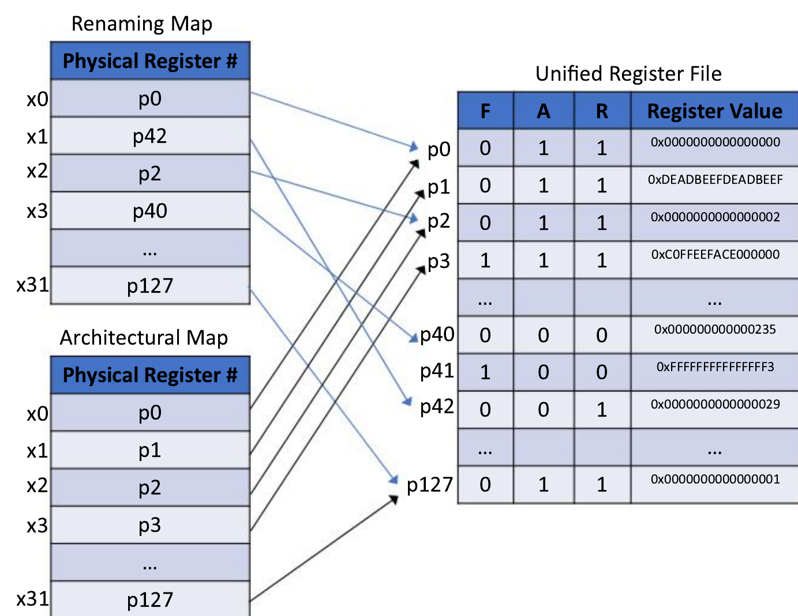
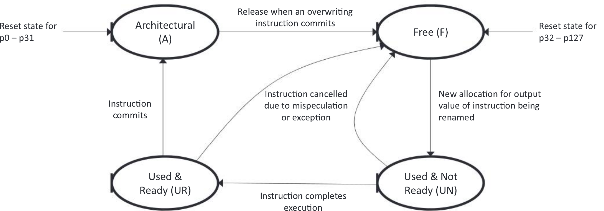
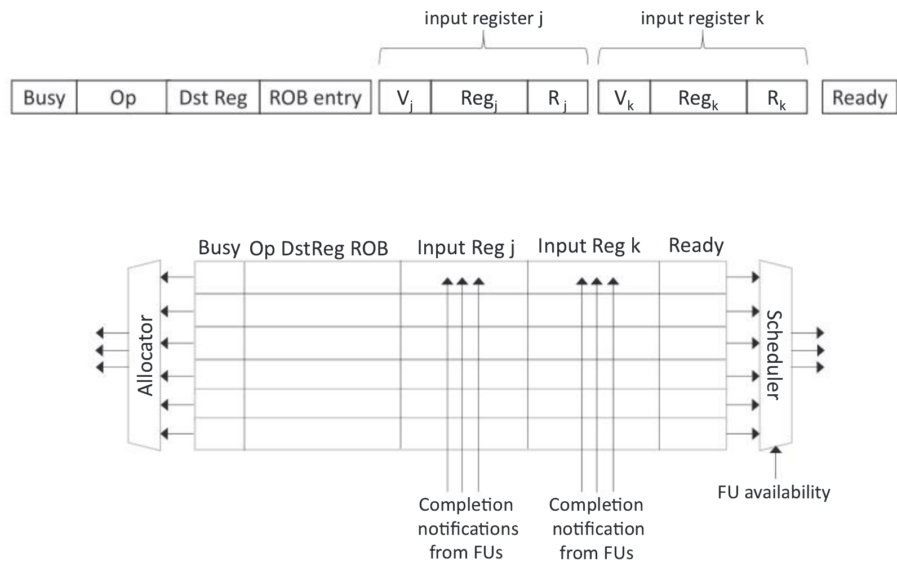
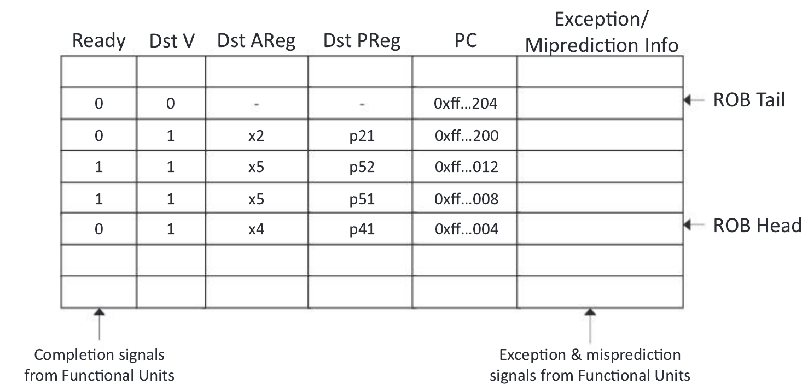

## 用寄存器重命名克服名相关 {#sec-3-5}

寄存器重命名让超标量处理器可以使用大量物理寄存器，从而消除名相关可能引起的 WAR 冒险和 WAW 冒险。下面先结合一种可能的实现，详细说明重命名是怎样工作的，然后再讨论其他实现方式的利弊。为简单起见，这里只讨论整数寄存器重命名所需的硬件，浮点寄存器的重命名采用类似的结构。

**统一寄存器堆与两张映射表。**[图 3.16](#fig-3-16) 给出了用*统一寄存器堆*（URF，unified register file）实现寄存器重命名所需的硬件结构。URF 中有一大组物理寄存器（[图 3.16](#fig-3-16) 中的 `p0`–`p127`），既保存 32 个体系结构可见寄存器的值，也保存尚未提交的指令产生的临时值。物理寄存器的使用由两张表管理：

* *重命名映射表*（renaming map）：记录指令作为输入操作数指定的体系结构寄存器，当前对应哪个物理寄存器号（x~i~→p~i~）。指令在处理器流水线前端发射时，查找并更新这张表。其中一些指令以后可能因推测错误或异常而被取消，所以表中保存的映射是推测性的。
* *体系结构映射表*（architectural map）：根据已经提交的指令，记录每个体系结构寄存器对应的物理寄存器号。这张表在流水线后端更新，用于异常和预测错误之后的恢复。

{#fig-3-16 width=70%}

**物理寄存器的状态。**[图 3.17](#fig-3-17) 给出了物理寄存器的四种可能状态：

* *空闲*：寄存器当前没有使用，可以分配给新的指令。
* *已用未就绪*和*已用就绪*：寄存器已经分配给一条尚未完成的指令。未就绪表示这条指令还没有执行完，值还不能供后续的相关指令使用；就绪表示产生这个值的指令已经执行完但尚未提交，值已经可以使用。
* *体系结构态*：寄存器保存的是一条已经执行完并且已经提交的指令的结果，体系结构映射表中有一项指向它。体系结构寄存器总是就绪的。

复位时，前 32 个物理寄存器处于体系结构态，其余都空闲。[图 3.16](#fig-3-16) 中每个物理寄存器的状态用三个元数据位（Free、Architectural、Ready）编码：空闲为（1, 0, 0），已用未就绪为（0, 0, 0），已用就绪为（0, 0, 1），体系结构态为（0, 1, 1）。

{#fig-3-17 width=90%}

重命名的大部分工作在指令译码之后的发射级完成。不过，指令经过后续各个执行阶段时，物理寄存器的状态也随之转换：

* **发射（按序）**：指令发射时，先在重命名映射表中查找输入操作数，得到若干物理寄存器的地址，这些物理寄存器保存着该指令所读体系结构寄存器的最新值。物理寄存器号及其状态随后送往实现动态调度的硬件（见 [3.6 节](#sec-3-6)）。与此同时，指令为输出寄存器 x~i~ 的新值分配一个新的物理寄存器 p~j~，把重命名映射表中 x~i~ 的表项改为 x~i~→p~j~，并把新分配的物理寄存器状态置为已用未就绪。store、转移等指令不产生新的寄存器值，因此不分配新的物理寄存器。
* **分派（乱序）**：保存输入操作数的物理寄存器全部处于体系结构态或已用就绪状态时，指令就可以执行，可以分派出去。跟踪输入操作数状态的调度硬件在 [3.6 节](#sec-3-6)介绍。指令输出所用的物理寄存器 p~j~ 状态不变，仍是已用未就绪。
* **完成（乱序）**：功能部件执行完指令后，把新值写入分配好的物理寄存器 p~j~，并把它的状态改为已用就绪。此后，相关指令就可以使用这个值了。
* **提交（按序）**：指令到达 ROB 头部，并且没有产生异常或预测错误，就把结果提交到体系结构状态，p~j~ 的状态变为体系结构态。我们还要更新体系结构映射表中 x~i~ 的表项：如果原来的映射是 x~i~→p~k~，就改为 x~i~→p~j~，并把 p~k~ 的状态置为空闲。这时改写 p~k~ 的指令刚刚提交，p~k~ 中的值已经不可能再被用到。
* **恢复（按序）**：如果 ROB 中最老的指令发生了异常或预测错误，就必须取消所有尚未完成的指令，恢复精确的体系结构状态，就像这些指令从来没有被处理过一部分一样。重命名状态的恢复只需两个很快的步骤：一是把处于两种已用状态的物理寄存器全部标为空闲；二是丢弃重命名映射表的当前状态，用一次整体复制把它初始化为体系结构映射表的状态。

超标量处理器要在一个时钟周期内为一个指令组（bundle）中的全部指令做重命名，所以重命名逻辑相当复杂。这带来两方面的影响。一是映射表必须做成多端口结构。处理器每个周期分派 N 条指令时，重命名映射表需要 2N 个读端口查找所有输入操作数的当前映射，还需要 N 个写端口更新所有输出操作数的映射；处理器每个周期提交 M 条指令时，体系结构映射表需要 M 个写端口完成相应的更新。物理寄存器的三个元数据位也要支持每个周期多次访问，不过它们是用位掩码实现的，增加多个端口做并行更新，代价不大。

二是重命名逻辑必须检测并遵守指令组内部的数据相关。如果相关不在组内，就用重命名映射表找出保存着（或将要保存）所需结果的物理寄存器；如果一条指令数据相关于同一组中前面的某条指令，就应当把前面那条指令分配的物理寄存器用作输入操作数。下面用一个循环说明这个问题，这个循环把整数数组的每个元素都加 1：

```asm
Loop: ld   x2,0(x1)    //x2 = 数组元素
      addi x2,x2,1     //x2 加 1
      sd   x2,0(x1)    //存储结果
      addi x1,x1,8     //指针加 8
      bne  x1,x3,Loop  //不是最后一个元素则转移
```

[图 3.18](#fig-3-18) 给出了处理器以每周期 5 条指令的速度，对这个循环的两次迭代做重命名的过程，每个指令组含 5 条指令。第一个时钟周期为指令结果分配了三个物理寄存器：`p51` 重命名 `ld` 的 `x2`，`p52` 重命名第一条 `addi` 的 `x2`，`p53` 重命名第二条 `addi` 的 `x1`。周期结束时，映射表中 `x2` 的映射取两条指令中较新的那一条产生的映射，即 `p52`。组内还有三个数据相关。第一个是寄存器 `x2`：它由 `ld` 产生，由紧接着的 `addi` 使用。`addi` 不用重命名表为 `x2` 返回的指针 `p40`，而是使用 `ld` 在同一周期分配的 `p51`。`sd` 与 `addi` 之间关于 `x2` 的真相关、`bne` 与 `addi` 之间关于 `x1` 的真相关，重命名逻辑也照此处理。第二个时钟周期，重命名逻辑以同样的方式处理循环第二次迭代的指令组，为这些指令产生的新值使用新的物理寄存器 `p61`、`p62` 和 `p63`。

{#fig-3-18 width=100%}

**物理寄存器的释放。**复杂性还有一个来源：要判断什么时候可以安全地释放（回收）一个物理寄存器。分配给体系结构寄存器 x~i~ 的物理寄存器 p~k~，要满足两个条件才能释放：一是后面某条改写 x~i~ 的指令已经为 x~i~ 分配了新的物理寄存器；二是等待调度的指令中，已经没有尚未读取 p~k~ 的指令。此外，还必须确保在这条改写指令能够提交之前，不会有指令引发异常。因此，大多数处理器选择晚一些释放，等改写指令提交时再释放物理寄存器，以物理寄存器占用时间更长为代价，换取设计的简单。

### 寄存器重命名的其他实现方式 {-}

寄存器重命名还有以下几种实现方式。

*不用体系结构映射表*：采用 URF 时，也可以只用重命名映射表实现重命名。没有体系结构映射表，发生预测错误或异常时，按下面的办法恢复精确的寄存器状态。分派时，每条指令在用新分配的物理寄存器号 p~j~ 改写目的寄存器的映射之前，先读出原来的映射 p~k~，记入 ROB；指令提交时，丢弃这个旧映射；发生异常或预测错误时，从较新的指令到较老的指令反向遍历 ROB，把每个 ROB 项中记录的旧映射写回重命名映射表。这种方法的缺点是恢复延迟与 ROB 的大小成正比。

*物理寄存器与体系结构寄存器分开*：也可以不用含 128 个物理位置的 URF，而是设两个寄存器堆：一个保存体系结构状态，称为 *ARF*，共 32 项（`x0`–`x31`）；另一个保存临时的重命名寄存器，称为 *RRF*。指令在分派时分配 RRF 寄存器，在完成时写入；提交时，新的输出值从 RRF 中的物理寄存器复制到 ARF 中的体系结构寄存器，同时更新重命名表以反映这一变化。从异常或预测错误中恢复很快，只需把所有 RRF 寄存器标为空闲，再把重命名映射表各项重新初始化为指向 ARF。实际上，ARF 和重命名映射表可以合成一个 32 项的结构：每个 ARF 项含一个指向 RRF 的指针，指出最近一条将要改写这个体系结构寄存器、尚未完成的指令所分配的物理寄存器。这样就不再需要单独的体系结构映射表。

*重命名寄存器放在 ROB 中*：像上面那样把体系结构寄存器和重命名寄存器分开以后，还可以把重命名寄存器并入 ROB。每个 ROB 项留出一个寄存器值的空间，指令的输出先缓存在这里，直到指令提交；提交时，再把这个值从 ROB 复制到 ARF。发生异常或预测错误时，这个临时缓冲随 ROB 项一起释放。这种方法的缺点是，本来就是多端口的 ROB 会变得更加复杂。

*重命名表放在 ROB 中*：有些设计更进一步，把映射表也并入 ROB。分派时，新指令对它要读的每个体系结构寄存器，都要在 ROB 中查找可能写过这个寄存器的最新指令。找到匹配的 ROB 项，就由这一项在值就绪时向新指令提供输入值；找不到，就从体系结构寄存器堆取值。这样，读输入操作数就不必再分两步走（先访问重命名映射表，再访问寄存器堆）。代价是 ROB 每个时钟周期都要为多条指令的多个输入操作数做相联查找，而且查找时必须优先考虑较新的指令，也就是离 ROB 头部最远的指令。

## 用动态调度克服数据冒险 {#sec-3-6}

动态调度让超标量处理器能够利用 ILP：不管指令在程序中的顺序如何，只要它的数据相关已经解除，就立即执行。遇到 Cache 失效或其他长延迟操作时，动态调度更是必不可少，否则这些操作会使流水线长时间停顿。本书以前各版先介绍用于动态执行的 Tomasulo 算法，这个算法于 1967 年提出，在 IBM 360/91 大型机的浮点部件中实现。本版不再这样安排，而是直接介绍动态调度的现代实现，它们建立在转移预测、推测执行和寄存器重命名的基础之上。

### 动态调度的基本思想 {-}

动态调度分两步：

* 一是硬件跟踪每条尚未完成的指令的数据相关状态，判断它什么时候可以执行，称为*指令唤醒*（instruction wakeup）；
* 二是硬件从已就绪的指令中选出一部分，启动它们执行，称为*指令分派*（instruction dispatch）。

指令虽然是乱序分派、乱序执行的，但有 ROB 作保证：推测错误之后能够恢复，指令产生异常时能够恢复精确的状态。

指令唤醒和分派有两种实现方式：一种是集中式硬件调度器（也称统一调度器），另一种是一组分布式的较小调度结构。Intel 近期的处理器（如 Skylake 和 Golden Cove）对整数和浮点指令都采用集中式方法，AMD 近期的处理器（如 Milan 和 Genoa）则采用分布式方法。下面先介绍集中式调度器，再讨论它与分布式设计的利弊。在研究文献中，集中式调度器有时也称为*指令窗口*（instruction window）、*指令缓冲*（instruction buffer）或*指令队列*（instruction queue），尽管它并不按先进先出的方式工作。

**调度器表项。**[图 3.19](#fig-3-19) 给出了集中式调度器每一项的字段（上）和它的整体结构（下）。每一项包括：

* 忙（busy）字段，表示这一项是否已被一条尚未调度的指令占用；
* 三个在指令开始执行时使用的字段：操作码、目的物理寄存器、要更新的 ROB 项；
* 两个输入寄存器 j 和 k 的状态：执行这条指令是否需要它们（`V`~j~ 和 `V`~k~），提供其值的物理寄存器编号（`Reg`~j~ 和 `Reg`~k~），以及这些值是否已经就绪（`R`~j~ 和 `R`~k~）；
* 最后一个字段，表示指令是否可以执行，所有有效的输入寄存器都就绪时置位。

输入物理寄存器就绪有两种情况：一是在发射时就已经就绪，二是某个功能部件通知调度器，写这个物理寄存器的指令已经执行完毕。功能部件每个时钟周期都通过广播总线，把已完成的指令所写的物理寄存器通知指令调度器。调度器每一项都有比较器，不断地把本项两个输入物理寄存器的编号（`Reg`~j~ 和 `Reg`~k~）与功能部件刚刚更新的物理寄存器相比较，发现匹配，就把其中一个或两个寄存器标为就绪（把 `R`~j~ 和/或 `R`~k~ 置为真）。

{#fig-3-19 width=80%}

**ROB。**[图 3.20](#fig-3-20) 给出了 ROB 的组织。每一项跟踪一条指令的状态，内容包括：指令是否已经执行完毕（`Ready`）；指令是否产生寄存器输出（`DestV`）；指令所写的体系结构寄存器号和物理寄存器号（`Dst AReg` 和 `PReg`）；指令地址（PC）；指令是否引起了预测错误或异常，以及预测错误或异常的类型。ROB 作为循环缓冲来管理，用头指针和尾指针指示两端。

{#fig-3-20 width=80%}

[图 3.21](#fig-3-21) 是处理器执行引擎和后端的框图，其中包括指令窗口和 ROB。图中实线表示传送数据或地址，虚线表示传送指令、控制信号和通知。框图还给出了 load-store 部件的基本结构，这部分在 [3.7 节](#sec-3-7)讨论。

{#fig-3-21 width=90%}

重命名之后，指令的执行分为以下几步：

1. *发射（按序）*：每条指令都在 ROB 中分配一项。算术、逻辑和转移操作还要在调度器中分配一项；load/store 操作则送往 *load/store 队列*，在那里做存储地址消歧和调度（见 [3.7 节](#sec-3-7)）。如果 ROB、硬件调度器或 load/store 队列已满，就让处理器前端停顿，直到有空位为止。
2. *分派（乱序）*：每个时钟周期，调度器从已就绪的指令中选出一部分去执行。选择电路既要考虑可用功能部件的数量和类型，也要考虑已就绪指令的类型和年龄。指令必须按序提交，所以最好先调度已就绪指令中最老的那些。选中的指令移出指令窗口，送往相应的功能部件。流水化的功能部件每个周期可以发射一条指令。
3. *完成（乱序）*：功能部件执行已发射的指令时，先从 URF 读出输入数据；运算完成后，把结果写回目的物理寄存器，同时向 ROB 和调度器发出完成通知。ROB 据此把相应的指令标为就绪，检测到异常或预测错误时还要记录下来。调度器得知目的物理寄存器已经就绪，据此完成*指令唤醒*：调度器每一项都把这个目的寄存器号与自己的输入寄存器号相比较，判断其中一个或两个输入寄存器是否已经就绪。如果某一项的两个输入寄存器都已就绪，这条指令就就绪了，可以参与调度。
4. *提交或恢复（按序）*：指令到达 ROB 头部，并且已经执行完毕、没有产生任何异常，就可以提交。提交还有一个附加条件：转移指令没有预测错误，load 指令在存储消歧时没有涉及错误的推测。对大多数指令来说，提交就是更新目的寄存器的体系结构映射，并把指令移出 ROB。store 的提交与此类似，只是还要通知 store 缓冲：现在可以安全地更新存储器了。如果到达 ROB 头部的是一条导致推测错误的转移或 load，或者是一条引起异常的指令，就清空 ROB 和整个处理器流水线，从正确的 PC 重新开始执行。正确的 PC 是指正确的转移目标、这条 load 的地址或异常处理程序的 PC。

这四步每个周期都要处理多条指令。例如，一条流水线可以按每周期发射 4 条、分派 6 条、提交 4 条指令来设计。分派宽度大于流水线的发射宽度和提交宽度，是一种常见的做法：只要有足够的功能部件可用，关键的相关一旦解除，就能很快处理积压的指令。比如，一条在 L1 和 L2 Cache 中都失效的 load，可能让许多相关指令在调度器中一直等到它完成；load 完成后，较宽的分派就能很快处理完这些积压的指令。

### 动态调度的例子 {-}

**例题**　假设一个动态调度的超标量处理器有三个功能部件，分别执行浮点 load/store、浮点加/减和浮点乘/除，延迟见[图 3.2](#fig-3-2)：加法 2 个时钟周期，乘法 6 个时钟周期，除法 12 个时钟周期。下面是一段已经重命名的代码，注释中是原来的代码；`pf6` 表示浮点物理寄存器，`p2` 表示整数物理寄存器。请给出 `fmul.d` 准备提交时，指令窗口、ROB 和浮点物理寄存器的状态。

```asm
fld     pf6,0(p2)       // fld     f6, 0(x2)
fld     pf2,0(p3)       // fld     f2, 0(x3)
fmul.d  pf0, pf2,pf4    // fmul.d  f0, f2, f4
fsub.d  pf8, pf2,pf6    // fsub.d  f8, f2, f6
fdiv.d  pf10,pf0,pf6    // fdiv.d  f0, f0, f6
fadd.d  pf16,pf8,pf2    // fadd.d  f6, f8, f2
```

**解答**　ROB、调度器和浮点物理寄存器的状态见[图 3.22](#fig-3-22)。可以看到，`fsub.d` 虽然已经执行完毕，但要等 `fmul.d` 提交以后才能提交。寄存器 `f6` 已经重命名，避免了 WAR 冒险，所以 `fadd.d` 可以先于 `fdiv.d` 执行完毕。浮点乘/除部件刚刚空闲下来，`fdiv.d` 将在下一个周期开始执行。

[图 3.22　fmul.d 准备提交时，只有两条 fld 指令已经提交，另外几条指令虽然已执行完毕，也都还没有提交。fmul.d 位于 ROB 头部，两条 fld 列在表中只是为了便于理解。fsub.d 和 fadd.d 的结果已经可用，也可以用作其他指令的源操作数，但要等 fmul.d 提交以后它们才能提交。fdiv.d 要用 fmul.d 刚刚算出的值（pf0），现在已经可以分派到执行部件，指令调度器很快就会选中它执行。ROB 中的状态、忙和指令字段只是为了说明问题而列出的。图中没有给出 load/store 队列的表项，这些表项是按序保存的。]{#fig-3-22 .caption}

**重排序缓冲**

| 项 | 忙 | 指令 | 状态 | 就绪 | 目的 |
|---|---|---|---|---|---|
| 1 | 否 | `fld pf6, 0(p2)` | 已提交 | 是 | `pf6 (f6)` |
| 2 | 否 | `fld pf2, 0(p3)` | 已提交 | 是 | `pf2 (f2)` |
| 3 | 是 | `fmul.d pf0, pf2, pf4` | 已完成 | 是 | `pf0 (f0)` |
| 4 | 是 | `fsub.d pf8, pf2, pf6` | 已完成 | 是 | `pf8 (f8)` |
| 5 | 是 | `fdiv.d pf10, pf0, pf6` | 已分派 | 否 | `pf0 (f10)` |
| 6 | 是 | `fadd.d pf16, pf8, pf2` | 已完成 | 是 | `pf16 (f6)` |

**指令调度器**

| 项 | 忙 | Op | Dst | ROB | V~j~ | Reg~j~ | R~j~ | V~j~ | Reg~j~ | R~j~ | Ready |
|---|---|---|---|---|---|---|---|---|---|---|---|
| 1 | 否 | `fld` | `pf6` | 1 | – | – | – | – | – | – | 否 |
| 2 | 否 | `fld` | `pf2` | 2 | – | – | – | – | – | – | 否 |
| 3 | 否 | `fmul.d` | `pf0` | 3 | – | – | – | – | – | – | 否 |
| 4 | 否 | `fsub.d` | `pf8` | 4 | – | – | – | – | – | – | 否 |
| 5 | 是 | `fdiv.d` | `Pf0` | 5 | 是 | `pf0` | 是 | 是 | `Pf6` | 否 | 是 |
| 6 | 否 | `fadd.d` | `pf16` | 6 | – | – | – | – | – | – | 否 |

**浮点重命名寄存器**

| 寄存器 | `pf0` | `pf2` | `pf4` | `pf6` | `pf8` | `pf10` | `pf12` |
|---|---|---|---|---|---|---|---|
| 状态 | 已用/就绪 | 体系结构态 | 体系结构态 | 体系结构态 | 已用/就绪 | 已用/未就绪 | 已用/就绪 |
| 值 | `Mem[p3]+X` | `Mem[p3]` | `X` | `Mem[p2]` | `Mem[p3]-Mem[p2]` | `Y` | `2*Mem[p3]-Mem[p2]` |

这个例子说明了采用动态调度和 ROB 的超标量处理器的一个关键特点：最早一条尚未完成的指令（`fmul.d`）之后，任何指令都不允许提交。正因为如此，处理器能够维持精确异常模型。

例如，`fmul.d` 如果引起了浮点异常，只需等它到达 ROB 头部时再引发异常，同时把其他尚未完成的指令从 ROB 中清除。指令是按序提交的，这样得到的就是精确异常。反之，如果指令一执行完就提交结果，`fsub.d` 和 `fadd.d` 就可能在 `fmul.d` 引发异常之前都已完成，它们的目的寄存器 `f8` 和 `f6` 中的值会被覆盖，中断也就不精确了。

有些用户和体系结构设计者认为，高性能处理器中不精确的浮点异常是可以接受的，因为程序很可能会就此终止，这个问题的进一步讨论见附录 J。其他类型的异常（如缺页）则不同：处理完这类异常后，程序必须透明地恢复执行，所以这类异常如果不精确，处理起来就困难得多。

下一个例题说明，用 ROB 实现指令按序提交，除了支持推测执行，还能实现精确异常。

**例题**　考虑下面这段含有循环的代码：

```asm
Loop: fld    f0,0(x1)
      fmul.d f4,f0,f2
      fsd    f4,0(x1)
      addi   x1,x1,-8
      bne    x1,x2,Loop  //x1≠x2 时转移
```

假设转移已经预测为成功，循环中的所有指令都已经分派了两遍；再假设第一次迭代的 `fld` 和 `fmul.d` 已经提交，其余指令都已分派并执行完毕。通常，store 要在 ROB 中等待有效地址操作数（本例为 `x1`）和要存的值（本例为 `f4`）都计算出来；这里只考虑浮点流水线，所以假设 store 的有效地址在指令发射时就已算出。此时重排序缓冲和物理寄存器的状态如何？

**解答**　重排序缓冲以及整数和浮点物理寄存器的状态见[图 3.23](#fig-3-23)。

[图 3.23　只有 fld 和 fmul.d 指令已经提交，其余指令虽然都已执行完毕，也还没有提交。因此指令调度器中没有忙的表项，图中也就没有列出。其余指令将尽快提交。前两个重排序缓冲项已经空出，列出来只是为了完整。]{#fig-3-23 .caption}

**重排序缓冲**

| 项 | 忙 | 指令 | 状态 | 就绪 | 目的 |
|---|---|---|---|---|---|
| 1 | 否 | `fld f0, 0(x1)` | 已提交 | 是 | `pf10 (f0)` |
| 2 | 否 | `fmul.d f4, f0, f2` | 已提交 | 是 | `pf14 (f4)` |
| 3 | 是 | `fsd f4, 0(x1)` | 已完成 | 是 | – |
| 4 | 是 | `addi x1, x1, -8` | 已完成 | 是 | `p11 (x1)` |
| 5 | 是 | `bne x1, x2, Loop` | 已完成 | 是 | – |
| 6 | 是 | `fld f0, 0(x1)` | 已完成 | 是 | `pf20 (f0)` |
| 7 | 是 | `fmul.d f4, f0, f2` | 已完成 | 是 | `pf24 (f4)` |
| 8 | 是 | `fsd f4, 0(x1)` | 已完成 | 是 | – |
| 9 | 是 | `addi x1, x1, -8` | 已完成 | 是 | `p21 (x1)` |
| 10 | 是 | `bne x1, x2, Loop` | 已完成 | 是 | – |

**浮点物理寄存器**

| 寄存器 | `pf0` | `pf2` | `pf4` | `pf10` | `pf14` | `pf20` | `pf24` |
|---|---|---|---|---|---|---|---|
| 状态 | 空闲 | 体系结构态 | 空闲 | 已用/就绪 | 已用/就绪 | 已用/就绪 | 已用/就绪 |
| 值 | `X` | `Y` | `Z` | `Mem[A]` | `Mem[A]+Y` | `Mem[A-8]` | `Mem[A-8]+Y` |

**整数物理寄存器**

| 寄存器 | `p1` | `p2` | `p11` | `p21` |
|---|---|---|---|---|
| 状态 | 体系结构态 | 体系结构态 | 已用/就绪 | 已用/就绪 |
| 值 | `A` | `B` | `A-8` | `A-16` |

**转移预测错误的恢复。**指令提交之前，store 的值还没有写入存储器，寄存器原来的值也仍然保留在物理寄存器中，所以一旦发现转移预测错误，处理器能够撤销推测执行的操作。假设[图 3.23](#fig-3-23) 中的转移指令 `bne` 第一次实际上不成功：转移之前的指令到达 ROB 头部时照常提交；转移指令到达 ROB 头部时，清空 ROB，用体系结构映射表恢复寄存器重命名映射表，处理器从正确的转移目标开始取指令。

许多推测执行的处理器一发现转移预测错误，就设法尽早恢复：清除预测错误的转移之后所有指令的 ROB 项，让 ROB 中位于转移之前的指令继续执行。难点在于，从正确的转移后继指令重新开始执行之前，要先恢复正确的重命名状态。常用的办法是在转移指令发射时，为重命名映射表做一个完整的检查点（checkpoint），以后发现这条转移预测错误，就恢复相应的检查点。能用来保存重命名状态检查点的硬件有多少，决定了流水线中最多能同时存在多少条未决转移。在推测执行的处理器中，预测错误的影响通常很大，性能对转移预测更加敏感，因此转移处理的各个方面，包括预测准确率、发现预测错误的延迟和预测错误的恢复时间，都变得更加重要。

**异常的处理。**处理异常的办法是等到指令准备提交时才引发异常。一条指令在执行中产生的异常，先记录在 ROB 中。如果发现比这条指令更老的某条转移预测错误，清空 ROB 时，这个异常就随指令一起清除；如果这条指令到达了 ROB 头部，就说明它已经不再是推测执行的，应当真正处理这个异常。也可以在异常一出现、而且前面的转移都已确定时就处理它，但对异常这样做比对转移预测错误更困难；况且异常发生得较少，这样做也没有那么关键。

### 动态调度的细节 {-}

[图 3.24](#fig-3-24) 给出了一条指令执行的各个步骤、进入每一步必须满足的条件，以及要执行的操作。图中假定预测错误的转移直到提交时才处理。store 只在到达 ROB 头部时才更新存储器，这就保证了指令在不再是推测执行之前不会更新存储器。[图 3.24](#fig-3-24) 对 store 做了一处较大的简化，实际中并不需要这样做：[图 3.24](#fig-3-24) 要求 store 等两个输入寄存器的值都就绪后再计算地址，而实际上，要存的值只需在 store 提交并更新存储器*之前的那一刻*可用即可。

[图 3.24](#fig-3-24) 中某些步骤的速度对乱序（OOO）处理器的性能至关重要。举例来说，设有两条存在数据相关的简单算术指令：一条加法，后面跟一条减法。在附录 C 的简单五级流水线中，借助前递逻辑，这两条相关指令可以在相邻的周期中执行，没有任何停顿。而在本节介绍的超标量处理器中，加法执行完毕后，减法要经过以下几步才能执行：1）更新减法指令的调度器项，表明它已经就绪（唤醒）；2）调度器选中减法指令执行（发射）；3）从 URF 读出减法指令的输入寄存器值。如果每一步都要占用一个完整的时钟周期，这两条指令的执行就会相隔三个周期，也就需要更多的 ILP 才能让功能部件保持忙碌。许多处理器设计用以下办法缩短相关指令的执行延迟。一是把指令唤醒和调度合并到一个时钟周期内完成。这之所以可行，是因为完成通知可以在时钟周期的早期发出，与加法指令的执行并行。这一技术可以推广到任何固定延迟的指令：提前发出完成通知，就能减轻所有相关指令的唤醒和调度延迟。二是在分派时读出已就绪的物理寄存器，存入指令调度器，从而避免从 URF 读输入带来的额外延迟；加法的结果则通过附加的前递通路在功能部件之间传递。这些优化都可以实现，也能缩短流水线、降低 CPI，但会增加复杂性，还要与处理器的时钟周期时间相权衡。

{#fig-3-24 width=100%}

**分布式调度器。**集中式指令调度器越来越复杂，常用的简化办法是采用分布式方案。一种极端的设计是给每个功能部件配一个只有几项（4～10 项）的调度器：发射时，每条指令分到某个特定功能部件的调度器，由它跟踪这条指令什么时候可以执行。这类分布式调度器通常称为*保留站*（reservation station）。一个 10 项的小保留站，在唤醒和分派上比 100 多项的集中式调度器简单得多，也快得多。例如，从 10 条已就绪指令中选出最老的一条，比从 100 条中选要快；在本地功能部件中每个周期只选出一条要分派的指令，也比在集中式调度器中选出 4～8 条容易。在大调度器中，推断指令年龄最简单的办法是看它所在表项的位置，这就要求每当有指令分派出去，剩下的指令都要压缩（compact），使较老的指令位于调度器底部，留给新发射指令的空项位于顶部。小保留站则可以不管位置，直接比较编码了指令年龄的 tag；而且用 10 项实现压缩也比用 100 项容易。分布式保留站的缺点是各项的利用可能不均衡。设计处理器时，每个结构的大小是按常见情况确定的；如果程序的指令组合偏离了这种常见情况，就可能出现一个功能部件的保留站已满、另一个功能部件的保留站却空着的情形。保留站一满，指令发射就会停顿。集中式调度器则可以用任何一项存放发往任何功能部件的指令。

AMD 近期的处理器采用混合设计。以 Milan 处理器为例，它的流水线采用分布式设计，整数指令有 4 个调度器，浮点指令有 2 个调度器。每个整数调度器都可以接收任何整数指令，并把指令分派到任何整数功能部件；每个浮点调度器也都可以接收任何浮点指令，并分派到任何浮点功能部件。这样就避免了每个功能部件各配一个保留站时利用率不足的问题。这 6 个分布式调度结构都比集中式调度器小，每个周期要分派的指令也更少。这种分布式设计唯一增加的复杂性是：4 个整数调度器和 2 个浮点调度器之间必须相互协调，避免把指令分派到同一个功能部件。压缩式保留站要在大小与时钟频率之间权衡，因此近期有些处理器采用带年龄矩阵（age matrix）的非压缩式保留站设计。年龄矩阵并不给出指令的全序，但能保证在一个 N 路宽的调度器中，分派最老的那条指令，再加上任意其他 N−1 条指令。
