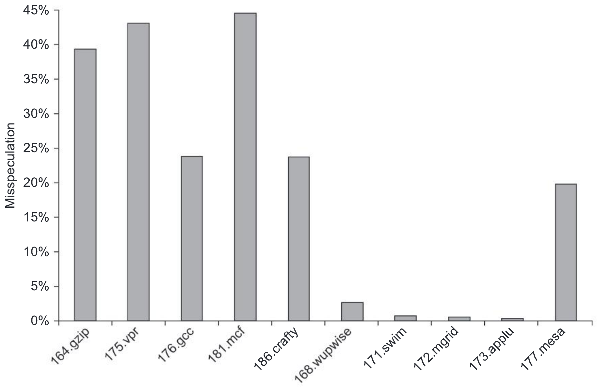

## 用动态消歧克服存储相关 {#sec-3-7}

上一节讨论的动态调度，处理的是经由寄存器的数据相关。本节讨论经由存储器的数据相关，也就是 load 和 store 通过存储单元形成的相关。这类相关的检测和处理要困难得多。寄存器的输入名和输出名完整地编码在指令中，在流水线前段就能检查相关；存储地址却做不到这一点。load 和 store 指令要先经过地址生成部件处理，才能得到有效访存地址。而且，地址计算可能与更早的、正在计算指针值的算术指令或 load 指令存在寄存器相关，因而发生停顿。

**按序访存。** 最简单的办法是让所有 load 和 store 指令按程序顺序执行：最老的访存指令先等经由寄存器的数据相关全部解除，再计算地址，然后把地址送往 Cache 层次。这种办法简单但慢，会损害多发射处理器的性能，原因在于 store 提交以前不能改写 Cache 中的数据。这样，即使有转移预测和寄存器重命名，循环后续迭代中的 load 也要等本次迭代的 store 提交之后才能访问数据 Cache。采用这种办法的处理器无法利用跨循环迭代的 ILP。

**load 旁路。** [图 3.21](#fig-3-21) 给出了一种性能更好的办法，称为 *load 旁路*（load bypassing）。load 和 store 只要数据相关允许，就立即计算有效地址；store 则要等提交以后才分派到 Cache 层次。如果不存在数据相关，即所有更老的 store 指令都已算出有效地址，而且这些地址都与 load 的有效地址不同，就允许这条 load 越过这些更老的 store。为了快速比较 load 地址和所有未完成 store 的地址，store 缓冲的表项要配备比较器。有了这项优化，即使更老的 store 尚未提交，循环后面迭代中的 load 也能提早访问 Cache，从而隐藏失效延迟，并尽早解除后续算术指令对它的相关。

**store 前递。** 另一项优化是 *store 前递*（store forwarding）：如果地址比较表明某条 load 与一条更老的 store 存在数据相关，就让 load 直接从这条 store 的输入物理寄存器中取数据，不再访问存储层次。与多于两条指令之间存在寄存器相关的情形一样，load 必须从它所相关的 store 中最年轻的那一条取数据。store 前递对 x86 处理器很重要。x86 的体系结构寄存器很少（只有 8 个整数寄存器），编译器不得不经常把变量从寄存器溢出到内存，过几条指令又重新装入。因此，超标量 x86 处理器常常要重叠执行多对溢出（store）和恢复（load）指令。store 前递能加快相关的 load 以及其后与之相关的指令的执行。

### 推测式存储消歧 {-}

即使有了 load 旁路，load 仍要等所有地址都可用、能够检查相关之后才能越过更老的 store，这对性能仍是很大的妨碍。为此出现了*推测式存储消歧*（speculative memory disambiguation）：先推测不存在相关，允许 load 越过尚未算出访存地址的更老的 store；等缺少的 store 地址可用以后，再做实际的相关检查。如果推测错了，这条 load 以及所有用过它结果的相关指令都要重新执行。复杂流水线很难有选择地重新执行指令，因此通常的恢复办法是像转移预测错误或发生异常时那样，清空这条 load 之后的整个流水线。

有几项研究给出了定量结果：不加区分地推测不存在存储相关，可能比完全不推测还差 [Moshovos et al., 1997, Chrysos and Emer 1998]。因此，近来所有的乱序处理器都实现了某种推测式选择性存储消歧方案。其思路与转移预测学习转移模式相似：处理器学习哪些 load 很可能与未完成的 store 相关，如果更老的 store 还没有算出地址，就不让这些 load 提前执行。具体做法是，在没有其他信息时，处理器先不加区分地推测，由此学习循环中 load 和 store 的这类模式。一旦发现了存储相关，就把涉及这一相关的 load 和 store 指令的 PC 存入硬件结构；这条 load 再次执行时，查询这些结构，就能判断它是否很可能与一条尚未算出地址的未完成 store 相关。

**存储集方案。** 下面以 Chrysos 和 Emer 于 1998 年提出的*存储集*（store sets）方案为例，较详细地介绍推测式选择性存储消歧的一种设计。存储集方案着重记录最近卷入存储相关误推测的 load 和 store。它可以简洁地表示两种情况：一条 load 可能与一组（一个集合）store 相关；一组 load 可能与同一条 store 相关。所需的两个硬件结构见[图 3.25](#fig-3-25)：

* *存储集标识表*（SSIT，store set ID table），记录最近卷入存储相关误推测的 load 和 store 的存储集标识。SSIT 用 load 和 store 指令 PC 中的若干位索引，所有表项初始化为无效。存储集标识是一个较小的整数（例如 0～63）。
* *最近取出 store 表*（LFST，last fetched store table），记录每个存储集中最近取出的那条 store 指令的指令地址（PC）。

两个结构的维护和使用过程如下：

* **建立存储集。** 硬件发现一次存储相关误推测时，分配一个存储集标识，写入这次误推测所涉及的 load 和 store 各自的 SSIT 表项。如果其中一条指令已经属于某个存储集（SSIT 有效），就改用它已有的存储集标识；如果两条指令分属不同的存储集，就把两个集合合并。
* **store 登记。** 一条 store 分派时查找自己的 SSIT 表项；如果表项有效，就把自己的指令地址（PC）记入这个存储集的 LFST 表项。这条 store 算出地址后，该 LFST 表项复位。
* **load 检查。** 一条 load 算出地址、准备分派到存储层次时，检查这两个结构。如果它的 SSIT 有效，而对应的 LFST 表项指出有一条尚未算出地址的未完成 store，这条 load 就不能继续执行。其他情况下，允许这条 load 推测地越过尚未得到地址的更老的 store，提前发射。其他情况有两种：一是 SSIT 表项无效，说明这条 load 最近没有卷入相关误推测；二是 SSIT 表项有效但指向空的 LFST 表项，说明这条 load 可能相关的所有 store 都已完成地址计算。

![图 3.25　推测式选择性存储消歧的存储集方案所需的硬件 [Chrysos and Emer, 1998]。原论文建议 SSIT 取 1K 到 4K 个表项，LFST 取 64 到 128 个表项。LFST 表项中缓存的内容取决于处理器其余部分的实现，可以是最近取出的那条 store 的指令地址（PC）、ROB 表项号或 load/store 队列表项号。](images/ch03/fig-3-25.png){#fig-3-25 width=90%}

存储集方案逐步积累那些引起过相关误推测、彼此相关的 load 和 store 指令集合。它的准确性受三方面限制：

* 不同的 load 和 store 指令可能映射到同一个 SSIT 表项，造成不必要的存储集合并；
* 某一对 load/store 如果很少发生相关误推测，不把它记入存储集结构，性能可能更好；
* 存储集只会随时间增大，处理器的 load 旁路因此越来越保守。

一个简单的解决办法是每隔几百万条指令把两个结构复位一次，让硬件重新找出推测时必须保持的最关键的相关。

**多处理器中的访存顺序。** 第 5 章讨论存储一致性时将会讲到，在多处理器系统中，即使 load 和 store 的访存地址都已知道，它们之间也还有更多的顺序约束，有些情况下连 load 之间重新排序都可能出错。在这类约束下，推测式存储消歧仍能获得高性能：硬件学习哪些重新排序会违反存储一致性，只在不太可能引起违例时才为提高性能而重排访存。

**值预测。** 推测式存储消歧是*值预测*的一种简单的受限形式。值预测就是预测一条指令将要产生的值。如果预测得非常准，就能消除数据流的限制，获得更高的 ILP。过去 20 年中，许多研究人员致力于值预测，发表了几十篇论文，但迄今为止，结果还不足以让商用处理器采用通用的值预测。

## 现代超标量处理器的高级问题 {#sec-3-8}

### 每周期多发射的挑战 {-}

动态调度处理器每个时钟周期发射多条指令，难就难在同一指令束中的指令可能彼此相关。前面介绍的指令执行的各个步骤，尤其是发射、分派和提交，都必须考虑并行执行的指令之间的相关。每个时钟周期重命名多条指令的复杂性已在 [3.5 节](#sec-3-5)介绍过，这里进一步讨论多发射对流水线其余部分的影响。

超标量处理器在一个时钟周期内处理多条指令，有两种办法：

* 一是让这一步在半个时钟周期内完成，一个时钟周期就能依次处理两条指令。但这种办法不容易扩展到每周期处理四条或更多指令。关键在于，这个问题不能简单地靠流水化来解决。例如，如果指令发射要占用多个时钟周期，就必须及时更新重命名表，让下一个时钟周期发射的相关指令能用上更新后的信息。
* 二是设计必要的逻辑，一次处理两条或更多指令，包括处理它们之间所有可能的相关。现代超标量处理器在深流水线的关键段采用的就是这种办法。

**发射。** 发射是宽发射处理器最根本的瓶颈之一。要正确发射一个指令束中的 N 条指令，必须完成以下工作：

- 在 ROB 中分配并更新 N 个表项。可用表项不足 N 个时，只发射指令束中最老的一部分指令。
- 在指令调度器和 load-store 队列中分配并更新 N 个表项。可用表项不足 N 个时，只发射指令束中最老的一部分指令。
- 分配并更新最多 N 个物理寄存器。可用寄存器不足 N 个时，只发射指令束中最老的一部分指令。
- 考虑指令束内各指令之间的数据相关和名相关，正确地重命名这 N 条指令的全部输入操作数（见 [3.5 节](#sec-3-5)）。

可能存在的相关数随指令束中指令数的平方增长，因此发射这一步很可能成为限制时钟频率的瓶颈，这也是很少有处理器尝试每周期发射八条以上指令的原因。[3.5 节](#sec-3-5)的[图 3.18](#fig-3-18) 举例说明了每周期重命名多条指令的复杂性，从中也能看出，过去 20 年里大批量生产的处理器，发射率为什么只从 3～4 条增加到 4～8 条。

**分派与提交。** 每周期分派多条指令要简单一些，因为到了流水线的这个位置，数据相关和名相关都已经解决，指令大多可以各自独立处理。半导体工艺的缩放也让处理器很容易配备大量功能部件，每个时钟周期都能处理就绪的指令，所以有好几种处理器每周期能分派的指令数超过了它的发射宽度。这样，一条 load 发生 Cache 失效之后，突然就绪的一批指令就能很快得到处理。同样，每周期从 ROB 中提交多条指令也不特别复杂，只要提交逻辑保证取消第一条报告异常或预测错误的指令后面的所有指令即可。

下面用一个例子从性能角度说明这些概念如何结合在一起。

**例题**　一台双发射、动态调度、带推测执行的处理器执行下面的循环，这个循环把一个整数数组的每个元素加 1：

```
Loop: ld   x2,0(x1)    //x2=数组元素
      addi x2,x2,1     //x2 加 1
      sd   x2,0(x1)    //存回结果
      addi x1,x1,8     //指针加 8
      bne  x2,x3,Loop  //不是最后一个则转移
```

假设有效地址计算、ALU 运算和转移条件求值各有独立的整数功能部件，每个时钟周期最多可以提交两条任意类型的指令。为这个循环的前三次迭代列出执行时间表。

**解答**　[图 3.26](#fig-3-26) 给出了双发射、动态调度、带推测执行的处理器的性能。在这个例子中，循环末尾的转移可能严重限制 ILP，推测执行的作用很大。有了转移推测，在前面的转移解决之前，后面的指令就可以执行（但不能提交），因而执行得很快。例如，第二条 load 可以先于更老的转移完成执行。如果处理器不采用推测执行，转移的解决就会成为主要的性能瓶颈。

[图 3.26　带推测执行的双发射流水线中各指令的分派、发射、执行完成和提交时间。由于 bne 预测为转移成功，bne 后面的 ld 可以提早开始执行。假设 load 用一个周期生成地址、一个周期访问 Cache（全部命中）；store 可以按需缓冲；一条指令可以在它所相关的更老指令完成执行的同一周期被调度执行。]{#fig-3-26 .caption}

| 迭代号 | 指令 | 发射周期 | 分派周期 | 完成周期 | 提交周期 | 说明 |
|---|---|---|---|---|---|---|
| 1 | `ld   p2, 0(p1)` | 1 | 2 | 4 | 5 | 第一条指令 |
| 1 | `addi p22, p2, 1` | 1 | 4 | 5 | 6 | 等待 ld |
| 1 | `sd   p22, 0(p1)` | 2 | 5 | | 6 | 等待 addi |
| 1 | `addi p21, p1, 8` | 2 | 2 | 3 | 7 | 按序提交 |
| 1 | `bne  p21, p3 Loop` | 3 | 3 | 4 | 7 | 等待 addi |
| 2 | `ld   p32, 0(p21)` | 4 | 5 | 7 | 8 | 无执行延迟 |
| 2 | `addi p42, p32, 1` | 4 | 7 | 8 | 9 | 等待 ld |
| 2 | `sd   p42, 0(p21)` | 5 | 8 | | 9 | 等待 addi |
| 2 | `addi p31, p21, 8` | 5 | 6 | 7 | 10 | 按序提交 |
| 2 | `bne  p31, p3 Loop` | 6 | 7 | 8 | 10 | 等待 addi |
| 3 | `ld   p52, 0(p31)` | 7 | 8 | 10 | 11 | 尽早执行 |
| 3 | `addi p62, p52, 1` | 7 | 10 | 11 | 12 | 等待 ld |
| 3 | `sd   p62, 0(p31)` | 8 | 11 | | 12 | 等待 addi |
| 3 | `addi p41, p31, 8` | 8 | 9 | 10 | 13 | 提前执行 |
| 3 | `bne  p41, p3 Loop` | 9 | 10 | 11 | 13 | 等待 addi |

### 推测执行到什么程度 {-}

推测执行的一大优点，是能提早发现那些本来会让流水线停顿的事件，例如 Cache 失效。但这一潜在优点也伴随着严重的潜在缺点。推测执行是有代价的：

* 它要花费时间和能量，推测错误后的恢复还会进一步降低性能；
* 要从推测执行中获益，指令执行速率必须更高，处理器就需要额外的资源来支持，这些资源要占用硅片面积，消耗功率；
* 如果推测执行引发了 Cache 失效、TLB 失效之类的异常事件，而不推测时这个事件本来不会发生，那么性能严重下降的可能性就会增大。

为了保住大部分优点，同时把缺点降到最低，许多带推测执行的流水线只允许在推测状态下处理代价低的异常事件，如 Cache 失效。如果发生的是代价高的异常事件，如 TLB 失效，处理器要等引起这个事件的指令不再处于推测状态，再处理这个事件。这样做可能使某些程序的性能略有下降，却能避免另一些程序的性能大幅下降，特别是这类事件频繁发生、转移预测又不够好的程序。

20 世纪 90 年代，推测执行的潜在缺点还不太明显。后来处理器使用推测执行越来越激进，它的实际代价才逐渐显现，更宽的发射和推测执行的局限性也已经暴露出来。稍后我们再回到这个问题。

### 跨多个转移的推测执行 {-}

本章讨论的宽发射、深流水线处理器会重叠执行几十条指令，因此任何时刻都可能有多个尚未解决的推测转移。另有三个特点使这种情况更容易出现：一是许多程序中转移的频率很高；二是某些代码段中转移很密集；三是功能部件解决转移需要很长的延迟。数据库程序和其他结构性较差的整数计算常常具有前两个特点，跨多个转移的推测执行因此很重要。同样，功能部件的延迟长，跨多个转移推测执行也更为重要，因为它可以避免较长的流水线带来的停顿。

**何时更新预测状态。** 跨多个转移推测执行，主要难在决定什么时候更新转移预测状态，包括历史寄存器、预测计数器和目标预测结构。注意，无论预测正确还是错误，都要更新预测器状态。如果只有一个尚未解决的推测转移，可以等它解决之后再更新。有多个推测转移时，就要权衡：等一个转移解决之后再更新预测表，预测随后的几条转移指令时就用不上这个转移的历史；一预测出转移成功或不成功就立即更新，预测状态中就会含有可能不准确的信息。有几种处理器设计的折中办法是：提早更新预测状态，如果转移解决后的方向与原来的预测相反，再在部分或全部预测结构中纠正这些更新。例如，有些处理器维护两个 RAS，一个在取到函数调用指令时就推测地更新，另一个只在函数调用指令不再处于推测状态时才更新。

**每周期预测几条转移。** 到目前为止，所有处理器每个时钟周期都只预测一条转移。同一个 PC 值既用来从 Cache 中取出一个指令束，又用来索引预测结构、得到下一个 PC。预测结构记录的是指令束中第一条成功转移（如果有的话）的信息。如果每个时钟周期预测多条成功转移，复杂性和功耗都会大大增加，性能收益不太可能抵得上这些代价。容易得到的收益来自循环体较小的循环：循环 Cache 能有效地捕获这类循环，而循环 Cache 是许多现代处理器的常见特性。

### 推测执行与能效的挑战 {-}

推测执行对能效有什么影响？乍看起来，似乎推测执行总会降低能效，因为每次推测错误都会在两方面多耗能量：

1. 推测执行了一些指令，它们的结果却不需要，这些指令给处理器增加了额外的工作，浪费了能量。
2. 撤销推测、恢复处理器状态以便从正确的地址继续执行，要消耗额外的能量，而不推测就不需要这部分能量。

推测执行确实会提高功耗。它引入了几种管理指令执行的新硬件结构，如转移预测器、重命名表、指令窗口和 ROB，这些大型结构一直处于使用状态，动态功耗和静态功耗都因此增加。但是，只要推测执行使执行时间缩短的幅度大于平均功耗增加的幅度，总能耗就可能降低。

所以，推测执行对能效的影响，要看它导致不必要工作的频率有多高。如果执行了大量不需要的指令，运行时间就不太可能缩短相应的幅度。[图 3.27](#fig-3-27) 给出了采用一种复杂的转移预测器时，部分 SPEC2000 基准测试程序中因误推测而执行的指令所占的比例。可以看出，这一比例在科学计算代码中很小，在整数代码中则相当大（平均约 30%）。因此，对整数应用来说，推测执行不太可能是节能的，而 Dennard 缩放的终结使不完善的推测执行问题更加突出。设计者可以有几种选择：不采用推测执行；设法减少误推测；或者考虑新的方法，例如只对已知可预测性很高的转移进行推测。

{#fig-3-27 width=90%}

### 超标量处理器受什么限制 {-}

本章讨论的硬件技术利用 ILP 特别有效。今天，几乎所有中高性能处理器都建立在宽发射、深流水线、转移预测、寄存器重命名和动态调度之上。然而，过去十年里，超标量处理器的改进速度放慢了：超标量的各项特性只是渐进地改进，发射宽度、流水线深度乃至时钟频率等几个关键特征多年来基本不变。这说明超标量处理器的效果存在局限。

前面已经讨论过两个关键的局限：

* 一是设计复杂、功耗大。非常宽（每周期 4 条或更多指令）、流水线非常深的处理器设计复杂，功耗很大，某些流水段的复杂性随发射宽度的平方增长。为了缓解这一问题，处理器厂商现在把超标量技术与向量技术、多核技术结合起来，分别利用数据级并行和线程级并行，以求进一步提高性能。第 4 章和第 5 章将会看到，这两种并行比 ILP 更规整或粒度更粗，支持它们的硬件也没有那么复杂。
* 二是受转移预测准确率制约。即使预测错误率只有几个百分点，也足以使更宽、更深的流水线失去效果。

第三个局限来自需要由片外 Cache 和主存服务的 Cache 失效。Karkhanis 和 Smith 较早分析了这类可能持续几百个时钟周期的长 Cache 失效的影响 [Karkhanis & Smith 2002]。有意思的是，长失效未完成期间停顿在指令窗口中的相关指令并不是主要问题：这些相关指令只有几十条，能够装进现代处理器的大指令窗口，不会妨碍无关指令就绪后发射。真正的问题是 ROB 阻塞，因为失效未完成期间，任何更年轻的指令都不能提交。这促使人们研究用检查点技术构建具有几千个 ROB 表项的超标量处理器，但这些技术迄今还没有商业应用。最后，长失效取回的数据往往供给与数据相关的转移，导致转移预测不准确。
