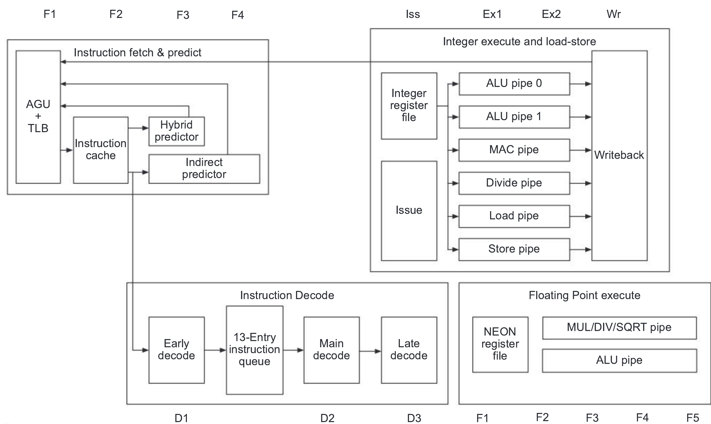
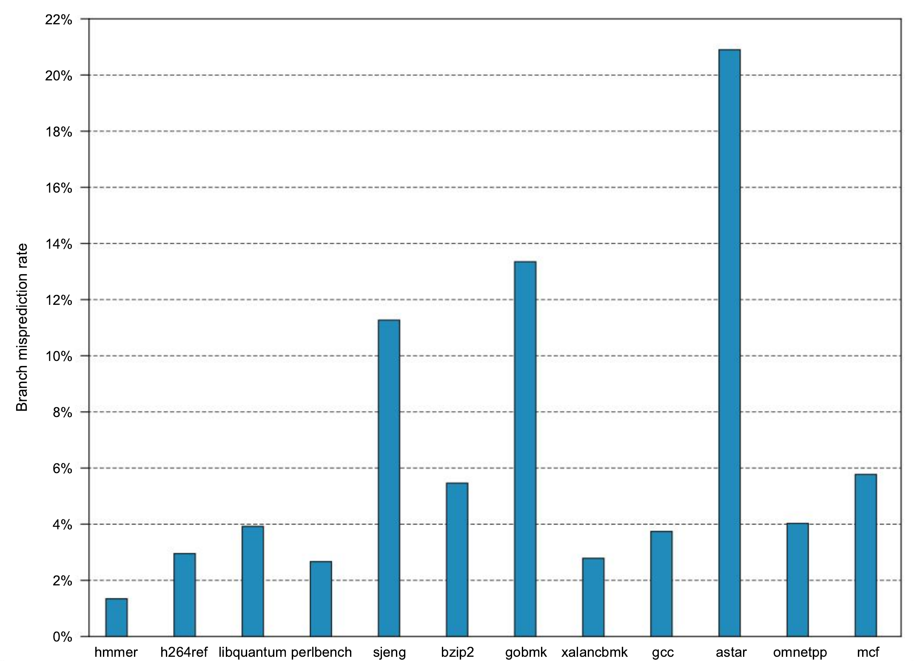
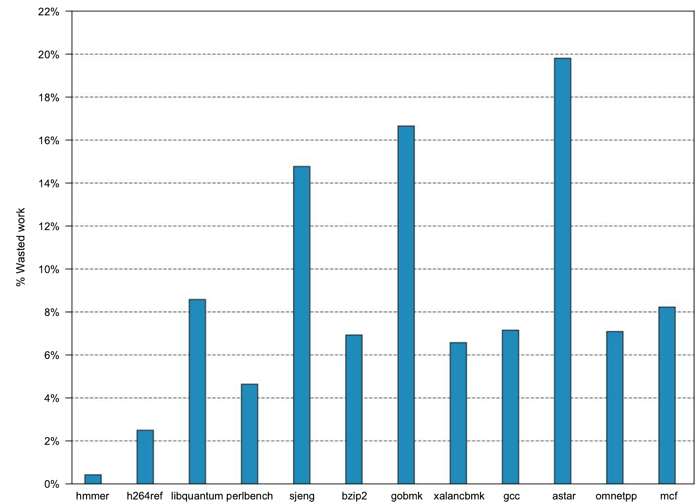
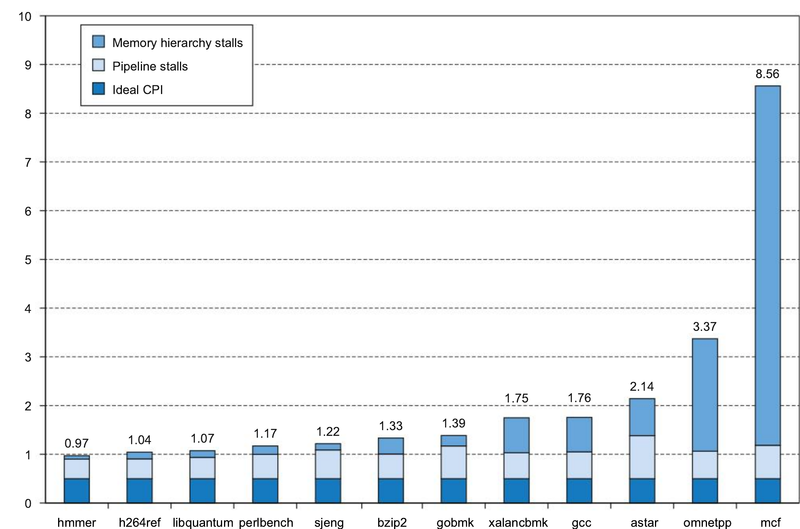
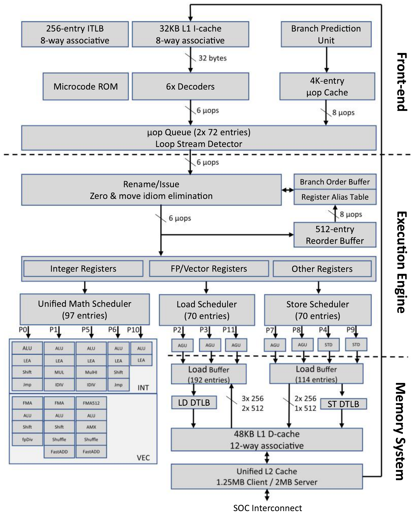

{#fig-3-32 width=90%}

## 微结构旁路攻击 {#sec-3-12}

本章介绍的推测执行和多线程技术，让宽发射处理器在各类工作负载上都能取得良好的性能，但也带来了一类新的安全漏洞，称为*微结构旁路攻击*，也称*瞬态执行攻击*。自 Meltdown [Lipp et al., 2018] 和 Spectre [Kocher et al., 2019] 攻击公布以来，新类型、新变种的旁路攻击接连出现，它们利用超标量处理器的性能特性来访问并泄露秘密数据。

微结构旁路攻击与第 2 章介绍的填充—探测攻击相似，但更令人担忧：填充和探测两个阶段之间执行哪些指令，由窥探者控制。后面马上会说明，借助推测执行，这些指令可以直接访问秘密数据，绕过软件边界检查、虚拟存储保护、虚拟机隔离、可信执行的硬件隔离等安全机制，从而快速、准确地在 Cache 中留下标记，供探测阶段观察。SMT 处理器让情况更糟：窥探进程与受害进程共用处理器流水线，由此带来两个问题。

* 一是窥探者可以利用多种缓存结构（包括一级 Cache 和 BTB）建立高带宽的旁路；
* 二是窥探者与受害者并行运行，可以赶在正常的执行活动（如 Cache 回填）覆盖泄露的信息之前，迅速探测旁路，取得这些信息。

推测执行与 SMT 结合，旁路攻击的准确性和有效带宽就有可能超过以往已知的所有攻击。公有云框架等共享基础设施采用超标量和 SMT 处理器，上面运行着大量服务，因此微结构旁路攻击可能造成严重的安全后果。

下面这段伪代码概括了最初的 Meltdown 攻击 [Lipp et al., 2018]，我们借它说明推测执行怎样为旁路攻击提供便利。窥探者在共享的核上运行这段代码，就有可能观察到操作系统内核所用的任意存储地址中的值。

```
---------------------------------
Allocate user_memory[];              // 填充阶段
Flush_caches();
Generate_exception();                // 推测执行并泄露
Value = kernel_array[Address];
Index = (Value & 1) * 256;           // 探测阶段
Value = user_array[Index];
---------------------------------
```

窥探者先填充系统：（1）分配数组 `user_memory`；（2）确保这个数组的元素都不在处理器的一级 Cache 中。接着，（3）发出一条会引发异常的指令，例如除以零引起的算术异常，或者一条 load 指令引起的存储保护错误。

如果处理器一次只执行一条指令，后面的步骤（4～6）根本不会执行。但推测执行的处理器会继续执行后面的代码，直到引发异常的指令到达 ROB 头部。因此，在异常真正发生、步骤 4 到 6 的结果被丢弃之前，后面这些指令很可能已经全部或部分执行。其中，指令（4）访问一个它本无权访问的内核存储单元，办法可以是在窥探者地址空间中的某个指针上加上或减去一个很大的偏移量；指令（5）根据读出的内核单元的最低位，生成索引值 0 或 256；指令（6）用这个索引读取数组 `user_memory` 的一个元素。异常到达 ROB 头部时，指令（4～6）都会取消，但指令（6）对一级 Cache 的影响留了下来：数组 `user_memory` 的一部分已经在 Cache 中。

窥探者从异常中恢复以后，或者在同一个 SMT 处理器的另一个线程上并行运行，就可以测量访问数组 `user_memory` 各元素的时间，以此探测 Cache：元素 0 读得快，说明 Cache 命中，内核存储单元的最低位是 0；元素 256 读得快，这一位就是 1。重复这些步骤，窥探者就能绕过虚拟存储保护，逐步读出内核存储器的大部分内容，以及其中的全部秘密。Meltdown 论文详细解释了每一步，并给出了在 x86 指令系统上的实现 [Lipp et al., 2018]。

大多数微结构旁路攻击的结构都与 Meltdown 相似：在填充和探测之间，窥探者利用推测执行，执行（但不提交）一些访问并泄露秘密数据的指令；这些指令用秘密数据改变某个硬件性能机制的状态，窥探者随即探测这一状态，推断出秘密数据的某些位。近来出现的攻击利用了超标量处理器中的各种性能机制（Cache、BTB 等）或推测事件（异常的延迟报告、转移预测、存储器消歧）。在包括 Spectre 在内的许多攻击中，窥探者通过现有的软件接口调用操作系统或受害进程，并精心挑选输入，让受害者自己的代码推测地访问并泄露秘密数据。受害进程处理这次调用时，窥探进程就用同一个核上的一个 SMT 线程探测泄露出来的数据。微结构旁路攻击的详细综述和分类，请参阅 Guangyuan Hu 等人的综述论文 [Hu et al., 2021]。

微结构旁路攻击很难在不损失性能的前提下防御。

**重新编译。** 第一种办法是重新编译可能处理秘密数据的代码，加以修改。编译器可以插入栅栏（fence）指令，在某个条件判定之前禁止推测执行；也可以在利用推测执行的指令与可能泄露秘密数据的 load 之间引入相关，这种技术称为推测 load 加固（speculative load hardening）。这种办法有两个缺点：一是依赖重新编译，而重新编译并不总是可行；二是在可能存在漏洞的代码上，这些防御措施用到多大范围，需要在性能和安全之间权衡。

**限制共享硬件结构。** 第二种办法是限制访问可能用来传递秘密的共享硬件结构。SMT 处理器上有大量结构由窥探进程与受害进程共用，有些场合干脆关闭了 SMT 多线程，让窥探进程无法轻易观察这些结构。用 Cache 划分技术把不同进程使用的 Cache 空间隔离开，也能削弱某些攻击的效果。

**修改流水线。** 最后，还有几种修改处理器流水线的方案：一是在推测执行时限制访问可能敏感的数据，或推迟使用这些数据；二是消除错误推测的指令对硬件性能机制的影响。Guangyuan Hu 等人的综述也概述了针对微结构旁路攻击的主要防御类别 [Hu et al., 2021]。目前，还没有哪一套防御措施能保证抵御所有可能的攻击。

微结构旁路攻击让人们意识到，现有 ISA 对正确行为的规定不够充分，不足以据此分析安全攻击。ISA 定义可编程处理器的功能行为，与时序无关。所以，一个超标量处理器完全可能正确实现了 ISA，却仍然容易受到安全攻击，今天的推测执行超标量处理器正是如此。我们这个领域还缺少相应的抽象和工具，用来建模和形式化分析：从安全和隐私的角度看，硬件实现的时序行为与正确执行之间怎样相互作用。截至本书写作时，已有几项研究工作在应对这一挑战。

## 融会贯通：Arm Cortex-A53 和 Intel Golden Cove 处理器 {#sec-3-13}

本节考察两款多发射处理器的设计。一是 Arm Cortex-A53 核。手机和平板电脑的芯片往往集成了若干个高性能核（大核）和高能效核（小核），A53 常用作其中的高能效核。二是 Intel Golden Cove 核，它是客户端 CPU 产品线 Alder Lake 和服务器 CPU 产品线 Sapphire Rapids 中的高性能核（p-core）。

### Arm Cortex-A53 {-}

A53 是一款双发射、静态调度的超标量处理器，采用动态发射，每个时钟可以发射两条指令。流水线的基本结构见[图 3.33](#fig-3-33)。非转移的整数指令要经过 8 个流水段：F1、F2、D1、D2、D3/ISS、EX1、EX2 和 WB，各段的作用见图注。流水线是顺序的，一条指令只有在结果可用、并且它前面的指令也已开始执行之后，才能发射执行。所以，如果紧接着的两条指令相关，两条指令都可以进入相应的执行流水线，但到了这条流水线的入口就会串行化：要等基于记分牌的发射逻辑指出第一条指令的结果已经可用，第二条指令才能发射。

{#fig-3-33 width=90%}

取指的四个周期中有一个地址生成部件，负责产生下一个 PC。下一个 PC 要么在上一个 PC 的基础上递增得到，要么来自以下四个预测器之一：

1. 单表项的转移目标 Cache，存放两次指令 Cache 取指的内容，即假定预测正确时，转移后面的两条指令。第一个取指周期检查这个目标 Cache，命中时后面两条指令就由它提供。如果命中而且预测正确，转移的执行没有延迟周期。
2. 3072 项的混合预测器，在 F3 段工作，用于所有在转移目标 Cache 中未命中的指令。由它处理的转移有 2 个周期的延迟。
3. 256 项的间接转移预测器，在 F4 段工作。由它预测的转移，预测正确时有 3 个周期的延迟。
4. 深度为 8 的返回栈，在 F4 段工作，有 3 个周期的延迟。

转移在 ALU 流水线 0 中判定，因此转移误预测开销为 8 个周期。SPECint2006 的误预测率见[图 3.34](#fig-3-34)。浪费的工作量取决于两个因素：一是误预测率，二是误预测的转移之后那段时间内维持的发射率。从[图 3.35](#fig-3-35) 可以看出，浪费的工作量大体随误预测率变化，但可能更大，偶尔也会更小。

#### A53 流水线的性能 {-}

A53 是双发射结构，理想 CPI 为 0.5。流水线停顿有三个来源：

1. 功能冒险：同时选中发射的两条相邻指令要用同一条功能流水线。A53 是静态调度的，编译器应当设法避免这种冲突。这样的指令先后出现时，会在执行流水线入口处串行化，只有第一条指令开始执行。
2. 数据冒险：在流水线前段检测，可能使两条指令都停顿（第一条不能发射时，第二条一定停顿），也可能只使一对指令中的第二条停顿。编译器同样应当尽可能防止这类停顿。
3. 控制冒险：只在转移误预测时发生。

{#fig-3-34 width=90%}

{#fig-3-35 width=90%}

TLB 失效和 Cache 失效也会引起停顿。在指令一侧，TLB 或 Cache 失效会推迟指令队列的填充，很可能导致流水线后段停顿。停顿的影响要看失效发生在哪一级：L1 失效时，如果指令队列是满的，延迟可能大部分被掩盖；L2 失效的时间则长得多。在数据一侧，Cache 或 TLB 失效会使流水线停顿，因为引起失效的 load 或 store 无法沿流水线继续前进，后面的指令也就全部随之停顿。CPI 以及各种来源对 CPI 的估计贡献见[图 3.36](#fig-3-36)。

A53 流水线浅，转移预测器相当激进，因此流水线损失不大，处理器又能以不高的功耗达到较高的时钟频率。与 i7 相比，四核 A53 处理器的功耗约为前者的 1/200。总之，A53 是一款非常成功的低功耗超标量处理器，常与性能更高的 Arm 核组成 big.LITTLE 结构。

{#fig-3-36 width=90%}

### Intel Golden Cove {-}

Golden Cove 是一种激进的 OOO 推测执行微结构，目标是让一个核从单个线程中提取更多的指令级并行（Rotem et al., 2022）。与 2008 年以来 Intel 所有的高端微结构一样，Golden Cove 核也支持 2 个线程的 SMT 执行。Golden Cove 于 2021 年发布，接替 Sunny Cove 微结构。Golden Cove 流水线的总体结构，以及其中许多关键结构的大小，见[图 3.37](#fig-3-37)。

*取指*：x86 指令长 1 到 15 字节不等，所以 x86 处理器的指令供给特别复杂。Golden Cove 的前端每个周期从指令 Cache 取 32 字节，由 6 个译码器把 x86 指令翻译成类似 RISC 的*微操作*（micro-op），暂存在 144 项的*微操作队列*中。这种把 x86 指令翻译成较易流水化的简单操作的做法，1997 年在 Pentium Pro 中引入，此后一直沿用。语义较复杂的 x86 指令由一个微码引擎产生微操作序列，它每个周期最多产生 4 个微操作，直到生成所需的整个序列为止。

前端还有一个*微操作 Cache*，存放 4K 个已译码的微操作，每个周期最多可以向微操作队列送出 8 个微操作。有了它，指令供给可以绕开指令 Cache 和译码器。此外还有一个*循环流检测器*（LSD），负责跟踪能装进微操作队列的循环。有了 LSD，微操作队列可以持续向后端提供指令，直到某次转移误预测不可避免地结束这个循环流。单线程模式下，LSD 可以让前端的其余部分休眠，以节省功耗；SMT 模式下，一个线程使用 LSD 时，更多的前端资源可以用来加快另一个线程的指令供给。

为了更好地支持代码量大的工作负载，Golden Cove 的指令 TLB 是 Sunny Cove 的 2 倍：4 KB 页有 256 项，2 MB/4 MB 页有 32 项。代码预取也有改进。转移预测器的组织是保密的，但已知其中几个结构加大了。第二级转移目标缓冲有 12K 项，Ice Lake 则只有 5K 项。

*乱序引擎*：Golden Cove 用一个 512 项的大 ROB 支持 OOO 执行。每个周期最多可以有 6 个微操作完成重命名，发射到调度器，再由调度器安排到各个功能部件上执行。硬件能识别某些可以优化的 x86 指令惯用法。例如，实际作用是把寄存器清零或在寄存器之间传送值的指令，就不必调度到功能部件上执行。

算术微操作的调度器有 97 项，由整数操作和浮点操作共用。它有 5 个端口，每个周期最多可以向整数功能部件发射 5 个就绪的微操作，向浮点和向量功能部件最多发射 3 个。Golden Cove 实现了几种面向数据中心和高性能计算（HPC）工作负载的 x86 ISA 扩展，其中有 512 位 SIMD 指令（AVX-512），它支持机器学习工作负载所用的数据类型，如 Brain 浮点（BF16）格式和 8 位整数（INT8）。窄数据类型对机器学习的意义在第 7 章讨论。Golden Cove 还是第一个实现*高级矩阵扩展*（AMX）的 Intel 微结构，AMX 面向机器学习工作负载。

{#fig-3-37 width=80%}

AMX 定义了一个新的二维寄存器堆和一组矩阵乘法指令。寄存器堆有 8 个寄存器，每个寄存器是由 16 个 64 字节的行组成的数组；矩阵乘法指令以不同的二维形状对这些寄存器做运算，最高速率为每个周期 2K 个 Int8 操作。load 调度器有 70 项，每个周期可以供给 3 个地址生成部件；store 调度器有 38 项，每个周期可以供给 2 个地址生成部件和 2 个 store 数据部件。

Golden Cove 用一个 128 项的*转移顺序缓冲*（branch order buffer）从转移误预测中恢复（Boggs et al., 2004）。遇到可能误预测的条件转移指令和间接转移指令时，这个缓冲为寄存器重命名状态保存一份快照。一旦检测到转移误预测，处理器就丢弃所有更年轻的指令，恢复这条转移之前的最后一份快照，然后从正确的目标重新开始取指。恢复期间，更老的指令照常执行。这样，处理器既不必等误预测的指令到达 ROB 头部，也不必清空整条流水线。

*存储子系统*：Golden Cove 每个周期最多可以处理 3 个 32 字节的 load 或 2 个 64 字节的 load，同时最多处理 2 个 64 字节的 store。流水线中有 192 项的 load 缓冲和 114 项的 store 缓冲，并采用推测式存储器消歧，发掘 load 与 store 之间的并行性。Golden Cove 支持 store 前递，load 的前一部分字节从 store 前递、其余字节从数据 Cache 读出的情况也支持。

L1 数据 Cache 容量为 48 KB，12 路组相联，命中时 load 到使用的延迟为 5 个周期。*填充缓冲*（fill buffer）最多可以跟踪 16 个未完成的 L1 Cache 失效。L2 Cache 容量为 1.25 MB（客户端芯片）或 2 MB（服务器芯片），每个周期提供 64 字节数据，延迟为 15 个周期。L1 和 L2 两级的预取器都有改进。L2 Cache 有一个基于模式的多路径预取器，能根据反馈自适应地节流预取。L2 Cache 最多可以有 48 个未完成的失效或预取请求。

load 的地址转换使用这样一个 TLB：4 KB 页 96 项（6 路组相联），2 MB/4 MB 页 32 项（4 路组相联），1 GB 页 8 项。store 另有一个 16 项的 TLB，适用于所有页大小。指令和数据的所有一级 TLB 后面，都有一个 2K 项的二级 TLB（STLB）作后援。STLB 失效送往页失效处理部件（PMH），PMH 最多可以并行进行 4 次页表遍历。

*与以往 Intel 微结构的比较*：[图 3.38](#fig-3-38) 比较了 Golden Cove 与 Skylake（2015）、Sunny Cove（2019）两种微结构的关键特性。与前几代相比，Golden Cove 在译码、发射、分派和退出各段每个周期能处理更多的指令，所有关键缓冲结构也都更大，ILP 能力明显提高。同时，Golden Cove 核能达到很高的频率，已公布的客户端产品和服务器产品分别可达 5.5 GHz 和 4.2 GHz。

[图 3.38　Intel 三代乱序微结构的特性。为了提取更多的 ILP，关键流水段（译码、发射、分派、退出）的宽度，以及关键缓冲、队列和寄存器堆的容量，逐年稳步增加。各种缓冲的大小有时看起来是随意定的，但很可能都以大量模拟为依据。]{#fig-3-38 .caption}

| | Skylake（2015） | Sunny Cove（2019） | Golden Cove（2021） |
|---|--:|--:|--:|
| 微操作队列（每个 SMT 线程） | 64 | 70 | 72 |
| 微操作 Cache 容量 | 1,500 | 2,304 | 4,096 |
| 保留站（整数 + 浮点） | 97 | 97 | 80 |
| 整数寄存器 | 180 | 280 | 280 |
| 浮点寄存器 | 168 | 224 | 332 |
| 未完成 load 缓冲 | 72 | 128 | 192 |
| 未完成 store 缓冲 | 56 | 72 | 114 |
| 重排序缓冲 | 256 | 352 | 512 |
| 每周期取指字节数 | 16 | 16 | 32 |
| 指令译码器数 | 1 个复杂 + 5 个简单 | 4 | 6 |
| 每周期发射指令数 | 4 | 5 | 6 |
| 功能部件的调度器端口数 | 8 | 10 | 12 |
| 每周期退出指令数 | 4 | 4 | 8 |

#### Golden Cove 核的性能 {-}

[图 3.39](#fig-3-39) 给出了 Golden Cove 核以单线程模式运行 10 个 SPECCPUint2017 基准测试程序时的性能特征。CPI 在 0.32 到 0.89 之间，即这个核平均每个周期执行 1.11 到 3.14 条指令。CPI 与误预测率、Cache 失效率和 TLB 失效率的相关性很好。

以 `mcf` 为例。这个基准测试程序实现的是网络单纯形法，用来求解公共交通车辆调度这类最小费用流问题。网络单纯形法把一般单纯形算法中的线性代数运算换成找圈、修改生成树等网络操作，这些操作可以很快完成。因此，`mcf` 含有依赖数据的转移和不可预测的指针访问，转移误预测率很高，存储层次各级的 Cache 失效率也很高。单是转移误预测率高，就可能使核缺少可执行的有用指令，`leela` 就是这样，它是一个围棋引擎，采用基于蒙特卡罗方法的局面评估。而在 `perlbench`（用于过滤垃圾邮件的 Perl 脚本）、`x264`（H.264/MPEG-4 AVC 视频编码）和 `exchange2`（编制数独谜题的递归程序）这样的基准测试程序上，Golden Cove 的预测器和 Cache 表现良好，核的后端因此能够利用相当多的 ILP。

[图 3.39　Golden Cove 核以单线程模式运行 SPECCPUint2017 基准测试程序时的关键性能特征。测量在双插座的 Sapphire Rapids 系统上进行，每个插座 56 个核、8 个 DDR5-4800 通道。基准测试程序用 Intel ICC 18 编译，使用了 AVX2 指令。MPKI 指每千条指令失效数。]{#fig-3-39 .caption}

| | perlbench_r | gcc_r | mcf_r | omnetpp_r | xalancbmk_r | x264_r | deepsjeng_r | leela_r | exchange2_r | xz_r |
|---|--:|--:|--:|--:|--:|--:|--:|--:|--:|--:|
| SpecRate | 6.68 | 7.84 | 7.12 | 6.31 | 7.9 | 16.43 | 5.5 | 4.97 | 17.53 | 3.92 |
| CPI | 0.328 | 0.577 | 0.899 | 0.717 | 0.505 | 0.321 | 0.512 | 0.666 | 0.318 | 0.730 |
| L1D 失效率（%） | 1.33% | 7.81% | 14.85% | 8.90% | 14.20% | 2.05% | 1.29% | 1.21% | 0.03% | 5.02% |
| L2 失效率（%） | 14.29% | 39.58% | 32.13% | 46.19% | 24.50% | 11.44% | 15.45% | 20.65% | 40.63% | 23.51% |
| L3 失效率（%） | 8.89% | 23.67% | 59.06% | 23.01% | 2.05% | 31.62% | 66.67% | 1.43% | 0.00% | 24.03% |
| L1D MPKI | 3.88 | 22.08 | 38.25 | 29.33 | 38.2 | 4.33 | 3.04 | 3.19 | 0.1 | 12.51 |
| L2 MPKI | 1.35 | 11.83 | 12.36 | 13.95 | 9.77 | 1.36 | 1.38 | 0.7 | 0.13 | 3.08 |
| L3 MPKI | 0.12 | 2.8 | 7.3 | 3.21 | 0.2 | 0.43 | 0.92 | 0.01 | 0 | 0.74 |
| 数据 TLB MPKI | 0.1 | 0.45 | 1.56 | 3.36 | 0.11 | 0.04 | 0.23 | 0.01 | 0 | 1.43 |
| 转移误预测率（%） | 0.49% | 1.30% | 8.77% | 2.06% | 0.28% | 1.46% | 4.04% | 9.44% | 1.81% | 3.95% |

[图 3.40](#fig-3-40) 给出了以双线程模式运行这 10 个 SPECCPUint2017 基准测试程序的性能收益。与运行单个线程相比，Golden Cove 核运行两个 SMT 线程时，这些基准测试程序的吞吐率提高了 5% 到 46%。单线程性能低的程序，SMT 收益通常较高，如 `mcf`（46%）和 `leela`（45%）。这些程序没有充分利用核的资源，第二个 SMT 线程因此能以合理的吞吐率执行。双插座系统的全部 112 个核都以双线程模式运行时，SMT 收益在 5% 到 37% 之间。以访存密集的 `mcf` 为例，它的 SMT 收益从只有 1 个核活跃时的 46% 降到所有核都活跃时的 27%，原因是每个插座内的 112 个线程要争用共享 L3 Cache 和主存系统中的资源。总的来看，按 SPECCPUint2017 各项 rate 成绩的几何平均值计算，SMT 收益在单核时为 27%，在双插座系统上为 16%。SMT 带来的吞吐率提高相当可观，这证明采用更宽的 OOO 流水线是合理的，尽管在单线程模式下，更宽的流水线并不能使所有工作负载同样受益。

 相同。我们给出了两种情况下的 SMT 收益：只用一个核（最多 2 个 SMT 线程）；使用双插座系统的全部 112 个核（最多 224 个 SMT 线程）。图例中 1 core 为单核，All cores 为全部核。](images/ch03/fig-3-40.png){#fig-3-40 width=90%}

[图 3.41](#fig-3-41) 给出了双插座系统全部 112 个核都以 SMT 模式运行时，每个核的性能特征。[图 3.38](#fig-3-38) 与[图 3.40](#fig-3-40) 之间的差别有两个来源：误预测率以及 L1、L2 失效率的差别，来自核内资源的争用；L3 失效率的差别，来自两个插座中全部线程之间的资源争用。例如，`gcc` 的 L3 Cache 每千条指令失效数（MPKI）从 1 个线程时的 2.8（[图 3.38](#fig-3-38)）增加到 224 个线程时的 20.2（[图 3.40](#fig-3-40)）。这说明，对同时执行数百个线程的多核芯片而言，Cache 和存储系统的设计非常重要。另外，打开 SMT 后，每个线程的 CPI 会增大。例如，从[图 3.38](#fig-3-38) 到[图 3.40](#fig-3-40)，`perlbench` 的 CPI 从 0.328 增大到 0.590。但现在有两个线程以这一速率执行指令，所以核一级的有效吞吐率是原来的 $(2/0.590)/(1/0.328) = 1.111$ 倍，即提高了 11.1%。

[图 3.41　双插座、共 112 个核的系统以双线程模式运行 SPECCPUint2017 基准测试程序时，单个 Golden Cove 核的关键性能特征。基准测试程序的设置与[图 3.39](#fig-3-39) 相同。我们给出的是每个 SMT 线程的 CPI。MPKI 指每千条指令失效数。]{#fig-3-41 .caption}

| | perlbench_r | gcc_r | mcf_r | omnetpp_r | xalancbmk_r | x264_r | deepsjeng_r | leela_r | exchange2_r | xz_r |
|---|--:|--:|--:|--:|--:|--:|--:|--:|--:|--:|
| CPI（每个线程） | 0.590 | 1.260 | 1.420 | 1.950 | 0.958 | 0.556 | 0.794 | 0.934 | 0.552 | 1.150 |
| L1D 失效率（%） | 1.85% | 9.10% | 18.98% | 10.43% | 17.03% | 2.96% | 2.68% | 1.92% | 0.00% | 7.37% |
| L2 失效率（%） | 11.32% | 42.70% | 25.63% | 43.99% | 19.01% | 6.63% | 12.17% | 10.36% | 0.00% | 23.12% |
| L3 失效率（%） | 82.96% | 65.62% | 78.92% | 80.76% | 63.95% | 77.78% | 81.21% | 35.19% | 0.00% | 71.43% |
| L1D MPKI | 5.53 | 26.74 | 48.47 | 35.1 | 47.14 | 6.32 | 6.39 | 5.16 | 0.01 | 17.82 |
| L2 MPKI | 1.35 | 15.27 | 12.43 | 15.85 | 9.32 | 0.9 | 1.49 | 0.54 | 0 | 4.13 |
| L3 MPKI | 1.12 | 10.02 | 9.81 | 12.8 | 5.96 | 0.7 | 1.21 | 0.19 | 0 | 2.95 |
| 数据 TLB MPKI | 0.15 | 0.6 | 1.32 | 4.53 | 0.11 | 0.01 | 0.24 | 0 | 0 | 1.78 |
| 转移误预测率（%） | 0.63% | 1.11% | 9.04% | 1.97% | 0.29% | 1.38% | 4.22% | 9.86% | 1.91% | 4.03% |
