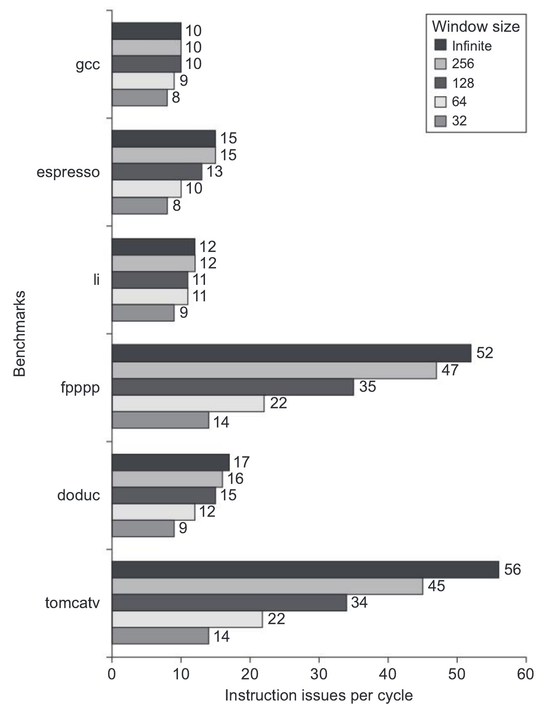

## 谬误与陷阱 {#sec-3-14}

下面几条谬误想说明的是：性能和能效很难预测，也不能从时钟频率、CPI 这样的单一指标推算出来。我们还将看到，在不同的基准测试程序上，不同的体系结构方法表现可能截然不同。

**谬误**　*只要工艺不变，同一指令系统结构的两个不同版本在性能和能效上的表现很容易预测。*

2008 年，Intel 推出了两款处理器。一款是面向低端上网本和个人移动设备（PMD）市场的 Atom 230，它同时实现了 x86 体系结构的 64 位和 32 位版本。Atom 是静态调度的双发射超标量处理器，微结构与 Arm A8 十分相似；A8 是单核处理器，是 A53 的前身。另一款是 Core i7 920，基于 OOO 的 Nehalem 微结构。而且，Atom 230 和 Core i7 920 是用同一种 45 nm Intel 工艺制造的。[图 3.42](#fig-3-42) 概括了 Intel Core i7 920、Arm Cortex-A8 和 Intel Atom 230 的特点。指令系统相同，底层制造工艺也相同，这就提供了一个难得的机会，可以直接比较两种截然不同的微结构。比较之前，先进一步介绍一下 Atom 230。

[图 3.42　四核 Intel i7 920、一款典型的 Arm A8 处理器芯片（256 MiB L2、32 KiB L1，无浮点）和 Intel Atom 230 的概况。对比可以清楚地看出，面向 PMD（Arm）或上网本（Atom）的处理器，与面向服务器和高端台式机的处理器，设计理念截然不同。注意 i7 有 4 个核，每个核的性能都高于单核的 A8 或 Atom。这几款处理器都采用相当的 45 nm 工艺。]{#fig-3-42 .caption}

| 领域 | 具体特性 | Intel i7 920（4 个核，均带浮点） | ARM A8（1 个核，无浮点） | Intel Atom 230（1 个核，带浮点） |
|---|---|---|---|---|
| 芯片物理特性 | 时钟频率 | 2.66 GHz | 1 GHz | 1.66 GHz |
| | 热设计功耗 | 130 W | 2 W | 4 W |
| | 封装 | 1366 引脚 BGA | 522 引脚 BGA | 437 引脚 BGA |
| 存储系统 | TLB | 两级；全部 4 路组相联；128 I/64 D；512 L2 | 一级，全相联；32 I/32 D | 两级；全部 4 路组相联；16 I/16 D；64 L2 |
| | Cache | 三级；32 KiB/32 KiB；256 KiB；2–8 MiB | 两级；16/16 或 32/32 KiB；128 KiB–1 MiB | 两级；32/24 KiB；512 KiB |
| | 峰值存储带宽 | 17 GB/s | 12 GB/s | 8 GB/s |
| 流水线结构 | 峰值发射率 | 每时钟周期 4 个操作（含融合） | 每时钟周期 2 个操作 | 每时钟周期 2 个操作 |
| | 流水线调度 | 推测执行，乱序 | 按序动态发射 | 按序动态发射 |
| | 转移预测 | 两级 | 两级；512 项 BTB；4 K 全局历史；8 项返回栈 | 两级 |

**Atom 230 的微结构。** Atom 处理器用标准办法实现 x86 体系结构：把 x86 指令翻译成类似 RISC 的微操作。20 世纪 90 年代中期以来，所有 x86 实现都是这样做的。Atom 的微操作功能稍强一些，允许一个算术操作与一个 load 或 store 配对；后来的 OOO 微结构通过宏融合（macrofusion）也有了这种能力。有了这项优化，在典型的指令组合中，平均只有 4% 的指令需要一个以上的微操作。微操作在一条 16 级流水线中执行，和 Arm A8 一样，每个时钟周期按序发射两条指令。Atom 有两个整数 ALU，浮点加法和其他浮点操作各有一条流水线，另有两条访存流水线。因此，Atom 的双路执行比 Arm A8 更通用，但仍受按序发射的限制。Atom 230 有 32 KiB 指令 Cache 和 24 KiB 数据 Cache，二者共用同一晶片上 512 KiB 的 L2。Atom 230 还支持双线程的多线程，但这里只比较单线程的情况。

i7 和 Atom 230 工艺相同、指令系统也相同，我们也许会以为，二者的相对性能和能耗是可以预测的，也就是说，功耗和性能会接近线性地按比例变化。我们用三组基准测试程序来检验这一假设：

* 第一组是单线程的 Java 基准测试程序，取自 DaCapo 和 SPEC JVM98 两个基准测试程序集（这些程序和测量方法见 Esmaeilzadeh 等（2011）的讨论）；
* 第二组和第三组取自 SPEC CPU2006，分别是其中的整数程序和浮点程序。

从[图 3.43](#fig-3-43) 可以看出，i7 的性能远高于 Atom。在 i7 上，所有基准测试程序的速度都至少是 Atom 的 4 倍，两个 SPECFP 程序超过 10 倍，一个 SPECINT 程序超过 8 倍。两种处理器的时钟频率之比是 1.6，因此 i7 920 的优势主要来自低得多的 CPI：Atom 的 CPI，在 Java 程序上是 i7 920 的 2.8 倍，在 SPECINT 程序上是 3.1 倍，在 SPECFP 程序上是 4.3 倍。

{#fig-3-43 width=90%}

然而，i7 920 的平均功耗略低于 43 W，Atom 的平均功耗只有 4.2 W，约为前者的 1/10。把性能和功耗合起来看，Atom 的能效通常是 i7 的 1.5 倍以上，常常达到 2 倍。两种处理器的底层工艺相同，这一比较清楚地表明：激进的超标量处理器靠动态调度和推测执行取得了性能优势，代价是能效上的*明显劣势*。

**谬误**　*CPI 较低的处理器总是更快。*

**谬误**　*时钟频率较高的处理器总是更快。*

关键在于，决定性能的是 CPI 与时钟频率的乘积。处理器靠深度流水线提高了时钟频率，还必须保持较低的 CPI，才能充分发挥高时钟频率的好处。同样，时钟频率高而 CPI 低的简单处理器，也可能更慢。

上一条谬误已经表明，即使指令系统相同，为不同环境设计的处理器，性能和能效也可能相差很远。实际上，即便是同一家公司同一系列的处理器，而且都面向高端应用，性能也可能相差很大。[图 3.44](#fig-3-44) 给出了 Intel 的两种 x86 实现的整数和浮点性能，以及 Intel 的一种 Itanium 体系结构实现的性能。

[图 3.44　三种 Intel 处理器差别很大。Itanium 处理器有 2 个核，i7 有 4 个核，但基准测试只用了一个核。功耗一列是热设计功耗；对多核处理器，给出的是只有一个核工作时的估计值。]{#fig-3-44 .caption}

| 处理器 | 实现工艺 | 时钟频率 | 功耗 | SPECCInt2006 base | SPECCFP2006 baseline |
|---|---|---|---|--:|--:|
| Intel Pentium 4 670 | 90 nm | 3.8 GHz | 115 W | 11.5 | 12.2 |
| Intel Itanium 2 | 90 nm | 1.66 GHz | 104 W，单核约 70 W | 14.5 | 17.3 |
| Intel i7 920 | 45 nm | 3.3 GHz | 共 130 W，单核约 80 W | 35.5 | 38.4 |

Pentium 4 是 Intel 造过的流水线设计最激进的处理器：流水线超过 20 级，有 7 个功能部件，Cache 中存放的是微操作而不是 x86 指令。实现如此激进，性能却相对较差，这清楚地说明，开发更多 ILP 的尝试（在途指令很容易达到 50 条）已经失败。Pentium 4 的功耗与 i7 相近，晶体管却比 i7 少，因为它的一级 Cache 只有 i7 的一半大，二级 Cache 只有 2 MiB，也没有三级 Cache。

Intel Itanium 是 VLIW 风格的体系结构。与动态调度的超标量处理器相比，它有可能降低复杂度，但时钟频率始终没能达到与主流 x86 处理器竞争的水平（不过它的总体 CPI 看来与 i7 相近）。分析这些结果时要注意，它们采用的实现工艺不同：流水线深度相当时，i7 的晶体管更快，时钟频率也就更高。尽管如此，性能差距之大仍然惊人，i7 的性能是 Pentium 的 3 倍以上。这一优势有相当一部分从何而来，下一条陷阱将给出解释。

**陷阱**　*有时更大、更笨的反而更好。*

21 世纪初，人们的注意力大多放在设计激进的处理器来开发 ILP 上，其中包括 Pentium 4 体系结构和 Intel Itanium：前者的流水线是微处理器中前所未有的最深流水线，后者的每时钟周期峰值发射率也是前所未有的最高水平。人们很快就发现，开发 ILP 的主要限制往往在存储系统。一级 Cache 失效的开销是 10～15 个周期，推测执行的 OOO 流水线能把其中相当大的一部分隐藏起来；末级 Cache（LLC，Last-Level Cache）失效则要访问主存，开销很可能达到 50～100 个时钟周期，OOO 流水线能隐藏的就很少了。

结果，这些设计尽管晶体管很多，技术也极其复杂巧妙，指令吞吐率却始终远未达到峰值。另一个变化也印证了这条陷阱：设计者不再试图用 ILP 隐藏更多的访存延迟，而是干脆把晶体管用来做大得多的 Cache。Pentium 4 是两级 Cache，Itanium 2 和 i7 都是三级 Cache；Itanium 2 和 i7 的三级 Cache 分别是 9 MiB 和 8 MiB，而 Pentium 4 的二级 Cache 只有 2 MiB。显然，做大 Cache 比设计 20 多级的 Pentium 4 流水线容易得多，而且从[图 3.44](#fig-3-44) 的数据来看，效果似乎也更好。

**陷阱**　*有时聪明的又比更大、更笨的好。*

过去十年里，转移预测领域出现了一个比较出人意料的结果：带 tag的混合预测器问世后，人们发现，在位数相同的条件下，较复杂的预测器能够胜过简单的 gshare 预测器（见[图 3.10](#fig-3-10)）。说它出人意料，一个原因是带 tag 的预测器还要拿出一部分位来存 tag，实际存储的预测反而更少，而 gshare 只有一个大的预测数组。尽管如此，不再把一条转移的预测误用到另一条转移上，由此得到的好处看来超过了把位分给 tag 而不分给预测所付出的代价。

**陷阱**　*认为只要有合适的技术，就能获得大量可用的 ILP。*

开发大量 ILP 的尝试之所以失败，原因有好几个。其中最重要的一个起初有些设计者并不接受：在结构常规的程序中，即使采用推测执行，也很难找到大量的 ILP。David Wall 1993 年的一项著名研究（见 Wall，1993）分析了在各种理想化条件下可用的 ILP 有多少。下面概述他针对一种处理器配置得到的结果，这种配置的能力大约是 2023 年最先进处理器的 4 到 8 倍。Wall 的研究详细记录了多种不同的方法，对开发 ILP 这一难题感兴趣的读者应当读一读研究全文。

这种激进的处理器有以下特点：

1. 每个时钟周期最多发射和分派 64 条指令，*没有*任何发射限制。这一发射宽度是 2023 年最宽的处理器 IBM Power10 总发射宽度的 8 倍，每个时钟周期允许的 load 和 store 数最多是后者的 32 倍。前面讨论过，发射率很高时，复杂度和功耗都会成为严重的问题。
2. 采用 1K 项的竞争预测器和 16 项的函数返回预测器。这一预测器与 2016 年最好的预测器相当，不是主要瓶颈。误预测在一个周期内处理完毕，但仍会限制推测执行的能力。
3. 动态地对访存引用完美消歧。这一要求很激进，但窗口较小时或许能够做到。
4. 寄存器重命名另有 64 个整数寄存器和 64 个浮点寄存器，比 2011 年最激进的处理器稍少。但这项研究假设所有指令的延迟都只有一个周期，而在 Golden Cove 这类处理器上，常见指令的延迟是 1～4 个周期，复杂指令最多可达 15 个周期。因此，有效的重命名寄存器数大约是这两种处理器的 5 倍。

[图 3.45](#fig-3-45) 给出了窗口大小变化时这种配置的结果。这种配置比现有的实现更复杂、更昂贵，在指令发射数上尤其如此；尽管如此，它为未来的实现可能达到的水平给出了一个有用的上限。这些数据很可能过于乐观，还有另一个原因：64 条指令之间没有任何发射限制，例如可以全是访存引用。近期内，谁都不会考虑让处理器具备这种能力。另外要记住，这些结果没有考虑 Cache 失效和非单周期延迟，而这两个因素的影响都很大。

{#fig-3-45 width=70%}

[图 3.45](#fig-3-45) 中最令人吃惊的现象是：在上述切合实际的处理器约束下，窗口大小对整数程序的影响不像对浮点程序那样严重。这一结果反映了两类程序的关键区别。有两个浮点程序存在循环级并行，可开发的 ILP 因而较多；整数程序则不同，转移预测、寄存器重命名，以及程序本身的并行性就比较少，这些因素都是重要的限制。这一点至关重要，因为过去十年市场增长的大部分，如事务处理、Web 服务器等，依赖的是整数性能，而不是浮点性能。

Wall 的研究当时有人不相信，但 10 年以后，人们终于认清了现实：投入大量硬件资源只换来有限的性能提高，错误的推测执行又带来严重的能耗问题，两方面合在一起，迫使设计方向发生了转变。我们在结束语中还会回到这一话题。

## 结束语 {#sec-3-15}

进入 2000 年时，人们对开发 ILP 的关注达到了顶峰。新世纪的头 5 年里，情况逐渐明朗：ILP 方法很可能已经到顶，需要新的方法。到 2005 年，Intel 和其他所有主要处理器厂商都已调整方针，转而专注于多核。此后，更高的性能要靠 TLP 而不是 ILP 来获得，高效使用处理器的责任也在很大程度上从硬件转到了软件和程序员身上。这是 25 年多以前流水线和 ILP 发展初期以来，处理器体系结构最重大的一次变化。如今，除了嵌入程度最深的应用领域，已经很难找到单核芯片了。

同一时期，设计者开始探索另一条提高性能的途径：更多地利用数据级并行。SIMD 扩展让台式机和服务器微处理器在图形及类似功能上获得了一定的性能提高。更重要的是，GPU 大力采用 SIMD，在具有大量 DLP 的应用上取得了明显的性能优势。对科学计算应用来说，多核开发的 TLP 更通用，但效率较低，这类 DLP 方法是它之外的一种可行选择。第 4 章讨论 DLP 利用方面的这些进展。2015 年前后，技术方向又一次急剧转变：设计者开始探索领域专用体系结构，以牺牲可编程性为代价，换取机器学习计算等关键应用在性能和功耗效率上的大幅提高。第 7 章专门讨论如何构建领域专用硬件。

许多研究者曾预测，ILP 的使用将大幅收缩，未来属于双发射超标量处理器和更多的核。然而，稍高一些的发射率仍有好处，推测式动态调度又能应对一级 Cache 失效这类不可预测的事件，因此，作为多核设计主要构件的核，在 ILP 上一直缓慢而稳定地改进；即使在 TLP 充足的应用领域（如数据中心）也是如此。SMT 的加入，以及它在性能和能效两方面的效果，进一步巩固了 OOO 推测执行方法的地位。超标量设计的改进速度无疑已经放慢，但 Intel、AMD、Arm、苹果和 IBM 等厂商仍在适时地推出一项又一项改进。实际上，即使在嵌入式市场，最新的处理器也已引入了动态调度、推测执行和更宽的发射。2023 年性能最好的 OOO 核之一是苹果的 Avalanche 核，用于智能手机的 A15 芯片和笔记本电脑的 M2 芯片。

ILP 的改进速度不太可能明显加快，原因很简单：从硅片利用率和功耗效率看，这样做效率太低。不过，ILP 很可能继续缓慢地改进。一是单线程性能对一些工作负载很重要，二是 ILP 技术适用面很广，这两点仍然是需要考虑的重要因素。三是同一块芯片上既可以组合高性能核与高能效核，也可以组合可编程核与定制加速器，从而兼顾效率，不断改进的 OOO 核因此能够继续部署。

以[图 3.46](#fig-3-46) 的数据为例，图中给出了 IBM Power 系列的 7 款处理器。Power 处理器面向银行系统、客户关系管理等企业应用，追求高性能，往往是 ILP 设计的领先者。二十年来，Power 处理器对 ILP 的支持稳步改进，但晶体管数增加的绝大部分（从 Power4 到 Power10，晶体管数增加到原来的 100 多倍）用在了扩大片上 Cache 和增加每个晶片的核数上。具体来看：

* 单个线程每周期最多发射的指令数，从 Power4 的 5 条增加到 Power10 的 8 条。Power10 SMT8 核分成两个执行域，每个域为 8 个线程服务，资源足以每周期发射 8 条指令；
* SMT 支持从无到有，发展到每个处理器 8 个线程。

Intel 的多代高性能微结构也呈现出类似的趋势：新增硅片面积有很大一部分用来支持更多的核、更宽的 SIMD 部件和更大的 Cache。接下来的两章讨论开发数据级并行和线程级并行的方法。

[图 3.46　七代 IBM Power 处理器的特点。除 Power6 是静态调度、按序执行的以外，其余都是动态调度的超标量处理器。Power7 和 Power8 用嵌入式 DRAM 做 L3 Cache。Power9 前面已简要介绍过，它进一步扩大了 Cache，并支持片外 HBM。Power10 SMT8 核包含两个执行资源域，每个域提供的资源最多可为 4 个硬件线程服务。因此，累计发射宽度为每周期 16 条指令，而单个线程每周期最多只能发射 8 条指令。]{#fig-3-46 .caption}

| | Power4 | Power5 | Power6 | Power7 | Power8 | Power9 | Power10 |
|---|--:|--:|--:|--:|--:|--:|--:|
| 推出年份 | 2001 | 2004 | 2007 | 2010 | 2014 | 2017 | 2021 |
| 峰值时钟频率（GHz） | 1.3 | 1.9 | 5.0 | 4.14 | 4.35 | 4.0 | 4.15 |
| 晶体管数（百万） | 174 | 276 | 790 | 1,200 | 4,200 | 8,000 | 18,000 |
| 每时钟周期发射数 | 5 | 5 | 7 | 6 | 8 | 18 | 16 |
| 每个核的功能部件数 | 8 | 8 | 9 | 12 | 16 | 38 | 42 |
| 每个核的 SMT 线程数 | 0 | 2 | 2 | 4 | 8 | 8 | 8 |
| 每片核数 | 2 | 2 | 2 | 8 | 12 | 12 | 16 |
| 片上 Cache 总容量（MiB） | 1.5 | 2 | 8 | 35 | 103.0 | 128 | 163 |

## 历史回顾与参考文献 {#sec-3-16}

M.5 节（可在线获取）讨论流水线和 ILP 的发展历程。我们还给出了大量参考文献，供读者进一步阅读和探索这些主题。M.5 节涵盖第 3 章和附录 H 两部分内容。
