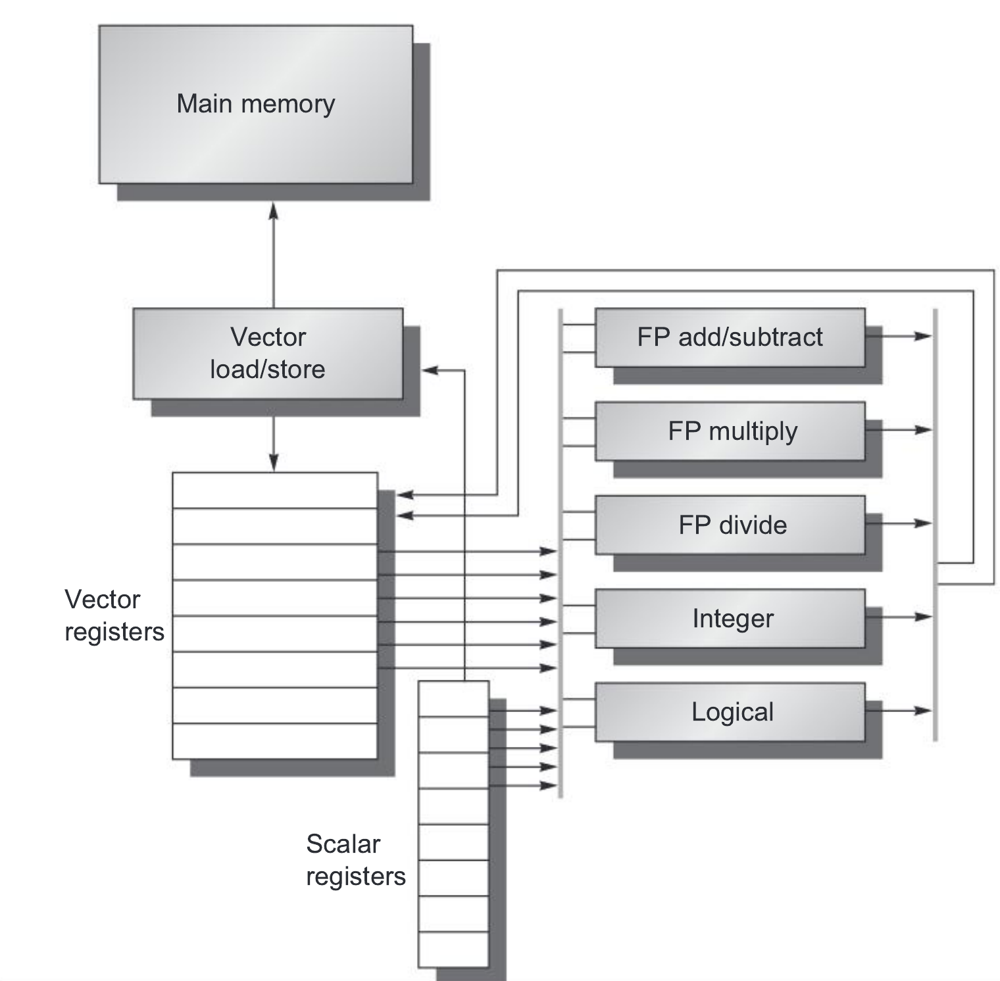
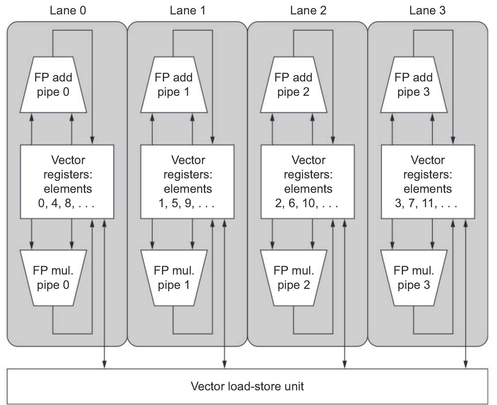

# 向量、SIMD 和 GPU 体系结构中的数据级并行 {#ch-dlp}

> 我们把这些算法称为数据并行算法，因为它们的并行性来自对大量数据同时进行的操作，而不是来自多个控制线程。
>
> ——W. Daniel Hillis 和 Guy L. Steele，「Data parallel algorithms」，*Commun. ACM*（1986）

> 如果你要犁一块地，你愿意用哪一种：两头壮牛，还是 1024 只鸡？
>
> ——Seymour Cray，超级计算机之父（他主张用两台强大的向量处理器，而不是用许多简单的处理器）

## 引言 {#sec-4-1}

第 1 章介绍过单指令流多数据流（SIMD）体系结构。围绕它一直有一个问题：到底有多少应用具有可观的数据级并行（DLP）？SIMD 分类提出（Flynn，1966）至今已近 60 年，答案是：不只是科学计算中的矩阵运算，面向媒体的图像和声音处理、机器学习算法（见第 7 章）也都具有可观的 DLP，而这些其实都是线性代数的变形。从能耗看，多指令流多数据流（MIMD）体系结构每做一次数据操作就要取一条指令，而 SIMD 一条指令就能启动许多次数据操作，因此 SIMD 有可能更节能。这两方面的回答，使 SIMD 对个人移动设备和服务器都很有吸引力。此外，与 MIMD 相比，SIMD 最大的优势也许在于：程序员仍然按顺序的方式思考，靠并行的数据操作就能得到并行加速。

本章介绍 SIMD 的三种变体：向量体系结构、多媒体 SIMD 指令系统扩展和图形处理器（GPU）。^[本章的素材来自以下几处：本书第 5 版中 Krste Asanovic 撰写的附录 F「Vector Processors」和附录 G「Hardware and Software for VLIW and EPIC」；《计算机组成与设计》（*Computer Organization and Design*）第 5 版中 John Nickolls 和 David Kirk 撰写的附录 A「Graphics and Computing GPUs」；另有少部分来自 Joe Gebis 和 David Patterson 的「Embracing and Extending 20th-Century Instruction Set Architectures」（*IEEE Computer*，2007 年 4 月），以及 David Patterson 和 Andrew Waterman 的「SIMD Considered Harmful」（2017 年 9 月）。]

**向量体系结构。** 第一种变体比另外两种早出现 30 多年，它把流水线执行推广到许多次数据操作上。*向量体系结构*比其他 SIMD 变体更容易理解，为它编译也更容易，但直到不久前，人们还认为把它用在微处理器上代价太高。代价一是在晶体管上，二是在于要提供足够的动态随机访问存储器（DRAM）带宽，因为传统微处理器普遍依靠 Cache 来满足对存储器性能的要求。

**多媒体 SIMD 扩展。** 第二种变体借用了 SIMD 这个名字，取的基本是「同时进行的并行数据操作」这层意思。现在，大多数支持多媒体应用的指令系统结构都有这类扩展。x86 的 SIMD 指令扩展始于 1996 年的 MMX（多媒体扩展），此后十年间推出了几个版本的 SSE（流式 SIMD 扩展），一直发展到今天的 AVX（高级向量扩展）和 AMX（高级矩阵扩展）。要让 x86 计算机达到最高的计算速率，往往要用到这些 SIMD 指令，浮点程序尤其如此。

**GPU。** 第三种变体来自图形加速器领域，潜在性能比今天传统的多核计算机更高。GPU 与向量体系结构有一些共同特点，但也有自己的鲜明特征，部分原因在于它所处的生态环境：系统中除了 GPU 及其图形存储器，还有系统处理器和系统存储器。正是为了体现这种区别，GPU 界把这类体系结构称为*异构*体系结构。除了图形，GPU 还在推动机器学习的发展，GPU 在这方面的作用留到第 7 章介绍。

对于数据并行性很强的问题，三种 SIMD 变体有一个共同的优点：比传统的 MIMD 并行编程更省程序员的力气。

本章希望体系结构设计者弄清两个问题：一是向量为什么比多媒体 SIMD 更通用；二是向量体系结构与 GPU 体系结构有哪些异同。向量体系结构是多媒体 SIMD 指令的超集，编译模型也更好；GPU 又与向量体系结构有若干相似之处。所以我们先介绍向量体系结构，为后面两节打基础。下一节介绍向量体系结构，附录 G 对这一主题有更深入的讨论。

## 向量体系结构 {#sec-4-2}

> 执行可向量化应用最高效的方式是向量处理器。
>
> ——Jim Smith，*International Symposium on Computer Architecture*（1994）

向量体系结构的工作方式是：把散布在存储器各处的一组组数据元素取出来，放进大型的顺序寄存器堆，在寄存器堆中完成运算，再把结果分散写回存储器。一条指令处理的是一个向量的数据，相当于对相互独立的数据元素做几十次寄存器—寄存器操作。

这些大型寄存器堆相当于由编译器控制的缓冲区，作用有两个：隐藏访存延迟，充分利用存储带宽。向量 load 和 store 是深度流水的，程序只需每次向量 load 或 store 承受一次较长的访存延迟，而不是每个元素承受一次，于是延迟分摊到了比如 32 个元素上。向量程序的目标，就是让存储器始终保持忙碌。

现代微处理器受功耗限制，体系结构设计者因此看重这样的体系结构：性能好，又不必像高度乱序的超标量处理器那样付出能耗和设计复杂度的代价。向量指令正好符合这一趋势：用它可以提高简单的顺序标量处理器的性能，而能耗和设计复杂度不会大幅增加。Kozyrakis 和 Patterson（2002）的研究表明，许多在复杂乱序处理器上运行良好的程序，实际上都可以改写成向量指令形式的 DLP，而且效率更高。

### RV64V 扩展 {-}

我们从一台向量处理器讲起，它的主要部件如[图 4.1](#fig-4-1) 所示。这台处理器大致以 50 年前的 Cray-1 为蓝本，Cray-1 是最早的超级计算机之一。指令系统采用 RISC-V 的向量扩展 RVV。向量扩展本身叫 RVV，RV64V 则是指 64 位 RISC-V 基本指令加上向量扩展。下面给出 RV64V 的一个简化子集，力求用几页篇幅讲清它的精髓。

RV64V 指令系统结构的主要组成部分如下：

* *向量寄存器*：每个向量寄存器存放一个向量，RV64V 共有 32 个。向量寄存器堆要有足够多的端口，为所有向量功能部件供数，这样，对不同向量寄存器的向量操作才能高度重叠。读写端口合计至少有 16 个读端口和 8 个写端口，通过一对交叉开关与功能部件的输入或输出相连。提高寄存器堆带宽的一个办法是用多个存储体（bank）构成寄存器堆，向量比较长时这种办法效果很好。
* *向量功能部件*：在我们的实现中，每个功能部件都是全流水的，每个时钟周期都能启动一个新操作。另需一个控制部件检测冒险，包括功能部件上的结构冒险和寄存器访问中的数据冒险。从[图 4.1](#fig-4-1) 可以看出，我们假设 RV64V 的实现有 5 个功能部件。为简单起见，本节只讨论浮点功能部件。
* *向量 load/store 部件*：负责把向量从存储器装入，或者存入存储器。在我们假想的 RV64V 实现中，向量 load 和 store 是全流水的，经过初始延迟之后，向量寄存器与存储器之间每个时钟周期可以传送一个字。标量 load 和 store 通常也由这个部件处理。
* *一组标量寄存器*：标量寄存器同样可以为向量功能部件提供输入数据，还可以计算地址，交给向量 load/store 部件。它们就是 RV64G 中普通的 31 个通用寄存器和 32 个浮点寄存器。标量值从标量寄存器堆读出后，由向量功能部件的一个输入端锁存。
* 与下一节的 SIMD 指令不同，一次数据并行操作包含多少个元素，不由指令的操作码决定。这个值称为*最大向量长度*（*VLMAX*），它属于向量体系结构的每一种实现，而不属于每一条指令。两种实现可以有相同的向量指令系统，而 VLMAX 不同。

{#fig-4-1 width=70%}

**指令的几种版本。** [图 4.2](#fig-4-2) 列出了本节用到的 RV64V 向量指令。[图 4.2](#fig-4-2) 的说明假设输入操作数都是向量寄存器，但这些指令也有某个操作数为标量寄存器（`xi` 或 `fi`）的版本。按源操作数的不同，每种向量指令分为几类：

* 源操作数都是向量寄存器，后缀 `.vv`；
* 一个向量寄存器和一个标量整数寄存器，后缀 `.vx`；
* 一个向量寄存器和一个标量整数立即数，后缀 `.vi`；
* 一个向量寄存器和一个标量浮点寄存器，后缀 `.vf`。

既然版本由操作数决定，我们通常让汇编器自动加上合适的后缀。标量值的副本在指令发射时交给向量功能部件。

[图 4.2　RV64V 向量指令。所有指令都采用 R 型指令格式。表中每个双操作数的向量操作都按两个操作数均为向量（`.vv`）的形式给出，但这些操作还有第二个操作数为标量寄存器的版本（`.vs`）；在有区别时，还有第一个操作数为标量寄存器、第二个操作数为向量寄存器的版本（`.sv`）。操作数的类型和宽度由各个向量寄存器的配置决定，不由指令给出。除了向量寄存器和谓词寄存器，还有两个向量控制和状态寄存器（CSR）`vl` 和 `vctype`，后面会讨论。带步长的数据传送和带索引的数据传送也在后面解释。]{#fig-4-2 .caption}

| 助记符 | 名称 | 说明 |
|---|---|---|
| `vadd` | ADD | 整数加：V[rs1] 与 V[rs2] 的元素相加，每个结果放入 V[rd] |
| `vsub` | SUBtract | 整数减：V[rs1] 的元素减去 V[rs2] 的元素，每个结果放入 V[rd] |
| `vmul` | MULtiply | 整数乘：V[rs1] 与 V[rs2] 的元素相乘，每个结果放入 V[rd] |
| `vdiv` | DIVide | 整数除：V[rs1] 的元素除以 V[rs2] 的元素，每个结果放入 V[rd] |
| `vmacc` | Multiply ACCumulate | 整数乘：V[rs1] 与 V[rs2] 的元素相乘，每个结果累加到 V[rd] |
| `vfadd` | Fp ADD | 浮点加：V[rs1] 与 V[rs2] 的元素相加，每个结果放入 V[rd] |
| `vfsub` | Fp SUBtract | 浮点减：V[rs1] 的元素减去 V[rs2] 的元素，每个结果放入 V[rd] |
| `vfmul` | Fp MULtiply | 浮点乘：V[rs1] 与 V[rs2] 的元素相乘，每个结果放入 V[rd] |
| `vfdiv` | Fp DIVide | 浮点除：V[rs1] 的元素除以 V[rs2] 的元素，每个结果放入 V[rd] |
| `vfmacc` | Fp Multiply ACCumulate | 浮点乘：V[rs1] 与 V[rs2] 的元素相乘，每个结果累加到 V[rd] |
| `vxor` | XOR | V[rs1] 与 V[rs2] 的元素按位异或，每个结果放入 V[rd] |
| `vor` | OR | V[rs1] 与 V[rs2] 的元素按位或，每个结果放入 V[rd] |
| `vand` | AND | V[rs1] 与 V[rs2] 的元素按位与，每个结果放入 V[rd] |
| `vsll` | Shift Left | V[rs1] 的元素左移 V[rs2] 位，每个结果放入 V[rd] |
| `vsrl` | Shift Right | V[rs1] 的元素右移 V[rs2] 位，每个结果放入 V[rd] |
| `vsra` | Shift Right Arithmetic | V[rs1] 的元素右移 V[rs2] 位，同时扩展符号位，每个结果放入 V[rd] |
| `vpeq` | Compare = | 比较 V[rs1] 与 V[rs2] 的元素。相等时，在 V[0] 对应的 1 位元素中置 1，否则置 0 |
| `vpne` | Compare != | 比较 V[rs1] 与 V[rs2] 的元素。不相等时，在 V[0] 对应的 1 位元素中置 1，否则置 0 |
| `vmxor` | Mask XOR | V[rs1] 与 V[rs2] 最低位的 1 位元素按位异或，每个结果放入 V[0] |
| `vmor` | Mask OR | V[rs1] 与 V[rs2] 最低位的 1 位元素按位或，每个结果放入 V[0] |
| `vpmand` | Mask AND | V[rs1] 与 V[rs2] 最低位的 1 位元素按位与，每个结果放入 V[0] |
| `vle`*i* | Contiguous Load（连续装入） | 从地址 R[rs1] 开始的存储器中把向量装入寄存器 V[rd]（*i* 位元素，*i* = 8、16、32 或 64；`vl` 设定元素个数） |
| `vlse`*i* | Strided Load（带步长装入） | 从地址 R[rs1] 开始、按 R[rs2] 中的步长把数据装入 V[rd]，即地址为 R[rs1] + j × R[rs2]，j = 0, 1, … |
| `vloxe`*i* | Indexed Load (Gather)（带索引装入，集中） | 用元素位于 R[rs2] + V[rs2] 处的向量装入 V[rs1]（即 V[rs2] 是索引） |
| `vse`*i* | Contiguous Store（连续存储） | 把向量寄存器 V[rd] 存入从地址 R[rs1] 开始的存储器 |
| `vsse`*i* | Strided Store（带步长存储） | 把 V[rd] 存入地址为 R[rs1]、步长在 R[rs2] 中的存储器（即 R[rs1] + j × R[rs2]，j = 0, 1, …） |
| `vsoxe`*i* | Indexed Store (Scatter)（带索引存储，分散） | 把 V[rs1] 存入元素位于 R[rs2] + V[rs2] 处的存储器向量（即 V[rs2] 是索引） |
| `setvl` | Set vector length | 设置元素宽度和寄存器个数（在 `vtype` 中），并把 `vl` 和目的寄存器设为 `mvl` 与源寄存器两者中的较小值 |

**数据宽度。** 传统的向量体系结构不能高效地支持窄数据类型，但向量本身天然能够容纳不同的数据宽度（Kozyrakis 和 Patterson，2002）。一个向量寄存器如果有 32 个 64 位元素，同样可以看成 128 个 16 位元素，甚至 256 个 8 位元素。正因为硬件能这样一物多用，向量体系结构既能用于多媒体应用，也能用于科学应用。

[图 4.2](#fig-4-2) 中的 RV64V 指令都没有给出数据宽度。这是 RV64V 的一项创新：数据宽度不像通常那样由指令给出，而是附属于*每个向量寄存器*。因此，程序在执行向量指令之前，要先配置所用的向量寄存器，指定它们的宽度。[图 4.3](#fig-4-3) 列出了 RV64V 可选的宽度。指定的办法是设置一个状态寄存器，把其中的标准元素宽度字段 SEW 设为相应的位数，例如 64。

[图 4.3　RV64V 支持的数据宽度，这里假设它还有单精度和双精度浮点扩展 RVS 和 RVD。在这样的 RISC-V 设计中加入 RVV，标量部件也必须加入 RVH。RVH 是一种标量指令扩展，用于支持半精度（16 位）IEEE 754 浮点数。RV32V 没有双字标量操作，因此它的向量部件可以去掉 64 位整数。如果某种 RISC-V 实现不包含 RVS 或 RVD，就可以省去向量浮点指令。]{#fig-4-3 .caption}

| 类型 | 宽度 |
|---|---|
| 整数 | 8、16、32 和 64 位 |
| 浮点 | 16、32 和 64 位 |

**动态寄存器类型的好处。** 这种做法称为*动态寄存器类型*，它有三个好处。

一是指令少。传统向量体系结构要支持这么多种宽度，需要很多条指令。按[图 4.3](#fig-4-3) 中的宽度种数计算，如果没有动态寄存器类型，[图 4.2](#fig-4-2) 会长得多。而且类型一经设定就不再改变，只指定一次，比每条指令都指定更高效。

二是程序员可以更好地利用向量寄存器堆。用不了多少向量寄存器的程序，可以把几个寄存器合起来，组成更长的向量。例如，设向量存储空间共 1024 字节，某个程序只需要 4 个存放 64 位浮点数的向量寄存器，它就可以把这块空间当作 4 个 256 字节的向量来用，每个向量有 256/8 = 32 个元素。具体做法是设置一个状态寄存器，把其中的长度倍增字段 LMUL 设为 8，表示每 8 个寄存器合成一组，于是只有 4 个可用的向量寄存器。

对向量体系结构有一种批评：状态多，上下文切换就慢。我们的 RV64V 实现使状态变为原来的 3 倍，从 2 × 32 × 8 = 512 字节增加到 2 × 32 × 8 + 1024 = 1536 字节。为了降低上下文切换的开销，处理器会记录自上次上下文切换以来软件有没有写过向量寄存器。

三是不同宽度操作数之间的转换，可以根据寄存器的配置，在算术指令中隐式完成，不必另加显式的转换指令。下一节会给出这方面的例子。

**向量访存与控制寄存器。** `vle` 和 `vse` 分别是向量 load 和向量 store，一次装入或存储一整个向量。它们有两个操作数：一个是要装入或存储的向量寄存器，另一个是 RV64G 通用寄存器，存放向量在存储器中的起始地址。除了向量寄存器本身，向量操作还要用到另外几种寄存器：向量的自然长度不等于 VLMAX 时，要用向量长度寄存器 `vl`；向量类型寄存器 `vtype` 记录寄存器的类型；循环中有 IF 语句时，要用谓词寄存器 `p`~*i*~。下面的例子会说明它们的用法。

有了向量指令，系统可以用多种方式对向量中的数据元素执行操作，包括同时处理许多元素。这种灵活性让向量设计可以用速度慢但宽度大的执行部件，以较低的功耗获得较高的性能。而且，向量指令系统中各元素相互独立，扩展功能部件时不必像超标量处理器那样另做代价高昂的相关检查。

### 向量处理器的工作原理：一个例子 {-}

理解向量处理器，最好的办法是看一个 RV64V 的向量循环。本节始终以下面这个典型的向量问题为例：

$$
\mathrm{Y} = \mathrm{a} \times \mathrm{X} + \mathrm{Y}
$$

其中 `X` 和 `Y` 是向量，开始时存放在存储器中，`a` 是标量。这就是 *SAXPY* 循环或 *DAXPY* 循环，它构成 Linpack 基准测试程序的内层循环（Dongarra 等，2003）。SAXPY 是 single-precision a × X plus Y（单精度 a × X 加 Y）的缩写，DAXPY 是 double-precision a × X plus Y（双精度 a × X 加 Y）的缩写。Linpack 是一组线性代数例程，Linpack 基准测试程序由执行高斯消去的例程组成。

暂且假设向量寄存器的元素个数，即*长度*（32），正好等于我们所关心的向量操作的长度。这一限制很快就会去掉。

**例题**　给出 DAXPY 循环的 RV64G 代码和 RV64V 代码。假设 X 和 Y 都有 32 个元素，`X` 和 `Y` 的起始地址分别在 `x5` 和 `x6` 中。（元素个数不是 32 的情况，后面另有例题讨论。）

**解答**　RISC-V 代码如下：

```
      fld    f0,a          # 装入标量 a
      addi   x28,x5,#256   # 要装入的最后一个地址
Loop: fld    f1,0(x5)      # 装入 X[i]
      fmul.d f1,f1,f0      # a × X[i]
      fld    f2,0(x6)      # 装入 Y[i]
      fadd.d f2,f2,f1      # a × X[i] + Y[i]
      fsd    f2,0(x6)      # 存入 Y[i]
      addi   x5,x5,#8      # X 的下标加 1
      addi   x6,x6,#8      # Y 的下标加 1
```

DAXPY 的 RV64V 代码如下：

```
vsetvl a3,a0,e64,m8,ta,ma # 4 个 64 位向量寄存器（SEW=64，LMUL=8）
fld    f0,a               # 装入标量 a
vle64  v0,(x5)            # 装入向量 X
vfmul  v8,v0,f0           # 向量-标量乘
vle64  v16,(x6)           # 装入向量 Y
vfadd  v24,v8,v16         # 向量-向量加
vse64  v24,(x6)           # 存储和
```

向量操作生成哪种版本，由汇编器决定：乘法有一个标量操作数，汇编器就生成 `vfmul.vf`；加法没有标量操作数，就生成 `vfadd.vv`。第一条指令把前 4 个向量寄存器配置成存放 64 位数据。

**指令带宽。** 上面两段代码最显著的区别在于，向量处理器大大降低了动态指令带宽：RV64V 只执行 8 条指令，RV64G 却要执行 258 条。原因有两个：一是向量操作一次处理 32 个元素；二是在 RV64G 上几乎占循环一半的开销指令，在 RV64V 代码中都不需要了。如果编译器为这样的指令序列生成了向量指令，而且生成的代码大部分时间运行在向量模式下，就称这段代码是*向量化*的或*可向量化*的。循环能否向量化，要看各次迭代之间有没有相关；没有相关的循环就可以向量化。迭代之间的相关称为*循环携带相关*（loop-carried dependence，见 4.5 节）。

**流水线互锁。** 两者的另一个重要区别，是 RV64G 简单实现上流水线互锁的频率。在直接写出的 RV64G 标量代码中，每条 `fadd.d` 都要等前面的 `fmul.d`，每条 `fsd` 又要等 `fadd.d`。而在向量处理器上，每条向量指令只在每个向量的第一个元素上停顿，后面的元素随即顺畅地流过流水线。因此，流水线停顿每条向量*指令*只发生一次，而不是每个向量*元素*发生一次。向量体系结构设计者把相关元素操作之间的前递称为*链接*（chaining），意思是把相关的操作「链」在一起。在这个例子中，RV64G 上的流水线停顿频率大约是 RV64V 的 32 倍。软件流水、循环展开（见附录 H）或乱序执行可以减少 RV64G 上的流水线停顿，但指令带宽上的巨大差距无法大幅缩小。

### 向量执行时间 {-}

一个向量操作序列的执行时间主要取决于三个因素：一是操作数向量的长度；二是操作之间的结构冒险；三是数据相关。向量部件接收新操作数、产生新结果的速率称为*发起速率*。已知向量长度和发起速率，就能算出一条向量指令的执行时间。

现代向量计算机的向量功能部件都有多条并行流水线（或称*车道*，lane），每个时钟周期能产生两个或更多结果，不过其中也可能有些功能部件不是全流水的。为简单起见，我们的 RV64V 实现只有一条车道，单个操作的发起速率为每个时钟周期一个元素。这样，一条向量指令的执行时间（以时钟周期计）大约就等于向量长度。

**护航指令组。** 为了简化对向量执行和向量性能的讨论，我们引入*护航指令组*（convoy）的概念。所谓护航指令组，就是一组有可能一起执行的向量指令。组内指令之间*不能*有任何结构冒险；如果有，就必须把它们串行化，放到不同的护航指令组中启动。按这个规定，前面例子中的 `vld` 和紧跟其后的 `vmul` 可以放在同一个护航指令组中。后面很快会看到，只要数一数一段代码有多少个护航指令组，就能估计它的性能。为了让分析简单，我们假设一个护航指令组执行完毕之后，其他指令（标量指令或向量指令）才能开始执行。

看起来，有写后读相关冒险的指令序列，也应该像有结构冒险的序列一样放进不同的护航指令组。但有了链接，它们就可以放在同一个护航指令组中。链接让一个向量操作在源向量操作数的各个元素一旦可用时就开始执行：链中第一个功能部件的结果「前递」给第二个功能部件。实际实现链接时，常常允许处理器同时读写同一个向量寄存器，只要读写的是不同元素。早期的链接实现与标量流水线中的前递完全一样，但这种方法限制了链中源指令和目的指令的时序。近来的实现采用*灵活链接*（flexible chaining）：只要不产生结构冒险，一条向量指令基本上可以与任何其他正在执行的向量指令链接。所有现代向量体系结构都支持灵活链接，本章始终假设采用灵活链接。

**钟鸣。** 要把护航指令组换算成执行时间，还需要一个估计护航指令组执行时间的度量，这就是*钟鸣*（chime），即执行一个护航指令组所用的时间单位。由 *m* 个护航指令组组成的向量序列，执行时间就是 *m* 个钟鸣。例如，向量长度为 *n* 时，在我们简单的 RV64V 实现上，执行时间大约为 *m* × *n* 个时钟周期。

钟鸣近似忽略了一些与具体处理器有关的开销，其中许多开销与向量长度有关。因此，用钟鸣计时对长向量比对短向量更准确。我们用钟鸣而不用每个结果的时钟周期数来度量，就是为了明确表示忽略了某些开销。

知道一个向量序列有多少个护航指令组，也就知道了以钟鸣计的执行时间。钟鸣忽略的开销之一，是在一个时钟周期内启动多条向量指令所受的限制。如果每个时钟周期只能启动一条向量指令（大多数向量处理器的实际情况就是这样），钟鸣数就会低估护航指令组的实际执行时间。不过，向量长度通常远大于护航指令组中的指令条数，因此我们简单地假设一个护航指令组在一个钟鸣内执行完。

**例题**　假设每种向量功能部件只有一个，说明下面的代码序列怎样划分成护航指令组：

```
vle64 v0,x5       # 装入向量 X
vfmul v1,v0,f0    # 向量-标量乘
vle64 v2,x6       # 装入向量 Y
vfadd v3,v1,v2    # 向量-向量加
vse64 v3,x6       # 存储和
```

这个向量序列要用多少个钟鸣？忽略向量指令的发射开销，每个 FLOP（浮点操作）需要多少个时钟周期？

**解答**　第一个护航指令组从第一条 `vle` 指令开始。`vfmul` 与第一条 `vle` 相关，但有了链接，二者可以放在同一个护航指令组中。

第二条 `vle` 指令与前一条 `vle` 指令在 load/store 部件上有结构冒险，必须放到另一个护航指令组中。`vfadd` 与第二条 `vld` 相关，同样可以通过链接与它放在同一个护航指令组中。最后，`vse` 与第二个护航指令组中的 `vld` 有结构冒险，只能放进第三个护航指令组。划分结果如下：

1. `vle`　`vfmul`
2. `vle`　`vfadd`
3. `vse`

这个序列需要 3 个护航指令组，也就是 3 个钟鸣。每个结果有 2 次浮点操作，因此每个 FLOP 需要 1.5 个时钟周期（忽略所有向量指令发射开销）。注意，虽然我们允许 `vld` 和 `vmul` 都在第一个护航指令组中执行，但大多数向量机要用 2 个时钟周期才能启动这两条指令。

这个例子说明，对长向量来说，钟鸣近似相当准确。例如，向量有 32 个元素时，以钟鸣计的时间是 3，这个序列大约要用 32 × 3 = 96 个时钟周期，而分两个时钟周期发射护航指令组带来的开销很小。

**启动时间。** 比发射限制重要得多的开销来源，是向量的*启动时间*，这也是钟鸣模型忽略的最重要的开销。所谓启动时间，是指流水线填满之前的延迟时钟周期数，主要由向量功能部件的流水线延迟决定。RV64V 采用与 Cray-1 相同的流水线深度，虽然更现代的处理器中延迟有增大的趋势，向量 load 尤其如此。所有功能部件都是全流水的，流水线深度如下：浮点加法 6 个时钟周期，浮点乘法 7 个，浮点除法 20 个，向量 load 12 个。

有了这些向量基础知识，下面几小节介绍一些优化。这些优化有的提高性能，有的扩大能在向量体系结构上高效运行的程序范围。具体来说，它们要回答以下问题：

* 向量处理器怎样以每个时钟周期多于一个元素的速度执行一个向量？每个时钟周期处理多个元素，可以提高性能。
* 向量长度与最大向量长度（mvl）不一致的程序，向量处理器怎样处理？大多数应用中的向量与体系结构的向量长度都不一致，这种常见情况需要一个高效的解决办法。
* 要向量化的代码中有 IF 语句时怎么办？条件语句处理得好，能向量化的代码就更多。
* 向量处理器对存储系统有什么要求？存储带宽不够，向量执行可能是白费功夫。
* 向量处理器怎样处理多维矩阵？多维矩阵是常用的数据结构，向量体系结构要得到广泛应用，就必须能把它向量化。
* 向量处理器怎样处理稀疏矩阵？稀疏矩阵也是常用的数据结构，同样必须能向量化。
* 怎样为向量计算机编程？体系结构上的创新如果与程序设计语言及其编译器不相适应，就可能得不到广泛使用。

本节其余部分依次介绍向量体系结构的这些优化，附录 G 有更深入的讨论。

### 多车道：每个时钟周期处理多个元素 {-}

向量指令系统的一个关键优势是：软件只用一条短指令，就能把大量并行工作交给硬件。一条向量指令可以包含几十个相互独立的操作，编码位数却和一条普通标量指令一样。向量指令的语义是并行的，所以实现时可以用多种方式完成这些逐元素的操作：

* 用一个深度流水的功能部件，到目前为止讨论的 RV64V 实现就是这样；
* 用一组并行的功能部件；
* 把并行和流水的功能部件结合起来。

[图 4.4](#fig-4-4) 说明了怎样用并行流水线执行一条向量加法指令，从而提高向量性能。

{#fig-4-4 width=90%}

RV64V 指令系统有一个性质：在所有向量算术指令中，一个向量寄存器的第 *N* 个元素只能与其他向量寄存器的第 *N* 个元素一起运算。这大大简化了高度并行的向量部件的设计：向量部件可以组织成多条并行的*车道*。和公路一样，增加车道就能提高向量部件的峰值吞吐率。[图 4.5](#fig-4-5) 是一个四车道向量部件的结构。在这个例子中，从一条车道增加到四条车道，一个钟鸣的时钟周期数就从 32 降到 8。多车道要发挥作用，应用和体系结构都必须支持长向量。否则，向量指令很短，执行得非常快，指令带宽就会跟不上，还得靠 ILP 技术（见第 3 章）来提供足够的向量指令。

每条车道包含向量寄存器堆的一部分，以及每个向量功能部件中的一条执行流水线。每个向量功能部件用多条流水线（每条车道一条）执行向量指令，速率为每个时钟周期一个元素组。所有向量寄存器的第一个元素（元素 0）都放在第一条车道中，因此任何向量指令的第一个元素，它的源操作数和目的操作数都在第一条车道里。这样分配以后，车道内的算术流水线不必与其他车道通信就能完成运算。车道之间不通信，构建高度并行的执行部件时就能少用布线和寄存器堆端口。这也说明了为什么向量计算机每个时钟周期最多能完成 64 次操作（16 条车道，每条车道 2 个算术部件和 2 个 load/store 部件）。

{#fig-4-5 width=90%}

增加车道是提高向量性能的常用技术，因为它几乎不增加控制复杂度，也不需要修改已有的机器代码。设计者还可以借此在晶片面积、时钟频率、电压和能耗之间权衡，而不损失峰值性能：向量处理器的时钟频率减半时，把车道数加倍，峰值性能就能保持不变。
