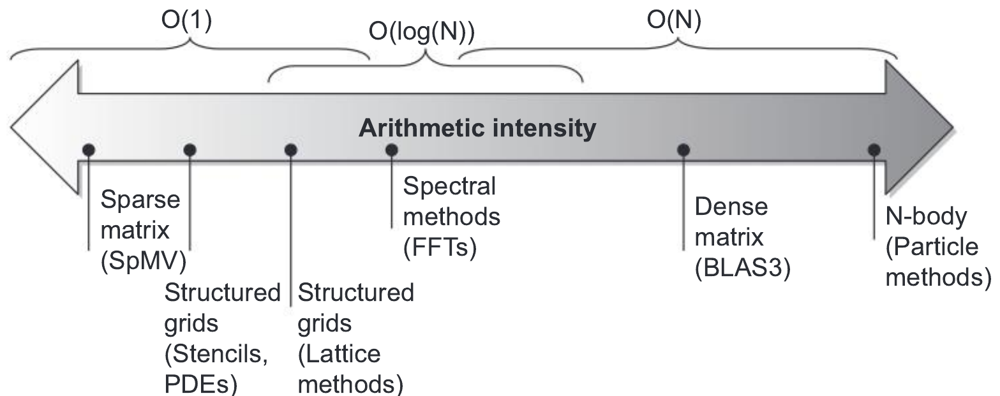

[图 4.7　Perfect Club 基准测试程序在 Cray Y-MP 上运行时的向量化程度（Vajapeyam，1991）。第一列是编译器在没有提示时达到的向量化程度；第二列是 Cray Research 的程序员团队根据提示改进代码以后的结果。]{#fig-4-7 .caption}

| 基准测试程序 | 以向量模式执行的操作（编译器优化） | 以向量模式执行的操作（程序员协助） | 提示优化带来的加速比 |
|---|--:|--:|--:|
| BDNA | 96.1% | 97.2% | 1.52 |
| MG3D | 95.1% | 94.5% | 1.00 |
| FLO52 | 91.5% | 88.7% | N/A |
| ARC3D | 91.1% | 92.0% | 1.01 |
| SPEC77 | 90.3% | 90.4% | 1.07 |
| MDG | 87.7% | 94.2% | 1.49 |
| TRFD | 69.8% | 73.7% | 1.67 |
| DYFESM | 68.8% | 65.6% | N/A |
| ADM | 42.9% | 59.6% | 3.60 |
| OCEAN | 42.8% | 91.2% | 3.92 |
| TRACK | 14.4% | 54.6% | 2.52 |
| SPICE | 11.5% | 79.9% | 4.06 |
| QCD | 4.2% | 75.1% | 2.15 |

## 面向多媒体的 SIMD 指令系统扩展 {#sec-4-3}

多媒体 SIMD 扩展的出发点很简单：许多媒体应用处理的数据，比 32 位处理器所针对的数据类型要窄。例如，图形系统用 8 位表示一种基色，三基色之外再用 8 位表示透明度；音频采样视应用不同，通常用 8 位或 16 位表示。把加法器内部的进位链分割开，处理器就能同时对短向量做运算。以 256 位加法器为例，它可以同时处理 32 个 8 位操作数、16 个 16 位操作数、8 个 32 位操作数或 4 个 64 位操作数，而这种分割式加法器增加的成本很小。典型的多媒体 SIMD 指令见[图 4.8](#fig-4-8)。

SIMD 指令与向量指令相同的地方是，一条指令对一组数据指定同一种操作。不同的是寄存器堆的规模：向量计算机的寄存器堆很大，例如 RISC-V RV64V 有 32 个向量寄存器，每个可以存放比如 32 个 64 位元素；SIMD 指令指定的操作数往往较少，寄存器堆也就小得多。

[图 4.8　典型的 256 位宽操作的多媒体 SIMD 支持。IEEE 754-2008 浮点标准增加了半精度（16 位）和四精度（128 位）浮点操作。]{#fig-4-8 .caption}

| 指令类别 | 操作数 |
|---|---|
| 无符号加/减 | 32 个 8 位、16 个 16 位、8 个 32 位或 4 个 64 位 |
| 最大值/最小值 | 32 个 8 位、16 个 16 位、8 个 32 位或 4 个 64 位 |
| 平均值 | 32 个 8 位、16 个 16 位、8 个 32 位或 4 个 64 位 |
| 右移/左移 | 32 个 8 位、16 个 16 位、8 个 32 位或 4 个 64 位 |
| 浮点 | 16 个 16 位、8 个 32 位、4 个 64 位或 2 个 128 位 |

向量体系结构本来就是作为向量化编译器的目标设计的，指令系统简洁、优雅。与之相比，SIMD 扩展缺了三样主要的东西：向量长度寄存器，带步长的和集中—分散的数据传送指令，以及掩码寄存器。

1. **没有向量长度寄存器。** 多媒体 SIMD 扩展把数据操作数的个数固定在操作码里，结果 x86 体系结构的 MMX、SSE、AVX 和 AMX 扩展一共增加了数百条指令。向量体系结构则用向量长度寄存器指定当前操作的操作数个数。有些程序的向量天然就比体系结构支持的最大长度短，这种可变长度的向量寄存器很容易适应它们。此外，向量体系结构中隐含了一个最大向量长度，它和向量长度寄存器配合，就不必设置大量操作码。
2. **没有复杂的寻址方式。** 直到不久以前，多媒体 SIMD 都不支持向量体系结构那些更复杂的寻址方式，即带步长的访问和集中—分散访问。有了这两种访问，向量编译器能够成功向量化的程序就更多（见 [4.7 节](#sec-4-7)）。
3. **没有掩码寄存器。** 向量体系结构用掩码寄存器支持元素的条件执行，多媒体 SIMD 通常不提供，不过这一情况正在改变。

缺了这些，编译器生成 SIMD 代码就更难，用 SIMD 汇编语言编程也更费力。

**MMX。** x86 体系结构在 1996 年增加了 MMX 指令。MMX 借用了原有的 64 位浮点寄存器，基本指令可以同时完成 8 个 8 位操作或 4 个 16 位操作。随同加入的还有：并行的 MAX 和 MIN 操作，各种屏蔽指令和条件指令，数字信号处理器中常见的操作，以及一些被认为对重要媒体库有用的专用指令。MMX 访存用的也是原有的浮点数据传送指令。

**SSE。** 1999 年，MMX 的后继者流式 SIMD 扩展（SSE）问世。SSE 增加了 16 个独立的 128 位寄存器（`XMM` 寄存器），指令可以同时完成 16 个 8 位操作、8 个 16 位操作或 4 个 32 位操作，还能做并行的单精度浮点运算。寄存器是独立的，所以 SSE 需要单独的数据传送指令。此后不久，Intel 又通过 2001 年的 SSE2、2004 年的 SSE3 和 2007 年的 SSE4 增加了双精度 SIMD 浮点数据类型。只要程序员把操作数并排存放，一条指令就能完成 4 个单精度浮点操作或 2 个并行的双精度操作，x86 计算机的峰值浮点性能由此提高。每一代扩展还都加入了一些专用指令，用来加速当时被认为重要的特定多媒体功能。

**AVX。** 2010 年加入的高级向量扩展（AVX）再次把寄存器宽度加倍，达到 256 位（`YMM` 寄存器）。对所有较窄的数据类型，新指令每条完成的操作次数都比原来多一倍。[图 4.9](#fig-4-9) 列出了对双精度浮点计算有用的 AVX 指令。2013 年的 AVX2 增加了 30 条新指令，例如集中指令（`VGATHER`）和向量移位指令（`VPSLL`、`VPSRL`、`VPSRA`）。2017 年的 AVX-512 又把宽度加倍到 512 位（`ZMM` 寄存器），寄存器个数也再加倍到 32 个，并增加了大约 250 条新指令，其中包括分散指令（`VPSCATTER`）和掩码寄存器（`OPMASK`）。AVX 还为今后的版本把寄存器扩展到 1024 位做了准备。

**AMX。** 最新的扩展是高级矩阵扩展（AMX），2022 年问世的微处理器开始加入。AMX 的目标是支持矩阵乘法，这是机器学习最基本的运算（见第 7 章）。它增加了 8 个二维向量寄存器，称为 *tile*。每个 tile 为 16 × 256，即 16 行，每行 256 位，所以 AMX 增加的状态共 8 × 16 × 256/8 = 4096 字节。tile 矩阵乘法（TMUL）部件可以对 8 位整数或 BF16 格式的 16 位浮点数（见第 7 章）做矩阵乘法，因此一个 256 位的行可以存放 32 个 int8 数据或 16 个 BF16 数据。

[图 4.9　x86 体系结构中对双精度浮点程序有用的 AVX 指令。对 256 位 AVX 而言，紧缩双精度（packed-double）是指以 SIMD 方式执行的 4 个 64 位操作数。AVX 加宽以后，数据重排指令越来越重要，这类指令能把宽寄存器中不同部分的窄操作数组合起来。AVX 有在 256 位寄存器内混洗 32 位、64 位或 128 位操作数的指令，例如 BROADCAST 把一个 64 位操作数在 AVX 寄存器中复制 4 份。AVX 还有大量融合乘加/乘减指令，这里只列出两条。]{#fig-4-9 .caption}

| AVX 指令 | 说明 |
|---|---|
| `VADDPD` | 4 个紧缩双精度操作数相加 |
| `VSUBPD` | 4 个紧缩双精度操作数相减 |
| `VMULPD` | 4 个紧缩双精度操作数相乘 |
| `VDIVPD` | 4 个紧缩双精度操作数相除 |
| `VFMADDPD` | 4 个紧缩双精度操作数乘加 |
| `VFMSUBPD` | 4 个紧缩双精度操作数乘减 |
| `VCMPxx` | 比较 4 个紧缩双精度操作数，条件为 `EQ`、`NEQ`、`LT`、`LE`、`GT`、`GE`、… |
| `VMOVAPD` | 传送 4 个对齐的紧缩双精度操作数 |
| `VBROADCASTSD` | 把一个双精度操作数广播到 256 位寄存器中的 4 个位置 |

总的来说，这么多扩展的目的一直是加速精心编写的库，而不是让编译器来生成这类代码（见附录 H）。不过，近来的 x86 编译器已经在尝试生成这类代码，尤其是针对浮点密集型应用。SIMD 寄存器的宽度由操作码决定，因此宽度每加倍一次，SIMD 指令的条数也必须加倍。

多媒体 SIMD 扩展有这些缺点，为什么还如此流行？原因有以下几点：

- 一是成本低。最初在标准运算部件上增加这些扩展花费很少，实现也容易。
- 二是几乎不增加处理器状态。与向量体系结构相比，SIMD 扩展需要的额外处理器状态很少，而处理器状态总会影响上下文切换的时间。
- 三是对存储带宽要求不高。支持向量体系结构需要很高的存储带宽，许多计算机达不到。
- 四是避开了虚拟存储的问题。向量体系结构中一条指令可能产生 32 次访存，其中任何一次都可能引起缺页；SIMD 不必处理这类问题。最初的 SIMD 扩展对每组 SIMD 操作数分别做数据传送，这些操作数在存储器中是对齐的，因此不会跨越页边界。
- 五是容易扩充指令。SIMD 的「向量」短而定长，便于引入有助于新媒体标准的指令，例如做数据重排的指令，或者所需操作数比向量所能提供的更少或更多的指令。
- 最后，人们曾担心向量体系结构不能很好地与 Cache 配合。

较新的向量体系结构已经解决了上述所有问题。但最根本的一点在于，向后二进制兼容压倒一切，一种体系结构一旦走上 SIMD 这条路，就很难再回头。

**例题**　为了看看多媒体指令是什么样子，假设给 RISC-V 增加一个 256 位的 SIMD 多媒体指令扩展，暂且称为 RVP，P 表示「紧缩」（packed）。本例只考虑浮点。同时处理 4 个双精度操作数的指令，加后缀「`4D`」。与向量体系结构一样，可以把 SIMD 处理器看作有若干条车道，这里是 4 条。RV64P 把 F 寄存器扩展到全宽，这里是 256 位。下面给出 `DAXPY` 循环的 RISC-V SIMD 代码，为 SIMD 对 RISC-V 代码所做的改动加了下划线。假设 `X` 和 `Y` 的起始地址分别在 `x5` 和 `x6` 中。

**解答**　RISC-V SIMD 代码如下：

```
      fld       f0,a           #取标量 a
      splat.4D  f0,f0          #把 a 复制 4 份
      addi      x28,x5,        #256 #最后一个要取的地址
Loop: fld.4D    f1,0(x5)       #取 X[i] … X[i+3]
      fld.4D    f2,0(x6)       #取 Y[i] … Y[i+3]
                               # a×X[i+3]+Y[i+3]
      fsd.4D    f2,0(x6)       #存 Y[i]… Y[i+3]
      addi      x5,x5,#32      #X 的下标增量
      addi      x6,x6,#32      #Y 的下标增量
      bne       x28,x5,Loop    #检查是否完成
```

改动有三处：

- 每条 RISC-V 双精度指令都换成对应的 `4D` 指令；
- 增量从 8 改为 32；
- 增加一条 `splat` 指令，在 `f0` 的 256 位中放入 `a` 的 4 个副本。

RV64V 能把动态指令带宽降为原来的 1/32；RISC-V SIMD 的效果没有这样显著，但也降为原来的将近 1/4：它执行 67 条指令，RV64G 则要执行 258 条。这段代码事先知道元素的个数。而元素个数常常要到运行时才能确定，那样就需要再加一个分段开采循环，处理元素个数不是 4 的倍数的情况。

### 多媒体 SIMD 体系结构的编程 {-}

多媒体 SIMD 扩展是零散地、针对具体需要加进来的，所以使用这些指令最简单的办法，一直是调用库或者直接写汇编语言。

近来的扩展规整了许多，编译器有了更合适的目标。编译器借鉴向量化编译器的技术，已经开始自动生成 SIMD 指令。例如，今天的先进编译器能为科学计算代码生成 SIMD 浮点指令，使性能大大提高。但程序员必须保证存储器中的全部数据都按运行代码的 SIMD 部件的宽度对齐；否则，即使代码本来可以向量化，编译器也只会生成标量指令。

### Roofline 可视化性能模型 {-}

Roofline 模型（Williams 等，2009）可以直观地比较各种 SIMD 体系结构可能达到的浮点性能。这个模型很简单，画出来的图由水平线和斜线组成，模型因此得名，它的用处也正体现在这些线上（见[图 4.11](#fig-4-11)）。Roofline 模型用一张二维图把浮点性能、存储性能和运算强度联系起来。所谓*运算强度*，就是每访问 1 字节存储器所做的浮点操作次数，计算方法是用程序的浮点操作总数，除以程序执行期间与主存之间传送的数据总字节数。[图 4.10](#fig-4-10) 给出了几个示例计算内核（kernel）的相对运算强度。

{#fig-4-10 width=90%}

峰值浮点性能可以从硬件规格中查到。本案例研究中的许多内核放不进片上 Cache，所以峰值存储性能由 Cache 后面的存储系统决定。这里要的是处理器实际能得到的峰值存储带宽，而不只是 DRAM 引脚处的带宽（如[图 4.30](#fig-4-30)）。测定（实际提供的）峰值存储性能，一种办法是运行 Stream 基准测试程序。

[图 4.11](#fig-4-11) 左边是 NEC SX-9 向量处理器的 Roofline 模型，右边是 Intel Core i7 920 多核处理器的 Roofline 模型。两张图的纵轴 y 都是可达到的浮点性能，范围从 2 GFLOP/s 到 256 GFLOP/s；横轴 x 都是运算强度，范围从每访问 1 字节 DRAM 做 1/8 次浮点操作，到每访问 1 字节 DRAM 做 16 次浮点操作。图采用双对数坐标。每台计算机的 Roofline 只需画一次。

**怎样画 Roofline。** 对一个给定的内核，先按它的运算强度在 x 轴上找到一点，过这一点作竖线，这个内核在这台计算机上的性能必定落在这条竖线上的某处。再画一条水平线，表示这台计算机的峰值浮点性能。水平线是硬件的极限，实际浮点性能显然不可能超过它。

峰值存储性能又怎样画呢？x 轴是 FLOPs/byte，y 轴是 FLOPs/second，所以 bytes/second 在图中就是一条 45° 的斜线。

这样，Roofline 模型中就可以画出第三条线：对给定的运算强度，这台计算机的存储系统所能支持的最大浮点性能。把这几种极限写成公式，就能画出[图 4.11](#fig-4-11) 中的这些线：

$$
\text{可达到的 GFLOPs/s} = \text{Min}(\text{峰值存储带宽} \times \text{运算强度},\ \text{峰值浮点性能})
$$

{#fig-4-11 width=90%}

如果觉得上面的结论来得太快，可以换个方式再推一遍。设曲线 y = f(x) 表示存储带宽被充分利用时的性能极限。曲线上任意一点 (x, y) 都对应一个计算速率（y 轴）和一个存储带宽。存储带宽在图上是隐含的：x 轴（FLOPs/byte）反映的是计算量与完成这些计算所需存储量之间的权衡。具体地说，图上给定一点 (x, y)，它的存储带宽为 m = y/x，因为 y 轴的单位是 FLOPs/second，x 轴的单位是 FLOPs/byte，两者相除得到 bytes/second，正是存储带宽的单位。把这个式子改写成 y = m \* x，再令 m 为系统恒定的峰值存储带宽，它描述的就是一条斜率为 m 的直线。

「Roofline」（屋顶线）按内核的运算强度给出其性能的上界。把运算强度想象成一根顶到屋顶的柱子：柱子顶在屋顶的平坦部分，说明性能受计算能力限制；顶在倾斜部分，说明性能最终受存储带宽限制。[图 4.11](#fig-4-11) 中，右边的竖直虚线（运算强度为 4）属于前一种情况，左边的竖直虚线（运算强度为 1/4）属于后一种情况。一台计算机的 Roofline 模型与内核无关，画好以后可以反复使用。

**脊点。** 斜屋顶与平屋顶的交点称为「脊点」（ridge point），从它可以看出一台计算机的特点。脊点很靠右，说明只有运算强度很高的内核才能达到这台计算机的最高性能；脊点很靠左，说明几乎任何内核都有可能达到最高性能。下面会看到，与其他 SIMD 处理器相比，这台向量处理器不仅存储带宽高得多，脊点也很靠左。

从[图 4.11](#fig-4-11) 可以看出，SX-9 的峰值计算性能是 Core i7 的 2.4 倍，存储性能则是 Core i7 的 10 倍。对运算强度为 0.25 的程序，SX-9 的性能是 Core i7 的 10 倍（40.5 GFLOP/s 对 4.1 GFLOP/s）。存储带宽更高，脊点就从 Core i7 的 2.6 左移到 SX-9 的 0.6。这意味着在这台向量处理器上，能达到峰值计算性能的程序要多得多。

### 向量体系结构与多媒体 SIMD 计算机的异同 {-}

前面说过，SIMD 的一个优点是，最初支持数据并行非常容易，成本也低。体系结构设计者只需把现有的寄存器和 ALU 分割成许多 8 位、16 位或 32 位的片段，再并行地对它们计算。数据宽度和操作由操作码给出，数据传送就是对单个寄存器的 load 和 store。

为了支持更多的数据并行、进一步加速 SIMD，设计者随后又把寄存器宽度加倍，以便同时计算更多的片段。ISA 历来坚持向后二进制兼容，而数据宽度又由操作码规定，所以扩展 SIMD 寄存器的同时，SIMD 指令集也跟着扩展。SIMD 寄存器的宽度和 SIMD 指令的条数一次次加倍，ISA 的规模随之不断膨胀，代价由处理器设计者、编译器编写者和汇编语言程序员承担。从 1978 年到现在，x86 指令集从 80 条指令增加到大约 1400 条，主要就是 SIMD 造成的。

向量计算机的做法不同。它从主存中把数据集中起来，放进长而连续的向量寄存器，由流水化的执行部件在向量寄存器上高效地计算，再把结果从向量寄存器分散存回主存。load/store 的操作数在主存中可以连续存放，也可以不连续存放（非单位步长），还可以随机存放（集中—分散）；进入向量寄存器以后，操作数总是连续的。简单的向量处理器可能每次只执行一个向量元素，但各元素的操作按定义相互独立，所以理论上处理器可以同时计算所有元素。今天的向量处理器通常每个时钟周期执行 2 个、4 个或 8 个字元素；向量长度不是每个时钟周期所执行元素数的整数倍时，剩下的边缘情况由硬件处理。向量也和 SIMD 一样能处理不同的数据宽度：每个寄存器有 N 个 64 位元素的向量处理器，也能对 2N 个 32 位元素、4N 个 16 位元素或 8N 个 8 位元素的向量做计算。

[图 4.12](#fig-4-12) 汇总了 DAXPY 程序在 x86 AVX2 和 RV32V 上的指令数（Patterson 和 Waterman，2017）。在 SIMD 代码中，真正做计算的部分与记账代码相比只占很小一部分，x86 AVX2 的代码有 2/3 到 3/4 是 SIMD 开销。记账代码要做三件事：一是复制标量变量 a，供 SIMD 执行使用；二是分段开采，处理 n 不是 SIMD 寄存器宽度整数倍的情况；三是在 n 为 0 时跳过主循环。RV32V 代码不需要这些记账代码，静态指令数因此大大减少。这是因为 RV32V 与 SIMD 不同，它有向量长度寄存器 `vl`，向量指令对任何 `n` 值都能正确工作；它还有 `vsetvl` 指令，能自动处理 `n` 不是向量车道数整数倍的情况和 `n` 为 0 的情况。

[图 4.12　DAXPY 程序的指令数，以及 n = 1000 时执行的总指令数。]{#fig-4-12 .caption}

| ISA | IA-32 AVX2 | RV32 V |
|---|--:|--:|
| 指令数（静态） | 29 | 13 |
| 每次主循环的指令数 | 6 | 10 |
| 记账指令数 | 23 | 3 |
| 每次主循环得到的结果数 | 4 | 64 |
| 指令数（动态，n = 1000） | 1517 | 163 |

不过，SIMD 与向量处理最大的差别并不在静态代码量，而在执行的指令数：SIMD 执行的指令数是 RV32V 的 10～20 倍，因为 SIMD 每次循环只处理 2 个或 4 个元素，向量则处理 64 个。取指和译码多了，完成同样的任务就要消耗更多的能量。

再与 DAXPY 的标量版本比较。SIMD 版本的主循环大小不变，但代码量（按指令数和字节数计）大约是标量版本的 2 倍；动态执行的指令数降为原来的 1/2 或 1/4，取决于 SIMD 寄存器的宽度。RV32V 向量代码的静态代码量只是标量版本的 1.2 倍，动态指令数却降为原来的 1/43。

动态指令数的差别虽然很大，但可能还不是 SIMD 与向量之间最重要的差别，更重要的也许是 ISA 和记账代码的规模急剧膨胀。x86 这类 ISA 奉行向后二进制兼容的原则，指令系统采用演进式设计，每改变一次 SIMD 宽度，都必须把为较窄 SIMD 寄存器定义的所有旧 SIMD 指令重新定义一遍。多代 SIMD ISA 已经造出了数百条 x86 指令，今后还会再造出数百条。汇编语言程序员的认知负担因此很重：`vfmadd213pd` 是什么意思？什么时候该用它？这也意味着第三方应用程序必须重新编写代码，才能用上这些新指令，而这在很多情况下并不容易。

RV64V 代码则不受向量寄存器存储容量的影响。向量存储容量扩大时，RV64V 代码不用修改，甚至不用重新编译。最大向量长度 `VLMAX` 的值由处理器提供给 RV64V，因此处理器设计者把向量存储容量加倍也好、减半也好，代码都无须改动。

SIMD ISA 直接规定了硬件，要获得更多的 DLP，就必须修改指令集和编译器。向量 ISA 则允许处理器设计者针对自己的应用选择数据并行所需的资源，而不影响程序员和编译器。在遵循「体系结构与实现相分离」这一设计原则方面，向量体系结构做得好得多。
