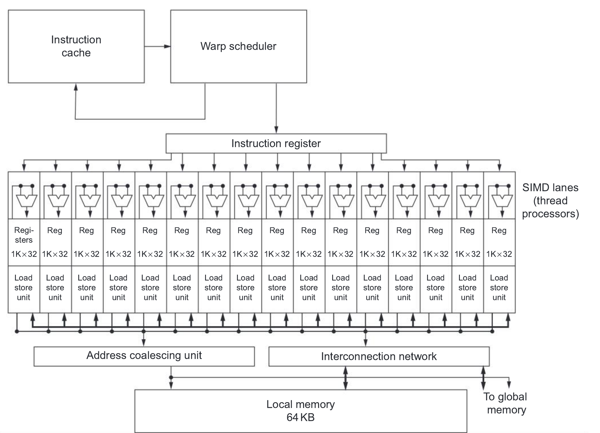
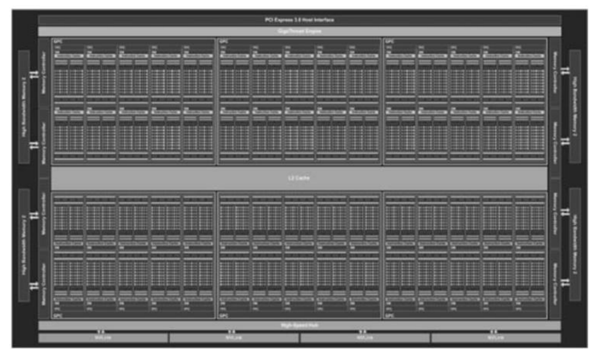
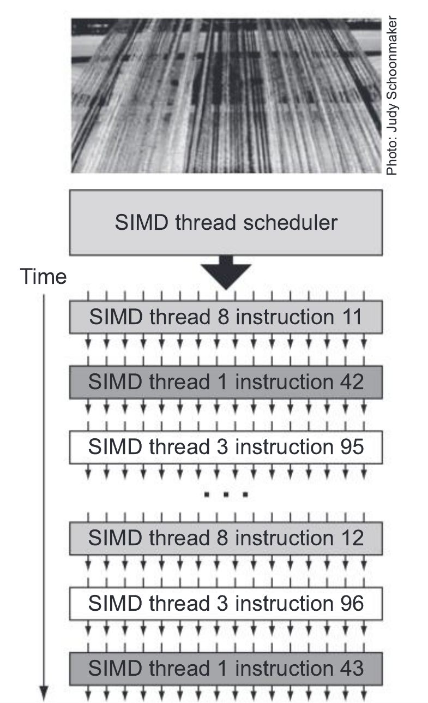

## 图形处理器 {#sec-4-4}

花几百美元就能买到一块 GPU 芯片，插到桌边的 PC 上，得到数千个并行的浮点部件。价格低、使用方便，高性能计算因此走进了许多人的手中。后来又出现了让 GPU 更容易编程的程序设计语言，两者一结合，GPU 计算便兴盛起来。

今天说到用 GPU 计算，可能指三种用途：

1. 用 GPU 生成图形；
2. 用 GPU 做科学计算或多媒体计算；
3. 用 GPU 做机器学习计算。

在图形生成上，GPU 的地位无可争议。在科学计算和多媒体应用领域，如今许多程序员都在权衡该用 GPU 还是 CPU；例如，截至 2022 年，全球最快的 500 台超级计算机中有 30% 依靠 GPU 完成大部分计算。做机器学习（第 7 章的主题）的程序员则更倾向于 GPU。

在计算机体系结构的谱系中，GPU 和 CPU 追溯不到同一个祖先，也不存在一个能把两者联系起来的「缺失环节」。[4.10 节](#sec-4-10) 将会讲到，GPU 的主要祖先是图形加速器，GPU 正是为了把图形做好而诞生的。GPU 虽然在向主流计算靠拢，却不能丢掉继续出色地处理图形这一本职。因此，从架构师的角度来理解 GPU 的设计会更清楚：为了做好图形，已经投入了这么多硬件，怎样再加以补充，才能让更多种类的应用也获得更高的性能？

本节只讨论用 GPU 做计算。GPU 计算怎样与图形加速这一传统角色结合，可参阅 John Nickolls 和 David Kirk 撰写的「Graphics and Computing GPUs」，即本书作者所著《计算机组成与设计》（*Computer Organization and Design*）第 6 版的附录 C。

GPU 的术语和一些硬件特性与向量体系结构、SIMD 体系结构差别很大。我们认为，先介绍 GPU 的简化编程模型，再讲它的体系结构，读者会更容易理解。

### GPU 编程 {-}

> CUDA 为算法中并行性的表达问题提供了一个优雅的解决方案。它不能解决所有算法，但能解决的已经足够多，足以产生重要影响。它似乎在某种程度上契合我们思考和编写代码的方式，让我们能更容易、更自然地表达任务级以外的并行性。
>
> ——Vincent Natol，「Kudos for CUDA」，*HPC Wire*（2010）

GPU 程序员面对的难题不只是让程序在 GPU 上跑出好的性能，还要协调两件事：一是计算在系统处理器和 GPU 上如何调度，二是数据在系统存储器和 GPU 存储器之间如何传送。此外，本节后面会看到，编程环境所能表达的各种并行性，GPU 几乎全都具备：多线程、MIMD、SIMD，乃至指令级并行。

为了同时应对异构计算和多种形式并行性这两方面的难题，提高 GPU 程序员的开发效率，NVIDIA 决定开发一种类 C 的语言和编程环境，命名为 *CUDA*，即 Compute Unified Device Architecture（计算统一设备体系结构）。CUDA 为系统处理器（*主机*）生成 C/C++ 代码，为 GPU（*设备*，CUDA 中的 D 即由此而来）生成一种 C 和 C++ 的方言。在 NVIDIA 看来，所有这些形式的并行性都可以统一到 *CUDA 线程*（CUDA Thread）上。CUDA 线程是最低层次的并行，以它作为编程原语，编译器和硬件就能把成千上万个 CUDA 线程组织起来，利用 GPU 中的各种并行：多线程、MIMD、SIMD 和指令级并行。所以，NVIDIA 把 CUDA 编程模型归为单指令多线程（*SIMT*）。这些线程按块组织、成组执行，一组线程称为一个*线程块*（Thread Block），原因后面很快会讲到。执行一整个线程块的硬件，我们称为*多线程 SIMD 处理器*（multithreaded SIMD Processor）。

给出 CUDA 程序的例子之前，还要交代几个细节：

- CUDA 用 `__device__` 或 `__global__` 标明 GPU（设备）上的函数，用 `__host__` 标明系统处理器（主机）上的函数，以示区分。
- 用 `__device__` 声明的 CUDA 变量分配在 GPU 存储器中（见下文），所有多线程 SIMD 处理器都能访问。
- 调用在 GPU 上运行的函数 *name*，采用扩展的函数调用语法：

  *name*`<<<dimGrid, dimBlock>>>`(…*参数列表*…)

  其中 `dimGrid` 指定代码的维数（以线程块为单位），`dimBlock` 指定块的维数（以线程为单位）。
- 块的标识符为 `blockIdx`，块内每个线程的标识符为 `threadIdx`；此外，CUDA 还提供关键字 `blockDim` 表示每块的线程数，它的值来自上一条中的参数 `dimBlock`。

先来看 [4.2 节](#sec-4-2) 中 `DAXPY` 循环的普通 C 代码：

```c
// 调用 DAXPY
daxpy(n, 2.0, x, y);
// C 语言的 DAXPY
void daxpy(int n, double a, double *x, double *y)
{
    for (int i = 0; i < n; ++i)
        y[i] = a*x[i] + y[i];
}
```

下面是 CUDA 版本。程序启动 `n` 个线程，每个向量元素对应一个线程；每个线程块有 256 个 CUDA 线程，在一个多线程 SIMD 处理器上执行。GPU 函数先由块 ID、每块线程数和线程 ID 算出对应的元素下标 `i`，只要下标没有越出数组（`i < n`），就做乘法和加法。

```c
// 以每个线程块 256 个线程调用 DAXPY
__host__int nblocks = (n + 255) / 256;
daxpy<<<nblocks, 256>>>(n, 2.0, x, y);
// CUDA 的 DAXPY
__global__
void daxpy(int n, double a, double *x, double *y)
{
    int i = blockIdx.x*blockDim.x + threadIdx.x;
    if (i < n) y[i] = a*x[i] + y[i];
}
```

对比两段代码，可以看出把数据并行代码改写成并行 CUDA 代码的常用模式。C 版本的循环中，每次迭代都与其他迭代无关，因此可以直接把它变换成并行代码：每次迭代成为一个独立的线程。（前面提到过，[4.5 节](#sec-4-5) 还会详细讨论：向量化编译器同样要求循环的各次迭代之间没有相关，这种相关称为*循环携带相关*（loop-carried dependence）。）在 CUDA 中，程序员通过指定网格的维数和每个 SIMD 处理器的线程数，显式地确定并行性。由于每个元素分配一个线程，各线程把结果写回存储器时不必相互同步。

并行执行和线程管理都由 GPU 硬件负责，不由应用程序或操作系统完成。为了简化硬件调度，CUDA 要求各线程块能够独立地、以任意顺序执行。不同的线程块之间不能直接通信，但可以借助全局存储器中的原子访存操作相互*协调*。

后面很快会看到，许多 GPU 硬件概念在 CUDA 中是看不出来的。追求性能的程序员用 CUDA 写程序，心里必须装着 GPU 硬件：CUDA 编程模型看起来像 MIMD，但要写出高效的 GPU 代码，程序员必须按 SIMD 操作来思考。这样做可能降低开发效率，不过大多数程序员之所以用 GPU 而不用 CPU，本来就是为了性能。他们知道（原因稍后解释）：一是要让每组 32 个线程在控制流上保持一致，多线程 SIMD 处理器才能发挥最佳性能；二是每个多线程 SIMD 处理器上要创建多得多的线程，才能隐藏 DRAM 的延迟；三是数据地址要集中在一个或少数几个存储块内，才能得到预期的存储器性能。

与许多并行系统一样，CUDA 在开发效率和性能之间的折中办法是提供内建函数（intrinsics），让程序员能够显式地控制硬件。一边是开发效率，一边是让程序员能表达硬件所能做的一切，两者之间的较量在并行计算中屡见不鲜。在这场经典的效率与性能之争中，CUDA 语言会怎样演变，它会不会在其他 GPU 乃至其他风格的体系结构上流行起来，都值得关注。

### NVIDIA GPU 的计算结构 {-}

上面说的这种与众不同的渊源，有助于解释 GPU 为什么有自己的体系结构风格，有一套独立于 CPU 的术语。理解 GPU 的一大障碍就是它的行话，有些术语的名字甚至会让人误解。这个障碍出人意料地难以跨越，本章的多次改写就是明证。

我们要兼顾两个目标：一是让 GPU 的体系结构易于理解，二是让读者掌握许多定义不同寻常的 GPU 术语。为此，我们的做法是：软件方面用 CUDA 术语；硬件方面先用描述性更强的术语，有时借用 OpenCL 的术语。用我们的术语讲清 GPU 体系结构之后，再把它们对应到 NVIDIA GPU 的官方行话。

[图 4.13](#fig-4-13) 从左到右依次列出四项内容：本节使用的描述性名称、主流计算中最接近的术语、NVIDIA GPU 的官方行话（供有兴趣的读者参考），以及术语的简要说明。本节其余部分都用图中左列的描述性术语来讲解 GPU 的微结构特性。

[图 4.13　本章所用 GPU 术语速查。硬件术语用第一列的名称。这 11 个术语分为四组，从上到下依次是：程序抽象、机器对象、处理硬件和存储硬件。第 312 页的[图 4.21](#fig-4-21) 把向量术语与这里最接近的术语对应起来；第 317 页的[图 4.24](#fig-4-24) 和第 318 页的[图 4.25](#fig-4-25) 给出 CUDA/NVIDIA 和 AMD 的官方术语及定义，以及 OpenCL 所用的术语。]{#fig-4-13 .caption}

| 类型 | 描述性名称 | GPU 以外最接近的旧术语 | CUDA/NVIDIA 官方 GPU 术语 | 简要说明 |
|---|---|---|---|---|
| 程序抽象 | 可向量化循环 | 可向量化循环 | Grid | 在 GPU 上执行的可向量化循环，由一个或多个能够并行执行的线程块（向量化循环的循环体）组成 |
| | 向量化循环的循环体 | （经过分段开采的）向量化循环的循环体 | Thread Block | 在一个多线程 SIMD 处理器上执行的向量化循环，由一个或多个 SIMD 指令线程组成，这些线程可以通过局部存储器通信 |
| | SIMD 车道操作序列 | 标量循环的一次迭代 | CUDA Thread | SIMD 指令线程的一个纵向切片，对应由一个 SIMD 车道执行的一个元素。结果是否保存，取决于掩码和谓词寄存器 |
| 机器对象 | SIMD 指令线程 | 向量指令线程 | Warp | 传统意义上的线程，但只包含在多线程 SIMD 处理器上执行的 SIMD 指令。结果是否保存，取决于每个元素的掩码 |
| | SIMD 指令 | 向量指令 | PTX Instruction | 在各 SIMD 车道上执行的一条 SIMD 指令 |
| 处理硬件 | 多线程 SIMD 处理器 | （多线程）向量处理器 | Streaming Multiprocessor | 执行 SIMD 指令线程，与其他 SIMD 处理器相互独立 |
| | 线程块调度器 | 标量处理器 | Giga Thread Engine | 把多个线程块（向量化循环的循环体）分配给多线程 SIMD 处理器 |
| | SIMD 线程调度器 | 多线程 CPU 中的线程调度器 | Warp Scheduler | 一个硬件部件，在 SIMD 指令线程就绪时调度并发射它们；内含记分牌，用来跟踪 SIMD 线程的执行 |
| | SIMD 车道 | 向量车道 | Thread Processor | 在单个元素上执行 SIMD 指令线程中的操作。结果是否保存，取决于掩码 |
| 存储硬件 | GPU 存储器 | 主存 | Global Memory | GPU 中所有多线程 SIMD 处理器都能访问的 DRAM 存储器 |
| | 私有存储器 | 栈或线程局部存储（OS） | Local Memory | DRAM 存储器中为每个 SIMD 车道私有的部分 |
| | 局部存储器 | 局部存储器 | Shared Memory | 供一个多线程 SIMD 处理器使用的快速局部 SRAM，其他 SIMD 处理器不能访问 |
| | SIMD 车道寄存器 | 向量车道寄存器 | Thread Processor Registers | 单个 SIMD 车道中的寄存器，在整个线程块（向量化循环的循环体）范围内分配 |

NVIDIA 的系统是 GPU 体系结构的代表，所以我们以它为例。具体来说，术语沿用前面介绍的 CUDA 并行编程语言，实例采用 NVIDIA Pascal GPU（见 [4.7 节](#sec-4-7)）。后续的 NVIDIA GPU 基本微结构相同，一般只是复制了 Pascal 的某些特性。

**与向量体系结构的异同。** 与向量体系结构一样，NVIDIA GPU 只适合数据级并行问题。两者都有集中—分散数据传送和掩码寄存器，而 NVIDIA GPU 处理器的寄存器比向量处理器还多。有些功能，向量处理器用软件实现，NVIDIA GPU 却用硬件实现，原因在于向量处理器带有一个标量处理器，可以执行软件函数。与大多数向量体系结构不同，NVIDIA GPU 还依靠单个多线程 SIMD 处理器内部的多线程来隐藏访存延迟（见第 2 章和第 3 章）。不过，无论是向量体系结构还是 GPU，程序员都要按成组的 SIMD 操作来思考，才能写出高效的代码。

**网格与线程块。** 在 NVIDIA GPU 上运行的代码称为*网格*（Grid），一个网格由一组*线程块*组成。[图 4.13](#fig-4-13) 把网格比作向量化的循环，把线程块比作这个循环的循环体（经过分段开采，成为一个完整的计算循环）。下面举一个具体例子，本节会一直用它：两个向量相乘，`A = B * C`，每个向量长 8192 个元素。[图 4.14](#fig-4-14) 给出这个例子与上面两个 GPU 术语的关系。完成全部 8192 个元素乘法的 GPU 代码称为一个*网格*（相当于向量化的循环）。为了分解成便于管理的规模，网格由若干*线程块*（相当于向量化循环的循环体）组成，每个线程块最多处理 512 个元素。注意，一条 GPU SIMD 指令一次处理 32 个元素。向量共有 8192 个元素，8192 ÷ 512 = 16，所以这个例子有 16 个线程块。网格和线程块是在 GPU 硬件中实现的编程抽象，用来帮助程序员组织 CUDA 代码。（线程块类似于向量长度为 32 的分段开采向量循环。）

{#fig-4-14 width=75%}

执行线程块代码的处理器，我们称为*多线程 SIMD 处理器*；把线程块分配给它的是*线程块调度器*（Thread Block Scheduler）。线程块调度器由硬件实现，程序员只需告诉它要运行多少个线程块。在这个例子中，线程块调度器会把 16 个线程块发给多线程 SIMD 处理器，由这 16 个线程块算出循环的全部 8192 个元素。

[图 4.15](#fig-4-15) 是多线程 SIMD 处理器的简化框图。它与向量处理器相似，区别在于功能部件：向量处理器只有少数几个深度流水的功能部件，多线程 SIMD 处理器则有许多并行的功能部件。在[图 4.14](#fig-4-14) 的编程例子中，每个多线程 SIMD 处理器分到向量中的 512 个元素。SIMD 处理器是完整的处理器，各有独立的 PC，用线程来编程（见第 3 章）。

{#fig-4-15 width=90%}

GPU 硬件包含一组多线程 SIMD 处理器，由它们执行由线程块（相当于向量化循环的循环体）组成的网格。换句话说，GPU 是一个由多线程 SIMD 处理器构成的多处理器。

一个 GPU 可以有 1 个到几十个多线程 SIMD 处理器。例如，Pascal P100 系统有 56 个，Hopper H100 有 132 个，较小的芯片可能只有一两个。各型号 GPU 的多线程 SIMD 处理器数目不同，为了在各型号之间实现透明的可扩展性，线程块（向量化循环的循环体）由线程块调度器分配给多线程 SIMD 处理器。[图 4.16](#fig-4-16) 是 Pascal 体系结构的 P100 实现的布局图。

{#fig-4-16 width=90%}

**SIMD 指令线程与两级调度。** 再深入一层，硬件创建、管理、调度和执行的机器对象是 *SIMD 指令线程*。它就是传统的线程，只不过全部由 SIMD 指令组成。每个 SIMD 指令线程有自己的 PC，在多线程 SIMD 处理器上运行。*SIMD 线程调度器*（SIMD Thread Scheduler）掌握哪些 SIMD 指令线程已经就绪，把它们送到分派部件，在多线程 SIMD 处理器上运行。因此，GPU 有两级硬件调度器：

（1）*线程块调度器*，把线程块（向量化循环的循环体）分配给多线程 SIMD 处理器；

（2）SIMD 处理器*内部*的 SIMD 线程调度器，决定 SIMD 指令线程何时在处理器内运行。

这些线程的 SIMD 指令宽度为 32，所以在这个例子中，每个 SIMD 指令线程计算其中的 32 个元素，每个线程块包含 512/32 = 16 个 SIMD 线程（见[图 4.14](#fig-4-14)）。

**SIMD 车道。** 线程由 SIMD 指令组成，SIMD 处理器就必须有并行的功能部件来执行这些操作。我们把这些功能部件称为 *SIMD 车道*（SIMD Lane），它们与 [4.2 节](#sec-4-2) 中的向量车道非常相似。

Pascal GPU 把每个 32 宽的 SIMD 指令线程映射到 16 个物理 SIMD 车道上，因此 SIMD 指令线程中的每条 SIMD 指令要用 2 个时钟周期才能完成。每个 SIMD 指令线程都以锁步方式执行，只在开始时调度一次。如果继续把 SIMD 处理器比作向量处理器，可以说它有 16 个车道，向量长度为 32，钟鸣（chime）为 2 个时钟周期。（正因为它这样又宽又浅，我们才选用更准确的说法「SIMD 处理器」，而不说「向量处理器」。）

注意，GPU SIMD 处理器的车道数可以取任何值，只要不超过线程块中的线程数，正如向量处理器的车道数可以在 1 到最大向量长度之间变化。例如，在各代 GPU 中，每个 SIMD 处理器的车道数在 8 到 32 之间变动。

**SIMD 线程调度器。** 按照定义，各 SIMD 指令线程相互独立，所以 SIMD 线程调度器可以挑选任何一个已就绪的 SIMD 指令线程，不必拘泥于某个线程内顺序上的下一条 SIMD 指令。SIMD 线程调度器内含一个记分牌（见第 3 章），最多跟踪 64 个 SIMD 指令线程，用来判断哪条 SIMD 指令可以执行，因为这些线程中各 SIMD 指令的执行时间长短不一。访存指令的延迟尤其不固定：Cache 和 TLB 时而命中、时而失效，所以要靠记分牌判断这些指令何时完成。[图 4.17](#fig-4-17) 表示 SIMD 线程调度器随着时间推移，以不同的顺序挑选 SIMD 指令线程。GPU 架构师的假设是：GPU 应用有大量的 SIMD 指令线程，因而多线程既能隐藏 DRAM 延迟，又能提高多线程 SIMD 处理器的利用率。

{#fig-4-17 width=50%}

**寄存器。** 回到向量乘法的例子：每个多线程 SIMD 处理器先要把两个向量的 32 个元素从存储器装入寄存器，再读写寄存器完成乘法，最后把乘积从寄存器存回存储器。为了容纳这些存储器元素，一个 SIMD 处理器有多达 32,768～65,536 个 32 位寄存器（[图 4.15](#fig-4-15) 中每个车道 1024 个），具体数目取决于 Pascal GPU 的型号。与向量处理器一样，这些寄存器在逻辑上分布在各个向量车道上，在这里就是分布在各个 SIMD 车道上。

每个 SIMD 线程最多只能使用 256 个寄存器。因此，可以把一个 SIMD 线程看成最多有 256 个向量寄存器，每个向量寄存器有 32 个元素，每个元素 32 位宽。（双精度浮点操作数占用两个相邻的 32 位寄存器，所以也可以看成每个 SIMD 线程有 128 个向量寄存器，每个有 32 个元素，每个元素 64 位宽。）

寄存器用量和最大线程数之间存在权衡：每个线程用的寄存器少，能容纳的线程就多；用的寄存器多，线程就少。也就是说，并非所有 SIMD 线程都要用到最大数量的寄存器。Pascal 的架构师认为，如果所有线程都配最大数量的寄存器，这块宝贵的硅片面积会有很大一部分闲置。

为了能执行许多 SIMD 指令线程，物理寄存器采用动态分配：SIMD 指令线程创建时，在各 SIMD 处理器上分到一组物理寄存器；SIMD 线程退出时再释放。例如，程序员可以让一个线程块每个线程用 36 个寄存器、有比如 16 个 SIMD 线程，同时让另一个线程块每个线程用 20 个寄存器、有 32 个 SIMD 线程。之后的线程块可能以任意顺序到来，寄存器只能按需分配。这种可变性可能造成碎片，使一些寄存器无法使用；但在实践中，同一个可向量化循环（「网格」）中的大多数线程块使用的寄存器数相同。硬件必须知道每个线程块的寄存器位于大寄存器堆的什么位置，这一信息按线程块记录。一个线程块的某个寄存器可能落在寄存器堆中的任何位置，所以要实现这种灵活性，硬件必须具备路由、仲裁和分体（banking）功能。

注意，CUDA 线程只是 SIMD 指令线程的一个纵向切片，对应由一个 SIMD 车道执行的一个元素。要当心，CUDA 线程与 POSIX 线程大不相同：CUDA 线程不能随意发起系统调用。

有了这些准备，就可以来看 GPU 指令是什么样子了。
