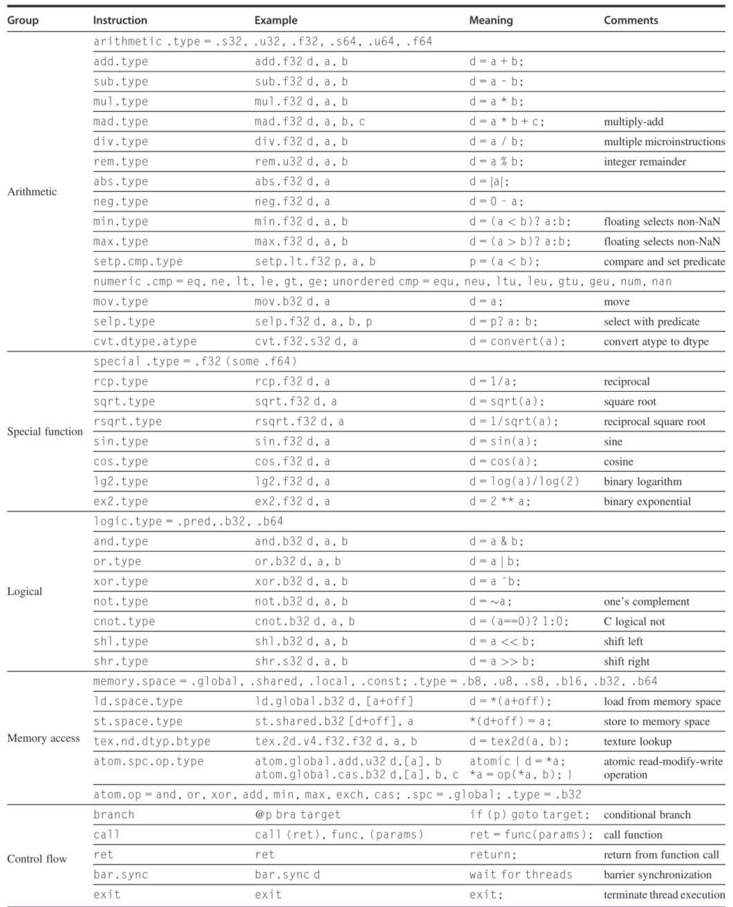
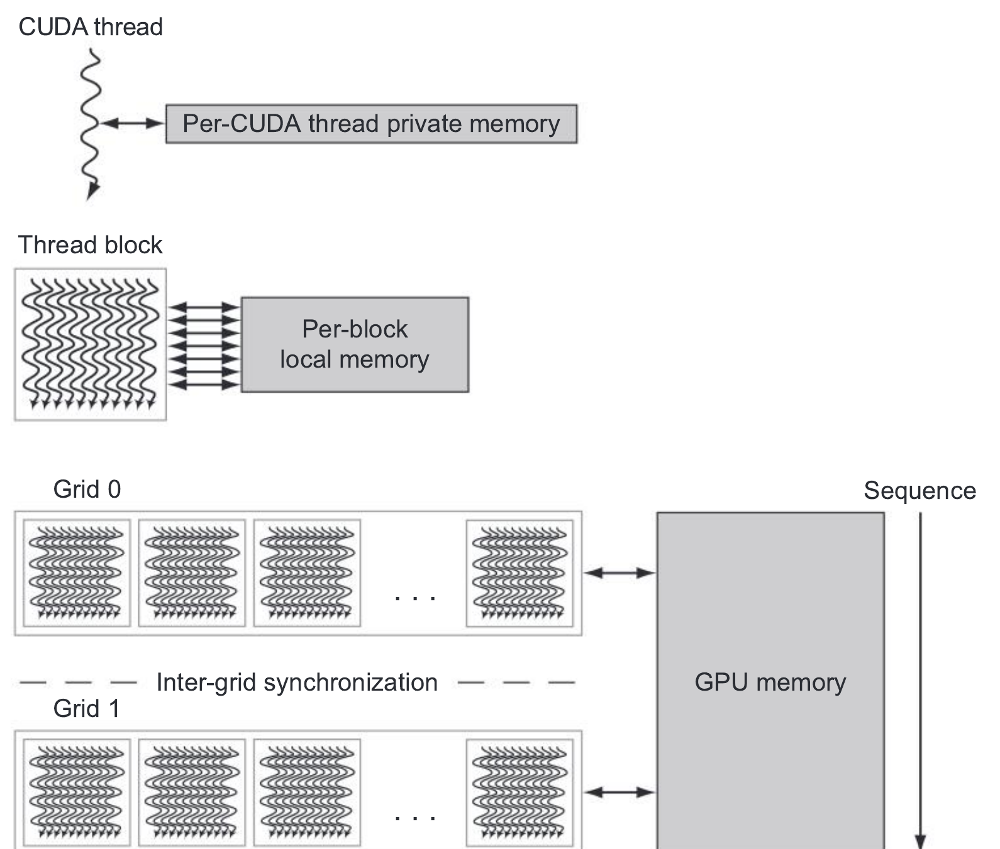
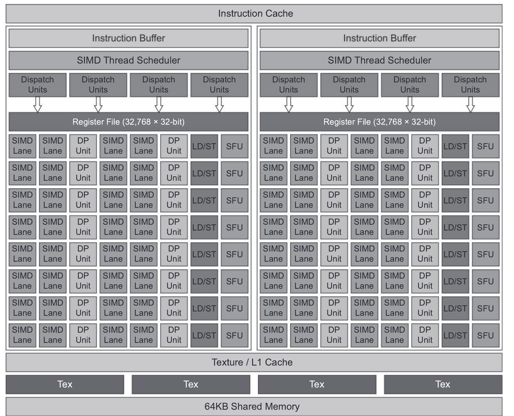
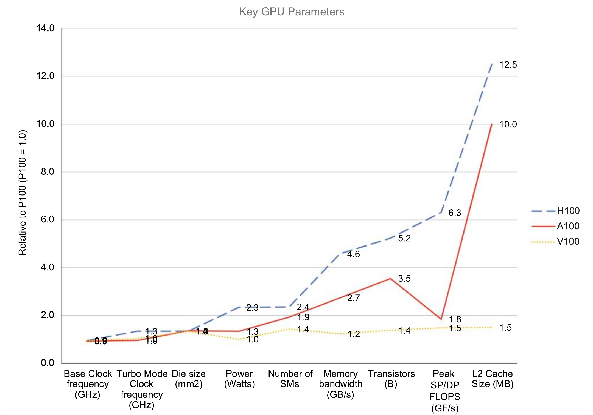

### NVIDIA GPU 的指令系统结构 {-}

大多数系统处理器的编译器直接面向硬件指令集，NVIDIA 的编译器则不同，它面向的是硬件指令集的一个抽象，即 *PTX*（*Parallel Thread Execution*，并行线程执行）。PTX 给编译器提供了一套稳定的指令集，也保证了各代 GPU 之间的兼容；硬件指令集则对程序员隐藏。一条 PTX 指令描述单个 CUDA 线程上的操作，通常与一条硬件指令一一对应，但也可能一条 PTX 指令展开成多条机器指令，或者多条 PTX 指令对应一条机器指令。PTX 的一次写入寄存器数量不限，而实际设备上的硬件寄存器数量固定、可以反复读写，所以编译器必须运行寄存器分配过程，把 PTX 寄存器映射到硬件寄存器上。之后运行的优化器还能进一步减少寄存器的使用，同时删除死代码、合并指令，并找出转移可能分叉的位置和分叉路径可能汇合的位置。

x86 微结构与 PTX 有相似之处：两者都要把指令转换成一种内部形式（x86 转换成微指令）。区别在于转换的时机和手段：x86 在执行时由硬件转换，GPU 则在装入时由软件转换。

PTX 指令的格式为

```
opcode.type d, a, b, c ; comment
```

其中 `d` 是目的操作数，`a`、`b`、`c` 是源操作数，分号右边全是注释。操作类型 `opcode.type` 取下列之一：

| 类型 | .type 说明符 |
|---|---|
| 无类型位，8、16、32 和 64 位 | `.b8`、`.b16`、`.b32`、`.b64` |
| 无符号整数，8、16、32 和 64 位 | `.u8`、`.u16`、`.u32`、`.u64` |
| 有符号整数，8、16、32 和 64 位 | `.s8`、`.s16`、`.s32`、`.s64` |
| 浮点数，16、32 和 64 位 | `.f16`、`.f32`、`.f64` |

源操作数可以是 32 位或 64 位寄存器，也可以是常数。目的操作数除 store 指令外都是寄存器。

[图 4.18](#fig-4-18) 列出了基本的 PTX 指令集。所有指令都可以受 1 位谓词寄存器控制，谓词寄存器由设置谓词指令 `setp` 设置。控制流指令包括函数调用 `call` 与返回 `return`、线程退出 `exit`、转移 `branch`，以及线程块内各线程之间的栅栏同步 `bar.sync`。转移指令前面加上谓词，就成了条件转移。虚拟寄存器由编译器或 PTX 程序员声明，分为 32 位和 64 位，可以有类型，也可以无类型。例如 `R0`、`R1`、……存放 32 位值，`RD0`、`RD1`、……是 64 位寄存器。前面说过，PTX 的虚拟寄存器在装入时才分配到物理寄存器。

[4.2 节](#sec-4-2) DAXPY 循环的一次迭代可以写成下面的 PTX 指令序列：

```
shl.u32 R8, blockIdx, 8      ; Thread Block ID * Block size
                             ; (256 or 2^8)
add.u32 R8, R8, threadIdx    ; R8 = i = my CUDA Thread ID
shl.u32 R8, R8, 3            ; byte offset
ld.global.f64 RD0, [X+R8]    ; RD0 = X[i]
ld.global.f64 RD2, [Y+R8]    ; RD2 = Y[i]
mul.f64 RD0, RD0, RD4        ; Product in RD0 = RD0 * RD4
                             ; (scalar a)
add.f64 RD0, RD0, RD2        ; Sum in RD0 = RD0 + RD2 (Y[i])
st.global.f64 [Y+R8], RD0    ; Y[i] = sum (X[i]*a + Y[i])
```

CUDA 程序员为每次循环迭代分配一个 CUDA 线程。CUDA 给每个线程块一个唯一的编号 `blockIdx`，给块内每个 CUDA 线程也一个唯一的编号 `threadIdx`。这样，程序创建 8192 个 CUDA 线程，用各自唯一的编号去寻址数组元素，不需要递增和转移的代码。前三条 PTX 指令在 `R8` 中算出本线程元素的字节偏移量，这个偏移量再加上数组的基地址。其后的 PTX 指令装入两个双精度浮点操作数，做乘法和加法，再把和存回去。（CUDA 代码 `if (i < n)` 对应的 PTX 代码后面再介绍。）

从这个例子可以看出 GPGPU 程序员的一般做法：先设法创建尽可能多的线程，然后可能再针对已知的低效来源（如未合并的访存）进一步优化。NVIDIA 提供的一些 CUDA 示例就是这样：先给出简单但不一定高效的核函数，再逐步改成更高效的代码，归约就是一例。

{#fig-4-18 width=100%}

**地址合并。** 向量体系结构为顺序、按步长和集中—分散三种数据传送分别设置了指令，GPU 则没有这种区分，它的所有数据传送都是集中—分散方式。为了找回顺序（单位步长）传送的效率，GPU 设有专门的地址合并（Address Coalescing）硬件。这个硬件在运行时检测一个 SIMD 指令线程中的各个 SIMD 车道是否在共同发出顺序的地址；如果是，就通知存储接口部件发出一次块传送请求，传送 32 个连续的字。要获得这项重要的性能提升，GPU 程序员必须保证相邻的 CUDA 线程同时访问相近的地址，使这些访问能合并成一个或少数几个存储块或 Cache 块。前面的例子正是这样做的。

### GPU 中的条件转移 {-}

处理 IF 语句与处理单位步长数据传送一样，向量体系结构和 GPU 的做法十分相似。区别在于：向量体系结构主要靠软件实现，硬件支持有限；GPU 则更多地依靠硬件。后面会看到，GPU 的转移硬件除了显式的谓词寄存器，还用到内部掩码、转移同步栈和指令标记，用来管理转移何时分叉成多条执行路径、这些路径又何时汇合。

**PTX 汇编层次。** 在这一层，一个 CUDA 线程的控制流由 PTX 的 branch、call、return 和 exit 指令描述，再加上逐条指令、逐个线程车道的谓词控制；谓词由程序员通过每个线程车道各自的 1 位谓词寄存器指定。PTX 汇编器分析 PTX 的转移图，把它优化成最快的 GPU 硬件指令序列。每个线程都可以对转移自行判断，不必与其他线程步调一致。

**GPU 硬件指令层次。** 在这一层，控制流指令有转移、跳转、变址跳转、调用、变址调用、返回、退出，以及管理转移同步栈的专用指令。早期的一些 GPU 为每个 SIMD 线程配备一个自己的栈，栈表项包括一个标识令牌、一个目标指令地址和一个目标线程活跃掩码。有一些 GPU 专用指令为 SIMD 线程压入栈表项；另一些专用指令和指令标记则弹出一个栈表项，或者把栈回退到指定的表项，然后带着目标线程活跃掩码转移到目标指令地址。GPU 硬件指令同样可以逐个车道施加谓词控制（允许或禁止），每个车道由一个 1 位谓词寄存器指定。Volta GPU 及其后继产品取消了这个栈，允许 warp 拆分。

PTX 汇编器对控制流的处理分几种情况：

* 简单的外层 IF-THEN-ELSE 语句：即使用 PTX 转移指令编写，PTX 汇编器通常也把它优化成纯粹受谓词控制的 GPU 指令，其中没有任何 GPU 转移指令。
* 较复杂的控制流：通常生成谓词控制与 GPU 转移指令的混合体，并带有使用转移同步栈的专用指令和标记。当一部分车道转移到目标地址、另一部分车道顺序执行下去时，就压入一个栈表项，NVIDIA 称这种情况为转移*分叉*。当某个 SIMD 车道执行到同步标记或汇合时，也使用这种混合方式：弹出一个栈表项，按表项中的线程活跃掩码转移到表项给出的地址。
* 循环：PTX 汇编器识别出循环转移，生成转移到循环顶部的 GPU 转移指令，同时生成专用的栈指令，用来处理个别车道跳出循环的情况，并在所有车道都完成循环后让各 SIMD 车道汇合。
* switch 语句和函数调用：GPU 的变址跳转和变址调用指令向栈中压入表项，等所有车道都完成 switch 语句或函数调用后，SIMD 线程再汇合。

**谓词控制的执行过程。** GPU 的设置谓词指令（[图 4.18](#fig-4-18) 中的 `setp`）计算 IF 语句的条件，随后的 PTX 转移指令依据这个谓词执行。如果 PTX 汇编器生成的是不含 GPU 转移指令的谓词控制指令，它就用每个车道的谓词寄存器，逐条指令地允许或禁止各个 SIMD 车道：

* THEN 部分：线程中的 SIMD 指令把操作广播给所有 SIMD 车道，谓词为 1 的车道执行操作并保存结果，其余车道既不执行也不保存。
* ELSE 部分：指令使用（相对 THEN 部分）取反的谓词，原来空闲的车道现在执行操作、保存结果，原来活跃的车道则不执行。
* ELSE 部分之后：指令不再受谓词控制，原来的计算继续进行。

因此，两条路径长度相等时，IF-THEN-ELSE 的效率只有 50%，甚至更低。

IF 语句可以嵌套，所以要用栈。遇到复杂的控制流，PTX 汇编器通常生成谓词控制指令、GPU 转移指令和专用同步指令的混合体。嵌套很深时，执行嵌套的条件语句期间大多数 SIMD 车道可能都处于空闲状态。两条路径长度相等时，两层嵌套的 IF 语句效率为 25%，三层为 12.5%，依此类推。向量处理器也有类似情况：嵌套的 if 语句会把各层条件组合起来设置向量掩码寄存器，结果只有少数掩码位为 1。

**转移同步标记。** 再深入一层细节。PTX 汇编器在适当的条件转移指令上设置「转移同步」标记，把当前活跃掩码压入每个 SIMD 线程内部的栈中。如果条件转移发生分叉（一部分车道转移，另一部分顺序执行下去），就压入一个栈表项，并根据条件设置当前的内部活跃掩码。在 ELSE 部分之前，另一个转移同步标记弹出分叉转移的表项，并把掩码位取反。（IF-ELSE 语句嵌套时，调整掩码位比简单取反要复杂一些。）在 IF 语句末尾，PTX 汇编器再加一个转移同步标记，把栈中先前的活跃掩码弹出，作为当前活跃掩码。

**全 1 和全 0 掩码的优化。** 如果掩码位全为 1，THEN 部分末尾的转移指令就跳过 ELSE 部分的指令。THEN 部分也有类似的优化：掩码位全为 0 时，条件转移直接跳过 THEN 部分的指令。并行的 IF 语句和 PTX 转移常常使用一致的转移条件，即所有车道都同意走同一条路径，这样 SIMD 线程就不会分叉成各车道各自的控制流。PTX 汇编器对这类转移作了优化，跳过 SIMD 线程中没有任何车道执行的指令块。这种优化对条件错误检查之类的代码很有用：检查必须做，但条件很少成立。

一条与 4.2 节类似的条件语句如下：

```c
if (X[i] != 0)
  X[i] = X[i] – Y[i];
else X[i] = Z[i];
```

这条 IF 语句可以编译成下面的 PTX 指令（假设 `R8` 中已经是按比例换算过的线程 ID）。其中 `*Push`、`*Comp`、`*Pop` 是 PTX 汇编器插入的转移同步标记，作用分别是压入旧掩码、对当前掩码取反、弹出以恢复旧掩码：

```
        ld.global.f64 RD0, [X+R8]   ; RD0 = X[i]
        setp.neq.s32 P1, RD0, #0    ; P1 is predicate reg 1
        @!P1, bra ELSE1, *Push      ; Push old mask, set new
                                    ; mask bits if P1 false, go to ELSE1
        ld.global.f64 RD2, [Y+R8]   ; RD2 = Y[i]
        sub.f64 RD0, RD0, RD2       ; Difference in RD0
        st.global.f64 [X+R8], RD0   ; X[i] = RD0
        @P1, bra ENDIF1, *Comp      ; complement mask bits
                                    ; if P1 true, go to ENDIF1
ELSE1:ld.global.f64 RD0, [Z+R8]     ; RD0 = Z[i]
        st.global.f64 [X+R8], RD0   ; X[i] = RD0
ENDIF1:< next instruction >, *Pop   ; pop to restore old mask
```

再强调一次：SIMD 处理器通常会执行 IF-THEN-ELSE 语句中的全部指令，只是执行 THEN 部分时只有一部分 SIMD 车道处于允许状态，执行 ELSE 部分时则是另一部分车道。前面提到，有一种情况出人意料地常见：各车道对谓词控制的转移判断一致，例如按一个对所有车道都相同的参数值转移，所有活跃掩码位全为 0 或全为 1。这时转移会跳过 THEN 部分或 ELSE 部分的指令。

**灵活性的代价。** 这种灵活性让每个元素看起来都有自己的程序计数器。但在最慢的情况下，每 2 个时钟周期只有一个 SIMD 车道能保存结果，其余车道都空闲。向量体系结构中对应的最慢情况，是只有一个掩码位为 1。不熟悉 GPU 的程序员可能因为这种灵活性写出性能很差的程序，不过在程序开发的早期阶段，它也可能有帮助。要记住的是，一个 SIMD 车道在一个时钟周期内只有两种选择：要么执行 PTX 指令指定的操作，要么空闲；两个 SIMD 车道不能同时执行不同的指令。（后面几段会把这种方案与向量方法作对比。）

把 SIMD 指令线程中的每个元素称为 *CUDA 线程*，部分原因也在于这种灵活性：它让人觉得每个元素都在独立行动。不熟悉 GPU 的程序员可能以为，有了线程这层抽象，GPU 处理条件转移就更从容：一些线程走这条路，其余线程走那条路。只要不在乎速度，看起来确实如此。实际上，每个 CUDA 线程要么在执行与线程块中其他所有线程相同的指令，要么空闲。正因为各线程同步执行，带条件转移的循环反而更容易处理：掩码机制可以关闭 SIMD 车道，还能自动检测循环何时结束。

所以，实际性能有时与这种简单的抽象并不相符。让 SIMD 车道以这种高度独立的 MIMD 方式运行，就好比在物理内存较小的计算机上运行占用大量虚拟地址空间的程序：两种程序都是正确的，但很可能慢得让程序员无法满意。

**与向量体系结构的对比。** 条件执行这件事，GPU 在运行时用硬件完成，向量体系结构则在编译时完成。向量编译器做两次 IF 转换，生成四个不同的掩码。执行过程与 GPU 基本相同，只是向量方式要多执行一些额外开销指令。向量体系结构的优势在于它与标量处理器集成在一起：当 0 的情况在计算中占多数时，可以避开这些情况所花的时间。何时改用标量更好，要看标量处理器与向量处理器的速度之比，交叉点大概在掩码位为 1 的比例低于 20% 的时候。反过来，GPU 也有一项优化是向量体系结构在编译时做不到的：在运行时发现掩码位全为 0 或全为 1，就跳过 THEN 部分或 ELSE 部分。

可见，GPU 执行条件语句的效率，归根到底取决于转移分叉的频繁程度。例如，有一个特征值计算程序条件嵌套很深，但对代码的测量表明，大约 82% 的时钟周期发射中，32 个掩码位里有 29 到 32 个为 1。因此，GPU 执行这段代码的效率比人们预想的要高。

同样的机制也用来处理向量循环的分段开采，即元素个数与硬件不完全匹配的情况。本节开头的例子中，有一条 IF 语句检查本 SIMD 车道的元素编号（前面的例子中存放在 `R8` 中）是否小于上限（`i < n`），并据此设置掩码。两种方法的关键区别是：向量编译器设置掩码寄存器，并生成不同的循环（n 层嵌套时最多 2^n^ 个）；GPU 则由硬件跟踪掩码和嵌套。两种方法的运行时间相近。

### NVIDIA GPU 的存储结构 {-}

[图 4.19](#fig-4-19) 给出了 NVIDIA GPU 的存储结构。

**私有存储器。** 多线程 SIMD 处理器中的每个 SIMD 车道都分得片外 DRAM 中的一块私有区域，我们称之为*私有存储器*，用来存放栈帧、溢出的寄存器，以及寄存器中放不下的私有变量。各 SIMD 车道*不*共享私有存储器。GPU 把私有存储器缓存在 L1 和 L2 Cache 中，以方便寄存器溢出，并加快函数调用。

**局部存储器。** 每个多线程 SIMD 处理器独有的片上存储器，我们称之为*局部存储器*。它是一个小容量的便笺存储器，延迟低（几十个时钟周期），带宽高（每个时钟周期 128 字节）。需要重复使用的数据，不论是由同一个线程使用，还是由同一线程块中的其他线程使用，程序员都可以放在这里。局部存储器的容量有限，通常为 48 KiB；同一处理器上先后执行的线程块之间，它不保留任何状态。一个多线程 SIMD 处理器内的各个 SIMD 车道共享局部存储器，不同的多线程 SIMD 处理器之间则不共享，「局部」之名即由此而来。多线程 SIMD 处理器在创建线程块时为它动态分配一部分局部存储器，等线程块的所有线程退出后再释放。这部分局部存储器为该线程块私有。

{#fig-4-19 width=80%}

**GPU 存储器。** 片外 DRAM 中由整个 GPU 和所有线程块共享的区域，我们称之为 *GPU 存储器*。前面的向量乘法例子只用到了 GPU 存储器。

系统处理器称为*主机*，它可以读写 GPU 存储器，但不能访问局部存储器和私有存储器，因为局部存储器只属于各个多线程 SIMD 处理器。

**GPU 的 Cache。** GPU 传统上不靠大容量 Cache 装下应用程序的全部工作集，而是使用较小的流式 Cache。GPU 的工作集可能达到几百 MB，它依靠大量 SIMD 指令线程的多线程执行来隐藏 DRAM 的长延迟。既然 DRAM 延迟由多线程隐藏，系统处理器中用于大容量 L2、L3 Cache 的芯片面积，GPU 就改用在计算资源上，以及用来保存大量 SIMD 指令线程状态的寄存器上。前面讲过，向量 load 和 store 的做法不同：它们只付出一次延迟，其余访问流水进行，从而把延迟分摊到许多元素上。

用大量线程隐藏访存延迟虽然是 GPU 最初的设计思想，但近来所有的 GPU（以及向量处理器）都设有 Cache 来降低延迟。依据是排队论中的 Little 定律：延迟越长，一次访存期间需要运行的线程就越多，所需的寄存器也就越多。因此，GPU 增设 Cache 是为了降低平均延迟，从而缓解寄存器可能不够用的问题。需要注意，GPU 的数据常常直接从高带宽存储器流入，所以 GPU Cache 在设计时假定的命中率比 CPU Cache 低得多。

**访存请求的合并。** 前面提到，为了提高存储带宽、减少开销，当地址落在同一个块中时，PTX 数据传送指令会与存储控制器配合，把同一个 SIMD 线程中各并行线程的请求合并成一个存储块请求。这是对 GPU 程序提出的限制，有点像系统处理器的程序为了用上硬件预取而要遵循的准则（见第 2 章）。GPU 存储控制器还会暂存请求，把发往同一个已打开页的请求集中在一起发送，以提高 DRAM 带宽（见 [4.6 节](#sec-4-6)）。（第 2 章对 DRAM 介绍得已经足够详细，读者可以据此理解把相关地址归并在一起有什么好处。）

### 近期 GPU 体系结构的创新 {-}

实际 GPU 中的多线程 SIMD 处理器比[图 4.15](#fig-4-15) 中的简化版本稍复杂一些。为了提高硬件利用率，每个 SIMD 处理器有两个 SIMD 线程调度器，每个调度器带有多个指令分派部件（有些 GPU 的线程调度器还要多）。双 SIMD 线程调度器选出两个 SIMD 指令线程，从每个线程中各发射一条指令，送往两组各 16 个 SIMD 车道、16 个 load/store 部件或 8 个特殊功能部件。执行部件有多个，所以每个时钟周期可以调度两个 SIMD 指令线程，让 64 个车道同时活跃。这两个线程相互独立，不需要检查指令流中的数据相关。这项创新相当于把多线程向量处理器的车道数加倍，并让它能从两个独立的线程中发射向量指令。[图 4.20](#fig-4-20) 给出了双调度器发射指令的情形，[图 4.21](#fig-4-21) 给出了 Pascal GP100 GPU 多线程 SIMD 处理器的框图。

 中的单 SIMD 线程设计对照](images/ch04/fig-4-20.png){#fig-4-20 width=75%}

从[图 4.22](#fig-4-22) 可以看到，每一代新 GPU 通常都会增加一些新特性，或者提高性能，或者方便程序员。以 Pascal GPU 为例，它有四项主要创新：

* *快速的单精度、双精度和半精度浮点运算*：Pascal GP100 芯片在三种字长上都有很高的浮点性能，这三种字长都属于 IEEE 浮点标准。单精度浮点运算的峰值速度为 10 TeraFLOP/s；双精度约为单精度的一半，即 5 TeraFLOP/s；半精度以 2 元素向量表示时约为单精度的 2 倍，即 20 TeraFLOP/s。原子存储操作包括全部三种字长的浮点加法。Pascal GP100 是第一款半精度性能如此之高的 GPU。

* *高带宽存储器*：Pascal GP100 GPU 的第二项创新是采用堆叠式高带宽存储器（*HBM2*）。这种存储器的总线很宽，有 4096 根数据线，工作频率为 0.7 GHz，峰值带宽达 732 GB/s，是以往 GPU 的 2 倍以上。后来的 GPU 采用了更新、更快的 HBM 版本。

* *高速芯片间互连*：GPU 是协处理器，一个 CPU 配多个 GPU 使用时，PCIe 总线可能成为通信瓶颈。为此，Pascal GP100 引入了 *NVLink* 通信通道，每个方向的数据传送速率最高 20 GB/s。每块 GP100 有 4 个 NVLink 通道，每块芯片的芯片间聚合峰值带宽为 160 GB/s。面向多 GPU 应用，有 2 个、4 个和 8 个 GPU 的系统可供选用，每个 GPU 都可以对经 NVLink 连接的任何 GPU 执行 load、store 和原子操作。在某些情况下，NVLink 通道还可以与 CPU 通信，例如 IBM Power9 及以后的 CPU 就支持 CPU 与 GPU 之间的通信。在这种芯片中，NVLink 让连接在一起的所有 GPU 和 CPU 看到一致的存储器视图，并提供 Cache 到 Cache 的通信，而不是存储器到存储器的通信。

{#fig-4-21 width=100%}

[图 4.22　四代 NVIDIA GPU 的关键参数。较新的 GPU 引入了适用于机器学习的窄浮点操作（8 位和 16 位），第 7 章介绍它们的用法]{#fig-4-22 .caption}

| GPU 型号 | P100 | V100 | A100 | H100 |
|---|---|---|---|---|
| 发布年份 | 2016 | 2017 | 2020 | 2022 |
| SM 数 | 56 | 80 | 108 | 132 |
| 基础时钟频率（GHz） | 1.19 | 1.12 | 1.10 | 1.13 |
| Turbo 模式时钟频率（GHz） | 1.48 | 1.53 | 1.41 | 1.98 |
| 晶片面积（mm^2^） | 610 | 815 | 826 | 814 |
| 工艺（TSMC） | 16 nm | 12 nm FinFET+ | 7 nm N7 | 4N |
| 功耗（W） | 300 | 300 | 400 | 700 |
| 晶体管数（十亿） | 15.3 | 21.1 | 54.2 | 80 |
| 存储带宽（GB/s） | 732 | 900 | 2000 | 3350 |
| L2 Cache 容量（MB） | 4 | 6 | 40 | 50 |
| 单精度 SIMD 宽度 | 8 | 32 | 32 | 32 |
| 双精度 SIMD 宽度 | 4 | 32 | 32 | 32 |
| 单精度峰值 FLOPs/sec（GFLOP/s） | 10,608 | 15,700 | 19,500 | 66,900 |
| 双精度峰值 FLOPs/sec（GFLOP/s） | 5,304 | 7,800 | 9,700 | 33,500 |
| 16 位峰值 FLOPs/sec（用于 ML 的 GFLOP/s） | N.A. | 125,000 | 312,000 | 989,000 |
| 8 位峰值 FLOPs/sec（用于 ML 的 GFLOP/s） | N.A. | N.A. | N.A. | 1,979,000 |

* *统一虚拟存储和分页支持*：Pascal GP100 GPU 在统一的虚拟地址空间中增加了页故障处理能力。有了这项特性，每个数据结构只有一个虚拟地址，而且这个地址在同一系统的所有 GPU 和 CPU 中都相同。线程访问远程地址时，相应的存储页会传送到本地 GPU，供以后使用。统一存储器用请求调页代替 CPU 与 GPU 之间、GPU 与 GPU 之间显式的存储器复制，从而简化了编程模型。它还允许分配远多于 GPU 实际容量的存储器，用来求解存储需求很大的问题。与所有虚拟存储系统一样，使用时必须注意避免页的过度移动。

[图 4.22](#fig-4-22) 列出了四代 GPU 的关键参数，[图 4.23](#fig-4-23) 以 Pascal P100 GPU 为基准把它们画成图。变化最大的是 L2 Cache 容量，其次是单精度和双精度峰值 FLOPs/second，再次是晶体管数。A100 的晶体管数增加很多，FLOPs/second 却只是小幅提高，因为它的重点主要放在提高机器学习的性能上（见[图 4.22](#fig-4-22) 的最后两行），这部分内容在第 7 章讨论。H100 的 FLOPs/second 大幅提高，一方面是因为功耗几乎是原来的 2 倍，另一方面是因为采用了 4 nm 工艺。

{#fig-4-23 width=90%}
