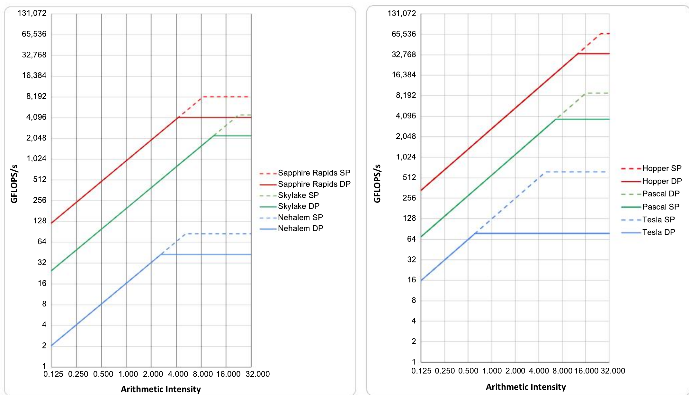

## 融会贯通：嵌入式 GPU 与服务器 GPU，Tesla 与 Core i7 {#sec-4-7}

图形应用十分普及，如今从移动客户端、笔记本电脑、高性能台式计算机到传统服务器，都能见到 GPU。[图 4.29](#fig-4-29) 列出了两种 GPU 的主要特性：一种是面向平板电脑和笔记本电脑等客户端的片上系统 Intel Xe GPU，另一种是面向服务器的 NVIDIA Hopper GPU。

[图 4.29　面向嵌入式客户端和服务器的 GPU 的主要特性]{#fig-4-29 .caption}

| GPU 型号 | Core i7-1195G7 中的 Intel Xe GPU | NVIDIA Hopper H100 |
|---|---|---|
| 发布年份 | 2021 | 2022 |
| 核数 | 96 | 132 |
| 基准时钟频率（GHz） | 0.30 | 1.13 |
| 睿频模式时钟频率（GHz） | 1.40 | 1.98 |
| 晶片面积（mm^2^） | N.A. | 814 |
| 工艺 | Intel 10 nm SF | TSMC 4N |
| 功耗（W） | 最高 28（含 CPU、Cache 等） | 700 |
| 晶体管数（十亿） | N.A. | 80 |
| 存储器技术 | LPDDR4x-4267 | HBM3 |
| 存储器容量（GB） | 32 | 80 |
| 存储带宽（GB/s） | 68 | 3350 |
| 片上存储器（MB） | 12 | 50 |
| 单精度 SIMD 宽度 | 8 | 32 |
| 双精度 SIMD 宽度 | N.A. | 32 |
| 峰值单精度 FLOPS（GFLOP/s） | N.A. | 66,900 |
| 峰值双精度 FLOPS（GFLOP/s） | N.A. | 33,500 |
| 峰值 16 位 FLOPS（GFLOP/s，用于机器学习） | 4,300 | 989,000 |

**Intel Iris Xe。** Iris Xe ICX 是 Intel 一个 GPU 微结构系列中的低功耗型号，它的基本构件是*执行单元*（EU，Execution Unit）。EU 是一个 7 路多线程的 SIMD 处理器，每个线程有 128 个 32 字节宽的寄存器。EU 有两个计算部件：主计算部件是 8 路宽的 SIMD 部件，执行浮点和整数运算；辅助部件是 2 路宽的 SIMD 部件，执行扩展数学运算。每个 EU 每个时钟周期可以完成 16 个 16 位浮点操作或 8 个 32 位浮点操作。[图 4.29](#fig-4-29) 中的这款芯片有 96 个 EU、12 MB L3 Cache，与 DRAM 之间每个时钟周期传送 128 字节数据。

**NVIDIA Hopper H100。** H100 的睿频时钟频率为 2.0 GHz，共有 132 个 SIMD 处理器。它通向 HBM3 存储器的数据通路宽 5120 位，在 2.62 GHz 时钟的上升沿和下降沿都传送数据，因此峰值存储带宽为 3350 GB/s。H100 晶片的各项物理指标都很大：有 800 亿个晶体管，采用 TSMC 4 nm 工艺，晶片面积为 814 mm^2^，典型功耗为 700 W。

### GPU 与带多媒体 SIMD 的 MIMD 的比较 {-}

Intel 的一组研究人员发表过一篇论文（Lee 等，2010），比较了带多媒体 SIMD 扩展的四核 Intel i7 和 Tesla GTX 280。这项研究比较的并不是最新的 CPU 和 GPU，但它是对这两种风格最深入的一次比较，因为它解释了性能差异背后的原因。而且，这两种体系结构的现行版本与研究中的版本有许多相似之处。

[图 4.30](#fig-4-30) 列出了两个系统的特性。两种产品都是 2009 年秋季购买的，Core i7 采用 Intel 的 45 nm 半导体工艺，GPU 采用 TSMC 的 65 nm 工艺。如果由中立的第三方或者由双方共同来做比较，也许更公平一些。不过，本节的目的*不是*确定哪种产品比另一种快多少，而是弄清这两种对立的体系结构风格中各项特性的相对价值。

[图 4.30　Intel Core i7-960 与 NVIDIA GTX 280。最右一列是 GTX 280 与 Core i7 的比值。GTX 280 的单精度 SIMD FLOPs/s 中，较高的数值（933）来自一种很少出现的情况，即同时双发射融合乘加和乘法；比较合理的数值是只用单条融合乘加时的 622。注意，这里的存储带宽比[图 4.28](#fig-4-28) 中的高，因为这里给的是 DRAM 引脚带宽，而[图 4.28](#fig-4-28) 中给的是用基准测试程序在处理器端测得的带宽。引自 Lee, W.V., et al., 2010. Debunking the 100× GPU vs. CPU myth: an evaluation of throughput computing on CPU and GPU. In: Proc. 37th Annual Int'l. Symposium on Computer Architecture (ISCA), June 19–23, 2010, Saint-Malo, France 中的表 2。]{#fig-4-30 .caption}

| | Core i7-960 | GTX 280 | GTX 280 与 i7 之比 |
|---|---:|---:|---:|
| 处理部件数（核数或 SM 数） | 4 | 30 | 7.5 |
| 时钟频率（GHz） | 3.2 | 1.3 | 0.41 |
| 晶片面积 | 263 | 576 | 2.2 |
| 工艺 | Intel 45 nm | TSMC 65 nm | 1.6 |
| 功耗（芯片，不含模块） | 130 | 130 | 1.0 |
| 晶体管数 | 700 M | 1400 M | 2.0 |
| 存储带宽（GB/s） | 32 | 141 | 4.4 |
| 单精度 SIMD 宽度 | 4 | 8 | 2.0 |
| 双精度 SIMD 宽度 | 2 | 1 | 0.5 |
| 峰值单精度标量 FLOPS（GFLOP/s） | 26 | 117 | 4.6 |
| 峰值单精度 SIMD FLOPS（GFLOP/s） | 102 | 311–933 | 3.0–9.1 |
| （单精度，1 个加法或乘法） | N.A. | （311） | （3.0） |
| （单精度，1 条融合乘加指令） | N.A. | （622） | （6.1） |
| （单精度，很少出现的融合乘加与乘法双发射） | N.A. | （933） | （9.1） |
| 峰值双精度 SIMD FLOPS（GFLOP/s） | 51 | 78 | 1.5 |

**Roofline 比较。** [图 4.31](#fig-4-31) 给出了 Core i7 920 和 GTX 280 的 Roofline，从中可以看出两台计算机的差别。920 的时钟频率比 960 低（2.66 GHz 对 3.2 GHz），系统的其余部分相同。GTX 280 不仅存储带宽和双精度浮点性能高得多，双精度的脊点也靠左得多：GTX 280 的双精度脊点是 0.6，Core i7 是 2.6。前面讲过，Roofline 的脊点越靠左，就越容易达到峰值计算性能。单精度的脊点则大大右移，因为单精度性能的屋顶高得多，要达到它也就难得多。

![图 4.31　Roofline 模型（Williams 等，2009）。上面一行是双精度浮点（DP FP）性能的 Roofline，下面一行是单精度性能的 Roofline（为便于对照，下面一行也画出了 DP FP 的性能上限）。左边的 Core i7 920 峰值 DP FP 性能为 42.66 GFLOP/s，单精度浮点（SP FP）峰值为 85.33 GFLOP/s，峰值存储带宽为 16.4 GB/s。NVIDIA GTX 280 的 DP FP 峰值为 78 GFLOP/s，SP FP 峰值为 624 GFLOP/s，存储带宽为 127 GB/s。左边的竖直虚线表示运算强度为 0.5 FLOP/字节，在 Core i7 上，它受存储带宽限制，不超过 8 DP GFLOP/s 或 8 SP GFLOP/s。右边的竖直虚线表示运算强度为 4 FLOP/字节，它只受计算能力限制：在 Core i7 上为 42.66 DP GFLOP/s 和 64 SP GFLOP/s，在 GTX 280 上为 78 DP GFLOP/s 和 512 SP GFLOP/s。要在 Core i7 上达到最高计算速率，必须用满 4 个核，并使用乘法和加法数量相等的 SSE 指令；在 GTX 280 上，必须在所有多线程 SIMD 处理器上都使用融合乘加指令。](images/ch04/fig-4-31.png){#fig-4-31 width=90%}

需要注意两点。一是内核的运算强度按访问主存的字节数计算，而不是按访问 Cache 的字节数计算。因此，只要大多数访问确实落在 Cache 中，Cache 就能改变一个内核在某台计算机上的运算强度。Roofline 有助于解释本案例研究中两者的相对性能。二是这里的带宽针对的是两种体系结构上的单位步长访问。后面会看到，真正的集中—分散访问如果地址无法合并，在 GTX 280 和 Core i7 上都会更慢。

**基准测试程序。** 研究人员说，他们分析了最近提出的四个基准测试程序集的计算特性和存储特性，然后「构造出一组能体现这些特性的吞吐计算内核」。[图 4.32](#fig-4-32) 描述了这 14 个内核，[图 4.33](#fig-4-33) 给出了性能结果，数值越大表示越快。

[图 4.32　吞吐计算内核的特性。括号中的名称是本节使用的基准测试程序名。作者认为两种机器的代码在优化上投入了相同的工作量。引自 Lee, W.V., et al., 2010. Debunking the 100× GPU vs. CPU myth: an evaluation of throughput computing on CPU and GPU. In: Proc. 37th Annual Int'l. Symposium on Computer Architecture (ISCA), June 19–23, 2010, Saint-Malo, France 中的表 1。]{#fig-4-32 .caption}

| 内核 | 应用 | SIMD | TLP | 特点 |
|---|---|---|---|---|
| SGEMM（**SGEMM**） | 线性代数 | 规则 | 在二维分块之间 | 分块后受计算限制 |
| Monte Carlo（**MC**） | 计算金融 | 规则 | 在路径之间 | 受计算限制 |
| 卷积（**Conv**） | 图像分析 | 规则 | 在像素之间 | 受计算限制；滤波器较小时受带宽限制 |
| FFT（**FFT**） | 信号处理 | 规则 | 在较小的 FFT 之间 | 受计算限制或受带宽限制，取决于规模 |
| SAXPY（**SAXPY**） | 点积 | 规则 | 在向量元素之间 | 向量较大时受带宽限制 |
| LBM（**LBM**） | 时间迁移 | 规则 | 在单元之间 | 受带宽限制 |
| 约束求解器（**Solv**） | 刚体物理 | 集中/分散 | 在约束之间 | 受同步限制 |
| SpMV（**SpMV**） | 稀疏求解器 | 集中 | 在非零元之间 | 对典型的大矩阵受带宽限制 |
| GJK（**GJK**） | 碰撞检测 | 集中/分散 | 在对象之间 | 受计算限制 |
| 排序（**Sort**） | 数据库 | 集中/分散 | 在元素之间 | 受计算限制 |
| 光线投射（**RC**） | 体绘制 | 集中 | 在光线之间 | 第一级工作集 4～8 MB；末级工作集超过 500 MB |
| 搜索（**Search**） | 数据库 | 集中/分散 | 在查询之间 | 树较小时受计算限制；树较大时在树的底层受带宽限制 |
| 直方图（**Hist**） | 图像分析 | 需要冲突检测 | 在像素之间 | 受归约/同步限制 |
| 双边滤波（**Bilat**） | 图像分析 | 规则 | 在像素之间 | 受计算限制 |

[图 4.33　在两个平台上测得的原始性能和相对性能。这项研究中的 SAXPY 只用来衡量存储带宽，所以合适的单位是 GB/s，而不是 GFLOP/s。依据 Lee, W.V., et al., 2010. Debunking the 100× GPU vs. CPU myth: an evaluation of throughput computing on CPU and GPU. In: Proc. 37th Annual Int'l. Symposium on Computer Architecture (ISCA), June 19–23, 2010, Saint-Malo, France 中的表 3。]{#fig-4-33 .caption}

| 内核 | 单位 | Core i7-960 | GTX 280 | GTX 280/i7-960 |
|---|---|---:|---:|---:|
| SGEMM | GFLOP/s | 94 | 364 | 3.9 |
| MC | 十亿条路径/s | 0.8 | 1.4 | 1.8 |
| Conv | 百万像素/s | 1250 | 3500 | 2.8 |
| FFT | GFLOP/s | 71.4 | 213 | 3.0 |
| SAXPY | GB/s | 16.8 | 88.8 | 5.3 |
| LBM | 百万次查找/s | 85 | 426 | 5.0 |
| Solv | 帧/s | 103 | 52 | 0.5 |
| SpMV | GFLOP/s | 4.9 | 9.1 | 1.9 |
| GJK | 帧/s | 67 | 1020 | 15.2 |
| Sort | 百万元素/s | 250 | 198 | 0.8 |
| RC | 帧/s | 5 | 8.1 | 1.6 |
| Search | 百万次查询/s | 50 | 90 | 1.8 |
| Hist | 百万像素/s | 1517 | 2583 | 1.7 |
| Bilat | 百万像素/s | 83 | 475 | 5.7 |

**性能差异的原因。** 从原始性能指标看，GTX 280 的时钟频率只有 Core i7 的 1/2.5，每片核数则是 Core i7 的 7.5 倍；从实测性能看，GTX 280 慢的为 Core i7 的 1/2.0（Solv），快的是 Core i7 的 15.2 倍（GJK）。Intel 的研究人员从以下几个方面分析了差异的原因。

* *存储带宽*。GPU 的存储带宽是 Core i7 的 4.4 倍，这在一定程度上解释了 LBM 和 SAXPY 为什么分别快到 Core i7 的 5.0 倍和 5.3 倍：它们的工作集有几百 MB，Core i7 的 Cache 装不下。（为了让 SAXPY 密集访存，研究人员没有对它做 Cache 分块。）所以，这两个内核的性能由 Roofline 的斜线部分决定。SpMV 的工作集也很大，但只快到 1.9 倍，原因是 GTX 280 的双精度浮点性能只是 Core i7 的 1.5 倍。

* *计算带宽*。其余内核中有 5 个受计算限制：SGEMM、Conv、FFT、MC 和 Bilat，GTX 280 的速度分别是 Core i7 的 3.9、2.8、3.0、1.8 和 5.7 倍。前三个使用单精度浮点运算，GTX 280 的单精度性能是 Core i7 的 3～6 倍。（[图 4.30](#fig-4-30) 中 9 倍于 Core i7 的数值，只有在 GTX 280 每个时钟周期能同时发射一条融合乘加和一条乘法这种非常特殊的情况下才能达到。）MC 使用双精度，而 GTX 280 的双精度性能只是 Core i7 的 1.5 倍，所以 MC 只快到 1.8 倍。Bilat 要用到超越函数，GTX 280 直接支持超越函数（见[图 4.18](#fig-4-18)），而 Core i7 有三分之二的时间花在计算超越函数上，所以 GTX 280 快到 5.7 倍。这说明，工作负载中出现的操作，如双精度浮点乃至超越函数，值得由硬件直接支持。

* *Cache 的作用*。光线投射（RC）在 GTX 上只快到 1.6 倍，原因是 Core i7 利用 Cache 做了 Cache 分块，RC 因此不会像在 GPU 上那样受存储带宽限制。Cache 分块对 Search 也有帮助：索引树较小、能装进 Cache 时，Core i7 的速度是 GTX 280 的 2 倍；索引树较大时，Search 受存储带宽限制。总体来看，GTX 280 运行 Search 的速度是 Core i7 的 1.8 倍。Cache 分块对 Sort 同样有帮助。大多数程序员不会在 SIMD 处理器上运行排序，但排序可以用一种称为 *split* 的 1 位排序原语来写。split 算法执行的指令比标量排序多得多，结果 GTX 280 的速度只有 Core i7 的 0.8 倍。此外，Cache 对 Core i7 上的其他内核也有帮助：有了 Cache 分块，SGEMM、FFT 和 SpMV 都变成了受计算限制。这再次说明了第 2 章中 Cache 分块优化的重要性。

* *集中—分散*。如果数据分散在主存各处，多媒体 SIMD 扩展就帮不上什么忙，只有数据按 16 字节边界对齐，才能获得最佳性能。因此，GJK 在 Core i7 上从 SIMD 中得益很少。前面讲过，GPU 提供了向量体系结构中有、而 SIMD 扩展中没有的集中—分散寻址。地址合并单元也有帮助：它把对同一 DRAM 行的访问合并起来，从而减少集中和分散的次数。存储控制器还会把对同一 DRAM 页的访问集中成批处理。几方面合在一起，GTX 280 运行 GJK 的速度达到 Core i7 的 15.2 倍，超过了[图 4.30](#fig-4-30) 中任何一项物理参数的比值。这进一步说明，SIMD 扩展所缺少的集中—分散，对向量体系结构和 GPU 体系结构十分重要。

* *同步*。Hist 的同步性能受原子更新的限制。尽管 Core i7 有硬件的取数加一（fetch-and-increment）指令，原子更新仍占 Core i7 总运行时间的 28%。因此，GTX 280 运行 Hist 的速度只是 Core i7 的 1.7 倍。Solv 先用少量计算求解一批相互独立的约束，然后进行屏障同步。Core i7 得益于原子指令和存储一致性模型：即使之前对存储层次的访问没有全部完成，这种模型也能保证结果正确。GTX 280 没有这样的存储一致性模型，它的版本要从系统处理器启动一部分批次，结果速度只有 Core i7 的一半。这说明，对某些数据并行问题，同步性能可能很重要。

有意思的是，向量体系结构的集中—分散支持比 SIMD 指令早出现几十年，却对这些 SIMD 扩展能否真正发挥作用如此重要。早在这次比较之前，就有人这样预言过（Gebis 和 Patterson，2007）。Intel 的研究人员指出，如果 Core i7 有更高效的集中—分散支持，14 个内核中有 6 个能更好地利用 SIMD。

这次比较遗漏了一项重要内容：没有说明为两个系统得到这些结果各花了多少工作量。理想的做法是，今后的比较公开在两个系统上使用的代码，这样别人就可以在不同的硬件平台上重做同样的实验，还有可能改进结果。

### 比较的更新 {-}

此后几年，Core i7 和 Tesla GTX 280 的弱点都在它们的后继产品中得到了弥补。Intel 的 AVX2 增加了集中指令，AVX/512 增加了分散指令，Intel Skylake 系列中二者都有。NVIDIA Pascal 的双精度浮点性能达到单精度的一半，而不再是 1/8，并且有快速的原子操作和 Cache。

[图 4.34](#fig-4-34) 列出了这两种后继产品的特性；[图 4.35](#fig-4-35) 用原论文 14 个基准测试程序中的 3 个比较了它们的性能（我们只找到了这 3 个程序的源代码）；[图 4.36](#fig-4-36) 给出了两个新的 Roofline 模型。新的 GPU 芯片是前代的 15～50 倍，新的 CPU 芯片是前代的 50 倍，新 GPU 是新 CPU 的 2～5 倍。

[图 4.34　Intel Xeon 8180 与 NVIDIA P100。最右一列是 P100 与 Xeon 的比值。注意，这里的存储带宽比[图 4.28](#fig-4-28) 中的高，因为这里给的是 DRAM 引脚带宽，而[图 4.28](#fig-4-28) 中给的是用基准测试程序在处理器端测得的带宽。]{#fig-4-34 .caption}

| | Xeon Platinum 8180 | P100 | P100 与 Xeon 之比 |
|---|---:|---:|---:|
| 处理部件数（核数或 SM 数） | 28 | 56 | 2.0 |
| 时钟频率（GHz） | 2.5 | 1.3 | 0.52 |
| 晶片面积 | N.A. | 610 mm^2^ | – |
| 工艺 | Intel 14 nm | TSMC 16 nm | 1.1 |
| 功耗（芯片，不含模块） | 80 W | 300 W | 3.8 |
| 晶体管数 | N.A. | 15.3 B | – |
| 存储带宽（GB/s） | 199 | 732 | 3.7 |
| 单精度 SIMD 宽度 | 16 | 8 | 0.5 |
| 双精度 SIMD 宽度 | 8 | 4 | 0.5 |
| 峰值单精度 SIMD FLOPS（GFLOP/s） | 4480 | 10,608 | 2.4 |
| 峰值双精度 SIMD FLOPS（GFLOP/s） | 2240 | 5304 | 2.4 |

[图 4.35　两个平台的现代版本测得的原始性能和相对性能，并与原平台的相对性能对照。与[图 4.30](#fig-4-30) 一样，SAXPY 和 DAXPY 只用来衡量存储带宽，所以合适的单位是 GB/s，而不是 GFLOP/s。]{#fig-4-35 .caption}

| 内核 | 单位 | Xeon Platinum 8180 | P100 | P100/Xeon | GTX 280/i7-960 |
|---|---|---:|---:|---:|---:|
| SGEMM | GFLOP/s | 3494 | 6827 | 2.0 | 3.9 |
| DGEMM | GFLOP/s | 1693 | 3490 | 2.1 | — |
| FFT-S | GFLOP/s | 410 | 1820 | 4.4 | 3.0 |
| FFT-D | GFLOP/s | 190 | 811 | 4.2 | — |
| SAXPY | GB/s | 207 | 544 | 2.6 | 5.3 |
| DAXPY | GB/s | 212 | 556 | 2.6 | — |

{#fig-4-36 width=100%}

**SGEMM 与深度神经网络。** 从历史的角度看，GPU 上的 SGEMM 达到 CPU 的 3.9 倍，加上 CUDA 的推出，对 Intel 和 NVIDIA 两家公司的前途都起了决定性作用。SGEMM 是单精度通用矩阵乘法（Single precision GEneral Matrix Multiply）的缩写，它是深度神经网络（DNN）的核心计算。Alex Krizhevsky 是多伦多大学的一名博士生，选修过一门用 GPU 进行计算的研究生课程。2012 年，他在 GPU 上训练了一个名为 AlexNet 的神经网络，并用它参加了计算机视觉领域的 ImageNet 竞赛。AlexNet 不仅拿到了第一名，还大幅降低了视觉识别的错误率。2012 年参赛的 DNN 只有 AlexNet 一个，而仅仅两年后，所有参赛作品都依靠 DNN。这一结果促使 GPU 成为 DNN 的首选引擎，此后 DNN 的重要性急剧上升。

2012 年，Intel 的市值是 NVIDIA 的 10 倍以上。到我们 2024 年修订本章时，DNN 的日益普及使两家公司的地位颠倒过来，NVIDIA 的市值已是 Intel 的 30 倍以上。需要指出的是，NVIDIA 在 2012 年并没有把 DNN 作为什么总体规划的目标。NVIDIA 的成功在于，它通过 CUDA 把 GPU 的潜力开放给尽可能多的程序员，让任何人都能在任何领域自发地造就一个杀手级应用。

## 谬误与陷阱 {#sec-4-8}

从程序员的角度看，DLP 是仅次于 ILP 的最容易利用的并行；从体系结构设计者的角度看，DLP 大概也是最简单的。尽管如此，DLP 仍有许多谬误和陷阱。

**谬误**　*GPU 因为是协处理器而处于不利地位。*

主存与 GPU 存储器分开固然有缺点，但与 CPU 保持一定距离也有好处。

例如，PTX 之所以存在，部分原因就在于 GPU 是一种 I/O 设备。编译器和硬件之间多了这一层间接，GPU 的体系结构设计者就比系统处理器的设计者灵活得多。一项体系结构创新能否得到编译器和库的良好支持、对应用是否重要，事先往往很难知道；有时一种新机制只在一两代产品中有用，随着 IT 领域的变化，它的重要性就逐渐减弱了。有了 PTX，GPU 设计者可以尝试性地引入创新，如果效果令人失望或重要性减弱，就在后续产品中去掉，这就鼓励了探索。系统处理器则不同：发布二进制机器码通常意味着这种体系结构的所有后续产品都必须支持新特性，因此加入新特性的门槛要高得多，这可以理解，能做的探索也就少得多。

PTX 的价值有一个证明：NVIDIA 在不同代的体系结构中彻底改变了硬件指令集，从 x86 那样面向存储器的指令集改成了 RISC-V 那样面向寄存器的指令集，还把地址宽度加倍到 64 位，却没有打乱 NVIDIA 的软件栈。

**陷阱**　*在向量体系结构中只关注峰值性能而忽视启动开销。*

早期存储器—存储器型的向量处理器，如 TI ASC 和 CDC STAR-100，启动时间都很长。对某些向量问题，向量长度要超过 100，向量代码才能比标量代码快。CYBER 205 由 STAR-100 发展而来，它执行 DAXPY 的启动开销为 158 个时钟周期，这大大提高了向量代码与标量代码的盈亏平衡点。假如 Cray-1 和 CYBER 205 的时钟频率相同，那么向量长度不超过 64 时，Cray-1 都更快。实际上 Cray-1 的时钟频率还更高（尽管 205 是较新的机器），所以两者的交叉点在向量长度超过 100 处。

**陷阱**　*提高向量性能，而不相应地提高标量性能。*

许多早期的向量处理器都有这种不平衡的问题，Seymour Cray（Cray 系列计算机的设计者）正是在这一点上改写了规则。许多早期向量处理器的标量部件相对较慢（启动开销也较大）。即使在今天，一个向量性能较低而标量性能较好的处理器，也可能胜过峰值向量性能较高的处理器。标量性能好，就能压低各种额外开销（例如分段开采的开销），并减轻 Amdahl 定律的影响。

比较一台快速的标量处理器和一台标量性能较低的向量处理器，就能很好地说明这一点。Livermore Fortran 内核是由 24 个科学计算内核组成的程序集，各内核的可向量化程度不同。[图 4.37](#fig-4-37) 给出了两台处理器在这组基准测试程序上的性能。向量处理器的峰值性能虽然较高，但标量性能低，按调和平均衡量，它反而比快速的标量处理器慢。

[图 4.37　两台处理器上 Livermore Fortran 内核的性能测量结果。MIPS M/120-5 和 Stardent-1500（前身是 Ardent Titan-1）的主 CPU 都是 16.7 MHz 的 MIPS R2000 芯片。Stardent-1500 用向量部件执行标量浮点运算，它的标量性能（按最低速率衡量）约为 MIPS M/120-5 的一半，后者使用 MIPS R2010 浮点芯片。对高度可向量化的循环（最高速率），向量处理器的速度是标量处理器的 2.5 倍以上。但按全部 24 个循环的调和平均衡量总体性能时，Stardent-1500 较低的标量性能抵消了它较高的向量性能。]{#fig-4-37 .caption}

| 处理器 | 任一循环的最低速率（MFLOPS） | 任一循环的最高速率（MFLOPS） | 全部 24 个循环的调和平均（MFLOPS） |
|---|---:|---:|---:|
| MIPS M/120-5 | 0.80 | 3.89 | 1.85 |
| Stardent-1500 | 0.41 | 10.08 | 1.72 |

今天，这种危险的另一面是：提高向量性能（比如增加车道数），却不提高标量性能。这种短视同样会造成计算机失衡。

下一条谬误与此密切相关。

**谬误**　*不提供存储带宽，也能获得良好的向量性能。*

从 DAXPY 循环和 Roofline 模型可以看到，存储带宽对所有 SIMD 体系结构都十分重要。DAXPY 每个浮点操作需要 1.5 次访存，许多科学计算代码都是这个比例。在 Cray-1 上，即使浮点操作不花时间，所用的这段向量序列的性能也不能提高，因为它受存储器限制。后来，编译器用分块改变了 Linpack 的计算方式，使数据可以保存在向量寄存器中，Cray-1 运行 Linpack 的性能随之大幅提高。这种做法减少了每个 FLOP 的访存次数，使性能提高到原来的近 2 倍。于是，对原先需要更多带宽的循环，Cray-1 的存储带宽也够用了。

**谬误**　*在 GPU 上，存储性能不够时，只要增加线程就行。*

GPU 用大量 CUDA 线程来隐藏主存延迟。如果各 CUDA 线程的访存很分散，或者彼此不相关，存储系统响应每个请求的速度就会越来越慢，到最后，线程再多也掩盖不了延迟。要让「增加 CUDA 线程」的策略奏效，不仅需要大量 CUDA 线程，这些 CUDA 线程本身的访存还必须有良好的局部性。

## 结束语 {#sec-4-9}

音频、视频和游戏类应用在个人移动设备上十分普及，数据级并行（DLP）对这类设备也就越来越重要。DLP 的编程模型比任务级并行简单，能效还可能更高，所以不难理解，DLP 在这十年中重新兴盛起来。

我们看到，系统处理器越来越多地具备 GPU 的特征，GPU 也越来越多地具备系统处理器的特征。传统处理器与 GPU 在性能上最大的差别之一在于集中—分散寻址。传统的向量体系结构表明了如何在 SIMD 指令中加入这种寻址，我们预计，随着时间推移，会有更多久经考验的向量体系结构思想加入 SIMD 扩展。

正如 [4.4 节](#sec-4-4)开头所说，GPU 面临的问题不只是哪种体系结构最好，而是：既然为了做好图形已经投入了硬件，怎样增强这些硬件，使它支持更通用的计算？向量体系结构在纸面上有许多优点，但它能否像 GPU 一样成为图形处理的良好基础，还有待证明。RISC-V 选择了向量而不是 SIMD。与以往的体系结构之争一样，两种数据并行体系结构风格各有长短，哪些长处和短处更重要，市场会帮助作出判断。到目前为止，DNN 日益普及，DNN 的训练又依赖 NVIDIA GPU 和 CUDA（见第 7 章），这已经让 DLP 的天平倒向了 GPU。

## 历史回顾与参考文献 {#sec-4-10}

M.6 节（可在线获取）讨论了 ILLIAC IV（早期 SIMD 体系结构的代表）和 Cray-1（向量体系结构的代表），还回顾了多媒体 SIMD 扩展和 GPU 的发展历程。
