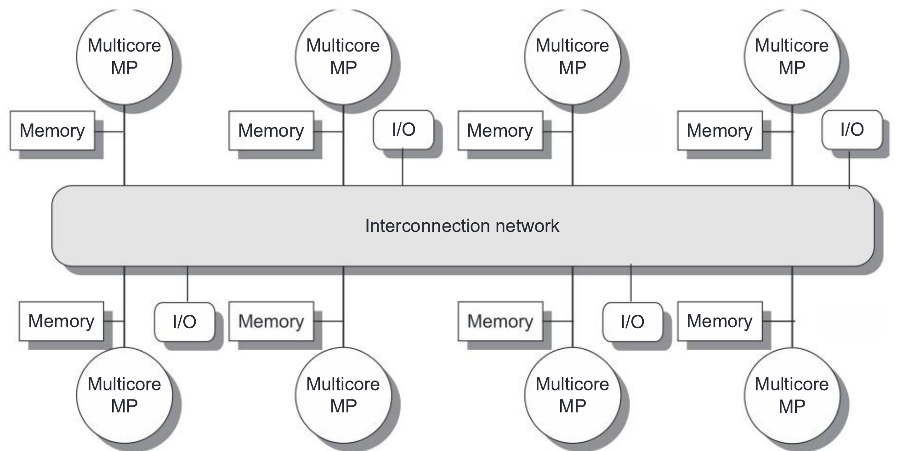

# 线程级并行 {#ch-tlp}

> 到 20 世纪 60 年代中期，人们开始放弃传统的组成方式。这时，为提高计算机运算速度所作的努力已经出现收益递减……电子电路的运算速度最终受到光速的限制……而许多电路的工作速度已经进入纳秒量级。
>
> ——W. Jack Bouknight 等，《ILLIAC IV 系统》（1972）

> 我们未来所有产品的开发都将转向多核设计。我们相信，这是整个产业的一个关键转折点。
>
> ——Intel 总裁 Paul Otellini，2005 年在 Intel 开发者论坛上介绍 Intel 未来的方向

> 2004 年以来，处理器设计者不再着力提高单核性能，而是增加核数，以利用摩尔定律带来的缩放。转向多核在一定程度上是对 Dennard 缩放失效的回应，但 Dennard 缩放的失效很快也可能限制多核的扩展，正如单核的扩展已经受到抑制一样。
>
> ——Hadi Esmaeilzadeh 等，《功耗限制与暗硅挑战多核的未来》（2012）

## 引言 {#sec-5-1}

本章开头的引语表明，多年来一直有研究者认为单处理器体系结构的进步已经接近尽头。显然，其中有些看法下得太早了。实际上，1986—2003 年间，在微处理器的推动下，单处理器性能的增长速度是 20 世纪 50 年代末、60 年代初出现第一批晶体管计算机以来最快的。

尽管如此，多处理器在整个 20 世纪 90 年代越来越重要。设计者希望既能利用商品化微处理器巨大的性价比优势，又能造出比单个微处理器性能更高的服务器和超级计算机，多处理器正是这样一条途径。第 1 章和第 3 章讲过，开发指令级并行（ILP）的收益不断递减，单处理器性能的提高随之放缓；与此同时，人们对功耗的担忧也在加深。这两方面合在一起，把计算机体系结构带进了一个新时代：从低端到高端，多处理器都扮演着重要角色。第二段引语说的就是这个明确的转折点。

多处理器越来越重要，主要有以下几方面的原因：

* 2000—2005 年间，设计者试图找到并利用更多的 ILP，结果发现这条路效率很低：功耗和硅片成本的增长比性能更快，硅片和能量的利用效率大幅下降。除了 ILP，我们所知道的唯一一种可扩展的通用方法，能让性能的提高快于基础工艺所允许的速度（从开关速度的角度看），就是多处理，包括 SIMD 和 MIMD 两类方法。
* 云计算和软件即服务越来越重要，人们对高端服务器的兴趣随之增加。
* 互联网上有了海量数据，数据密集型应用由此增多。
* 人们认识到，提高桌面性能已经不那么重要了（图形和 AI 加速器除外，它们利用的是其他形式的并行）。原因有二：一是现有性能已经够用，二是计算密集和数据密集的应用都放到云上去做了。
* 人们更懂得如何有效地使用多处理器，在服务器环境中尤其如此。这类环境本身就有大量并行性，来源有三：一是大数据集，通常表现为数据并行；二是「自然世界」中的并行，见于科学和工程计算程序；三是大量独立请求之间的并行，即请求级并行。
* 通过复制同一个设计，而不是另做一个独特的设计，可以充分发挥设计投入的作用；所有多处理器设计都有这种好处。
* 多核处理器可以集成不同类型的核（大核/小核），系统既可以使用高性能（功耗也较高）的核，也可以使用能效更高的低功耗核，还可以集成领域专用加速器。
* 每个芯片内部都集成了互连和 Cache 一致性支持，用多个多核芯片构建系统也就容易了。

第三段引语则提醒我们，多核在提升性能方面的潜力可能有限。Amdahl 定律的作用，再加上 Dennard 缩放的终结，意味着多核的前景可能是有限的，至少作为提高单个应用性能的手段是这样。异构处理器和领域专用处理器也许能提供另外的出路。本章后面还会回到这个话题。

本章讨论如何利用*线程级并行*（*TLP*）。TLP 意味着有多个程序计数器，因此主要通过 MIMD（多指令流多数据流）处理器来利用。MIMD 已经存在了几十年，但从嵌入式应用到高端服务器，TLP 在整个计算领域走到前台，主要是近 30 年的事。同样，TLP 广泛用于各类通用应用，而不只是事务处理或科学计算，也是比较晚近的事。

本章的重点是*多处理器*。所谓多处理器，就是由紧密耦合的处理器构成的计算机，这些处理器通常由一个操作系统（可能有多个副本）协调和管理，并通过共享地址空间共享存储器。这类系统用两种软件模式来利用 TLP：

* 一是执行一组紧密耦合、协作完成同一任务的线程，这通常称为*并行处理*；
* 二是执行多个相对独立的进程，这些进程可能来自一个或多个用户。这是*请求级并行*的一种形式，只是规模比下一章讨论的要小得多。请求级并行可以由运行在多个处理器上的单个应用来利用，例如响应查询的数据库；也可以由多个独立运行的应用来利用，这通常称为*多道程序设计*。

本章考察的多处理器，规模通常从 8 核的单插座处理器，到几十个、有时几百个核不等，这些核主要通过共享存储器来通信和协调。通过存储器共享意味着共享地址空间，但不一定只有一个物理存储器。这类多处理器既包括有多个核的单芯片系统，即*多核*处理器，也包括由多个芯片构成的计算机，其中每个芯片通常也是一个多核处理器。

除了真正的多处理器，本章还会回到*多线程*这个话题。多线程技术让多个线程在一个多发射处理器上交替执行。许多多核处理器也支持多线程。

下一章讨论数据中心。数据中心通常由数量极多的处理器（几千到几十万个）构成，处理器之间用网络技术连接（不一定是计算机接入互联网所用的那种网络技术）。这类大规模系统用于云计算，主要任务是并行执行海量的独立任务。本章讨论的多核处理器和多处理器，就是构建这些更大规模系统的基本部件。此外，容易并行化的计算密集型任务，如搜索和某些机器学习算法，也使用集群。集群扩展到几万台甚至更多服务器时，也称为*仓库级计算机*。阿里巴巴、亚马逊、谷歌、微软和 Facebook 都在构建和使用仓库级计算机。这类系统有时也称为多计算机，用于科学计算时尤其如此。

Culler 等（1999）以及其他许多书籍详细介绍了这类系统。多处理这一领域内容庞杂，而且变化很快（刚才提到的 Culler 等的书超过 1000 页，讲的还只是多处理），因此本书只关注我们认为计算领域中最重要、最通用的部分。附录 I 讨论构建更大规模计算机时出现的一些问题，以及这类计算机在计算密集型科学应用中的使用。

本章的重点是大约有 8～1024 个处理器核的多处理器。这些核可能分布在 1～64 个独立的芯片上，一个插座中可能封装一个模块，模块里有几个 CPU 和存储器。无论按台数还是按金额计算，这类设计都占绝对主导地位。在大规模多处理器中，互连网络是设计的关键部分，附录 F 专门讨论这个问题。

### 多处理器体系结构：问题与方法 {-}

一台有 $n$ 个处理器的 MIMD 多处理器，要充分发挥作用，通常至少要有 $n$ 个线程或进程可以执行；如果采用多线程（今天大多数高端多核芯片都支持），所需的线程数还要再增加到 2～8 倍。

线程的来源有两种极端情况。一种是单个进程中的独立线程，通常由程序员指定，或者由操作系统（根据多个独立请求）创建。另一种是并行编译器利用循环中的数据并行生成的线程，一个线程可能只包含循环的几十次迭代。分配给一个线程的计算量称为*粒度*，它对能否高效地利用 TLP 很重要。但 TLP 与 ILP 在性质上的重要区别在于：TLP 由软件系统或程序员在高层识别，而且每个线程由几千到几十亿条指令组成，这些线程可以并行执行。

线程也可以用来利用数据级并行，但开销通常高于向量部件、GPU 这类 SIMD 处理器（见第 4 章）。由于开销较高，粒度必须足够大，才能高效地利用并行性。例如，向量处理器或 GPU 能高效地并行处理短向量上的操作；但在 MIMD 中，如果把这样的并行性分给许多线程，每个线程的粒度可能非常小，开销大到利用这种并行性的代价无法承受。

**按存储器组织分类。** 传统上，共享存储多处理器按处理器数目分为两类，处理器数目又决定了存储器的组织方式和互连策略。处理器多少才算「少」、多少才算「多」，标准一直在变，所以我们按存储器的组织方式来称呼这两类多处理器。

早期的多处理器常常只有一个共享存储器，用一条总线连接处理器和存储器。所有处理器访问存储器的时间都相同，所以这类多处理器称为 *UMA*（Uniform Memory Access，均匀存储访问）多处理器。一些早期的多核处理器也是 UMA。公共总线简化了设计，但核数和单核性能不断提高以后，总线就成了瓶颈。因此，大多数多核处理器改用了[图 5.1](#fig-5-1) 那样的结构：多个核共享末级 Cache（LLC，Last-Level Cache），LLC 通常是分布式的。各个核通过互连网络访问存储器接口，各部分 LLC 之间也通过互连网络通信；后面会看到，这种通信是维持一致的存储器视图所必需的。有些设计中，一小组处理器共享 LLC 的一个分片。

{#fig-5-1 width=80%}

由多个多核芯片构成的多处理器，可以既使用多个存储器，又用互连网络连接各个多核芯片，如[图 5.2](#fig-5-2) 所示。这种体系结构称为*分布式共享存储器*（DSM），它表现出非均匀存储访问（NUMA）的特点：访存延迟取决于发起访问的核与存放数据的物理存储器之间的相对位置。存储器在物理上是分布的，但各个处理器共享同一个地址空间，可以访问全部存储器，「分布式*共享*存储器」这个名称说的就是这一点。需要通信的进程和线程请求操作系统，把各自虚拟地址空间的某一部分映射到物理地址空间的共享部分。然后由存储系统保证各个处理器能够正确地访问和共享存储器，这是本章要深入讨论的问题。

下一章的集群和仓库级计算机则不同，它们看上去是用网络连接起来的一台台独立计算机（每台计算机可能是由多核处理器构成的多处理器）。一台计算机要访问另一台计算机的存储器，必须借助两台计算机上都运行的软件协议。这类设计用消息传递协议在计算机之间传送数据。

{#fig-5-2 width=90%}

### 并行处理的挑战 {-}

多处理器的应用范围很广，一端是运行基本上不需要通信的独立任务，另一端是运行并行程序，其中的线程必须相互通信才能完成任务。对于相互依赖、相互作用的线程，并行处理面临两大障碍，两者都可以用 Amdahl 定律来解释。要克服这些障碍，通常必须统筹考虑多个方面：算法的选择和实现，底层编程语言和系统，操作系统及其支持功能，以及体系结构和硬件实现。在许多情况下，其中某一方面是关键瓶颈；但扩展到较多的处理器（比如 32 个或更多）时，软件和硬件的*所有*方面往往都需要关注。

第一个障碍是程序中可用的并行性有限，第二个障碍是通信的代价比较高。可用并行性有限，任何并行处理器都难以获得好的加速比，下面第一道例题说明了这一点。

**例题**　要用 100 个处理器获得 80 的加速比，原计算中可以串行执行的部分最多占多大比例？

**解答**　第 1 章讲过，Amdahl 定律为：

$$
\text{加速比} = \frac{1}{\dfrac{\text{比例}_\text{改进}}{\text{加速比}_\text{改进}} + (1 - \text{比例}_\text{改进})}
$$

为简单起见，假设程序只有两种运行模式：一种是并行模式，所有处理器都得到充分利用，这就是改进后的模式；另一种是串行模式，只用一个处理器。这样简化以后，改进模式的加速比就是处理器的个数，改进模式所占的比例就是并行模式下所用时间的比例。代入上式得：

$$
80 = \frac{1}{\dfrac{\text{比例}_\text{并行}}{100} + (1 - \text{比例}_\text{并行})}
$$

化简：

$$
\begin{aligned}
0.8 \times \text{比例}_\text{并行} + 80 \times (1 - \text{比例}_\text{并行}) &= 1 \\
80 - 79.2 \times \text{比例}_\text{并行} &= 1 \\
\text{比例}_\text{并行} &= \frac{80 - 1}{79.2} \\
\text{比例}_\text{并行} &= 0.9975
\end{aligned}
$$

由此可见，要用 100 个处理器获得 80 的加速比，原计算中串行的部分只能占 0.25%！要获得线性加速比（$n$ 个处理器加速比为 $n$），整个程序通常必须全部并行，不能有任何串行部分。实际上，程序并不是只在完全并行和串行两种模式下运行，在并行模式下也常常用不满全部处理器。对于加速比各不相同的多个部分，同样可以用 Amdahl 定律来分析，下面的例题就是这样。

**例题**　一个应用运行在有 100 个处理器的多处理器上，它可以使用 1 个、50 个或 100 个处理器。假设 95% 的时间能使用全部 100 个处理器，要获得 80 的加速比，在其余 5% 的执行时间中，有多大比例必须使用 50 个处理器？

**解答**　采用多项形式的 Amdahl 定律：

$$
\text{加速比} = \frac{1}{\dfrac{\text{比例}_{100}}{\text{加速比}_{100}} + \dfrac{\text{比例}_{50}}{\text{加速比}_{50}} + (1 - \text{比例}_{100} - \text{比例}_{50})}
$$

代入数据：

$$
80 = \frac{1}{\dfrac{0.95}{100} + \dfrac{\text{比例}_{50}}{50} + (1 - 0.95 - \text{比例}_{50})}
$$

化简：

$$
\begin{aligned}
0.76 + 1.6 \times \text{比例}_{50} + 4.0 - 80 \times \text{比例}_{50} &= 1 \\
4.76 - 78.4 \times \text{比例}_{50} &= 1 \\
\text{比例}_{50} &= 0.048
\end{aligned}
$$

也就是说，如果应用 95% 的时间能充分利用 100 个处理器，要获得 80 的加速比，其余时间中必须有 4.8% 使用 50 个处理器，串行部分只能占 0.2%！

并行处理的第二个主要挑战是：在并行处理器中，远程访问的延迟很长。在现有的共享存储多处理器中，不同核之间传送数据可能要花 50～100 多个时钟周期；不同芯片上的核之间，则要花 500 个时钟周期到 1000 个甚至更多时钟周期（大规模多处理器的情形）。具体数值取决于通信机制、互连网络的类型和多处理器的规模。通信延迟这么长，影响显然很大。下面看一个简单的例子。

**例题**　一个应用运行在有 32 个处理器的多处理器上，处理一次远程存储器访问的延迟为 200 ns。假设除涉及通信的访问以外，这个应用的所有访问都在本地存储层次中命中，这个假设显然是乐观的。处理器在远程请求期间停顿，时钟频率为 4 GHz。如果基本 CPI（假设所有访问都在 Cache 中命中）为 0.5，那么没有通信时的多处理器，与 0.2% 的指令涉及远程通信访问时相比，速度是后者的多少倍？

**解答**　先求每条指令的时钟周期数比较简单。远程访问占 0.2% 时，多处理器的有效 CPI 为：

$$
\begin{aligned}
\text{CPI} &= \text{基本 CPI} + \text{远程请求率} \times \text{远程请求开销} \\
&= 0.5 + 0.2\% \times \text{远程请求开销}
\end{aligned}
$$

远程请求开销为：

$$
\frac{\text{远程访问开销}}{\text{时钟周期}} = \frac{200\ \text{ns}}{0.25\ \text{ns}} = 800\ \text{个时钟周期}
$$

因此 CPI 为：

$$
\begin{aligned}
\text{CPI} &= 0.5 + 0.20\% \times 800 \\
&= 2.6
\end{aligned}
$$

所有访问都在本地的多处理器，速度是前者的 2.6/0.5 = 5.2 倍！实际的性能分析要复杂得多：一方面，有一部分不涉及通信的访问会在本地存储层次中失效；另一方面，远程访问时间也不是一个固定值。例如，许多访问同时争用全局互连，会使延迟加大，远程访问的代价可能更高；反过来，如果存储器是分布式的，而访问恰好落在本地存储器上，访问时间可能更短。

这个问题也可以用 Amdahl 定律来分析，留给读者作为练习。

**应对思路。** 并行性不足和远程通信延迟长，是使用多处理器时性能上最大的两个挑战。应用并行性不足的问题，主要靠软件来解决：一是采用并行性能更好的新算法，二是由软件系统尽量延长用满全部处理器执行的时间。远程延迟长的影响，则可以从体系结构和程序员两方面来降低：

* 降低远程访问的频率。可以用硬件机制，如缓存共享数据；也可以用软件机制，如重新组织数据，让更多的访问落在本地。
* 容忍延迟。可以采用多线程（见第 3 章）或预取（第 2 章已详细讨论）。

本章的大部分内容都是降低远程通信长延迟影响的技术：[5.2 节](#sec-5-2)～[5.4 节](#sec-5-4)讨论如何用缓存来降低远程访问的频率，同时保持一致的存储器视图；[5.5 节](#sec-5-5)讨论同步，同步本身就要在处理器之间通信，而且会限制并行性，因此是一个潜在的主要瓶颈；[5.6 节](#sec-5-6)介绍延迟隐藏技术和共享存储器的存储一致性模型。附录 I 主要讨论更大规模的多处理器及其在科学计算中的应用。

## 多处理器的 Cache 一致性 {#sec-5-2}

两个处理器都通过各自的 Cache 来看存储器，因此对同一个存储单元，它们最终可能看到不同的值，[图 5.3](#fig-5-3) 就是一个例子。这个问题一般称为 *Cache 一致性问题*。一致性问题之所以存在，是因为系统中既有全局状态，又有局部状态：全局状态主要由主存决定，局部状态由各个 Cache 决定，而这些 Cache 是每个处理器核私有的。所以，在多核处理器中，即使有某一级 Cache 是共享的（如 LLC），只要另一些级是私有的（如 L1 和 L2），一致性问题就依然存在，必须解决。

[图 5.3　两个处理器（A 和 B）读写同一个存储单元（X）时的 Cache 一致性问题。假设开始时两个 Cache 中都没有这个变量，X 的值为 1。还假设 Cache 采用写直达方式；如果采用写回 Cache，还会带来一些类似的复杂问题。A 写入 X 以后，A 的 Cache 和存储器中都是新值，B 的 Cache 中却不是；这时如果 B 读 X，得到的将是 1！]{#fig-5-3 .caption}

| 时刻 | 事件 | 处理器 A 的 Cache 内容 | 处理器 B 的 Cache 内容 | 存储单元 X 的内容 |
|---|---|--:|--:|--:|
| 0 | | | | 1 |
| 1 | 处理器 A 读 X | 1 | | 1 |
| 2 | 处理器 B 读 X | 1 | 1 | 1 |
| 3 | 处理器 A 把 0 存入 X | 0 | 1 | 0 |

非正式地说，如果对任何一个数据项的任何一次读都返回该数据项最近一次写入的值，存储系统就是一致的。这个定义直观易懂，但含糊而且过于简单，实际情况要复杂得多。这个简单的定义其实包含了存储系统行为的两个不同方面，要写出正确的共享存储程序，两者都至关重要：

* 第一个方面称为 *Cache 一致性*（coherence），它规定读操作可以返回哪些值；
* 第二个方面称为*存储一致性*（consistency），它规定写入的值什么时候能被读操作返回。

先看 Cache 一致性。满足以下三条性质的存储系统是一致的：

1. *单处理器读一致性*：处理器 P 写单元 X 之后又读 X，如果在这次写和读之间没有其他处理器写 X，那么这次读总是返回 P 写入的值。
2. *多处理器读一致性*：一个处理器写单元 X 之后，另一个处理器读 X，如果读和写在时间上相隔足够远，而且两次访问之间没有其他对 X 的写，那么这次读返回写入的值。
3. *多处理器写串行化*：对同一单元的写是*串行化*的，也就是说，任意两个处理器对同一单元的两次写，在所有处理器看来顺序都相同。例如，如果先后向某个单元写入 *y* 和 *z*，那么任何处理器都不可能先读到 *z*、后来又读到 *y*。

单处理器读一致性保持的是程序顺序，即使在单处理器中，我们也要求这条性质成立。多处理器读一致性定义了「一致的存储器视图」是什么意思：如果一个处理器可以一直读到旧的数据值，我们当然要说存储器是不一致的。

多处理器写串行化的必要性不那么直观，但同样重要。设想不对写进行串行化：处理器 P1 先写单元 X，然后 P2 也写 X。写串行化保证每个处理器迟早都会看到 P2 的写。如果不串行化，就可能出现这样的情况：有些处理器先看到 P2 的写，后看到 P1 的写，于是一直保留 P1 写入的值。避免这类问题最简单的办法，就是保证对同一单元的所有写在各处理器看来顺序都相同，这一性质称为*写串行化*。

上述三条性质足以保证 Cache 一致性，但写入的值什么时候能被看到，同样是个重要问题。原因在于，我们不能要求读 X 时立即看到其他处理器刚写入 X 的值。例如，一个处理器写 X，另一个处理器紧接着读 X，两者只相隔很短的时间，这时可能根本无法保证读到写入的值，因为写入的数据此刻可能还没有离开写它的处理器。写入的值究竟什么时候必须被读者看到，由*存储一致性模型*规定，这个问题在 [5.6 节](#sec-5-6)讨论。

Cache 一致性与存储一致性是互补的：*Cache 一致性*规定对同一存储单元的读写行为，*存储一致性*则规定读写相对于对其他存储单元的访问如何排序。目前先作以下两点假设：

* 一是一次写要等到所有处理器都看到它的效果以后才算完成（才允许下一次写进行）；
* 二是处理器不改变任何一次写相对于其他任何访存操作的顺序。

这两个条件意味着：如果一个处理器先写单元 A、再写单元 B，那么任何看到 B 的新值的处理器，也一定能看到 A 的新值。这些限制允许处理器对读重新排序，但强制处理器按程序顺序完成写。在 [5.6 节](#sec-5-6)之前，我们一直采用这个假设；到了 5.6 节，再来具体看这个定义的含义以及其他可选方案。

### 实现一致性的基本方案 {-}

多处理器和 I/O 的一致性问题来源相似，但各有特点，适用的解决方案也就不同。在 I/O 中，同一数据有多个副本是很少见的情况，应当尽量避免；而在多个处理器上运行的程序，同一数据通常在好几个 Cache 中都有副本。在一致的多处理器中，Cache 为共享数据项提供了*迁移*和*复制*两种功能。

**迁移。** 数据项可以移到本地 Cache 中，并在那里以透明的方式使用，因此一致的 Cache 提供了迁移功能。迁移既降低了访问分配在远程的共享数据项的延迟，也降低了对共享存储器的带宽需求。迁移还能节省能量，因为访问本地 Cache 比访问片外存储器的能效高得多。

**复制。** 对于同时被读的共享数据，一致的 Cache 会在本地 Cache 中制作一个副本，因此也提供了复制功能。复制既降低了访问延迟，也减少了对被读的共享数据项的争用。

支持迁移和复制对共享数据的访问性能至关重要，还能节省能量。因此，多处理器并不试图在软件中回避这个问题，而是采用硬件方案，引入一种协议来维持 Cache 的一致性。

#### 保证一致性：作废与更新 {-}

维持一致性要求的方法有两种。

一种方法是保证处理器在写一个数据项之前，先获得对它的独占访问权。这种协议称为*写作废协议*，因为它在写之前作废其他副本。这是迄今为止最常用的协议。独占访问保证了写发生时，该数据项不存在其他可读或可写的副本：所有其他 Cache 中的副本都已作废。

[图 5.4](#fig-5-4) 是一个在写回 Cache 上工作的作废协议的例子。下面看这个协议怎样保证一致性。考虑一个处理器写、另一个处理器随后读的情形：由于写要求独占访问，读处理器持有的任何副本都必须作废。因此，读操作在原来存有旧副本的 Cache 中进行时，就会失效，只能去取数据的新副本。对于写，我们也要求写处理器拥有独占访问权，这样其他处理器就不可能同时写。如果两个处理器确实试图同时写同一数据，其中一个会在竞争中获胜（稍后会看到怎样决定谁获胜），另一个处理器的副本随之作废。另一个处理器要完成写，必须取得数据的新副本，其中已经是更新后的值。所以，这个协议保证了写串行化。

[图 5.4　单个 Cache 块（X）在监听总线上采用写回 Cache 时作废协议的工作示例。假设开始时两个 Cache 中都没有 X，存储器中 X 的值为 0。处理器和存储器的内容是处理器操作和总线操作都完成以后的值。空白表示没有操作或者没有缓存副本。B 第二次失效时，由处理器 A 提供数据，并取消存储器的响应；同时，B 的 Cache 内容和存储器中 X 的内容都要更新。在块变为共享时更新存储器，可以简化协议；也可以只跟踪所有权，等到块被替换时才强制写回。这需要再引入一个状态位，表示块的所有权。所有权位表示块可以被共享读，但只有拥有它的处理器才能写；这个处理器修改或替换该块时，负责更新其他处理器和存储器。如果多核处理器使用共享 Cache（如 L3），那么所有存储器都通过共享 Cache 来看；这时 L3 的作用就相当于本例中的存储器，一致性只需对每个核私有的 L1 和 L2 Cache 来处理。正是这一点，促使一些设计者在多核处理器内部采用目录协议。要做到这一点，L3 Cache 必须是包含的。第 2 章讲过，如果较高一级 Cache（这里是 L1 和 L2）中的任何单元也都在 L3 中，这个 Cache 就是包含的。[5.7 节](#sec-5-7)再讨论包含性问题。]{#fig-5-4 .caption}

| 处理器操作 | 总线操作 | 处理器 A 的 Cache 内容 | 处理器 B 的 Cache 内容 | 存储单元 X 的内容 |
|---|---|--:|--:|--:|
| | | | | 0 |
| 处理器 A 读 X | X 的 Cache 失效 | 0 | | 0 |
| 处理器 B 读 X | X 的 Cache 失效 | 0 | 0 | 0 |
| 处理器 A 向 X 写 1 | X 的作废 | 1 | | 0 |
| 处理器 B 读 X | X 的 Cache 失效 | 1 | 1 | 1 |

作废协议之外的另一种方法是：一个数据项被写时，更新它在所有 Cache 中的副本。这种协议称为*写更新协议*或*写广播协议*。写更新协议必须把对共享 Cache 行的所有写都广播出去，因此占用的带宽要多得多。正因为如此，近来的多处理器都选择默认采用写作废协议，本章其余部分也只讨论作废协议。

#### Cache 一致性协议 {-}

实现 Cache 一致性协议的关键，是跟踪每一个共享数据块的状态。Cache 块的状态用与块相关联的状态位来保存，这和单处理器 Cache 中的有效位、脏位类似。目前使用的协议有两类，分别用不同的技术来跟踪共享状态：

* *基于目录*：物理存储器中某个块的共享状态保存在一个地方，这个地方称为*目录*。目录通常放在共享的 LLC 中，或者放在该块所在存储器对应的存储器接口处。出于可扩展性的考虑，由多个芯片构成的多处理器大多使用多个分布式目录，常常是每个芯片一个。许多多核处理器把目录信息与 LLC 放在一起。由于 LLC 分成了多个存储体，单个多核处理器内部的目录也是分布式的！分布式目录比单一目录复杂，这类设计是 [5.4 节](#sec-5-4)的内容。
* *监听*：不把共享状态保存在单一的目录中，而是由每个持有物理存储器某块数据副本的 Cache 来跟踪这个块的共享状态。由于这些信息只保存在本地，每一个一致性事务都必须广播给所有 Cache。在总线这样的广播介质上，每个 Cache 控制器都监视（即*监听*）介质，判断自己是否持有被请求的块的副本。

监听协议最早在由单核微处理器构成的多处理器中流行起来，这类系统用一条总线把各个 Cache 连接到同一个共享存储器上。今天，大多数多核设计采用混合协议：用监听来保持各个非共享 Cache（L1 和 L2）的一致，同时在 LLC 或存储器接口处采用目录方案，决定为了保证一致性需要监听哪些处理器。有些多核处理器的做法正好相反：在一组 2～4 个插座之间（用广播介质连接）采用监听，再用目录指明每个插座内需要监听哪些核。[5.4 节](#sec-5-4)末尾再回到混合方案。
