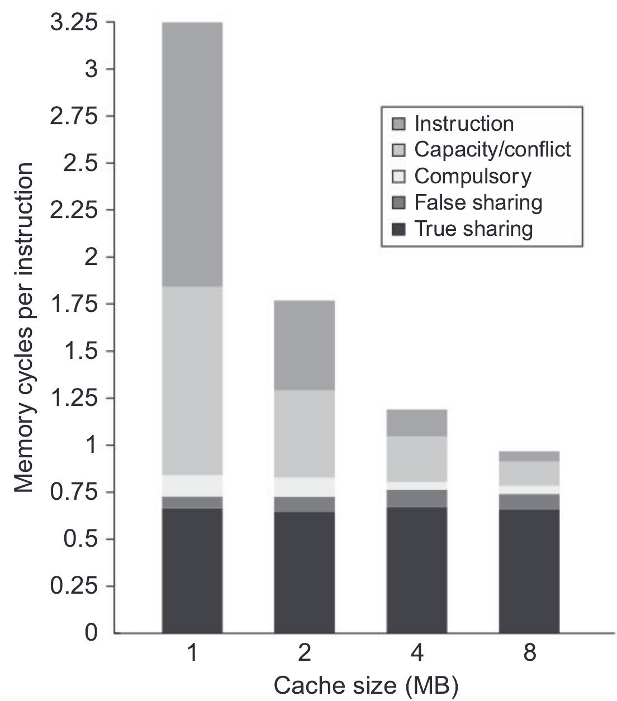
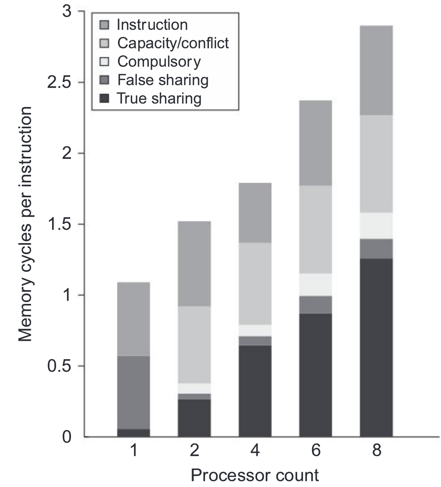
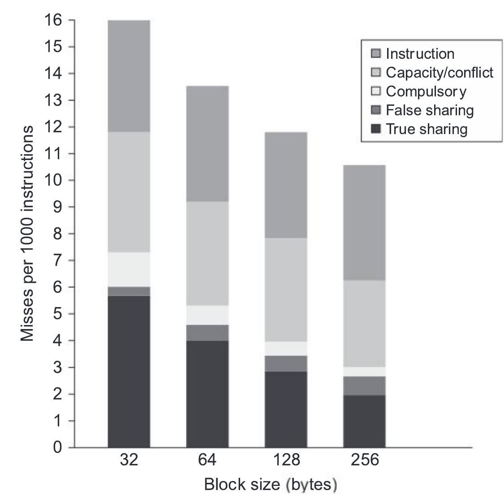

### 共享存储多处理器的性能 {-}

采用监听一致性协议的多核处理器，性能由几种不同的现象共同决定。就 Cache 而言，总体性能取决于两部分流量：一部分是单处理器本来就有的 Cache 失效流量，另一部分是一致性事务引起的流量，这些事务会作废其他 Cache 中的块，从而造成后续的 Cache 失效。处理器数目、Cache 容量和块大小发生变化时，对失效率的这两个组成部分影响各不相同，系统的总体行为是两方面效果叠加的结果。

[图 5.8　隐藏的瞬态及其操作。表中列出了需要增加的 7 个状态。这些状态是瞬态：「等待」一栏中的事务完成后，状态就变为「成功后的状态」一栏所列的状态，这与基本一致性协议中的状态变化相同。但如果在挂起的事务完成之前，收到了针对同一块的写失效或作废，该块的状态就变为无效，事务必须从无效状态重新开始。由于块已经无效，此时只可能发生读失效或写失效。注意，[图 5.6](#fig-5-6) 和[图 5.7](#fig-5-7) 中的写回操作也必须完成。先完成写回比较简单；如果把写回放进缓冲，那么到来的事务还必须监听缓冲中的内容。]{#fig-5-8 .caption}

| Cache 状态 | 核的操作 | 等待 | 成功后的状态 |
|---|---|---|---|
| 无效（Invalid） | 读失效 | 失效返回 | 共享（Shared） |
| 无效（Invalid） | 写失效 | 失效返回 | 独占（Exclusive） |
| 共享（Shared） | 读失效 | 失效返回 | 共享（Shared） |
| 共享（Shared） | 写命中 | 作废完成 | 独占（Exclusive） |
| 共享（Shared） | 写失效 | 失效返回 | 独占（Exclusive） |
| 独占（Exclusive） | 读失效 | 失效返回 | 共享（Shared） |
| 独占（Exclusive） | 写失效 | 失效返回 | 独占（Exclusive） |

**一致性失效的两个来源。** 附录 B 把单处理器的失效按 3C 分为容量失效、强制失效和冲突失效三类，借此既能看清应用程序的行为，也能找到改进 Cache 设计的方向。处理器之间通信引起的失效通常称为*一致性失效*，同样可以按来源分成两类。

第一类是*真共享失效*，它是数据经由 Cache 一致性机制进行通信而产生的。在基于作废的协议中，处理器第一次写一个共享的 Cache 块时，要发出作废，以取得该块的所有权；此后另一个处理器读这个 Cache 块中被修改过的字时，会发生失效，并把相应的块传送过来。这两种失效都直接来自处理器之间的数据共享，所以都归为真共享失效。

第二类称为*伪共享*。一致性算法基于作废、而每个 Cache 块只有一个有效位时，就会出现伪共享。所谓伪共享，是指一个块中被读的字本身没有被写，但块中其他某个字被写了，于是整个块被作废，随后的访问因此失效。判断的方法是看被写的字：

* 如果被写的字正是收到作废的那个处理器要使用的，那么这次访问属于真共享访问，不管块多大都会失效；
* 如果被写的字与被读的字不同（只是位于同一个 Cache 块中），作废并没有传递任何新值，只是多造成了一次 Cache 失效，这就是伪共享失效。

发生伪共享失效时，块是共享的，但块中没有任何一个字真正被共享；如果块大小只有一个字，这次失效就不会发生。下面的例子可以把这几种共享模式说清楚。

**例题**　假设字 z1 和 z2 位于同一个 Cache 块中，该块在 P1 和 P2 的 Cache 中都处于共享状态。对于下面的事件序列，判断每次失效是真共享失效、伪共享失效，还是命中。凡是块大小为一个字时也会发生的失效，都算作真共享失效。

| 时间 | P1 | P2 |
|---|---|---|
| 1 | 写 z1 | |
| 2 | | 读 z2 |
| 3 | 写 z1 | |
| 4 | | 写 z2 |
| 5 | 读 z2 | |

**解答**　按时间步逐一分类如下：

1. 真共享失效。z1 在 P2 中处于共享状态，必须从 P2 中作废。
2. 伪共享失效。z2 所在的块因 P1 写 z1 而被作废，但 P2 并不使用 z1 的这个值。
3. 伪共享失效。由于 P2 的读，含有 z1 的块被标记为共享，但 P2 读的并不是 z1。P2 读过之后，含有 z1 的 Cache 块处于共享状态，P1 要取得对该块的独占访问，就需要一次写失效。有些协议把这种情况作为升级请求处理，只产生一次总线作废，不传送 Cache 块。
4. 伪共享失效，理由与第 3 步相同。
5. 真共享失效，因为读的值是 P2 写入的。

商业工作负载中也能看到真共享失效和伪共享失效的影响，但一致性失效对紧密耦合、共享大量用户数据的应用影响更大。附录 I 讨论并行科学计算工作负载的性能时，将详细考察这些影响。

### 小规模多处理器上的商业工作负载 {-}

本节考察一台 4 处理器共享存储多处理器在运行联机事务处理工作负载时的存储系统行为。所依据的研究是 1998 年在一台 4 处理器 Alpha 系统上完成的，但直到今天，对多处理器在这类工作负载下的性能，它仍是最全面、最有见地的研究。我们关注的是多处理器的 Cache 活动，尤其是 L3 的行为，因为 L3 中的流量有很大一部分与一致性有关。

研究结果有的是在 AlphaServer 4100 上实测的，有的是用一个以 AlphaServer 4100 为原型、可配置的模拟器得到的（见 Barroso 等人 [1998]）。AlphaServer 4100 中的每个处理器都是 Alpha 21164，每个时钟周期最多发射 4 条指令，时钟频率为 300 MHz。这个系统中 Alpha 处理器的时钟频率比近年设计的系统低得多，但系统的基本结构与多核的 Intel i7、i9 等处理器非常相似：都由四发射的处理器和三级 Cache 层次构成，只是 Cache 比新的多核处理器小（见[图 5.9](#fig-5-9)）。我们不关注性能细节，而是考察模拟得到的 L3 行为数据，L3 容量从每个处理器 1 MiB 变化到 8 MiB。

原始研究考察了三种工作负载，这里只讨论其中的联机事务处理（OLTP）工作负载。它以 TPC-B 为模型（TPC-B 的存储行为与第 1 章介绍的较新的 TPC-C 相似），底层数据库为 Oracle 7.3.2。该工作负载由两组进程组成：一组客户进程产生请求，一组服务器进程处理请求。服务器进程占用 85% 的用户时间，其余用户时间归客户进程。经过仔细调优，并且有足够多的请求让处理器保持忙碌，I/O 延迟得以隐藏；但服务器进程通常每执行大约 25000 条指令就会因 I/O 而阻塞。从总的执行时间看，71% 花在用户态，18% 花在操作系统中，11% 处于空闲，空闲主要是在等待 I/O。在所研究的几种商业应用中，OLTP 应用对存储系统的压力最大，即使用容量大得多的 L3 Cache 来评估，也仍然面临相当大的困难。例如，在 AlphaServer 上，处理器大约 90% 的周期处于停顿状态；在停顿时间中，L3 失效引起的访存占了将近一半，L2 失效占了 25%。

[图 5.9　本研究所用 Alpha 21164 与 Intel i7 的 Cache 层次特性。i7 的 Cache 容量更大、相联度更高，但失效开销也更大，因此两者的行为可能只有细微差别。两个系统从私有 Cache 传送数据都需要很高的开销（125 个周期或更多）。一个关键区别是：i7 的 L3 是共享的，而 Alpha 服务器中是 4 个各自独立、不共享的 L3 Cache。]{#fig-5-9 .caption}

| Cache 级 | 特性 | Alpha 21164 | Intel i7 |
|---|---|---|---|
| L1 | 容量 | 8 KB I/8 KB D | 32 KB I/32 KB D |
| | 相联度 | 直接映射 | 8 路 I/8 路 D |
| | 块大小 | 32 B | 64 B |
| | 失效开销 | 7 | 10 |
| L2 | 容量 | 96 KB | 256 KB |
| | 相联度 | 3 路 | 8 路 |
| | 块大小 | 32 B | 64 B |
| | 失效开销 | 21 | 35 |
| L3 | 容量 | 2 MiB（共 8 MiB，不共享） | 每核 2 MiB（共 8 MiB，共享） |
| | 相联度 | 直接映射 | 16 路 |
| | 块大小 | 64 B | 64 B |
| | 失效开销 | 80 | 约 100 |

**L3 容量的影响。** 先考察 L3 Cache 容量变化的影响。研究中 L3 的容量从每个处理器 1 MiB 变化到 8 MiB；每个处理器 2 MiB 时，L3 的总容量与 Intel i7 6700 相同。不过 i7 的 L3 是共享的，这样做有利也有弊。共享的 8 MiB Cache 不大可能比总容量为 16 MiB 的几个独立 L3 Cache 性能更好。[图 5.10](#fig-5-10) 给出了增大 Cache 容量的效果，这里采用两路组相联 Cache，以减少大量的冲突失效。L3 增大后，L3 失效减少，执行时间随之缩短。出人意料的是，几乎全部的收益都出现在从 1 MiB 增大到 2 MiB 这一步（4 个处理器的 Cache 总容量从 4 MiB 增大到 8 MiB）。再往上增大，收益就很小了，尽管在 2 MiB 和 4 MiB 时，Cache 失效仍然造成相当大的性能损失。这是为什么？

{#fig-5-10 width=70%}

要回答这个问题，需要弄清哪些因素构成了 L3 失效率，以及 L3 增大时这些因素怎样变化。[图 5.11](#fig-5-11) 给出了这些数据，显示五种来源各自贡献的每条指令访存周期数。L3 为 1 MiB 时，L3 访存周期的两个最大来源是指令失效和容量/冲突失效；L3 增大后，这两个来源都缩小为次要因素。然而，强制失效、伪共享失效和真共享失效并不随 L3 增大而减少。因此，在 4 MiB 和 8 MiB 时，真共享失效在失效中占了主要部分；真共享失效没有变化，所以 L3 超过 2 MiB 以后再增大容量，总失效率下降得很有限。

{#fig-5-11 width=70%}

**处理器数目的影响。** 增大 Cache 容量消除了大部分单处理器失效，多处理器失效却丝毫未减。那么，增加处理器数目对各类失效有什么影响？[图 5.12](#fig-5-12) 给出了这方面的数据，基本配置为 2 MiB、两路组相联的 L3 Cache（每个处理器的有效 Cache 容量与 i7 相同，但相联度较低）。不出所料，真共享失效率上升了，而单处理器失效并没有相应减少来抵消，所以每条指令的访存周期数总体增加。

{#fig-5-12 width=70%}

**块大小的影响。** 最后考察的问题是：增大块对这个工作负载是否有帮助？块增大后，指令失效率和冷失效率应当下降；在一定范围内，容量/冲突失效率也会下降，真共享失效率也可能下降。[图 5.13](#fig-5-13) 给出了块大小从 32 字节增大到 256 字节时每 1000 条指令的失效次数。块从 32 字节增大到 256 字节，影响了失效率的四个组成部分：

* 真共享失效率降为原来的 1/2 以下，说明真共享模式具有一定的局部性；
* 强制失效率显著下降，这在意料之中；
* 冲突/容量失效略有下降（块大小增大到原来的 8 倍，冲突/容量失效只降为原来的 1/1.26），说明 L3 大于 2 MiB 时，剩下的单处理器失效空间局部性不高；
* 伪共享失效率虽然绝对值不大，却增加到原来的将近 2 倍。

{#fig-5-13 width=70%}

指令失效率几乎不受影响，这一点令人吃惊。假如有一个只存指令的 Cache 表现出这种行为，我们就会得出结论：指令的空间局部性非常差。L2 和 L3 是指令和数据混合的 Cache，块较大时，指令与数据之间的冲突等其他因素也可能导致指令失效率居高不下。其他研究也证实，大型数据库和 OLTP 工作负载的指令流空间局部性很低，因为这类负载有大量短小的基本块和专用代码序列。根据这些数据，块较大的 L3 要与 32 字节块的 L3 性能相当，所需的失效开销可以表示为 32 字节块失效开销的倍数：

| 块大小 | 失效开销与 32 字节块失效开销之比 |
|---|---|
| 64 字节 | 1.19 |
| 128 字节 | 1.36 |
| 256 字节 | 1.52 |

现代 DDR SDRAM 能够快速进行块访问，这些数字是可以达到的，64 字节（i7/i9 的块大小）和 128 字节的块尤其如此。当然，还必须考虑访存流量增加的影响，以及与其他核争用存储器的可能。后一种影响很容易抵消单个处理器性能提高带来的收益。5.4 节将考察规模更大、基于 NUMA 的多处理器在一种可扩展性很好但耦合松散的工作负载下的性能特点。
