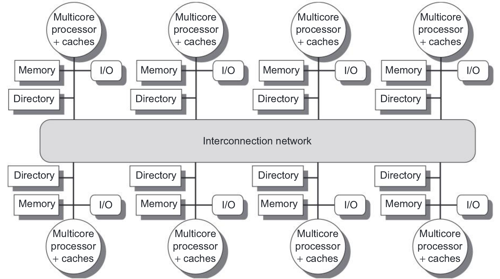
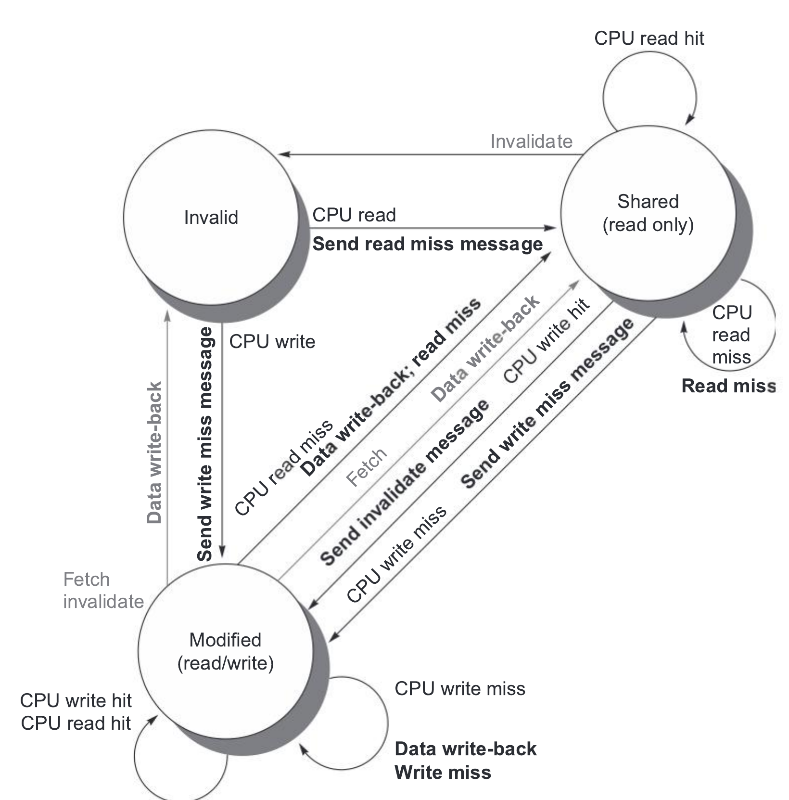
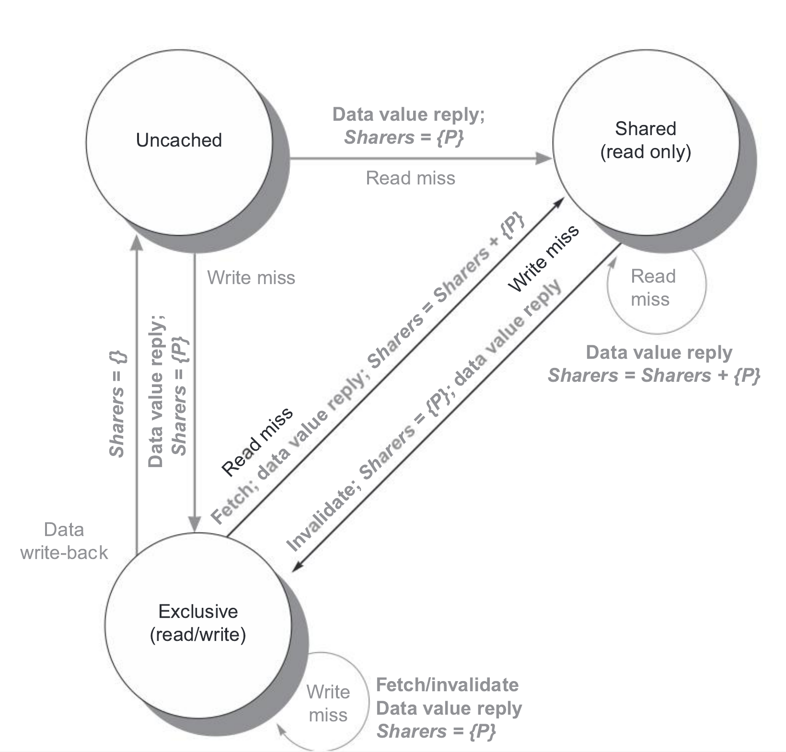
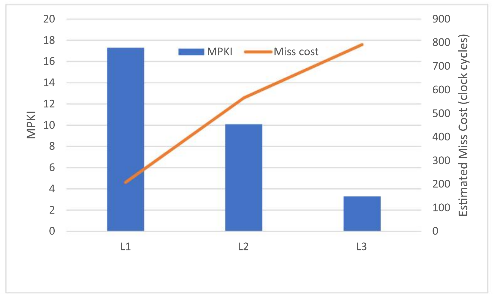
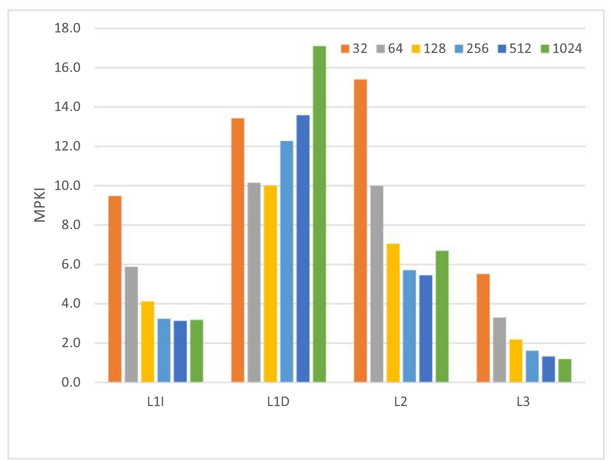
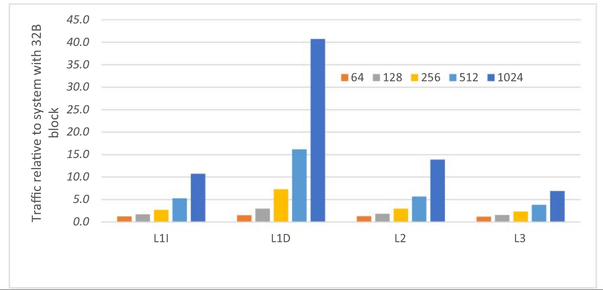

## 用目录维护 Cache 一致性 {#sec-5-4}

[5.3 节](#sec-5-3)讲过，监听协议每发生一次 Cache 失效，都要与所有 Cache 通信，对可能共享的数据的写操作也是如此。监听协议没有任何集中的数据结构来记录各个 Cache 的状态，这既是它的根本优点，也是它的致命弱点：优点是实现代价低，弱点是难以扩展。

把存储器分布到各个节点上（见[图 5.2](#fig-5-2)），可以提高存储带宽和互连带宽。这样一来，本地访存流量与远程访存流量立即分开，存储系统和互连网络的带宽需求都随之降低。但是，只要一致性协议还需要在每次 Cache 失效时广播，分布式存储带来的好处就很有限。

前面提到过，监听协议之外的另一种选择是目录协议。*目录*记录每个可能被缓存的块的状态，包括：哪些 Cache（或哪些 Cache 组）可能有这个块的副本，这个块是否已被修改。

**单个多核芯片中的目录。** 如果一个多核芯片有共享的包含式末级 Cache（LLC，Last-Level Cache），在 LLC 处实现目录很容易：给 LLC 的每个块配一个位向量，位数等于核数。由于所有 L2 块都必定在 LLC 中，位向量就能指出哪些私有 L2 Cache 可能有该块的副本，作废请求只需发给这些 Cache。只要 LLC 是包含式的，这个办法用在单个多核芯片上就非常有效，Intel i7 采用的正是这种方案。LLC 不是包含式的，目录信息也仍然可以放在 LLC 处，做法有两种：一是另设一个独立的目录结构（Intel Xeon 的方案）；二是保存一份 L2 tag的副本（AMD EPYC 的方案）。

只有一个目录还有一个好处：事件的定序比较简单，而实现各种存储一致性模型都需要定序（见 [5.6 节](#sec-5-6)）。目录只有一个时，可以先把后续请求压住，等当前正在处理的请求（如作废，或取回远程 Cache 中的数据）完成以后再处理。但核数增多后，这种阻塞的办法效率很低；目录不止一个时，这种办法就根本行不通。

**分布式目录。** 因此，目录也必须像存储器一样分布开，而且分布的方式要让一致性协议知道：任何一个被缓存的存储块，其目录信息在什么地方。最直接的办法是让目录随存储器一起分布。这样，不同的一致性请求可以发往不同的目录，就像不同的访存请求可以发往不同的存储器一样。

分布以后，一个块的共享状态仍然总是保存在唯一的一个已知位置。正是这个性质，加上目录记录了哪些其他节点可能缓存了这个块，一致性协议才能免去广播。[图 5.14](#fig-5-14) 给出了每个节点都加上目录以后的分布式存储多处理器。

{#fig-5-14 width=90%}

**目录的开销。** 最简单的目录实现给每个存储块配一个目录项。这时目录的信息量与「存储块数 × 节点数」成正比，其中每个存储块的大小与 L2 块或 LLC 块相同；一个*节点*是一个多核处理器，或者是在内部用监听实现一致性的一小组处理器。处理器（每个处理器可能是多核的）不超过几百个时，只要块的大小合理，目录开销都可以接受，不成问题。更大的多处理器需要采用能高效扩展目录结构的方法，但只有超级计算机规模的系统才需要考虑这一点。

### 基于目录的 Cache 一致性协议：基础 {-}

与监听协议一样，目录协议必须实现两种主要操作：一是处理读失效，二是处理对共享的干净 Cache 块的写。对当前处于共享状态的块发生写失效，只是这两种操作的简单组合。为了实现这些操作，目录必须记录每个 Cache 块的状态。简单协议中的状态可以是：

* *共享*（Shared）：一个或多个节点缓存了该块，存储器中的值是最新的（所有持有副本的 Cache 中的值也是最新的）；
* *未缓存*（Uncached）：没有任何节点持有该块的副本；
* *已修改*（Modified）：恰好有一个节点持有该块的副本，并且写过这个块，因此存储器中的副本已经过时。这个处理器称为该块的*属主*（owner）。

除了每个可能共享的存储块的状态，目录还必须记录哪些节点持有该块的副本，因为写操作发生时要作废这些副本。最简单的办法是给每个可能被缓存的存储块配一个位向量。块处于共享状态时，位向量的每一位表示对应的核（也可能是一组核）是否有该块的副本；块处于独占状态时，也可以用这个位向量记录属主。出于效率考虑，各个 Cache 中也要记录每个 Cache 块的状态。

**与监听协议的异同。** 每个 Cache 上状态机的状态和状态转换与监听 Cache 完全相同，只是转换时执行的动作稍有不同。不同之处在于作废副本和找到数据项的独占副本这两个过程：在目录协议中，两者都既要在请求节点与目录之间通信，又要在目录与一个或多个远程节点之间通信；在监听协议中，这两步合并为一次向所有节点的广播。也就是说，目录系统不向所有节点广播，而是在请求核、目录控制器和响应核之间传送点到点消息。

**节点的角色。** 看协议状态图之前，先列出核与目录之间为处理失效和维护一致性而可能传送的消息类型，见[图 5.15](#fig-5-15)。消息涉及三种节点：

* *本地节点*：发出请求的节点。
* *宿主节点*：某个地址的存储单元和目录项所在的节点。物理地址空间是静态分布的，所以每个物理地址的存储器和目录在哪个节点上是已知的，例如可以用高位地址给出节点号，用低位地址给出该节点存储器内的偏移。本地节点也可以就是宿主节点。即使宿主节点就是本地节点，也必须访问目录，因为副本可能存在于第三个节点上，即远程节点。
* *远程节点*：持有某个 Cache 块副本的节点，这个副本可以是独占的（此时是唯一的副本），也可以是共享的。远程节点可以与本地节点或宿主节点是同一个节点。这时基本协议不变，只是处理器之间的消息可能变成处理器内部的消息。

[图 5.15　为维护一致性而在节点之间传送的消息，包括源节点和目标节点、消息内容（P 为请求节点号，A 为请求的地址，D 为数据）以及消息的功能。前三种消息是本地节点发给宿主节点的请求。第四到第六种消息是宿主节点为满足读失效或写失效请求而需要数据时，发给远程节点的消息。数据值应答用来把数据从宿主节点送回请求节点。数据值写回有两种情况：一是块在 Cache 中被替换，必须写回宿主存储器；二是应答宿主节点发来的取数或取数/作废消息。块一旦变为共享就写回数据，可以减少协议的状态数，因为这样任何脏块都必定是独占的，而任何共享块在宿主存储器中总能取到。最后两行是确认消息，分别用来知道远程 Cache 何时完成了一次作废，以及本地 Cache 完成写操作所需的全部作废何时都已完成。作废本身并不要求应答，而一致性模型又要求知道写操作何时可以继续，因此需要确认消息。]{#fig-5-15 .caption}

| 消息类型 | 源节点 | 目标节点 | 消息内容 | 消息功能 |
|---|---|---|---|---|
| 读失效 | 本地 Cache | 宿主目录 | P, A | 节点 P 在地址 A 读失效；请求数据，并把 P 设为读共享者 |
| 写失效 | 本地 Cache | 宿主目录 | P, A | 节点 P 在地址 A 写失效；请求数据，并把 P 设为独占属主 |
| 作废 | 本地 Cache | 宿主目录 | A | 请求向所有缓存了地址 A 处块的远程 Cache 发送作废 |
| 作废 | 宿主目录 | 远程 Cache | A | 作废地址 A 处数据的一个共享副本 |
| 取数 | 宿主目录 | 远程 Cache | A | 取出地址 A 处的块，送往它的宿主目录；把远程 Cache 中 A 的状态改为共享 |
| 取数/作废 | 宿主目录 | 远程 Cache | A | 取出地址 A 处的块，送往它的宿主目录；作废 Cache 中的该块 |
| 数据值应答 | 宿主目录 | 本地 Cache | D | 从宿主存储器返回一个数据值 |
| 数据值写回 | 远程 Cache | 宿主目录 | A, D | 写回地址 A 的数据值 |
| 确认 | 宿主目录 | 本地 Cache | A | 表示针对地址 A 请求的全部作废都已完成（确认消息到达时目录逐一记录，所有共享副本都作废以后再发出本消息） |
| 确认 | 远程 Cache | 宿主目录 | P, A | 表示处理器 P 已完成对地址 A 的一次作废。确认消息到达时目录逐一记录，然后再向本地请求 Cache 发送确认 |

**本节的假设。** 本节假定一种简单的存储一致性模型。为了尽量减少消息类型、降低协议的复杂度，我们假定接收方按消息发送的顺序接收和处理消息。[5.8 节](#sec-5-8)考察的多处理器和多核处理器满足这个假设，但很大规模的多处理器未必满足。不满足这种严格定序时，问题会更复杂，其中一部分留到 [5.6 节](#sec-5-6)讨论存储一致性模型时再讲。本节借助这个假设来保证：一个节点发出的作废先得到执行，然后才传送新消息。这与前面讨论监听协议的实现时所作的假设相同。

与监听协议一样，这里也省略了实现一致性协议所需的一些细节。其中大多数问题的解决办法，也与监听协议一样，是增加瞬态来处理非原子的动作。

**确认消息。** 有一项关键的补充已经作为一种消息类型列入[图 5.15](#fig-5-15)，原因是我们无法知道所需的作废何时全部完成。作废不需要返回任何数据，因此发出作废以后，必须靠确认消息才能知道作废何时完成。而且，在确认所有作废都已完成之前，不能让写操作继续进行。[5.6 节](#sec-5-6)讨论存储一致性时将说明为什么需要这项限制，附录 I 对这些问题有更详细的讨论。

### 目录协议举例 {-}

在基于目录的协议中，Cache 块的基本状态与监听协议完全相同，目录中的状态也与前面给出的状态类似。因此，下面先看单个 Cache 块的状态转换图，再看与存储器中每个块对应的目录项的状态转换图。与监听协议一样，这些状态转换图并没有表示出一致性协议的全部细节。实际的控制器在很大程度上取决于多处理器的许多细节，如消息传递的特性、缓冲结构等。本节只给出基本的协议状态图，实现这些状态转换图时遇到的棘手问题在附录 I 中讨论。

**单个 Cache 的状态转换。** [图 5.16](#fig-5-16) 给出了单个 Cache 所响应的协议动作，记法与上一节相同：来自节点外部的请求用灰色表示，动作用粗体表示。引起单个 Cache 状态转换的是读失效、写失效、作废和数据取数请求，[图 5.16](#fig-5-16) 画出了这些操作。单个 Cache 也会产生读失效、写失效和作废消息，发往宿主目录。读失效和写失效都需要数据值应答，这些事件要等到应答到达以后才改变状态。与监听协议一样，这些事务需要瞬态。此外还要在目录处记录作废，才能知道作废何时全部完成。

{#fig-5-16 width=80%}

[图 5.16](#fig-5-16) 中 Cache 块状态转换图的工作方式，与监听协议基本相同：状态完全相同，激励也几乎相同。区别在于，监听方案在总线（或其他网络）上广播的写失效操作，换成了由目录控制器有选择地发送的取数和作废操作。与监听协议一样，任何 Cache 块被写时都必须处于独占状态，任何共享块在存储器中都必须是最新的。在许多多核处理器中，最外一级 Cache 由各个核共享（如 Intel i7 和 i9、AMD Opteron 和 EPYC、IBM Power 系列的 L3），这一级的硬件用内部目录或监听来维护同一芯片上各核私有 Cache 之间的一致性。这样，目录信息就可以存放在 LLC 中。超出一个插座以后，LLC 不再是共享的，需要作一些扩展，稍后讨论。

**目录的状态转换。** 在目录协议中，一致性协议的另一半由目录实现。发给目录的消息会引起两类动作：一是更新目录状态，二是发出其他消息来满足请求。目录中的状态是块的三种标准状态，但与监听方案不同，目录状态表示的是一个存储块所有缓存副本的状态，而不是某一个 Cache 块的状态。

一个存储块可能有三种情况：没有被任何节点缓存；被多个节点缓存，并且可读（共享）；只被一个节点独占缓存，并且可写。除了每个块的状态，目录还必须记录持有该块副本的节点集合，我们用一个名为 Sharers 的集合来记录。节点数少于 64 的多处理器（每个节点可能包含多个处理器，处理器总数可达节点数的 4～8 倍）通常用位向量保存这个集合。处理目录请求时，既要更新 Sharers 集合，也要读这个集合来执行作废。

[图 5.17](#fig-5-17) 给出了目录收到消息后所执行的动作。目录收到的请求有三种：读失效、写失效和数据写回。目录作为响应发出的消息用粗体表示，对 Sharers 集合的更新用粗斜体表示。所有激励消息都来自外部，所以所有动作都用灰色表示。这个简化的协议假定有些动作是原子的，例如请求一个值并把它发往另一个节点。实际的实现不能采用这个假设，而需要像监听方案那样引入瞬态。

{#fig-5-17 width=80%}

下面逐个状态看目录收到的请求和执行的动作。

**块处于未缓存状态。** 这时存储器中的副本就是当前值，该块只可能收到两种请求：

* *读失效*：从存储器把所请求的数据发给请求节点，请求节点成为唯一的共享节点，块的状态改为共享。
* *写失效*：把值发给请求节点，请求节点成为共享节点。块的状态改为独占，表示唯一有效的副本在 Cache 中，Sharers 指明属主是谁。

**块处于共享状态。** 这时存储器中的值是最新的，可能收到同样的两种请求：

* *读失效*：从存储器把所请求的数据发给请求节点，并把请求节点加入共享集合。
* *写失效*：把值发给请求节点，向 Sharers 集合中的所有节点发送作废消息，Sharers 集合改为只含请求节点。目录确知所有作废都已完成后，把块的状态改为独占。

**块处于独占状态。** 这时块的当前值保存在 Sharers 集合所指节点（即属主）的 Cache 中，目录可能收到三种请求：

* *读失效*：向属主发送数据取数消息，使属主 Cache 中该块的状态变为共享，并使属主把数据送到目录；目录把数据写入存储器，再送回请求处理器。把请求节点加入 Sharers 集合，集合中仍保留原属主处理器，因为它仍有一个可读的副本。
* *数据写回*：属主要替换这个块，因此必须把它写回。写回以后，存储器中的副本成为最新的（实际上宿主目录成了属主），块变为未缓存状态，Sharers 集合为空。
* *写失效*：这个块有了新的属主。目录向原属主发送消息，使它的 Cache 作废该块，并把值送到目录；目录再把值发给请求节点，请求节点成为新的属主。Sharers 改为只含新属主，块的状态仍为独占。

**实际协议中的优化。** 实际多处理器所用的目录协议还有一些优化。例如，在本协议中，对处于独占状态的块发生读失效或写失效时，块先送到宿主节点的目录，在那里写入宿主存储器，再发给最初的请求节点。商用多处理器的许多协议则把数据从属主节点直接转发给请求节点，同时写回宿主节点。这类优化增加了需要处理的消息类型，协议也就更复杂。此外，前面为监听协议介绍的扩展（如增加 O 状态和 I 状态），目录协议同样可以采用。

实现目录方案时，需要解决的挑战大多与前面讨论的监听协议相同。不过，如果 CPU 数目不受限制，还会有另外一些问题（见附录 I）。

### 在多核处理器中实现目录一致性 {-}

所有多芯片多处理器都选择了监听与某种目录相结合的混合方案，以便在处理器数目较多时维护一致性。实际上，随着单个芯片上的核数增加，许多设计即使在单个芯片内部也采用了混合方案，把目录信息与共享 LLC 的各个分片联系起来。

**芯片内部。** 如果 LLC 是包含式的，目录信息可以与每个 LLC 块的 tag 信息放在一起。目录信息可以指明哪些 L2 Cache 有共享数据的副本；如果有连接多个 L2 的共享结构（如 Power 处理器中的环形总线），只需指明必须监听的那一组处理器即可。另外两种做法是：让 LLC 对所有共享行（而不是其他行）保持包含性；或者建一个目录，指明需要监听哪些 L2 或 L2 簇。AMD EPYC 通过复制 L2 tag 来构建目录。

**芯片之间。** 一旦超出共享 LLC 的范围，就需要为每个块的目录信息指定唯一的存放位置。这类设计中存储器也是分布的，所以把目录放在存储器接口处最简单。假设一致性在 LLC 这一级实现，目录只需记录哪些核的 LLC 可能有共享块的副本，因此每个存储块的目录信息很少（1～16 位）。这些目录信息还可以用 Cache 的形式保存，不必为每个存储块都保存一份。当然，目录采用 Cache 结构以后，就必须处理目录 Cache 的失效。最简单的处理办法是假定该块存在，向每个簇发送作废。

**角色互换。** 大多数设计只用目录，或者在目录之下对一部分核进行监听，但两者的角色也可以反过来。芯片数少时，可以对保存在 LLC 一级的目录进行监听，LLC 目录命中后，再向持有副本的 L2 Cache 发出显式的作废。EPYC 最多只有两个插座、两个 LLC，采用的就是这种方案。

### NUMA 多处理器在 WWW 搜索应用上的性能 {-}

到 2022 年，所有新的多核处理器都是 NUMA 结构，其中许多还是 LLC 分布式的 NUCA 结构；核数越多，访问的不均匀程度当然也越大。这类系统的大规模版本主要用于服务器，通常提供交互式服务，因此性能既要求高吞吐率，又要求快速响应（通常有服务质量要求）。

为了考察性能和系统折中，我们以交互式搜索中最耗时的部分为基础构造一个负载（这个负载和下面总结的数据详见 Ayers 等［2018］）。这部分计算主要发生在搜索树的根部，检查 Web 索引的各个分段（称为*分片*，shard）；索引本身是离线以批处理方式建立的。搜索过程的其他几个部分与这一部分类似，只是耗时较少。

**负载的特点。** 与 SPECint 等其他负载相比，搜索负载的 L2 指令失效率更高；它的总体 CPI 和 LLC 失效率介于访存最密集的基准测试程序（如 mcf）和 SPECint 中较典型的基准测试程序之间。这个负载的并行性很高：在 72 核的 Intel Xeon E7 系统上，相对于 8 核系统的加速比是线性的。之所以能达到线性加速比，是因为这个负载由请求级并行构成（见第 6 章），进程之间的通信极少，因而共享数据的读写引起的一致性流量也很少。

数据是在 Intel Xeon E7-88xx 上收集的，它的主要参数如下：

| 项目 | 参数 |
|---|---|
| 核数 | 每个芯片 18 个 |
| 总核数（2 个芯片） | 36 |
| 每个核的 SMT 线程数 | 2 |
| Cache 块大小 | 64 B |
| L1I（每个核） | 32 KiB，4 路 |
| L1D（每个核） | 32 KiB，8 路 |
| L2（每个核） | 256 KiB，8 路 |
| 共享 L3（每个插座） | 45 MiB，16 路 |

**失效的构成。** 这个搜索应用的一致性流量虽然很少，对存储系统的压力却很大。[图 5.18](#fig-5-18) 给出了 L1、L2 和 L3 的每千条指令失效数（MPKI），以及失效代价的估计值，后者等于平均失效开销乘以 MPKI。由于处理器能掩盖一部分失效时间，这个估计值高于实际的停顿时间。L3 失效影响很大，所以 CPI 与 L3 失效率高度相关，第 2 章讨论硬件预取时也观察到了这一点。还要记得，L3 失效要访问片外 DRAM，能耗是 L3 命中的 10 倍以上。

{#fig-5-18 width=80%}

Cache 采用组相联，所以冲突失效很少：改用全相联 Cache，把冲突失效全部消除，两个 L1 Cache 的失效率也只降低 7%，L2 和 L3 的降低不到 1%。这个应用运行时间很长，强制失效很少，一致性失效也很少，因此占主导地位的是容量失效。考虑到 WWW 搜索引擎所用的数据规模，这个结论在意料之中。

**增大块的效果。** 采用大容量的 L3 Cache 是减少容量失效的一种办法。如果空间局部性好，增大块也能降低容量失效率。[图 5.19](#fig-5-19) 给出了在这个负载下改变各级 Cache 块大小的影响。前面说过，这个负载的共享很少，因此一致性失效的影响很小；一般情况下，块增大会引起伪共享，一致性失效随之增加。不出所料，增大块对 L1 指令 Cache 失效的影响最大，但大容量的 L3 Cache 也有明显收益。L1 数据 Cache 对块大小最敏感：失效率先降低约 25%，块再增大时失效率又上升。

{#fig-5-19 width=80%}

块增大往往能降低失效率，但也会增加到存储层次下一级的流量。因此，增大块能否提高性能，取决于三个因素：

* 访存流量增加后可能引起的争用；
* 失效代价的增大，而这又取决于存储系统是否先返回关键字，并允许访存继续进行；
* 对功耗的影响，功耗主要取决于失效次数，而不是块的大小。

[图 5.20](#fig-5-20) 给出了块增大后访存流量相对于 32 B 块的倍数。即使只考虑这一个基准测试程序，选择最佳块大小也很复杂。

* L1I 用较大的块似乎是合理的：块增大到 64 B 时，失效率降低很多，流量只增加一点。
* 由于包含性的存在，L1D 和 L2 难以采用不同的块大小。把 L2 的块增大到 64 B，到 L2 的流量是原来的 1.5 倍，从 L2 到 L3 的流量是原来的 1.3 倍。这个折中是否值得，要在更多基准测试程序上分析整个系统的行为才能判断。
* 假设不要求包含性，增大 L3 的块看起来更有吸引力，但同时也要考虑怎样记录各个 L2 Cache 的一致性信息。尽管如此，流量只增加到 1.2 倍，失效率却明显降低（降为原来的 1/1.7），这样的收益很有说服力。

{#fig-5-20 width=90%}

数据共享更密集的应用（附录 I 分析了科学计算应用中的失效）增大块可能会产生更多的一致性失效，L1D 和 L2 采用较大块的好处就更小了。
