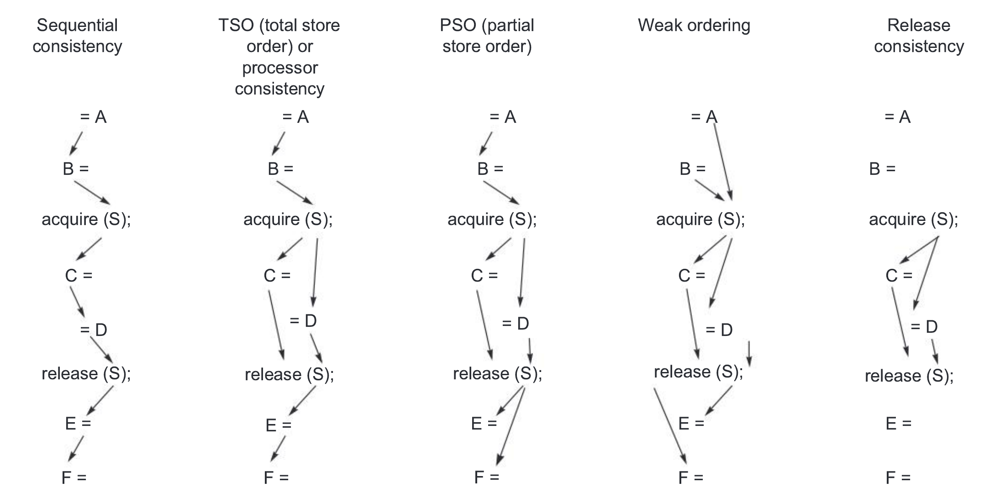

## 同步：基础 {#sec-5-5}

同步机制通常由用户级的软件例程实现，这些例程又依赖硬件提供的同步指令。在规模较小的多处理器上，或者竞争不激烈的情况下，硬件需要提供的关键能力是一条不可中断的指令或指令序列，它能够原子地取出一个值并修改它。软件同步机制就建立在这一能力之上。本节主要讨论加锁（lock）和解锁（unlock）这两种同步操作的实现。用加锁和解锁可以直接实现互斥，也可以实现更复杂的同步机制。

竞争激烈时，同步可能成为性能瓶颈：一是竞争本身会带来额外的延迟，二是多处理器规模越大，延迟可能越长。怎样把本节的基本同步机制扩展到处理器数目很多的系统，在附录 I 中讨论。

### 基本硬件原语 {-}

在多处理器上实现同步，最关键的是要有一组能够*原子地读取并修改*存储单元的硬件原语。没有这种能力，构造基本同步原语的代价就会过高，而且处理器越多，代价越高。

基本硬件原语有几种不同的形式。它们都能原子地读取并修改一个存储单元，同时还有办法判断这次读和写是不是原子地完成的。用这些硬件原语可以构造出各种用户级同步操作，如锁和栅障（barrier）。一般来说，体系结构设计者并不指望普通用户直接使用这些硬件原语，而是希望由系统程序员用它们构造同步库，这项工作往往既复杂又容易出错。下面先介绍一种硬件原语，再说明怎样用它构造一些基本的同步操作。

**原子交换。** 构造同步操作的一种典型操作是*原子交换*（atomic exchange），即把寄存器中的值与存储器中的值互换。下面用它来构造一个简单的锁：锁变量为 0 表示锁空闲，为 1 表示锁已被占用。处理器要加锁时，把寄存器中的 1 与锁对应的存储单元做交换。如果交换指令返回 1，说明已经有别的处理器取得了锁；如果返回 0，说明锁原本空闲，而这时锁变量也已经变成 1，其他与之竞争的交换操作就不可能再取回 0。

例如，两个处理器同时执行交换操作。这场竞争总会有结果：两个处理器中恰好有一个先完成交换，得到 0；另一个后完成交换，得到 1。用交换（swap）原语实现同步，关键在于这个操作是原子的：交换不可分割，两个同时发生的交换会由写串行化机制排出先后。因此，两个处理器用这种方式设置同步变量时，不可能都认为是自己设置成功的。

**其他原子原语。** 能用来实现同步的原子原语还有几种。它们的共同点是：读取并更新一个存储单元时，我们能够判断这两个操作是否是原子地执行的。

* *测试并置位*（test-and-set）：许多早期的多处理器都提供这种操作。它测试一个值，如果测试通过就设置这个值。例如，可以定义一个操作，测试值是否为 0，若是则把它置为 1，用法和原子交换类似。
* *取并加一*（fetch-and-increment）：返回一个存储单元的值，并原子地把它加 1。如果用 0 表示同步变量未被占用，就可以像使用交换操作那样使用取并加一。取并加一这类操作还有别的用途，后面很快就会看到。

**load 保留与 store 条件。** 实现单个原子访存操作有一定难度，因为它要求在一条不可中断的指令中完成一次读和一次写。这使 Cache 一致性的实现变得复杂：硬件在读和写之间不能插入任何其他操作，同时又不能出现死锁。

另一种办法是用一对指令来实现：由第二条指令返回一个值，根据这个值可以判断这对指令是否像原子操作一样执行。所谓一对指令*在效果上是原子的*，是指看起来所有处理器执行的其他操作要么都发生在这对指令之前，要么都发生在之后。这样，只要一对指令在效果上是原子的，在这两条指令之间就没有别的处理器能改变那个值。MIPS 处理器和 RISC-V 都采用这种办法。

RISC-V 的这对指令是一条特殊的 load 和一条特殊的 store：

* *load 保留*（load reserved，也称 load linked 或 load locked）：把 rs1 所给地址处的存储单元内容装入 rd，同时在这个地址上建立一个*保留*；
* *store 条件*（store conditional）：把 rs2 中的值存入 rs1 所给的地址。如果这次 load 建立的保留因为有写操作写了同一存储单元而被破坏，store 条件就失败，并向 rd 写入一个非零值；如果成功，就写入 0。如果处理器在两条指令之间做了上下文切换，store 条件一定失败。

这两条指令要配合使用。load 保留返回存储单元原来的值，store 条件只有成功时才返回 0，因此下面的指令序列就能把 x1 所指存储单元的内容与 x4 中的值做原子交换：

```
try: mov x3,x4       ;取交换值
     lr  x2,0(x1)    ;从 x1 所指单元 load 保留
     sc  x3,0(x1),x5 ;存 x3，成功则 x5 = 0
     bnez x5,try     ;store 失败则转移，重试
     mov x4,x2       ;把 load 得到的值放入 x4
```

这段序列执行完后，x4 的内容与 x1 所指存储单元的内容就完成了原子交换。只要有别的处理器在 lr 和 sc 之间插进来修改了这个存储单元，sc 就在 x5 中返回非零值，代码序列重新执行。

load 保留/store 条件机制的一个好处是还能用来构造其他同步原语。例如，原子的取并加一可以这样写：

```
try: lr   x2,0(x1)    ;load 保留 0(x1)
     addi x3,x2,1     ;加 1
     sc   x3,0(x1),x4 ;store 条件
     bnez x4,try      ;store 失败则转移
```

这两条指令的实现方法通常是：用一个寄存器记下 lr 指令给出的地址，这个寄存器常称为*保留寄存器*。如果发生中断，或者与保留寄存器中地址对应的 Cache 块被作废（例如被另一条 sc 作废），就清除保留寄存器。sc 指令只需检查自己的地址与保留寄存器中的地址是否相同，相同就成功，否则失败。

由于对 load 保留地址的任何一次其他 store 尝试，以及任何一次异常，都会使 store 条件失败，所以在这两条指令之间插入什么指令要慎重。只有寄存器—寄存器指令可以安全地放在中间；否则可能造成死锁，使处理器永远无法完成 sc。此外，load 保留和 store 条件之间的指令应当尽量少，以减小因无关事件或竞争的处理器而使 store 条件频繁失败的概率。

### 利用 Cache 一致性实现锁 {-}

有了原子操作，就可以利用多处理器的 Cache 一致性机制来实现*自旋锁*。所谓自旋锁，就是处理器不断尝试获取的锁：处理器在一个循环里反复「自旋」，直到获得锁为止。程序员预计锁只会被占用很短的时间，并且希望锁空闲时加锁的延迟很低，这时就使用自旋锁。自旋锁在等待锁释放期间一直占着处理器空转，所以有些场合并不适用。

**不缓存锁变量的实现。** 如果没有 Cache 一致性，最简单的实现是把锁变量放在存储器中。处理器用原子操作（比如原子交换）不断尝试获取锁，并检查交换返回的值是否表示锁空闲。释放锁时，处理器只需向锁变量存入 0。下面的代码对地址在 x1 中的自旋锁加锁，其中 EXCH 是一个宏，代表前面给出的原子交换指令序列：

```
lockit: addi x2,R0,#1  ;加锁值
        EXCH x2,0(x1)  ;原子交换
        bnez x2,lockit ;已加锁？
```

**缓存锁变量的好处。** 如果多处理器支持 Cache 一致性，就可以把锁放进 Cache，由一致性机制保持锁值的一致。缓存锁变量有两个好处：

* 一是「自旋」（在一个紧凑的循环里反复测试并尝试获取锁）可以在本地 Cache 的副本上进行，不必每次尝试获取锁都访问一次全局存储器；
* 二是锁的访问往往有局部性，即上次使用锁的处理器很快又会再次使用它。这时锁值可能就在这个处理器的 Cache 中，获取锁的时间可以大大缩短。

**只读自旋。** 要得到第一个好处，即在本地 Cache 副本上自旋，而不是每次尝试都产生一次访存请求，就必须修改上面那个简单的自旋过程。在上面的循环中，每次尝试交换都要做一次写操作。如果有多个处理器在争夺锁，每个处理器都会产生写操作；而每个处理器都要以独占状态获得锁变量，所以这些写大多会造成写失效。

因此，自旋过程应当改成：先在锁的本地副本上反复读，直到看到锁空闲，再用交换操作去获取锁。处理器不断地读取并测试，直到读出的值表明锁已打开；然后它和其他同样在「自旋等待」的进程竞争，看谁先锁住锁变量。所有进程都用交换指令读出旧值，同时向锁变量存入 1。唯一的胜者看到的是 0，败者看到的则是胜者刚放进去的 1。（败者也会把锁变量继续置为加锁值，但这无关紧要。）获胜的处理器执行加锁之后的代码，完成后向锁变量存入 0，释放锁，于是新一轮竞争又开始了。实现这种自旋锁的代码如下（0 表示未加锁，1 表示已加锁）：

```
lockit: ld   x2,0(x1)  ;load 锁变量
        bnez x2,lockit ;锁不可用，自旋
        addi x2,R0,#1  ;装入加锁值
        EXCH x2,0(x1)  ;交换
        bnez x2,lockit ;锁不为 0 则转移
```

**自旋锁与一致性操作。** 下面看看这种自旋锁是怎样利用 Cache 一致性机制的。[图 5.21](#fig-5-21) 给出了多个进程用原子交换争夺一个锁变量时，各处理器的操作和总线或目录上的操作。持有锁的处理器向锁变量存入 0 后，其他所有 Cache 中的副本都被作废，这些 Cache 必须取回新值来更新自己的锁副本。其中某个 Cache 先得到未加锁的值（0），并执行交换。等其他处理器的 Cache 失效得到响应时，它们发现锁变量已经被锁住，只好回去继续测试、自旋。

[图 5.21　三个处理器 P0、P1、P2 的 Cache 一致性操作步骤和总线流量。本图假定采用写作废一致性协议。开始时 P0 持有锁（第 1 步），锁的值为 1（即已加锁）；在第 1 步开始之前，锁处于独占状态，由 P0 拥有。P0 退出临界区并释放锁（第 2 步）。P1 和 P2 竞争，看谁在交换时读到未加锁的值（第 3～5 步）。P2 获胜，进入临界区（第 6、7 步）；P1 的尝试失败，于是开始自旋等待（第 7、8 步）。在实际系统中，这些事件所用的时间远不止 8 个时钟周期，因为获得总线和响应失效所需的时间要长得多。到第 8 步之后，这一过程可以由 P2 重复：P2 最终获得独占访问权，并把锁置为 0。]{#fig-5-21 .caption}

| 步骤 | P0 | P1 | P2 | 本步结束时锁的一致性状态 | 总线/目录活动 |
|---|---|---|---|---|---|
| 1 | 持有锁 | 开始自旋，测试 lock = 0 是否成立 | 开始自旋，测试 lock = 0 是否成立 | 共享 | P1 和 P2 的 Cache 失效先后得到响应，顺序任意。锁的状态变为共享 |
| 2 | 将锁置为 0 | （收到作废） | （收到作废） | 独占（P0） | P0 对锁变量发出写作废 |
| 3 | | Cache 失效 | Cache 失效 | 共享 | 总线/目录响应 P2 的 Cache 失效；P0 写回；状态变为共享 |
| 4 | | （总线/目录忙，等待） | 测试 lock = 0 成功 | 共享 | P2 的 Cache 失效得到响应 |
| 5 | | lock = 0 | 执行交换，产生 Cache 失效 | 共享 | P1 的 Cache 失效得到响应 |
| 6 | | 执行交换，产生 Cache 失效 | 完成交换：返回 0，并置 lock = 1 | 独占（P2） | 总线/目录响应 P2 的 Cache 失效；产生作废；锁变为独占 |
| 7 | | 交换完成，返回 1，并置 lock = 1 | 进入临界区 | 独占（P1） | 总线/目录响应 P1 的 Cache 失效；发出作废，并使 P2 写回 |
| 8 | | 自旋，测试 lock = 0 是否成立 | | | 无 |

**用 lr/sc 实现自旋锁。** 这个例子还显示出 load 保留/store 条件原语的另一个好处：读操作和写操作是明确分开的，load 保留不必产生任何总线流量。于是可以写出下面这段简单的代码，它与前面用交换实现的优化版本具有同样的特性（x1 中是锁的地址，lr 代替了 LD，sc 代替了 EXCH）：

```
lockit: lr   x2,0(x1)    ;load 保留
        bnez x2,lockit   ;锁不可用，自旋
        addi x2,R0,#1    ;加锁值
        sc   x2,0(x1),x3 ;store
        bnez x3,lockit   ;store 失败则转移
```

第一条转移指令构成自旋循环；第二条转移指令用来解决两个处理器同时看到锁空闲时的竞争。

## 存储一致性模型简介 {#sec-5-6}

Cache 一致性保证多个处理器看到的存储器视图是一致的，但它没有回答存储器视图*在多大程度上*必须一致。所谓「多大程度上一致」，实际上是问：一个处理器必须在什么时候看到另一个处理器更新过的值。处理器之间通过共享变量通信（共享变量既用于传递数据，也用于同步），所以问题归结为：一个处理器必须按什么顺序观察到另一个处理器对数据的写？而「观察另一个处理器的写」只能通过读来实现，于是问题又变成：不同处理器对不同存储单元的读和写之间，必须满足哪些性质？

这个问题看似简单，实际上非常复杂。来看一个简单的例子，下面是进程 P1 和 P2 中的两段代码，左右并排列出：

```
P1:  A = 0;              P2:  B = 0;
     .....                    .....
     A = 1;                   B = 1;
L1:  if (B == 0)...      L2:  if (A == 0)...
```

假定这两个进程在不同的处理器上运行，存储单元 A 和 B 原来都缓存在两个处理器的 Cache 中，初值都是 0。如果写操作总是立即生效，并且*立即*被其他处理器看到，那么两个 IF 语句（标号为 L1 和 L2）的条件就不可能*都*为真，因为执行到 IF 语句时，A 或 B 至少有一个已经被赋值为 1。但是，假如写作废被推迟了，而处理器在推迟期间可以继续执行，那么 P1 和 P2 就有可能在读取 B 和 A *之前*，分别都还没有看到对 B 和 A 的作废。问题在于：这种行为应不应该允许？如果允许，在什么条件下允许？

**顺序一致性。** 最直观的存储一致性模型称为*顺序一致性*（sequential consistency）。顺序一致性要求：任何一次执行的结果，都与这样一种执行的结果相同——每个处理器的访存操作保持各自的程序顺序，不同处理器的访存操作之间任意交错。在上面的例子中，顺序一致性要求赋值语句必须在 IF 语句开始之前完成，从而排除了那种不直观的执行结果。

实现顺序一致性最简单的办法是：处理器的每一次访存，都要等到这次访存引起的所有作废都完成以后才算完成。也可以等前一次访存完成之后再开始下一次访存，效果完全相同。要记住，存储一致性涉及的是不同变量之间的操作：必须保持先后顺序的两次访问，针对的是不同的存储单元。在上面的例子中，必须等前面的写（B = 1 或 A = 1）完成后，才能读 A 或读 B（A == 0 或 B == 0）。例如，在顺序一致性下，不能简单地把写放进写缓冲，然后继续往下执行读。

顺序一致性给出了一种简单的编程范式，但降低了可能达到的性能，在处理器很多或互连延迟很长的多处理器上尤其如此。请看下面的例题。

**例题**　假设某处理器上，一次写失效需要 60 个周期来取得所有权；取得所有权后，需要 40 个周期来发出作废；每个作废发出后，需要 80 个周期才能完成并得到确认。如果另外有 4 个处理器共享同一个 Cache 块，在处理器满足顺序一致性的情况下，一次写失效会使执行写操作的处理器停顿多长时间？假定作废必须得到显式确认，一致性控制器才知道作废已经完成。如果写失效取得所有权之后就可以继续执行，不必等待作废，这次写需要多长时间？

**解答**　如果要等待作废完成，每次写所需的时间就是取得所有权的时间加上完成作废的时间，所以这次写总共需要 60 + 40 + 80 = 180 个周期。相比之下，取得所有权只需要 60 个周期。如果写缓冲实现得当，甚至可以在取得所有权之前就继续执行。

为了提高性能，研究人员和体系结构设计者探索了两条不同的途径：

* 一是开发更激进的实现，保持顺序一致性，但用隐藏延迟的技术来减小损失，[5.7 节](#sec-5-7)将讨论这些技术；
* 二是开发限制较少的存储一致性模型，使硬件可以做得更快。

这类模型会影响程序员眼中的多处理器，所以在讨论这些限制较少的模型之前，先看看程序员期望的是什么。

### 程序员的视角 {-}

顺序一致性模型在性能上有缺点，但从程序员的角度看，它的优点是简单。难点在于找到这样一种编程模型：既容易讲清楚，又允许高性能的实现。

**同步程序。** 有一种编程模型可以带来更高效的实现，那就是假定程序是*同步的*。如果对共享数据的所有访问都由同步操作排定了顺序，这个程序就是同步的。一次数据访问由同步操作排定顺序，是指在每一种可能的执行中，一个处理器对某个变量的写，与另一个处理器对该变量的访问（读或写）之间，都隔着一对同步操作：一个由写的处理器在写之后执行，另一个由第二个处理器在访问之前执行。变量在没有同步操作排定顺序的情况下被更新，这种情况称为*数据竞争*（data race），因为执行结果取决于各处理器的相对速度；与硬件设计中的竞争一样，结果是不可预测的。由此，同步程序又称为*无数据竞争*（data-race-free）程序。

举一个简单的例子：两个处理器读取并更新同一个变量。每个处理器在读取和更新的前后分别加锁和解锁，一方面保证更新的互斥，另一方面保证读到的值是一致的。这样，每次写与另一个处理器的读之间，都隔着一对同步操作：一个解锁（在写之后）和一个加锁（在读之前）。当然，如果两个处理器先后写同一个变量，中间没有读，那么这两次写之间也必须用同步操作隔开。

人们普遍认为，大多数程序是同步的。主要原因是：如果访问不加同步，程序的行为很可能不可预测，因为哪个处理器赢得数据竞争取决于执行速度，从而会影响程序的结果。即使在顺序一致性下，要推断这种程序的行为也非常困难。

程序员也可以自己构造同步机制来保证访问顺序，但这样做极易出错，写出的程序可能有缺陷，而且体系结构不一定支持，也就是说在以后各代多处理器上可能无法正确运行。因此，几乎所有程序员都会选择使用同步库，这些库是正确的，并且针对具体的多处理器和同步原语类型做了优化。

最后，使用标准的同步原语还能保证：即使体系结构实现的是比顺序一致性更宽松的一致性模型，同步程序的行为也与在顺序一致的硬件上完全一样。

### 宽松一致性模型：基础与释放一致性 {-}

宽松一致性模型的基本思想是：允许读和写乱序完成，但用同步操作来强制顺序，使同步程序的行为与在顺序一致的处理器上一样。宽松模型有多种，按照放松了哪些读写顺序来分类。我们用一组形如 X → Y 的规则来表示顺序，意思是操作 X 必须在操作 Y 执行之前完成。顺序一致性要求保持全部四种可能的顺序：

$$
R \rightarrow W,\quad R \rightarrow R,\quad W \rightarrow R,\quad W \rightarrow W
$$

各种宽松模型由它们放松了这四种顺序中的哪几种来定义：

* 只放松 W → R 顺序，得到的模型称为*全存储定序*（total store ordering）或*处理器一致性*（processor consistency）。这种模型保持了写与写之间的顺序，因此许多在顺序一致性下能正确运行的程序，不必增加同步，在这种模型下也能正确运行。
* 同时放松 W → R 和 W → W 顺序，得到的模型称为*部分存储定序*（partial store order）。
* 四种顺序全部放松，得到的模型有多种，包括*弱定序*（weak ordering）、PowerPC 的一致性模型，以及 RISC-V 采用的*释放一致性*（release consistency）。

放松这些顺序，处理器可能获得明显的性能好处。正因为如此，RISC-V、ARMv8 以及 C++ 和 C 语言标准都选择了释放一致性模型。

**释放一致性。** *释放一致性*把同步操作分成两类：一类用来*获取*（acquire）对共享变量的访问权，记作 S~A~；另一类用来*释放*（release）一个对象，让其他处理器能够获取访问权，记作 S~R~。释放一致性基于这样一个事实：在同步程序中，获取操作必须在使用共享数据之前进行，释放操作必须在对共享数据的所有更新之后、下一次获取之前进行。利用这一性质，顺序可以再放松一些：获取之前的读或写不必在获取之前完成，释放之后的读或写也不必等待释放。这样，需要保持的顺序只涉及 S~A~ 和 S~R~，如[图 5.22](#fig-5-22) 所示。[图 5.23](#fig-5-23) 的例子表明，在这五种模型中，释放一致性施加的顺序最少。

[图 5.22　各种一致性模型对普通访问和同步访问施加的顺序。这些模型从限制最多的（顺序一致性）到限制最少的（释放一致性）依次排列，实现的灵活性逐步增大。较弱的模型依靠同步操作形成的栅栏（fence），而不是在每个访存操作处隐含一道栅栏。S~A~ 和 S~R~ 分别表示获取操作和释放操作，定义释放一致性时需要用到。如果对每个 S 都一律改用 S~A~ 和 S~R~ 表示，那么每个含一个 S 的顺序都会变成两个顺序（例如 S → W 变成 S~A~ → W 和 S~R~ → W），每个 S → S 都会变成表中右下角一格最后一行所示的四个顺序。]{#fig-5-22 .caption}

| 模型 | 使用者 | 普通访问的顺序 | 同步访问的顺序 |
|---|---|---|---|
| 顺序一致性 | 大多数机器的一种可选模式 | R → R，R → W，W → R，W → W | S → W，S → R，R → S，W → S，S → S |
| 全存储定序或处理器一致性 | IBM S/370、DEC VAX、SPARC | R → R，R → W，W → W | S → W，S → R，R → S，W → S，S → S |
| 部分存储定序 | SPARC | R → R，R → W | S → W，S → R，R → S，W → S，S → S |
| 弱定序 | PowerPC | | S → W，S → R，R → S，W → S，S → S |
| 释放一致性 | MIPS、RISC-V、Armv8、C 和 C++ 规范 | | S~A~ → W，S~A~ → R，R → S~R~，W → S~R~，<br>S~A~ → S~A~，S~A~ → S~R~，S~R~ → S~A~，S~R~ → S~R~ |

{#fig-5-23 width=90%}

释放一致性是限制最少的模型之一，它容易检查，又能保证同步程序看到的执行是顺序一致的。大多数同步操作要么是获取，要么是释放：获取通常读取一个同步变量并原子地更新它，释放通常只是写这个同步变量。但也有一些操作，如栅障，既是获取又是释放，这时的顺序就等同于弱定序。

同步操作总能保证此前的写都已完成。但有时我们希望在没有明确的同步操作时也能保证写已经完成。这时要用一条显式的指令，RISC-V 中称为 FENCE，来保证该线程中此前的所有指令都已完成，包括所有对存储器的写及其引起的作废都已完成。前面讲过，在没有广播介质的较大规模多处理器上，必须跟踪作废操作，才能知道它们什么时候完成。关于宽松模型的复杂性、实现问题和可能带来的性能好处，我们推荐阅读 Adve 和 Gharachorloo（1996）的出色教程。
