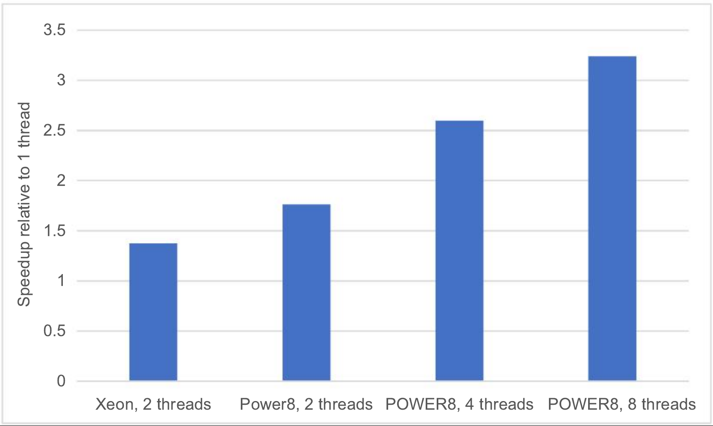
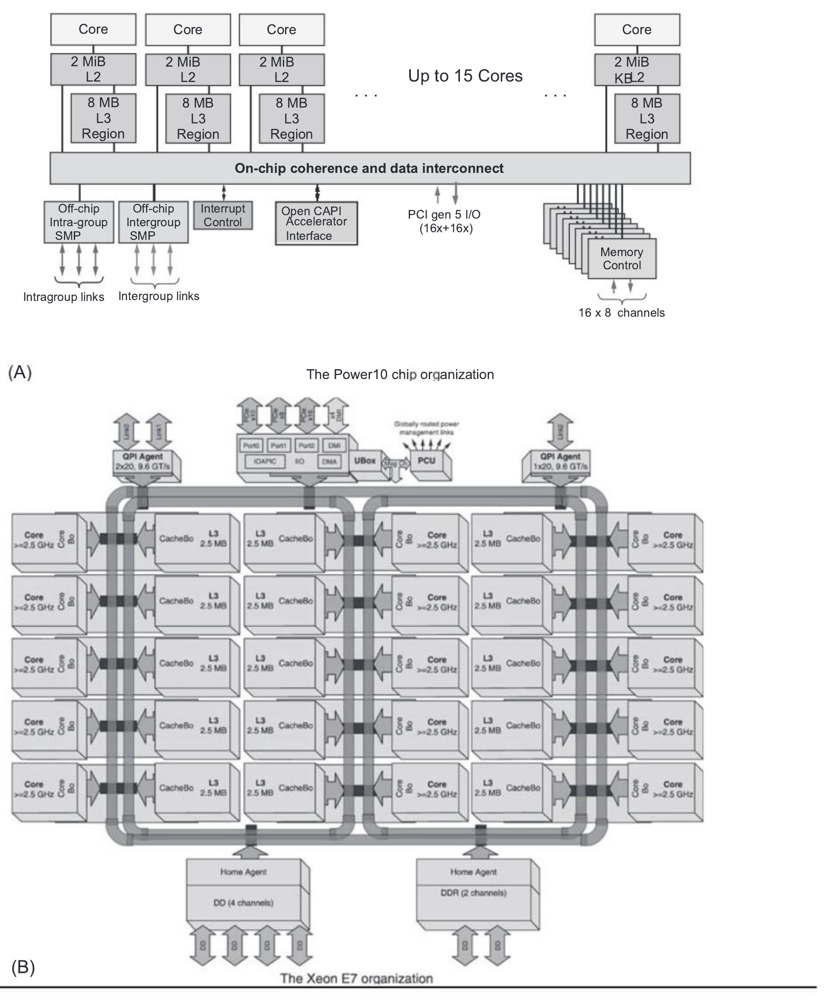

## 交叉问题 {#sec-5-7}

多处理器改变了系统的许多特性，例如性能怎样评估、存储延迟有多大、可扩展性有多重要。因此，多处理器带来了一些贯穿整个设计范围、同时牵涉硬件和软件的设计问题。本节先举几个与存储一致性有关的例子，然后考察在多处理器上再加入多线程能带来多少性能提升。

### 编译器优化与一致性模型 {-}

定义存储一致性模型还有一个原因：规定编译器对共享数据可以合法地做哪些优化。在显式并行的程序中，除非同步点有明确的定义，并且程序是同步的，否则编译器不能交换对两个不同共享数据项的读和写，因为这种变换可能改变程序的语义。这一限制使一些相对简单的优化也无法进行，例如为共享数据分配寄存器，因为寄存器分配通常要交换读和写的顺序。隐式并行的程序（例如用 High Performance Fortran（HPF）编写的程序）不存在这个问题，因为这类程序必须是同步的，同步点也是已知的。

编译技术在优化共享变量的访存上能取得多大成功，目前还没有定论。这类优化至今用得不多，原因有两个：一是优化技术本身的水平有限，二是共享数据常常通过指针或数组下标来访问。如果这种技术成熟起来，并且能带来明显的性能好处，编译器开发者就会希望利用更宽松的编程模型。考虑到这种可能，也为了给将来留出尽可能大的灵活性，RISC-V 的设计者经过长时间的反复讨论，最终选择了释放一致性。

### 在严格一致性模型中用推测执行隐藏延迟 {-}

第 3 章讲过，推测执行可以隐藏访存延迟。它同样可以隐藏严格一致性模型带来的延迟，从而获得宽松存储模型的大部分好处。基本思路是：处理器用动态调度对访存重新排序，让访存有可能乱序执行。访存乱序执行可能违反顺序一致性，进而影响程序的执行结果；推测执行处理器的延迟提交机制可以避免这种情况。假定一致性协议基于作废。如果某次访存还没有提交，处理器就收到了针对它的作废，处理器就用推测恢复机制撤销已经做的计算，从地址被作废的那次访存开始重新执行。当然，处理器还必须保证，这种做法不会为借助推测执行实施旁路攻击创造新的机会（见第 3 章）。

也就是说，处理器对访存重新排序以后，如果得到的执行顺序可能产生与顺序一致性下不同的结果，处理器就重新执行。这种方法的关键在于：处理器只需保证结果与所有访问都按顺序完成时相同，而要做到这一点，只需检测结果什么时候可能不同。这种方法很有吸引力，因为推测重启很少触发，只有未同步的访问真正引起竞争时才会触发（Gharachorloo 等，1992）。

Hill（1998）主张把顺序一致性或处理器一致性与推测执行结合起来，作为首选的一致性模型。他的论据有三条：

* 一是顺序一致性或处理器一致性只要实现得足够激进，就能获得更宽松模型的大部分好处；
* 二是在推测执行处理器上，这样的实现几乎不增加实现成本；
* 三是程序员可以按较简单的顺序一致性或处理器一致性编程模型来推理程序。

MIPS R10000 的设计团队在 20 世纪 90 年代中期就认识到了这一点，并利用 R10000 的乱序执行能力，支持这种激进的顺序一致性实现。

### 包含性及其实现 {-}

所有多处理器都采用多级 Cache 层次，目的是既减少对全局互连的需求，又降低 Cache 失效的延迟。监听操作和处理器的 Cache 访问要争用同一个 Cache，于是一致性流量与处理器流量之间会产生竞争。如果 Cache 还具有*多级包含性*，即 Cache 层次的每一级都是离处理器更远一级的子集，就可以利用多级结构来减少这种竞争。许多采用多级 Cache 的多处理器都保证包含性，不过近来也有几种多处理器选择不保证包含性。

乍看起来，保持多级包含性似乎很简单。以两级 Cache 为例：L1 的任何一次失效，要么在 L2 中命中，要么在 L2 中也失效，后一种情况下该块会同时调入 L1 和 L2。同样，在 L2 中命中的任何作废都必须发给 L1，L1 中如果有这个块，就把它作废。

问题出在 L1 和 L2 的块大小不同的时候。块大小不同是很合理的选择：L2 容量大得多，失效开销中的延迟部分也长得多，因此 L2 要用更大的块。那么，块大小不同时，上面这种「自动」保持的包含性会怎样呢？L2 的一个块对应 L1 的多个块，L2 的一次失效所替换的数据相当于 L1 的多个块。例如，L2 的块大小是 L1 的 4 倍时，L2 的一次失效会替换相当于 L1 中 4 个块的数据。下面看一个具体的例子。

**例题**　假设 L2 的块大小是 L1 的 4 倍。说明对某个地址的一次失效如果在 L1 和 L2 中都引起替换，怎样会破坏包含性。

**解答**　假设 L1 和 L2 都是直接映射，L1 的块大小为 $b$ 字节，L2 的块大小为 $4b$ 字节。设 L1 中有两个块，起始地址分别为 $x$ 和 $x+b$，并且 $x \bmod 4b = 0$，即 $x$ 也是 L2 中某个块的起始地址；于是 L2 中的这一个块包含了 L1 的 $x$、$x+b$、$x+2b$ 和 $x+3b$ 四个块。现在处理器访问块 $y$，$y$ 在两个 Cache 中都映射到包含 $x$ 的那个块，因此发生失效。L2 失效后取回 $4b$ 字节，替换包含 $x$、$x+b$、$x+2b$、$x+3b$ 的块；L1 则取回 $b$ 字节，只替换包含 $x$ 的块。这时 L1 中还有 $x+b$，L2 中却已经没有了，包含性不再成立。

由此可见，块大小不同时，要保持包含性，就必须在较低一级发生替换时探查层次中较高的各级，确保较低一级替换掉的字在较高一级的 Cache 中都被作废。各级相联度不同，也会带来同类问题。Baer 和 Wang（1988）详细论述了包含性的好处和难点。2017 年，大多数设计者选择了实现包含性，常用的办法是各级 Cache 统一采用一种块大小。近来的 Intel 处理器（包括 i9 和高端 Xeon）以及 AMD EPYC 对 L1 和 L2 保证包含性，对 L3 则不保证。这样，L2 和 L3 可以存放不同的数据，L3 的效用随之提高。这一点很重要，因为按每个核计算，L3 只比 L2 稍大一点。

### 多线程为多处理器带来的性能提升 {-}

本节简要介绍一项研究，它考察了在两种多核处理器上使用多线程的效果：一种是 Intel Xeon E7 8800，另一种是 Power8 系统。所用的基准测试程序是 [5.4 节](#sec-5-4)末尾讨论过的网页搜索，它的并行度很高。SMT 能带来多少好处，取决于处理器数、支持的线程数和 ILP 流水线。两种处理器与此最相关的特性如下：

| 特性 | Intel Xeon E7 | IBM Power8 |
|---|--:|--:|
| 核数 | 18 | 12 |
| 每核 SMT 线程数 | 2 | 8 |
| 每时钟周期发射数 | 4 | 8 |
| 功能部件数 | 8 | 16 |

前面讲过，网页搜索应用的请求级并行很多，进程间通信很少，所以在 Xeon E7 上从 8 个核扩展到 72 个核，加速比是线性的。[图 5.24](#fig-5-24) 给出了线程数增加后相对于单线程版本的加速比。Power8 支持 8 个线程，总体收益更大，不过这一收益可能与它更高的发射率和更多的功能部件密切相关。

{#fig-5-24 width=80%}

## 融会贯通：多核处理器及其性能 {#sec-5-8}

大约 15 年来，多核一直是提高性能的主要途径。不过，各种多核的实现方式差别很大，对更大规模的多芯片多处理器的支持也各不相同。本节考察三种多核的设计、它们对更大规模多处理器的支持，以及其中一些系统在性能和能效两方面的可扩展性。

### 三种多核服务器处理器 {-}

[图 5.25](#fig-5-25) 列出了三种面向服务器应用的多核处理器的主要特性，2019 年至 2022 年间都有采用这些处理器的系统产品。

* Intel Xeon Platinum 的核与 Skylake 微结构类似，但时钟频率比桌面处理器略低（受功耗限制），L3 Cache 更大，核数也多得多。
* Power10 是 IBM Power 系列的最新产品，核数更多，Cache 更大。
* 本例中的 AMD EPYC Milan 系列每个芯粒有 8 个核，每个插座有 4 个芯粒。

这些处理器都面向多核、多处理器服务器，因此都以产品系列的形式提供，处理器数、Cache 容量等参数各不相同，如图中所示。

[图 5.25　三种近期面向服务器的高端多核处理器（2020～2023 年发布）的特性汇总。表中给出了每个处理器系列中处理器数、时钟频率和 Cache 容量的范围。这些处理器既具有 NUCA（非一致 Cache 访问）结构，也具有 NUMA 结构。L3 访问时间分别给出了本地片和远程片的数值；存储器访问时间分别给出了访问本地存储器和远程存储器的时间。所有访问时间都是平均值。最后一行给出了有已发表性能数据（如 SPECintRate）的系统配置范围，包括处理器芯片数和总核数。注意，Intel Xeon 虽有 56 核的型号，但采用最新微结构的处理器最多只有 40 个核。这些系统大多以芯粒形式提供，其中 IBM 和 Intel 的设计还支持由多个芯粒构成的更大规模多处理器。]{#fig-5-25 .caption}

| 特性 | IBM Power10 | Intel Xeon Platinum | AMD EPYC |
|---|---|---|---|
| 每芯片 / 每 MCM 核数 | 每芯片 4～15 个；每插座 8～30 个 | 每芯片 4～60 个；每插座 8～120 个 | 每芯片 8 个；每插座 64 个 |
| 多线程 | SMT | SMT | SMT |
| 每核线程数 | 8 | 2 | 2 |
| 时钟频率 | 4.15 GHz | 2.2～3.6 GHz | 3.5 GHz |
| L1 指令 Cache | 每核 96 KiB | 每核 32 KiB | 每核 32 KiB |
| L1 数据 Cache | 每核 64 KiB | 每核 32 KiB | 每核 32 KiB |
| L2 Cache | 每核 2 MiB | 每核 1 MiB | 每核 512 KiB |
| L3 Cache | 每核 8 MiB；共享，访问时间不一致 | 22～77 MiB，每核 1.375 MiB；共享，核数越多容量越大 | 每核 4 MiB，采用堆叠存储器时可达每核 12 MiB；共享 |
| 包含性 | L2 包含 | L2 包含 | L3 对共享块包含 |
| 多核一致性协议 | 扩展的 MESI，带行为提示和局部性提示（13 个状态） | MESIF：MESI 的扩展形式，允许直接传送干净块 | MDOEFSI：MOESI 的扩展形式，增加了脏状态和转发状态 |
| 多芯片一致性的实现 | 混合策略，以监听为主，辅以有限的目录 | 混合策略，监听加 L3 处的目录 | 混合策略，监听加 L3 处的目录（目录是 L2 tag的副本） |
| 多处理器互连支持 | 最多可连接 16 个处理器芯片，经 1 跳或 2 跳可到达任一处理器 | 通过 UPI 最多直接连接 8 个处理器芯片 | Infinity Fabric 每插座连接 4 个芯粒，最多 2 个插座 |
| 处理器芯片数范围 | 1～16 | 2～8 | 1～2 |
| 核数范围 | 4～240 | 8～480 | 8～128 |

这三种系统采用了各不相同的技术，既有连接片上各核的，也有连接多个处理器芯片或芯粒的。

[图 5.26](#fig-5-26) 是 Power10 和 Xeon Platinum 芯片的组成。Power10 的每个核直接连接一个 8 MiB 的 L3 存储体；其他存储体要经互连网络访问，这个互连网络有 8 条独立的总线。

[图 5.26](#fig-5-26) 的 (B) 部分是核数较多时 Xeon Platinum 处理器芯片的组成（图中画的是 24 个核）。两组环把一组核连接起来，每个核带有自己的那一段 L3，以及负责一部分地址空间的一致性逻辑。任何一个核经过一个或两个环，就能访问任一 Cache 存储体或任一其他核。Xeon Platinum 提供 3 条 UPI 互连链路，用来连接多个 Xeon。

单芯片版的 AMD EPYC Milan 最简单，因为每个芯粒只有 8 个核。8 个核和一个由 8 个存储体组成的 L3 通过一条 32 字节宽的双向环连接。同一插座中其他芯粒的连接由 Infinity Path 提供，它把一个插座中的 8 个多核芯片全连接起来。三种多核都属于 NUCA，因为访问 L3 的时间取决于访问的是哪个存储体。

{#fig-5-26 width=90%}

由这些多核芯片构成的多处理器采用了多种不同的互连策略，如[图 5.27](#fig-5-27) 所示。

* Power10 的设计支持连接 16 个 Power10 芯片，共 240 个核。组内连接把 4 个处理器芯片构成一个全连接的模块；组间链路则把每个处理器芯片与其他每个模块中的 3 个芯片相连。
* 多个 Xeon 芯片之间用 UPI 互连。在 8 插座的多处理器中（采用最新发布的 Xeon，可以有 448 个核），每个处理器的 3 条 UPI 链路分别连到 3 个相邻的处理器。[图 5.27](#fig-5-27) 给出了 8 个 Xeon 处理器的连接方式；与 Power10 一样，任意两个处理器之间都只相隔一跳或两跳。有几家公司制造了基于 Xeon 的多处理器，它们接入 UPI 网络，并扩展了网络和一致性机制，以支持更多的处理器。
* EPYC 的设计用 Infinity Path 连接一个插座中的 8 个芯粒。从[图 5.27](#fig-5-27) 可以看到，同一插座中的各芯粒是全连接的。两个插座之间可以用空闲的 Infinity Path 连接，形成任意两个芯粒之间都只相隔一跳或两跳的拓扑。

{#fig-5-27 width=80%}

### 多核多处理器在多道程序负载上的性能 {-}

首先用 SPECintRate 比较三种多核处理器的性能可扩展性，一直比到提交给 SPEC 的最大单系统配置（128～220 个核）。[图 5.28](#fig-5-28) 以 15 核或 16 核的最小配置为基准，假定最小配置的加速比是理想的 15 或 16，给出性能随核数扩展的情况。这张图*不*比较不同处理器之间的性能。比如，16 核 AMD EPYC 的性能是 Intel Xeon 的 1.14 倍，这一点图中就看不出来。[图 5.28](#fig-5-28) 只反映每个处理器系列在增加核数时性能如何扩展。

AMD 和 Intel 系统的加速比都随核数增加而下降。例如，240 核的 Xeon 系统相对于 16 核系统的加速比是 157.8，而不是 240。与 8 核的结果相比（8 核相对于单核当然不太可能达到理想加速比），这相当于约 70% 的效率。AMD EPYC 系统在核数少时更快，但到 64 核时遇到了性能上的限制，原因既可能是系统方面的问题，也可能是体系结构上的局限。在 128 核时，EPYC 系统相对于 16 核版本的效率约为 66%。按这种相对于最小配置的加速比来衡量，IBM Power10 的可扩展性最好，220 核时效率达到 97%。SPECintRate 受 Cache 一致性问题的影响不大，因此起重要作用的可能是存储器带宽和互连带宽。

{#fig-5-28 width=90%}

### Xeon Platinum 在两种不同负载上的可扩展性 {-}

本节简要考察 Xeon Platinum 多处理器在两种负载上的可扩展性：一种是科学计算的并行处理负载，另一种是基于 Java 服务器的服务器负载，后者既测量性能，也测量功耗。

**SPEComp2012。** SPEComp2012 由 14 个科学和工程程序组成。这些程序按共享存储并行处理的 OpenMP 标准编写，所用语言为 Fortran、C 和 C++，内容从流体力学到分子建模，再到图像处理。与 SPECintRate 不同，这些程序的进程经常通过共享地址空间通信。和前面一样，[图 5.29](#fig-5-29) 以最小配置（28 核）为基准，假定最小配置为线性加速比，给出性能。在 72 核以内的较小配置上，系统相对于 28 核系统的加速比是线性的；在 92～108 核范围内，效率降到约 90%；到 172～220 核时，效率进一步降到约 50%。

**SPECpower2008。** 最后一项比较用 SPECpower2008 基准测试程序考察 Xeon 系统的性能和能效。SPECpower 模拟一台运行多个 Java 流的服务器，考验的是 Java 虚拟机、垃圾回收和即时（JIT）编译器。负载随系统规模扩展，以模拟实际使用中的服务器。测试报告从 10% 到 100% 各级负载下的性能和功耗。所谓 100% 负载，是系统在保证服务质量的前提下能处理的最大负载，它按计算机的能力确定规模（配置越大，运行的负载越大）。[图 5.30](#fig-5-30) 给出了从 28 核到 224 核，最大负载下吞吐率的增长和能效（性能/平均功耗）。这个基准测试并行度高、负载按规模扩展，Xeon Platinum 从 28 核到 224 核基本上达到了理想加速比。乍看这张图，读者可能会以为 224 核配置的能效急剧下降；请仔细看图，并对照图注。

SPECpower 还测量从空闲到 100% 各级负载下的平均功耗，以此衡量能效。[图 5.31](#fig-5-31) 给出了 224 核 Xeon Platinum 配置的这一指标。可以看到，在 50% 负载下，系统的平均功耗是满载功耗的 60%，相对能效约为 85%。

分析 SPECpower 的结果时要记住，这个基准测试由许多独立的任务组成，任务数又随处理器规模增加。因此，它得到的性能提升要比以下两种情况好得多：一是并行任务之间的交互较多，二是负载不随规模扩展。例如，SPECintRate 虽然也主要由独立任务组成，扩展性却只有理想值的 60%～70%；SPECOMP 扩展到大核数时，效率只有 50% 左右。扩展问题及其对应用和性能的影响，附录 I 有更详细的讨论。
