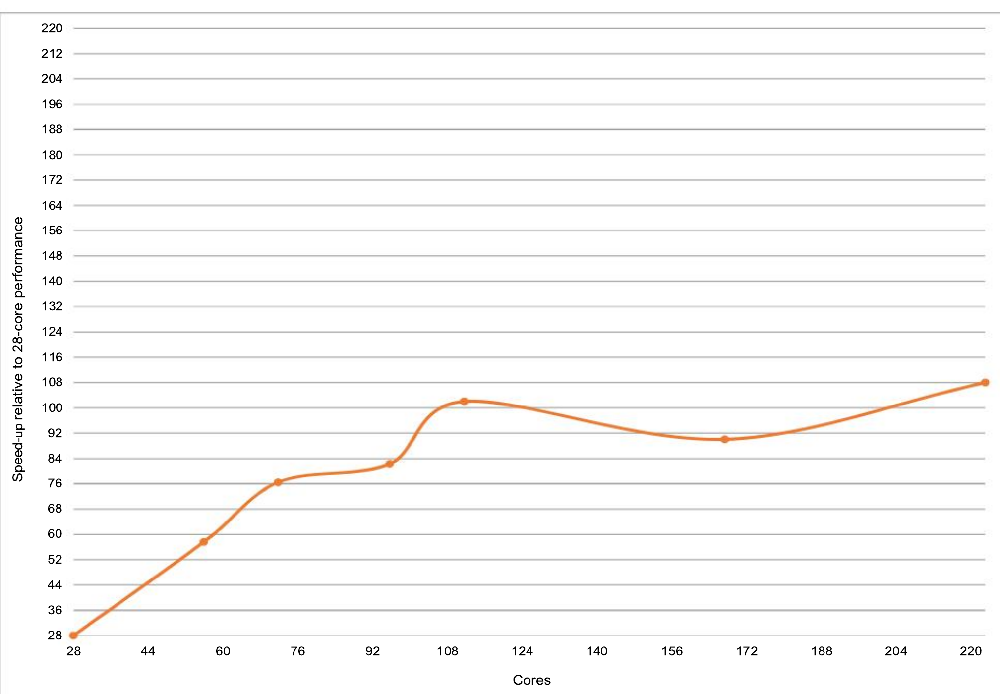
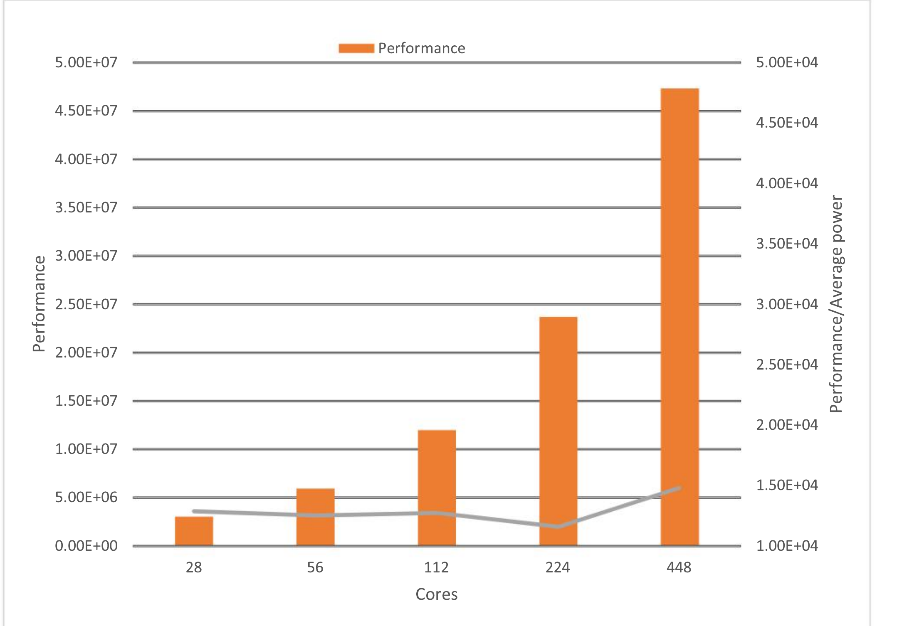
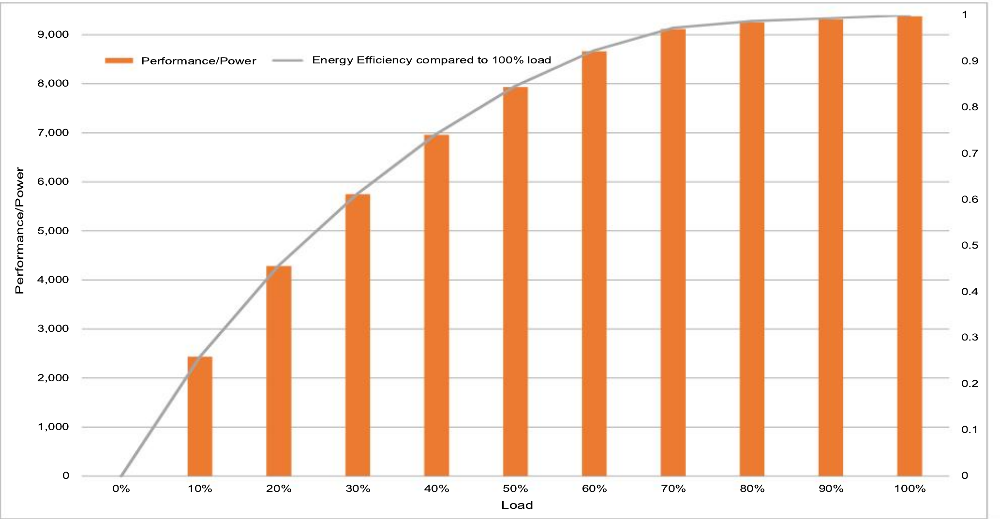
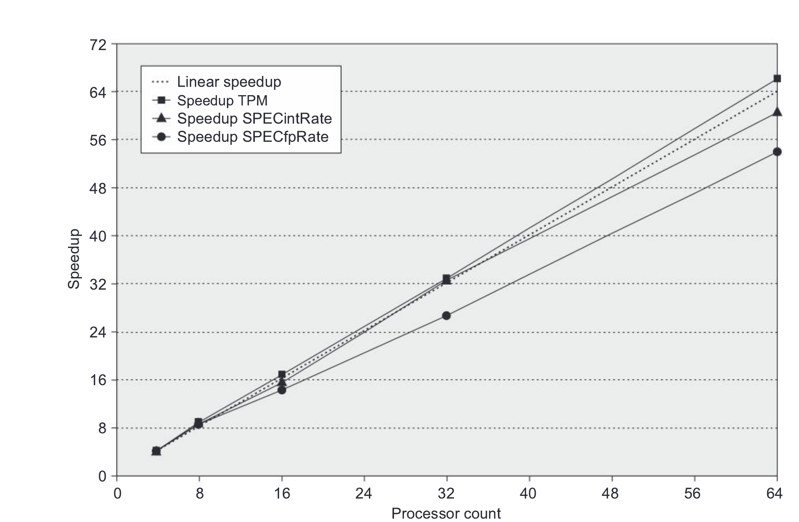

{#fig-5-29 width=90%}

{#fig-5-30 width=90%}

{#fig-5-31 width=90%}

## 谬误与陷阱 {#sec-5-9}

人们对并行计算的认识还很有限，其中埋着许多陷阱，有的会被细心的设计者发现，有的则要等不走运的人踩中才暴露出来。多年来，围绕多处理器的炒作很多，常见的谬误也就随处可见。下面选了其中几条。

**陷阱**　*用线性加速比而不是执行时间来衡量多处理器的性能。*

[图 5.28](#fig-5-28) 和[图 5.29](#fig-5-29) 这类图画出性能随处理器数的变化，曲线先是线性加速，然后进入平台，最后下降。长期以来，人们一直用这样的图来评判并行处理器是否成功。但加速比只是并行程序的一个侧面，并不能直接衡量性能。

**一是被扩展的处理器本身有多强。** 一个程序在 100 个 Intel Atom 处理器（上网本所用的低端处理器）上取得了线性加速，它的速度仍可能不如在 8 核 Xeon 上运行的版本。浮点密集的程序尤其要小心：处理单元如果没有硬件辅助，可扩展性可能非常好，总体性能却很差。同样，像 SPECpower 这样的基准测试含有大量独立的并行性，问题规模又随多处理器规模扩大，很容易取得很高的效率。

**二是比较的算法是否对等。** 只有在每台计算机上都用最好的算法，比较执行时间才公平。在两台计算机上运行完全相同的代码，看似公平，其实不然：并行程序在单处理器上可能比串行版本还慢。而且，编写并行程序有时会带来算法上的改进，于是拿以前已知最好的串行程序与并行代码比较，看似公平，比较的却不是等价的算法。为了反映这一问题，人们有时区分两种加速比：*相对加速比*（同一程序）和*真实加速比*（最好的程序）。

**三是超线性加速比。** 如果结果显示出*超线性*性能，即程序在 $n$ 个处理器上的速度超过等价单处理器的 $n$ 倍，可能说明比较不公平，不过确实也遇到过「真正」的超线性加速比。例如，处理器数小幅增加（从 2 或 4 增加到 8 或 16）时，有些科学应用经常取得超线性加速比。原因往往是：关键数据结构装不进 2 个或 4 个处理器的多处理器的 Cache 总容量，却能装进 8 个或 16 个处理器的多处理器的 Cache 总容量。

总之，通过比较加速比来比较性能，往好里说是难以把握，往坏里说是误导。上一节已经看到，比较两种多处理器的加速比，不一定能说明两者的相对性能。即使在同一台多处理器上比较两种算法也不容易，因为必须用真实加速比而不是相对加速比，比较才有效。

**陷阱**　*Amdahl 定律不适用于并行计算机。*

1987 年，一家研究机构的负责人宣称，一台 MIMD 多处理器打破了 Amdahl 定律（见 [1.9 节](#sec-1-9)）。但这并不意味着这条定律对并行计算机已经失效，程序中被忽略的那部分仍然会限制性能。要弄清媒体报道的依据，先看 Amdahl（1967）的原话：

> 至此可以得出一个相当明显的结论：除非串行处理速率也取得几乎同样量级的提高，否则为获得高并行处理速率所付出的努力都是白费。［第 483 页］

对这条定律有一种解读：每个程序都有一部分必须串行执行，因此能经济有效地利用的处理器数有一个上限，比如 100 个。用 1000 个处理器取得线性加速比，就推翻了这种解读。

所谓 Amdahl 定律被「突破」，依据的是*按比例扩展的加速比*（scaled speedup），也称*弱扩展*（weak scaling）。研究人员把基准测试的数据集扩大到原来的 1000 倍，然后比较扩大后的基准测试在单处理器和并行机上的执行时间。对这个特定算法来说，程序的串行部分是常数，与输入规模无关，其余部分完全可以并行，因此用 1000 个处理器取得了线性加速比。由于运行时间的增长快于线性，即使用了 1000 个处理器，扩大规模后的程序实际运行时间也更长了。

假定输入规模随之扩大的加速比并不等于真实加速比，把它当成真实加速比来报告是误导。并行基准测试常常在规模不同的多处理器上运行，因此必须说明允许哪种应用扩展方式，以及具体怎样扩展。单纯让数据规模随处理器数增大，很少是合适的；但在处理器数多得多时仍假定问题规模不变（称为*强扩展*，strong scaling），往往也不合适，因为用户拿到大得多的多处理器后，很可能会选择运行规模更大或更精细的应用版本。这个重要问题的进一步讨论见附录 I。

**陷阱**　*多处理器必须达到线性加速比才有好的性价比。*

并行计算的一大好处是比最快的单处理器「求解时间更短」，这一点已经得到公认。但也有许多人认为，并行处理器除非达到完全线性的加速比，否则性价比不可能与单处理器相当。他们的理由是：多处理器的成本是处理器数的线性函数，因此加速比只要低于线性，性能/成本比就会下降，并行处理器的性价比就不如单处理器。

这种观点的问题在于，成本不只取决于处理器数，还取决于存储器、I/O 和系统的其他开销（机箱、电源、互连等）。到了多核时代，一个芯片上有多个处理器，这种观点就更站不住了。

Wood 和 Hill（1995）指出了把存储器计入系统成本的影响。我们用 TPC-C 和 SPECrate 基准测试较新的数据举例说明；用并行的科学应用负载也能说明同样的道理，而且说服力可能更强。

[图 5.32](#fig-5-32) 给出了 IBM eServer p5 多处理器配置 4～64 个处理器时，TPC-C、SPECintRate 和 SPECfpRate 的加速比。从图中可以看出，只有 TPC-C 的加速比优于线性。SPECintRate 和 SPECfpRate 的加速比低于线性，但成本也低于线性，因为与 TPC-C 不同，它们所需的主存容量和磁盘容量的增长都低于线性。

{#fig-5-32 width=90%}

如[图 5.33](#fig-5-33) 所示，处理器数较多的配置，性价比可能高于 4 处理器配置。比较两台计算机的性价比时，必须准确评估系统的总成本和能够达到的性能。对于许多存储需求较大的应用，这样比较之后，多处理器的吸引力会大大增加。

{#fig-5-33 width=90%}

**陷阱**　*不为发挥或优化多处理器体系结构的性能而开发软件。*

长期以来，多处理器软件的发展一直落后于单处理器软件，原因可能是问题要难得多。这方面的例子很多，下面只举一个，说明问题有多微妙。

一个常见的问题出现在把为单处理器设计的软件移植到多处理器环境的时候。例如，2000 年的 SGI 操作系统起初假定页分配不频繁，于是只用一把锁保护页表数据结构。在单处理器上，这不构成性能问题；在多处理器上，对某些程序来说却可能成为主要的性能瓶颈。

设想一个程序使用大量页，这些页在启动时初始化，UNIX 对静态分配的页就是这样处理的。假设这个程序经过并行化，由多个进程分配这些页。页分配要使用页表数据结构，而页表在使用期间总是加锁的。因此，如果各进程同时分配自己的页（初始化时恰恰会出现这种情况），即使操作系统内核允许多个线程同时在内核中运行，这些分配也会被串行化。

页表的串行化消除了初始化阶段的并行性，对整体并行性能影响很大。即使在多道程序的情况下，这个性能瓶颈依然存在。例如，把并行程序拆成彼此独立的进程，每个处理器运行一个，进程之间没有任何共享。（有一位用户正是这样做的，因为他有理由认为，性能问题是由应用中意料之外的共享或干扰造成的。）遗憾的是，这把锁仍然把所有进程串行化，连多道程序的性能也很差。

这个陷阱说明，软件在多处理器上运行时，可能出现一类不易察觉却影响很大的性能缺陷。和许多其他关键软件组件一样，操作系统的算法和数据结构也必须放到多处理器的背景下重新考虑。改为对页表的较小部分分别加锁，就能有效地解决这个问题。存储结构中也存在类似的问题，在实际上并没有共享的情况下增加了一致性流量。

从桌面计算机到服务器，多核成为各个领域的主流之后，并行软件投入不足的问题就显现出来了。由于对这方面重视不够，我们所用的软件系统很可能要过好几年才能充分利用越来越多的核。

## 多核扩展的未来 {#sec-5-10}

40 多年来，研究人员和设计者一直预言单处理器将走到尽头，由多处理器取而代之。直到本世纪初，这一预言总是落空。第 3 章讲过，进一步发掘和利用 ILP 的代价越来越高，在效率上（无论是硅面积还是功耗）已经难以承受。不过，多核并不能神奇地解决功耗问题，因为它显然既增加了晶体管总数，也增加了处于开关状态的晶体管数，而这两者正是功耗的两个主要来源。本节将会看到，能耗问题已经在限制多核的扩展，而且限制可能比以前预想的更严重。

ILP 的扩展之所以失败，一是可用的 ILP 有限，二是利用 ILP 的效率不高。与此类似，单纯靠增加核数来提高性能，至少作为让单个程序运行得更快的方法，不大可能普遍成功，这也是两个因素共同作用的结果：一是 Amdahl 定律带来的挑战，它决定了利用并行性的效率；二是 Dennard 缩放的终结，它决定了多核处理器所需的能耗。

为了理解这些因素，我们采用一个简单的工艺缩放模型（依据 Esmaeilzadeh 等人（2012）广泛而详尽的分析）。先回顾一下 CMOS 的能耗和功耗。第 1 章讲过，晶体管开关一次的能耗为：

$$
\text{能耗} \propto \text{电容负载} \times \text{电压}^2
$$

CMOS 缩放主要受热功耗的限制。热功耗由静态漏电功耗和动态功耗两部分组成，其中动态功耗往往占主导地位。功耗为：

$$
\begin{aligned}
\text{功耗} &= \text{每个晶体管的能耗} \times \text{频率} \times \text{开关的晶体管数} \\
&= \text{电容负载} \times \text{电压}^2 \times \text{频率} \times \text{开关的晶体管数}
\end{aligned}
$$

为了说明能耗和功耗的缩放会带来什么后果，下面比较两代工艺：一是早先的 Xeon E5（2014/2015 年）所用的 22 nm 工艺，二是 Xeon Platinum（2021 年）所用的 10 nm 工艺。[图 5.34](#fig-5-34) 根据工艺预测给出了这一比较，以及由此得到的能耗和功耗缩放情况。注意，功耗缩放大于 1.0，表示未来的器件功耗更大，在这里是原来的 1.79 倍。

[图 5.34　2014/2015 年的 22 nm 工艺与 Intel 在 2021 年 Xeon Platinum 中采用的当前 11 nm 工艺的比较。数据来自《国际半导体技术路线图》（International Technology Roadmap for Semiconductors），多年来，这份路线图一直为未来各代半导体工艺指明方向。由于继续缩放面临挑战，新工艺随之变得不确定，路线图在 2015 年版之后就停止发布了。这一比较反映了六年间 Dennard 缩放放缓的影响，也反映了摩尔定律的放缓：按照摩尔定律，11 nm 工艺本应在 2018/2019 年就可以使用。]{#fig-5-34 .caption}

| 项目 | 缩放比例 |
|---|---|
| 器件数缩放（晶体管尺寸为原来的 1/4） | 4 |
| 频率缩放（依据器件速度的预测） | 1.75 |
| 电压缩放预测 | 0.81 |
| 电容缩放预测 | 0.39 |
| 每个开关晶体管的能耗缩放（$CV^2$） | 0.26 |
| 功耗缩放（假定开关晶体管所占比例不变，且芯片的频率完全按比例提高） | 1.79 |

再看这对 Intel 最新的 Xeon Platinum 8380 处理器意味着什么。这款处理器有 40 个核，近 100 亿个晶体管（包括 60 MiB 的 Cache），工作频率为 2.3 GHz，热设计功耗为 270 W，晶片面积为 600 mm^2^。它的时钟频率已经受到散热功耗的限制：8 核版本（Xeon Gold）的时钟频率为 3.2 GHz，功耗为 140 W。比较 2017 年到 2022 年间生产的各款 Xeon 可以发现：如果核数不增加，时钟频率会提高（约 50%）；如果核数增加，时钟频率基本不变。散热功耗是主要的限制因素。此外，还可能受到 Amdahl 定律的影响，下面的例题就说明了这一点。

**例题**　假设未来某一代处理器有 96 个核，但平均只能有 54 个核同时工作。假设 90% 的时间可以使用所有可用的核；9% 的时间可以使用 50 个核；1% 的时间完全串行。预计能得到多大的加速比？假设不用的核可以关闭，关闭后不消耗功耗；并假设使用不同核数的时间是分散分布的，因此只需考虑平均功耗。另有一个 24 处理器的版本，99% 的时间都能用上全部处理器。96 核处理器的加速比与它相比如何？

**解答**　先求在可用核数超过 54 的那 90% 的时间里，最多能用多少个核：

$$
\begin{aligned}
\text{平均使用的处理器数} &= 0.09 \times 50 + 0.01 \times 1 + 0.90 \times \text{最大处理器数} \\
54 &= 4.51 + 0.90 \times \text{最大处理器数} \\
\text{最大处理器数} &= 55
\end{aligned}
$$

于是加速比为：

$$
\text{加速比} = \frac{1}{\dfrac{\text{比例}_{55}}{55} + \dfrac{\text{比例}_{50}}{50} + (1 - \text{比例}_{55} - \text{比例}_{50})}
$$

$$
\text{加速比} = \frac{1}{\dfrac{0.90}{55} + \dfrac{0.09}{50} + 0.01} = 35.5
$$

再计算 24 个处理器时的加速比：

$$
\text{加速比} = \frac{1}{\dfrac{\text{比例}_{24}}{24} + (1 - \text{比例}_{24})}
$$

$$
\text{加速比} = \frac{1}{\dfrac{0.99}{24} + 0.01} = 19.5
$$

同时考虑功耗约束和 Amdahl 定律的影响，96 处理器版本相对于 24 处理器版本的加速比还不到 2。实际上，提高时钟频率带来的加速比，与处理器数增加到 4 倍带来的加速比几乎相当。结束语中还会进一步讨论这些问题。

### 多核的未来是异构 {-}

多核如果只是简单地增加核数，很可能会撞上刚才讨论的功耗墙。多核的未来是走向异构程度更高的系统。对 PMD 和桌面计算机来说，这类系统很可能采用片上系统（SoC）设计，既有多个通用核，也有领域专用的加速器。苹果的 M1 和 M2 就是这类系统的典型，稍后将考察 M1 的设计。

对数据中心所用的大规模多核来说，采用领域专用体系结构的片外加速器正成为一种日益明显的趋势。把计算中最密集的部分（如神经网络的训练或推理）以能效更高的方式实现，多核内部的通用处理器就能得到更有效的利用。面向数据中心应用的多核是否会集成不同类型的通用核，目前还没有定论，但散热功耗的限制可能会推动它朝这个方向发展。

### 苹果 M1：一种异构的 SoC 多核 {-}

M1 于 2020 年年底推出，包含以下部件：

* 通用 ARM 核，其中 4 个是高性能核（功耗也较高），4 个是能效核；
* 一个 8 核 GPU，图形任务的性能可达 2.6 teraops；
* 一个 16 核神经网络引擎，执行机器学习推理任务的速度是通用核的 10～15 倍，功耗却更低；
* 信号处理引擎，负责图像处理功能和媒体编解码；
* 一个加密引擎，用于支持安全隔区（security enclave）。

对许多应用来说，M1 能以更低的功耗提供更高的性能。

苹果 M1 推出约一年后，Intel 也推出了多款新处理器，具备 M1 的部分能力，特别是同时采用性能核和能效核。苹果没有公布两种核的相对性能和功耗数据。Intel i9 系列采用了性能核和能效核，对这类 Intel 设计的测量表明：不使用 SMT 时，性能核的速度约为能效核的 1.5 倍（SMT 只在性能核中提供）；在能够利用 SMT 的并行负载上，性能核的速度是能效核的 1.8～2.0 倍。性能核的功耗是能效核的 1.3～1.7 倍，具体取决于是否使用 SMT。

## 结束语 {#sec-5-11}

上一节讲过，多核并不能神奇地解决功耗问题，因为它显然既增加了晶体管总数，也增加了处于开关状态的晶体管数，而这两者正是功耗的两个主要来源。Dennard 缩放的放缓只会让这个问题更加突出。

但多核确实改变了局面。本章的结果已经表明，让空闲的核进入节能模式，并集成性能/功耗特性不同的核，就能提高能效。例如，在 Intel Xeon 或 i9 中关闭一些核，其他核就可以工作在 Turbo 模式。这样就可以在两种方案之间权衡：一是较少的处理器、较高的时钟频率，二是较多的处理器、较低的时钟频率。同样，用 M1 的能效核处理要求不高的任务，可以降低功耗、延长电池续航时间。与此类似，SoC 设计集成了专用处理器或加速器，它们执行关键功能时，性能比通用核更高，功耗也更低。

多核还转移了让处理器保持忙碌的责任：更多地依靠线程级并行和请求级并行，由应用和程序员负责发掘；而不再像 ILP 那样由硬件负责。因此，能够避开 Amdahl 定律影响的多道程序负载和高度并行负载更容易受益。同样，领域专用的加速器，如 GPU 或深度学习处理器（见第 7 章），一方面采用效率更高的组织方式（SIMD 而不是 MIMD，程序控制的存储器而不是 Cache），另一方面暴露出更多的并行性，从而突破瓶颈。

在 2012 年出版的那一版中，我们提出过一个问题：是否值得考虑异构处理器？当时还没有交付或发布过这样的多核，异构多处理器只在专用计算机或嵌入式系统中取得过有限的成功。把第 4 章和第 7 章讨论的那类领域专用处理器与通用处理器结合起来，也许是今后的最佳道路：既能提高性能和能效，又能保留通用处理器的一部分灵活性。

## 历史回顾与参考文献 {#sec-5-12}

M.7 节（可在线获取）回顾了多处理器和并行处理的历史。这一节按时间段和体系结构分别叙述，讨论了早期的实验性多处理器和并行处理领域的一些重大争论，也介绍了近年来的进展，并列出了进一步阅读的参考文献。
