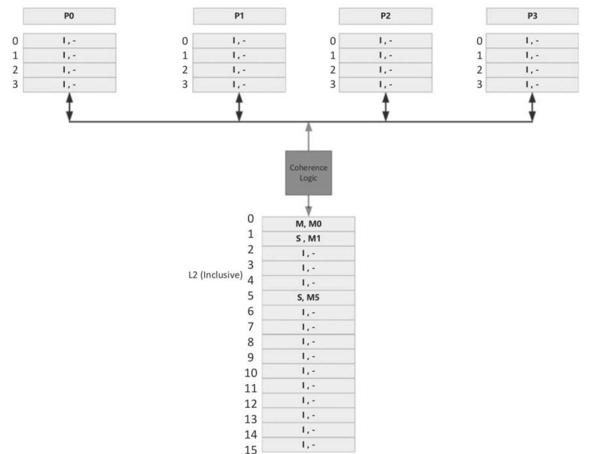

## 案例研究与习题（Amr Zaky） {- #sec-5-exercises}

### 案例研究 1：单芯片多核多处理器 {-}

*本案例研究涉及的概念*

* 监听一致性协议的状态转换与动作
* 监听一致性协议的性能
* 监听一致性协议实现上的优化
* 同步及其对 Cache 一致性支持的利用

**事务记号。** 本案例研究用如下记号表示一次访存：

「Pi, r/w, Mj」表示处理器核 i 读/写第 j 号存储块。例如，「P2, r, M3」表示处理器核 2 读第 3 号存储块。

**Cache 的配置和策略。** 本案例研究中的 Cache（L1 和 L2）都是直接映射、写回、写分配的 Cache。L2 Cache 对与它相连的各个 L1 Cache 是*包含*的。**所有 L1 Cache 和 L2 Cache 的行大小都相同，都等于一个存储块的大小。**

**一致性协议。** 采用写作废的监听协议，状态有 M、S、I 三种，与 [5.3 节](#sec-5-3)相同。

**存储器的分布和编址。**

5.1　[20] <5.3> [图 5.35](#fig-5-35) 是一个 4 处理器的 SMP。每个处理器核有一个私有的 L1 Cache，所有核共享一个 L2 Cache。各 Cache 的配置和策略见本案例研究开头的说明。L2 各 Cache 行的初始状态和数据见图：L2 某个块项中标有 Mi，表示该项缓存的是第 i 号存储块。

{#fig-5-35 width=80%}

* 对下面这个读写序列，说明随着序列的执行，各 Cache 行的状态如何变化，各 Cache 和监听逻辑分别执行什么动作。序列中「x || y」表示操作 x 之后是操作 y，Mi 指第 i 号物理存储块。

```
<P0, r, M0 || P3, w, M1 || P1, r, M5 || P2, r, M5 || P0, r, M0 || P3, r, M1 || P2, w, M5>
```

5.2　[30] <5.3> [图 5.36](#fig-5-36) 给出了所用监听协议实现中各项操作的延迟（以处理器周期计）。

[图 5.36　监听协议各项操作的延迟。tag访问与读数据访问同时进行，如果读失效，读出的数据就丢弃。写则不同，必须等 tag 访问确认写命中之后才能访问数据阵列，所以一次写命中需要两个周期。这样做的前提是：时钟周期太短，容纳不下先访问 tag、再访问数据这样串行的两步。]{#fig-5-36 .caption}

| 访问 | 处理器周期数 | 用途 |
|---|---|---|
| L1 tag 访问 | 1 | L1 读/写命中；失效的第一个周期；来自一致性逻辑的监听查询 |
| L1 数据访问 | 1 | L1 读（与 tag 访问同时进行）；L1 写 |
| L2 tag 访问 | 6 | L1 失效 |
| L2 数据访问 | 12 | L1 写回；L1 重填 |
| 一致性逻辑访问 | 1 | L1 失效；L1 升级失效（作废）；L1 对一致性逻辑的响应 |

例如，P1 写失效，而所写的存储块在 P2 的 L1 Cache 中处于已修改状态，这时各步的延迟如[图 5.37](#fig-5-37) 所示。

[图 5.37　写失效的延迟]{#fig-5-37 .caption}

| 步骤 | 延迟 |
|---|---|
| P1 访问 tag | 1 个周期 |
| P1（失效）发出作废请求 | 1 个周期 |
| 一致性逻辑向 P2（及所有核）的 tag 发监听查询 | 1 个周期 |
| P2 写回 L2 | 12 个周期 |
| L2 重填 P1 | 12 个周期 |
| 合计 | 27 个周期 |

假定总线上的各处理器在一个周期内就能报告自己对被作废的那一行所处的状态（L1 命中共享行、L1 命中已修改行、L1 失效）。

* 计算题 5.1 中读写序列的总延迟周期数。

5.3　[10/10] <5.3> 设 Cache 行的大小正好容纳数组 A 的一个元素，数组 A 全部在 L2 中，但不在 P0 的 L1 Cache 中。

```
for (…) A[i] = A[i]+1;
```

* 上面这个 for 循环每次迭代有两次访存，它们共需多少个周期？
* 如果协议由 MSI 改为 MESI，这些访存需要多少个周期？

5.4　[15] <5.3> 为了进一步考察 MSI 和 MESI 协议的性能，请解释：采用 MSI 协议时，下面两个循环的数据访问所需周期数为什么不同（假定 A[i] 起初不在 L1 Cache 中，但数组 A 全部在 L2 中）；而采用 MESI 协议时，两者的周期数应当相差不大。

```
for (…) A[i] = A[i-1] +1;
for (…) A[i] = A[i]+1;
```

5.5　[15/15] <5.3> 考虑下面的读写序列：

```
<P0, r, M0 || P3, w, M1 || P1, r, M5 || P2, r, M5 || P2, r, M0 || P0, r, M1 || P2, w, M1>
```

* 假定所访问的存储块都不在 L1 Cache 中，而全部在 L2 Cache 中。
    - 计算上述读写序列的总延迟周期数。
    - 如果一个处理器核可以直接把数据提供给另一个核，不必等待 L2 来提供，总延迟周期数是多少？假定从一个处理器的 L1 向另一个 L1 Cache 传送数据需要 4 个周期。

下面改用另一种 L2 Cache 结构，如[图 5.38](#fig-5-38) 所示：每两个核共享一个私有的 L2 Cache。私有 L2 对它所连接的各核的 L1 Cache 是**包含**的；同时假定末级 Cache（LLC，Last-Level Cache）对这两个 L2 Cache 也是**包含**的。L1 中某个 Cache 行失效时，由 L2 提供；如果 L2 也失效，就从 LLC 取（LLC 可能还要从存储器取）。从 LLC 取来的 Cache 行先写入 L2，再转交给提出请求的 L1。有一致性逻辑时，如果这一行还在其他某个 Cache（L1、L2 或 LLC）中，这个过程通常需要执行一致性动作，还可能改变该 Cache 行的状态。

。](images/ch05/fig-5-38.png){#fig-5-38 width=85%}

5.6　[20] <5.3> 针对这种新配置，讨论监听协议如何实现。例如，访问存储块 M38 时 L1 和 L2 都失效，此后 P0 的 L1 和（P0/P1 共享的）L2 中相应的行分别处于什么状态？我们也许会想完全不要 L1 一致性逻辑（L1 与 L2 之间），只用 L2 一致性逻辑（L2 与 LLC 之间）；但实现了 L1/L2 一致性逻辑，就有机会做一些性能优化。请举一个例子。

5.7　[10] <5.3> 解释为什么在这种配置下，L2 Cache 采用 MESI 协议、同时 L1 Cache 采用写一次（write-once）协议，能够减少一致性流量。所谓写一次的 L1 Cache 策略，就是对一个 Cache 行的第一次写按写直达方式处理，此后的写按写回方式处理。

5.8　[20] <5.3> 计算下面这个访存序列的读写延迟总周期数。假定采用 MSI 协议。

```
<P0, r, M0 || P3, w, M1 || P1, r, M5 || P2, r, M5 || P1, r, M0 || P0, r, M1 || P2, w, M1>
```

5.9　[20] <5.5> 下面是 [5.5 节](#sec-5-5)讨论过的自旋锁循环的两种实现。

```
lockit: addi x2, x0, #1          lockit: ld   x2, 0(x1)
        EXCH x2,0(x1)                    bnez x2, lockit
        bnez x2, lockit                  bnez x2, lockit
                                         addi x2, x0, #1
                                         EXCH x2,0(x1)
```

* 锁由 P2 持有，P0 和 P1 争用这把锁。分别给出两种实现中自旋锁循环的时序。

### 案例研究 2：简单的基于目录的一致性 {-}

*本案例研究涉及的概念*

* 目录一致性协议的状态转换
* 一致性协议的性能
* 一致性协议的优化

(a) 所示的分布式共享存储器系统，它由 16 个处理器核节点组成，节点之间用互连网络（IN）相连。[图 5.39](#fig-5-39)(b) 是一个节点的内部结构。从图中看，每个节点可以有多个核（以 SMP 方式相连），但开始时可以假定每个节点只有一个核。如果节点有多个核，可以假定这些核之间用监听来维护一致性。图中 Interconnection Network 为互连网络，SMP Cores + Local Caches 为 SMP 核加本地 Cache，Memory 为存储器，Inter-node Link Logic 为节点间链路逻辑，Directory + Logic 为目录及其逻辑。](images/ch05/fig-5-39.png){#fig-5-39 width=90%}

**一致性协议。** 采用基于目录的写作废协议，状态有 M、S、I 三种，与 [5.4 节](#sec-5-4)相同。

**存储器的分布和编址。** 存储器平均分配给各个节点。存储块地址的最高 4 位表示该存储器所在的节点号。除非题目中另有说明，存储块的大小和每个分布式存储器中的块数都不作规定。

**事务记号。** 本案例研究用如下记号表示一次访存：

「Ni, r/w, M (m, n)」表示节点 i 读/写节点 m 上的第 n 号存储块。例如，「N2, r, M (3,7)」表示节点 2 读节点 3 上的第 7 号存储块。

**Cache 的配置和策略。** 本案例研究中的 Cache（L1、L2……）都是直接映射、写回、写分配的 Cache。每一级 Cache 对它上面各级（更靠近处理器的）Cache 都是*包含*的。**所有 Cache 的行大小都相同，都等于一个存储块的大小。**

5.10　[20] <5.4> 假定所有 Cache 块起初都处于无效状态。对下面的访存序列，说明随着序列的执行，各 Cache 行的状态如何变化，各目录控制器执行什么动作，以及交换了哪些一致性消息。序列中「x || y」表示操作 x 之后是操作 y。

```
<N0, r, M (0, 4) || N3, w, M (1, 5) || N7, r, M (1,5) || N2, r, M (5,2) || N0, w, M (0,4) || N13, r, M (1,5) || N2, w, M(5,2)>
```

5.11　[5/10] <5.4> 设每个节点分配 1 GiB 的分布式存储器，存储块大小为 128 字节。

a. 给出节点目录数据结构的一种直接的布局，计算实现它总共需要多少位，并计算目录大小占存储器容量的百分比。

b. 按 (a) 中给出的布局，画出节点 1 的目录内容示意。注意，凡是访问存储块 M(1, \*) 的操作，访问的都是节点 1 的目录。

5.12　[5/5/5] <5.4> 为了缩小目录，可以对目录结构做下面两项修改，可以只做一项，也可以两项都做：

* 让每个目录项记录比一个块更大的一段存储器的一致性状态，从而减少每个目录的项数；
* 让目录项记录的是多个节点组成的组对存储器的使用情况，而不是单个节点的使用情况，从而缩小每个目录项。

a. 每个目录项负责 4 KiB 存储器的使用情况（每个节点分配 1 GiB 分布式存储器），计算目录数据结构的项数。

b. 系统的 16 个节点分为 4 组（每组 4 个节点），目录项记录的是一组节点（而不是单个节点）对存储块的拥有情况，计算一个目录项的大小。

c. 同时采用上述两项优化，计算目录的大小。

5.13　[15/5] <5.4> 按题 5.11 中目录的直接实现，画出实现 MSI 协议所需的一致性消息集合，写清地址、源/目的节点、数据和命令等细节。

a. 画出每类消息包含的各个字段，并计算每类消息的大小（以位计）。

b. 必要时用额外的位填充消息，使消息大小为字节的整数倍，重做 (a)。

5.14　[10/10/10/10/5] <5.4> 题 5.12 提出的目录缩小优化是有代价的：实现基于目录的一致性协议所需的消息数会增加。

用下面的访存序列比较不同优化下交换的消息数：

```
<N0, r, M (0, 4) || N3, w, M (0, 5) || N7, r, M (1,60) || N5, r, M (1,59) || N0, w, M (0,5)>
```

a. 不做目录缩小优化（如题 5.11），说明执行的动作和交换的一致性消息。

b. 实施题 5.12 (a) 的修改（每个目录项管理 4 KiB 的存储块），说明执行的动作和交换的一致性消息。

c. 实施题 5.12 (b) 的修改（节点分为四组：(G0: N0, N1, N2, N3)、(G1: N4, N5, N6, N7)、(G2: N8, N9, N10, N11)、(G3: N12, N13, N14, N15)），说明执行的动作和交换的一致性消息。

d. 同时实施题 5.12 (a) 和 (b) 的修改（节点分为四组：(G0: N0, N1, N2, N3)、(G1: N4, N5, N6, N7)、(G2: N8, N9, N10, N11)、(G3: N12, N13, N14, N15)），说明执行的动作和交换的一致性消息。

e. 填写下表：给出每个节点的目录大小（位）和执行上述事务序列所交换的消息数，二者都是一致性组中节点数和每个目录项所管理块大小的函数。

| 一致性组中的节点数 | 每个目录项管理的存储块大小 | 每个节点的目录大小（位） | 上述事务序列交换的消息数 |
|---|---|---|---|
| 1 | 128 字节 |  |  |
| 1 | 4 KiB |  |  |
| 4 | 128 字节 |  |  |
| 4 | 4 KiB |  |  |

5.15　[10] <5.4> 把题 5.12 (c) 的优化推到逻辑上的极端，就可以取消节点目录，不再记录哪个节点在使用哪个存储块。假定仍保留部分目录逻辑，这种组织方式需要交换的一致性消息非常多。消息开销虽然这么大，使用目录逻辑还有没有价值？提示：假定从任一节点 i 发往任一节点 j 的消息在互连网络中走确定的路径，并按顺序处理；再假定节点 i 和 j 都要访问（读或写）节点 k 中的一个存储块。

### 案例研究 3：存储一致性 {-}

*本案例研究涉及的概念*

* 顺序一致性（SC）模型下程序的合法行为
* SC 模型所允许的硬件优化
* 用同步原语使一种存储一致性模型模拟更严格的模型

5.16　[10/5/5] <5.6> 下面的代码段是两个进程在两个处理器上运行的 Peterson 互斥算法。这个算法是为了说明：不使用硬件同步原语，也可以实现互斥。

初始条件：enter0、enter1 = false（起初 P0、P1 两个进程都不打算进入临界区）。

```
P0: enter0 ← true                        P1: enter1 ← true
    turn ← 0                                 turn ← 1
    wait-for ((not enter1) OR turn == 1)     wait-for ((not enter0) OR turn == 0)
    begin                                    begin
    /* critical section */                   /* critical section */
    end                                      end
    enter0 ← false                           enter1 ← false
```

a. 证明：两个进程都要进入临界区，而且处理器遵循顺序一致性（SC）模型时，每次只有一个进程能进入临界区。

b. 给出 P0、P1 读写操作的一种 SC 次序，使 P0 先于 P1 进入临界区。

c. 给出 P0、P1 读写操作的一种 SC 次序，使 P1 先于 P0 进入临界区。

5.17　[10] <5.6> 证明：处理器实现的是释放一致性（RC）模型时，不能保证 Peterson 算法行为正确。给出某种 RC 次序，使进程 P1 和 P2 能同时进入临界区。

5.18　[5/5/5] <5.6> 假定 a 和 b 的初值都是 0。

```
P0: a=1
    while (b == 0)
    print ("p0 done\n")

P1: b=1
    while (a == 0)
    print ("p1 done\n")
```

a. 采用 SC 模型时，上面两个进程可能打印出哪些结果？

b. 在采用 RC 模型的系统上原样执行这段代码，两个进程有可能都永远跳不出 while 循环，解释其原因。

c. 给出一种编译器的代码重排，使采用 SC 模型的系统也可能出现 (b) 中描述的现象。

5.19　[10] <5.6> 在题 5.18 中，如果 P0 在 P1 把 b 置为 1 之前就把 b 预取到自己的 Cache 中，在采用 SC 模型的系统上会不会产生意外的结果？假定系统有 Cache 一致性机制。

5.20　[10/10] <5.6> 给题 5.15 的互斥代码加上同步原语，使它在实现 RC 模型的系统上行为正确。

5.21　[20/20/20] <5.6> 顺序一致性（SC）要求所有的读和写看起来都按某种全序执行。为此，处理器在某些情况下必须先停顿，然后才能提交一条读指令或写指令。考虑下面的代码序列：

```
write A
read B
```

其中 write A 引起 Cache 失效，read B 则 Cache 命中。在 SC 下，处理器必须让 read B 停顿，直到能够为 write A 排定次序（从而执行它）为止。SC 的简单实现会让处理器一直停顿，直到 Cache 收到数据、能够执行这次写为止。

较弱的存储一致性模型放松了对读写次序的约束，处理器需要停顿的情况也就少了。全存储定序（TSO，Total Store Order）模型要求所有的写看起来按某种全序发生，但允许处理器的读越过它自己的写。于是处理器可以采用写缓冲，用来存放已经提交、但相对于其他处理器的写还没有排定次序的写。在 TSO 下，读可以越过写缓冲（还可能从写缓冲中旁路取得数据），这在 SC 下是不允许的。

假定每个周期可以执行一次存储器操作；在 Cache 中命中的操作，以及可以由写缓冲满足的操作，都不引入停顿周期；失效的操作要经历 100 个周期的存储器延迟。

在 SC 和 TSO 两种模型下，每个操作*之前*分别有多少个停顿周期？（写缓冲最多只能存放一个写。）访存操作用题 5.1 引入的记号描述。

a. [20] <5.6>

```
P0, W, M110    //assume miss (no other cache has the line)
P0, R, M108    //assume miss (no other cache has the line)
```

b. [20] <5.6>

```
P0, R, M110    //assume miss (no other cache has the line)
P0, W, M100    // assume hit.
```

c. [20] <5.6>

```
P0, W, M100    //assume miss.
P0, W, M100    // assume hit.
```

各操作后的注释含义：「assume miss (no other cache has the line)」表示假定失效（其他 Cache 中都没有这一行），「assume hit」表示假定命中，「assume miss」表示假定失效。
