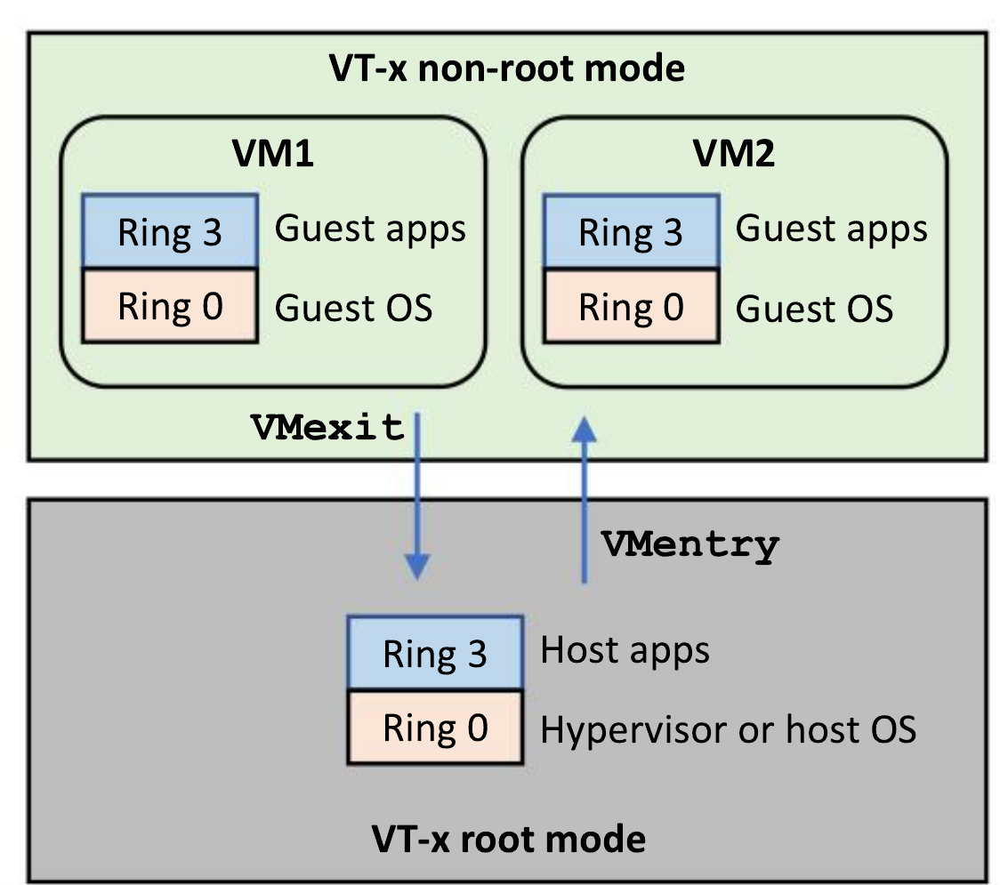
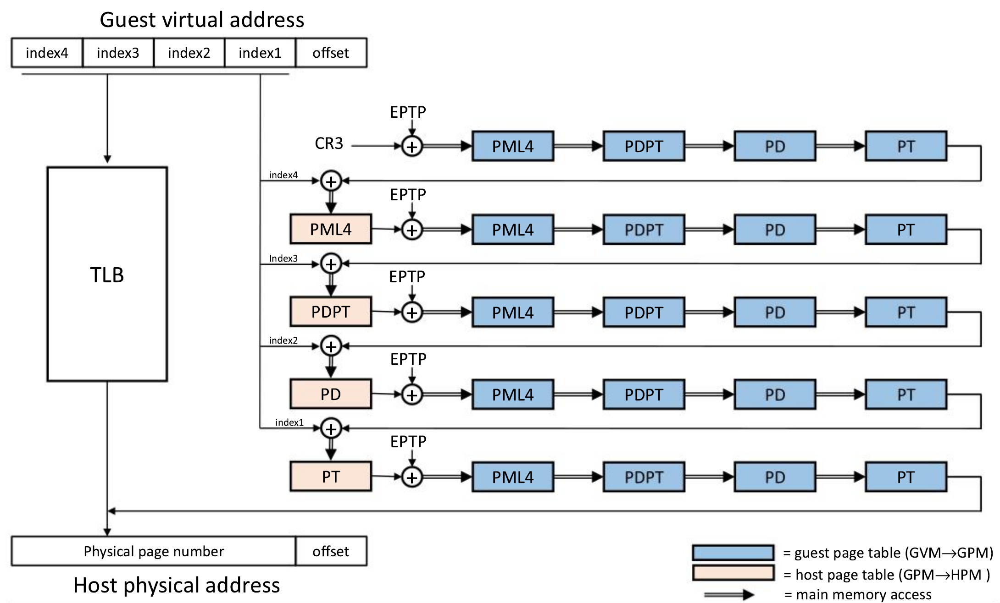

## 虚拟化的硬件支持 {#sec-6-3}

> 虚拟机是真实机器的一个高效、相互隔离的副本。我们借助虚拟机监控器（VMM）这一概念来解释这些含义。VMM 有三个基本特征：第一，VMM 为程序提供的环境与原来的机器基本相同；第二，程序在这个环境中运行，最坏情况下速度也只是略有下降；第三，VMM 完全控制着系统资源。
>
> ——Gerald Popek 和 Robert Goldberg，《可虚拟化第三代体系结构的形式化要求》，*Communications of the ACM*（1974 年 7 月）

虚拟化技术最早出现在 20 世纪 60 年代末，此后一直是大型机计算的重要组成部分。20 世纪八九十年代，单用户计算机和服务器领域基本不用虚拟化；到了 21 世纪头十年，虚拟化又流行起来。它最初的成功在于让开发人员在一台机器上运行多个操作系统（如 Windows 的多个版本），不必购买多台物理机器，就能在各种不同的场景下测试自己的应用代码。不久，应用的重点转向企业机房的服务器整合，目的一是提高利用率，二是让旧的软件栈在它不直接支持的新硬件上运行。这些企业应用又推动了效用计算在 WSC 规模上的复兴，虚拟化成为支撑云计算的核心技术。

**系统虚拟机。** 虚拟化就是增加一层或几层硬件或软件，为被虚拟化的底层资源制造出一个或多个虚拟副本。以一台物理机器为基础，虚拟化可以创建多个*虚拟机*（VM），每个 VM 呈现的指令系统与底层硬件相同。这类 VM 称为（操作）*系统虚拟机*，IBM VM/370、VMware ESX Server 和 Xen 都属于这一类。如果对「机器」一词另作定义，还可以构造出其他类型的 VM。例如，Java 虚拟机和 JavaScript 引擎等基于语言的虚拟机，就是把用户级的应用二进制接口（ABI）定义为「机器」。本章只讨论系统 VM：它让用户觉得自己独占一整台计算机，可以运行包括操作系统在内的整个软件栈。一台计算机可以运行多个 VM，支持多种不同的操作系统（OS）。没有虚拟化时，所有硬件资源归一个 OS 所有；有了虚拟化，多个 OS 共享硬件资源。

**VMM。** 管理 VM 的软件层称为*虚拟机监控器*（VMM，Virtual Machine Monitor），也称 *hypervisor*。被虚拟化的底层硬件平台，即物理机器，称为*宿主机*（host），它的资源由各个*客户*（guest）VM 共享。VMM 负责把物理资源映射为虚拟资源，这一点与操作系统的下半部分相似。VMM 管理资源主要综合运用三种技术：分时、划分和仿真。例如：

* CPU 核可以由多个 VM 分时使用，就像 OS 让多个进程分时使用一个核一样；在多核芯片中，还可以把各个核划分给不同的 VM；
* 物理内存采用划分的方式，任一时刻每个 VM 只能访问其中一部分页；
* I/O 硬件通常采用仿真的方式：VM 发出的 I/O 调用由 VMM 居中处理，VMM 访问 I/O 设备，再把结果返回给 VM。

VMM 中负责核心隔离功能的部分大约 10000 行代码。VMM 不包含图形、用户界面、高层 API 和库等上半部分功能，因此比传统 OS 小得多。后面会讲到，目前所有主流的指令系统结构（ISA）都为 VMM 提供了相当多的硬件支持。此外，云服务提供商正在逐步把 VMM 软件卸载到智能网卡（SmartNIC）等专用硬件上，把宿主机 CPU 核的周期腾出来留给用户的 VM。

对效用计算而言，虚拟化带来了几项根本性的能力：

* *聚合*：虚拟化让软件栈各不相同的多个 VM 共享一台宿主机。云服务提供商因此可以部署总拥有成本（TCO）最低的物理机器（通常是多核的大型服务器），在每台机器上聚合多个大小不一的用户 VM。
* *更好的容错、恢复和维护*：虚拟化把用户自己拥有的物理机器换成了运行在云服务器上的 VM。VM 把一台机器及其软件栈的全部状态封装成一组二进制位，这些位可以操作，也可以搬移。例如，云服务提供商可以定期把 VM 状态保存到持久存储上，形成 VM 快照，用于故障恢复；也可以把 VM 状态从一台宿主机复制到另一台（即 VM *热迁移*），从而在不中断业务的情况下维护原来的宿主机，或者支持主备式容错。
* *更好的调度*：用户 VM 可以在宿主机之间迁移，云服务提供商因此可以不时地尝试把正在运行的 VM 集中到少数几台高利用率的宿主机上。腾出来的宿主机可以进入低功耗模式以节省能源，也可以留给那些独占宿主机或使用相邻宿主机时效果最好的大型负载。云服务提供商还可以迁移 VM，使 WSC 网络和存储系统的负载更加均衡，或者把相互之间存在性能干扰的 VM 分开放置。
* *软件灵活性与隔离*：VM 提供的抽象可以运行完整的软件栈，包括 DOS 这样的老操作系统和定制的操作系统。典型的部署中，可能有一些 VM 运行遗留的 OS，许多 VM 运行当前的稳定版 OS，还有少数 VM 在测试下一个 OS 版本。这些软件栈可以并存，又不会使 WSC 的运维复杂化。一个 VM 中发生的崩溃、错误或安全事件，不会波及同一宿主机上的其他 VM。

### 怎样的体系结构才能虚拟化 {-}

VMM 虚拟化底层硬件时必须满足三个条件：

* *安全性*：VMM 与客户 VM 相互隔离，各个客户 VM 之间也相互隔离；客户 VM 不能直接改变物理资源的分配。
* *等价性*：客户 VM 上运行的软件，其行为应当与在原生硬件上运行时完全一样，任何计算的输出（包括所有副作用）都应相同。由性能相关因素或资源可用性（如分配给每个客户 VM 的物理内存大小）引起的差别除外。
* *高效性*：客户 VM 中运行的软件，性能应尽可能接近在原生硬件上运行时的性能。多个 VM 共享或划分固定的硬件资源，资源的复用或仿真本身也有开销，这些都可能使性能下降。

**安全性和等价性。** 先看硬件如何支持安全性和等价性的要求。要虚拟化一个处理器，VMM 必须控制几乎一切：特权状态的访问、地址转换、I/O、异常和中断。即使当前正在运行的客户 VM 暂时在使用这些资源（无论运行的是 OS 代码还是用户代码），控制权也必须在 VMM 手中。以定时器中断为例，VMM 必须挂起当前运行的客户 VM，保存它的状态，处理中断，决定下一个运行哪个客户 VM，再装入那个 VM 的状态。对于依赖定时器中断的客户 VM，VMM 为它提供一个可编程的虚拟定时器和仿真的定时器中断。为了掌握控制权，VMM 的特权级必须高于任何 VM 中的用户代码和 OS 代码，并且能够截获客户 VM 中所有操纵物理硬件资源（如核、内存或中断）的操作。

**Popek–Goldberg 定理。** 1974 年，Gerald Popek 和 Robert Goldberg 给出了一个 ISA 及其各种实现能够虚拟化的形式化条件（Popek 和 Goldberg，1974）。他们的著名定理指出，只要满足以下两点，就可以构造出 VMM：

* ISA 至少定义了两种处理器模式：系统模式和用户模式；
* 能够观察或修改系统状态的*敏感指令*，构成了*特权指令*集合的一个子集。特权指令只有处理器在系统模式下运行时才能使用。

所谓系统状态，是指反映或管理处理器状态、中断、虚拟存储（MMU）、安全和资源分配等功能的全部配置寄存器和存储器结构。如果所有能观察或修改这些状态的指令在用户模式下执行时都会产生异常，使处理器进入系统模式，那么独自运行在系统模式下的 VMM 就完全控制了整个系统。客户 VM 中运行的代码（如操作系统）一旦试图执行敏感指令，VMM 就有机会介入，根据需要管理或虚拟化物理资源。

**早期的 x86 虚拟化。** 20 世纪 90 年代末，虚拟化重新流行起来，而当时的 x86 ISA 并不满足 Popek–Goldberg 定理的条件：有 17 条指令是敏感的，却不是特权指令（Robin 和 Irvine，2000）。例如，客户操作系统运行在 ring 1 或 ring 3（x86 中供用户代码使用的两种模式）时，可以用 push 指令观察寄存器 %cs 的值，而 %cs 的内容之一就是当前的处理器模式。这样，客户 OS 能够发现自己并没有运行在内核模式（x86 的 ring 0）下。尽管如此，早期的 VMM 还是用两种办法实现了 x86 系统的虚拟化：

* VMware Workstation 依靠*动态二进制翻译*（DBT）运行操作系统未经修改的客户 VM。VMM 为 VM 装入代码页时，扫描其中有问题的指令，把它们替换成等价、安全而且性能好的代码序列（Bugnion 等，2012）。
* Xen VMM 依靠*半虚拟化*：修改客户操作系统，去掉有问题的指令，并让它与底层的 VMM 高效地交互（Barham 等，2003）。

下面讨论的虚拟化硬件支持使 x86 体系结构符合了 Popek–Goldberg 定理，但 DBT 和半虚拟化在弥补虚拟化环境的性能缺陷方面仍然有用。

### 虚拟化的体系结构支持 {-}

体系结构增加虚拟化支持，出于三方面的原因：

* 一是让所有敏感指令都成为特权指令，使 VMM 的设计不再需要 DBT 和半虚拟化。
* 二是在只有用户和系统两种运行模式的系统中，VMM 必须运行在系统模式，客户 OS 和应用程序只好共用用户模式，两者之间的隔离因此减弱。这种现象称为*模式压缩*（在 x86 中称为*环压缩*）。
* 三是模式压缩还会造成性能损失。未经修改的操作系统往往通过敏感指令频繁访问系统状态，客户 VM 与 VMM 之间的切换次数因此过多。

目前所有主要的指令系统都提供了虚拟化的体系结构支持。下面简要介绍 x86 的做法，再指出 Arm 和 RISC-V 的主要不同。

**VT-x 的根模式。** x86 ISA 的 VT-x 扩展为 VMM 定义了一种新的运行模式，称为*根模式*。如[图 6.4](#fig-6-4) 所示，根模式与 x86 原有的各种模式是正交的。客户 VM 运行在*非根模式*下，其中 OS 运行在 ring 0（x86 的系统模式），用户应用运行在 ring 3（x86 的用户模式）。这种附加的正交模式消除了模式压缩，同时又不改变现有操作系统看到的硬件。VT-x 还把一个虚拟机的全部状态封装在物理内存中的一个结构里，称为*虚拟机控制结构*（VMCS）。VMCS 包含 OS 在非根模式 ring 0 下能够使用的全部配置寄存器。借助 VMCS，VMM 可以操纵 VM 的状态（保存、恢复、读、写），并调度 VM 执行，方式与 OS 管理用户进程及其状态相似。

{#fig-6-4 width=60%}

**VM 的进入与退出。** VMM 准备启动或恢复某个 VMCS 所描述的虚拟机时，执行 *vmlaunch* 或 *vmresume* 指令。这两条指令以原子方式把 VMCS 结构的内容从内存复制到处理器寄存器中，并把处理器切换到非根模式。随后 VM 开始执行，根据需要在它的 OS（ring 0）和应用（ring 3）之间切换。多数情况下，OS 用 x86 的特权指令读写自己的配置寄存器，并不会把控制权转交给 VMM。只有发生下面几种 *vmexit* 事件时，处理器才切换到根模式并调用 VMM：

1. VM 的代码试图访问根模式的敏感状态（如读 CPU 的某个型号专用寄存器），或者使用根模式的特权指令（如 vmlaunch）；
2. 处理器收到外部中断，或者收到 VM 无法处理的中断（如复位）；
3. VM 用 *vmcall* 指令调用 VMM。vmcall 指令相当于用户进程调用操作系统时所用的 syscall 指令。

VT-x 扩展满足了 Popek–Goldberg 定理对安全性和等价性的要求，只是方式不那么直接。所有能观察或修改根模式状态的指令都是根模式特权指令，执行时都会引起 vmexit 事件。但在非根模式下，许多操作敏感状态的指令执行时并不引起 vmexit，因为硬件保证这些指令操作的是该 VM 独占的一份状态副本。这样就减少了 VMM 与客户 VM 之间的切换次数，提高了性能。

**RISC-V 和 Arm。** 与 VT-x 类似，RISC-V ISA 的 H 扩展为 VMM 定义了 H 模式，它与 S（系统）模式和 U（用户）模式正交。Arm ISA 通过新增的 EL2 执行模式支持虚拟化。EL2 的特权严格高于 Arm 的用户模式（EL0）和系统模式（EL1），但与它们不正交。Arm 还有一个由 TrustZone 安全扩展定义的 EL3 模式。EL3 与其他所有模式都正交，安全监控程序可以在 EL3 下把系统资源划分给可信执行环境和非可信执行环境。TrustZone 系统的可信一侧可以用来实现纯软件的可信平台模块（TPM）。

### 内存虚拟化 {-}

内存的虚拟化方式，对 VMM 和虚拟机的安全性和性能都至关重要。讨论具体做法之前，先定义几个术语，以便弄清第 2 章讨论的虚拟存储与 VM 的内存虚拟化之间的区别和相互关系：

* 系统中实际存在的半导体存储器（通常由 DRAM 芯片构成）称为*宿主物理内存*（HPM）。VMM 把 HPM 的不同部分分配给不同的 VM，并保证各个 VM 不能读写彼此分到的内存，除非明确允许。
* 每个 VM 中的客户 OS 管理*客户物理内存*（GPM）。GPM 是一个线性地址空间。客户 OS 看不到 VMM 用 HPM 的哪些部分来支持 GPM。GPM 中不常用的部分也可能通过分页暂时存放在外存中。
* VM 中运行的每个进程都有自己的*客户虚拟内存*（GVM）地址空间，由客户 OS 管理，建立在 GPM 之上。

因此，一个虚拟化的系统中只有一个 HPM 地址空间，每个 VM 有一个 GPM，每个 VM 中的每个客户进程有一个 GVM。

**影子页表。** ISA 支持虚拟化之前，VMM 用*影子页表*为未经修改的客户系统管理内存。进程的页表把 GVM 映射到 GPM，由客户 OS 管理。VMM 截获 OS 的所有存储管理操作（如 MMU 和 TLB 管理指令），构造一个把 GVM 直接映射到 HPM 的影子页表。程序执行时，影子页表用来重填 TLB，为 load 和 store 指令访问的 GVM 地址提供地址转换。在管理影子页表的过程中，VMM 决定每个 VM 可以使用多少内存，以及一个 GVM 页由 HPM 页支持还是由外存支持。影子页表要依靠 DBT 或半虚拟化来截获 OS 的所有存储管理事件，并减少调用 VMM 的次数。影子分页很可能是 VMM 中最复杂的部件。

**扩展页表。** x86 的 VT-x 扩展定义了*扩展页表*（EPT）的硬件支持，软件不再需要影子页表。MMU 和 TLB 的指令和逻辑都作了扩展，能够识别两种页表的结构：一种由 OS 管理，把 GVM 地址映射到 GPM 地址；另一种由 VMM 管理，把 GPM 地址映射到 HPM 地址。执行 load 或 store 指令时，硬件用 TLB 把 GVM 地址快速转换为 HPM 地址。TLB 失效时，硬件页表遍历器同时使用 GVM/GPM 和 GPM/HPM 两种页表找到正确的转换并重填 TLB，通常既不调用客户 OS，也不调用 VMM。只有 GVM/GPM 转换中发生缺页时才调用客户 OS，GPM/HPM 转换中发生缺页时才调用 VMM。

**EPT 下的页表遍历。** 使用 EPT 时，页表遍历比较复杂，因为两种页表（GVM/GPM 和 GPM/HPM）都是多级结构，而 GPM 地址必须先转换成 HPM 地址才能使用。[图 6.5](#fig-6-5) 给出了 x86 转换 64 位地址所需的步骤：

* TLB 命中时，无论是否虚拟化，地址转换都能很快完成，不需要任何访存。
* 非虚拟化系统中 TLB 失效时，硬件遍历器从基址寄存器 CR3 所指的地址开始，进行四级页表查找，依次访问 PML4、PDPT、PD 和 PT 四个表，每级查找用虚拟地址的不同部分作索引。每级查找访存一次，转换代价是 4 次访存。
* 虚拟化系统中，转换代价是 24 次访存。CR3 的值和四级查找（PML4、PDPT、PD 和 PT）的输出都是 GPM 地址，都要用 VMM 维护的 GPM 到 HPM 转换表再转换一次，而这个表也是四级页表。因此要额外增加 5 × 4 步查找，共 24 次访存。

开启虚拟化后，页表遍历的代价是原来的 6 倍，这就对 TLB 的命中率提出了更高的要求，也促使人们使用更大的页，以扩大 TLB 的覆盖范围，减少页表遍历的步数。多级页表、多种页大小的支持、页表缓存等存储转换的关键优化，附录 L 有深入的介绍。

Arm 和 RISC-V 定义的内存虚拟化支持与 x86 的 EPT 相似。

{#fig-6-5 width=95%}

**例题**　一个非虚拟化的 x86 系统，在典型负载下的基准平均访存时间（AMAT）为 2.2 个周期。这一基准计入了指令和数据的 Cache 失效以及 L1 TLB 失效，但不包括 L2 TLB 失效。假设 L2 TLB 失效率为 0.2%，每次页表访存需要 50 个周期（L2、L3 和主存访问大致各占三分之一）。问：

1. 这个系统的总 AMAT 是多少？
2. 开启虚拟化后，要保持 AMAT 不变，L2 TLB 失效率应降到多少？
3. 如果 L2 TLB 失效率最多只能优化到 0.005%，要使 AMAT 与非虚拟化系统相同，虚拟化后四级页表遍历的目标延迟应是多少？

**解答**　对非虚拟化系统，总 AMAT 包括基准 AMAT 和 L2 TLB 失效的影响，每次页表遍历访存 4 次：

$$
\begin{aligned}
\text{AMAT} &= \text{基准 AMAT} + \text{L2 TLB 失效开销} \\
&= \text{基准 AMAT} + \text{L2 TLB 失效率} \times \text{页表访问代价} \\
&= 2.2 + 0.002 \times 50 \times 4 = 2.2 + 0.4 = 2.6\ \text{个周期}
\end{aligned}
$$

可见，页表遍历的代价很高，即使 L2 TLB 失效率很低，对性能的影响也相当大。第 2 章提到过，硬件页表遍历器能够同时处理多个未完成的 TLB 失效，可以抵消一部分开销。

对虚拟化系统，由[图 6.5](#fig-6-5) 可知，页表访问代价是原来的 6 倍。要得到同样的 AMAT（2.6），L2 TLB 失效率必须降到 0.2%/6 = 0.033%。

要减小虚拟化对 AMAT 的影响，可以采用更大的 L2 TLB 和更大的页来降低 TLB 失效率。例如，Intel 和 AMD 都支持 2 MiB 的页。如果 L2 TLB 失效率降到 0.05%，使 AMAT 为 2.6 的页表遍历时间为：

$$
\begin{aligned}
&\text{AMAT} = 2.6 \\
&2.2 + 0.0005 \times 24 \times \text{页表访问代价} = 2.6 \\
&\text{页表访问代价} = 0.4/(0.0005 \times 24) = 33.33\ \text{个周期}
\end{aligned}
$$

降低页表访问代价的一种办法是增设专门存放页表项的 MMU Cache。MMU Cache 存放的不是顺序的地址，而是多级页表项，一次访问就能返回几个相互链接的页表项。详见附录 L。

### I/O 虚拟化 {-}

**VMM 居中处理 I/O。** 虚拟化存储、网络等 I/O 系统的基本办法，是由 VMM 截获 VM 与 I/O 硬件之间的全部交互。具体可以在三类事件上产生 *vmexit*：执行程序控制 I/O（PIO）指令时，对存储器映射 I/O（MMIO）地址执行 load/store 时，以及发生 I/O 中断时。也可以用 DBT 或半虚拟化，在 I/O 处插入调用 VMM 的 *vmcall*。由 VMM 居中处理所有 I/O 操作有几方面的好处：

* 一是 VMM 可以把客户 OS 所设想的 I/O 接口转换成实际可用硬件的接口。这样，老的 VM 可以借助仿真的 I/O 设备运行；未经修改的 VM 也能用上新硬件的功能，即使它们的老设备驱动程序无法配置和利用这些功能。
* 二是 VMM 能够观察和控制所有 I/O 操作的状态，因此可以在物理机器之间迁移 VM，而不必重新引导 VM。VMM 先让所有 I/O 操作静止下来，暂停 VM，再把记录其状态的全部数据位（寄存器、内存以及 VMM 跟踪的状态）传送到另一台机器，然后恢复执行。前面讲过，这种*热迁移*操作给云计算带来了关键的好处。
* 三是 VMM 可以居中实施策略，规定多个 VM 如何安全地共享一个 I/O 设备的能力，例如限制每个 VM 能产生的网络带宽。

**直接访问 I/O 设备。** 但是，居中处理会带来延迟和吞吐率上的开销，对依赖 SSD 或高速网络接口（NIC）的 I/O 密集型应用来说，这种开销可能相当大。例如，一块 200 Gbps 的 NIC 每秒最多可以传送 4 亿个以太网包，逐包居中处理的代价相当高。这个问题推动了 I/O 虚拟化的体系结构支持，使 VM 能够直接而又安全地访问 I/O 设备。以发送一个网络包为例，理想的 I/O 操作过程是：

1. 客户 OS 或用户进程用 MMIO 指令直接对 I/O 设备编程；
2. I/O 设备的 DMA 引擎直接从 VM 的内存中复制要发送的数据，不需要 VMM 帮助；
3. 包发送完毕后，I/O 设备直接向客户 VM 发出中断，同样不需要 VMM 帮助。

对第一步的支持前面已经讲过：利用 EPT，可以把 I/O 设备的 HPM 地址映射到客户的 GPM 或 GVM 地址空间中。下面通过 x86 的 VT-d（IOMMU）扩展，介绍对后两步的支持，即 DMA 虚拟化和中断虚拟化。Arm 和 RISC-V 定义了类似的机制。另外还有一项要求：允许多个 VM 直接、安全地访问同一个 I/O 设备。针对 PCIe I/O 设备的 SRIOV 方案将在 [6.5 节](#sec-6-5)讨论。

**DMA 重映射。** VT-d 定义的 IOMMU 部件包括两部分：DMA 重映射（DMAR）和中断重映射（IR）。DMAR 让 VM 中运行的软件可以用 GPM 或 GVM 地址对 I/O 设备的 DMA 引擎编程。DMA 引擎发出存储器读或写访问时，用设备标识查找一个上下文标识符。对于通过 PCIe 接口连接的设备，设备标识包括总线号（8 位）、设备号（5 位）和功能号（3 位）。上下文标识符中有一个指针，指向转换该存储地址（如从 GPM 到 HPM）所用的页表。利用这些页表，地址转换按通常的方式进行。IOMMU 中有一个 TLB，缓存最近用过的转换，以加快转换过程。早期的 IOMMU 设计其实没有硬件页表遍历器，TLB 失效时要调用 VMM，由它把 DMA 引擎所用的地址转换为 HPM 地址，并更新 TLB 供以后使用。IOMMU 的 TLB 设计难度相当大：一方面要求失效率低，这对容量提出了要求；另一方面吞吐率必须足够高，能够支持一个或多个高性能 I/O 设备，例如一块 200 Gbps 的 NIC 每个方向每秒要为多达 4 亿个包产生 DMA 访问。

**中断重映射。** IR 部件的工作过程如下。I/O 设备要产生消息信号中断时，向系统中某个核的高级可编程中断控制器（APIC）发送一条消息。使用 VT-d 时，每个 VM 都关联一个虚拟 APIC，它是由相应 VMCS 标识的一个存储器结构。设备在 VT-d 下产生中断时，IR 用 I/O 设备标识查出接收中断的 VM（VMCS）的信息，以及中断消息应当如何改写。相应 VMCS 中的虚拟 APIC 随即更新，记下这个待处理的中断。虚拟 APIC 还会通知当前正在运行该 VM 的核，由它考虑是否递交这个中断。物理 APIC 根据核的状态和 VM 的状态，决定这个中断是立即发出还是等待。例如，客户 OS 可能正在处理一个优先级更高的中断，必须等它处理完才能触发后续中断。中断发出后，直接调用客户 OS 中对应中断向量的中断处理程序，VMM 完全不参与。这种不引起 VM 退出、直接向运行中的 VM 递交中断的方式称为*投递中断*（posted interrupt）。投递中断也可以用于两个 VM 之间或同一个 VM 中两个进程之间的处理器间中断（IPI）。

### 一个 VMM 实例：Xen 项目 {-}

Xen VMM 是一个开源项目，2003 年首次推出，AWS 最初使用的 VMM 就是它。Xen 是裸机 VMM，也称第 1 类 VMM，即机器引导时首先运行的软件就是 VMM。与之相对，VMware Workstation 等第 2 类 VMM 先引导一个基础操作系统，VMM 是一个用户级进程，依靠这个宿主 OS 提供的服务，在同一硬件上运行另外的 VM。

**半虚拟化。** 在 VT-x 和 VT-d 扩展出现之前，Xen 引入半虚拟化来解决 x86 系统虚拟化在安全性和性能方面的难题（Barham 等，2003）。Xen 的开发者修改了 Linux，改动了大约 3000 行代码，约占 x86 专用代码的 1%。这些改动去掉了敏感但非特权的指令，并替换掉了在虚拟化下效率很低的代码。例如，为了避免清空与影子页表相关的 TLB，Xen 把自己映射到每个 VM 地址空间最高的 64 MiB 中。Xen 允许客户 OS 分配页，只检查客户 OS 是否违反保护限制。为了保护客户 OS 不受 VM 中用户程序的影响，最初的 Xen 利用了 x86 提供的三个保护级：Xen VMM 运行在最高特权级（0），客户 OS 运行在次一级（1），应用程序运行在最低特权级（3）。而 x86 体系结构上的大多数 OS 只用特权级 0 和 3 运行所有程序。这些改动都不影响 VM 负载所依赖的 Linux ABI。从 2011 年起，Linux 已经原生支持 Xen 半虚拟化。

**域。** Xen 把 VM 称为「域」。一个具有特权的初始域 Dom0 首先引导，负责管理普通的 VM，即*客户域*。Dom0 中有硬件 I/O 设备的驱动程序（后端驱动）。客户域使用虚拟磁盘和虚拟网络设备的驱动程序（前端驱动），由它们调用 Dom0 完成 I/O 请求。Dom0 的部分功能还可以分离出来，交给*驱动域*。驱动域是没有特权的 VM，各自负责一个特定的 I/O 设备及其后端驱动。有了驱动域，Dom0 不会成为系统瓶颈，可靠性也提高了：驱动程序崩溃不会影响 Dom0 的运行。

**利用硬件支持。** 多年来，Xen 不断演进，利用了虚拟化的体系结构支持。从 2006 年起，Xen 用 VT-x 支持 Microsoft Windows 等未经修改的客户 OS。后来又利用 VT-d 改进 I/O 性能和安全性，例如驱动域借助 IOMMU 保护其他域，使它们免受后端驱动程序中的错误和漏洞利用的影响。Xen 还支持轻量级 VM，混合使用硬件辅助虚拟化和半虚拟化，以提高 VM 性能并减少 VM 占用的内存。VM 越小，云 WSC 中一台服务器的内存就能容纳越多计算需求不高的 VM。

### 机密计算与安全飞地 {-}

**安全隐患。** 公有云系统得到广泛采用，金融、医疗等关键应用的数据安全也随之引起关注。进程之间（虚拟存储）或 VM 之间（EPT）由硬件辅助的内存隔离，可能因应用、客户 OS 或 VMM 本身的错误被人利用而遭到绕过。云计算扩大了攻击面，原因有三：

* 云基础设施是公共的，攻击者可能运行在同一个 WSC 中，甚至同一台机器上（同驻的 VM）；
* 许多云负载实现的是互联网服务，恶意用户可以与之交互，寻找代码注入或其他安全漏洞的可乘之机；
* 有些云用户并不完全信任云服务提供商，一方面担心有内部人员作恶，另一方面他们可能与云服务提供商的某种产品存在直接竞争。

**机密计算平台。** 这些挑战推动了*机密计算*平台的发展：在公有云上运行、实现互联网服务时，平台对数据的机密性和完整性提供强有力的保证。这类平台可以用同态加密、多方计算、零知识证明等新兴的密码技术构建。由于这些密码技术的计算开销仍然很大，CPU 厂商推出了可信执行的硬件支持，如 Intel 的软件防护扩展（SGX）。更细粒度保护的课题已经提出了几十年，但过去开销高，又有其他更高效、侵入性更小的方案可用，所以在商业上几乎没有推广开。网络攻击日益增多，在线的机密信息越来越多，人们才开始重新审视提高这种细粒度安全性的技术。

**安全飞地。** SGX 以及其他 ISA 中的类似扩展允许用户程序创建*安全飞地*（secure enclave）。放进飞地的代码和数据始终用用户代码提供的密钥加密，只有在 CPU 芯片内使用时才解密。程序通过一个很窄的接口调用飞地中的函数，所用的专门指令会把处理器切换到安全飞地模式。飞地不处理中断、缺页或任何 vmexit 事件。发生这类事件时，处理器先把程序状态保存在加密的内存中，用合成的值覆盖寄存器，退出安全模式，再调用预先指定的处理程序处理中断。SGX 还有一个值得注意的特点：用代码和数据初始化飞地时，会生成飞地状态的密码散列值，外部的证明服务可以检查这个散列值，确认代码和数据此前都没有被修改过。

有了飞地，执行某些函数时只需要信任 CPU 厂商，就能做到机密执行。由于飞地始终是加密的，VMM 或 OS 为虚拟存储或 I/O 进行的常规操作虽然可以访问飞地（如移动一页），却提取不出任何明文信息。飞地要发挥作用，函数所需的全部代码和全部数据都必须放在飞地中。与 Intel 的 SGX 类似，IBM 和 AMD 近来的处理器也支持对主存进行实时加密。
