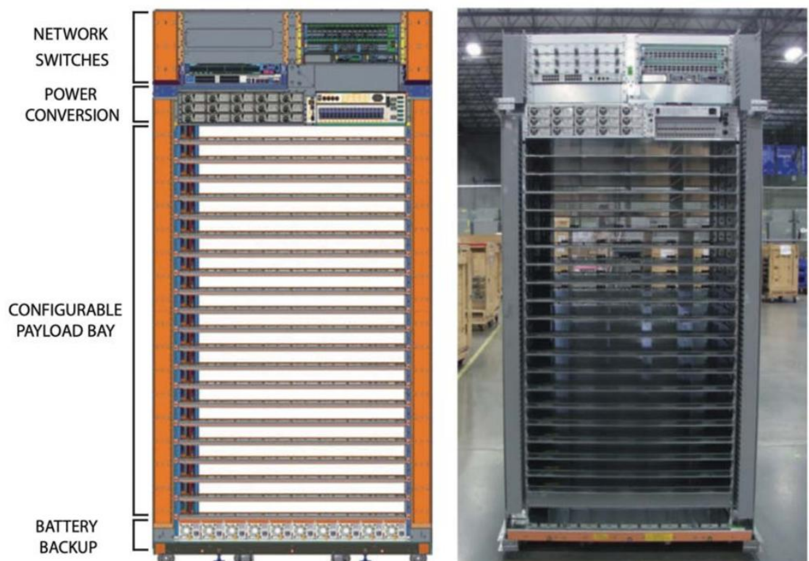
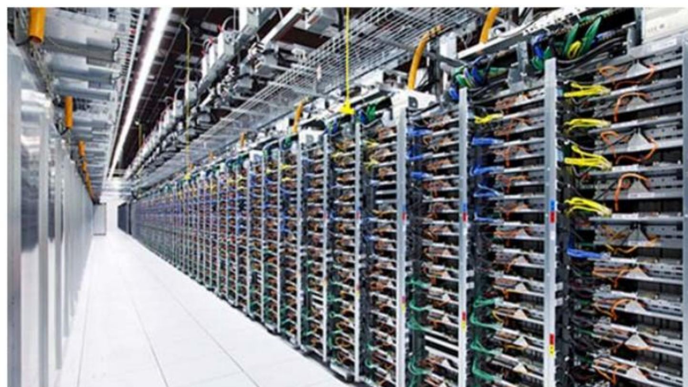
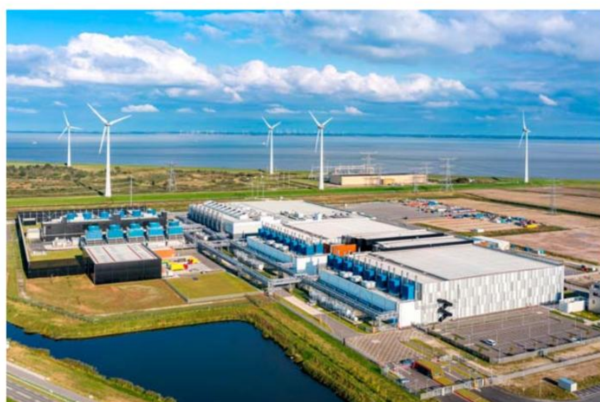
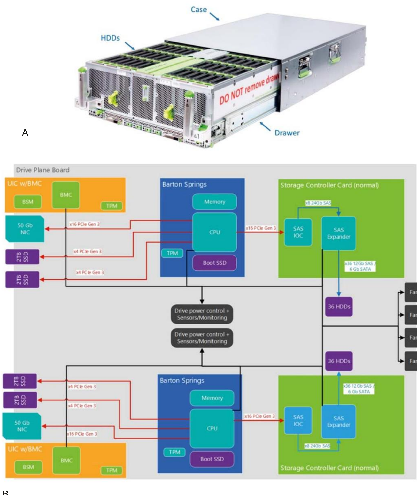
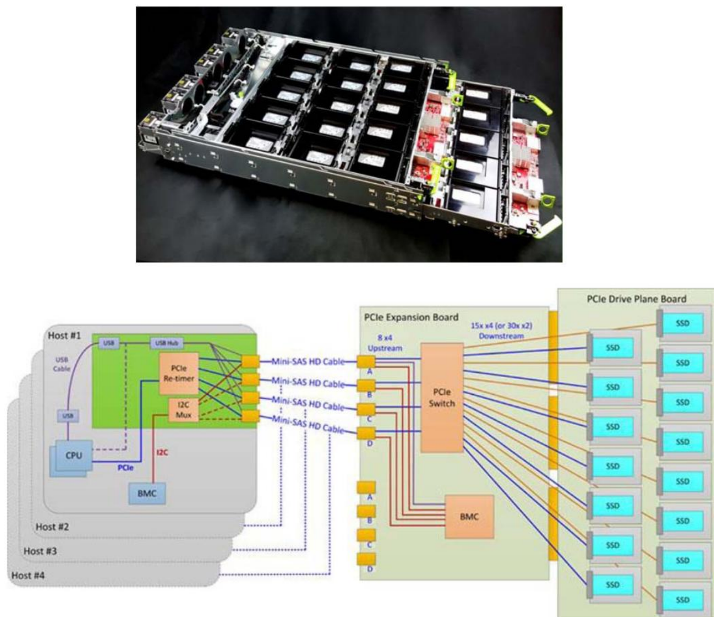

## 仓库级计算机的体系结构 {#sec-6-4}

一台 WSC 由 50 000～100 000 台计算服务器和存储块组成，它们通过一个分层的网络连接起来。计算设备、存储设备和网络设备都装在机架里，同一个机架中还装有供电设备，如交流—直流电源变换器和备用电池。[图 6.6](#fig-6-6) 是谷歌 WSC 中的一个机架。

{#fig-6-6 width=90%}

机架的尺寸差别很大。传统机架宽 19 英寸、深 48 英寸；近来的几种设计则做得更浅、更宽，以便每层水平托盘能放下多台服务器。机架高度通常为 70～84 英寸，以*机架单元*（RU）计量，1 RU = 1.75 英寸 = 4.44 cm。一个机架能装多少台服务器，还受三方面的限制：一是可用的供电能力（例如每个机架 10～30 kW），二是散热和气流条件，三是机架接入网络交换结构的可用带宽。机架在仓库建筑内排成一行一行，如[图 6.7](#fig-6-7) 所示。[图 6.8](#fig-6-8) 是一个 WSC 园区，园区里有多栋仓库大小的建筑，用来容纳机架以及运行机架所需的电气设备和冷却设备。

{#fig-6-7 width=80%}

{#fig-6-8 width=80%}

本节介绍 WSC 的计算、存储和网络部件，并从*开放计算项目*（OCP，Open Compute Project，<https://www.opencompute.org/>）中选取几个实例重点说明。Meta、谷歌、微软、阿里巴巴等 WSC 运营商自行设计硬件部件，OCP 维护着这些部件的详细规范。供电和冷却设备对 WSC 的运行至关重要，而且是和电子部件协同设计的，这部分内容留到 [6.6 节](#sec-6-6)介绍。

### WSC 的计算 {-}

与传统的企业数据中心相比，WSC 的硬件相对单一，但其中的服务器配置仍有多种。之所以要有这种异构性，主要是为了让硬件的能力和成本与 WSC 关键负载的特点更好地匹配。[图 6.9](#fig-6-9) 汇总了 2017 年 Meta 的 WSC 所用的 7 种服务器，以及各种配置所对应的负载。一个机架可以只装一种服务器，也可以混装多种，只要总体上满足供电和冷却的约束即可，所以有些机架并没有装满。仓库的使用年限内，硬件是逐步安装、逐步更换的，因此一个 WSC 中会同时存在好几代服务器和机架。

[图 6.9　Meta 的 WSC 所用的 7 种服务器，见 2017 年 OCP 峰会的介绍（<https://engineering.fb.com/2017/03/20/networking-traffic/ocp-summit-2017-facebook-news-recap/>）。I 型服务器实际上是一个机箱，内装 4 台单插座服务器，共用一个网络接口；其余各型都是双插座服务器，CPU、内存和存储的配置各不相同。VI、V、VII 和 VIII 型把一台双插座服务器与一个或多个存储托盘组合在一起。]{#fig-6-9 .caption}

| | I 型 | III 型 | IV 型 | V 型 | VI 型 | VII 型 | VIII 型 |
|---|---|---|---|---|---|---|---|
| 用途 | Web 服务 | 数据库 | 数据分析 | 照片 | 多种服务 | 冷存储 | 分离式 Flash |
| CPU | 4 个 Xeon D | 2 个 Xeon E5 | 2 个 Xeon E5 | 2 个 Xeon E5 | 2 个 Xeon E5 | 2 个 Xeon E5 | 2 个 Xeon E5 |
| 内存 | 32 GB | 256 GB | 128 GB | 32 GB | 256 GB | 256 GB | 32 GB |
| 存储 | 1 个 500 GB SATA | 2 个 3.2 TB PCIe Flash | 15 个 5 TB PCIe Flash | 30 个 4 TB SAS HDD | 1 个 1.8 TB PCIe Flash | 240 个 4 TB SATA HDD | 15 个 5 TB SATA/PCIe Flash |

**双插座服务器。** [图 6.10](#fig-6-10) 是一台 1 RU 的双插座服务器。这是 WSC 中常见的服务器配置，因为它的计算能力和内存容量可以配得恰到好处，能够承担范围很广的应用。服务器的固定成本（金属机壳、主板、风扇、NIC）由两个 CPU 插座分摊，所以这种配置的性价比高，即使把服务器切分开来运行多个小虚拟机（VM），效果也很好。

{#fig-6-10 width=90%}

**多节点服务器。** 还有一些服务器设计在成本和模块化方面更进一步。[图 6.11](#fig-6-11) 是 Meta 的 Yosemite 多节点服务器设计。4U 机箱中有 3 个滑架（sled），每个滑架可以插 1～4 块不同配置的服务器刀片。基本配置下，一个滑架装 4 台单插座服务器，顶部还有一块小板，上面是 4 块刀片共用的基板管理控制器（BMC）和 NIC。BMC 负责安全启动、风扇、电压调节器和各种系统传感器；NIC 内含一个 4 路 PCIe 交换器，为每台服务器各提供一个物理上独立的接口来使用 NIC 的资源。

{#fig-6-11 width=90%}

有些负载的会话级并行性充足、内存需求小，如前端 Web 服务器、横向扩展的微服务、中小规模的虚拟机，这种配置对它们来说性价比高。这类负载用两台单插座服务器和用一台双插座服务器，得到的吞吐率相同，因此没有必要使用双插座服务器所需的、更昂贵的 CPU 芯片。Yosemite 设计让多台单 CPU 服务器分摊 BMC 和 NIC 的成本。Yosemite 滑架还可以装其他配置的刀片，包括带共享存储或共享领域专用加速器（DSA）的刀片。

**DSA 服务器。** 小型 DSA，如用于机器学习推理或视频转码的芯片，可以做成 PCIe 或 M.2 外设板，装在上述服务器中。但是，大型机器学习模型（如大语言模型，LLM）的训练和服务意义重大、规模巨大、计算密集，于是出现了专门部署 DSA 的服务器。这种服务器装有 4～16 块高端 DSA 芯片，每块芯片的功耗在 800 W 以上。每台服务器连接三个网络：

* 一是普通的数据中心网络，把服务器连到分布式存储和公共互联网；
* 二是高带宽网络，把服务器内部的各个 DSA 直接连起来；
* 三是一个独立的服务器间互连网络，支持跨多台服务器的分布式训练和推理。

这类服务器是构建 DSA 超级计算机的基本单元，第 7 章将讨论 DSA 超级计算机。

[图 6.12](#fig-6-12) 是 NVIDIA 用于 GPU 机器学习训练的 DGX H100 服务器。这台 3U 服务器装有 8 个 H100 Tensor Core GPU，每个 GPU 配 80 GB HBM 存储器，FP8 运算性能最高可达 8 PFLOPS，BF16 或 FP16 运算最高可达 2 PFLOPS。8 个 GPU 通过 NVLink 互连直接通信，互连用了 4 块交换芯片，每个 GPU 的峰值带宽为 900 GB/s（每个 GPU 18 条链路，每条链路 50 GB/s）。4 个交换器另外向外引出 72 条链路，用来构建更大的系统：

* 再加一层 NVLink 交换器，可以把最多 32 台 DGX 服务器（256 个 GPU）连成 DGX pod 系统；
* 更大的系统用 Infiniband 网络把多个 DGX pod 连起来，每个 GPU 配一块 400 Gbps 的 CX7 NIC。

GPU 由两个 x86 CPU 管理，CPU 另配最多 2 TB 内存，并通过单独的 NIC 连接普通的 WSC 网络。一台 DGX 服务器的功耗最高可达 10 kW。类似的 GPU 服务器在公有云和私有 WSC 中都很常见。第 7 章将从端到端的角度考察 DSA 的系统设计。

{#fig-6-12 width=80%}

**Arm 服务器。** 除了 DSA 的广泛采用，WSC 的计算还有两个重要趋势。第一个趋势是 Arm 服务器的兴起。x86 垄断了二十年之后，所有主要的云服务商现在都提供采用 Arm CPU 的服务器。AWS 和阿里巴巴已经自行研发了 Arm CPU 芯片，它们借助自身的巨大用量，也获得了针对自家 WSC 环境进一步优化的机会。与十年前的预期相反，这些 Arm CPU 采用了强大的乱序核，性能可以与同类 x86 CPU 竞争（见 6.9 节的陷阱）。

**主存系统。** 第二个趋势是主存系统也将发生重大变化。随着半导体工艺继续微缩，CPU 芯片上的核数增长很快。不仅如此，CPU 厂商还把多个芯粒封装在一起，构成 64 核甚至更多核的大型 CPU 插座，每个插座的功耗最高可达 400 W，需要很高的存储带宽。目前的 CPU 集成了内存控制器，通过 DDR 通道直接与 DRAM 内存条通信。用 DRAM 工艺很难设计出更快的收发器，所以每个 DDR 引脚的速率只有 3.2～8.4 Gb/s；而制造 CPU 所用的逻辑工艺可以做出每引脚 64 Gb/s（PCIe）或 100 Gb/s（以太网）的收发器。

于是出现了一种新的趋势：把部分或全部 DRAM 控制器移到一块独立的缓冲芯片上，用 PCIe 速率的链路连接 CPU 和缓冲芯片，就像 21 世纪头十年中期以前的做法那样。缓冲芯片再连接大量 DDR 通道，构成容量大、带宽高的存储系统。与 GPU 和其他 DSA 一样，CPU 封装中也可能集成一定数量的堆叠 HBM DRAM。Compute Express Link（CXL）联盟（<https://www.computeexpresslink.org/>）推动了片外内存控制器这一趋势，它还为存储系统设计带来了几方面的新机会：

* CXL 缓冲芯片让新型非易失存储技术更容易部署；
* CXL 缓冲芯片还可以让少数几台服务器共享 DRAM 容量（Li 等，2023），就像 Yosemite 滑架让 4 台服务器共享 NIC 一样；
* 采用交换方式的 CXL 互连结构可以实现更大规模的内存分离（disaggregation）。

### WSC 的存储 {-}

**本地存储。** 有些 WSC 服务器带有本地存储，如 1～8 个 HDD 或 Flash SSD。企业负载需要本地存储，原因有二：一是有些负载本来就预期在带本地设备的服务器上运行；二是有些负载需要的存储吞吐率，超出了 WSC 网络能为每台服务器提供的水平。例如，8 个基于 NVMe 的 SSD 的峰值读带宽为 400 Gbps。使用本地存储的虚拟机必须清楚：磁盘或服务器一旦出故障，数据就会丢失。如果用本地存储保存非临时性数据，就要由虚拟机软件负责数据的持久性，例如在多个实例之间复制数据。本地存储中的数据用客户提供的密钥加密，这样，同一套物理硬件先后由不同的虚拟机使用，也不会泄露数据。

**分布式存储。** 大多数 WSC 负载把持久数据存放在分布式存储系统中。云服务商提供多种存储框架，有块、文件和对象三类接口，底层由 HDD 或 SSD 支撑，性能和价格各有不同档次。分布式存储系统有几方面的优点：

* 计算硬件与持久存储在物理上分开，管理更简单；
* 虚拟机可以迁移，也可以出故障后重启，但仍然通过网络连接原来的存储卷或文件系统；
* 数据持久性、故障恢复和灾难恢复、所分配存储容量和吞吐率的扩展，这些责任都转给了云服务商。

**磁盘阵列。** 实现分布式存储的硬件部件是磁盘阵列，称为 *JBOD*（just a bunch of disks，简单磁盘捆绑）。[图 6.13](#fig-6-13) 是 Meta 的 Grand Canyon JBOD 阵列，一个 4U 机柜中装 72 个 HDD。按每个 HDD 16 TB 计算，这是一台 PB 级的存储设备。[图 6.14](#fig-6-14) 是 Meta 的 Lightning JBOF 阵列，它有两个独立的 Flash 托盘，每个托盘 15 个槽位，每个槽位可以装 2 个 M.2 规格（2.5 英寸）的 SSD，或 1 个 U.2 规格（3.5 英寸）的 SSD。

{#fig-6-13 width=90%}

{#fig-6-14 width=90%}

JBOD 和 JBOF 阵列包含保证电源完整性和信号完整性、遥测和管理所需的器件，也支持热插拔；但阵列内部不实现任何可靠性机制，如复制或 RAID 编码。这些阵列用 PCIe 电缆连接机架中位于其上方或下方的服务器，这些服务器通常称为*头节点*。

**由软件保证可靠性。** 头节点上运行的 WSC 存储软件实现分布式存储功能，包括跨机架、跨行、跨集群的复制或纠删码。这样，WSC 中发生各种各样的故障时都能恢复数据，包括磁盘故障、机柜故障、服务器硬件或软件故障、机架故障和网络故障。只要副本或编码块分布在整个 WSC 中，无论是一个磁盘出了故障，还是为 JBOD 阵列服务的网络链路出了故障，分布式存储软件都用同样的方式恢复数据。用统一的机制应对多种故障，所需副本或编码块的总数也更少。

**存储的调优。** WSC 架构师可以调整存储阵列的部署，针对从热数据快速存储到低成本归档存储的各种用途分别优化，手段有三：

* 一是部署不同类型的 HDD 和 SSD，有的为吞吐率优化，有的为容量优化。
* 二是调整头节点的数量、阵列与头节点之间连接的带宽，以及为连接 WSC 网络而分配的网络带宽。例如，一个 Lightning JBOF 托盘可以由 1 个头节点通过一条 x8 PCIe 连接服务，也可以由 4 个节点通过 4 条 PCIe 连接服务。
* 三是调整容错方案，在速度与存储开销之间折中。3 副本方案可以容忍 2 个磁盘故障，恢复是即时的，但存储开销为 200%。Reed-Solomon 码可以降低容错的开销，但会带来恢复延迟。例如，RS(9,6) 码每 6 个块增加 3 个冗余块，存储开销为 50%，重建任何一个故障块都要读 6 个块；RS(14,10) 码的开销为 40%，但重建任何一个故障块都要读 10 个块。
