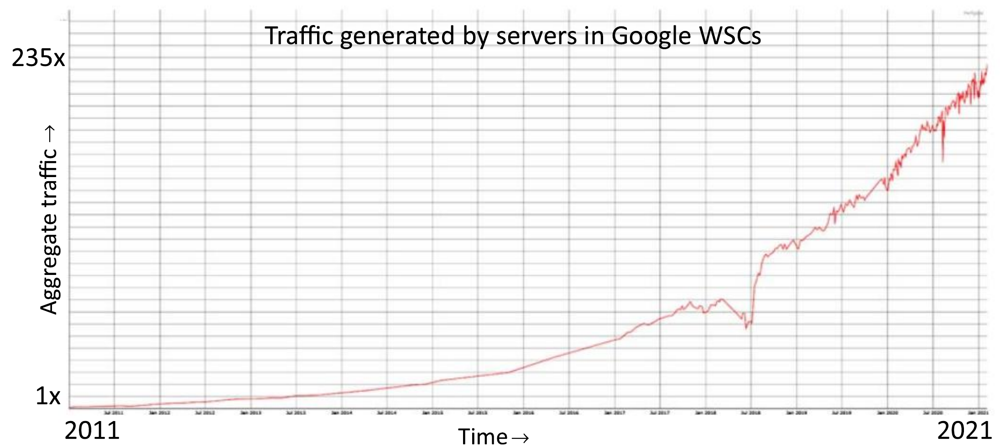
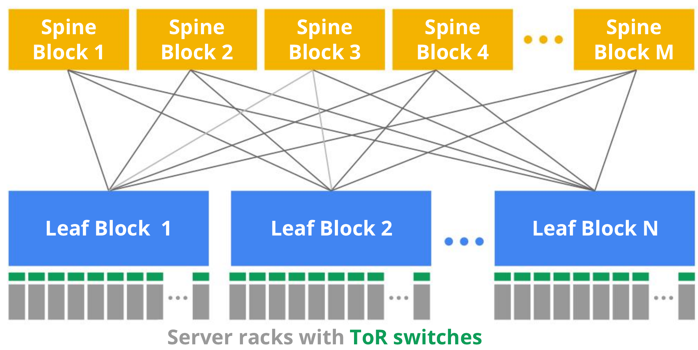

### WSC 网络 {-}

WSC 的节点越来越多，每个节点的计算能力和存储能力也越来越强，网络流量因此增长很快。[图 6.15](#fig-6-15) 表明，谷歌 WSC 中服务器之间的网络流量在短短 10 年里增加到原来的 235 倍。如果设计时不下功夫，WSC 网络很容易成为性能或成本的瓶颈。

{#fig-6-15 width=90%}

**理想的网络与现实。** 理想的 WSC 网络是一个完美的交叉开关，能以全*对分带宽*连接 5 万～10 万个节点，也就是说，任意两个节点组成的所有节点对都能同时以各自 NIC 的全速（如 100 Gbps）通信。此外，WSC 网络还必须有弹性：大型系统中偶尔会有网络链路和交换机发生故障，服务器之间仍应能以高带宽通信。可惜这样的理想交换机并不现实，因为 $n$ 个端口（节点）的交叉开关，成本按 $n^2$ 增长。到 21 世纪 10 年代初，人们已经清楚，没有哪种企业级网络方案能够满足 WSC 在规模和成本上的要求。于是，云服务提供商为 WSC 开发了一类新的网络，它结合了超级计算的思想（拓扑结构）和商用网络的思想（交换芯片和传输协议）。

**Clos 拓扑。** 现代 WSC 网络采用多级拓扑，例如 Clos 拓扑。Clos 拓扑最初是为电路交换的电话网络发明的，以形式化描述其性质的电信专家 Clos 命名（Clos，1953）。这种拓扑用多级交换机来近似一个大型交叉开关的连通性，成本却低得多。[图 6.16](#fig-6-16) 是 WSC 中 Clos 网络的一般结构：

* 第一级是每个机架上都有的*架顶（TOR，top-of-the-rack）交换机*，也称 *L1 交换机*。每个 TOR 交换机用下行链路连接服务器，用上行链路连接一组*叶交换机*（*L2 交换机*）；
* 每个叶交换机都与所有*脊交换机*（*L3 交换机*）相连。

这种拓扑是模块化的，增加叶交换机组就能扩展到数万个节点；按照叶到脊的连接方式再增加层级，还可以进一步扩展。附录 L 深入讨论了互连网络，包括拓扑结构和交换机的微结构。

{#fig-6-16 width=85%}

**Jupiter 网络。** Clos 拓扑的性价比高，原因是三级交换系统都用同样的商用交换芯片搭建。[图 6.17](#fig-6-17) 是谷歌 Jupiter 互连网络所用的交换机。Jupiter 是谷歌自行设计的第五代 WSC 网络，2012 年首次部署（Singh 等，2015）。TOR、叶、脊三种交换机都由一块或多块电路板构成，每块板上有 4 个 16 端口的交叉开关芯片。Jupiter 在最大规模时，对分带宽高达 1.3 Pbit/s（1 Pbit = 10^15^ 位）。相比之下，整个因特网的对分带宽可能只有 0.2 Pbit/s，原因之一是 Jupiter 就是为高对分带宽而建的，因特网则不是。[图 6.18](#fig-6-18) 回顾了谷歌五代自研 WSC 网络中各级交换机的演变。

![图 6.17　谷歌 Jupiter Clos 网络的基本构件，取自 Singh 等（2015）的图 13（a）和图 14（b）。图（a）中的 Merchant silicon 是 Jupiter 所用的商用交换芯片，即一个 16 端口、链路速率 40 Gbps 的交叉开关芯片。关键构件是 4U 的 Centauri 机箱，内有 4 个交叉开关芯片，64 个端口都可以从前面板接入。Centauri 用作 TOR（L1）交换机，一种可能的配置是 48 条下行链路连接服务器，16 条上行链路连接网络核心。叶（L2）交换机在谷歌内部也称中间块（middle box，图中 Middle block，MB），由 4 个 Centauri 机箱按两级结构组成，有 64 条上行链路和 64 条下行链路。图（b）是装在一个机架中的 4 个中间块。叶块也称汇聚块（Aggregation block），包含 8 个叶交换机，有 512 条下行链路连接 32 个 TOR 交换机，512 条上行链路连接 256 个脊交换机。每个脊（L3）交换机（Spine block）由 6 个 Centauri 机箱按两级拓扑组成，提供 128 条下行链路，连接 64 个叶块。图内的 up、down 分别指上行、下行。](images/ch06/fig-6-17.png){#fig-6-17 width=85%}

[图 6.18　谷歌 WSC 部署过的六代网络交换机（Singh 等，2015）。Four-Post CR 使用商用的 512 端口 1 Gbit/s 以太网交换机和 48 端口 1 Gbit/s 以太网架顶（ToR）交换机，一个 WSC 可容纳 20000 台服务器。其余各代都采用自行设计的交换机。Firehose 1.0 的目标是为 10000 台服务器中的每一台提供 1 Gbps 的无阻塞对分带宽，但 ToR 交换机的连通性低，链路出故障时会引发问题。Firehose 1.1 是第一种自行设计、ToR 交换机连通性更好的交换机。Watchtower 和 Saturn 沿用同样的思路，但采用了更新、更快的商用交换芯片。Jupiter 采用 40 Gbps 的链路和交换机，对分带宽超过 1 Pbit/s。]{#fig-6-18 .caption}

| 数据中心交换机代 | 首次部署 | 商用芯片 | 架顶（ToR）交换机配置 | 边缘汇聚块 | 脊块 | 网络速率 | 主机速率 | 对分带宽 |
|---|---|---|---|---|---|---|---|---|
| Four-Post CRs | 2004 | 厂商产品 | 48 × 1 Gbps | — | — | 10 Gbps | 1 Gbps | 2 Tbps |
| Firehose 1.0 | 2005 | 8 × 10 Gbps；4 × 10 Gbps（ToR） | 上行 2 × 10 Gbps；下行 24 × 1 Gbps | 2 × 32 × 10 Gbps | 32 × 10 Gbps | 10 Gbps | 1 Gbps | 10 Tbps |
| Firehose 1.1 | 2006 | 8 × 10 Gbps | 上行 4 × 10 Gbps；下行 48 × 1 Gbps | 64 × 10 Gbps | 32 × 10 Gbps | 10 Gbps | 1 Gbps | 10 Tbps |
| Watchtower | 2008 | 16 × 10 Gbps | 上行 4 × 10 Gbps；下行 48 × 1 Gbps | 4 × 128 × 10 Gbps | 128 × 10 Gbps | 10 Gbps | n × 1 Gbps | 82 Tbps |
| Saturn | 2009 | 24 × 10 Gbps | 24 × 10 Gbps | 4 × 288 × 10 Gbps | 288 × 10 Gbps | 10 Gbps | n × 10 Gbps | 207 Tbps |
| Jupiter | 2012 | 16 × 40 Gbps | 16 × 40 Gbps | 8 × 128 × 40 Gbps | 128 × 40 Gbps | 10/40 Gbps | n × 10 Gbps / n × 40 Gbps | 1300 Tbps |

**超额订阅与拥塞。** Clos 拓扑通常不提供全对分带宽。在上面介绍的 Jupiter 配置中，每个 TOR 交换机的下行带宽与上行带宽之比为 3:1，称为 3:1 的*超额订阅比*（oversubscription ratio）。任意两台服务器之间都能以链路的最高速率（40 Gbps）通信；但如果一个机架内的所有服务器同时向其他机架的服务器发送数据，每台服务器的有效带宽就只有 1/3。WSC 中各条通信路径还会相互重叠，叶交换机和脊交换机中的拥塞也会限制有效带宽。WSC 运营商用多种技术把超额订阅和拥塞的影响降到最低：

* 把不太可能同时向网络核心全速发送数据的负载放在同一个机架里；
* 尽量把分布式负载的各个进程调度得靠近一些，让它们的大部分流量只经过一个 TOR 交换机或一个叶交换机。但从容错的角度看，这些进程又应当均匀地分散到整个 WSC 中，以保证任何一条链路或一个机架出故障时，对它们可用性的影响都最小，两种考虑互相矛盾；
* 每条连接在多路径的 Clos 网络中走哪条路径，随机选择，使流量尽可能均匀地分布，避免核心出现拥塞。

**容错。** [图 6.17](#fig-6-17) 中的 Clos 实现本身就是容错的：任意两个 TOR 交换机之间都有多条经过叶块和脊块的路径，叶块或脊块中任何一条链路或一个芯片出故障，都不会使某个 TOR 交换机断开。有些云部署还在每个机架中配置一对冗余的 TOR 交换机，使不能容错的应用不受 TOR 交换机故障或交换机维护停机的影响。

**新一代交换芯片。** 用更新的商用交换芯片也能设计出类似的 Clos 拓扑。例如，Broadcom 2022 年发布的 Tomahawk 5 芯片，可以用作 64 端口的 800 Gbps 交叉开关，也可以用作 128 端口的 400 Gbps 交叉开关或 256 端口的 200 Gbps 交叉开关。这为芯片的用法提供了更多灵活性：WSC 架构师可以在拓扑的核心部分使用较高的链路速率，在机架内部则使用每条 200 Gbps 的链路，使系统中的服务器端口数最多。

**例题**　用[图 6.17](#fig-6-17) 中的构件搭建 Jupiter 拓扑，最多能支持多少台服务器？假设每台服务器用一条 40 Gbps 链路连接 TOR 交换机，TOR 一级的超额订阅比为 3:1；每个 TOR 与每个中间块之间、每个汇聚块与每个脊块之间，都用一对冗余的 40 Gbps 链路连接。如果 TOR 一级的超额订阅比改为 1:1，容量又是多少？

**解答**　先回顾[图 6.17](#fig-6-17) 中的构件：

* 脊块（L3）向汇聚块提供 128 条 40 Gbps 的下行链路。每个汇聚块都用一对冗余链路连接每个脊块，因此系统中最多有 128/2 = 64 个汇聚块。
* TOR 交换机（L1）有 64 个 40 Gbps 端口。超额订阅比为 3:1 时，有 48 条下行链路连接服务器，16 条上行链路连接汇聚块。用一对冗余链路连接一个中间块，16 条上行链路正好连接一个汇聚块中的 8 个中间块。
* 在汇聚块（L2）一级，每个中间块有 64 条连向 TOR 交换机的下行链路，所以每个中间块可以连接 32 个 TOR 交换机。

系统中最多可容纳的服务器数为：

$$
\begin{aligned}
& 64\ \text{个汇聚块} \times 32\ \text{个 TOR 交换机/汇聚块} \\
& \quad \times 48\ \text{台服务器/TOR 交换机} \\
& = 98304\ \text{台服务器}
\end{aligned}
$$

实际的服务器数要少一些，因为一部分汇聚块要用于对外连接，连到其他 WSC 集群和公共因特网。不过，每条 40 Gbps 链路可以拆成 4 条 10 Gbps 链路，这样就能以较低的单服务器带宽连接更多的服务器。

超额订阅比为 1:1 时，每个 TOR 有 32 条上行链路和 32 条下行链路。汇聚块的设计不变，每个 TOR 交换机与每个中间块之间有 4 条链路，于是每个汇聚块只能容纳 16 个 TOR 交换机。系统中最多可容纳的服务器数为：

$$
\begin{aligned}
& 64\ \text{个汇聚块} \times 16\ \text{个 TOR 交换机/汇聚块} \\
& \quad \times 32\ \text{台服务器/TOR 交换机} \\
& = 32768\ \text{台服务器}
\end{aligned}
$$

要容纳更多的服务器，就得使用更多的汇聚块和更大的脊块。一个机架内的大量服务器同时高速发送数据时，超额订阅可能造成拥塞；但对于给定数量的服务器，它能大大降低所需 WSC 网络的成本。

**布线。** WSC 网络中的链路数量很多，电缆成本和布线的复杂性都是必须认真考虑的问题。目前，服务器与 TOR 交换机之间的链路通常是成束的铜缆。例如，一条 200 Gbps 的链路可以是 4 根各 50 Gbps 的电缆，也可以是 2 根各 100 Gbps 的电缆。距离短（1～3 m）、链路速率为 100～400 Gbps 时，铜缆既实用，成本又低。L1、L2、L3 交换机之间的链路则长得多（数十米到数百米），速率也更高，因此首选光缆。光缆往往预先成束，以降低在 WSC 中部署的复杂性。配有 GPU 或其他 DSA 的服务器需要的带宽越来越大，服务器到 TOR 的链路继续使用铜缆也越来越难。下面两种技术可能很快就会在数据中心中广泛部署：

* 有源铜缆，内含中继器，用来延长铜缆的传输距离，提高带宽；
* 与计算芯片共封装在插座内的光收发器，用来降低服务器到 TOR 链路上光收发器的成本和功耗。

**增量部署与光路交换。** 为一个 WSC 装满 10 万台服务器需要几个月到几年；装满以后，还要不断用最新的硬件逐步升级。叶交换机可以根据需要增加和更换，不影响 WSC 网络的其余部分。脊交换机则带来一个两难的折中：

* 如果随着 WSC 逐步装机而逐步增加脊交换机，每增加一次，都要在叶交换机和脊交换机之间大量重新布线，网络性能会在很长一段时间内下降；
* 如果一开始就装好全部脊交换机，就可以预先为将来的叶交换机布好所有连线。但这样一来，脊交换机用的就是数据中心里最老的技术。假如 Clos 网络起初使用 100 Gbps 链路，把一部分叶交换机升级到 200 Gbps 链路，在脊交换机也升级之前，带宽不会有任何提高。

为了摆脱这一困境，WSC 运营商在叶交换机和脊交换机之间加了一层*光路交换机*（OCS，optical circuit switch）。OCS 是一种微机电系统（MEMS），可以在几毫秒内重新编程，改变输入光纤与输出光纤之间的连接。OCS 只是反射光，不做包一级的决策，因此与速率无关。[图 6.19](#fig-6-19) 表明，谷歌在 Jupiter 网络中用一层 OCS 来方便叶块和脊块的增量部署，每一步都能针对现有的叶交换机采用尽可能好的拓扑（Poutievski 等，2022）。随着时间推移逐步增加叶交换机和脊交换机，布线也都是增量进行的。

{#fig-6-19 width=90%}

**用 OCS 取代脊交换机。** 谷歌的工程师把这个思路又推进了一步，用 OCS 完全取代脊交换机。叶交换机只与 OCS 相连，OCS 之间也直接相连。[图 6.20](#fig-6-20) 表明，谷歌通过对 OCS 内部的连接编程，来配置叶交换机之间所需的拓扑和连接速率（Poutievski 等，2022）。注意，两个采用 200 Gbps 链路的新叶交换机之间现在可以直接全速通信，尽管它们与其他所有较老的叶交换机通信时仍须降速到 100 Gbps。之所以能这样，是因为 OCS 与脊交换机不同，它只是反射光，与速率无关。

![图 6.20　谷歌 WSC 中用光路交换机取代脊交换机，取自 Poutievski 等（2022）的图 5。OCS 除了支持增量部署，还支持根据流量模式动态配置的直连拓扑。(1) 起初加入汇聚块 A、B，各有 512 条上行链路。(2) 加入有 512 条上行链路的块 C。每个块向外的需求为 50T，均匀分布到其他各块。拓扑工程构成一个均匀的网状拓扑，与均匀的稳态需求矩阵相匹配。(3) 流量工程（TE）根据 (2) 中更细粒度的需求，调整加权代价多路径（WCMP）的权重：A 发往 B 的全部流量（20T）都走直接路径（粉色）；发往 C 的流量（青色）按 5:1（25T:5T）分到直接路径和间接路径（经由 B）上。(4) 加入有 256 条上行链路的块 D（D 中只装了一部分机器机架）。(5) 块 D 扩充到 512 条上行链路。(6) 块 C、D 更新为 200 G 链路速率。图内标注：DCNI（4x failure domains），DCNI（4 个故障域）；512x100Gbps block，512 × 100 Gbps 的块；256x100Gbps block，256 × 100 Gbps 的块；512x200Gbps，512 × 200 Gbps 的块；Block-to-block，块到块（需求矩阵）；100Gbps / 200Gbps block-to-block logical links，100 Gbps / 200 Gbps 的块到块逻辑链路；右下角说明：这些逻辑链路所对应的物理链路条带化地分布在 DCNI 层的所有 OCS 上。](images/ch06/fig-6-20.png){#fig-6-20 width=90%}

**拓扑工程。** 从总体上看，Clos 拓扑中的脊层提供了一种手段，把流量分散、均衡到包含接收节点的叶块的所有链路上。这种分散能很好地处理多种流量模式，即使是最坏情况下的全互换（all-to-all）置换也能应对，代价是脊交换机需要大量光收发器。谷歌的工程师观察到，他们的网络流量模式相对可以预测，与脊层所针对的最坏情况置换模式相去甚远。因此，他们不再分散流量，而是利用 OCS 层做*拓扑工程*：根据当前的应用模式，每天对叶交换机之间所需的连接和带宽编程。

**控制平面与传输协议。** WSC 网络推动了控制平面系统的发展，这类系统负责所有网络设备的配置、路由、管理和实时控制。因特网依靠分布式的独立管理；WSC 的控制平面则不同，它利用逻辑上集中的网络状态视图，对性能、可扩展性、安全性和活性进行优化，效果超出了每次只考虑一条网络连接所能达到的程度（Ferguson 等，2021）。控制平面的决策由网络各级每台交换设备所附的、基于 CPU 的控制器执行。WSC 网络也促使通信应用所用的传输协议迅速演进。WSC 网络是同构的、集中控制的系统，因此可以从交换机中提取拥塞和遥测信息，或者精确测量往返时间，从而构造更好的拥塞控制算法；还可以部署*远程直接内存访问*（RDMA，remote direct memory access）协议，实现低延迟、低开销的通信。

### 程序员眼中的 WSC {-}

WSC 体系结构对所有类型的负载都有影响。即使是只用单个 VM 的负载，也需要了解从远程服务器访问存储意味着什么。分布式负载或*云原生*负载则必须针对 WSC 中大量机器和网络的性能与可靠性特点进行优化。

程序员了解 WSC 的存储层次。[图 6.21](#fig-6-21) 给出了 WSC 内部存储层次的延迟、带宽和容量，[图 6.22](#fig-6-22) 把同样的数据画成了图。这两幅图基于以下假设：

* 服务器的两个插座合计有 16 个存储通道，都插上 32 GB 的 DDR4-3200 内存条。内存总容量为 512 GB，访问延迟为 100 ns，所有通道合计的峰值内存带宽为 409.6 GB/s。
* 服务器有一块 3.84 TB 的 NVMe Flash 驱动器，最大读带宽为 6.9 GB/s，无负载时的读延迟为 100 μs。服务器还有一块 20 TB 的硬盘，平均访问时间为 5 ms，持续传输率为 300 MB/s。两个 CPU 插座共用一块 100 Gbps 的以太网 NIC。
* 本例中一个机架有 48 台服务器。NIC、交换机和网络软件使 DRAM 和 Flash 的访问延迟增加 100 μs，磁盘的访问延迟增加 500 μs。100 Gbps 的 NIC 把远程接收的带宽限制在 12.5 GB/s，但数据可以来自机架上的多个设备。整个机架的存储容量约为 DRAM 24.5 TB、Flash 184.3 TB、磁盘 960 TB。
* WSC 的一行有 30 个机架，所以一行（阵列）的存储容量是一个机架的 30 倍：DRAM 735 TB、Flash 5.5 PB、磁盘 29.8 PB。在一行之内，多级网络中的网络设备和可能出现的拥塞使 DRAM 的访问延迟增加 200 μs，Flash 增加 300 μs，磁盘增加 1 ms。由于超额订阅，每台服务器远程访问 DRAM、阵列 Flash 或阵列磁盘时可用的带宽限制在 20 Gbps，即 2.5 GB/s。

[图 6.21　WSC 存储层次的延迟、带宽和容量。[图 6.22](#fig-6-22) 画出了同样的数据。]{#fig-6-21 .caption}

| | 本地 | 机架 | WSC 行 |
|---|--:|--:|--:|
| DRAM 延迟（μs） | 0.1 | 100.0 | 200.0 |
| Flash 延迟（μs） | 100.0 | 200.0 | 300.0 |
| 磁盘延迟（μs） | 5000.0 | 5500.0 | 6000.0 |
| DRAM 带宽（MB/s） | 409600 | 12500 | 2500 |
| Flash 带宽（MB/s） | 6900 | 12500 | 2500 |
| 磁盘带宽（MB/s） | 300 | 12500 | 2500 |
| DRAM 容量（GB） | 512 | 24500 | 735000 |
| Flash 容量（GB） | 3840 | 184320 | 5500000 |
| 磁盘容量（GB） | 20000 | 960000 | 29800000 |

 中 WSC 存储层次的延迟、带宽和容量数据的图示。图内标注：Latency (μs)，延迟（μs）；Bandwidth (MB/s)，带宽（MB/s）；Capacity (GB)，容量（GB）；横轴依次为本地 DRAM、本地 Flash、本地磁盘、机架 DRAM、机架 Flash、机架磁盘、WSC DRAM、WSC Flash、WSC 磁盘。](images/ch06/fig-6-22.png){#fig-6-22 width=90%}

**计算与存储分离。** 从[图 6.21](#fig-6-21) 和[图 6.22](#fig-6-22) 可以看出，硬盘和 Flash 设备本身的延迟比网络额外增加的延迟大得多，所以从本地访问改为远程访问，总延迟增加得并不多。如果数据来自多个远程磁盘，远程磁盘带宽比本地磁盘带宽高得多。Flash 的带宽在机架内较高，跨行时较低。正是这些现象推动了 WSC 中计算与存储的分离，这种分离在可扩展性和可靠性上有很大优势。许多分布式应用发起的是无状态的计算任务，这些任务在整个 WSC 范围内调度，输入和输出都依靠分布式（远程）存储。计算很容易扩展；分布式存储系统则通过在存储节点之间对数据*分片*（sharding）或*分区*（partitioning），达到所需的容量、带宽和可靠性。计算和存储都可以各自独立地扩展，并从大型 WSC 的并行性中获益。

**远程 DRAM 与键值存储。** DRAM 的情况则相反。[图 6.21](#fig-6-21) 和[图 6.22](#fig-6-22) 表明，无论是在机架内还是在一行之内，网络开销都使远程 DRAM 的访问延迟急剧增加。即便如此，远程 DRAM 和远程 Flash 的访问速度仍是本地磁盘的 10 倍以上。此外，网络抹平了机架内 DRAM、Flash 和磁盘之间的带宽差别，阵列内三者之间的带宽差别也同样被抹平。这些现象促使许多 WSC 应用采用基于 DRAM 或 Flash 的分布式*键值存储*（KVS，key-value store），以快速访问海量数据。例如，Facebook 社交网络用基于 DRAM 的 Memcache KVS，每天以交互式的延迟为数以亿计的用户提供服务（Nishtala 等，2013）。

**RDMA 与 CXL。** 从本地 DRAM 到远程 DRAM 的延迟急剧增加，正在推动 WSC 部署新的技术。RDMA 是一种网络技术，可以消除网络软件的开销和不可预测性。网络开销大多来自两个方面：一是超额订阅造成的网络拥塞，二是网络软件的延迟。网络交换机本身的直通（cut-through）延迟只有每跳 200～500 ns。RDMA 使用 Infiniband 和 RoCE 等在 NIC 硬件中实现的网络协议，可以把远程内存访问延迟降到几微秒。新兴的 CXL 交换网络也有望在 WSC 内实现快速的内存共享（解耦，disaggregation）。
