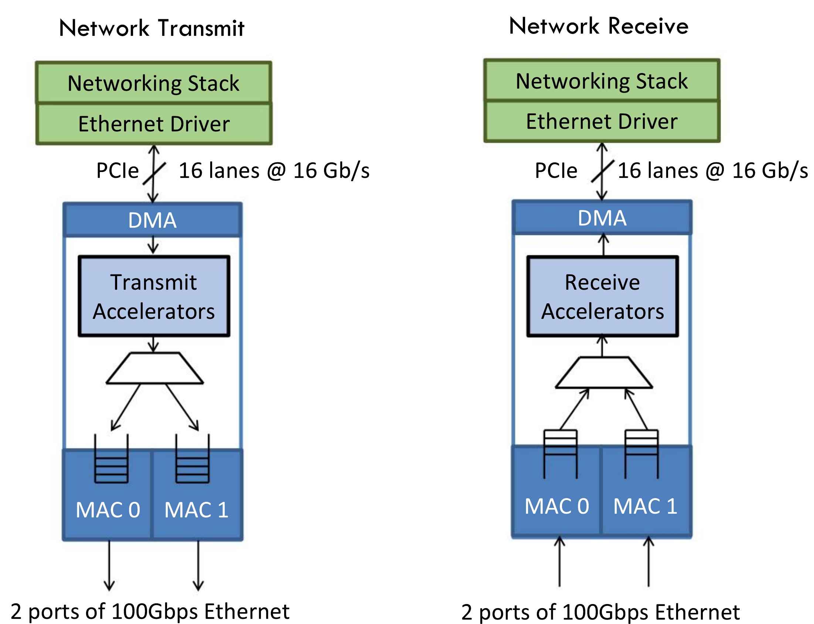
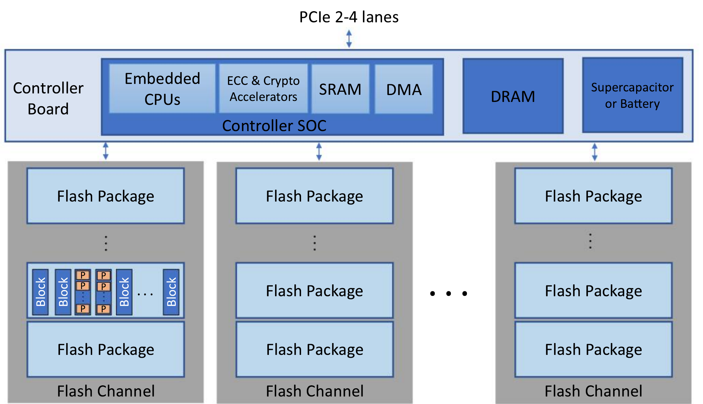

## 高性能 I/O 设备的体系结构 {#sec-6-5}

本节进一步考察 NIC 和 Flash 存储设备的体系结构，它们分别是 WSC 网络和存储中的关键 I/O 部件。为提高这两种设备的带宽、降低延迟而采用的许多软硬件优化，同样适用于其他 I/O 设备，无论这些设备连接在 CPU 宿主机上，还是直接连接在 DSA 上。

### 网络接口 {-}

[图 6.23](#fig-6-23) 是一个简单网络接口（NIC）的框图。它有 2 个以太网端口，每个端口的速率为 100 Gbps。每个端口配有一个以太网介质访问控制（MAC）模块和一组发送/接收队列。MAC 模块用硬件实现网络协议栈中的两层：

* 物理层，负责编码和信号传输；
* 数据链路层，负责底层的位发送和接收。

其余各层都可以在宿主机上用软件实现，包括互联网通信中常用的 IP 协议和 TCP 协议。下面会讲到，现代 NIC 为其中一些软件任务提供了全部或部分的加速器。软件通过以太网设备驱动程序与 NIC 交互。

发送队列和接收队列在两个方向上把 MAC 层与软件协议栈解耦。每个队列至少要能存放两个以太网包，而一个包最长可达 9000 字节。实际的 NIC 片上缓冲区比这还要大。

{#fig-6-23 width=90%}

**发送过程。** 通过网络发送一个包，要经过以下步骤：

1. 用户级软件把要发送的数据准备在一个内存缓冲区中，然后调用 write() 或 send() 这样的系统调用，通过一条事先建立好的连接（如 TCP/IP 套接字）发送数据。
2. OS 一般会把数据复制到自己的内存缓冲区，再依次执行一系列网络协议，如 TCP 和 IP。每个协议都会给数据加上包头和包尾信息，如源地址和目的地址、序号、纠错信息等。
3. 包准备好以后，OS 的设备驱动程序通过两个 FIFO 数据结构与 NIC 通信：发送队列（SQ）和完成队列（CQ）。两者都实现为宿主机内存中的循环缓冲区，用头指针和尾指针管理。驱动程序向 SQ 写入一个描述符，其中包括包在内存中的地址和目的以太网端口，然后把 SQ 的尾指针加 1。
4. 驱动程序「按门铃」通知 NIC，也就是写 NIC 的一个寄存器，这个寄存器映射在宿主机的物理地址空间中。
5. NIC 读取 SQ 中的第一个包描述符，把头指针加 1，并配置直接存储器访问（DMA）引擎，把包从宿主机内存复制到所选以太网端口的发送缓冲区。
6. 以太网 MAC 清空自己的缓冲区，按照与上游以太网交换机协商好的速率（如 100 Gbps）把包发到链路上。
7. 发送完成后，NIC 把包描述符写入 CQ，把 CQ 的尾指针加 1，并向宿主机 OS 发出中断。OS 响应中断时，可以决定释放这个包所占的内存缓冲区。对于 TCP 等某些协议，OS 可能要等收到接收方的确认之后才释放缓冲区。如果发送失败，这个包可能会重传。

**接收过程。** 通过网络接收一个包，要经过以下步骤。NIC 与 OS 驱动程序之间用一对 FIFO 数据结构通信：接收队列（RQ）和完成队列（CQ），两者同样实现为宿主机内存中的循环缓冲区，用头指针和尾指针管理。OS 分配一些内存缓冲区用于接收包，并定期把这些缓冲区的地址填入 RQ。

1. 包到达时，NIC 从 RQ 中读出一个缓冲区地址，并把 RQ 的头指针加 1。
2. NIC 对 DMA 引擎编程，把包从 NIC 的接收队列复制到 OS 的缓冲区。
3. DMA 传输完成后，NIC 释放接收队列中的相应空间，向 CQ 写入一个包描述符并更新 CQ 的尾指针，最后向宿主机 OS 发出中断。
4. OS 在随后某个时刻用一系列协议（如 IP 和 TCP）处理这个包：用检错码确认包已正确接收，并去掉所有包头和包尾。
5. OS 把数据复制到正在监听这条连接的应用程序的用户级缓冲区。
6. OS 释放或回收这个包用过的自己的缓冲区，还可能生成一个确认消息，告诉发送方这个包已经收到，以及接收时是否出错。

上面概括的发送和接收过程是简化过的，其中有几处低效之处，导致网络带宽低、延迟高。

**挑战一：网络协议处理的 CPU 开销很大。** NIC 用所谓*无状态卸载*（stateless offload）部分缓解了这个问题，也就是用硬件加速器完成一部分网络协议任务。最常见的卸载是：对以太网、IP、TCP、UDP 等常用网络协议，在发送时生成检错码，在接收时检查检错码。包在发送或接收的过程中，NIC 就随即生成或检查检错码，并把结果告知宿主机 OS。

NIC 还提供*大段卸载*（large segment offload）。它的逻辑在发送端把一个大消息拆分成网络所支持的较小的包，在接收端再把这些小包重新组装成大消息，即使这些小包是乱序到达的。这样，发送和接收一块 1 MB 的数据只需要执行 1 次网络协议，而不是 1 MB/9000 B ≈ 112 次。大段卸载要求 NIC 上有更大的缓冲区，实现起来也比较复杂，因为以太网包在穿过 WSC 网络时可能被重新排序，偶尔还会丢失。

**挑战二：中断处理的开销。** 一块 100 Gbps 的 NIC 如果接收的都是最小的以太网包（64 B），每秒可能产生 2 亿次中断。为了不让 CPU 不堪重负，NIC 采取了以下几种措施：

* *中断调节*（interrupt moderation）：限制中断的频率上限，一次中断可以通知多个包的到达。
* *中断导向*（interrupt steering）：由 NIC 中的逻辑选择由哪个 CPU 核接收中断。一种简单的做法是所有包都只中断同一个核，这样这个核的指令 Cache 和数据 Cache 里始终有网络处理要用的内容。但网络速率很高时，这个核会成为瓶颈。因此，NIC 还实现了把中断分散到多个核上的机制：对每个包的连接信息做哈希，按哈希结果选择核，这种机制称为*接收端扩展*（receive side scaling）。哈希保证同一条连接的所有中断都由同一个核接收，从而把同步开销降到最低。
* OS 完成网络处理之后，可能还需要再产生一次中断，才能调度正在等待这个包的应用进程。为此，有些 NIC 设有专门的逻辑，记录每条活跃连接最近是由哪个核发出发送类系统调用的；同一条连接的包到达时，就中断这个核。如果这个核仍在运行建立这条网络连接的应用程序，那次额外的中断就不需要了。

OS 和应用程序也可以通过轮询 NIC 来获取到达的网络包，从而完全避免中断。有些操作系统采用折中的办法：NIC 中断使它们开始运行网络子系统的代码以后，就在轮询模式下停留一段时间，以分摊中断的开销。

**挑战三：存储和 Cache 的开销。** 发送和接收包都要在 NIC、OS 缓冲区和应用程序缓冲区之间多次复制。在未经优化的系统中，消耗的存储带宽是网络带宽的 5 到 8 倍。相应的优化有以下几种：

* *数据直接 I/O*（DDIO，data direct I/O）：把到达的包直接放进 CPU 的末级 Cache（LLC，Last-Level Cache）。如果包很快就得到处理，DDIO 既能加快网络处理，又能减少所用的存储带宽；否则，这些包会逐渐被替换到主存中。
* *包头分离*（header splitting）：把包的元数据和包的数据放在不同的缓冲区。OS 一般只处理包头，数据则由应用程序自己处理，所以分离以后网络处理的局部性更好。
* *零拷贝网络*（zero-copy networking）：把有效载荷直接从 NIC 复制到应用程序的缓冲区，省去经由 OS 缓冲区的多余复制。零拷贝网络必须以包头分离为前提，还要求接收方应用程序事先提交好用于接收数据的缓冲区地址。如果包会被重新排序或丢失，零拷贝的实现就比较复杂。

WSC 中使用的 NIC 大多数是以太网设备，实现了上面讨论的几种优化。近几年，NIC 出现了两种新趋势：

* 一是一些为机器学习（ML）优化的集群使用 InfiniBand（IB）或 RoCE（RDMA over Converged Ethernet，基于融合以太网的 RDMA）网络设备。RoCE 是在以太网上实现的 InfiniBand 协议。IB 和 RoCE 把全部网络协议处理都卸载到 NIC 上，并实现了到应用程序缓冲区的零拷贝网络，缓冲区可以在 CPU 内存中，也可以在 GPU 内存中。
* 二是部署智能网卡（SmartNIC）。SmartNIC 集成了可编程的核，能够卸载各种各样的任务，包括网络协议处理、远程存储协议处理和各种虚拟机监控器任务。

公有云框架中使用的 NIC 还带有用于网络虚拟化的硬件模块，即一些可编程逻辑。这些逻辑可以添加和去除支持私有虚拟网络所需的各层包头，并在共享的 WSC 中执行安全规则（Firestone 等，2018）。

### NVMe Flash 盘 {-}

WSC 中广泛使用 NVMe（Nonvolatile Memory Express）盘，构建针对高吞吐率和低延迟优化的存储系统。如果存储系统追求的是每位存储成本低，硬盘驱动器仍然很常用。

[图 6.24](#fig-6-24) 是 NVMe 盘的组成。它的核心部件是由垂直堆叠的 Flash 存储芯片构成的封装，每个堆叠有 100 多个芯片，整个封装相当于一个高密度的芯片。多个这样的封装组织成若干个通道，以获得并行性。每个通道同一时刻只能进行一次访问，但设备控制器可以让不同通道上的访问重叠进行。

**读写特性。** 对一个封装的访问以页为单位，一页 1 到 8 KB，其中包括一些用于纠错编码的冗余存储空间。读一页需要几十微秒，写一页则既慢又复杂：

* 若干页组成一个*块*，每块 64 到 256 页；
* 写之前要先用擦除操作把整个块复位，擦除需要几毫秒；
* 然后按顺序（0, 1, 2, ...）写入各页，每写一页需要 1 到 2 毫秒。

写入慢的原因有三：一是 Flash 存储单元本身的特性，它的状态以浮栅上的电荷来保存；二是为了增加 Flash 的容量，常常采用多级单元（MLC）；三是 Flash 单元阵列的结构（NAND 排列）。此外，Flash 块的*耐久性*有限，每个块擦除 10 万到 100 万次以后，就不能再作为存储器正常工作了。

{#fig-6-24 width=90%}

**Flash 转换层。** 由于这些特性，操作系统很难直接使用 Flash 设备。因此，NVMe 控制器实现了一个 *Flash 转换层*（FTL，Flash translation layer）。FTL 把块存储的读写访问转换成 Flash 的读、擦除和写操作，并把写操作造成的*磨损*均匀地分摊到所有可用的块上。[图 6.25](#fig-6-25) 给出了 FTL 维护的主要数据结构：

* 一是映射表，它把宿主机 OS 可见的*逻辑块地址*（LBA）映射到 Flash 设备地址，设备地址包括通道号、封装号、块号和页号。每次读都要查这张表，以确定要访问的物理页。
* 二是块信息表，记录设备上每个块的状态，包括块是否完好、是否已擦除，以及块中存有多少个有效页。
* 三是一个指向当前*写入点*的指针，它指明当前接收写操作的块，以及这个块中下一个可用的页。

写一个逻辑块时，控制器把新数据写到当前写入点，更新映射表，记下这个逻辑块与物理页之间的新对应关系；最后，原来存放这个逻辑块数据的 Flash 块，其有效页计数要减 1，控制器相应地更新这个块的信息。选择下一个写入点时，控制器挑选擦除次数少的 Flash 块，以此均衡磨损。

[图 6.25　Flash NVMe 设备中 FTL 的主要数据结构。所有数据结构都存放在 NVMe 设备上的 DRAM 中，并定期保存到 Flash 存储器中，以保证非易失性。块信息表中每个块还可以包含其他信息。]{#fig-6-25 .caption}

块映射表（Block Map）：

| LBA | 物理页地址 <通道, 封装, 块, 页> |
|---|---|
| 0 | <2, 4, 59, 3> |
| 1 | <2, 5, 12, 8> |
| … | … |
| 8k | <4, 0, 33, 129> |

块信息表（Block Information Table）：

| 块 | 已擦除 | 擦除次数 | 有效页数 | 坏块标志 |
|---|---|---|---|---|
| 0 | False | 15 | 15 | False |
| 1 | True | 33 | 0 | False |
| … | … | … | … | … |
| 2 | False | 1 | 4 | False |

写入点（Write point）：

| | 物理页地址 <通道, 封装, 块, 页> |
|---|---|
| 写入点 | <3, 1, 12, 24> |

**垃圾回收。** NVMe 控制器在后台定期扫描块信息表，决定是否要对有效页数少的块做垃圾回收。被回收的块中的有效页都复制到写入点，腾空的块则安排擦除。要用上全部可用容量，这一压缩步骤必不可少，但它会带来*写放大*问题：一方面加剧磨损，另一方面，排在这些额外写操作后面的读操作会被推迟。针对不同的访问模式和目标，垃圾回收和写入点选择有多种折中方案和不同的调优算法。

**FTL 的实现。** FTL 通常实现为 NVMe 设备中一个或多个嵌入式核上运行的固件。[图 6.25](#fig-6-25) 中的数据结构存放在 Flash 板上的 DRAM 中，并定期保存到 Flash 存储器中，以保证非易失性。NVMe 设备通常带有一个超级电容，掉电时控制器可以靠它迅速把全部数据结构保存到 Flash 中。FTL 还实现了对待处理访问的调度逻辑，并用 DRAM 缓存经常访问的数据。

**与宿主机的接口。** NVMe 设备与宿主机 CPU 上运行的软件之间的接口和 NIC 类似：通过 PCIe 接口实现，使用成对的命令队列和完成队列。发给 NVMe 设备的读写命令延迟不固定，可能乱序完成。控制器可以对命令排队和调度。有些读命令很快就能完成，另一些则可能被推迟几毫秒，原因是相应的 Flash 块、封装或通道上有待处理的写操作或垃圾回收任务。

**NVMe 设备与磁盘的对比。** NVMe 设备的典型参数是：容量 0.5～10 TB，无负载时的读延迟 50～100 μs，吞吐率每秒 100 万～200 万次操作，功耗 5～10 W。相比之下，典型磁盘的容量为 1～25 TB，无负载时的读延迟为 5000～10 000 μs，吞吐率为每秒 100～200 次操作，功耗为 5～10 W。

### I/O 设备虚拟化 {-}

[6.3 节](#sec-6-3)讲过，I/O 设备可以由 VMM 截获客户虚拟机的全部 I/O 请求来实现虚拟化，办法有两种：一是半虚拟化，二是对访问存储器映射 I/O 地址的 load 和 store 设陷。如今，NIC、NVMe 驱动器这类高性能 I/O 设备在设计上就允许客户虚拟机直接访问 I/O，不需要 VMM 介入。

**设备一侧：PCIe 接口的虚拟化。** 按照 PCIe 标准的单根 I/O 虚拟化（SR-IOV）扩展，I/O 设备实现多个接口功能：

* *物理功能*（PF）只有一个，包含管理 I/O 设备全部功能所需的寄存器。在非虚拟化系统中，唯一的操作系统运行设备驱动程序，通过 PF 完成 I/O 操作。
* *虚拟功能*（VF）有多个。在虚拟化系统中，VMM 使用 PF，并把设备实现的众多 VF 接口之一映射到每个客户虚拟机的客户物理地址空间，供其操作系统使用。每个 VF 都包含实现设备基本操作所需的全部寄存器：对 NIC 来说是收发数据包，对 NVMe 驱动器来说是读写数据块。VF 接口不暴露管理功能，例如启用或禁用 VF、配置每个 VF 可以访问的存储块范围、设定每个 VF 可以使用的网络带宽比例等。

**宿主一侧：IOMMU。** 要让虚拟机直接访问 I/O 设备，宿主一侧的关键技术是 [6.3 节](#sec-6-3)介绍过的 IOMMU。VMM 配置 IOMMU，对 I/O 设备中每个 PF/VF 使用的 DMA 地址进行转换，并正确地重新映射中断，这样客户虚拟机就能直接访问 VF。

在每个 PF/VF 内部，I/O 设备通常还支持多个队列对，用于网络或存储访问。利用这些队列对，可以把客户虚拟机内多个应用的 I/O 请求进一步分开、相互隔离。以网络为例，为每个应用使用单独的队列对，操作系统就能控制每个应用使用多少带宽，还有可能把到达的数据直接送入应用的虚拟地址空间。
