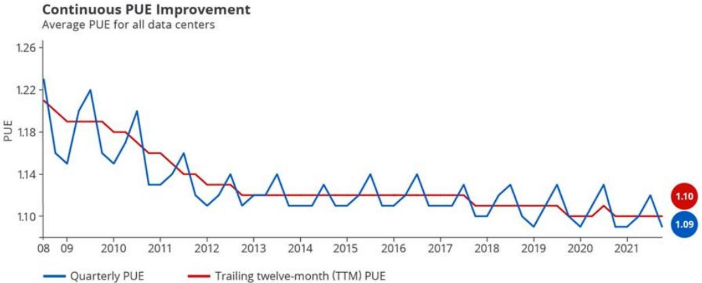
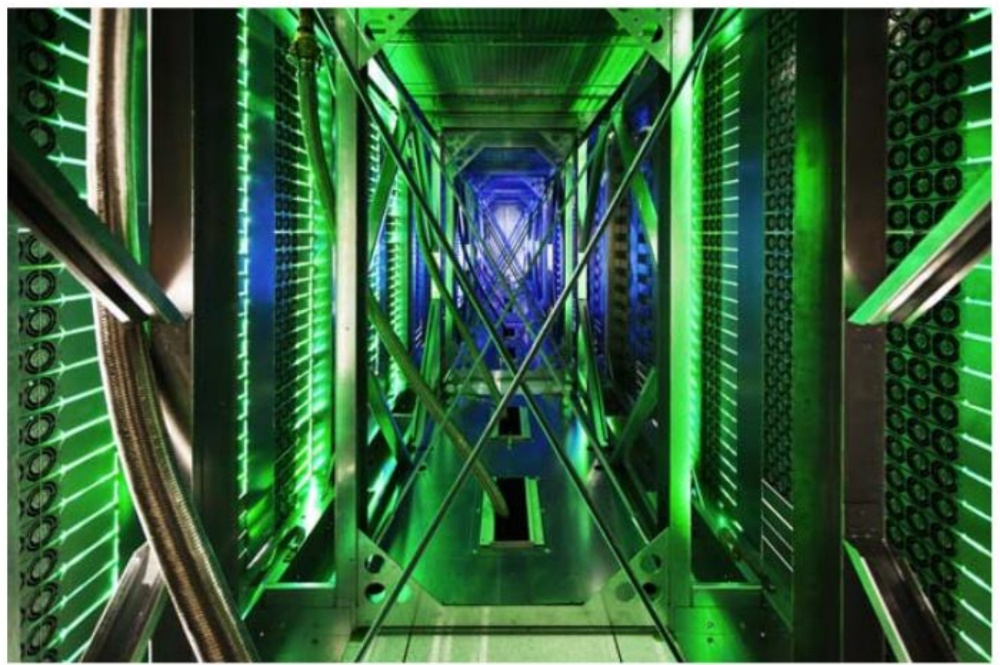
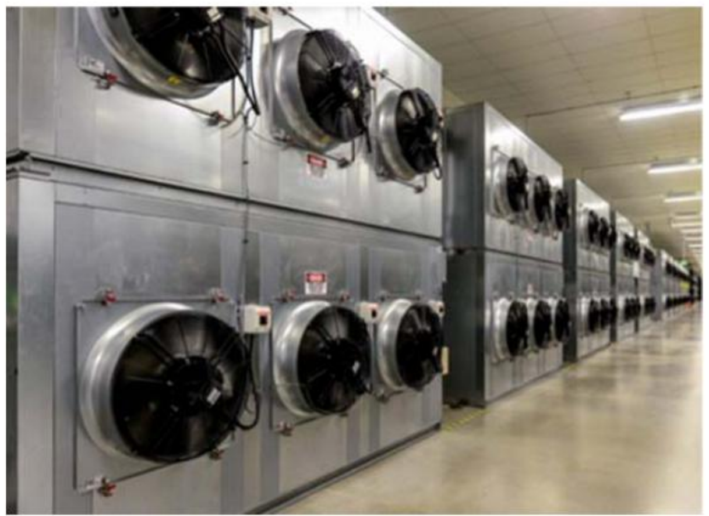
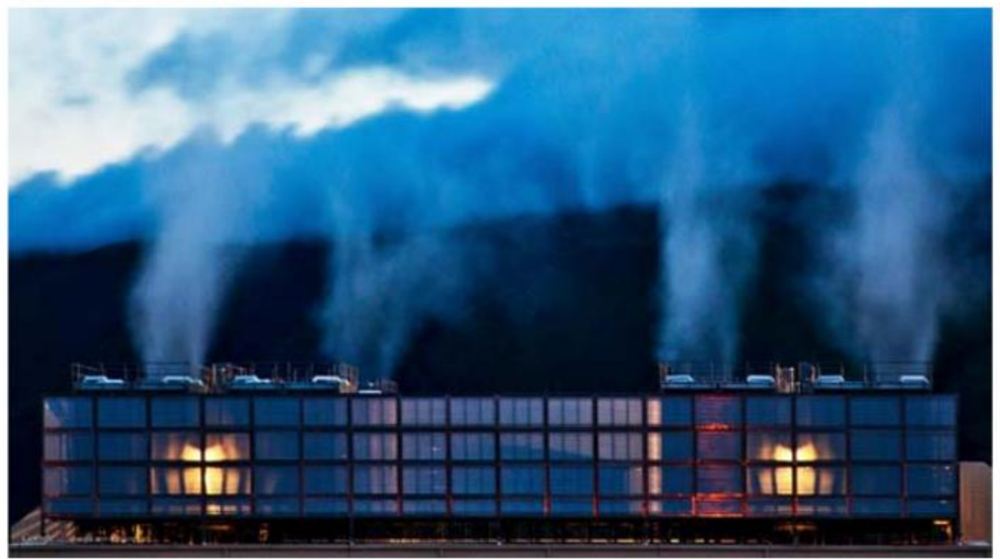

## WSC 的配电与冷却 {#sec-6-6}

最先进的 WSC，关键负载功率可以超过 100 MW，大致相当于美国 75,000 户家庭的用电量。因此，有必要了解 WSC 设施怎样供电、怎样散热。事实表明，WSC 规模虽然庞大，却仍然能做到成本合理，一个重要原因就是对供电和冷却系统做了优化，并把它们与 WSC 的硬件和软件协同设计。

**PUE。** 评价 WSC 供电和冷却基础设施的效率，常用一个简单而有效的指标，称为*电能使用效率*（PUE，power utilization effectiveness）：

$$
\text{PUE} = \frac{\text{设施总功率}}{\text{IT 设备功率}}
$$

其中，IT 设备功率是指安装计算、存储和网络设备的机架所消耗的功率；设施总功率则还包括供电和冷却的开销：供电环节因多次电能转换而产生损耗，冷却环节则有空调机组等设备耗电。PUE 总是大于或等于 1，PUE 越大，WSC 的供电和冷却效率就越低。

Uptime Institute 对大型设施的平均 PUE 已经跟踪了 15 年（Uptime Institute，2022）。2007 年，平均 PUE 为 2.5，也就是说，每向 IT 设备送去 1 W，供电和冷却就要额外消耗 1.5 W，其中 2/3 或更多是冷却的开销。开销这么高，会带来三方面的问题：

* 一是增加 WSC 设施的运营成本，主要是电费。此外，配电和冷却基础设施的费用本身也占 WSC 设施建造成本的大部分。
* 二是限制 WSC 的规模。设施可用的总功率一定，电能开销越大，能容纳的 IT 设备就越少。
* 三是浪费能源，对环境有害，在发电来源不是可再生能源时尤其如此（见下一章的 7.8 节）。

据报道，到 2021 年，平均 PUE 已经降到 1.57。最大型的 WSC 效率还要高得多。[图 6.26](#fig-6-26) 给出了谷歌所有 WSC 的平均 PUE，2020 年以来大致在 1.10 左右。本节下面介绍供电和冷却是怎样一步步优化、把开销降到 10% 的。PUE 并不是常数：一年之中，每个 WSC 周围的环境条件不断变化，影响冷却系统的效率，PUE 也随之变化。

{#fig-6-26 width=90%}

### WSC 的供电 {-}

[图 6.27](#fig-6-27) 是一个 WSC 供电基础设施的例子，从市电线路到服务器要经过多次转换：

* 为了冗余，通常有两路左右的外部电源，经由高压线路（115 kV 交流）输送电能。
* 公用变电站把电压降到 10～50 kV 交流，在园区内配送。
* 若干个单元变电站再把电压降到 400～500 V 交流，并接入一种*不间断电源*（UPS），保证外部电源中断时 WSC 的一部分仍能继续运行。
* 每个单元变电站为若干个*配电单元*（PDU）供电。PDU 把电压降到 IT 硬件所接受的 110 V 交流（北美）或 220 V 交流（欧洲）。

UPS 系统通常包括一组柴油发电机，外部电源中断后 10～15 秒内就能供电；另外还有某种形式的储能装置（电、机械或化学储能），用来支撑发电机启动之前的这段时间。UPS 还能平滑供电，消除电压的尖峰和跌落。

每个 PDU 可以支持 100～200 kW 的功耗，内含多个断路器，每个断路器约承担 6 kW。这样，一台服务器发生短路，波及的范围也很小。发电机和 UPS 单元按 N + 1 或 N + 2 冗余配置，连接方式保证即使有一台发电机或一个 UPS 单元因故障或维护而离线，所有 PDU 也都能正常工作。

![图 6.27　WSC 中的供电，包括备用发电机和 UPS 系统。引自 Hamilton, J., 2010. Cloud computing economies of scale. In: Paper Presented at the AWS Workshop on Genomics and Cloud Computing, June 8, 2010, Seattle, WA. http://mvdirona.com/jrh/TalksAndPapers/JamesHamilton_GenomicsCloud20100608.pdf。图中标注：High voltage utility distribution 为高压市电输电；Substation 为变电站，效率 99.7%；UPS: Rotary or Battery 为 UPS（旋转式或电池式），效率 94%；2.5MW Generator ~180 Gallons/hour 为 2.5 MW 发电机，每小时耗油约 180 加仑；UPS & Gen often on 480V 表示 UPS 和发电机通常接在 480 V 上；Transformers 为变压器，两级效率均为 98%；PDUs 为配电单元；~1% loss in switch Gear and conductors 表示开关设备和导线约有 1% 的损耗；IT load – servers, storage, network 为 IT 负载，即服务器、存储和网络；Note: Two more levels of power conversion at server level 表示服务器内部还有两级电能转换；11% distribution loss 为配电损耗 11%，即 0.997 × 0.94 × 0.98 × 0.98 × 0.99 = 89%。](images/ch06/fig-6-27.png){#fig-6-27 width=90%}

**转换损耗。** 上面的每一次电压转换都会带来损耗。UPS 系统往往是最难处理的一环，效率只有 94%～97%（损耗 3%～6%），原因是接入电池等储能装置需要两次转换：先把交流转成直流，再把直流转回交流。传统设计的总损耗可能高达 11%，即效率只有 89%。遗憾的是，每台 IT 设备内部还有损耗，PUE 指标并没有把它们算进去。典型的服务器有一个电源，把 110 V 或 220 V 交流转换成 12 V 直流；此外还有若干电压调节器，把电压进一步降到半导体芯片所需的值，例如 CPU 可能需要 1.1 V 直流。服务器内部的总损耗也可能达到 10%。正因为如此，有人建议在 PUE 之外再使用*服务器级电能使用效率*（sPUE）。

**减少转换次数。** 减少供电损耗的关键是减少电压转换的次数。一项重要改进是采用分布式 UPS：集中式 UPS 接在变电站一级，需要两次转换，改为分布式后就省去了这两次转换。常见的设计是在每个机架内放置一组电池，作为本地 UPS，为机架内的所有设备供电。这种 UPS 方案的效率可达 99%；而且其中某一块电池失效时，整组电池仍能工作，容错能力也提高了。

改用直流配电还能进一步改进。例如，变电站输出 380 V 直流，机架级电源把电压降到 12～48 V，配送给 IT 设备。机架内采用直流配电，机架级 UPS（电池组）也就不再需要两次转换。

### WSC 的冷却 {-}

WSC 的设备产生大量热量，这些热量经由多级闭合和开放的冷却回路，最终排到 WSC 设施之外。[图 6.28](#fig-6-28) 给出了完整的冷却回路，包括传统的架空地板冷却设计，以及 IT 设备机房之外所需的系统，如热交换器和冷却塔。

**CRAC 机组与冷热通道。** 机房空气由*机房空调*（CRAC，computer room air-conditioning）机组冷却。冷空气经由架空地板下的空间在设施内输送，这个空间位于混凝土楼板与架高地板砖之间，地板砖由钢结构支撑。冷空气从设施*冷通道*中的穿孔地板砖送出。相邻两排机架中的服务器朝向相反，热排风也就朝相反方向吹出，于是机房形成冷通道与热通道交替排列的布局。服务器中的风扇推动冷空气流过芯片和散热器，把热量带向*热通道*。热空气上升到顶部，流向 CRAC 机组的进风口，在那里用冷冻水重新冷却。这与冰箱的道理相似：冰箱把热量释放到箱体外面，从而带走箱内的热量。液体吸热时蒸发，放热时凝结。空调把液体以低压泵入盘管，让它蒸发吸热，然后把它送到外部的冷凝器，在那里把热量释放出去。因此，在 CRAC 机组中，风扇推动热空气流过一组充满冷水的盘管，再由水泵把变热的水送到冷水机组降温。

![图 6.28　WSC 冷却系统的机械设计。引自 Hamilton, J., 2010. Cloud computing economies of scale. In: Paper Presented at the AWS Workshop on Genomics and Cloud Computing, June 8, 2010, Seattle, WA. http://mvdirona.com/jrh/TalksAndPapers/JamesHamilton_GenomicsCloud20100608.pdf。图中标注：Cooling tower 为冷却塔；CWS pump 为冷却水泵；Heat exchanger (Water-side economizer) 为热交换器（水侧节能器）；Primary pump 为一次泵；A/C condenser、A/C compressor、A/C evaporator 分别为空调冷凝器、压缩机和蒸发器；Computer room air handler 为机房空气处理机；Air impeller 为送风叶轮；Server fans 6 to 9 W each 表示服务器风扇每个 6～9 W；Fans 为风扇；Cold、Hot 为冷、热气流；Leakage 为泄漏；Diluted hot/cold mix 为稀释后的冷热混合气流；Blow down & evaporative loss at 8 MW facility: ~200,000 gal/day 表示 8 MW 设施的排污和蒸发损失约为每天 200,000 加仑。](images/ch06/fig-6-28.png){#fig-6-28 width=90%}

这种基于 CRAC 的设计效率特别低，是早期数据中心 PUE 偏高（大于 2.5）的主要原因。过去 15 年里，经过一系列改进，WSC 的冷却开销已经大幅降到 10%～20%。

**提高运行温度，隔离冷热通道。** 提高效率最简单又很重要的一个办法，是让 IT 设备在较高的温度下运行，这样空气就不必冷却得那么多。传统 IT 设施的冷通道温度低于 68°F（20°C），WSC 把它提高到了 80°F（27°C）。IT 设备还能在更高的温度下工作，但温度再高可能影响出错的频率和设备的总体寿命。另一个简单的优化是把热通道和冷通道在物理上隔开，避免冷热空气在机架顶部附近混合而造成损失。[图 6.29](#fig-6-29) 是谷歌 WSC 中隔离开来的热通道。

{#fig-6-29 width=90%}

**整体优化气流。** 接下来，WSC 架构师从整体上优化了气流。在传统数据中心中，每台服务器依靠内部风扇，保证有足够的冷空气流过发热的芯片，使芯片维持在一定温度。这些机械风扇是服务器中最薄弱的部件之一，例如风扇的 MTBF 是 150,000 小时，而磁盘是 1,200,000 小时。风扇本身耗电也不少，每个 6～9 W。以谷歌为例，它把服务器风扇设计成与机房中几十台巨型风扇（[图 6.30](#fig-6-30)）协同工作，由巨型风扇保证整个机房的气流。有了这样的分工，小的服务器风扇在最坏的功耗和环境条件下也能发挥最大性能，同时耗电尽可能少。大风扇以气压为控制变量，通过调节转速，使热通道与冷通道之间保持一个最小压差。

{#fig-6-30 width=90%}

**节能器：减少机械制冷。** 下一批优化针对的是空调冷水机组中的机械制冷。基本思路是利用 WSC 设施附近的低温空气或低温水，几乎免费地获得冷却。*空气节能*是用大型风扇把室外的冷空气送进设施，空气先经过过滤以防污染，热空气则排到 WSC 建筑之外。*水节能*利用数据中心附近的冷水，如湖泊、河流或海洋：在冷却 WSC 内部空气的水回路与外部冷水源之间设置热交换系统，取代冷水机组（[图 6.31](#fig-6-31)）。空气节能和水节能可以完全取代机械制冷，也可以把冷水机组的使用减少到一年中仅有的几个炎热天。所以，PUE 会像[图 6.26](#fig-6-26) 所示的那样随时间变化。

{#fig-6-31 width=90%}

**液冷。** 处理器芯片的功耗一直在稳步增加，最新的 CPU 已经达到 400 W，GPU 达到 800 W。装有这类设备的机架很难用空气冷却，于是液冷用得越来越广泛。第 7 章将会介绍一些机器学习加速器，它们采用闭环液冷，冷却液直接送到处理器芯片。WSC 运营者还在研究把 IT 设备浸没在专用冷却液中，以增强散热，从而让芯片运行得更快、时钟频率更高，或者在每个芯片上集成更多的并行处理单元（Jalili 等，2021）。
