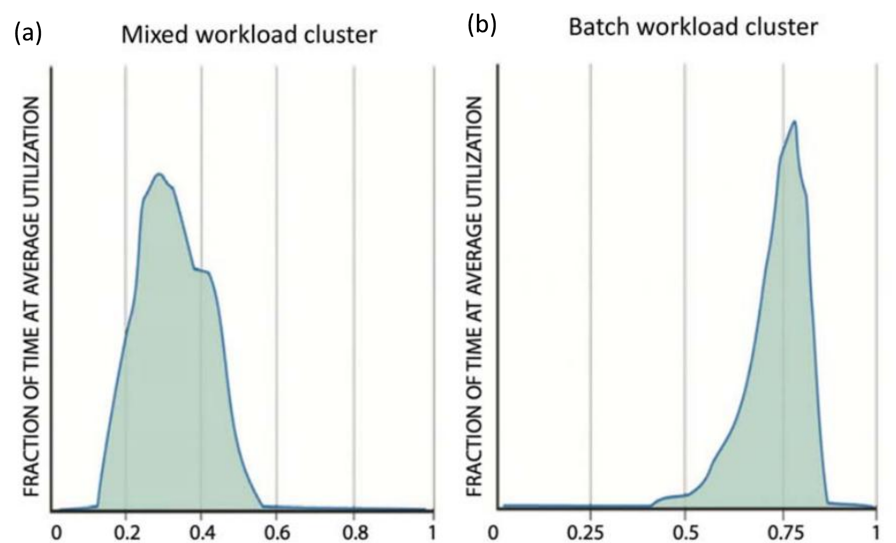

## 仓库级计算的成本与效率 {#sec-6-7}

前面介绍了 WSC 的体系结构，包括其中的机械部件。下面讨论 WSC 的成本：这类设施造价很高，为什么仍被认为具有成本效益。

### WSC 的成本 {-}

引言中提到，WSC 的设计者既关心建造成本，也关心运营成本。会计上把前者称为*资本支出*（CAPEX，capital expenditure），把后者称为*运营支出*（OPEX，operational expenditure）。

**Hamilton 的案例研究。** 为了说明能源成本在其中占多大分量，Hamilton（2010）做了一项估算 WSC 成本的案例研究。按他的估算，一个 8 MW 设施的 CAPEX 为 8800 万美元；约 46,000 台服务器及相应的网络设备又使 WSC 的 CAPEX 增加了 7900 万美元。案例研究的其余假设见[图 6.32](#fig-6-32)。

[图 6.32　一个 WSC 的案例研究，数据四舍五入到 5000 美元。因特网带宽的成本随应用而不同，这里没有计入。设施 CAPEX 中其余的 18% 包括购买地产和建造楼房的费用。安保和设施管理的人员成本不在原案例研究中，是我们在图 6.14 中加上的。注意，Hamilton 的估算是在他加入 Amazon 之前做的，并不以某一家公司的 WSC 为依据。资料来源：Hamilton, J., 2010. Cloud computing economies of scale. In: Paper Presented at the AWS Workshop on Genomics and Cloud Computing, June 8, 2010, Seattle, WA. <http://mvdirona.com/jrh/TalksAndPapers/JamesHamilton_GenomicsCloud20100608.pdf>。]{#fig-6-32 .caption}

| 项目 | 数值 |
|---|--:|
| 设施规模（关键负载功率，W） | 8,000,000 |
| 平均功率使用率（%） | 80% |
| 电能使用效率（PUE） | 1.45 |
| 电价（\$/kWh） | \$0.07 |
| 供电和冷却基础设施所占比例（占设施总成本的 %） | 82% |
| **设施 CAPEX（不含 IT 设备）** | **\$88,000,000** |
| 服务器数量 | 45,978 |
| 每台服务器成本 | \$1450 |
| **服务器 CAPEX** | **\$66,700,000** |
| 机架交换机数量 | 1150 |
| 每台机架交换机成本 | \$4800 |
| 阵列交换机数量 | 22 |
| 每台阵列交换机成本 | \$300,000 |
| 三层交换机数量 | 2 |
| 每台三层交换机成本 | \$500,000 |
| 边界路由器数量 | 2 |
| 每台边界路由器成本 | \$144,800 |
| **网络设备 CAPEX** | **\$12,810,000** |
| **WSC 的 CAPEX 总计** | **\$167,510,000** |
| 服务器摊销期 | 3 年 |
| 网络设备摊销期 | 4 年 |
| 设施摊销期 | 10 年 |
| 年资金成本 | 5% |

按 Hamilton 的研究折算，楼房、供电和冷却每瓦的成本为 11 美元。Barroso 等人（2018）报告了几个案例，结果与此一致，每瓦成本在 9～13 美元之间。

**把 CAPEX 折算成 OPEX。** 按照美国会计规则的标准惯例，假定借款成本为 5%，就可以通过资本成本折算把 CAPEX 转换成 OPEX，也就是在设备的有效寿命内，把 CAPEX 按每月固定的金额摊销。[图 6.33](#fig-6-33) 是 Hamilton 案例研究中每月 OPEX 的构成。注意，这个案例中各项的摊销期差别很大：设施 10 年，网络设备 4 年，服务器 3 年。也就是说，WSC 设施可以用 10 年，而服务器每 3 年更换一次，网络设备每 4 年更换一次。Hamilton 把 CAPEX 摊销到每月，并计入为建设 WSC 借款的成本（年利率 5%），得出每月 OPEX 为 380 万美元，约为 CAPEX 的 2%（每年约 24%）。

[图 6.33　[图 6.32](#fig-6-32) 对应的每月 OPEX，数据四舍五入到 5000 美元。注意，服务器按 3 年摊销，意味着每 3 年要购买一批新服务器，而设施按 10 年摊销，因此服务器每月摊销的资本成本约为设施的 3 倍。人员成本包括 3 个安保岗位，每天 24 小时、每年 365 天不间断值守，每人每小时 20 美元；另有 1 名设施管理人员，同样全年每天 24 小时值守，每小时 30 美元。福利按工资的 30% 计。计算中没有包括接入因特网的网络带宽费用，因为它随应用而不同；也没有包括厂商的维护费，因为它随设备和谈判结果而不同。]{#fig-6-33 .caption}

| 支出（占总额的 %） | 类别 | 每月成本 | 占每月成本的比例 |
|---|---|--:|--:|
| 摊销的 CAPEX（85%） | 服务器 | \$2,000,000 | 53% |
| | 网络设备 | \$290,000 | 8% |
| | 供电和冷却基础设施 | \$765,000 | 20% |
| | 其他基础设施 | \$170,000 | 4% |
| OPEX（15%） | 每月电费 | \$475,000 | 13% |
| | 每月人员工资和福利 | \$85,000 | 2% |
| | OPEX 总计 | \$3,800,000 | 100% |

**每瓦每年的成本。** 由这张图可以算出一条实用的准则，在关注能耗、选择采用哪些部件时可以作为参考。计入供电和冷却基础设施的摊销之后，WSC 中 1 W 功率每年的全部成本为：

$$
\frac{\text{每月基础设施成本} + \text{每月电费}}{\text{设施规模（W）}} \times 12 = \frac{\$765\text{K} + \$475\text{K}}{8\text{M}} \times 12 = \$1.86
$$

即每瓦每年约 2 美元。从短期的经济角度看，通过节能来降低成本时，每瓦每年的花费不应超过 2 美元（见 6.9 节）；从长期的环境角度看，为节能付出高得多的成本也可能是值得的（见 7.8 节）。

**成本构成的特点。** 从[图 6.33](#fig-6-33) 可以看出：

* 与电力有关的成本占 OPEX 的三分之一以上，而且呈上升趋势；服务器成本则随时间呈下降趋势；
* 网络设备的成本相当可观，占 OPEX 总额的 8%，相当于服务器 CAPEX 的 19%；网络设备成本下降得不如服务器快，原因可能是对更高网络带宽的需求一直存在。这一差别在网络层次中机架以上的交换机上尤其明显，而这些交换机占了网络成本的大部分；
* 安保和设施管理的人员成本只占 OPEX 的 2%。

把[图 6.33](#fig-6-33) 中的 OPEX 除以服务器数量和每月的小时数，得到每台服务器每小时的成本约为 0.11 美元。

**按每瓦每月计算成本。** Barroso 等人（2018）用每瓦每月的成本来评估 CAPEX 和 OPEX：

* 设施：一个 12 MW 的 WSC 按 12 年折旧，折旧成本为每瓦每月 0.08 美元。他们假定公司以年利率 8% 贷款来建设 WSC（企业贷款利率通常在 7% 到 12% 之间），利息又增加 0.05 美元，合计每瓦每月 0.13 美元；
* 服务器：用同样的方法计算。一台 500 W、价格 4000 美元的服务器，每瓦 8 美元，按 4 年折旧为每瓦每月 0.17 美元；服务器贷款 8% 的利息再增加 0.02 美元；
* 网络：估计为每瓦每月 0.03 美元；
* 运营：多兆瓦级 WSC 典型的 OPEX 为每瓦每月 0.02～0.08 美元。

总计为每瓦每月 0.37～0.43 美元。对一个 8 MW 的 WSC 来说，除去电费，每月成本约为 300 万到 350 万美元。从 Hamilton 的计算结果中减去每月电费，他估算的月成本为 330 万美元。两种成本预测方法不同，估算结果却相当一致。

**例题**　美国各地区的电价从每千瓦时 0.03 美元到 0.15 美元不等。这两种极端电价对服务器每小时的成本有什么影响？

**解答**　用 8 MW 的关键负载乘以 PUE，再乘以[图 6.32](#fig-6-32) 第二行的平均功率使用率，得到平均用电功率：

$$
8 \times 1.45 \times 80\% = 9.28\ \text{MW}
$$

于是，每月电费由[图 6.33](#fig-6-33) 中的 475,000 美元变为 205,000 美元（每千瓦时 0.03 美元）或 1,015,000 美元（每千瓦时 0.15 美元）。电价的这一变化使服务器每小时的成本由 0.11 美元分别变为 0.10 美元和 0.13 美元。

**例题**　如果所有摊销期都统一，比如都取 5 年，每月成本会怎样变化？每台服务器每小时的成本又会怎样变化？

**解答**　计算用的电子表格可以在线获取：<http://mvdirona.com/jrh/TalksAndPapers/PerspectivesDataCenterCostAndPower.xls>。摊销期都改为 5 年后，[图 6.33](#fig-6-33) 的前四行变为：

| 类别 | 每月成本 | 占每月成本的比例 |
|---|--:|--:|
| 服务器 | \$1,260,000 | 37% |
| 网络设备 | \$242,000 | 7% |
| 供电和冷却基础设施 | \$1,115,000 | 33% |
| 其他基础设施 | \$245,000 | 7% |

每月 OPEX 总计为 3,422,000 美元。如果所有设备都每 5 年更换一次，每台服务器每小时的成本为 0.103 美元；与[图 6.33](#fig-6-33) 相比，摊销成本中设施所占的部分变多，服务器所占的部分变少。

**规模带来的成本优势。** 许多公司自己拥有和运营（规模较小的）传统数据中心，它们的成本可能远高于每台服务器每小时约 0.10 美元。正是凭借 WSC 的成本优势，大型互联网公司才把计算作为一种效用来提供：像用电一样，用多少付多少。

多年来，WSC 的规模显著扩大，大型设施的功耗如今已超过 100 MW，但上面介绍的 TCO 计算方法和结论仍然适用。现代 WSC 的建造成本为每瓦 7～10 美元。[图 6.34](#fig-6-34) 是一个研究实例：装满服务器的 WSC，其 TCO 以资本支出为主，特别是计算、网络和存储设备的成本（60%～65%）和设施成本（10%）；电力和 PUE 开销所占的比例要低得多（分别为 5% 和 3%）。

{#fig-6-34 width=75%}

### 通过功率配置提高效率 {-}

即使按每瓦 7 美元计算，一个 100 MW 的 WSC 建造成本也要 7 亿美元。要提高 WSC 的成本效益，第一个办法是让它容纳尽可能多的服务器，以摊薄这笔成本。然而，扣除配电和冷却的开销之后，一个 WSC 究竟能支持多少台服务器，并不像想象的那样显而易见。

**实际峰值功率。** 服务器厂商给出的*铭牌额定功率*总是偏保守的：它是服务器所有部件同时达到最大功耗时可能消耗的最大功率。因此，第一步是在准备部署到 WSC 中的各种工作负载下测量单台服务器，负载从功耗病毒（power virus）基准测试程序到更接近实际的工作负载。网络通常只占功耗的 5% 左右，一开始可以忽略。由这些测量结果可以估计出服务器的*实际峰值功率*，它往往比铭牌功率低 60%，WSC 中可以部署的服务器数量因此大大增加。

**功率超配。** Fan 等人（2007）指出，按服务器的实际峰值功率配置仍然过于保守。他们发现，成千上万台服务器在最坏情况下理论上可能消耗的功率，与它们实际消耗的功率之间存在很大差距，因为没有哪种实际工作负载会让成千上万台服务器同时处于峰值。他们发现，以单台服务器实测的峰值功率为基准，服务器数量可以安全地超配多达 40%。这种功率超配（power oversubscription）如今在 WSC 中很常见，但它需要一套完善的监测框架，用来发现一个机架内、一个配电单元（PDU）后面或者整个 WSC 中的服务器同时出现的功率峰值。为了缓解机架、PDU 或 WSC 的供电能力被暂时突破的问题，可以采用以下技术：

a) 降低部分服务器的时钟频率，从而降低它们的功耗；

b) 暂时从每个机架都配有的电池中汲取额外的电力；

c) 暂停低优先级任务，或者把它们调度出去；

d) 在机架、PDU 或 WSC 之间迁移任务，以平衡电力需求，避免同时出现功率尖峰。

如果这些技术很少用到，它们对工作负载性能和电池寿命的影响都很小。

**领域专用体系结构。** 充分利用 WSC 中可用的每一瓦电力，也是为 ML 等 WSC 关键工作负载开发 DSA 的一个主要原因。第 7 章将会讲到，DSA 的每瓦性能比通用 CPU 高两个数量级。有了 DSA，为满足工作负载的性能需求而新建 WSC 的需要大大减少。由此节省的费用足以抵消开发一款大型定制 ASIC 的硬件和软件成本，这笔成本在 2022 年为 5000 万～1 亿美元。

### 通过提高利用率提高效率 {-}

服务器的 CAPEX 在 TCO 中占主导地位，因此让服务器在大部分时间里保持较高的利用率，对整体效率很重要。WSC 提供的效用计算，服务对象或者是公众（公有云），或者是一家大公司自己的工作负载（私有云）。把众多用户和工作负载复用在一个服务器池上，各种工作负载需求的高峰和低谷相互抵消，利用率就能提高。

**利用率难以长期保持在高位。** 尽管如此，要让 WSC 长时间保持接近满负荷的利用率仍然很难。[图 6.35](#fig-6-35) 是谷歌的两个集群在 3 个月内平均利用率的分布：

* 集群 (a) 运行混合工作负载，其中包括几个面向用户的服务。这些服务呈现出昼夜规律：工作时间或有重大事件时活动多，夜间或节假日活动少，因此利用率在 10% 到 50% 之间变化；
* 集群 (b) 运行大型的持续批处理工作负载，这类负载的需求在长时间内变化不大，因此利用率在 50% 到 85% 之间变化。

{#fig-6-35 width=90%}

**资源预留过大。** 用户负载的波动是许多 WSC 利用率处于中低水平的一个主要原因，但不是唯一的原因。开发人员也很难确定自己的应用需要多少资源，以及需要多少个、什么类型的实例。WSC 中的硬件是异构的，会带来性能波动；同时调度在一起的其他工作负载偶尔也会造成干扰。为了避开这些问题，开发人员往往给自己的工作负载申请过多的资源（Delimitrou & Kozyrakis 2014）。例如，一个工作负载如果占用一颗 CPU 中的大部分核，同一台机器上调度访存密集型工作负载的可能就小，它也就不太容易因对方引起的 Cache 失效而受影响。大多数开发人员对性能问题看得不全、理解有限，因此把资源预留得大一些，对他们来说是一种务实的做法。

**提高利用率的技术。** 多年来，人们开发了多种有助于提高利用率的技术，主要有三类：

* 按实际需要自动确定和调整分配给云工作负载的资源规模的工具，即*规格适配*（right sizing）和*自动伸缩*（autoscaling）；
* 预测或跟踪工作负载之间的干扰，并调整任务分配以减少干扰的调度器，即*干扰感知调度*（interference-aware scheduling）；
* 让低优先级任务（如运行批量分析的可抢占竞价实例）安全地运行在已预留但当前空闲的资源上的调度器，即*资源收割*（resource harvesting）。

这些技术的设计空间很大，用启发式方法难以安全、高效地探索，因此常常借助 ML 和在线学习技术。在硬件层面，人们越来越重视同时调度的工作负载之间的性能隔离，采用的技术包括 Cache 和存储带宽划分（Lo et al., 2016），以及网络和存储系统的服务质量（QoS）技术。

### 通过提高性能提高效率 {-}

最终的指标是每美元的性能，因此仍然需要衡量性能。分布式工作负载的性能会受到多方面的影响，例如随着与数据之间距离的不同，带宽会下降，延迟会增加。在 WSC 中，服务器内的 DRAM 带宽是机架内带宽的 40 倍，而机架内带宽又是 WSC 内带宽的 4～10 倍（见[图 6.21](#fig-6-21)）。因此，在 WSC 中放置数据和程序时，还要考虑另一种局部性。

**响应时间与用户行为。** 延迟是用户看得见的，因此互联网服务的开发人员同样关心延迟。用户的满意度和工作效率都与服务的响应时间有关。分时系统时代的几项研究表明，用户的工作效率与一次交互的时间成反比。一次交互的时间通常分成三部分：人输入的时间、系统响应的时间，以及人在输入下一项之前思考响应结果的时间（Doherty and Thadhani, 1982）。实验结果表明，系统响应时间缩短 30%，一次交互的时间就能缩短 70%（Brady, 1986）。这个看似不可能的结果可以用人的天性来解释：响应越快，人越不容易分心，能保持「顺手」的状态，所需的思考时间也就越短。

[图 6.36](#fig-6-36) 是一项较新的实验结果。实验在 Bing 搜索引擎的搜索服务器上人为插入 50～2000 ms 的延迟（Schurman and Brutlag, 2009）。与以前的研究预期的一样，到下一次点击的时间增加量大致是所插入延迟的 2 倍，例如服务器端 200 ms 的延迟使到下一次点击的时间增加了 500 ms。收入随延迟的增加而线性下降，用户满意度也是如此。另一项针对谷歌搜索引擎的研究发现，这些影响在为期 4 周的实验结束后还持续了很久：5 周以后，经历过 200 ms 延迟的用户每天的搜索次数仍少 0.1%，经历过 400 ms 延迟的用户则少 0.2%。搜索带来的收入数额巨大，即使是这么小的变化也令人担忧。事实上，由于结果过于负面，他们提前终止了实验。

[图 6.36　Bing 搜索服务器上的延迟对用户行为的负面影响（Schurman and Brutlag, 2009）。]{#fig-6-36 .caption}

| 服务器延迟（ms） | 到下一次点击的时间增加量（ms） | 每用户查询数 | 每用户任意点击数 | 用户满意度 | 每用户收入 |
|--:|--:|--:|--:|--:|--:|
| 50 | — | — | — | — | — |
| 200 | 500 | — | −0.3% | −0.4% | — |
| 500 | 1200 | — | −1.0% | −0.9% | −1.2% |
| 1000 | 1900 | −0.7% | −1.9% | −1.6% | −2.8% |
| 2000 | 3100 | −1.8% | −4.4% | −3.8% | −4.3% |

**服务等级目标。** 互联网服务极其看重所有用户的满意度，因此性能目标通常不是只给出平均延迟的目标值，而是规定很高比例的请求必须低于某个延迟阈值。这种阈值形式的目标称为*服务等级目标*（SLO，service-level objective），例如规定 99% 的请求必须在 100 ms 以内完成。正因为如此，Amazon 的 Dynamo 键值存储系统的设计者认为，要让构建在 Dynamo 之上的服务获得良好的延迟，存储系统必须在 99.9% 的时间里达到自己的延迟目标（DeCandia et al., 2007）。例如，Dynamo 的一项改进对第 99.9 百分位延迟的帮助远大于对平均情况的帮助，这正体现了他们的优先次序。

**容忍尾延迟。** Dean 和 Barroso（2013）提出用*尾部容忍*（tail tolerant）一词来描述为实现这类目标而设计的系统：

> 正如容错计算要用不那么可靠的部件构建出可靠的整体，大型在线服务也需要用响应时间不那么可预测的部件构建出响应时间可预测的整体。

造成不可预测性的原因很多，包括：对共享资源（Cache、网络等）的争用；排队；Turbo 模式之类的优化和 DVFS 之类的节能技术导致微处理器性能不稳定；软件的垃圾回收；等等。谷歌的结论是，与其设法在 WSC 中消除这种波动，不如开发尾部容忍技术，把暂时的延迟尖峰掩盖掉或绕过去。例如，细粒度的负载均衡可以在服务器之间迅速迁移少量工作，从而减少排队延迟。

### 通过能耗正比性提高效率 {-}

[6.6 节](#sec-6-6)提到，PUE 衡量的是 WSC 的能效，但它反映不出 IT 设备内部的情况。

**电源效率低。** 电能效率低的另一个来源是服务器内部的电源。电源把输入的高压交流电或直流电转换成芯片和磁盘使用的低电压。2007 年，许多电源的效率只有 60%～80%，因此服务器内部的损耗，比电力从供电塔的高压线路经过多级变换、最终送到服务器低压线路这一路上的损耗还要大。原因之一是，电源的额定功率往往远大于主板上部件实际需要的功率。而且，这类电源通常在负载为 25% 或更低时效率最差，可是从[图 6.35](#fig-6-35) 可以看出，WSC 中的许多服务器恰恰工作在这个范围。计算机主板上还有电压调节模块（VRM），它们的效率也可能比较低。

**能耗正比性。** Barroso 和 Hölzle（2007）提出，整台服务器的目标应当是*能耗正比性*（energy proportionality），即服务器消耗的能量应与完成的工作量成正比。15 年过去了，我们已经接近这一理想目标，但还没有达到。例如，第 1 章中 SPECpower 评分最高的服务器，空闲时仍要消耗满载功率的 20% 左右，负载只有 20% 时消耗的功率接近满载功率的 50%。与 2007 年相比，这已经是巨大的进步，当时空闲的计算机要消耗满载功率的 60%，20% 负载时消耗 70%；但仍有改进的余地。

**系统软件的作用。** 传统上，只要可能提高性能，系统软件就会用尽所有可用资源，而不考虑能耗。例如，操作系统会把全部内存都用来存放程序数据或作为文件缓存，尽管其中很多数据很可能永远不会用到。近来，WSC 的软件架构师开始针对能耗和能耗正比性做优化。例如，Lo 等人（2014）设计了一种进行细粒度功耗管理的动态控制器，使一组服务器刚好满足在线服务的 SLO 要求。这样可以改善能耗正比性，服务器在 10%～60% 的利用率下运行时，可节能 20%～30%。
