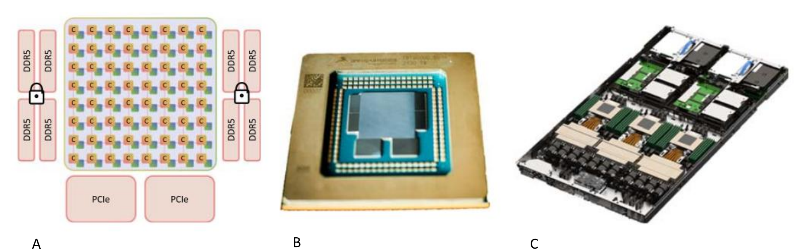

## 融会贯通：AWS 云中的定制芯片 {#sec-6-8}

亚马逊云服务（AWS，Amazon Web Services）2006 年上线，是第一家提供 IaaS 云实例的提供商。到 2023 年初，AWS 是规模最大的公有云提供商，提供 200 多种云服务，年化营收达 800 亿美元。AWS 的云基础设施遍布全球，已开通 30 个地理区域，另有 410 个接入点（边缘站点和缓存节点）。这 30 个区域内共有 96 个可用区，每个可用区由一个或多个相互独立的 WSC 组成，这些 WSC 分别位于不同的设施中，各自配有冗余的供电、网络和连接。

AWS 一直在为自己的云基础设施开发硬件和软件技术，总目标是降低 TCO，同时为客户的工作负载提高性能、降低成本。除了 [6.7 节](#sec-6-7)讨论的效率优化，AWS 云系统近年来的发展还围绕以下几个目标：

* **消除虚拟化开销。** 这样既降低了基础设施成本，又能让客户把全部可用的计算周期都用在自己的应用上；能耗以及运行碳排放和内含碳排放也会大幅减少。
* **缩短新技术的部署和维护时间，降低相应成本。** 新的 CPU、加速器、DRAM 或 Flash 芯片等新技术，能让云运营商和客户都在成本和性能上得到很大的改进。要让收益尽可能大，就必须把部署时间从几个月缩短到几周，并把客户负载能察觉到的维护停机时间降到几乎为零。
* **提高可用性和可靠性。** 云设施正在像电力系统和电信系统一样成为关键的公用设施，不能说停就停。
* **扩展用例和目标市场。** 例如，AWS 设计了 Outpost 机架，可以把一组 AWS 计算和存储单元安全地放到客户或第三方的场地中，用来支持因延迟、安全或监管原因必须在本地或边缘部署的应用。

过去十年间，定制芯片在 AWS 基础设施中的作用越来越大。2015 年，AWS 收购了无晶圆厂半导体公司 Annapurna Labs，此后该公司开发了一系列为云计算基础设施优化的芯片和系统。AWS 的采购量足够大，可以自己开发芯片。与在 WSC 系统中使用商用芯片相比，自研芯片有以下好处：

* **纵向创新。** 在横向分工的 IT 生态中，芯片厂商、硬件厂商和软件厂商各自只在自己交付的产品范围内优化。AWS 自己设计芯片，就可以纵向创新，例如在芯片中加入能在系统级或 WSC 级节省成本的功能。
* **专用化。** AWS 的芯片设计优先实现那些对其用例端到端效果影响大的功能。商用芯片则不同，它必须照顾许多潜在客户的用例，功能清单很长，结果是设计上要做折中，设计时间、硅面积和功耗也都随之增加。
* **开发速度。** 对一款新的商用芯片，软件团队通常要等芯片部署之后才开始开发。AWS 同时掌控芯片和软件的设计周期，可以让两者并行开发，保证硬件一部署，软件就已经就绪。这样，每一款新芯片的价值都能得到最充分的发挥。
* **安全性。** 有了定制芯片，AWS 可以从整体上设计整个系统，减小攻击面。AWS 用自己的芯片提供硬件信任根，对其上运行的固件做形式化验证，并用这些芯片把服务器内部的交互限制在一小组安全的 API 之内。
* **成本更低。** 商用芯片的售价比成本高 20%～100%。以 AWS 的采购量，不必支付芯片厂商的利润就能节省大量开支，足以抵偿自研芯片的开发成本。

到 2023 年初，AWS 已在自己的 WSC 中部署了以下定制芯片：

* **Nitro**：一个芯片系列，用来卸载和加速 VMM 及 I/O 任务，如 VM 网络、VM 存储和 RDMA。
* **Nitro 安全芯片**：部署在 AWS 主板上的一块小芯片，用于对硬件接口做主动的安全监控，并支持安全的固件升级。
* **Graviton**：面向云负载的 CPU 产品线，在性能、功耗和成本上都有较高的效率。
* **Trainium 和 Inferentia**：用于 ML 训练和推理的 DSA 系列。ML DSA 芯片的体系结构留到第 7 章讨论。

### Nitro 系统 {-}

**VMM 的开销。** VMM 要居中处理每一次 I/O 操作，因此是云负载性能开销的一个主要来源。以网络为例，VMM 要完成虚拟私有网络（VPC）所需的封装和解封装，执行安全规则和限速，还要实现路由。现代 I/O 设备速度很高，如 200 Gbps 的以太网 NIC 和 5 Gbps 的 NVMe 驱动器，现代服务器上能容纳的客户 VM 数量又很多，因此 VMM 的这些任务可能要占用宿主 CPU 的好几个核。这就带来了两难：如果把这些核留给 VMM 专用，宿主机的有效容量会大幅下降；如果不专门预留，随着总的 I/O 流量随时间变化，客户负载的性能就可能出现明显的不可预测性（抖动）。此外，在客户 VM 所用的同一 CPU 上运行一个复杂的 VMM，还会带来安全风险。

**Nitro VMM。** Nitro 项目的目标是把几乎全部 VMM 任务都卸载到 AWS 的定制芯片上，把 CPU 周期全部留给 VM 负载。AWS 从 2013 年起逐步朝这个目标推进，到 2017 年，用精简的 Nitro VMM 取代了原来基于 Xen 的 VMM。Nitro VMM 基于 KVM，只在 VM 启动或调整 VM 规模时，通过配置 VT-x、VT-d 等 CPU 功能来分配核、内存和中断。如果 CPU 支持投递中断，其他所有事件，包括频繁的 I/O 流量，都不需要 VMM 介入。Nitro VMM 的职责范围很小，因此占用的 CPU 资源可以忽略不计；它与 VM 之间的接口也随之变小，安全性得到提高。

**Nitro 卡。** 其余的 VMM 任务由一系列 Nitro 卡完成，这些卡都基于 AWS 的定制芯片：

* **弹性网络适配器（ENA，Elastic Network Adapter）控制器**：一块 PCIe 以太网 NIC，利用 SR-IOV 让客户 VM 直接访问 ENA 的虚拟功能。ENA 接口使用 [6.5 节](#sec-6-5)讨论过的提交队列和完成队列。这块 NIC 完成 VPC 数据平面的各项任务，如封装和解封装、安全规则、限速、路由、时间同步和流量加密。
* **弹性结构适配器（EFA，Elastic Fabric Adapter）控制器**：一块为数据密集型 ML 和 HPC 应用优化的 PCIe NIC。与 RoCE 和 IB NIC 类似，EFA 在 NIC 中实现完整的网络传输协议，从而支持绕过 OS。AWS 的 SRD 协议提供可靠的数据报服务，它利用 WSC 网络交换结构的多路径特性，获得高吞吐率和低延迟（Shalev 等，2020）。应用通过 OFI Libfabric、NVIDIA 集合通信库（NCCL）等常用通信框架使用 EFA。这块 NIC 支持面向 GPU 和其他 DSA 的零拷贝网络，也完成所有基本的 VPC 数据平面任务。
* **弹性块存储（EBS，Elastic Block Storage）控制器**：这块 PCIe 卡向客户 VM 提供一组 NVMe 虚拟功能，VM 通过它们经网络访问块存储卷。因此，VM 可以动态地添加、删除卷，也可以调整卷的大小；VM 还可以暂时关机，或迁移到另一台机器上，再重新连接到自己的持久 EBS 卷。这块控制器实现了经网络访问远程存储所需的全部系统软件，包括零拷贝、数据完整性检查、屏障和快照，以及加密存储卷所用的密码算法。
* **实例存储控制器**：这块 PCIe 卡向客户 VM 提供一组 NVMe 虚拟功能，VM 通过它们访问本地的 Flash 和硬盘。控制器实现透明加密：VM 终止时，加密密钥随即销毁，盘上的临时数据也就无法再访问。控制器为共享盘提供限速，并实现完整性检查、快照和驱动器监控。对 Flash 存储，控制器还实现 FTL 逻辑（Nitro-SSD）。
* **Nitro 控制器卡**：这块卡通过被动的 API 端点与 EC2 控制平面交互，并协调其他所有 Nitro 卡和 Nitro VMM，完成资源分配和实例生命周期管理。

到目前为止，AWS 已经为 Nitro 卡做了五代芯片。所有芯片都含有 Arm 核，这样芯片的功能可以不断演进。每一代都有多种板卡，有时还有多个芯片版本，以支持特定用途。每种板卡一般有专门的库存单位（SKU），例如：EFA 网络专用 SKU；EBS 专用 SKU；把全部功能集成在一块芯片上的主流「一体化」SKU，用于大批量的服务器配置；以及不带 Nitro 功能的简单 NIC SKU。Nitro 卡支持无中断升级，即更新卡上的固件时，宿主 CPU 上运行的 VM 不必停止。

**启动一个 VM 实例。** [图 6.37](#fig-6-37) 表示 Nitro 卡与 VMM 如何配合启动一个 VM 实例。EC2 控制平面收到客户请求后，先找到一台能够承接该请求的服务器，然后按以下步骤进行：

1. EC2 控制平面向该服务器上的 Nitro 控制器发送命令，要求启动 VM；
2. Nitro 控制器为这个 VM 分配具体的核和内存区域；
3. Nitro 控制器请 VMM 按这次分配配置 CPU；
4. Nitro 控制器映射一个 EBS 卷，卷中存有该 VM 的引导映像；
5. Nitro 控制器通过 NVMe 接口把这个卷提供给宿主机；
6. Nitro 控制器设置与该 VM 关联的其他所有 EFA、ENA、EBS 和本地实例存储设备；
7. Nitro 控制器把实例置为可运行状态，实例随即可以引导。

VM 运行起来以后，只有在该 VM 的核、内存或设备分配发生变化，或者 VM 自己发起 VMM 调用时，VMM 才会执行。VMM 基本上不再介入，因此如[图 6.38](#fig-6-38) 所示，VM 实例与裸金属实例的性能几乎完全相同。

{#fig-6-37 width=90%}

{#fig-6-38 width=80%}

**加快新技术的部署。** 几乎所有虚拟化任务都由 Nitro 卡完成，因此部署新的 CPU、DSA 和存储系统、支持新的操作系统时，都不需要花大力气移植或扩展 VMM。以裸金属方式运行一台服务器，就等于启动一个宿主 CPU 上没有 VMM 运行的 VM。实例和服务器都统一通过 Nitro 卡管理。在 Nitro 系统出现之前，AWS 提供大约 70 种 EC2 实例；到 2023 年初，AWS 已提供 600 多种实例，可选的 CPU 有 Intel 和 AMD 的 x86、AWS 和苹果的 Arm，加速器有 GPU、ML DSA、视频 DSA 和 FPGA，还有多种存储和网络选项，操作系统有 Linux、Windows、Unix 和 macOS。

### Nitro 安全芯片 {-}

Nitro 安全芯片是装在服务器主板上的一块小芯片。它通过 SPI、I2C 总线等接口监视对本地非易失性存储设备的所有操作，以便发现异常。主板的固件由它下发并认证。在 x86 宿主机上，安全芯片还位于 BMC 和 CPU 之间。安全芯片有两个重要作用：

* 一是禁止 CPU 上运行的任何软件更新任何固件，如 BMC 的固件。固件更新一律经由 Nitro 控制器下发，主板上不存放任何固件。这就杜绝了针对 SPI Flash 等存储设备的零日攻击和供应链攻击。
* 二是协助 Nitro 控制器完成安全引导和认证过程。

**安全引导。** 引导过程开始时，安全芯片让服务器的 CPU 和 BMC 保持在复位状态，直到 Nitro 控制器完成自身的安全引导和服务器认证。Nitro 控制器用一个防篡改的可信平台模块（TPM）对自己的引导 ROM 做密码学度量，验证其完整性和有效性。TPM 中存有密钥，这些密钥曾用来对一组已知良好的度量值做数字签名。如果引导 ROM 有效，Nitro 控制器就可以延伸信任链：度量并验证引导过程后续各步所用的固件，以及服务器运行期间所用的软件映像。一旦发现无效固件，该服务器立即退出服务，在问题解决之前不再承载客户负载。AWS 已经对 Nitro 系统早期引导代码的存储安全性质做了形式化验证（Cook 等，2021）。Nitro 系统完成安全引导后，再下载服务器主板上的固件并加以认证。这时，安全芯片才允许 CPU 和 BMC 引导。

Nitro 的安全引导过程有三方面的作用：

* 它保护了裸金属服务器，因为 CPU 上运行的 OS 无法修改服务器中的 BIOS、BMC 或其他任何固件；
* 它阻止部署任何未经正确签名、未经生产部署流程发布的固件，无论这种部署是出于失误还是出于恶意；
* 它使基于 Nitro 的系统可以部署在 AWS 的设施之外，Outpost 机架和边缘部署就是这种情况。AWS 可以通过远程认证过程，确保 Nitro 服务器运行的是一组经过批准的固件和软件映像，然后才允许它们运行客户负载、连接 AWS 数据中心中的服务。

**不接触用户数据的云管理。** 除了安全引导，Nitro 系统还有一项重要的安全特性：AWS 员工无须直接访问用户数据就能管理云。具体措施包括：

* 本地存储和主存用 VM 专属的密钥加密，VM 终止时密钥随即销毁；
* 持久存储卷可以用客户提供的密钥加密；
* AWS 数据中心之间的所有网络流量都在物理层做透明加密；
* 对大多数 EC2 实例类型，VPC 内部的所有流量都在 Nitro 卡中做透明加密；
* 所有 AWS 管理 API 都经过加密、认证和授权，并留有日志。

### Graviton CPU 芯片 {-}

AWS 开发基于 Arm 的 Graviton CPU，目的是让 EC2 实例的性价比尽可能高，并推动服务器提高能效。2018 年，Graviton1 成为大型云提供商中第一款用于 IaaS 实例的 Arm CPU，它证明了 Arm 的硬件和软件生态能够大规模地支撑云应用。

**三代 Graviton。** [图 6.39](#fig-6-39) 列出了三代 Graviton 的主要特点。借助第 3 章和第 4 章讨论的乱序执行和 SIMD 技术，每个核的性能稳步提高：Graviton2 核的速度约为 Graviton1 核的 2 倍，Graviton3 核的整数性能和浮点性能又在此基础上分别提高了 30% 和 60%。这些年来，每个核的性能提高了，核数也增加到原来的 4 倍，为了支撑这两方面的增长，每块芯片的存储带宽从 40 GB/s 提高到 300 GB/s。

[图 6.39　三代 AWS Graviton CPU 的主要特点。Graviton3 本可以改用 5 nm 工艺来降低功耗，但需要与 7 nm 工艺的成熟度权衡。Graviton3 的设计本身功耗就低，因此在该芯片量产的两年里，7 nm 工艺的成本效益更好。Graviton3 的末级 Cache（LLC，Last-Level Cache）相对较小，因为芯片的 DRAM 带宽充裕，负载下的延迟也控制得很好。此外，DRAM 带宽高，复杂的预取引擎就能发挥特别好的效果。]{#fig-6-39 .caption}

| | Graviton 1 | Graviton 2 | Graviton 3（E） |
|---|---|---|---|
| 发布年份 | 2018 | 2019 | 2021 |
| 工艺 | 16 nm | 7 nm | 7 nm |
| 晶体管数（十亿） | 5 | 30 | 55 |
| 指令系统 | ARMv8.0a | ARMv8.2a + fp16、rcpc、dotprod、crypto | ARMv8.4 + sve、rng、bf16、int8、crypto |
| 时钟频率 | 2.3 GHz | 2.5 GHz | 2.6 GHz |
| 核数 | 16 | 64 | 64 |
| 核类型 | Cortex-A72 | Neoverse-N1 | Neoverse-V1 |
| 取指/译码/发射宽度 | 3/3/5 | 4-8/4/8 | 8/5-8/15 |
| 功能部件（整数、浮点/SIMD、load/store、转移） | 3/2/2/1 | 3/2/2/1 | 4/4/5/2 |
| SIMD 功能部件 | 2 个 128 位（Neon） | 2 个 128 位（Neon） | 4 个 128 位（Neon）、2 个 256 位（SVE） |
| ROB 大小 | 128 | 128 | 256 |
| 每核 L1I/L1D/L2 | 48 KB/32 KB/-- | 64 KB/64 KB/1 MB | 64 KB/64 KB/1 MB |
| LLC 容量 | 8 MB | 32 MB | 32 MB |
| DRAM 类型 | DDR4-2666 | DDR4-3200 | DDR5-4800 |
| DRAM 控制器数 | 2 | 8 | 8 |
| DRAM 带宽 | 40 GB/s | 200 GB/s | 300 GB/s |
| DRAM 加密 | 无 | 有 | 有 |
| PCIe 类型 | Gen4 | Gen4 | Gen5 |
| PCIe 通道数 | 32 | 48 | 64 |

**Graviton3 的结构。** [图 6.40](#fig-6-40) 是 Graviton3 芯片的体系结构。一个封装内有 7 个芯粒：主芯粒包含 64 个核及其 Cache，由对分带宽为 2 TB/s 的网格互连连接起来；左右两侧各有 2 个芯粒，包含存储控制器和卸载功能；下方的 2 个芯粒包含 PCIe 接口和其他 I/O 功能。

{#fig-6-40 width=90%}

**面向云部署的优化。** Graviton3 有几方面是专门为云部署优化的：

* 一是采用不支持 SMT 的核。这样可以避免共享一个 SMT 核的两个线程之间相互干扰性能，还能提高 L1 Cache、转移预测器和 TLB 的效率。
* 二是 CPU 不支持双插座服务器配置。这一选择限制了单个 VM 能用的核数，但软件栈不再需要做 NUMA 优化，成本和功耗也随之降低。与 [6.3 节](#sec-6-3)讨论的 Meta Yosemite 服务器类似，Graviton3 的一个机箱内装 3 台单插座服务器，共用 Nitro 卡、BMC 和电源，从而分摊系统级的成本。
* 三是采用 DDR5-4800 内存。存储带宽提高了 50%，因此 L3 Cache 可以做得相对较小；云实例使用大量核时，这样的带宽对性能至关重要。
* 四是实现了多项安全功能，包括始终开启的主存加密。CPU 还实现了 Arm 的指针认证扩展，并为 Arm 的 TRNG 指令提供真随机数发生器。Graviton3 支持投递中断，I/O 中断可以直接递交给客户 VM，不需要 VMM 介入。

**为什么还要提供多种 CPU。** AWS 虽然自己生产 CPU，但仍然部署 x86 CPU 和苹果的 CPU。AWS 为数以百万计的客户服务，这些客户在软件兼容性上的约束和对性能的要求各不相同：有的 CPU 最适合代码量大、访存随机的负载，有的 CPU 则最适合 I/O 密集型负载。AWS 提供多种多样的实例，CPU 体系结构、时钟频率、网络和存储配置各不相同，客户可以为自己的负载选出最合适的一种。

**CPU 规格的确定。** 确定自研 CPU 的规格时，AWS 的目标是优化性价比。有些 CPU 只要一半的核满载就会达到热设计功耗（TDP）上限，云提供商只能二选一：要么让其余的核闲置（成本更高），要么让所有核以较低的时钟频率运行，或者开启降频机制（性能更低）。AWS 考察整个机群中负载分布的第 50、第 90 和第 99 百分位上 CPU 的功耗和性能功耗比，优先选择在第 50 和第 90 百分位上功耗（按性能归一化）较低的设计。Graviton CPU 按能耗正比的原则设计，负载为 50% 时，功耗约为 TDP 的 50%。AWS 还对 CPU、网络和存储系统做协同优化，追求端到端的效率。应用在每个实例上都能达到尽可能高的性能，承担同样的负载所需的实例就更少，这意味着客户节省开支，云提供商降低 TCO，运行碳排放和内含碳排放也随之减少。

### 云计算中的 CPU 效率 {-}

为了弄清云计算中选择 CPU 时的各种权衡，我们来看 SPECCPU2017 基准测试程序集在 6 种 AWS 计算实例上的性能估计值，这些实例都是 2022 年第四季度可以使用的。[图 6.41](#fig-6-41) 列出了这些实例的配置及其所用的 CPU 芯片。每个实例都独占一整台物理服务器，服务器为单插座或双插座。这 6 种 CPU 分别是 Intel、AMD 和 AWS 各自的两代 CPU，它们在乱序核的数量、存储层次和功耗上有很大差别。

[图 6.41　6 种 AWS 实例的配置及其所用的 CPU 芯片。这 6 种实例在 2022 年第四季度可以使用，每个实例都独占一整台有一个或两个 CPU 插座的服务器，这些服务器由 AWS 定制设计。表中的功耗是所有核都运行 SPECCPU2017 基准测试程序时每个插座的估计功耗。全核睿频频率是所有插座的所有核都运行 SPECCPU2017 基准测试程序时，服务器能维持的最高时钟频率；单核睿频频率是只有一个核运行 SPECCPU2017 基准测试程序、其余核全部空闲时，服务器能维持的最高时钟频率。]{#fig-6-41 .caption}

| | c5.metal | c5a.24xlarge | c6g.metal | m6i.32xlarge | m6a.48xlarge | c7g.16xlarge |
|---|---|---|---|---|---|---|
| **实例信息** | | | | | | |
| CPU 芯片插座数 | 2 | 1 | 1 | 2 | 2 | 1 |
| 每个实例的总核数 | 48 | 48 | 64 | 64 | 96 | 64 |
| 每个实例的 vCPU 总数 | 96 | 96 | 64 | 128 | 192 | 64 |
| **CPU 芯片信息** | | | | | | |
| CPU 芯片 | Intel Xeon 8275L | AMD EPYC 7R32 | AWS Graviton2 | Intel Xeon 8375C | AMD EPYC 7R13 | AWS Graviton3 |
| 体系结构 | Cascade Lake | Rome | Graviton2 | Ice Lake | Milan | Graviton3 |
| 推出年份 | 2019 | 2019 | 2019 | 2021 | 2021 | 2021 |
| 工艺 | 14 nm | 7 nm | 7 nm | 10 nm | 7 nm | 7 nm |
| 每块芯片的核数 | 24 | 48 | 64 | 32 | 48 | 64 |
| 每核 SMT 线程数 | 2 | 2 | 1 | 2 | 2 | 1 |
| 全核睿频频率（GHz） | 3.00 | 2.80 | 2.50 | 3.50 | 2.90 | 2.60 |
| 最高单核睿频频率（GHz） | 3.90 | 3.30 | 2.50 | 3.50 | 3.60 | 2.60 |
| L3 Cache 容量（MB） | 36 | 192 | 32 | 54 | 256 | 32 |
| 每插座 DRAM 通道数 | 6 | 8 | 8 | 8 | 8 | 8 |
| DRAM 类型 | DDR4-2933 | DDR4-3200 | DDR4-3200 | DDR4-3200 | DDR4-3200 | DDR5-4800 |
| 每插座 DRAM 带宽（GB/s） | 141 | 205 | 205 | 205 | 205 | 300 |
| 每插座估计功耗（W） | 240 | 280 | 130 | 280 | 300 | 170 |

**单个 vCPU 的性能。** [图 6.42](#fig-6-42) 是每个实例只用一个虚拟核（vCPU）时 SPECCPU2017 的性能估计值。对支持 SMT 的 CPU 微结构（AMD Milan 和两款 Intel CPU），这相当于测量一个核在单线程模式下的性能。不出所料，基于 2021 年芯片的实例（Intel 的 m6i、AMD 的 m6a 和 AWS 的 c7g）都比同一厂商基于 2019 年芯片的实例（依次为 c5、c5a 和 c6g）性能高。各家 CPU 厂商都在逐步增强处理器利用 ILP 的能力，采用更长的向量指令，有时还提高时钟频率。整数负载上性能最好的是采用 Intel Ice Lake CPU 的 m6i 实例，浮点负载上性能最好的是采用 AMD Milan CPU 的 m6a 实例。不过，具体到单个基准测试程序，哪个核性能最好差别很大：在 520.omnetpp 上 Intel Ice Lake 最好，在 519.lbm 上 AMD Milan 最好，在 549.fotonik3d 上 AWS Graviton3 最好，三者都比另外两种 2021 年的核高出 25% 以上。这种差异正说明了云平台提供多种 CPU 供选择的好处：客户可以在不同实例上对自己的具体负载做基准测试，选出硬件与负载特点最匹配的实例。

[图 6.42　SPECCPU2017 基准测试程序在 6 种 AWS 实例的单个虚拟 CPU 上运行时的性能估计值。这些用 AWS 实例得到的估计值不代表相应 CPU 芯片的官方 SPECCPU2017 结果。对采用 SMT 核的 CPU，这些结果是用一个核在单线程模式下测得的。所有二进制代码都用 GCC10 编译。每个基准测试程序上性能最好的实例用粗体标出。]{#fig-6-42 .caption}

| | 基准测试程序 | c5.metal | c5a.24xlarge | c6g.metal | m6i.32xlarge | m6a.48xlarge | c7g.16xlarge |
|---|---|---|---|---|---|---|---|
| 整数 | 500.perlbench_r | 5.88 | 4.27 | 3.68 | **6.55** | 5.02 | 5.09 |
| | 502.gcc_r | 6.79 | 6.01 | 4.58 | **7.68** | 7.07 | 7.27 |
| | 505.mcf_r | 5.63 | 5.55 | 4.95 | 5.90 | 6.70 | **7.15** |
| | 520.omnetpp_r | 5.95 | 3.49 | 3.81 | **6.76** | 5.07 | 5.37 |
| | 523.xalancbmk_r | 6.54 | 6.04 | 4.40 | 6.76 | **8.30** | 6.64 |
| | 525.x264_r | 9.49 | 9.14 | 7.35 | 10.39 | 10.85 | **11.76** |
| | 531.deepsjeng_r | 4.27 | 4.07 | 3.92 | 4.33 | **5.10** | 4.80 |
| | 541.leela_r | 4.00 | 3.56 | 3.54 | 4.13 | **4.32** | 4.23 |
| | 548.exchange2_r | 11.2 | 10.15 | 8.05 | **11.90** | 11.83 | 11.58 |
| | 557.xz_r | 3.65 | 2.88 | 2.58 | **3.78** | 3.67 | 3.25 |
| 浮点 | 503.bwaves_r | 36.49 | 61.14 | 35.68 | 45.33 | **74.52** | 74.39 |
| | 507.cactuBSSN_r | 5.44 | 6.31 | 4.75 | 6.24 | 7.68 | **8.78** |
| | 508.namd_r | 3.91 | 4.03 | 3.30 | 4.38 | 4.74 | **4.98** |
| | 510.parest_r | 6.44 | 7.43 | 5.64 | 6.68 | **8.86** | 8.71 |
| | 511.povray_r | 6.53 | 5.73 | 4.46 | **7.50** | 6.98 | 6.41 |
| | 519.lbm_r | 3.93 | 6.21 | 3.62 | 4.71 | **7.55** | 6.00 |
| | 521.wrf_r | 9.05 | 9.92 | 6.42 | 9.95 | **12.2** | 9.65 |
| | 526.blender_r | 5.76 | 5.49 | 4.41 | 6.71 | **6.83** | 6.36 |
| | 527.cam4_r | 7.41 | 8.25 | 5.12 | 8.33 | **9.85** | 8.16 |
| | 538.imagick_r | 7.20 | 6.94 | 5.68 | 7.86 | 8.46 | **9.60** |
| | 544.nab_r | 6.20 | 5.97 | 4.51 | 6.96 | **7.75** | 6.47 |
| | 549.fotonik3d_r | 10.22 | 16.27 | 10.28 | 12.31 | 18.09 | **24.46** |
| | 554.roms_r | 6.43 | 9.42 | 4.78 | 7.30 | **10.83** | 8.02 |
| | 整数几何平均 | 5.98 | 5.09 | 4.44 | **6.39** | 6.33 | 6.21 |
| | 浮点几何平均 | 7.22 | 8.48 | 5.84 | 8.23 | **10.22** | 9.69 |

**全部 vCPU 的性能。** [图 6.43](#fig-6-43) 是使用每个实例全部虚拟核时 SPECCPU2017 的性能估计值。在所有整数基准测试程序上，m6a 实例的吞吐率都是最高的，因为它能同时执行的 vCPU 最多：96 个 AMD Milan 核，每核 2 个线程，共 192 个 vCPU。在浮点基准测试程序上，m6i 实例有 128 个 vCPU，运行在 64 个 Intel Ice Lake 核上，它在三分之一的程序上与 m6a 不相上下。由此可见，对高吞吐率计算来说，线程数并不是唯一要考虑的因素，Cache、片上互连、功耗管理等系统结构问题同样重要。

[图 6.43　SPECCPU2017 基准测试程序在 6 种 AWS 实例的全部虚拟 CPU 上运行时的性能估计值。这些用 AWS 实例得到的估计值不代表相应 CPU 芯片的官方 SPECCPU2017 结果。对采用 SMT 核的 CPU，这些结果是每个核运行两个 SMT 线程时测得的。所有二进制代码都用 GCC10 编译。每个基准测试程序上性能最好的实例用粗体标出。]{#fig-6-43 .caption}

| | 基准测试程序 | c5.metal | c5a.24xlarge | c6g.metal | m6i.32xlarge | m6a.48xlarge | c7g.16xlarge |
|---|---|---|---|---|---|---|---|
| 整数 | 500.perlbench_r | 230 | 226 | 198 | 333 | **478** | 272 |
| | 502.gcc_r | 233 | 199 | 127 | 330 | **436** | 166 |
| | 505.mcf_r | 151 | 124 | 106 | 236 | **261** | 204 |
| | 520.omnetpp_r | 146 | 126 | 104 | 200 | **249** | 124 |
| | 523.xalancbmk_r | 227 | 224 | 177 | 327 | **540** | 259 |
| | 525.x264_r | 442 | 487 | 440 | 625 | **1041** | 722 |
| | 531.deepsjeng_r | 226 | 255 | 237 | 315 | **572** | 299 |
| | 541.leela_r | 232 | 259 | 222 | 337 | **570** | 270 |
| | 548.exchange2_r | 511 | 593 | 502 | 828 | **1214** | 738 |
| | 557.xz_r | 166 | 164 | 119 | 223 | **346** | 140 |
| 浮点 | 503.bwaves_r | 486 | 285.92 | 360 | **716** | 597 | 630 |
| | 507.cactuBSSN_r | 213 | 183.81 | 171 | 305 | **384** | 332 |
| | 508.namd_r | 190 | 224.05 | 204 | 276 | **462** | 315 |
| | 510.parest_r | 127 | 91.15 | 98 | 200 | **264** | 183 |
| | 511.povray_r | 258 | 313.94 | 276 | 401 | **641** | 407 |
| | 519.lbm_r | 54 | 32.55 | 36 | **75** | 71 | 63 |
| | 521.wrf_r | 223 | 157.71 | 163 | **344** | 327 | 268 |
| | 526.blender_r | 265 | 285.33 | 239 | 392 | **632** | 331 |
| | 527.cam4_r | 296 | 271.04 | 227 | 410 | **661** | 368 |
| | 538.imagick_r | 321 | 416.57 | 341 | 441 | **892** | 611 |
| | 544.nab_r | 349 | 376.27 | 279 | 526 | **820** | 409 |
| | 549.fotonik3d_r | 143 | 95.36 | 107 | **209** | 195 | 183 |
| | 554.roms_r | 96 | 69.3 | 58 | **150** | 138 | 118 |
| | 整数几何平均 | 236 | 234 | 192 | 340 | **503** | 266 |
| | 浮点几何平均 | 202 | 174 | 164 | 298 | **380** | 276 |

**其他效率指标。** 云提供商和客户看重的效率指标，不只是单台机器的绝对性能。云提供商多半会优化每瓦性能，目的是在 WSC 有限的功耗预算内服务尽可能多的客户。云客户多半会考虑每单位成本的性能，寻找以最低成本达到一定性能水平的办法；云客户也可能考虑每个虚拟 CPU 的性能，因为 vCPU 是云实例扩展规模的单位。[图 6.44](#fig-6-44) 用 SPECCPU2017 中的整数和浮点基准测试程序，在这几项指标上比较了 m6i、m6a 和 c7g 三种实例。基于 Graviton3 CPU 的 c7g 实例在每瓦性能和每单位成本的性能上优势明显，是另外两种实例的 2～3 倍，而这两项正是 Graviton3 的优化目标。对横向扩展的负载，无论是客户的应用，还是数据库、分析即服务之类的云服务，只要要用到几十乃至几千个实例，这一优势都很重要。这一结果还说明，即使从现有的硬件 IP 起步（这里是商用的 Arm 核），云提供商自研 CPU 芯片也能获得可观的端到端收益。

 中 SPECCPU2017 整数和浮点基准测试程序的全系统几何平均值；功耗采用[图 6.41](#fig-6-41) 中每个插座的估计值；实例成本采用 2022 年 12 月 AWS 按需实例的每小时价格。横轴各组依次为整数性能、浮点性能、每 vCPU 的整数性能和浮点性能、每瓦的整数性能和浮点性能、每美元的整数性能和浮点性能。](images/ch06/fig-6-44.png){#fig-6-44 width=90%}
