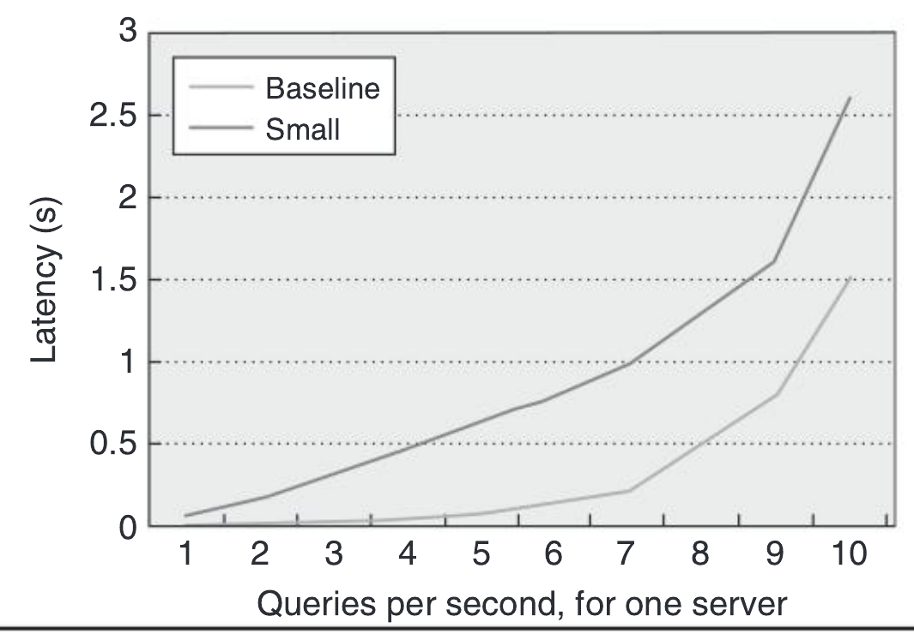

## 案例研究与习题（Parthasarathy Ranganathan） {- #sec-6-exercises}

### 案例研究 1：总拥有成本对仓库级计算机设计决策的影响 {-}

*本案例研究涉及的概念*

* 总拥有成本（TCO）
* 服务器成本和功耗对整个 WSC 的影响
* 低功耗服务器的利与弊

6.1　衡量一台仓库级计算机（WSC）的效益，总拥有成本（TCO）是一个重要指标。TCO 既包括 [6.7 节](#sec-6-7)介绍的 CAPEX，也包括 OPEX，反映的是整个数据中心达到一定性能水平所需的拥有成本。数据中心的所有者比较不同的服务器、网络和存储体系结构时，TCO 往往是决定取舍最重要的指标。不过，TCO 的计算是多维的，要考虑许多不同的因素。本案例研究的目的是细致地考察 WSC，看不同的体系结构怎样影响 TCO，并理解 TCO 怎样左右运营者的决策。本案例研究使用[图 6.32](#fig-6-32)、[图 6.33](#fig-6-33) 和 [6.7 节](#sec-6-7)中的数据，并假定所描述的 WSC 达到了运营者的目标性能。TCO 常用来比较在多个维度上各不相同的服务器方案。本案例研究的习题考察在 WSC 中怎样作这类比较，以及作出决策有多复杂。

[5/5/10] <6.7> 本章讨论过，WSC 可以利用数据级并行在大规模问题上获得高性能。可以设想，换用高端服务器还能得到更高的性能。但是，性能更高的服务器，价格往往不是按比例增加，而是增加得更多。

a.　[5] <6.7> 假设服务器在利用率相同的情况下快 10%，价格贵 20%，WSC 的 CAPEX 是多少？

b.　[5] <6.7> 如果这些服务器的功耗还高出 15%，WSC 的 OPEX 是多少？

c.　[10] <6.7> 在上述速度提高和功耗增加的条件下，新服务器的价格应为多少，才能与原来的集群相当？（提示：按这个 TCO 模型，可能需要改变设施的关键负载。）

6.2　[5/10] <6.7, 6.9> 要降低 OPEX，一个有吸引力的办法是采用低功耗版本的服务器，减少运行服务器所需的总电量。但是，与高端服务器类似，高端部件的低功耗版本在得失上也不是线性关系。

a.　[5] <6.7, 6.9> 如果低功耗服务器在性能相同的情况下功耗低 15%，价格贵 20%，这是一个好的折中吗？

b.　[10] <6.7, 6.9> 这种服务器的价格为多少时，才能与原来的集群相当？如果电价翻一番，结果又如何？

6.3　[5/10/15] <6.7> 服务器如果有多种工作模式，集群就可以根据工作负载的使用情况，动态地以不同配置运行。某种低功耗服务器的功耗—性能模式见[图 6.45](#fig-6-45)。

a.　[5] <6.7> 如果服务器运营者为了节省电费，决定让所有服务器都以中等性能运行，要达到同样的性能水平需要多少台服务器？

b.　[10] <6.7> 这种配置的 CAPEX 和 OPEX 各是多少？

c.　[15] <6.7> 如果还有一种方案可以选择：购买一种便宜 20% 的服务器，它慢 x%，功耗低 y%。求出使 TCO 与基准服务器相当的性能—功耗曲线。

[图 6.45　低功耗服务器的功耗—性能模式]{#fig-6-45 .caption}

| 模式 | 性能 | 功耗 |
|---|---|---|
| 高 | 100% | 100% |
| 中 | 75% | 60% |
| 低 | 59% | 38% |

6.4　[讨论] <6.7> 假设服务器上运行的工作负载保持不变，讨论习题 6.3 中两种方案各自的得失和好处。

6.5　[讨论] <6.1, 6.7> 与高性能计算（HPC）集群不同，WSC 的工作负载在一天之内往往有很大的波动。这次假设工作负载是变化的，再讨论习题 6.3 中两种方案各自的得失和好处。

6.6　[讨论] <6.7> 前面给出的 TCO 模型把大量较低层次的细节抽象掉了。讨论这些抽象对 TCO 模型整体准确性的影响。在什么情况下可以放心地作这些抽象？在什么情况下，考虑更多细节会得出明显不同的答案？

### 案例研究 2：WSC 中的资源分配与 TCO {-}

*本案例研究涉及的概念*

* WSC 内部服务器和电力的配置
* 工作负载随时间的变化
* 这种变化对 TCO 的影响

6.7　部署高效的 WSC，主要的难题之一是恰当地配置资源，并把资源充分利用起来。WSC 规模很大，所运行的工作负载又可能有很大变化，所以这个问题很复杂。本案例研究的习题说明，资源的使用方式不同，对 TCO 的影响也不同。需要时采用[图 6.32](#fig-6-32) 和[图 6.33](#fig-6-33) 中的数据。

[5/5/10] <6.7> 配置 WSC 的难题之一，是在设施规模给定的情况下确定合适的电力负载。本章讲过，铭牌功率往往是一个很少达到的峰值。

a.　[5] <6.7> 如果服务器的铭牌功率为 200 W，价格为 3000 美元，估计每台服务器的 TCO 怎样变化。

b.　[5] <6.7> 再考虑一种功率更高、价格更低的服务器：功率 300 W，价格 2000 美元。

c.　[10] <6.7> 如果服务器的实际平均功耗只有铭牌功率的 70%，每台服务器的 TCO 怎样变化？

6.8　[15/10] <6.7> TCO 模型的一个假设是：设施的关键负载固定不变，服务器的数量正好与这一关键负载相配。实际上，服务器的功耗随负载变化，设施所用的关键功率在任一时刻都可能不同。运营者起初必须根据数据中心的关键电力资源，以及对数据中心各组成部分用电量的估计，来配置数据中心。

a.　[15] <6.7> 扩展 TCO 模型：以铭牌功率为 300 W 的服务器为依据，对 WSC 作初始配置；再假设服务器的平均利用率为 40%，因而只消耗 225 W，计算每月实际使用的关键功率和 TCO。有多少容量没有用上？

b.　[10] <6.7> 换成平均利用率为 20%、只消耗 300 W 的 500 W 服务器，重做本题。

6.9　[10] <6.2, 6.7> [6.7 节](#sec-6-7)讲过，WSC 常常以与最终用户交互的方式使用。交互式使用往往造成一天之内随时段的波动，高峰出现在特定的时段。例如，Netflix 的租看在晚上 8 点到 10 点出现高峰。这些随时段变化的效应合起来相当可观。比较两种数据中心的单台服务器 TCO：一种的容量按凌晨 4 点的利用率配置，另一种按晚上 9 点的利用率配置。

6.10　[讨论/15] <6.2, 6.7> 讨论在非高峰时段更好地利用多余服务器、或者节省成本的一些办法。WSC 具有交互的性质，要激进地降低功耗会遇到哪些困难？

6.11　[讨论/25] <6.7, 6.9> 提出一种着眼于降低服务器功耗来改善 TCO 的办法。评估你的方案会遇到哪些困难？根据你的方案估计 TCO 能改善多少。这一方案有哪些优点和缺点？

### 习题 {-}

6.12　[10/10/10] <6.1> WSC 得以实现的一个重要条件，是有充足的请求级并行性，这与指令级并行性和线程级并行性不同。本题探讨不同类型的并行性对计算机体系结构和系统设计的影响。

a.　[10] <6.1> 讨论在哪些场景下，提高指令级或线程级并行性带来的好处，比利用请求级并行性所能得到的更大。

b.　[10] <6.1> 增加请求级并行性对软件设计有什么影响？

c.　[10] <6.1> 增加请求级并行性可能有哪些缺点？

6.13　[讨论/15/15] <6.3, 6.4> 云计算服务提供商收到由多个虚拟机（VM）组成的作业（如 MapReduce 作业）时，有多种调度方式可选：一种是轮转调度，把这些 VM 分散到所有可用的处理器和服务器上；另一种是合并调度，让它们使用尽可能少的处理器。例如，提交了一个有 24 个 VM 的作业，云中有 30 个处理器可用（每个处理器最多可运行 3 个 VM），轮转调度会用到 24 个处理器，而合并调度只用 8 个处理器。调度器还可以在不同的范围内寻找可用的处理器核：插座、服务器、机架和机架阵列。

a.　[讨论] <6.4> 假设提交的作业都是计算密集型工作负载，对存储带宽的要求可能各不相同。从功耗和冷却成本、性能、可靠性几方面看，轮转调度与合并调度各有什么优缺点？

b.　[15] <6.4> 假设提交的作业都是 I/O 密集型工作负载，在不同的范围内，轮转调度与合并调度各有什么优缺点？

c.　[15] <6.4> 假设提交的作业都是网络密集型工作负载，在不同的范围内，轮转调度与合并调度各有什么优缺点？

6.14　[15/15/10/10] <6.4> MapReduce 之类的分布式计算框架让数据上彼此独立的任务在多个节点上运行，这些节点通常采用商用硬件，从而获得大量的并行性。不过，并行的程度是有限的。例如，MapReduce 为了冗余，会把数据块写到多个节点上，这要消耗磁盘带宽，可能还要消耗网络带宽。假设：

* 数据集总大小为 300 GB；
* 网络带宽为 1 Gb/s；
* map 速率为 10 s/GB，reduce 速率为 20 s/GB；
* 30% 的数据必须从远程节点读取；
* 为了冗余，每个输出文件都要写到另外两个节点上。

其余参数都采用[图 6.21](#fig-6-21) 中的数据。

a.　[15] <6.4> 假设所有节点都在同一个机架中。用 5 个节点时，预计运行时间是多少？10 个节点、100 个节点、1000 个节点呢？讨论每种节点规模下的瓶颈。

b.　[15] <6.4> 假设每个机架有 40 个节点，任何一次远程读写落到任一节点上的机会均等。100 个节点时预计运行时间是多少？1000 个节点呢？

c.　[10] <6.4> 一个重要的考虑是尽量减少数据移动。从本地访问到机架内访问、再到阵列内访问，速度下降得很厉害，所以软件必须大力优化，尽量提高局部性。假设每个机架有 40 个节点，MapReduce 作业使用 1000 个节点。如果远程访问有 20% 落在同一机架内，运行时间是多少？50% 呢？80% 呢？

6.15　[20/20/10/20/20/20] <6.1, 6.4> WSC 程序员常用数据复制来克服软件中的故障。例如，Hadoop 分布式文件系统（HDFS）采用三路复制：一个本地副本，一个机架内的远程副本，一个另一机架中的远程副本。不过，值得考察的是，什么时候才需要这样的复制。

a.　[20] <6.1> 假设 Hadoop 集群规模较小，不超过 10 个节点，数据集不超过 10 TB。用[图 6.1](#fig-6-1) 中的故障频率数据计算：一个 10 节点的 Hadoop 集群，在一路、两路和三路复制下各有怎样的可用性？

b.　[20] <6.1> 仍用[图 6.1](#fig-6-1) 中的故障数据，对一个 1000 节点的 Hadoop 集群，一路、两路和三路复制下各有怎样的可用性？从中可以推断出，在大规模下复制有什么好处？

c.　[10] <6.1, 6.4> 复制的相对开销随每个本地计算小时写入的数据量而变。一个 1000 节点的 Hadoop 作业对 1 PB 数据排序，数据混洗的中间结果写入 HDFS。计算额外的 I/O 流量和网络流量（机架内和跨机架）。

d.　[20] <6.1, 6.4> 用[图 6.21](#fig-6-21) 计算两路和三路复制的时间开销。再用[图 6.1](#fig-6-1) 所示的故障率，比较不复制与两路、三路复制时的预期执行时间。

e.　[20] <6.1, 6.4> 现在考虑一个对日志实施复制的数据库系统，假设每个事务平均访问硬盘一次，产生 1 KB 日志数据。计算两路和三路复制的时间开销。如果事务在内存中执行，耗时 10 ms，结果又如何？

f.　[20] <6.1, 6.4> 再考虑另一个数据库系统，它为两阶段提交（为了满足 ACID 一致性）需要两次网络往返。维持一致性和复制的时间开销是多少？

6.16　[15/15/20/讨论] <6.1, 6.9> 利用请求级并行性，可以让许多台机器并行地处理同一个问题，从而获得更高的整体性能。困难之一在于如何避免把问题划分得过细。从服务等级协议（SLA）的角度看，划分得越细、每个子问题越小，为达到目标 SLA 所要付出的努力可能越大。假设 SLA 要求 95% 的查询在 0.5 秒以内响应，并行体系结构类似 MapReduce，可以启动多个冗余作业来得到同一个结果。以下各问都采用[图 6.46](#fig-6-46) 所示的查询—响应时间曲线。该曲线给出了响应延迟与每秒查询数的关系，有两条：一条对应基准服务器，一条对应采用较慢处理器型号的「小」服务器。

a.　[15] <6.1, 6.9> 按[图 6.46](#fig-6-46) 所示的查询—响应时间曲线，WSC 每秒收到 30,000 个查询，要达到这一 SLA 需要多少台服务器？按这条响应时间概率曲线，需要多少台「小」服务器？只看服务器成本，「小」服务器要比普通服务器便宜多少，才能在目标 SLA 下具有成本优势？

b.　[15] <6.1, 6.9> 「小」服务器的部件更便宜，可靠性往往也更差。采用[图 6.1](#fig-6-1) 中的数据，假设由不稳定的机器和坏内存引起的事件数增加 30%。现在需要多少台「小」服务器？这些服务器要比标准服务器便宜多少？

c.　[20] <6.1, 6.9> 现在假设是批处理环境。「小」服务器的整体性能是普通服务器的 30%。仍采用习题 6.15 (b) 中的可靠性数据，假设性能随节点规模完全线性扩展，每个节点上任务的平均长度为 10 min，要提供与 2400 个节点的标准服务器阵列相同的预期吞吐率，需要多少个「小」节点？如果扩展效率是 85% 呢？60% 呢？

d.　[讨论] <6.1, 6.9> 扩展往往不是线性函数，而是对数函数。一种自然的应对办法是改为购买更大的节点，每个节点计算能力更强，从而尽量缩小阵列规模。讨论这种体系结构的一些得失。

{#fig-6-46 width=60%}

6.17　[10/10/15/讨论] <6.4, 6.9> 考虑把非易失的 Flash 存储器纳入存储层次，可以采用固态盘（SSD），也可以采用 PCI Express 接口的扩展卡。典型的 SSD 带宽为 250 MB/s，延迟为 75 µs；PCIe 卡的带宽为 600 MB/s，延迟为 35 µs。

a.　[10] 把这两种器件加到[图 6.22](#fig-6-22) 的本地服务器存储层次中。假设它们在不同层次上被访问时，性能的缩放系数与 DRAM 相同，比较这两种 Flash 存储设备在跨机架访问和跨阵列访问时的性能。

b.　[10] 讨论能够利用这一新的存储层次的一些软件优化。

c.　[15] 「谬误与陷阱」（[6.9 节](#sec-6-9)）中讲过，把所有磁盘都换成 SSD，未必是一种合算的策略。考虑一个用 WSC 提供云服务的运营者，讨论在哪些场景下使用 SSD 或其他 Flash 存储器是合理的。

d.　[讨论] 讨论存储层次中是否还有机会增加其他层次：更慢的内存（如分解式内存），或者更慢的 Flash（成本更优化的技术）。

6.18　[20/20/讨论] <6.4> 存储层次：有些 WSC 设计大量使用缓存来降低延迟，而且有多种缓存方案，可以适应不同的访问模式和需求。

a.　[20] 考虑从 Web 上播放富媒体流（如 Netflix 或 YouTube）的设计方案。首先需要估计视频的数量、每个视频的编码格式数，以及同时观看的用户数。假设某视频流服务提供商有 12,000 部影片在线播放，每部影片至少有四种编码格式（500、1000、1600 和 2200 kbps）。再假设整个网站同时有 100,000 名观众，视频平均长 75 min（既有 30 min 的节目，也有 2 h 的影片）。估计总存储容量、I/O 带宽和网络带宽，以及视频流相关的计算需求。

b.　[20] 按每个用户、每个视频以及全部视频来看，访问模式和访存局部性各有什么特点？（提示：随机还是顺序，时间局部性和空间局部性好还是差，工作集相对较小还是较大。）

c.　[讨论] 利用 DRAM、SSD 和硬盘，有哪些影片存储方案？从性能和 TCO 两方面比较这些方案。习题 6.17 (d) 中那类替代存储技术会有用吗？

6.19　[20/讨论/讨论/讨论] <6.4> 考虑一个有 1 亿活跃用户的社交网站。用户发布关于自己的动态（文字和图片），也浏览社交圈中的动态并与之互动。为了降低延迟，Facebook 和许多其他网站在后端存储/数据库层之前用 memcached 作为缓存层。假设任一时刻，平均每个用户在浏览若干 MB 的内容；任一天中，平均每个用户上传若干 MB 的内容。

a.　[20] 对这里讨论的社交网站，容纳其工作集需要多少 DRAM？如果每台服务器有 96 GB DRAM，估计生成一个用户的主页需要多少次本地内存访问、多少次远程内存访问。

b.　[讨论] 现在考虑两种候选的 memcached 服务器设计：一种采用面向性能、能耗较高的核，另一种采用较小的高能效核（例如 Intel 和 AMD 发布的 E 核和 P 核）。memcached 需要很大的物理内存，但 CPU 利用率很低。在这一前提下，这两种设计各有什么优缺点？

c.　[讨论] 目前内存模块与处理器耦合得很紧，要支持大内存，往往需要增加 CPU 插座的数量。列出其他一些能提供大物理内存、又不必按比例增加服务器插座数的设计，并从性能、功耗、成本和可靠性几方面加以比较。

d.　[讨论] 同一个用户的信息可以同时存放在 memcached 服务器和存储服务器中，这些服务器在物理上可以有不同的部署方式。讨论 WSC 中以下几种服务器布局的优缺点：(1) memcached 与存储服务器放在同一台服务器上；(2) memcached 服务器和存储服务器放在同一机架的不同节点上；(3) memcached 服务器放在同一些机架上，存储服务器集中放在另外的机架上。

6.20　[5/5/10/10/讨论/讨论/讨论] <6.2, 6.4, 6.7> 数据中心网络：MapReduce 之类的分布式框架与仓库级计算机结合起来，是处理大规模数据的有力手段。本题假设用 4000 台服务器和 48,000 块硬盘，在 6 小时内对 1 PB 的记录排序。

a.　[5] 根据[图 6.21](#fig-6-21) 及相关正文推算磁盘带宽。把数据读入主存、再把排好序的结果写回，需要多少秒？

b.　[5] 假设每台服务器有两块 1 Gb/s 的以太网网络接口卡（NIC），WSC 交换基础设施的超额订阅比为 4，把整个数据集在 4000 台服务器之间混洗一遍需要多少秒？

c.　[10] 假设网络传输是 PB 级排序的性能瓶颈，你能估计出谷歌数据中心的超额订阅比是多少吗？

d.　[10] 现在考察采用无超额订阅的 10 Gb/s 以太网有什么好处，例如采用 48 端口的 10 Gb/s 以太网（2010 年 Indy 排序基准测试的冠军 TritonSort 就采用了这种网络）。混洗 1 PB 数据需要多长时间？

e.　[讨论] 比较这里的两种做法：(1) 大规模横向扩展，网络超额订阅比高；(2) 规模相对较小的系统，网络带宽高。两者各有哪些潜在瓶颈？从可扩展性和 TCO 来看，各有哪些优缺点？

f.　[讨论] 排序和许多重要的科学计算工作负载通信量很大，而其他许多工作负载并非如此。列出三个不能从高速网络中获益的工作负载实例。对这两类工作负载，你分别推荐使用哪些 EC2 实例？

g.　[讨论] 查阅 www.sortbenchmark.org 上的各项基准测试以及各类别最近的冠军。这些结果与 (e) 中讨论得出的认识是否吻合？CloudSort 最近一届冠军所用的云实例，与你在 (f) 中的答案相比如何？

6.21　[10/25/讨论] <6.4, 6.7> WSC 规模巨大，根据预期要运行的工作负载恰当地分配网络资源非常重要。不同的分配方式，对性能和总拥有成本都会有很大影响。

a.　[10] 用[图 6.32](#fig-6-32) 中详细列出的电子表格数据，求每台接入层交换机的超额订阅比。如果超额订阅比减半，对 TCO 有什么影响？如果加倍呢？

b.　[25] 如果工作负载受网络限制，降低超额订阅比就可能提高性能。假设一个计算作业使用 120 台服务器，读取 5 TB 数据。读入数据、中间数据和输出数据之间的比例与[图 6.47](#fig-6-47) 中 Sep-09 一行相同，存储层次各级的带宽按[图 6.21](#fig-6-21) 确定。读数据时，假设 50% 的数据从远程磁盘读取，其中 80% 在机架内读取，20% 在阵列内读取。对中间数据和输出数据，假设 30% 的数据使用远程磁盘，其中 90% 在机架内，10% 在阵列内。超额订阅比减半时，整体性能提高多少？超额订阅比加倍时，性能如何？分别计算各种情况下的 TCO。

c.　[讨论] 你认为新兴的技术趋势会怎样影响未来 WSC 的设计？例如，每个系统的核数越来越多（包括采用芯粒），光互连带来更高的带宽和更好的能效。

[图 6.47　谷歌 2004 年到 2016 年每月的 MapReduce 使用情况。12 年间，MapReduce 作业数增加到原来的 3300 倍。根据 [Dean, J., 2009] 更新]{#fig-6-47 .caption}

| 月份 | MapReduce 作业数 | 平均完成时间（s） | 每个作业平均服务器数 | 每台服务器平均核数 | CPU 核年 | 输入数据（PB） | 中间数据（PB） | 输出数据（PB） |
|---|---:|---:|---:|---:|---:|---:|---:|---:|
| Sep-16 | 95,775,891 | 331 | 130 | 2.4 | 311,691 | 11,553 | 4095 | 6982 |
| Sep-15 | 115,375,750 | 231 | 120 | 2.7 | 272,322 | 8307 | 3980 | 5801 |
| Sep-14 | 55,913,646 | 412 | 142 | 1.9 | 200,778 | 5989 | 2530 | 3951 |
| Sep-13 | 28,328,775 | 469 | 137 | 1.4 | 81,992 | 2579 | 1193 | 1684 |
| Sep-12 | 15,662,118 | 480 | 142 | 1.8 | 60,987 | 2171 | 818 | 874 |
| Sep-11 | 7,961,481 | 499 | 147 | 2.2 | 40,993 | 1162 | 276 | 333 |
| Sep-10 | 5,207,069 | 714 | 164 | 1.6 | 30,262 | 573 | 139 | 37 |
| Sep-09 | 4,114,919 | 515 | 156 | 3.2 | 33,582 | 548 | 118 | 99 |
| Sep-07 | 2,217,000 | 395 | 394 | 1.0 | 11,081 | 394 | 34 | 14 |
| Mar-06 | 171,000 | 874 | 268 | 1.6 | 2002 | 51 | 7 | 3 |
| Aug-04 | 29,000 | 634 | 157 | 1.9 | 217 | 3.2 | 0.7 | 0.2 |

6.22　[5/15/15/20/25/讨论/讨论] <6.2> 发挥云的能力：设想你是 Alexa.com 排名靠前的某个网站的站点运营和基础设施经理，正在考虑使用亚马逊 Web 服务（AWS）。决定是否迁移到 AWS 时，需要考虑哪些因素？可以使用哪些服务和实例类型？能节省多少成本？你可以利用 Alexa 和网站流量信息（例如 Wikipedia 提供页面浏览统计）来估计一个排名靠前的网站收到的流量，也可以采用 Web 上的具体例子，如下面这个：http://2bits.com/sites/2bits.com/files/drupal-single-server-2.8-million-page-views-a-day.pdf。

这份幻灯片介绍了一个 Alexa 排名第 3400 的网站，它每天有 280 万次页面浏览，只用一台服务器。这台服务器有两个四核 2.5 GHz Xeon 处理器、8 GB DRAM，以及三块 15K RPM 的 SAS 硬盘，组成 RAID1，每月费用约 400 美元。该网站大量使用缓存，CPU 利用率在 50% 到 250% 之间（大致相当于 0.5～2.5 个核处于忙碌状态）。

a.　[5] 查看现有的 EC2 实例（http://aws.amazon.com/ec2/instance-types/），哪些实例类型达到或超过这台服务器目前的配置？

b.　[15] 查看 EC2 的价格信息（http://aws.amazon.com/ec2/pricing/），选出在 AWS 上托管该网站最具成本效益的 EC2 实例（可以组合）。EC2 每月的费用是多少？

c.　[15] 再把 IP 地址和网络流量的费用算进去，假设该网站每天在 Internet 上传入和传出 100 GB 数据。现在网站每月的费用是多少？

d.　[20] AWS 还为新客户免费提供一年的微型实例，以及进出 AWS 的流量各 15 GB 的带宽。根据你对所在系 Web 服务器峰值流量和平均流量的估计，能否在 AWS 上免费托管它？

e.　[25] 根据各项服务的特点，如果 Netflix.com 这样大得多的网站把它的流媒体和编码基础设施迁移到 AWS，Netflix 可以使用哪些 AWS 服务？分别用于什么目的？

f.　[讨论] 查看其他云提供商（谷歌、微软、阿里巴巴等）的类似产品。(a)～(e) 的答案会有什么变化？

g.　[讨论] 利用「无服务器计算」，可以构建和运行更高层的应用和服务，而不必考虑具体的服务器。例子有 AWS Lambda、Google Cloud Functions、Microsoft Azure Functions 等。仍以站点运营和基础设施经理的身份考虑：什么时候你会考虑采用无服务器计算？

6.23　[讨论/讨论/20/20/讨论] <6.7, 6.9> [图 6.36](#fig-6-36) 给出了用户感受到的响应时间对收入的影响，说明有必要在保持低延迟的同时达到高吞吐率。

a.　[讨论] 以 Web 搜索为例，有哪些可能的办法降低查询延迟？

b.　[讨论] 可以收集哪些监测统计数据，来帮助了解时间花在了哪里？你打算怎样实现这样一个监测工具？

c.　[20] 假设每个查询的磁盘访问次数服从正态分布，均值为 2，标准差为 3。要满足「95% 的查询延迟不超过 0.1 s」的 SLA，磁盘访问延迟需要达到什么水平？

d.　[20] 内存缓存可以减少长延迟事件（如访问硬盘）的频率。假设稳态命中率为 40%，命中延迟为 0.05 s，失效延迟为 0.2 s，缓存是否有助于满足「95% 的查询延迟不超过 0.1 s」的 SLA？

e.　[讨论] 缓存的内容什么时候会过时，甚至不一致？这种情况多久会发生一次？怎样检测这样的内容并使之作废？

6.24　[15/15/20/讨论] <6.6, 6.7> 典型电源（PSU）的效率随负载变化。例如，负载在 40% 以上时（如从 100 W 的电源输出 40 W），PSU 效率约为 80%；负载在 20% 到 40% 之间时为 75%；负载低于 20% 时为 65%。

a.　[15] 假设服务器是功耗成比例的，实际功耗与 CPU 利用率成正比，利用率分布曲线如[图 6.48](#fig-6-48) 所示。PSU 的平均效率是多少？

b.　[15] 假设服务器的 PSU 采用 2N 冗余（即 PSU 数量加倍），以便在一个 PSU 故障时保证供电稳定。PSU 的平均效率是多少？

c.　[20] 刀片服务器厂商使用共享的 PSU 池，不仅用来提供冗余，还用来动态地使 PSU 的数量与服务器的实际功耗相匹配。假设一个刀片机柜用最多六个 PSU 为总共 16 台服务器供电。对于利用率曲线相同的服务器，这时机柜的 PSU 平均效率是多少？

d.　[讨论] 结合[图 6.32](#fig-6-32) 和[图 6.33](#fig-6-33) 中更宏观的 TCO 讨论，考虑这些不同的效率数值有什么影响：不同的设计对总 TCO 有什么影响？据此，你会怎样优化未来仓库级计算机的设计？

 右起第三列按正负 5% 的区间计算百分比，作为权重；因此，90% 那一行的 1.2% 表示有 1.2% 的服务器利用率在 85% 到 95% 之间。引自 [Barroso and Hölzle, 2007] 中的图 1。横轴为 CPU 利用率，纵轴为时间所占比例。](images/ch06/fig-6-48.png){#fig-6-48 width=80%}

6.25　[5/讨论/10/15/讨论/讨论/讨论] <6.6, 6.9> 所谓*电力搁浅*（power stranding），是指数据中心中已经配置、却没有用上的电力容量。考虑[图 6.49](#fig-6-49) 中给出的不同机器分组的数据 [Fan, Weber, and Barroso, 2007]。（注意，该论文所说的「集群」就是本章所说的「阵列」。）

a.　[5] 在 (1) 机架级、(2) 配电单元级和 (3) 阵列（集群）级，搁浅的电力各是多少？机器分组越大，电力容量的超额订阅呈现什么趋势？

b.　[讨论] 你认为不同机器分组之间电力搁浅程度的差别是什么原因造成的？

c.　[10] 考虑一个阵列级的机器集合，所有机器合计使用的功率从不超过总功率的 72%（这一比值有时也称为「和的峰值」与「峰值的和」之比）。用本案例研究中的成本模型，比较按峰值容量配置的数据中心和按实际用量配置的数据中心，计算可节省的成本。

d.　[15] 假设数据中心设计者决定在阵列级增加服务器，以利用搁浅的电力。采用 (a) 中的示例配置和假设，计算在配置的总电力不变的情况下，仓库级计算机现在可以多容纳多少台服务器。

e.　[讨论] 要让 (d) 中的优化在实际部署中行得通，需要什么条件？（提示：想一想，在阵列中所有服务器都以峰值功率运行这种罕见情况下，要限制功率需要做些什么。）

f.　[讨论] 管理功率上限可以设想两类策略 [Ranganathan et al., 2006]：(1) 预防式策略，功率预算事先确定（「不要以为可以用更多的电，用之前先申请！」）；(2) 反应式策略，一旦违反功率预算就对功率预算加以节流（「需要多少电就用多少，直到被告知不能再用为止！」）。讨论这两种做法的得失，以及分别在什么情况下使用。

g.　[讨论] 如果系统的能耗变得更加成比例，搁浅的总电力会有什么变化？
