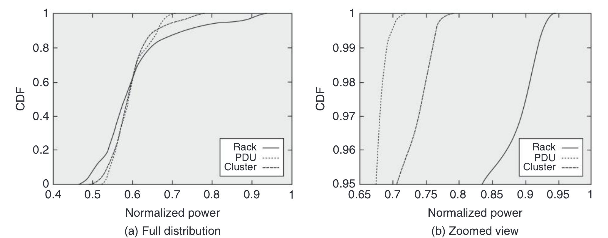

{#fig-6-49 width=90%}

6.26　[5/20/讨论] <6.6, 6.7> 6.6 节讨论过用每个机架配置的电池充当本地 UPS。这一思路还可以再推进一步：给每台服务器配一块电池。下面考察这种设计的影响。

a.　[5] 用电池充当服务器级的小型 UPS，效率为 99.99%，这样就不再需要效率只有 92% 的设施级 UPS。再假设变电站切换的效率为 99.7%，配电单元（PDU）、降压环节和其他断路器的效率分别为 98%、98% 和 99%。改用每台服务器各自的电池备份后，供电基础设施的总效率提高了多少？

b.　[20] 假设 UPS 的成本是 IT 设备成本的 10%，其余假设沿用案例研究中的成本模型。电池成本（用单台服务器成本的几分之几表示）的盈亏平衡点是多少？即电池成本低于多少时，基于电池的方案的总拥有成本才优于设施级 UPS？

c.　[讨论] 这两种做法在其他方面还有哪些权衡？特别是，你认为两种设计的可管理性和故障模型会有什么不同？

6.27　[5/5/讨论] <6.6, 6.7> 本题把 WSC 的总运行功率简化为下式：

$$
\text{总运行功率} = (1 + \text{冷却低效系数}) \times \text{IT 设备功率}
$$

a.　[5] 一个 8 MW 的数据中心，功率使用率为 80%，电价为每千瓦时 0.10 美元，冷却低效系数为 0.8。比较两种优化各能节省多少成本：(1) 把冷却效率提高 20%；(2) 把 IT 设备的能效提高 20%。

b.　[5] IT 设备的能效要提高百分之几，节省的成本才能与冷却效率提高 20% 相当？

c.　[讨论] 着眼于服务器能效的优化和着眼于冷却能效的优化，两者的相对重要性如何？你能得出什么结论？

6.28　[5/5/讨论] <6.6, 6.7> 本章讲过，WSC 中的冷却设备本身就可能消耗大量能量。主动管理温度可以降低冷却成本，温度感知的负载放置就是为此提出的一种优化。它的思路是：先摸清某个机房的冷却分布情况，再把发热较多的系统安排到较凉的位置，从而在 WSC 一级降低总的冷却需求。

a.　[5] 机房空调（CRAC）机组的*性能系数*（COP）用来衡量它的效率，定义为排出的热量（Q）与排出这些热量所需的功（W）之比。CRAC 机组送入静压箱的空气温度越高，COP 就越大。如果空气以 20 °C 返回 CRAC 机组，COP 为 1.9，要排出 10 kW 的热量，CRAC 机组要消耗多少能量？如果空气以 25 °C 返回，冷却同样体积的空气 COP 为 3.1，这时 CRAC 机组要消耗多少能量？

b.　[5] 假设某种负载分配算法能把发热多的负载很好地安排到较凉的位置，使 CRAC 机组可以在较高的温度下运行，像上一问那样提高冷却效率。上面两种情况相比，节省了多少功率？

c.　[讨论] WSC 系统规模庞大，功率管理可能是一个复杂的、涉及多个方面的问题。提高能效的优化可以在硬件中实现，也可以在软件中实现；可以在系统级实现，也可以在集群级实现；对象可以是 IT 设备，也可以是冷却设备，等等。为 WSC 设计整体的能效方案时，必须考虑这些优化之间的相互作用。考虑一种整合算法：它根据服务器利用率，把不同类别的负载整合到同一台服务器上，以提高服务器利用率（如果系统不是能耗成比例的，这样做有可能让服务器在更高的能效下工作）。如果同时还运行着另一种算法，试图利用不同的功率状态（例子见 ACPI，即高级配置与电源接口），这两种优化会怎样相互影响？你还能想到哪些例子，说明 WSC 中多种优化之间可能相互冲突？你会怎样解决这个问题？

6.29　[5/10/15/20] <6.7> 所谓*能耗正比性*（有时也称为 energy scale-down），是指系统空闲时不消耗功率；更重要的是，随着活动水平和完成的工作量增加，系统的功耗*按比例*逐渐增加。本题考察能耗对不同能耗正比性模型的敏感程度。以下各问如无特别说明，默认使用[图 6.50](#fig-6-50) 中的数据。

a.　[5] 分析能耗正比性的一种简单办法，是假定活动水平与功耗呈线性关系。只用[图 6.50](#fig-6-50) 中的峰值功率和空闲功率数据做线性插值，画出能效随利用率变化的曲线（能效用每瓦性能表示）。如果空闲功率（活动水平为 0% 时）只有[图 6.50](#fig-6-50) 所设的一半，结果会怎样？如果空闲功率为零呢？

b.　[10] 改用[图 6.50](#fig-6-50) 第 3 列的数据表示功率的变化，画出能效随活动水平变化的曲线。再假设（只有）空闲功率降为[图 6.50](#fig-6-50) 所设的一半，画出能效曲线。把这些曲线与上一问的线性模型作比较。只关注空闲功率会带来什么后果？你能得出什么结论？

c.　[15] 假设系统利用率的构成如[图 6.50](#fig-6-50) 第 7 列所示。为简单起见，假设 1000 台服务器按离散分布：109 台利用率为 0%，80 台利用率为 10%，依此类推。分别按 (a) 和 (b) 的假设，计算这一负载构成下的总性能和总能耗。

d.　[20] 可以设计这样一种系统：负载在 0% 到 50% 之间时，功率与负载呈亚线性关系。这样的系统，能效曲线的峰值出现在较低的利用率处（代价是较高利用率下的能效）。构造一个新版本的[图 6.50](#fig-6-50) 第 3 列，体现这样的能效曲线。假设系统利用率的构成如[图 6.50](#fig-6-50) 第 7 列所示。为简单起见，假设 1000 台服务器按离散分布：109 台利用率为 0%，80 台利用率为 10%，依此类推。计算这一负载构成下的总性能和总能耗。

[图 6.50　SPECpower 的测试结果，改用[图 6.48](#fig-6-48) 中的权重，而不是平均权重]{#fig-6-50 .caption}

| 负载 | 性能 | 功率（W） | SPEC 权重 | 加权性能 | 加权功率（W） | [图 6.48](#fig-6-48) 的权重 | 加权性能 | 加权功率（W） |
|---:|---:|---:|---:|---:|---:|---:|---:|---:|
| 100% | 2,889,020 | 662 | 9.09% | 262,638 | 60 | 0.80% | 22,206 | 5 |
| 90% | 2,611,130 | 617 | 9.09% | 237,375 | 56 | 1.20% | 31,756 | 8 |
| 80% | 2,319,900 | 576 | 9.09% | 210,900 | 52 | 1.50% | 35,889 | 9 |
| 70% | 2,031,260 | 533 | 9.09% | 184,660 | 48 | 2.10% | 42,491 | 11 |
| 60% | 1,740,980 | 490 | 9.09% | 158,271 | 45 | 5.10% | 88,082 | 25 |
| 50% | 1,448,810 | 451 | 9.09% | 131,710 | 41 | 11.50% | 166,335 | 52 |
| 40% | 1,159,760 | 416 | 9.09% | 105,433 | 38 | 19.10% | 221,165 | 79 |
| 30% | 869,077 | 382 | 9.09% | 79,007 | 35 | 24.60% | 213,929 | 94 |
| 20% | 581,126 | 351 | 9.09% | 52,830 | 32 | 15.30% | 88,769 | 54 |
| 10% | 290,762 | 308 | 9.09% | 26,433 | 28 | 8.00% | 23,198 | 25 |
| 0% | 0 | 181 | 9.09% | 0 | 16 | 10.90% | 0 | 20 |
| 合计 | 15,941,825 | 4967 |  | 1,449,257 | 452 |  | 933,820 | 380 |
|  |  |  |  | ssj_ops/W | 3210 |  | ssj_ops/W | 2454 |

6.30　[15/20/20] <6.7> 本题说明能耗正比性模型与服务器整合、高能效服务器设计等优化之间的相互作用。考虑[图 6.51](#fig-6-51) 和[图 6.52](#fig-6-52) 所示的场景。

a.　[15] 考虑两种服务器，功率分布如[图 6.51](#fig-6-51) 所示：情形 A 就是[图 6.50](#fig-6-50) 中的服务器；情形 B 的能耗正比性不如 A，但能效比 A 高。假设系统利用率的构成如[图 6.50](#fig-6-50) 第 7 列所示。为简单起见，假设 1000 台服务器按离散分布：109 台利用率为 0%，80 台利用率为 10%，依此类推，见[图 6.52](#fig-6-52) 第 1 行。性能随利用率的变化按[图 6.50](#fig-6-50) 第 2 列计算。比较两种服务器在这一负载构成下的总性能和总能耗。

b.　[20] 考虑一个由 1000 台服务器组成的集群，数据与[图 6.50](#fig-6-50) 类似（[图 6.51](#fig-6-51) 和[图 6.52](#fig-6-52) 的第一行对这些数据做了归纳）。在这些假设下，这一负载构成的总性能和总能耗是多少？再假设能把负载整合起来，形成情形 C 的分布（[图 6.52](#fig-6-52) 第二行），这时总性能和总能耗又是多少？与一个采用线性能耗正比模型、空闲功率为 0 W、峰值功率为 662 W 的系统相比，总能耗如何？

c.　[20] 改用服务器 B 的功率模型重做 (b)，并与 (a) 的结果作比较。

[图 6.51　两种服务器的功率分布]{#fig-6-51 .caption}

| 活动水平（%） | 0 | 10 | 20 | 30 | 40 | 50 | 60 | 70 | 80 | 90 | 100 |
|---|---:|---:|---:|---:|---:|---:|---:|---:|---:|---:|---:|
| 情形 A 的功率（W） | 181 | 308 | 351 | 382 | 416 | 451 | 490 | 533 | 576 | 617 | 662 |
| 情形 B 的功率（W） | 250 | 275 | 325 | 340 | 395 | 405 | 415 | 425 | 440 | 445 | 450 |

[图 6.52　集群中服务器的利用率分布：未整合与整合之后]{#fig-6-52 .caption}

| 活动水平（%） | 0 | 10 | 20 | 30 | 40 | 50 | 60 | 70 | 80 | 90 | 100 |
|---|---:|---:|---:|---:|---:|---:|---:|---:|---:|---:|---:|
| 服务器台数，情形 A 和 B | 109 | 80 | 153 | 246 | 191 | 115 | 51 | 21 | 15 | 12 | 8 |
| 服务器台数，情形 C | 504 | 6 | 8 | 11 | 26 | 57 | 95 | 123 | 76 | 40 | 54 |

6.31　[10/讨论] <6.7> *系统级能耗正比性的趋势*：一台服务器的功耗构成有以下两种情况：

* CPU 50%，内存 23%，磁盘 11%，网络及其他 16%；
* CPU 33%，内存 30%，磁盘 10%，网络及其他 27%。

a.　[10] 假设 CPU 的动态功率范围为 3.0 倍，即 CPU 空闲时的功耗是峰值功耗的 1/3；内存系统、磁盘以及网络及其他部分的动态范围分别为 2.0 倍、1.3 倍和 1.2 倍。两种情况下，整个系统的动态范围各是多少？

b.　[讨论] 从 (a) 的结果中能得到什么启示？怎样才能在系统级实现更好的能耗正比性？（提示：系统级的能耗正比性不能只靠优化 CPU 来实现，而要改进所有部件。）

6.32　[30] <6.7> Pitt Turner IV 等人 [2008] 对数据中心的等级划分做了很好的综述。等级划分规定的是场地基础设施的性能。为简单起见，只考虑[图 6.53](#fig-6-53) 所列的主要差别（改编自 Pitt Turner IV 等人 [2008]）。以案例研究中的 TCO 模型为框架，比较图中各个等级在成本上有什么不同。

6.33　[讨论] <6.7> 根据[图 6.36](#fig-6-36) 和[图 6.32](#fig-6-32) 中的观察结果，定性地分析：停机造成的收入损失，与为保证正常运行而付出的成本，两者之间存在怎样的权衡？

[图 6.53　数据中心等级划分概览，改编自 [Pitt Turner IV et al., 2008]]{#fig-6-53 .caption}

| 等级 | 特征 | 可用性 |
|---|---|---:|
| Tier 1 | 供电和冷却的分配只有一条通路，没有冗余部件 | 99.0% |
| Tier 2 | (*N* + 1) 冗余，即两条供电和冷却分配通路 | 99.7% |
| Tier 3 | (*N* + 2) 冗余，即三条供电和冷却分配通路，即使在维护期间也能保持正常运行 | 99.98% |
| Tier 4 | 两条同时工作的供电和冷却分配通路，每条通路都有冗余部件，任何一台设备出故障都不影响负载 | 99.995% |

6.34　[15/讨论] <6.6> 近来有些研究定义了一个称为 TPUE 的指标，意思是「真实 PUE」（true PUE）或「总 PUE」（total PUE），定义为 PUE × SPUE。6.6 节把 PUE（电能使用效率）定义为设施总功率与 IT 设备总功率之比。SPUE 即服务器 PUE，是一个与 PUE 类似、但用于计算设备的新指标，定义为服务器的总输入功率与有用功率之比。有用功率是指直接参与计算的电子部件消耗的功率，这些部件包括主板、磁盘、CPU、DRAM、I/O 卡等。换句话说，SPUE 反映的是服务器上的电源、电压调节器和风扇带来的低效。

a.　[15] 考虑一种设计：提高机房空调（CRAC）机组的送风温度。CRAC 机组的效率大致是温度的二次函数，因此这种设计能改善总体 PUE，不妨假设改善 7%（PUE 的基准值为 1.7）。但服务器一侧的温度升高后，板上的风扇控制器会让风扇以高得多的转速运行。风扇功率是转速的三次函数，转速提高会使 SPUE 变差。假设风扇功率模型为

$$
\text{风扇功率} = 284 \times ns^3 - 75 \times ns^2
$$

其中 $ns$ 是归一化风扇转速，即以 rpm 为单位的风扇转速除以 18,000；服务器的基准功率为 350 W。分别计算风扇转速 (1) 从 10,000 rpm 提高到 12,500 rpm、(2) 从 10,000 rpm 提高到 18,000 rpm 时的 SPUE，并比较这两种情况下的 PUE 和 TPUE。（为简单起见，SPUE 模型中不考虑供电环节的低效。）

b.　[讨论] (a) 说明，PUE 虽然是衡量设施开销的极好指标，却反映不出 IT 设备本身的低效。你能否再举出一种设计，使 TPUE 的变化可能小于传统 PUE 的变化？（提示：见习题 6.26。）

6.35　[讨论/30/讨论] <6.7> 要计量服务器的能效，有两个基准测试程序是很好的起点：SPECpower_ssj2008 基准测试程序（见 <http://www.spec.org/power_ssj2008/>）和 JouleSort 指标（见 <http://sortbenchmark.org/>）。

a.　[讨论] 查阅这两个基准测试程序的说明。它们有哪些相同之处，哪些不同之处？为了更好地服务于提高 WSC 能效这一目标，你会怎样改进它们？

b.　[30] JouleSort 测量完成一次外排序（out-of-core sort）所需的系统总能耗，并试图导出一个指标，用来比较从嵌入式设备到超级计算机的各类系统。到 <http://sortbenchmark.org> 查阅 JouleSort 指标的说明，下载一个公开的排序算法版本，在不同类别的机器（笔记本电脑、PC、手机等）上运行，或者在不同的配置下运行。从不同配置的 JouleSort 评分中，你能得到什么启示？

c.　[讨论] 对上面实验中 JouleSort 评分最好的系统，你会怎样提高它的能效？例如，可以尝试改写排序代码来提高 JouleSort 评分。在云中运行排序对能效有什么影响？

6.36　[10/10/15/讨论] <6.1, 6.4> [图 6.1](#fig-6-1) 列出了一个服务器阵列中的各类停机事件。面对 WSC 这样大的规模，必须在集群设计和软件体系结构之间取得平衡，才能既达到所需的正常运行时间，又不付出过高的成本。本题考察只靠硬件实现可用性会带来什么后果。

a.　[10] 假设运营者希望只靠改进服务器硬件达到 95% 的可用性，每类事件各需要减少多少次？暂且假设单台服务器的崩溃完全由冗余机器处理。

b.　[10] 如果单台服务器的崩溃有 50% 的时间由冗余处理，(a) 的答案会有什么变化？20% 的时间呢？完全不由冗余处理呢？

c.　[15] 讨论软件冗余对实现高可用性的重要性。如果 WSC 运营者考虑购买更便宜、但可靠性低 10% 的机器，这对软件体系结构有什么影响？软件冗余面临哪些挑战？

d.　[讨论] 讨论最终一致对仓库级计算机扩展能力的重要性。

6.37　[15] <6.1, 6.9> 查一查标准 DDR4 DRAM 和带纠错码（ECC）的 DDR4 DRAM 的当前价格。为了获得 ECC 提供的更高可靠性，每位的价格提高了多少？只考虑 DRAM 的价格，并利用 6.9 节给出的数据，分别计算使用非 ECC DRAM 和 ECC DRAM 的 WSC 每美元能换来多少正常运行时间。

6.38　[5/讨论/讨论] <6.1, 6.9> *WSC 的可靠性与可管理性问题*：

a.　[5] 考虑一个服务器集群，每台服务器价格 2000 美元。假设年故障率为 5%，每次维修平均需要 1 小时的服务时间，每次故障更换部件的费用为系统成本的 10%，维修技术人员的费用为每小时 100 美元。每台服务器每年的维护成本是多少？

b.　[讨论] 传统的企业数据中心运行着大量中小规模的应用，每个应用都在各自专用的硬件基础设施上运行。比较这里的可管理性模型与传统企业数据中心的有什么不同。

c.　[讨论] 讨论仓库级计算机采用异构机器的利弊权衡。

6.39　[5/5/10/讨论] <6.1, 6.7> 假设你开发了一项 Web 服务，99% 的时间运行良好（在 100 ms 的延迟内响应），1% 的时间有性能问题（比如 CPU 进入了较低的功率状态，响应用了 1000 ms，等等）。

a.　[5] 你的服务受到欢迎，现在有 100 台服务器，处理一个用户请求时，计算必须访问所有这些服务器。在 100 台服务器上，查询响应慢的时间可能占百分之几？

b.　[5] 单台服务器的延迟服务等级协议（SLA）现在是「两个 9」（99%）。要让集群的延迟 SLA 中出现差延迟的时间只占 10% 或更少，单台服务器的延迟 SLA 需要几个「9」？

c.　[10] 如果有 2000 台服务器，(a) 和 (b) 的答案有什么变化？

d.　[讨论] 6.7 节（第 531 页）讨论了「尾部容忍」的设计。你的 Web 服务需要做哪些设计优化？（提示：参阅 Dean 和 Barroso [2013] 的论文「The Tail at Scale」。）

6.40　[讨论/讨论/5/5/5] <6.3, 6.2> 现代虚拟化平台和 VMM 都支持热迁移，即把整个虚拟机从一台物理主机迁移到另一台。热迁移给云服务提供商和客户带来许多好处，包括不中断业务的系统维护，以及把负载更紧凑地装进物理主机，从而改善 TCO。假设有 A、B 两台机器，各有 12 个核和 256 GB DRAM：

* 开始时，机器 A 上运行两个 VM：VM0 使用 6 个核和 24 GB DRAM，VM1 使用 4 个核和 48 GB DRAM；
* 机器 B 上运行一个 VM，即 VM2，占用 4 个核和 128 GB DRAM。

后来，用户关闭了 VM1。根据以往对这个客户的 VM 的经验，我们预计 VM0 和 VM2 在可预见的将来会继续运行。假设我们有一个简单的 VM 迁移系统，迁移分三步：1) 暂停 VM；2) 通过网络传送 CPU 和内存状态；3) 恢复 VM。假设迁移时间主要花在传送内存内容上。

a.　[讨论] 迁移 VM 时，除了 CPU 和内存状态，还需要考虑哪些资源？如果目标是让迁移时间最短，你认为应当怎样管理这些资源？

b.　[讨论] 假设我们要把 VM0 和 VM2 整合到一台物理主机上。决定迁移哪一个 VM 时，可以参考哪些指标？

c.　[5] 采用上述简单迁移系统，并假设我们向 VM 客户承诺了六个 9 的正常运行时间。如果一个 VM 每天最多只迁移一次，而且迁移是停机唯一可能的来源，迁移过程最多可以花多长时间？

d.　[5] 假设系统决定把 VM2 迁移到机器 A。仍然假设每天迁移一次，要在不违反正常运行时间承诺的前提下完成迁移，A 和 B 之间至少需要多大的带宽？

e.　[5] 如果网络为 200 Gb/s，在不违反五个 9 的正常运行时间承诺的前提下，VM0 每天可以迁移多少次？

6.41　[讨论] <6.3, 6.2> 除了进程隔离、虚拟机、物理隔离等机制以外，容器化是另一种常用的隔离机制。

a.　[讨论] 查一查常用的容器管理工具。它们是否把隔离宣传为主要用途？

b.　[讨论] 把容器化与上面列出的其他隔离机制作比较，从性能开销、隔离能力、硬件要求等多个方面讨论它们的异同。

c.　[讨论] 什么样的 WSC 运营者可能会依赖哪一种隔离机制？为 WSC 中的每种隔离技术各举一个用例。

d.　[讨论] 隔离机制从来都不是完美的。找出生产系统中这些机制被攻破的一些例子，并加以解释。

6.42　[30/10] <6.5> 今天的 WSC 提供了大量 I/O 机制和加速器，它们的成本和性能各不相同。云用户同样可以使用这些种类繁多的资源，云服务提供商的网站上列有价格。

a.　[30] 针对不同的云服务提供商，画出下列资源按每小时、每 GB、每 Gb/s 等单位计算的成本。通过对比各种类型的实例，尽量把每种资源的成本分离出来。

* i　网络（带宽不同）
* ii　DRAM（容量和标准不同）
* iii　NVMe Flash（IOPS 和带宽不同）
* iv　磁盘（IOPS 和带宽不同）
* v　GPU（每秒操作数不同）
* vi　FPGA
* vii　机器学习加速器（每秒操作数不同）

b.　[10] 收集同类设备的零售价格。如果云服务提供商按这些价格购买设备，要出租多长时间才能收回成本？

6.43　[讨论/5/5/5/讨论] <6.8> 与 ASIC 相比，FPGA 牺牲了功耗和性能，换来的是能在几小时内部署新的专用硬件设计，而不必花几个月甚至几年。本题考虑在 FPGA 上和在 ASIC 上部署专用硬件设计的权衡。假设你是一家云运营商，可以从下面两种加速器中选购一种，部署到你的机群中：

* (1) FlexAcc，基于 FPGA 的加速器，可以快速修改和重新编程，与 32 核 CPU 上的软件相比，始终保持 16 倍的加速比；
* (2) FastAcc，基于 ASIC 的加速器，不能修改，但速度是 32 核 CPU 上软件的 1024 倍，功耗是 FlexAcc 的 1/8，是 CPU 的 1/32。

假设 FlexAcc 和 FastAcc 的购买价格相同。

a.　[讨论] 哪些应用领域或程序库可能更适合 FlexAcc 这种形态？哪些更适合 FastAcc？

b.　[5] 假设每发布一个新的软件版本，FastAcc 的效果就降为原来的一半（功耗不变）。经过多少个软件版本之后，FlexAcc 和 FastAcc 的瞬时每瓦性能相等？

c.　[5] 假设一个 32 核 CPU 的价格为 2048 美元，电价为每千瓦时 0.125 美元，CPU 和 FastAcc 都部署 2 年，期间没有任何新的软件版本。FastAcc 的购买价格最高为多少，才能与 CPU 持平？

d.　[5] 针对 FlexAcc 重做 (c)。

e.　[讨论] 在 (a)～(d) 中，我们隐含地假定 ASIC 形态的加速器完全不能随软件演进，但事实并非如此。可编程 ASIC 有哪些例子？它们怎样保持灵活性？

6.44　[讨论/讨论/240/5/5/5] <6.8> *为 WSC 复现开源定制芯片*：Karandikar 等人发布了一个开源的 Protocol Buffers 硬件加速器设计。Protocol Buffers 是一种序列化框架，在仓库级计算机中常用于服务之间的通信和持久化存储。

a.　[讨论] 设计这个加速器的动机是什么？查找一些参考文献，看看在不同的云服务提供商、不同的时期，序列化和反序列化占用了多少 CPU 利用率。

b.　[讨论] 这样的加速器应当怎样集成到系统中（靠近核、CXL、PCIe 等）？从性能和集成成本两个角度讨论其中的权衡。

c.　[240] 按照 Karandikar 等人论文中的制品附录（artifact appendix），在这个开源的 Protocol Buffers 加速器实现上，运行由谷歌机群数据导出的 Protocol Buffers 基准测试程序。需要使用 AWS。

d.　[5] 这篇论文不仅为 WSC 提出了新硬件，还利用 WSC 中的专用化来完成评估：借助云 FPGA，用 FireSim 做快速硬件模拟。按需付费使用所需的 FPGA（EC2 F1）与直接买一块 FPGA（Xilinx Alveo U250）相比，成本各是多少？

e.　[5] 如果买了 FPGA，要运行多少次基准测试才能收回成本？如果把承载 FPGA 的服务器的成本也算进去呢？

f.　[5] 假设买了足够多的 FPGA（8 块），与制品中设定的在云中多块 FPGA 上并行运行的并行度相当，重做前面几问的计算。

## 参考文献 {- #sec-6-references}

Barroso, L.A., Hölzle, U., Ranganathan, P., 2018. The Datacenter as a Computer: Designing Warehouse-Scale Machines, third ed. Morgan & Claypool Publishers.

Bugnion, E., Devine, S., Rosenblum, M., Sugerman, J., Wang, E.Y., November 2012. Bringing Virtualization to the x86 Architecture with the Original Vmware Workstation., 30 ACM Transactions of Computing Systems, p. 4. <https://doi.org/10.1145/2382553.2382554>.

Cook, B., Khazem, K., Kroening, D., Tasiran, S., Tautschnig, M., Tuttle, M.R., 2021. Model checking boot code from AWS data centers. Form. Methods Syst. Des. 57 (1), 34–52. <https://doi.org/10.1007/s10703-020-00344-2>.

Delimitrou, C., Kozyrakis, C., 2014. Quasar: resource-efficient and QoS-aware cluster management. In: Proceedings of the 19th international conference on Architectural support for programming languages and operating systems (ASPLOS '14). Association for Computing Machinery, New York, NY, USA, pp. 127–144. <https://doi.org/10.1145/2541940.2541941>.

Ferguson, A.D., Gribble, S.D., Hong, C.-Y., Edwin Killian, C., Mohsin, W., Mühe, H., Ong, J., Poutievski, L., Singh, A., Vicisano, L., Alimi, R., Chen, S.S., Conley, M., Mandal, S., Nagaraj, K., Bollineni, K.N., Sabaa, A., Zhang, S., Zhu, M., Amin, V., April 12-14, 2021. Orion: Google's Software-Defined Networking Control Plane. In: Proceedings of the 18th USENIX Symposium on Networked Systems Design and Implementation.

Firestone, D., Putnam, A., Mundkur, S., Chiou, D., Dabagh, A., Andrewartha, M., Angepat, H., Bhanu, V., Caulfield, A., Chung, E., Chandrappa, H.K., Chaturmohta, S., Humphrey, M., Lavier, J., Lam, N., Liu, F., Ovtcharov, K., Padhye, J., Popuri, G., Raindel, S., Sapre, T., Shaw, M., Gabriel, S., Sivakumar, M., Srivastava, N., Verma, A., Zuhair, Q., Deepak, B., Doug, B., Vaid, K., Maltz, D.A., Greenberg, A., 2018. Azure accelerated networking: SmartNICs in the public cloud. In: Proceedings of the 15th USENIX Conference on Networked Systems Design and Implementation (NSDI'18). USENIX Association, USA, pp. 51–64.

Forecast: Public Cloud Services, Worldwide, 2020-2026, 3Q22 Update." <https://www.gartner.com/document/4019167>

Jalili, M., Manousakis, I., Goiri, Í., Misra, P.A., Raniwala, A., Alissa, H., Ramakrishnan, B., Tuma, P., Belady, C., Fontoura, M., Bianchini, R., 2021. Cost-efficient overclocking in immersion-cooled datacenters. In: Proceedings of the 48th Annual International Symposium on Computer Architecture (ISCA '21). IEEE Press, pp. 623–636. <https://doi.org/10.1109/ISCA52012.2021.00055>.

Karandikar, S., Leary, C., Kennelly, C., Zhao, J., Parimi, D., Nikolic, B., Asanovic, K., Ranganathan, P., 2021. A Hardware Accelerator for Protocol Buffers. In: MICRO-54: 54th Annual IEEE/ACM International Symposium on Microarchitecture (MICRO '21). <https://doi.org/10.1145/3466752.3480051>.

Li, H., Berger, D.S., Novakovic, S., Hsu, L., Ernst, D., Zardoshti, P., Shah, M., Rajadnya, S., Lee, S., Agarwal, I., Hill, M.D., Fontoura, M., Bianchini, R., March 2023. Pond: CXL-Based Memory Pooling Systems for Cloud Platforms. In: Proceedings of the 28th ACM International Conference on Architectural Support for Programming Languages and Operating Systems (ASPLOS). Vancouver, BC Canada.

Lo, D., Cheng, L., Govindaraju, R., Ranganathan, P., Christos, K., 2016. Improving Resource Efficiency at Scale with Heracles. ACM Trans. Comput. Syst. 34 (2), 33. <https://doi.org/10.1145/2882783>. Article 6.

Nishtala, R., Fugal, H., Grimm, S., Kwiatkowski, M., Lee, H., Li, H.C., McElroy, R., Paleczny, M., Peek, D., Paul, S., Stafford, D., Tung, T., Venkataramani, V., 2013. Scaling Memcache at Facebook. In: Proceedings of the 10th USENIX conference on Networked Systems Design and Implementation (nsdi'13). USENIX Association, USA, pp. 385–398.

Popek, G.J., Goldberg, R.P., July 1974. Formal requirements for virtualizable third generation architectures. Communications of the ACM 17 (7), 412–421. <https://doi.org/10.1145/361011.361073>.

Poutievski, L., Mashayekhi, O., Ong, J., Singh, A., Tariq, M., Wang, R., Zhang, J., Beauregard, V., Conner, P., Gribble, S., Kapoor, R., Kratzer, S., Li, N., Liu, H., Nagaraj, K., Ornstein, J., Sawhney, S., Urata, R., Vicisano, L., Yasumura, K., Zhang, S., Zhou, J., Amin, V., 2022. Jupiter evolving: transforming google's datacenter network via optical circuit switches and software-defined networking. In: Proceedings of the ACM SIGCOMM 2022 Conference (SIGCOMM '22). Association for Computing Machinery, New York, NY, USA, pp. 66–85. <https://doi.org/10.1145/3544216.3544265>.

Shalev, L., Ayoub, H., Bshara, N., Sabbag, E., Nov.-Dec. 2020. A Cloud-Optimized Transport Protocol for Elastic and Scalable HPC. IEEE Micro vol. 40 (6), 67–73. <https://doi.org/10.1109/MM.2020.3016891>.

Turner IV, Pitt, W., Seader, J.H., Brill, K.G., 2008. Tier classifications define site infrastructure performance. White Paper, The Uptime Institute.

Uptime Institute Global Data Center Survey Results 2022, <https://uptimeinstitute.com/resources/research-and-reports/uptime-institute-global-data-center-survey-results-2022>
