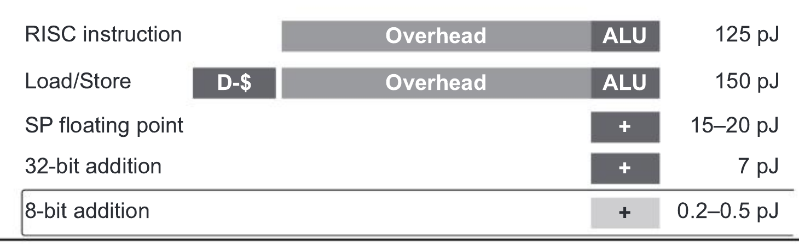

# 领域专用体系结构 {#ch-dsa}

> 摩尔定律不可能永远延续下去。我们还有 10～20 年，然后就会碰到根本性的极限。
>
> ——Gordon Moore，Intel 联合创始人（2005）

## 引言 {#sec-7-1}

Gordon Moore 在 1965 年预言，每个芯片上的晶体管数将惊人地增长。本章开头的引语表明，他还预言了这种增长将在 50 年后走向尽头。第 1 章的图 1.24 就是证据：几十年来，Intel 一直以摩尔定律指导资本投资，并以此为傲；然而即使是 Moore 亲手创办的这家公司，开发新一代半导体工艺的步伐也在放慢。

在半导体高速发展的年代，架构师搭着摩尔定律的快车发明了各种新机制，把源源不断的晶体管转化为更高的性能。20 世纪 80 年代，只要 25,000 个晶体管就能做出一个五级流水线的 32 位 RISC 处理器。此后，处理器的资源增长到原来的 1,000,000 倍，架构师用这些资源实现了各种功能，在通用处理器上加速通用代码。前面各章介绍过这些功能：

* 第一级、第二级、第三级甚至第四级 Cache；
* 512 位 SIMD 浮点部件；
* 15 级以上的流水线；
* 转移预测；
* 乱序执行；
* 推测预取；
* 多线程；
* 每个插座有数百个处理器的多处理。

这些复杂的体系结构面向的是上百万行的程序，这些程序用 C、C++ 这类高效语言写成。架构师把这些代码当作黑盒，一般既不了解程序的内部结构，甚至也不知道程序要做什么。SPEC2017 这样的基准测试程序，只是测量和加速的对象。从 20 世纪 80 年代的 RISC 革命起，站在软硬件界面上的就是编译器的编写者，但他们对上层应用的行为了解有限。正因为如此，编译器连 C 或 C++ 与 GPU 体系结构之间的语义鸿沟都跨越不了。

第 1 章讲过，Dennard 缩放比摩尔定律早得多就终结了。因此，现在翻转的晶体管越多，功耗就越大。能耗预算不再增加，而且单个低效的处理器早已换成了多个高效的核。这样一来，通用体系结构已经没有别的重大创新，可以让性价比和能效继续大幅提高。电迁移以及芯片的机械和热极限限制了能耗预算；要想获得更高的性能（每秒更多的运算），就必须降低每次运算的能耗。

第 1 章比较过存储器与逻辑的相对能耗，[图 7.1](#fig-7-1) 换了一个角度，把它们算作一条算术指令的开销。开销如此之大，对现有的核做些小改动，或许能把性能提高 5%～10%。但如果既要大幅提高性能，又要保持可编程性，就必须把每条指令执行的算术运算从一次增加到几百次。要达到这样的效率，计算机体系结构必须来一次彻底的变革，从通用核转向*领域专用体系结构*（DSA，Domain-Specific Architecture）。

{#fig-7-1 width=80%}

21 世纪初，这个领域迫不得已从单处理器转向了多处理器；同样，架构师现在研究 DSA，也是因为别无出路。新常态是：一台计算机里既有标准处理器，运行操作系统这类传统的大型程序；也有领域专用处理器，它们只做很窄范围内的工作，但做得极好。因此，这样的计算机将比过去同构的多核芯片异构得多。事实上，智能手机的 SOC 已经走向异构，配备了各种加速器，用来提高信号处理、图形生成、图像转换等工作的能效。

这一主张的部分理由是：过去几十年，架构师利用摩尔定律取得了许多体系结构创新（Cache、乱序执行等），但这些创新未必适合某些领域，在能耗上尤其如此。因此，可以把它们占用的资源挪作他用，让芯片更适合这个领域。比如，Cache 对通用体系结构非常有用，对 DSA 却未必。有些应用的访存模式很容易预测，有些应用的数据集极大（如视频），数据重用很少。对这些应用来说，多级 Cache 是大材小用，它们囤积着可能不再用到的数据，白白浪费面积和能耗。因此，DSA 有望同时提高硅片效率和能效，而在今天，能效通常是更重要的指标。

架构师大概不会为 SPEC2017 中编译器那样的大型 C++ 程序设计 DSA。领域专用算法几乎总是针对大系统中计算密集的小内核，如物体识别或语音理解。DSA 应该瞄准这一部分，而不打算运行整个程序。此外，修改基准测试程序的代码已经不再算违反规则，而是 DSA 获得加速的完全正当的途径，部分原因是被加速的代码很小。所以，有志于 DSA 的架构师要想作出有用的贡献，现在就必须摘掉眼罩，去学习应用领域和算法。

领域专用架构师除了要拓宽专业领域，还面临一项挑战：要找到一个需求量足够大的目标，值得在 SOC 上为它分配专用的硅片面积，甚至为它定制一款芯片。定制芯片和配套软件的一次性工程（NRE，Nonrecurring Engineering）成本要分摊到所生产的芯片上。因此，如果只需要 10,000 片，在经济上多半不合算（见第 1 章的图 1.17）。

对于批量较小的应用，一种办法是采用可重构芯片，如现场可编程门阵列（FPGA）。这样做有两个好处：一是 FPGA 的 NRE 比定制芯片低；二是几种不同的应用也许可以重用同一块可重构硬件，分摊它的成本。不过，这种硬件的效率比定制芯片低得多，所以 FPGA 带来的收益比较有限。

DSA 的另一项挑战是软件移植。人们熟悉的编程环境，如 C++ 编程语言和编译器，很少适合 DSA。

本章余下的部分先给出设计 DSA 的五条指导原则，然后介绍我们选作示例的领域：深度神经网络（DNN）。我们选择 DNN，是因为在过去十年里，DNN 正在给计算的许多领域带来革命性的变化。与有些硬件的目标领域不同，DNN 适用的问题范围很广，因此一种面向 DNN 的体系结构可以重用于语音、视觉、语言、翻译、搜索排序等许多领域。接下来介绍六个 DSA 的例子：五个是面向数据中心、用来加速 DNN 的定制芯片，一个是为个人移动设备（PMD）加速 DNN 的 DSA。随后用 DNN 基准测试程序比较这些 DSA 的性价比，最后谈到计算机体系结构正在经历的复兴。

## DSA 指导原则 {#sec-7-2}

[7.4 节](#sec-7-4)～[7.7 节](#sec-7-7)将介绍六个 DSA，它们的设计大体上遵循了下面五条原则。遵循这五条原则，不仅能提高面积效率和能效，还有两个可贵的附带好处。一是设计更简单，从而降低 DSA 的 NRE（见 [7.11 节](#sec-7-11)中的谬误）。二是 DSA 常用于面向用户的应用，这类应用有第 99 百分位响应时间的期限。传统处理器的性能优化随时间变化，而遵循这些原则的加速器能更好地满足这种期限，[7.10 节](#sec-7-10)将会讲到这一点。[图 7.2](#fig-7-2) 列出了六个 DSA 怎样遵循这些原则。

1. *使用专用存储器，尽量缩短数据移动的距离。*

    通用微处理器有多级 Cache，它们要为程序以最优的方式移动数据，因此花费了大量的面积和能耗。例如，两路组相联 Cache 的能耗是同等容量便笺存储器（由软件控制）的 2.5 倍。而按照定义，DSA 的编译器编写者和程序员了解所在的领域，硬件没有必要替他们移动数据。DSA 改用软件控制的存储器来减少数据移动，这些存储器专门服务于领域内的特定功能，并为之量身定做。

2. *去掉高级的微结构优化，把省下的资源用于更多的运算部件或更大的存储器。*

    [7.1 节](#sec-7-1)讲过，架构师把摩尔定律带来的红利投入了 CPU 和 GPU 上各种耗费资源的优化，如乱序执行、多线程、多处理、预取、地址合并等。在这些较窄的领域中，人们对所运行的程序了解得深入得多，因此把这些资源用于更多的处理部件或更大的片上存储器，效果要好得多。

3. *采用与领域相匹配的最简单的并行形式。*

    DSA 的目标领域几乎总有内在的并行性。设计 DSA 的关键决策是怎样利用这种并行性，以及怎样把它暴露给软件。DSA 应该按领域并行性的自然粒度来设计，并在编程模型中以简单的方式暴露这种并行性。例如，就数据级并行而言，如果 SIMD 适用于该领域，那么对程序员和编译器编写者来说，它肯定比 MIMD 容易。同样，如果超长指令字（VLIW）能够表达该领域的指令级并行，设计就可以比推测式乱序执行更小、能效更高。此外，VLIW 和 SIMD 都能提高每次取指令所完成的计算量。

4. *把数据的大小和类型缩减到领域所需的最简形式。*

    后面会看到，许多领域的应用通常受存储器限制，因此采用更窄的数据类型可以提高有效存储器带宽和片上存储器的利用率。数据更窄、更简单，同样的芯片面积上就能放下更多的运算部件，算术运算的能效也更高。

5. *用领域专用的编程语言为 DSA 编写代码。*

    [7.1 节](#sec-7-1)提到，DSA 的一项经典挑战是让应用在新的体系结构上运行起来。有一个由来已久的谬误：以为自己的新计算机很有吸引力，程序员会专门为它重写代码。幸运的是，早在架构师不得不把注意力转向 DSA 之前，领域专用的编程语言和库就已经流行起来了。例如，DNN 有 JAX、PyTorch 和 TensorFlow（Paszke et al., 2019; Abadi et al., 2016），数据库系统有 SQL。有了它们，把应用移植到 DSA 上就可行得多。前面说过，在有些领域中，应用只有一小部分计算密集的代码需要在 DSA 上运行，这也使移植更加简单。

[图 7.2　本章的六个 DSA 及其遵循五条指导原则的程度。注意，能做训练的芯片都能做推理。与各自的训练版本相比，谷歌和 NVIDIA 都通过减少核数、降低外部存储器的成本，降低了推理产品的成本。]{#fig-7-2 .caption}

| 指导原则 | 谷歌 TPU v4 lite | 谷歌 TPU v4 | NVIDIA A100 | NVIDIA T4 | Graphcore IPU Bow | 三星 NPUv2 |
|---|---|---|---|---|---|---|
| 领域 | DNN 推理 | DNN 训练和推理 | DNN 训练和推理 | DNN 推理 | DNN 训练和推理 | DNN 推理 |
| 设计目标 | 数据中心 ASIC | 数据中心 ASIC | 数据中心 ASIC | 数据中心 ASIC | 数据中心 ASIC | PMD SOC |
| 1. 专用存储器 | 16 MiB VMEM，128 MiB CMEM | 32 MiB VMEM，128 MiB CMEM | 27 MiB 多线程寄存器文件，40 MiB L2 Cache | 10 MiB 多线程寄存器文件，18 MiB L2 Cache | 897 MiB 处理器内存储器 | 2 MiB 紧耦合存储器 |
| 2. 更大的运算部件 | 65,536 个乘累加器 | 131,072 个乘累加器 | 110,592 个乘累加器 | 20,480 个乘累加器 | 94,208 个乘累加器 | 8192 个乘累加器 |
| 3. 简单的并行 | 单线程，VLIW，SIMD，顺序执行 | 单线程，VLIW，SIMD，顺序执行 | 多线程，SIMD | 多线程，SIMD | 多线程，SIMD | 单线程，SIMD |
| 4. 更小的数据 | 8 位整数，bf16 | 8 位整数，bf16 | 1 位、4 位、8 位整数，fp16，bf16，tf32 | 4 位整数，8 位整数，fp16 | fp16 | 4 位、8 位、16 位整数，fp16 |
| 5. 领域专用语言 | JAX，PyTorch，TensorFlow | JAX，PyTorch，TensorFlow | JAX，PyTorch，TensorFlow | JAX，PyTorch，TensorFlow | JAX，PyTorch，TensorFlow | TensorFlow，TensorFlow Lite |

DSA 带来了许多新术语，大多来自新的应用领域，也有一些来自传统处理器中没有的新体系结构机制。与第 4 章的做法一样，[图 7.3](#fig-7-3) 列出了新的缩写、术语和简短解释，方便读者查阅。

[图 7.3　本章所用 DSA 术语简明指南]{#fig-7-3 .caption}

| 领域 | 术语 | 缩写 | 简短解释 |
|---|---|---|---|
| 通用 | 领域专用体系结构 | DSA | 为特定领域设计的专用处理器，依靠其他处理器完成该领域以外的处理 |
| 通用 | 知识产权核 | IP | 可集成到 SOC 中的可移植设计模块。有了 IP 核，就形成了一个市场：一些机构提供 IP 核，另一些机构把它们组合成 SOC |
| 通用 | 片上系统 | SOC | 集成了计算机所有部件的芯片，常见于 PMD |
| 深度神经网络 | 激活值 | — | 「激活」人工神经元的结果，即非线性函数的输出 |
| 深度神经网络 | 批 | — | 为降低取权重的开销而一起处理的一组数据集 |
| 深度神经网络 | 卷积神经网络 | CNN | 一种 DNN，其输入是前一层空间上相邻区域输出的一组非线性函数，再乘以权重 |
| 深度神经网络 | 深度神经网络 | DNN | 由多个层组成的序列，每一层是一组人工神经元；人工神经元把非线性函数作用于权重与前一层输出的乘积 |
| 深度神经网络 | 推理 | — | DNN 的生产阶段，也称为*服务*（serving） |
| 深度神经网络 | 多层感知机 | MLP | 一种 DNN，其输入是前一层全部输出的一组非线性函数，再乘以权重。这样的层称为*全连接*层 |
| 深度神经网络 | 修正线性单元 | *ReLU* | 一种非线性函数，计算 `f(x) = max(x, 0)`。其他常用的非线性函数有 sigmoid 和双曲正切（tanh） |
| 深度神经网络 | 循环神经网络 | RNN | 一种 DNN，其输入来自前一层*和*先前的状态 |
| 深度神经网络 | 训练 | — | DNN 的开发阶段，也称为*学习* |
| 深度神经网络 | Transformer | — | 一种 DNN，依靠注意力机制为输入序列中的位置提供上下文。与 RNN 一样，常用于自然语言翻译和文本摘要；但与 RNN 不同，它一次处理全部输入，而不是按顺序逐个处理。这样各运算可以并行进行，因此能处理大得多的数据 |
| 深度神经网络 | 权重 | — | 训练过程中学到的、作用于输入的值，也称为*参数* |
| 深度神经网络 | 大语言模型 | LLM | 也称为前沿模型（Frontier Model）。LLM 基于 Transformer 模型的解码阶段，参数通常有数十亿到数万亿个 |

许多领域已经有了 DSA（如用于图形的 GPU），还有一些领域值得进一步研究，如数据分析、图像处理、安全和隐私。不过，本章的主线例子是人工智能。

## 示例领域：深度神经网络 {#sec-7-3}

> 人工智能（AI）不仅是计算领域的下一个大浪潮，还是人类历史上的下一个重大转折点……智能革命将由数据、神经网络和计算能力驱动。Intel 致力于发展 AI［因此］……我们增加了一系列 AI 的发展和普及所需的前沿加速器。
>
> ——Brian Krzanich，Intel CEO（2016）

进入 21 世纪以来，*人工智能*（AI）出人意料地卷土重来。人们不再用一大套逻辑规则来*构建*人工智能，而是转向从示例数据中*机器学习*（ML），以此作为通往人工智能的途径。事实证明，编程让计算机变得智能，比编程让计算机*学会*变得智能更难。然而，学习所需的数据量比人们原来想象的大得多。本世纪的仓库级计算机（WSC）从几十亿用户和他们的智能手机那里收集并存储了互联网上的 PB 级信息，提供了充足的数据。我们也低估了从海量数据中学习所需的计算量，但 WSC 的成千上万台服务器中装有 GPU，GPU 的单精度浮点性价比极高，于是计算能力也有了保证。

DNN 是机器学习的一个分支，在过去十年里一直是 AI 和 ML 领域的明星。DNN 取得的突破举例如下：

* 语言翻译。DNN 一步带来的改进，超过了此前十年所有进展的总和（Tung, 2016; Lewis-Kraus, 2016）。
* 图像识别。在一项图像识别竞赛中，改用 DNN 后，仅仅 5 年时间，错误率就从 26% 降到了 3.5%（Krizhevsky et al., 2012; Szegedy et al., 2015; He et al., 2016）。
* 围棋。2016 年，DNN 让计算机程序第一次战胜了人类围棋冠军（Silver et al., 2016）。
* 蛋白质结构预测。2022 年，一个 DNN 根据全部 2 亿种已知蛋白质的一维氨基酸序列，预测出了它们的三维形状。这个问题困扰了生物学家几十年。《科学》杂志把这项成果评为年度最大突破（Jumper et al., 2021），研究者还在 2024 年获得了诺贝尔奖。

重要的 DNN 新成果几乎每个月都在出现，因此有人把这个时代称为「深度学习的黄金十年」（Dean, 2022）。这些例子虽然大多在云端运行，但也催生了智能手机上的谷歌翻译这类应用，第 1 章介绍过这一点。

想要比本节更深入地了解 DNN 的读者，可以下载 JAX 和 PyTorch 的教程动手试一试；不那么喜欢冒险的读者，可以参阅一本免费的 DNN 在线教材（Nielsen, 2016）。谷歌的 ML/AI 速成课程也很不错！

### DNN 的神经元 {-}

DNN 的灵感来自大脑的神经元。神经网络中的人工神经元做的事情很简单：先计算一组权重（也称参数）与数据值的乘积之和，再把结果送入一个非线性函数，得到神经元的输出。后面会看到，每个人工神经元的扇入和扇出都很大。在处理图像的 DNN 中，输入数据是一张照片的像素，像素值与权重相乘。人们尝试过许多种非线性函数，今天常用的一种很简单：$f(x) = \max(x, 0)$，即 $x$ 为负时返回 0，为正或为零时返回原值。（这个简单的函数有一个复杂的名字：*修正线性单元*，即 *ReLU*。）非线性函数的输出称为*激活值*，因为它是被「激活」的人工神经元的输出。

一组人工神经元可以分别处理输入的不同部分，它们的输出又作为下一层人工神经元的输入。输入层和输出层之间的层称为*隐藏层*。在图像处理中，可以把每一层看作在寻找不同类型的特征，从边缘、角这样的低层特征，到眼睛、耳朵这样的高层特征。如果图像处理应用要判断图像中有没有狗，最后一层的输出可以是一个 0 到 1 之间的概率，也可以是与一组犬种对应的一组概率。

深度神经网络的「深度」就来自层数。早先缺乏数据和计算能力，因此大多数神经网络都比较浅，大概只有两个隐藏层。到 2024 年，有些 DNN 已经有几十层，使用几千亿个权重。[图 7.4](#fig-7-4) 列出了各种 DNN 的层数、参数数量和训练时间。

[图 7.4　DNN 规模举例：名称、参数数量、训练数据集、训练时间和所用硬件。为了减少基准测试的工作量，MLPerf Training 3.1 版采用了一些同样规模的模型，但数据集要小得多。例如，Stable Diffusion v2 只用 0.4B 个图文对，而不是图中的 5.9B 个；在 8 个更新的 H100 GPU 上训练不到 1 小时，总共约 6 个 H100 小时，而图中是 200,000 个 A100 小时。即使基于 H100 的系统速度是 A100 系统的 3.3 倍，Stable Diffusion 的生产训练所需时间仍是 MLPerf 训练的 10,000 倍。]{#fig-7-4 .caption}

| DNN 模型（类型和层数） | 参数数量 | 数据集的规模和类型 | 训练平台和时间 |
|---|---|---|---|
| BERT-large（24 层 Transformer 编码器）［Devlin et al., 2018］ | 340 M | BookCorpus（8 亿词）和英文维基百科（25 亿词） | 64 个 TPU v2 × 4 天（约 1500 个 TPU v2 小时） |
| Stable Diffusion v2 Base（采用 UNet 和交叉注意力的潜在扩散模型，OpenCLIP-ViT/H 文本编码器）［Rombach et al., 2022］ | UNet 860 M，文本编码器 123 M | 经过筛选的 LAION-5B（58.5 亿个图文对） | 256 个 A100 GPU × 33 天（约 200,000 个 A100 小时） |
| Switch-Transformer Base（12 层采用混合专家的 Transformer 编码器-解码器）［Fedus et al., 2022］ | 8000 M | Colossal Clean Crawled Corpus，3560 亿个 token | 16 个 TPU v3 × 2.5～3 天（约 70 个 TPU v3 小时） |
| GPT-3（96 层 Transformer 解码器）［Brown et al., 2020］ | 175,000 M | Common Crawl 4100 亿个 token，WebText2 190 亿个 token，Books1 120 亿个，Books2 550 亿个，维基百科 30 亿个 | 估计为 1024 个 A100 GPU × 34 天（约 840,000 个 A100 小时） |

### 训练与推理 {-}

前面讨论的是已经投入生产的 DNN。开发 DNN 的第一步是定义神经网络的结构：选择层的数量和类型、每一层的维度以及数据的大小。专家可能会开发新的神经网络结构，但大多数从业者会从许多现成的设计中挑选（如[图 7.4](#fig-7-4) 中的那些），因为这些设计在与他们相近的问题上已被证明效果很好。

选定神经网络结构后，下一步是学习神经网络图中每条边上的权重。权重决定了模型的行为。所选结构不同，一个模型中的权重少则几千个，多则几千亿个。*训练*就是调整这些权重的过程，它的代价很高，目的是让 DNN 逼近训练数据所描述的复杂函数（例如，从图片映射到图片中的物体）。

这个开发阶段普遍称为*训练*或*学习*，而生产阶段有很多名称：*推理*、*服务*、*预测*、*打分*或*实施*。用教育来打个比方：训练就像上大学学习一个专业，服务就像毕业生用学到的知识去完成工作。

大多数 DNN 采用*监督学习*，也就是让 DNN 从一个训练集中学习。训练集中的数据已经预先处理好，带有正确的标签。例如，在 ImageNet DNN 竞赛中（Russakovsky et al., 2015），训练集有 120 万张照片，每张照片都标注为 1000 个类别中的一个。其中有些类别分得很细，如具体的犬种和猫种。评定优胜者时，再用另外一组保密的 50,000 张照片来测试，看哪个 DNN 的错误率最低。

设定权重是一个迭代过程：利用训练集，在神经网络中反向进行，这个过程称为*反向传播*。例如，图像训练集中狗的品种是已知的，因此可以先看 DNN 对某张图像给出什么结果，再调整权重，让结果变得更好。令人惊奇的是，训练开始时权重应当设为随机数，然后只管不断迭代，直到 DNN 在训练集上的准确率令人满意为止。

从数学的角度看，学习的目标是在多层神经网络结构上找到一个函数，把输入映射到正确的输出。反向传播的意思是「误差的反向传播」。它计算所有权重上的梯度，作为优化算法的输入；优化算法通过更新权重，尽量减小误差。DNN 最常用的优化算法是*随机梯度下降*。它按比例调整各个权重，使误差沿反向传播所得的梯度下降得最多。想要深入了解的读者可以参阅 Nielsen（2016）。

训练可能要在几千个芯片上计算几周甚至几个月。推理阶段处理每个数据样本的时间往往不到 100 ms，速度是训练的一百万倍。单次推理虽然比训练耗时短得多，但推理的总计算时间等于 DNN 的用户数与他们调用 DNN 的频率之积。

训练完成后，就可以部署 DNN 了。这时你会希望训练集能够代表现实世界，也希望 DNN 大受欢迎，用户使用它的时间远远超过你开发它所花的时间！

有些任务没有训练数据集，例如试图预测某个现实世界事件的未来走向。*强化学习*（RL）是这类学习常用的算法，本书不作介绍。强化学习不是从训练集中学习，而是在现实世界中采取行动，然后根据这一行动使情况变好还是变坏，从*奖励函数*那里得到一个信号。

很难想象还有哪个领域变化得比这更快。2024 年最流行的 DNN 有四类：*多层感知机*（MLP）、*卷积神经网络*（CNN）、*循环神经网络*（RNN）和 *Transformer* 模型。它们都属于监督学习，依靠训练集。为了说明模型变化有多快，[图 7.5](#fig-7-5) 给出了谷歌生产环境中的 DNN 负载在短短 6 年里发生的巨大变化。

[图 7.5　谷歌生产环境中各类 DNN 所占比例随时间的变化。介绍 Transformer 的论文发表于 2017 年，两年后 Transformer 就占到了负载的 21%。BERT 发表于 2018 年；启发了大型 Transformer 模型研究的 GPT-3 论文发表于 2020 年。到 2022 年，它们已占 TPU v4 负载的将近 60%。]{#fig-7-5 .caption}

| DNN 模型 | TPU v1，2016 年 7 月（推理） | TPU v3，2019 年 4 月（训练和推理） | TPU v4 lite，2020 年 2 月（推理） | TPU v4，2022 年 10 月（训练） |
|---|---|---|---|---|
| MLP/DLRM | 61% | 27% | 25% | 24% |
| RNN | 29% | 21% | 29% | 2% |
| CNN | 5% | 24% | 18% | 12% |
| Transformer | – | 21% | 28% | 57% |
| （其中 BERT） | | | （28%） | （26%） |
| （其中大语言模型） | | | | （31%） |

### 多层感知机 {-}

MLP 是最早的 DNN。每个新的层都是一组非线性函数 $F$，作用于前一层全部输出的加权和：$y_n = F(W \times y_{n-1})$。加权和就是输出与权重做向量-矩阵乘法（见[图 7.6](#fig-7-6)）。由于每个输出神经元的结果都依赖于前一层的*全部*输入神经元，这样的层称为*全连接*层。

我们可以计算每类 DNN 每一层的神经元数、运算次数和权重数。最简单的是 MLP，因为它只是输入向量与权重矩阵的向量-矩阵乘法。下面是推理时的参数以及计算权重数和运算次数的公式（乘法和加法算作两次运算）：

* $\text{Dim}[i]$：输出向量的维度，即神经元数；
* $\text{Dim}[i-1]$：输入向量的维度；
* 权重数：$\text{Dim}[i-1] \times \text{Dim}[i]$；
* 运算次数：$2 \times \text{权重数}$；
* 运算次数/权重：2。

最后这一项就是第 4 章讨论屋顶线模型（Roofline）时讲的*运算强度*。我们按每个*权重*的运算次数来算，是因为权重可能有几十亿个，通常无法全部放在芯片上。例如，一个 MLP 示例中某一层的维度为 $\text{Dim}[i-1] = 4096$、$\text{Dim}[i] = 2048$，那么这一层的神经元数为 2048，权重数为 8,388,608，运算次数为 16,777,216，运算强度为 2。回忆一下屋顶线模型就知道，运算强度低，就难以达到高性能。

![图 7.6　MLP，左边是输入层 Layer[*i*−1]，右边是输出层 Layer[*i*]。ReLU 是 MLP 常用的非线性函数。输入层和输出层的维度往往不同。这样的层依赖于前一层的全部输入，即使其中许多是零，因此称为全连接层。有一项研究表明 44% 的输入是零，部分原因大概是 ReLU 把负数变成了零。图中 Input、Output、Weights 分别为输入、输出、权重；VMX（Vector matrix multiply）为向量-矩阵乘法，nlf（Nonlinear function）为非线性函数。](images/ch07/fig-7-6.png){#fig-7-6 width=75%}

### 卷积神经网络 {-}

CNN 广泛用于计算机视觉应用。图像是二维结构，要寻找像素之间的关系，自然要看相邻的像素。CNN 的输入取自前一层输出中空间上相邻的区域，是这些区域上的一组非线性函数，再乘以权重。因此，权重会重用很多次。

CNN 的思路是每一层都把图像的抽象层次提高一级。例如，第一层可能只识别水平线和竖直线；第二层可能把它们组合起来识别角；再下一步可能识别矩形和圆；后面一层可以用这些输入检测狗的局部，如眼睛或耳朵；更高的层则尝试识别不同犬种的特征。

每个神经层产生一组二维*特征图*，特征图中的每个单元都试图在输入的对应区域中识别一种特征。

[图 7.7](#fig-7-7) 给出了起始的一步：在输入图像上做 2×2 的模板计算，生成第一个特征图的元素。所谓*模板计算*（stencil computation），就是按固定的模式用相邻单元去更新一个数组的全部元素。输出特征图的数量取决于要从图像中捕捉多少种不同的特征，以及应用模板时所用的步长。

{#fig-7-7 width=75%}

实际过程要复杂一些，因为图像通常不只有一个二维平面。彩色图像一般有红、绿、蓝三层。例如，一个 2×2 的模板要访问 12 个元素：红色像素 2×2 个，绿色像素 2×2 个，蓝色像素 2×2 个。这时，在图像的三个输入层上做 2×2 的模板计算，每个输出特征图需要 12 个权重。

[图 7.8](#fig-7-8) 给出了第一层之后的一般情况：输入和输出特征图的数量任意。计算是在全部输入特征图上做一个三维模板计算，用一组权重生成一个输出特征图。

从数学的角度看，如果输入特征图和输出特征图的数量都等于 1，步长也是 1，那么二维 CNN 的一个层所做的计算就与二维离散卷积相同。

![图 7.8　CNN 的一般步骤：左边是 Layer[*i*−1] 的输入特征图，右边是 Layer[*i*] 的输出特征图，在输入特征图上做三维模板计算，生成一个输出特征图。每个输出特征图都有自己独有的一组权重，每个输出特征图都要做一次向量-矩阵乘法。图中虚线表示后续的输出特征图。如图所示，输入和输出特征图的维度和数量往往不同。与 MLP 一样，ReLU 也是 CNN 常用的非线性函数。图中 input feature maps 为输入特征图，output feature maps 为输出特征图，Weights 为权重；VMX 为向量-矩阵乘法，nlf 为非线性函数。](images/ch07/fig-7-8.png){#fig-7-8 width=75%}

从[图 7.8](#fig-7-8) 可以看出，CNN 比 MLP 复杂。下面是计算权重数和运算次数的参数和公式：

* $\text{DimFM}[i-1]$：（正方形）输入特征图的维度；
* $\text{DimFM}[i]$：（正方形）输出特征图的维度；
* $\text{DimSten}[i]$：（正方形）模板的维度；
* $\text{NumFM}[i-1]$：输入特征图的数量；
* $\text{NumFM}[i]$：输出特征图的数量；
* 神经元数：$\text{NumFM}[i] \times \text{DimFM}[i]^2$；
* 每个输出特征图的权重数：$\text{NumFM}[i-1] \times \text{DimSten}[i]^2$；
* 每层的总权重数：$\text{NumFM}[i] \times \text{每个输出特征图的权重数}$；
* 每个输出特征图的运算次数：$2 \times \text{DimFM}[i]^2 \times \text{每个输出特征图的权重数}$；
* 每层的总运算次数：$\text{NumFM}[i] \times \text{每个输出特征图的运算次数} = 2 \times \text{DimFM}[i]^2 \times \text{NumFM}[i] \times \text{每个输出特征图的权重数} = 2 \times \text{DimFM}[i]^2 \times \text{每层的总权重数}$；
* 运算次数/权重：$2 \times \text{DimFM}[i]^2$。

一个 CNN 可能有这样一层：$\text{DimFM}[i-1] = 28$，$\text{DimFM}[i] = 14$，$\text{DimSten}[i] = 3$，$\text{NumFM}[i-1] = 64$（输入特征图数），$\text{NumFM}[i] = 128$（输出特征图数）。这一层有 25,088 个神经元、73,728 个权重，要做 28,901,376 次运算，运算强度为 392。从这个例子可以看出，与 MLP 中的全连接层相比，CNN 的层一般权重更少，运算强度更高。

### 循环神经网络 {-}

第三类 DNN 是 RNN，它曾在语音识别和语言翻译中很流行。RNN 在 DNN 模型中加入了状态，从而能够显式地为顺序输入建模，并记住一些事实。这类似于硬件中组合逻辑与状态机的区别。例如，可以先识别出一个人的性别，再把这个信息传下去，以便后面翻译词语时用到。RNN 的每一层是对前一层输入和先前状态求加权和的一组运算。权重在各个时间步之间重用。

长短期记忆（LSTM，Long Short-Term Memory）模型是 RNN 的一个例子。以前的 RNN 记不住重要的长期信息，LSTM 缓解了这个问题。LSTM 一度很流行，但现在大体上已由 Transformer 取代。

### Transformer 神经网络 {-}

Transformer 模型差不多是在本书上一版出版时出现的，现在已经成为极为流行、极为重要的一种 DNN 模型。Transformer 依靠*自注意力*，也就是给输入数据的各个部分赋予不同的权重。它与 RNN 一样常用于自然语言翻译和文本摘要，但与 RNN 不同，它一次处理全部输入，而不是按顺序逐个处理。这一改变使各运算可以并行进行，于是 Transformer 处理输入更快，能处理大得多的数据集。

Transformer 依靠注意力机制为输入序列中的各个位置提供上下文。注意力层在输入序列的任何一个位置上都能访问先前的全部状态。事实上，介绍 Transformer 的那篇论文，题目就是「Attention is all you need」（注意力就是你所需要的全部）（Vaswani, 2017）。[图 7.9](#fig-7-9) 和[图 7.10](#fig-7-10) 给出了 Transformer 模型的结构。

{#fig-7-9 width=70%}

 中的注意力机制并行地运行若干次，把各次的输出拼接起来，再变换成所需的维度。下一步是把结果送给一个 MLP。图中自下而上依次为：Inputs（输入）、Input Embeddings（输入嵌入）、Multi-Head Attention（多头注意力，由多个 Attention 即注意力组成）、Add & Normalize（相加与归一化）、MLP、Add & Normalize、Encoder Output（编码器输出）、Output Probabilities（输出概率）。](images/ch07/fig-7-10.png){#fig-7-10 width=70%}

BERT（Bidirectional Encoder Representations from Transformers，基于 Transformer 的双向编码器表示）是一个流行的版本。它改进了原始的 Transformer，用 BookCorpus 和英文维基百科预训练了两个用于自然语言处理的模型（Devlin et al., 2018）。另一个流行的 Transformer 模型是 GPT-3（Generative Pretrained Transformer 3，生成式预训练 Transformer 3），它的训练目标是预测下一个 token（称为*生成式预训练*）。GPT-3 的突出之处在于规模很大，有 175B 个参数；它的前身 GPT-2 有 1.5B 个参数。在 GPT-3 的启发下，出现了一类新的模型，统称为*大语言模型*（LLM）或*前沿模型*。自 2021 年以来，探索 LLM 的潜力受到了包括工业界在内的整个 ML 界的高度关注。今天，在自然语言处理中，Transformer 模型已经大体上取代了 RNN（见[图 7.5](#fig-7-5)）。

### 批 {-}

DNN 的权重可能很多，因此有一种性能优化：从存储器中取出权重后，在一组输入上重复使用，从而提高有效运算强度。例如，一个图像处理 DNN 可以一次处理 32 张图像，使取权重的有效开销降为原来的 1/32。这样的一组输入称为*批*（batch）或*小批*（minibatch）。批不仅能提高推理的性能，反向传播也需要一批样本而不是一次一个，才能训练得好。

看[图 7.6](#fig-7-6) 中的 MLP，一批输入可以看作一串输入行向量，也可以把它想成一个矩阵，矩阵的高度等于批大小。把这些输入当作矩阵来计算，而不是当作独立的向量逐个计算，计算效率更高。

### 量化 {-}

与许多应用相比，数值精度对 DNN 没有那么重要。例如，DNN 不需要双精度浮点运算，而双精度浮点正是高性能计算的标杆。2024 年，许多 DNN 加速器支持 8 位或 16 位宽的浮点数据，最近的 DNN DSA 还提供 6 位甚至 4 位的浮点数据。DNN 也不需要 IEEE 754 浮点标准的全部精度。IEEE 754 标准的目标是，误差不超过浮点有效数最后一位的半个单位。

为了利用数值精度上的这种灵活性，开发者在推理阶段常常用定点数代替浮点数。（训练按惯例用浮点运算。）这种从浮点到整数的转换称为*量化*，转换后的应用称为*量化*的应用（Vanhoucke et al., 2011）。定点数据的宽度为 1、2、4、8 或 16 位，标准的乘加运算按乘数宽度的两倍累加。这种转换通常在训练之后进行，可能使 DNN 的准确率降低几个百分点（Bhattacharya and Lane, 2016）。

更窄的数据对 DNN 有好处：一是提高了运算强度；二是减少了权重所占的存储容量，后面会看到，存储容量往往是有限的。

### DNN 小结 {-}

从这样一个简短的概述就可以看出，面向 DNN 的 DSA 至少要高效完成以下面向矩阵的运算：向量-矩阵乘法、矩阵-矩阵乘法和模板计算。这些 DSA 还需要支持非线性函数，至少包括 ReLU、sigmoid 和 tanh。这些要求并不高，但留下的设计空间仍然非常大，后面几节将会探讨。
