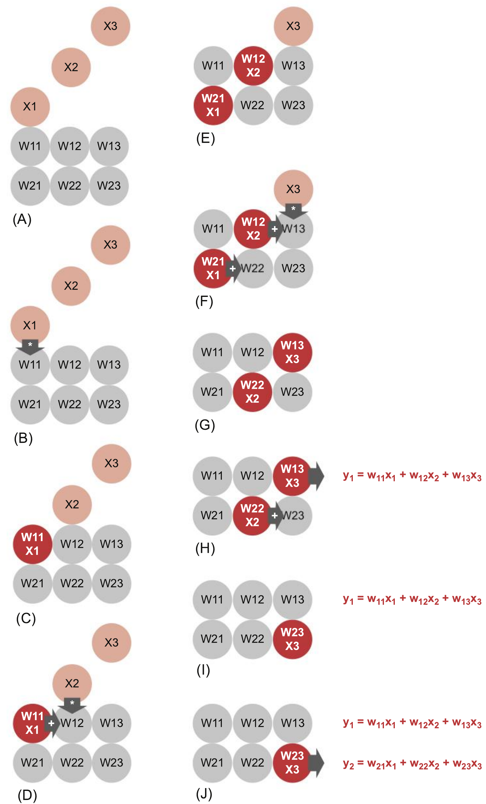

## 谷歌张量处理单元 TPU v4 与 v4 lite：数据中心 DNN 加速器 {#sec-7-4}

早在 2006 年，谷歌的工程师就讨论过是否要在数据中心部署 GPU、FPGA 或定制 ASIC。当时的结论是：适合在专用硬件上运行的应用很少，这几个应用完全可以利用大型数据中心的富余容量来完成，几乎没有额外成本，而这样的方案很难再改进。到 2013 年，情况发生了变化。有人预测，如果人们每天用语音搜索 3 分钟，而语音识别采用 DNN，那么谷歌的数据中心规模就要扩大到原来的 2 倍才能满足计算需求。用传统 CPU 满足这样的需求，既要花很长时间，成本也极高。

于是谷歌启动了一个高优先级项目，要尽快做出一款用于推理的定制 ASIC（训练仍购买现成的 GPU 来完成），目标是性价比达到 GPU 的 10 倍。张量处理单元（TPU，Tensor Processing Unit）v1 实现了这一目标，每瓦性能是同时期 CPU 的 80 倍、同时期 GPU 的 30 倍。随着机器学习越来越重要，CPU 和 GPU 现在也加入了专门针对机器学习的优化，因此它们与 DNN 专用体系结构之间的差距已经缩小。

第一代 TPU 是用于推理的单核设计；第二代和第三代是双核设计，既能用于训练，也能用于推理。TPU 使用 JAX、PyTorch 和 TensorFlow 等专为 DNN 设计的框架编程，由定制的 XLA 编译器编译。

到第四代时^[本节内容基于论文「Ten lessons from three generations shaped Google's TPU v4」（Jouppi et al., 2021），本书的一位作者是该论文的合作者。]，谷歌意识到，只要两款芯片使用同一个核，一份设计就可以得到两款芯片：一款是用于推理的单核芯片（与 TPU v1 类似），另一款是用于训练的双核芯片（与 TPU v2、TPU v3 类似）。这两款芯片由同一个团队在同一套代码库上开发，[图 7.11](#fig-7-11) 列出了它们的特性。

[图 7.11　TPU v4 lite 和 TPU v4 两款 DNN 加速器的主要特性]{#fig-7-11 .caption}

| 特性 | 谷歌 TPU v4 lite | 谷歌 TPU v4 |
|---|---|---|
| 投入生产部署 | 2020 | 2020 |
| 峰值 TFLOPS | 138（bf16 或 8 位整数） | 275（bf16 或 8 位整数） |
| DNN 用途 | 仅推理 | 训练或推理 |
| 时钟频率 | 1050 MHz | 1050 MHz |
| 工艺节点、晶片面积 | 7 nm，<400 mm^2^ | 7 nm，<700 mm^2^ |
| 晶体管数 | 160 亿 | 220 亿 |
| 每台 CPU 主机配的芯片数 | 8 | 4 |
| 热设计功耗 | 175 W | N.A. |
| 空闲功耗，最小/平均/最大功耗 | 55 W，N.A. | 90 W，121/170/192 W |
| 芯片间互连 | 2 条链路 @ 50 GB/s | 6 条链路 @ 50 GB/s |
| 最大规模配置 | 8 个芯片 | 4096 个芯片 |
| 云服务提供方 | 谷歌 | 谷歌 |
| 处理器类型 | 单指令二维数据 | 单指令二维数据 |
| 每个核的运算单元数 | 65,536（bf16） | 65,536（bf16） |
| 每个芯片的核数 | 1 | 2 |
| 每个核的线程数 | 1 | 1 |
| 片上存储器 | 144 MiB | 160 MiB |
| DRAM 容量、带宽 | 8 GiB，614 GB/s | 32 GiB，1200 GB/s |

下面先介绍面向推理的 *TPU v4 lite*，再介绍 *TPU v4* 为了支持训练在它的基础上做了哪些改动。

### TPU v4 lite 的体系结构 {-}

[图 7.12](#fig-7-12) 是 TPU v4 lite 的框图，图中也画出了 *uncore*。所谓 uncore，就是芯片上除 TensorCore 以外的全部部分。（TPU v4 的 uncore 与这款推理芯片相同，只是规模更大。）设计的核心是一个向量单元和一个 16 MB 的向量存储器，向量单元负责执行 DNN 的激活函数。谷歌发明了「brain float 16」（bfloat16，简称 bf16）浮点格式，并从 TPU v2 开始采用，因为它比 IEEE 754 fp16 更适合 DNN。与 fp16 不同，bf16 的指数位数与 IEEE 754 fp32 相同，尾数位则较少，而尾数位对 DNN 没那么重要。

向量单元上连接着 4 个矩阵乘单元（MXU）。每个 MXU 每个时钟周期完成一次 128×128 的矩阵乘，既可以用 bf16 计算、以 IEEE 754 fp32 累加，也可以用 8 位整数计算、以 32 位累加。每个 MXU 有 16,384 个乘累加单元，TPU v4 lite 的峰值性能 138 TFLOPS 就由此而来。跨通道单元（XLU）负责在 VPU 的各个通道之间完成 128×128 的矩阵转置、归约和置换。

![图 7.12　TPU v4 lite 的框图。体系结构上可见的存储器有：公共存储器（CMEM）、向量存储器（VMEM）、标量存储器（SMEM）、指令存储器（IMEM）和高带宽存储器（HBM）。HBM 是一种标准的 DRAM 产品，单独封装，许多 DNN 专用体系结构都依靠它。数据通路包括矩阵乘单元（MXU）、向量处理单元（VPU）、跨通道单元（XLU）和 TensorCore 定序器（TCS）。uncore 是上方中间那个大阴影框以外的全部部分，包括片上互连（OCI）、ICI 路由器（ICR）、ICI 链路栈（LST）、HBM 控制器（HBMC）、统一主机接口（UHI）和芯片管理器（MGR）。图中标注：Tensor Core 为张量核；Legend 为图例，依次是 Compute (TensorCore) 计算（TensorCore）、Memory and On-Chip Interconnect (OCI) 存储器与片上互连（OCI）、Inter-Chip Interconnect (ICI) 芯片间互连（ICI）、Host communication 主机通信、Management/firmware 管理/固件、Off-chip 片外；Host 为主机；PCIe Controller 为 PCIe 控制器；HBM Stack 为 HBM 堆叠；Other TPUv4i Chips (3) 为其他 TPU v4i 芯片（3 个）。](images/ch07/fig-7-12.png){#fig-7-12 width=90%}

MXU 采用脉动执行方式，减少了对向量存储器的读写，从而节省能耗（Kung and Leiserson, 1980; Ramacher et al., 1991）。所谓*脉动阵列*（systolic array），就是由运算单元组成的二维阵列，每个单元根据上游各运算单元送来的输入，独立地算出一个部分结果。脉动阵列的工作方式是：来自不同方向的数据按固定的时间间隔到达阵列中的各个单元，并在那里汇合。数据像不断推进的波阵面一样流过阵列，好比心脏把血液泵过人体的循环系统，「脉动」一名就由此而来。

[图 7.13](#fig-7-13) 演示了脉动阵列的工作过程。图中下方的 6 个圆圈是乘累加单元，事先已装入权重 *wi*；输入数据 *xi* 错开排列，从上方进入阵列。图中的 10 步代表 10 个时钟周期，在页面上从上往下排列。脉动阵列把输入向下传递，把乘积与部分和向右传递。数据走完它在阵列中的路径时，所需的乘积之和也就得出了。注意，在脉动阵列中，输入数据只从存储器读一次，输出数据也只向存储器写一次。

{#fig-7-13 width=70%}

在 TPU 中，脉动阵列是旋转过的。[图 7.13](#fig-7-13) 所示的情形是权重从上方装入、输入数据从左边流入阵列。一次 128 元素的乘累加操作以对角波阵面的形式穿过矩阵。权重是预先装入的，与新数据块的第一批数据一起随推进的波阵面生效。控制和数据都经过流水化处理，看起来就像 128 个输入是同时读入的；经过一段馈入延迟之后，这些输入分别更新 128 个累加器存储器中各自的一个位置。从正确性的角度看，软件感觉不到矩阵单元的脉动特性；但从性能的角度看，软件必须考虑这个单元的延迟。

[图 7.14](#fig-7-14) 是 TPU v4 lite 晶片的布局图。这款 TPU 芯片采用 7 nm 工艺制造，时钟频率为 1.05 GHz。确切的晶片面积没有公布，但小于 400 mm^2^。

[图 7.14](#fig-7-14) 中最大的模块是公共存储器（CMEM），占晶片面积的 28%。DNN 所需的一些大型数据结构放不进 16 MB 的向量存储器，因此 TPU v4 增加了一个 128 MB 的存储器来扩展存储层次，从而减少对主存的访问次数。主存即高带宽存储器（HBM），是存储层次中速度最慢、能效最低的一级。

 相同。晶片面积小于 400 mm^2^，CMEM 占 28%。晶片尺寸和总体布局主要由 TensorCore、CMEM 和 SerDes 的位置决定，因此在这种紧密拼接的布局中，OCI 模块被拉伸以填满剩余空间。TensorCore 和 CMEM 模块的排布沿用了 TPU v4 的布局。图中标注：SerDes 为串行器/解串器；Misc 为其他杂项电路；GPIO 为通用输入输出；PCIe Controller and SerDes 为 PCIe 控制器及 SerDes。](images/ch07/fig-7-14.png){#fig-7-14 width=90%}

### TPU v4 lite 的指令系统结构 {-}

TPU v2 和 TPU v3 采用 VLIW 指令系统。谷歌的工程师没有让 TPU v4 lite 与它们保持二进制兼容，而是选择了编译器兼容，原因有以下几点：

* 采用 VLIW 的初衷是：硬件资源随时间不断增加，只要重新编译应用程序，由编译器控制新增的指令级并行，就能利用这些资源。二进制兼容恰恰限制了这一点。
* 谷歌有些工程师开发过 Itanium 编译器，亲身体会过二进制兼容给 VLIW 编译器和硬件带来的弊端。
* XLA 编译器除了 TensorFlow，还接受 JAX 和 PyTorch，因此 TPU 只需依靠一个编译器，而不必提供一个适配多种编译器的接口。
* TPU 软件以源代码而不是二进制代码的形式维护和发布。

TPU v4 的指令系统基于约 400 位的 VLIW 指令包，而 TPU v2 和 TPU v3 的指令包是 322 位。多出来的位用于控制新增的功能部件，例如更多的 MXU。

XLA 生成两种操作：一种是与机器无关的高层操作（HLO），另一种是与机器相关的低层操作（LLO）。HLO 层次上的优化适用于所有平台。新一代 TPU 出现变化时（例如 VLIW 变宽），只要编译器的修改能限制在 LLO 上，HLO 优化就不受影响。

XLA 编译器显式地控制各种形式的并行：

* **指令级并行。** XLA 使用标准的编译技术，包括循环展开、指令调度和软件流水，让所有计算单元都保持忙碌。
* **数据级并行。** TPU 的向量寄存器和计算单元都是二维的，因此数据在计算单元和存储器中的布局对性能至关重要，可能比向量处理器或 SIMD 处理器更重要。MXU 的两个二维输入相互作用，产生一个二维输出。每个操作数在存储器中都有一种布局，必须先转换成二维寄存器中的布局，再在恰当的时刻送入 MXU，以满足脉动阵列的时序要求。
* **存储级并行。** TPU v4 lite 没有 Cache，存储层次各级之间的所有数据传送都由编译器调度。为了减轻互连延迟和连线缩放难题的影响，TPU v4 lite 在芯片 uncore 的各处分布了若干张量 DMA 引擎。张量 DMA 引擎相当于协处理器，能完整地译码并执行 TensorCore 的 DMA 指令。TPU v4 lite 的四维 DMA 把本地（片上）传送、远程（芯片到芯片）传送和主机（主机到芯片、芯片到主机）传送统一到同一种 DMA 体系结构下，因此应用程序从单个芯片扩展到整个 pod 更加简单。
* **线程级并行。** XLA 把 TensorFlow 程序中的并行性映射到超级计算机的数千个芯片上，目标是在 4 个到 4096 个芯片的系统上都能无缝运行。

### TPU v4 相对 TPU v4 lite 的改动 {-}

前面说过，芯片上最大的改动是 TPU v4 有两个张量核（TC），而不是一个，因此峰值性能提高到原来的 2 倍，达到 275 TFLOPS。两个核共享对 CMEM 的访问，公共存储器（Common Memory）的名称就由此而来。

从系统的角度看，这两款 TPU 差别很大。TPU v4 lite 针对推理优化，每台 CPU 主机配 8 个 TPU v4 lite。训练对主机的计算需求更大，因此每台 CPU 主机只配 4 个 TPU v4。TPU v4 要互连成谷歌所说的 *pod* 超级计算机，所以有 6 条芯片间互连（ICI）链路，而 TPU v4 lite 只有 2 条，TPU v3 则有 4 条。有了多出来的链路，TPU v4 就能配置成对分带宽更大的网络拓扑（三维环面）。TPU v3 的 pod 最多有 1024 个芯片，TPU v4 的 pod 最多可达 4096 个芯片，因此一个 pod 的 bf16 峰值性能超过 1 ExaFLOPS。TOP500 排行榜是对一台台 HPC 超级计算机排名，谷歌则不同，它在云中部署了几十个这样的 pod。

TPU v4 为支持训练所做的最后一项重大改动，是加大片外 HBM 存储器的容量，从 TPU v4 lite 的 8 GiB 增加到 TPU v4 的 32 GiB。

### 小结：TPU v4 怎样遵循设计准则 {-}

下面看看 TPU v4 和 TPU v4 lite 是怎样遵循 [7.2 节](#sec-7-2)的设计准则的。

1. *使用专用存储器，尽量缩短数据移动的距离。*

    TPU v4 有两级由程序控制的片上 SRAM 存储器。这些 SRAM 的能效是片外 HBM 存储器的 20 倍。

2. *把省去高级微结构优化所节省的资源，投入到更多的运算单元或更大的存储器上。*

    TPU v4 有 160 MiB 由软件控制的便笺存储器（128 MiB 的 CMEM 和两个 16 MiB 的 VMEM），还有 131,072 个 16 位/32 位 ALU，ALU 数量比同时期的服务器级 CPU 多一个数量级。TPU v4 lite 的 ALU 数量是 TPU v4 的一半，片上存储器容量则与 TPU v4 相近（128 MiB 的 CMEM 和一个 16 MiB 的 VMEM）。

3. *采用与领域相适应的最简单的并行形式。*

    TPU 的性能来自二维 SIMD 并行：每个 TC 有 4 个 128×128 的 MXU，内部按脉动方式组织成流水线。除了数据级并行，每个插座有两个 TC，每台超级计算机最多有 4096 个芯片。TPU 还用约 400 位的 VLIW 指令来利用指令级并行。同时期的 CPU 依靠的则是多处理、乱序执行、多线程和一维 SIMD。

4. *把数据的大小和类型缩减到该领域所需的最简形式。*

    TPU 主要用 16 位浮点数据计算，但累加用 32 位浮点，此外还支持 8 位整数。这样做的主要好处是数据变窄，对存储器带宽和存储器容量的需求都随之降低。CPU 则还要支持 64 位整数以及 32 位和 64 位浮点。

5. *用领域专用的编程语言把代码移植到 DSA 上。*

    TPU 用 JAX、PyTorch 和 TensorFlow 编程框架编程，而 CPU 几乎要运行所有的编程语言。
