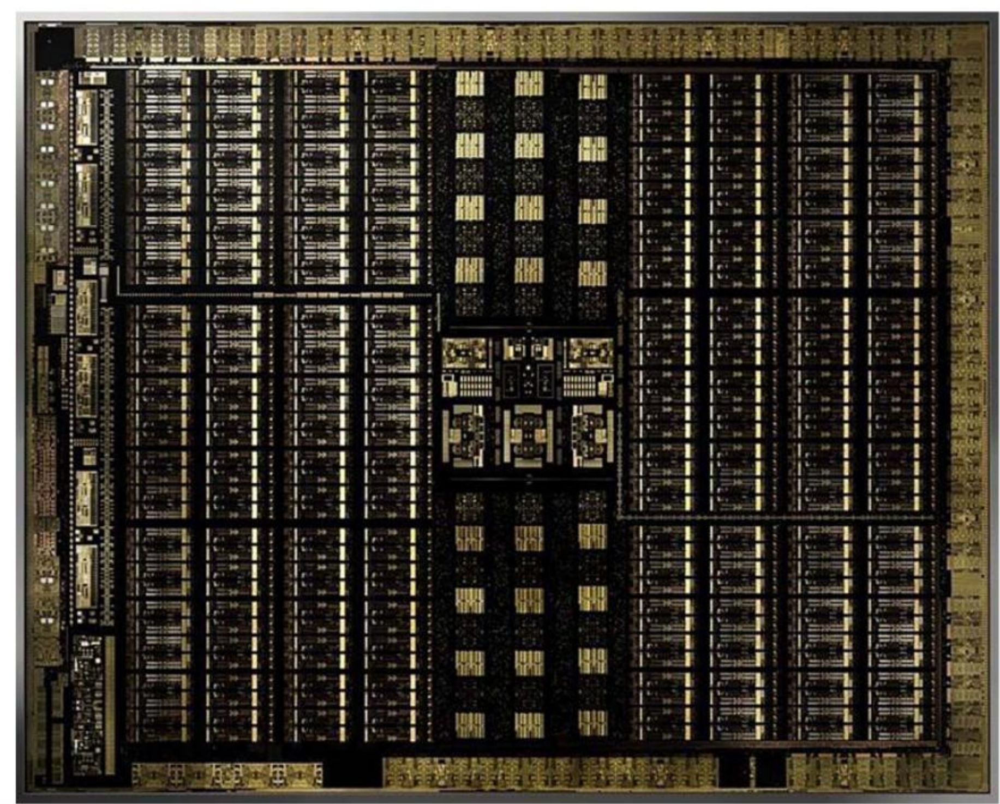

## NVIDIA A100 和 T4 GPU：图形与数据中心 DNN 加速器 {#sec-7-5}

第 4 章讲过，NVIDIA GPU 本质上是一种多处理器体系结构，其中的处理器称为 SM，即流式多处理器（Streaming Multiprocessor）。同一代 GPU 中，SM 的数量从几十个到 100 多个不等，改变 SM 的数量就能调整成本和性能。GPU 还利用多处理器结构设置冗余 SM，从而提高芯片的成品率。

GPU 的存储层次中既有 Cache，也有便笺存储器，但隐藏访存延迟主要靠两点：一是线程多，二是线程之间切换快。快速切换上下文主要依靠容量很大的寄存器堆。GPU 体系结构鼓励 CUDA 程序员编写大量线程，这样，一些线程等待访存时，总有别的线程可以执行。GPU 每次把 32 个线程编成一个 warp。一个 warp 在等待来自 HBM 存储器的操作数，GPU 就切换到另一个 warp。warp 的访存必须是合并的，即 load 或 store 访问存储器中连续的位置，GPU 才能得到全部的存储带宽。

GPU 最初是为图形处理设计的。图形处理是在数据密集型算法上做数值密集型计算，访存很有规律。DNN 也有类似的特点，因此十年前 GPU 就在机器学习领域流行起来。

在 GPU 上做机器学习越来越普遍，于是最近几代 GPU 一方面改进了对图形和 DNN 都有好处的体系结构，另一方面增加了专门为 DNN 服务的功能。在前一方面，新一代服务器级 GPU 主要做了以下几项改进：

* 提高主存的带宽和容量；
* 采用更大的 Cache；
* 增加每个插座的 SM 数；
* 提高睿频（Turbo boost）时钟频率。

### NVIDIA A100 张量核体系结构 {-}

第 4 章 [4.4 节](#sec-4-4)讲过，NVIDIA GPU 采用分块（tiled）体系结构，每一块称为一个*流式多处理器*（*SM*）。第 4 章用的是更能说明问题的术语：*多线程 SIMD 处理器*。每一代 GPU 的 SM 数都在增加，从 Pascal 的 56 个增加到 Hopper 的 132 个（见[图 4.21](#fig-4-21)）。与谷歌 TPU v3 同时代的 GPU 是 Volta（Jouppi，2020），它是第一款直接支持机器学习的 NVIDIA GPU。据 NVIDIA 报告，Volta 把 GPU 上机器学习的峰值性能提高到原来的 6～9 倍，具体倍数视矩阵大小而定。

CUDA 中的矩阵乘操作是 D = A × B + C，其中 A、B、C、D 可以是更大矩阵中的块（tile）（Raihan，2019）。每个块的大小记为 M × N × K，即：

* A 的维度是 M × K；
* B 的维度是 K × N；
* C 和 D 的维度是 M × N。

这与矩阵乘法的定义完全一致。为了支持这类操作，Volta 增加了 4 条张量核 PTX 指令：LoadA、LoadB、MultiplyAddA 和 StoreD。每条指令都有许多选项，可以设定类型、形状、步长、数据布局和同步方式。

为了把计算映射到 SM 的多线程结构上，每个块又进一步划分成若干*片段*（fragment），每个线程一个片段，映射到该线程的寄存器中。例如，一个 32 线程的 warp 处理 16 × 16 的块时，每个片段有 16 × 16/32 = 8 个元素，可能映射到 8 个独立的通用寄存器中。NVIDIA 没有公布片段映射到寄存器的具体方法。想了解细节的读者可以参考 Raihan（2019）。他们用逆向工程弄清了映射方法，发现矩阵 C 的数据在一个 warp 内的分布方式与矩阵 A、B 不同。

每个 Volta SM 由 4 个*子核*（subcore）组成，子核的结构见[图 7.15](#fig-7-15)。每个 Volta 子核又有两个*张量核*（*TC*，tensor core）（Choquette，2018）。（谷歌 TPU 中的处理器也叫 TensorCore，两者同名纯属巧合。）Volta 有 80 个 SM，因此共有 80 × 4 × 2 = 640 个张量核。NVIDIA Ampere 这一代每个子核只有一个张量核，总数是 108 × 4 × 1 = 432 个。到了 Hopper，又恢复为每个子核两个张量核。

![图 7.15　NVIDIA Volta SM 的子核。引自 Choquette, J., Giroux, O. and Foley, D., 2018. Volta: Performance and programmability. IEEE Micro, 38(2), pp. 42–52 的图 3。图中标注：Sub-Core 为子核；BRU (1 Branch/clk) 为转移部件（每个时钟周期 1 条转移）；L0 ICache 为 L0 指令 Cache；Constant Cache 为常数 Cache；Warp Scheduler (1 Warp Inst/clk) 为 warp 调度器（每个时钟周期 1 条 warp 指令）；Math Dispatch Unit 为运算分派部件；MIO Queue (Load/Store/TEX) 为 MIO 队列（load/store/纹理）；Tensor Core two 4x4x4 tensor/clk 为张量核（每个时钟周期两次 4×4×4 张量运算）；FP64 8 DFMA/clk 为 FP64 部件（每个时钟周期 8 次双精度融合乘加）；INT 16/clk 为整数部件（每个时钟周期 16 次）；FP32 16 FFMA/clk 为 FP32 部件（每个时钟周期 16 次单精度融合乘加）；MUFU 4/clk 为多功能部件（每个时钟周期 4 次）；Register File (512 * 32-threads * 32-bits) 为寄存器堆（512 × 32 个线程 × 32 位）；MIO Datapath (64B/clk) 为 MIO 数据通路（每个时钟周期 64 字节）；MIO Scheduler (1 Warp Inst / 2 clk) 为 MIO 调度器（每 2 个时钟周期 1 条 warp 指令）。](images/ch07/fig-7-15.png){#fig-7-15 width=80%}

**每个张量核完成矩阵乘法。** 一个张量核每个时钟周期处理 1024 位数据，操作数的类型从 1 位整数到 16 位浮点数都可以：1024 个 1 位整数，或 256 个 4 位整数，或 128 个 8 位整数，或 64 个 16 位浮点数。[图 7.15](#fig-7-15) 中的 warp 调度器把乘加操作发给张量核；张量核从寄存器堆取出操作数，完成 4 × 4 × 4 的矩阵乘，再把结果写回寄存器堆。每个张量核每个时钟周期完成一次 4 × 4 × 4 的矩阵乘加，需要 64 次乘加。

NVIDIA 没有公布张量核的框图，于是 Raihan（2019）运行微基准测试程序，试图揭示其内部的微结构。[图 7.16](#fig-7-16) 是他们推测的 Volta 张量核微结构。

TPU 的矩阵乘硬件依靠脉动阵列。Volta 计算的只是 4 × 4 的矩阵，而不是 128 × 128 的矩阵，因此不需要脉动阵列。Volta 的乘加硬件只是简单的组合逻辑，靠良好的电路设计、逻辑设计、流水线设计和物理设计，在一个时钟周期内完成全部 64 次乘加。

![图 7.16　推测的 NVIDIA Volta 张量核微结构。*线程组*（threadgroup）是一个 warp 中 4 个连续的线程。*八线程组*（octet）是一对线程组，负责计算结果中一个 8 × 8 的子块。每个 Volta warp 有 4 个八线程组。引自 Raihan, M.A., Goli, N. and Aamodt, T.M., 2019, March. Modeling deep learning accelerator enabled GPUs. In 2019 IEEE International Symposium on Performance Analysis of Systems and Software (ISPASS) (pp. 79–92). IEEE 的图 13。图中标注：FP16 Multiplier 为 FP16 乘法器；FP32 Adder 为 FP32 加法器；Accumulator Buffer 为累加器缓冲；Register File 为寄存器堆；Operand Bus 1～3 为操作数总线 1～3；other execution units 为其他执行部件；TENSOR CORE 为张量核；Octet 0～3 为八线程组 0～3；Threadgroup 0、Threadgroup 4 为线程组 0、线程组 4；Lane 为车道；Matrix A Buffer、Matrix B Buffer 为矩阵 A 缓冲、矩阵 B 缓冲；Mux 为多路选择器；Pipeline Registers 为流水线寄存器；DP (Dot Product) Unit 为点积部件；Writeback 为写回。](images/ch07/fig-7-16.png){#fig-7-16 width=90%}

Volta 的张量核可以完成 fp16 运算，也可以完成 fp16 与 fp32 混合的运算。[图 7.17](#fig-7-17) 列出了此后各代 GPU 张量核支持的数据类型。Ampere 中的 *tf32* 是 *TensorFloat-32* 的缩写，指数宽度与 fp32 相同（8 位），尾数宽度与 fp16 相同（10 位）。这种格式只有 19 位，但在存储器中仍占 32 位。bf16 的 7 位尾数或 fp16 的 5 位指数不够用时，用 tf32 计算比用 fp32 效率高。Hopper 的 fp8 浮点格式有两种：一种是符号位加 4 位指数和 3 位尾数，另一种是符号位加 5 位指数和 2 位尾数。设计者预期，训练的前向过程需要更高的精度，因而需要较宽的尾数；反向过程需要更大的表示范围，因而需要较宽的指数。Blackwell 的 fp4 格式只有 2 位指数和 1 位尾数，令人惊讶的是，这种浮点数总共只有 16 个可能的值。

[图 7.17　各代 NVIDIA GPU 的张量核所支持的数据类型]{#fig-7-17 .caption}

| GPU | 整数 | 浮点 |
|---|---|---|
| Volta | 无 | fp16、fp32 |
| Turing | Int8 | fp16 |
| Ampere | Int1、Int4、Int8 | fp16、fp32、bf16、tf32、fp64 |
| Hopper | Int8 | fp16、fp32、bf16、tf32、fp64、fp8 |
| Blackwell | Int8 | fp16、fp32、bf16、tf32、fp64、fp8、fp6、fp4 |

A100 的每个 SM 有 4 个张量核，每个张量核每个时钟周期处理 4096 位数据。从 Ampere 这一代开始，GPU 还支持*细粒度结构化稀疏*：以连续 4 个值为一组，只要组中任意两个值为零就可以使用。A100 为此新增了一条 PTX 指令，完成 2:4 稀疏矩阵乘法。

张量核只对两个非零值运算，因此用一半的时间就能完成同样的计算。数据符合这种模式时，这项优化使峰值性能提高到原来的 2 倍。DNN 的适应能力相当强，因此机器学习框架可以设法在训练之后让一部分数据满足 2:4 稀疏性。NVIDIA 给出的一个例子显示，性能提高到原来的 1.10～1.18 倍，具体倍数视批大小而定。

Hopper 这一代除了增加 fp8（见[图 7.17](#fig-7-17)），还专门为 Transformer DNN 增加了硬件，可见 Transformer 的重要性。这个硬件称为 Transformer 引擎（Transformer Engine）。它监测每个张量核输出值的统计特性，为 Transformer DNN 的每一层自动选择 fp8 或 fp16 数据类型，能用 fp8 时就用 fp8，从而提高性能。在执行过程中，硬件自行在 fp8 和 fp16 之间缩放，程序员不必管理这种转换。Transformer 引擎的目标是让 DNN 的每一层都只使用它所需要的最小数据范围。

Hopper 取消了 A100 的 Int1 和 Int4 数据类型（见[图 7.17](#fig-7-17)），大概是因为架构师认为已经不再需要它们。机器学习变化很快，一款面向 DNN 的 DSA 从开始设计到部署，即使只隔 3 年，也很难预料部署时哪些数据类型会变得重要。

[图 7.18](#fig-7-18) 列出了 NVIDIA A100 和 T4 GPU 的主要特征。这里的情况与上一节比较的 TPU v4 lite 和 TPU v4 类似：做推理时，NVIDIA 在每台 CPU 主机上装 8 块 T4，而每台主机只装 4 块 A100。系统层面也是如此：A100 可以扩展到 4096 块芯片，T4 只能扩展到 8 块。A100 先用 12 条 NVLink 无缝扩展成一个 8 插座系统，称为 DGX；再用集群网络交换机和链路把 512 个 DGX 系统连在一起，构成总共 4096 块芯片的系统。

[图 7.18　NVIDIA A100、NVIDIA T4 和 Graphcore MK2 IPU 这几种 DNN 加速器的主要特征]{#fig-7-18 .caption}

| | NVIDIA A100 | NVIDIA T4 | Graphcore MK2 IPU |
|---|---|---|---|
| 投入生产部署 | 2020 | 2018 | 2021 |
| 峰值 TFLOPS | 312（bf16），624（int8） | 65（IEEE fp16）/130（8 位 int） | 250（bf16） |
| DNN 目标 | 训练或推理 | 仅推理 | 训练或推理 |
| 时钟频率 | 765/睿频 1410 MHz | 585/睿频 1590 | 1850 MHz |
| 工艺节点，晶片面积 | 7 nm，826 mm^2^ | 12 nm，545 mm^2^ | 7 nm，832 mm^2^ |
| 晶体管数 | 540 亿 | 140 亿 | 590 亿 |
| 每台 CPU 主机的芯片数 | 4 | 8 | 4 |
| 热设计功耗 | 300 W | 70 W | 300 W |
| 芯片间互连 | 12 条链路 @ 25 GB/s | -- | 3 条链路 @ 64 GB/s |
| 最大配置规模 | 4096 块芯片 | 8 块芯片 | 256 块芯片 |
| 可用的云 | AWS、Azure、谷歌 | AWS、Azure、谷歌 | AWS、Azure、谷歌 |
| 处理器类型 | 单指令多线程 | 单指令多线程 | 多线程单指令多数据 |
| 每个处理器的运算单元数 | 1024（fp16） | 512（fp16） | 64（fp16） |
| 每块芯片的处理器数 | 108 | 40 | 1472 |
| 每个核的线程数 | 32 | 32 | 6 |
| 片上存储器 | 40 MiB | 18 MiB | 897 MiB |
| DRAM 存储器类型 | HBM2E | GDDR6 | 无 |
| DRAM 存储器容量，带宽 | 40 GiB，1555 GB/s | 16 GiB，320 GB/s | 0 |

[图 7.19](#fig-7-19) 和[图 7.20](#fig-7-20) 是这两种 GPU 的芯片布局。A100 和 T4 两种芯片在面积、功耗和主存上差别很大。首先是面积和功耗。T4 晶片的面积约为 A100 的三分之二，SM 数却只有 A100 的 40% 左右，原因是 T4 采用的工艺节点较老（12 nm 对 7 nm）。值得注意的是，A100 的基础时钟频率只是 T4 的 1.3 倍（765 MHz 对 585 MHz），T4 的热设计功耗（TDP）却只有 A100 的 1/4（70 W 对 300 W）。到了最高的睿频模式，时钟频率的比例甚至反了过来，T4 是 A100 的 1.1 倍（1590 MHz 对 1410 MHz）。

{#fig-7-19 width=90%}

{#fig-7-20 width=70%}

第二个大的差别在存储器：T4 使用图形 DRAM（GDDR6），A100 使用高带宽存储器（HBM2E）。T4 的容量同样约为 A100 的 40%（16 GiB 对 40 GiB），存储带宽却相差很多，A100 接近 T4 的 5 倍（1555 GB/s 对 320 GB/s）。

最后一个差别是主存的纠错（ECC）方式。A100 与服务器 CPU 一样采用较宽的 HBM，因此访问数据的同时就能检查或存储 ECC：72 位中有 64 位是数据，另外 8 位是 ECC。T4 的 GDDR 存储器只有 64 位宽，打开 ECC 时，存储控制器就把 ECC 位存放在 DRAM 芯片的其他位置。（前一种方式称为带外 ECC（side band ECC），后一种称为带内 ECC（in band ECC）。）因此，T4 是否打开 ECC 由客户选择。谷歌数据中心要求主存必须带 ECC，T4 的性能因此平均降低约 5%（见 [7.10 节](#sec-7-10)）。

### 小结：A100 和 T4 如何遵循设计准则 {-}

下面看 A100 和 T4 是怎样遵循 [7.2 节](#sec-7-2)准则的。

1. 使用专用存储器，尽量缩短数据搬运的距离。

    GPU 为了支持大规模多线程，配有非常大的寄存器堆：A100 为 27 MiB，T4 为 10 MiB。寄存器的总容量与各自的 L2 Cache 相当，A100 和 T4 的 L2 Cache 分别为 40 MiB 和 18 MiB。GPU 用作图形 DSA 时，多线程很有用；但多线程对机器学习有多大帮助，还不清楚。

2. 把省去高级微结构优化而节省下来的资源，投入到更多的运算单元或更大的存储器上。

    A100 有 110,592 个 16 位/32 位 ALU，T4 有 20,480 个 ALU，ALU 数同样是同时代 CPU 的许多倍。

3. 采用与领域相匹配的最简单的并行形式。

    GPU 依靠多处理器、多线程和二维 SIMD（不过它的乘法单元比 TPU 的小）。

4. 把数据的宽度和类型缩减到该领域所需的最简形式。

    GPU 提供的数据类型最为丰富，程序员可以从中选择最合适的数据宽度：有 4 位和 8 位整数，16 位和 32 位 IEEE 浮点数；A100 还增加了 1 位和 16 位整数，以及 bf16、tf32 和 fp64 浮点格式。

5. 使用领域专用编程语言，把代码移植到 DSA 上。

    用于机器学习时，GPU 使用 JAX、PyTorch 和 TensorFlow 编程框架编程，此外还可以用 CUDA 和 OpenCL。用于图形处理时，则使用 DirectX、Metal 和 OpenGL 等库。
