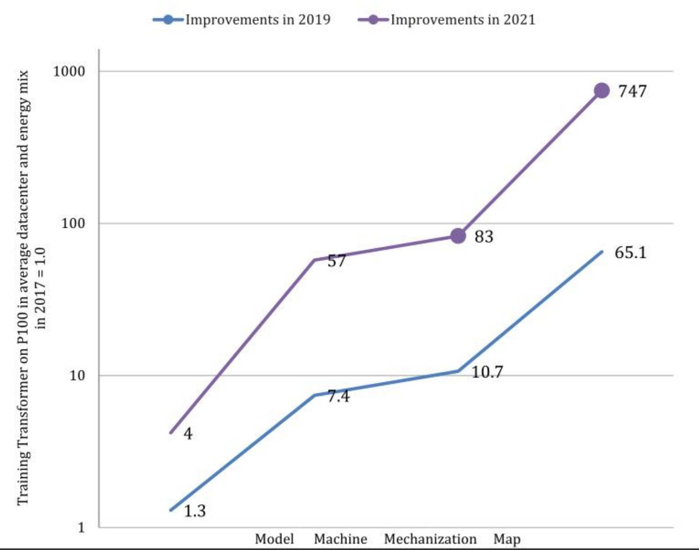
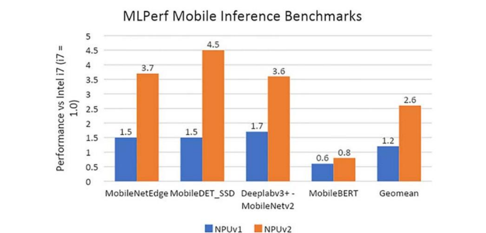

## 交叉问题 {#sec-7-8}

### 异构与片上系统 {-}

把 DSA 接入系统，最简单的办法是挂在 I/O 总线上，本章介绍的数据中心加速器都是这样做的。经由低速的 I/O 总线取访存操作数太慢，因此这些加速器都配有本地 DRAM。

Amdahl 定律提醒我们：数据在主机内存和加速器内存之间来回传送，传送得越频繁，加速器的性能就越可能受到限制。因此，肯定会有一些应用能从集成中获益，即把主机 CPU 和加速器集成在同一个*片上系统*（SOC，System on a Chip）中。

这样集成进 SOC 的设计称为 *IP 核*（IP block）。IP 是*知识产权*（Intellectual Property）的缩写，不过称它为「可移植的设计模块」也许更能说明它是什么。IP 核通常用 Verilog 或 VHDL 这样的硬件描述语言描述，以便集成到 SOC 中。IP 核形成了一个市场：许多公司制作 IP 核，其他公司买来搭建面向自己应用的 SOC，不必什么都自己设计。IP 核的重要性可以从两个例子看出：一是后面的[图 7.32](#fig-7-32)，它给出了苹果历代 PMD 所用 SOC 中 IP 核的数量，仅仅四年就增加到原来的 3 倍；二是苹果 SOC 中 CPU 和 GPU 只占面积的三分之一，其余都是 IP 核（Shao 和 Brooks，2015）。

设计 SOC 就像做城市规划：许多相互独立的团体争夺有限的资源，找到恰当的折中并不容易。CPU、GPU、Cache、视频编码器等都有可伸缩的设计，占用的面积和能耗多一些，性能就高一些，反之性能就低一些。SOC 用在平板电脑上和用在 IoT 设备上，预算各不相同。因此，IP 核必须在面积、能耗和性能上都可以伸缩。新的 IP 核尤其需要提供一个占用资源少的版本，因为它在 SOC 生态中可能还没有站稳脚跟；一开始申请的资源不多，就更容易被采用。

从 2017 年到 2024 年，系统公司通常都把加速器挂在 I/O 总线上。将来会怎样，值得拭目以待：一种可能是，集成的吸引力使大多数数据中心处理器改由传统 CPU 公司提供，加速器以 IP 核的形式集成在 CPU 晶片上；另一种可能是，系统公司继续经由 I/O 总线部署加速器。

### 机器学习训练的能耗与碳排放 {-}

人们关注全球气候变化，因此开始研究机器学习对环境的影响，这是理所应当的。[图 7.25](#fig-7-25) 表明，遵循最佳实践，能耗最多可以降为原来的 1/100，排放最多可以降为原来的 1/1000（Patterson，2022）。这个例子的起点是 2017 年著名的 Transformer 模型，当时它在一个普通的数据中心里用 GPU 训练。图中给出了 2019 年、2021 年两次应用最佳实践所节省的量。为了向 Cache 的「3C」助记法致敬，机器学习能效的最佳实践也归纳为*「4M」*：

1. **模型（Model）。** 第一个 M 是 DNN 模型，起点是 Transformer 模型。最佳实践是：选用最新、最高效、能同样好地解决同一问题的模型。2019 年，谷歌研究人员用*神经网络结构搜索*（NAS，Neural Architecture Search）找到了 Evolved Transformer 模型，它的质量与 Transformer 相同，速度是 Transformer 的 1.3 倍（So，2019）。2021 年，同一批研究人员又做了一次 NAS，找到了 Primer，质量也相同，速度是 Transformer 的 4.2 倍（是 Evolved Transformer 的 3.2 倍）（So，2021）。需要注意的是，NAS 很少做：每个问题领域和结构搜索空间只做一次，而不是每训练一次模型就做一次。按照惯例，搜索结果会公开发表，模型也会开源，所以所有机器学习从业者都能从这次 NAS 中受益。NAS 找到的高效模型此后被反复使用，省下的能耗和排放远远超过 NAS 本身的消耗。

2. **机器（Machine）。** 第二个 M 代表机器，最佳实践是选用最高效的硬件来训练模型。以 2017 年的 P100 GPU 为基准，2019 年的 TPU v2 速度是它的 5.7 倍，2021 年的 TPU v4 是它的 14 倍（是 TPU v2 的 2.6 倍）。与第一个 M 合起来，相对于在 P100 上训练 Transformer，能耗和排放在 2019 年降为原来的 1/7.4，在 2021 年降为原来的 1/57。

3. **机械化（Mechanization，即数据中心 PUE）。** 谷歌云数据中心的电能使用效率（PUE）约为 1.1，而一般数据中心约为 1.6，因此能效约为后者的 1.4 倍。与前两个 M 合起来，相对于在 PUE 一般的数据中心里用 P100 训练 Transformer，能耗和排放在 2019 年降为原来的 1/10.7，在 2021 年降为原来的 1/83。

4. **地点（Map）。** 第 1 章讲过，数据中心的选址对供电的清洁程度影响极大，差别可达 5～10 倍。以平均水平的电力为基准，每千瓦时电的排放，2019 年谷歌 Iowa 数据中心只有其 1/6，2021 年谷歌 Oklahoma 数据中心只有其 1/9（相当于 2019 年 Iowa 的 1/1.5）。与前三个 M 合起来，相对于在 PUE 一般、电力清洁程度一般的数据中心里用 P100 训练 Transformer，排放在 2019 年降为原来的 1/65，在 2021 年降为原来的 1/747。

{#fig-7-25 width=75%}

遵循 4M 最佳实践，是以可持续的方式实现机器学习巨大潜力的最好机会。

### 开放的指令系统 {-}

DSA 设计者面临的一个难题是：如何与 CPU 配合，运行应用的其余部分。如果 CPU 要放在同一个 SOC 上，那么一项重大决策就是选用哪种 CPU 指令系统。直到不久以前，几乎每一种指令系统都归某一家公司所有，所以过去设计 SOC，实际上第一步就是与一家公司签订合同，从而选定指令系统。

另一条路是自己设计一款定制的 RISC 处理器，再把编译器和库移植过去。授权 IP 核既昂贵又麻烦，因此 SOC 中自行设计的简单 RISC 处理器多得出人意料。一位 AMD 工程师估计，一款现代微处理器里有 12 种指令系统！

RISC-V 提供了第三条路：一种可用的、免费且开放的指令系统，并为领域专用协处理器预留了充足的操作码空间，供其添加指令。这样，前面所说的 CPU 与 DSA 之间更紧密的集成就能够实现。为了支持 DSA，RISC-V 预留了 4 个用于自定义指令的操作码，每个操作码还可以用 10 位功能码扩展，足以容纳成千上万条自定义指令。于是，SOC 设计者不必签订合同，就可以选用一种标准指令系统，并得到大量现成的支持软件。

设计者仍然要在设计初期选定指令系统，但不必选定某一家公司并与它签订合同。他们有三种选择：自己设计 RISC-V 核；从几家出售 RISC-V IP 核的公司中购买一个；下载别人开发的免费开源 RISC-V IP 核。最后一种做法与开源软件类似：Web 浏览器、编译器、操作系统等开源软件由志愿者维护，用户可以免费下载使用。

此外还有一个好处：由于指令系统是开放的，提供 RISC-V 技术的小公司在商业上也更有生存能力，因为客户不必担心拥有专有指令系统的那家公司能否长期存在。

RISC-V 对 DSA 还有一点吸引力：对 DSA 而言，指令系统不像对通用处理器那样重要。如果 DSA 用有向无环图（DAG）或并行模式这类抽象在较高层次上编程（JAX、PyTorch 和 TensorFlow 就是这样），那么指令系统这一层承担的工作就少了。而且，如果性能成本比和能耗成本比的提高都来自增加 DSA，二进制兼容性可能就不像过去那样重要了。

本书写作时，RISC-V 很可能是仅次于 ARM 和 x86 的第三重要的指令系统。开放的 RISC-V 指令系统看来前景光明。（我们真希望能预见未来，知道从现在到本书下一版出版时，RISC-V 会发展成什么样！）

## 融会贯通：DNN 加速器比较 {#sec-7-9}

下面以 DNN 领域为例，比较本章各种加速器的性价比。^[本节部分内容基于论文「Ten lessons from three generations shaped Google's TPU v4」（Jouppi 等，2021），本书的一位作者是该论文的合作者。] 首先在推理基准测试上详细比较 TPU v4 lite 和 T4，然后在训练上比较 TPU v4、A100 和 IPU Bow，最后简要评估智能手机所用三星 NPU 的性能，比较对象是笔记本电脑所用的 x86 CPU。

### 推理：TPU v4 lite 与 T4 {-}

[图 7.26](#fig-7-26) 给出了在谷歌数据中心中 TPU v4 lite 相对于 T4 的性能。三个推理基准测试都来自 MLPerf，每个基准测试有两种评分：

* 服务器（server）版本：在几十到几百毫秒的延迟上限内，每秒处理的查询数；
* 离线（offline）版本：没有延迟上限时，每秒处理的查询数。

在服务器基准测试上，TPU v4 lite 的速度是 T4 的 1.3 倍；在离线基准测试上，是 T4 的 1.6 倍。

）。注意，T4 在 ResNet 和 SSD 上使用 int8，在 NMT 上使用 fp16。MLPerf Inference 0.7 去掉了 NMT，因此图中 NMT 用的是 MLPerf Inference 0.5 的结果，ResNet 和 SSD 用的是 0.7 的数据。图内标注：纵轴为相对于 T4 的性能；横轴中 Server 为服务器场景，Offline 为离线场景，GeoMean 为几何平均。](images/ch07/fig-7-26.png){#fig-7-26 width=75%}

[图 7.27](#fig-7-27) 给出了 MLPerf 公布的性能与谷歌数据中心实测结果之间的差别。T4 的睿频（Turbo boost）时钟频率是基准时钟频率的 2.6 倍，而温度升高时时钟可能降频，因此冷却系统对 T4 的性能至关重要。（T4 和 TPU v4 lite 都采用风冷。）MLPerf Inference 规定每次运行至少持续 1 分钟，这差不多正是芯片及其散热器完全热起来所需的时间。谷歌的实验发现：空闲的 T4 在最低时钟频率下温度为 35°C；T4 以最高频率 1.6 GHz 运行 MLPerf 时，温度在 30 秒内升到 75°C，此后芯片一直保持在 75°C，时钟频率在 0.9～1.3 GHz 之间变化。谷歌数据中心有其特定的环境，而且必须开启 ECC（MLPerf Inference 中 ECC 是可选的）。[图 7.27](#fig-7-27) 给出了在这种条件下开启 ECC、运行 MLPerf Inference 10 分钟的影响：T4 的性能比它的 MLPerf Inference 评分低 19%～26%。

{#fig-7-27 width=100%}

TPU v4i 则不同：它的起始温度约为 37°C，10 分钟内只升高约 5°C。谷歌有意在数据中心中配足供电和冷却能力，使 TPU v4i 的延迟保持不变；还为 ECC 多配了内存，所以 ECC 可以一直开启，而不损失性能。

### 训练：TPU v4、A100 与 IPU Bow {-}

[图 7.28](#fig-7-28) 和[图 7.29](#fig-7-29) 给出了三种训练系统在两个 MLPerf 基准测试（ResNet-50 和 BERT）上的性能随系统规模扩大的变化。厂商可以自由选择用多大规模的系统来报告训练结果，因此这里的比较受限于三家公司各自的选择。本节希望比较规模相同或成本相同的系统。图中大的点是报告的结果，点之间的连线是外推值。TPU v4 和 A100 的 MLPerf 结果都扩展到了比 IPU 大得多的系统（4096 片对 256 片）。在 ResNet-50 上，TPU v4 比 A100 快，A100 又比 IPU 快。在 BERT 上，TPU v4 比 A100 稍快，A100 则比 IPU 快得多。

{#fig-7-28 width=100%}

。](images/ch07/fig-7-29.png){#fig-7-29 width=100%}

### 推理：三星 NPUv1、NPUv2 与 Intel Core i7 加 Iris Xe GPU {-}

MLPerf 还提供了一组面向移动设备的推理基准测试。为了降低计算量，移动基准测试一般比数据中心基准测试使用的权重少，质量目标也低。[图 7.30](#fig-7-30) 给出了 MLPerf 两个类别的结果：NPUv1 和 NPUv2 属于手机类，Intel Core i7 属于笔记本电脑类。

这两类其实不宜直接比较，因为笔记本电脑的功耗预算和晶片面积预算更大，时钟频率也高得多（见图 7.22），差距为 5～25 倍。尽管如此，领域专用的 NPU 加速器的性能仍然分别是 CPU 的 1.2 倍和 3.4 倍。原因之一是稀疏矩阵中的零值跳过，它平均把性能提高到原来的 1.4 倍。

{#fig-7-30 width=90%}

注意，与其他三个基准测试相比，MobileBERT 在 NPU 上表现不佳。这个基准测试要求用 fp16 计算。NPUv1 不支持 fp16，所以实际上用同一 SOC 中的一个 DSP 来运行。NPUv2 能够运行它，但在 fp16 下相对于 i7 的性能优势比在整数数据类型下小得多。
