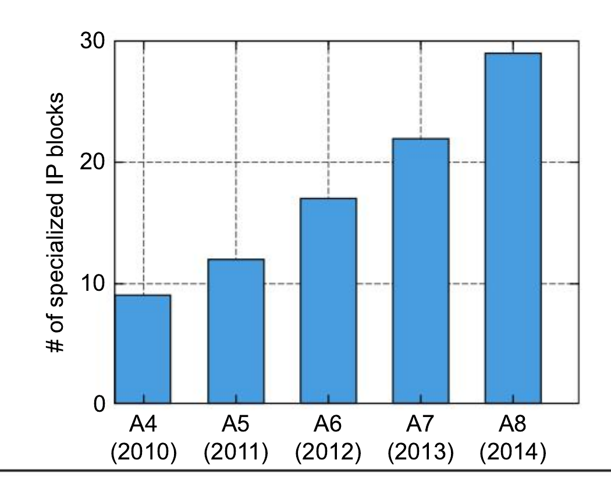

## 谬误与陷阱 {#sec-7-10}

面向 DNN 的商用 DSA 才走过第一个十年，谬误和陷阱比比皆是。

**陷阱**　*DNN 不像普通软件，它的变化可能非常快。*

[图 7.5](#fig-7-5) 给出了 4 年间谷歌生产环境中推理用 DNN 模型的构成变化。第一篇 BERT 论文发表于 2018 年，两年后 BERT 已占全部负载的四分之一以上。不仅如此，即使是同一类模型，规模也一直在快速增长：在这 4 年里，推理应用的内存占用和计算需求平均每年增长到上一年的 1.5 倍。

训练方面增长得还要快。2024 年，人们对大语言模型（LLM）热情高涨，这类模型有数千亿乃至数万亿个参数。GPT-3 论文发表两年后，LLM 已占 TPU v4 负载的四分之一。

DSA 架构师面临的挑战是：一方面要做专用化，提高 DNN 的性能；另一方面又要保持足够的灵活性，既能跟上现有模型的快速增长，又能容纳新发现的 DNN。

**谬误**　*对 DNN 硬件来说，每秒推理次数（IPS）是一个公平的综合性能指标。*

IPS 不适合用作 DNN 推理硬件的单一综合性能指标。原因在于，IPS 不过是应用中典型推理复杂度的倒数，而复杂度取决于 DNN 的层数、各层的规模和类型等。例如，TPU v1 运行 4 层的 MLP1 能达到每秒 360,000 次推理，运行 89 层的 CNN1 却只有每秒 4700 次，同一台 TPU 的 IPS 前者是后者的 75 倍！因此，用 IPS 作为 DNN 加速器的单一速度指标，比用 MIPS 或 FLOPS 衡量传统处理器还要容易误导人，IPS 理应受到更多的批评。

与本书上一版不同，今天已经有了 MLPerf，它是面向机器学习负载的业界标准基准测试程序。宣称性能时，再也没有理由引用 IPS 或每秒峰值运算次数这类间接指标。本章挑选介绍哪些 DSA 时就参考了 MLPerf 结果，书中的每个 DSA 都有 MLPerf 成绩。

**陷阱**　*新 DSA 的编译器需要很长时间才能成熟。*

传统编程语言有开源编译器，因此评估新的常规 CPU 相当容易，但面向 DNN 的 DSA 却不是这样。谷歌、NVIDIA 等公司都有专门的团队，为 JAX、PyTorch 和 TensorFlow 自行构建了全新的编译器和库。2017 年以来，许多初创公司开始开发面向 DNN 的新型 DSA，但大多数至今还没有提交过一个 MLPerf 结果，原因大概是它们的软件栈还达不到架构师预期的性能。

**谬误**　*推理要求低延迟，因此批大小必须为 1。*

[图 7.31](#fig-7-31) 列出了 MLPerf 基准测试程序和生产应用的延迟约束，以及它们在 TPU v4 lite 上所用的批大小。延迟约束规定 99% 的查询必须在某个时间上限内完成，这样规定是合理的。TPU v4 lite 能在满足延迟约束的同时，让一部分应用的批大小达到几百。不妨对比一下：对 CPU 而言，几微秒的延迟有时就会造成性能问题，而推理延迟是以毫秒计的。

**陷阱**　*不支持多租户。*

推理 DSA 应当像 CPU 一样支持多租户。如果一个应用要用到许多模型，在应用内部共享 DSA 可以降低成本、减少延迟。例如，翻译 DNN 需要覆盖许多语言对，语音 DNN 必须处理好几种方言。另一个原因则是良好的软件工程实践要求这样做，例如先让一小部分客户试用新功能，或者逐步部署新版本，以降低软件更新出问题的可能。谷歌的 8 个生产推理负载中，有 6 个需要多租户；其中 3 个应用的最大内存占用为 1300～3000 MB，远远超出 2024 年单个插座上的 SRAM 容量。而且前面说过，DNN 的规模预计还会越来越大，而 SRAM 在未来工艺中改进得很慢（见第\@ref(ch-fundamentals)章的图 1.18）。对部署在云中的设备来说，多租户带来一个后果：飞地（enclave）这类安全特性正在成为保护客户数据的必备功能。例如，NVIDIA 的 A100 和 H100 GPU 都支持飞地。

[图 7.31　TPU v4 lite 上 MLPerf 和生产应用的延迟约束与批大小（Jouppi，2021）]{#fig-7-31 .caption}

| 类型 | DNN | 延迟约束 | 批大小 |
|---|---|---|---|
| MLPerf | ResNet50 | 15 ms | 16 |
| MLPerf | SSD | 100 ms | 4 |
| MLPerf | GNMT | 250 ms | 16 |
| 生产应用 | MLP0 | 7 ms | 512 |
| 生产应用 | MLP1 | 20 ms | 128 |
| 生产应用 | CNN0 | 1 ms | 16 |
| 生产应用 | CNN1 | 32 ms | 16 |
| 生产应用 | RNN0 | 60 ms | 8 |
| 生产应用 | RNN1 | 10 ms | 32 |
| 生产应用 | BERT0 | 5 ms | 128 |
| 生产应用 | BERT1 | 10 ms | 64 |

**陷阱**　*设计 DSA 时不了解体系结构的历史。*

有些想法在通用计算中没能成功，用在 DSA 上却可能非常合适，因此了解历史的架构师可能占得竞争优势。DNN 加速器有两项重要的体系结构特性可以追溯到 20 世纪 80 年代：一是脉动阵列（Kung 和 Leiserson，1980），它减小了 TPU 中大型 MXU 的面积和功耗；二是超长指令字（VLIW）（Fisher，1983），它简化了指令级并行的开发。我们建议读者认真发掘本书每章末尾的历史回顾，从中找出能改进自己 DSA 设计的珍宝。

**谬误**　*DNN 训练过程中没有 I/O。*

Facebook 开发了一套数据存储与集成流水线，为机器学习集群供给数据，这些集群由数万个 GPU 组成（Zhao，2022）。深度学习推荐模型（DLRM）在 Facebook 应用广泛，消耗了大部分机器学习训练周期。数据存储与集成的需求增长很快：2020 年到 2022 年，存储容量增长到原来的 2 倍，在线数据摄取带宽增长到原来的 4 倍。在 Facebook 的三个集群上，DLRM 的能耗平均有 28% 用于存储，22% 用于预处理，50% 用于训练。

**谬误**　*训练一个 DNN 模型的碳排放相当于五辆汽车整个寿命期的排放。*

这个标题 2019 年出现在 *MIT Technology Review* 和 *New Scientist* 上，此后又出现在好几篇研究论文中。这一说法针对的是 Evolved Transformer 的训练（见 [7.9 节](#sec-7-9)和[图 7.25](#fig-7-25)）。它源自一篇论文（Strubell，2019）。Evolved Transformer 的原始论文（So，2019）没有给出碳排放数据，Strubell 的论文便试图估算发现 Evolved Transformer 的那次神经网络结构搜索（NAS）的碳排放。NAS 是在谷歌执行的，论文作者拿不到谷歌的 4M 数据，于是改用 GPU，并用数据中心 PUE 和电力清洁程度的平均值来估算。这样替代可以理解，但得出的排放估计值是谷歌实际排放的 5 倍，而谷歌实际是在 TPU v2 和谷歌数据中心上执行这次 NAS 的。此外，作者还估错了 NAS 的计算成本。为了节省时间、资金和能源，Evolved Transformer 的 NAS 先用一个规模较小的代理任务搜索最佳模型，再把找到的模型放大到完整规模。外部研究者却假定搜索是在完整规模的任务上进行的，因此估计的 NAS 计算量又是实际的 18.7 倍。两项合计，估计值是谷歌实际 NAS 排放的 88 倍（5 × 18.7）。

遗憾的是，*MIT Technology Review* 和 *New Scientist* 的记者，以及后来引用该论文的许多作者，又混淆了两种成本，使错误进一步扩大：一种是 Evolved Transformer 的 NAS 这一次性成本，另一种是训练时「每次都要付出」的成本，后者相对很小。为发现 Evolved Transformer 而做的 NAS，产生的排放是训练它一次的 1300 倍。因此，训练 Evolved Transformer 的实际排放只有所谓「五辆汽车整个寿命期的排放」的大约 1/120,000（5 × 18.7 × 1300），即 2.4 kg，而不是 284,019 kg。如果再算上进一步的改进，即在谷歌俄克拉何马数据中心的 TPU v4 上运行 Primer 模型（见[图 7.25](#fig-7-25)），训练一个与 Transformer 相当的模型，排放会降到 0.2 kg，只有五辆汽车整个寿命期排放的 1/1,400,000。

## 结束语 {#sec-7-11}

本章介绍了几个商业实例，它们体现了最近的一个转变：传统的目标是改进通用计算机，让所有程序都受益；现在则转向用 DSA 加速一部分程序。至少在过去十年里，体系结构研究者发表的创新大多是在有限的基准测试程序上模拟得出的，宣称能把通用处理器的性能提高 *10% 或更少*；而如今各公司报告，DSA 硬件产品带来的收益是 *3～10 倍甚至更多*。DSA 不仅带来了惊人的加速比，还大大减少了机器学习的能耗和碳排放。

我们认为，这标志着这个领域正在经历一场变革。体系结构创新正在迎来复兴，原因有两个：

* 一是 Dennard 缩放和摩尔定律都已历史性地终结，因此要改进成本—能耗—性能，就必须靠计算机体系结构的创新；
* 二是 DSA 潜力巨大，而且能与领域专用编程语言相辅相成。

特别是在撰写本书第 7 版时，人们看好人工智能的潜力，热情高涨，数据中心投资的重心已经从以 CPU 服务器为主转向以 AI DSA 为主。

我们相信，许多体系结构研究者将会构建出新的 DSA，把标杆抬得比本章讨论的这些还要高。我们期待着看到，到本书下一版时，计算机体系结构的世界会是什么样子！

## 历史回顾与参考文献 {#sec-7-12}

M.9 节（在网上提供）介绍了 DSA 的发展历程。

{#fig-7-32 width=60%}
