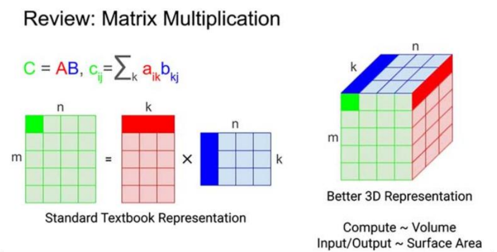

## 案例研究与习题（Cliff Young） {- #sec-7-exercises}

### 案例研究 1：矩阵乘法 {-}

*本案例研究涉及的概念*

* 矩阵乘法运算的结构

读者可能在中学代数里就接触过矩阵乘法。它是当前这场深度学习革命中最基本的计算密集型运算。矩阵乘法和标量乘法一样，有两个输入、一个输出，不同的是三个操作数都是二维矩阵。矩阵的形状通常先说行数、再说列数，例如 3 × 5 矩阵有 3 行 5 列，共 15 个元素。

两个矩阵相乘，形状必须匹配。按照 FORTRAN 的习惯，矩阵乘法通常写成 C = AB，其中 C 是结果矩阵，A 和 B 是源矩阵。C 是 m × n 矩阵，A 和 B 分别是 m × k 矩阵和 k × n 矩阵。需要注意的关键一点是：矩阵乘法运算的几何形状完全由 m、k、n 这三个标量决定。按上面对形状的描述，C 和 A 的行数相同，都是 m；C 和 B 的列数相同，都是 n；A 的列数必须等于 B 的行数。

这么多字母放在一起，不容易理清。可以把一次矩阵乘法想象成一个长方体，它的三个面分别是矩阵 A、B、C（[图 7.33](#fig-7-33)），三个标量决定了长方体各条棱的长度，矩阵乘法的工作量就对应长方体的体积。设想输入矩阵中的每个值都沿着垂直于所在面的方向，在长方体中传播开来。A 的值和 B 的值在哪里相遇，就在哪里把它们相乘。那么怎样构造输出 C 呢？对输出中的每个位置，取垂直于长方体 C 面、穿过该位置的那条线上的所有乘积，把它们加起来，就得到 C 中这个位置的值。

{#fig-7-33 width=90%}

下面是一个非常简单的矩阵乘法程序，这种程序有时称为 GEMM（GEneral Matrix Multiplication，通用矩阵乘法）。GEMM 是基本线性代数子程序库（BLAS，Basic Linear Algebra Subroutines，读作「blahs」）中的一个程序，BLAS 是线性代数的一个标准库。

```c
const int M, N, K;
float a[M][K], b[K][N], c[M][N];

void GEMM(const float &a[M][], const float &b[K][], float &c[M][]) {
  for (int i = 0; i < M; ++i)
  for (int j = 0; j < N; ++j)
    for (int k = 0; k < K; ++k)
    c[i][j] += a[i][k] * b[k][j];
}
```

7.1　[10/20/10/10/20] <7.3, 7.4>

a.　[10] 假设 M、N、K 都相等。这个算法的渐近时间复杂度是多少？（如果不熟悉大 O 记号，就用 M、N、K 写出加法和乘法次数的公式。）各参数的渐近空间复杂度是多少？当 M、N、K 增大时，这对矩阵乘法的运算强度意味着什么？

b.　[20] 假设 M = 3、N = 4、K = 5，这样各维的大小两两互素。写出矩阵 A、B、C 中各存储位置的访问顺序（可以先写二维下标，再把它们换算成存储地址，或者相对于各矩阵起始位置的偏移量）。哪些矩阵的元素是顺序访问的？哪些不是？假定存储顺序是行优先（C 语言的方式）。

c.　[10] 假设把 B 的行和列互换，构造一个新矩阵 B^T^（表示 B 的转置），即改为 B[N][K]。于是循环最内层的语句变成：

```c
c[i][j] += a[i][k] * b_t[j][k];
```

现在哪些矩阵的元素是顺序访问的？

矩阵乘法的内层循环体

```c
c[i][j] += a[i][k] * b[k][j];
```

称为*乘累加*运算，简称 MAC（multiply-accumulate）。可以把它写成一个短小的子程序：

```c
void MAC(float &d, const float &s1, const float &s2) {
  d += s1 * s2;
}
```

按高性能计算界的惯例，一次 MAC 算作两次运算（大概是指一次乘法和一次加法）。即使指令系统把 MAC 规定为一条操作码，也照此计算。IBM POWER 就是这样，它的 MAC 指令需要三个源操作数。可以改用 MAC 重写矩阵乘法：

```c
void GEMM_MAC(const float &a[M][], const float &b[K][], float &c[M][]) {
  for (int i = 0; i < M; ++i)
  for (int j = 0; j < N; ++j)
    for (int k = 0; k < K; ++k)
    MAC(c[i][j], a[i][k], b[k][j]);
}
```

d.　[10] 对于上面 M = 3、N = 4、K = 5 的情形，这个程序执行多少次 MAC？合多少次运算？

e.　[20] 假设有一个硬件部件，每个周期能完成两个 100 × 100 矩阵的乘法。如果它的工作频率是 1 GHz，每秒能完成多少次 MAC？合每秒多少次运算？

#### 分解 {-}

为了引出矩阵乘法的下一种写法，我们先改写 GEMM_MAC，让它的 B 参数改为转置后的矩阵，即值不变、行和列互换的 B。B 是 K × N 矩阵，所以它的转置 B^T^ 是 N × K 矩阵。

```c
void GEMM_MAC_BT(const float &a[M][], const float &b_t[N][], float &c[M][]) {
  for (int i = 0; i < M; ++i)
  for (int j = 0; j < N; ++j)
    for (int k = 0; k < K; ++k)
    MAC(c[i][j], a[i][k], b_t[j][k]);
}
```

这样转置还有一个好处：A 和 B 两个矩阵在内存中的低维（变化最快的那一维）现在都是 k。

*点积（内积）*

先看*点积*运算。dot 接收两个向量，把对应位置的元素两两相乘，再把这些乘积加起来，返回总和。

```c
float dot(const float &x[], const float &y[], int len) {
  float sum = 0.;
  for (int i = 0; i < len; ++i)
  sum += x[i] * y[i];
  return sum;
}

void GEMM_dot(const float &a[M][], const float &b_t[N][], float &c[M][]) {
  for (int i = 0; i < M; ++i)
  for (int j = 0; j < N; ++j)
    c[i][j] = dot(a[i], b_t[j], K);
}
```

7.2　[25/25/25] <7.3, 7.4>

a.　[25] 改写 GEMM_MAC_BT 程序，在循环嵌套中不用 MAC，改用点积。dot 程序要调用多少次？

b.　[25] 假设没有带 *len* 参数的软件版 dot，只有一个硬件版本，它要求 len 是固定长度，比如 2。改写你的代码，改用这样的 dot2 程序。dot2 要调用多少次？如果 K 不是偶数，应该怎么办？

*SAXPY*

另一种稍有不同的分解方式使用 *SAXPY*（*Single-precision Alpha times X Plus Y*，单精度 α 乘 X 加 Y）。SAXPY 接收一个输入向量和一个标量，用这个标量去乘输入向量的每个元素，再把各个乘积加到输出向量的对应位置上。

```c
void saxpy(float alpha, const float &x[], float &y[], int len) {
  for (int i = 0; i < len; ++i)
  y[i] += alpha * x[i];
}
```

c.　[25] 改写 GEMM 程序，在循环嵌套中不用 MAC，改用 saxpy。

*外积*

两个向量的*外积*是一个矩阵，由两个向量之间所有可能的两两乘积组成。按惯例，结果矩阵和 GEMM 程序中一样，既作输入又作输出，外积加到传进来的矩阵上。还要注意，这个程序在 C 语言下标上用了一点小技巧：把 *result* 作为裸指针传进来，再手工计算 *result* 的下标。

```c
void outer_product(const float &x[], const float &y[], int len_x, int len_y, float *result) {
  for (int i = 0; i < len_x; ++i)
  for (int j = 0; j < len_y; ++j)
    result[i * len_y + j] += x[i] * y[j];
}
```

7.3　[25/25] <7.3, 7.4>

a.　[25] 改写 GEMM 程序，在循环嵌套中不用 MAC，改用 outer_product。示例中具体的下标写法无关紧要，你可以随意改写 outer_product 程序，使它适合你选定的接口。

b.　[25] 重画[图 7.33](#fig-7-33)，表示出怎样把长方体分解成点积、SAXPY 和外积运算。可以把长方体中的小立方块稍稍分开画，以显示它们怎样组合成这三种运算。

### 案例研究 2：神经网络的层 {-}

*本案例研究涉及的概念*

* 深度神经网络（DNN）的结构

[图 7.34](#fig-7-34) 复制自经典的 AlexNet 论文（Krizhevsky，2012）中的图 2。这篇论文发表于 2012 年，但现代神经网络设计仍在使用的部件，这篇论文几乎都已经具备。

{#fig-7-34 width=100%}

这张图需要解释一下。为了便于阅读，我们把它拆开逐部分来看，并且只讲基本内容。

* 图中的长方体（左边和中间）和长方形（右边）表示*激活值*（也称*特征图*）。激活值有时是三维结构（AlexNet 的输入是一幅 224×224 的 RGB（×3）图像），有时只是一维结构（右边的 5 个长方形是长度为 2048 或 1000 的一维向量）。最后一个激活值向量有 1000 个值，它是 AlexNet 的「输出分类器」，列出输入图像属于 ILSVRC 竞赛 1000 个类别中每一类的概率。
* AlexNet 的*层*和*权重*没有直接画出来。它们位于图中画出的相邻两组激活值之间，形状可以从激活值的形状推导出来，下面就会讲到。
* 前 5 层位于长方体之间，是*卷积层*。在卷积层中，输出长方体里的每一个点都取决于一个*感受野*（每个大长方体里面的小长方体）。每组卷积输入或输出下方的数字（3、48、128、192、192 和 128）是该层的*深度*，也称特征深度。输入激活值的深度是 RGB 三个通道，后面每一层的深度更大，表示的概念也更抽象。长方体上还标出了*空间尺寸*：输入是 224×224，第 1 层之后迅速降到 55×55，第 2 层之后是 22×22，第 3 层和第 4 层之后是 13×13。
* 在前几层中，有两种机制缩小空间尺寸（空间尺寸有点像图像的分辨率）。一种是步长：每隔 4 个像素才计算一次感受野，而不是在每个像素位置都计算。另一种是最大池化：取空间上 2×2 的一组激活值，返回其中的最大值。
* 最后 3 层是*全连接层*，基本上就是矩阵—向量乘法。第 6 层把 13×13×128 展平成一维向量，共两组，每组 21632 个激活值（合计 43264 个），再做一次矩阵乘法，把它们投影到 4096 个激活值。第 7 层从 4096 个激活值变换到 4096 个激活值。分类器层再从 4096 投影到最终的 1000 个输出类别。
* 在分类器层，SoftMax 函数把由 1000 个元素组成的激活值向量变换成 1000 个概率。SoftMax 是一个向量函数，公式为 $v_i = e^{z_i} \big/ \sum_{j=1}^{K} e^{x_j}$，其中输入向量的 K 个元素是 $x_i$，输出向量的 K 个元素是 $v_i$。这个公式不必让人望而生畏：每个输出的分母都相同，它只是一个缩放因子，保证输出向量中各值之和为 1。
* 图中还表示出网络怎样在两个 GPU 上并行执行，两个 GPU 之间只有有限的通信。并行化的问题后面还会讲到。

7.4　[10/20/15/25/25/25/25] <7.3, 7.4>

a.　[10] 每个卷积层有多少个权重？产生一个输出激活值要用到多少个权重？

b.　[20] 根据图注给出的总数（第 1 个卷积层的输出是 253,440，依此类推），推导出各卷积层的神经元（激活值）数。

c.　[15] AlexNet 的第 6、7、8 层开始时，数据分在两个 GPU 上。为完成这些计算，每个 GPU 必须向另一个 GPU 发送多少数据？这几层在每个 GPU 上驻留多少个权重？对一幅图像，这几层要执行多少次运算？

d.　[25] 深度学习实践中有一个令人遗憾的现实：我们学过的卷积数学公式很简洁，但在实践中并不总能完全对得上。缩小空间尺寸的层（卷积核步长和最大池化）就会出现这种情况。按理说，长度为 k 的滤波器在长度为 x 的输入上做卷积，应该产生 x − k + 1 个输出；但有时神经网络某一层规定的输出个数，似乎比这个预期值多。通常的解决办法是在输入中补上一定量的「零填充」，加大输入的有效尺寸，从而得到所需的输出尺寸。对图中的步长层和最大池化层，什么情况下需要在 X 方向或 Y 方向加填充，才能让数目对得上？注意，最大池化可能也需要有步长。

e.　[25] SoftMax 函数的公式看上去复杂，但用几个很小的例子算一算，就能建立直观的认识。SoftMax 的输入称为 *logits*。计算下列输入的 SoftMax：

* 4 个值都等于 2.0 的向量；
* 向量 [1,2,3,4]；
* 长度为 4 的独热（one-hot）向量；
* 有两个大值、两个小值的四维向量。

然后试一试：把整个向量放大或缩小，给整个向量的每个元素加上同一个值，改变向量中各元素的相对大小。定性地说，SoftMax 对输入有什么影响？输出向量的值主要集中在哪里？

f.　[25] 分别用均匀分布、高斯分布和指数分布生成一些长度为 1000 的随机向量，计算它们的 SoftMax，画出这些输出的累积分布函数（CDF）。CDF 的 50%、95% 和 99% 分别由多少个输入构成？

g.　[25] SoftMax 在数值上可能不稳定。原因是计算中用到的指数函数增长很快，即使输入不算大，结果也可能超出浮点数的表示范围。怎样改写 SoftMax，才能消除这种数值不稳定性？

AlexNet 缺少的一个主要部件是*注意力*层。《Attention Is All You Need》（Vaswani，2017）一文提出了 Transformer 体系结构，注意力层在这篇论文中占有突出地位。用代数式表示，注意力的公式为

$$
\mathit{Attention}(Q, K, V) = \mathit{softmax}\left(\frac{QK^T}{\sqrt{d_k}}\right)V
$$

[图 7.35](#fig-7-35) 用图形表示了注意力。

{#fig-7-35 width=45%}

不过这样表示对我们来说有点过于简略，下面解释一下：

* 三个输入 Q、K、V 分别代表「查询」（Query）、「键」（Key）和「值」（Value）。这些名称提示我们，注意力的工作方式类似于内容寻址存储器（CAM）。CAM 是一种硬件结构，存储的是键—值对；访问 CAM 时给出的不是普通存储器那样的地址，而是一个查询，如果某个键等于查询，CAM 就返回这个键对应的值。CAM 做的是布尔型的精确比较和选择，注意力则「软」一些，因此学习过程中的反向传播能够穿过它。
* 首先，把 Q 看成一个向量，而不是矩阵。深度学习中有一件令人费解的事：一个激活值向量不一定具有人能理解的「含义」。研究人员用一种讲究的说法来表达这一点，说这个向量位于*潜*空间中。图中下方的 MatMul 表示 QK^T^，（暂时）可以看作矩阵—向量乘法，K 是矩阵，Q 是向量。现在把 K 看成一组向量，每个向量表示一个键，与查询向量处在同一个潜空间中。QK^T^ 可以理解为计算 Q 与键集合中每个向量的点积。这里我们把点积当作比较函数来用：两个向量的方向大体相同时，它们的点积很大；如果方向正交，点积为零。所以，第一个 MatMul 只是把查询向量 Q 与键集合中的各个键作比较，算出 Q 与每个键的相似程度。
* 「缩放」和可选的「掩码」两步是逐元素运算，这里略过不讲。
* SoftMax 的作用前面已经讲过：它把 QK^T^ 算出的 logits 变成一个概率分布，表示每个键—值对应分配多大的权重。
* 最后一个矩阵乘法 SoftMax(...)V 用 SoftMax 选出的权重去缩放各个值向量。所以，如果 SoftMax 的结果是独热的，这就像内容寻址存储器在说「命中的就是这一项」。如果 SoftMax 的结果中有多个非零值，它就把键与查询最接近的几项按接近程度成比例地混合起来。因此，第二个 MatMul 根据查询返回各个值的加权混合。
* 最后，去掉开头所做的简化，不再把 Q 看成一个向量，而是看成一组查询。这样，整个注意力模块并行地处理一整组查询，返回一组混合后的值，每个查询对应一个。

7.5　[25/15/15] <7.3, 7.4>

a.　[25] 我们来探讨点积为什么像一个比较函数。同样为了简单，我们只用四维向量。显然，标准正交基向量组 {[1,0,0,0], [0,1,0,0], [0,0,1,0], [0,0,0,1]} 具有这样的性质：其中任意两个向量的点积都为零。但神经网络输出的向量很少这么干净，因为它们是通过随机过程学习得到的。随机选一个四维向量，然后自己构造一个包含这个向量的正交基。基中的 4 个向量不必是单位长度，但必须满足两两点积都为零。

b.　[15] 如果一个键向量等于另一个键向量的 2 倍，会出现什么情况？它们的点积之比是多少？

c.　[15] 类似地，如果一个键向量是另一个键向量的相反向量，会出现什么情况？它们的点积之比是多少？取负的那个在 SoftMax 中会怎样？
