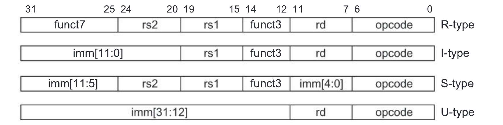

* *把编译时已知的量作为常数绑定到指令中*。编译器设计者最不愿意看到处理器在运行时去解释编译时就已经知道的值。违反这条原则的典型例子，就是在运行时解释编译时已经固定的值的指令。例如，VAX 的过程调用指令（`calls`）用一个掩码指明调用时要保存哪些寄存器，这个掩码在编译时就已确定，指令却要在运行时动态解释它（见 [A.10 节](#sec-a-10)）。

### 编译器对多媒体指令的支持（或者说缺乏支持） {-}

遗憾的是，SIMD 指令（见第 4 章 4.3 节）的设计者基本上没有理会上一小节的建议。这些指令往往是「解决方案」而不是原语，寄存器不够用，数据类型也和现有的程序设计语言对不上。体系结构设计者本想找一种廉价的办法帮助一部分用户，结果常常只有少数底层图形库例程用到这些指令。

SIMD 指令其实是一种优雅的体系结构风格的简化版，这种风格有自己的一套编译技术。4.2 节讲过，向量体系结构以数据向量为操作对象。它最初是为科学计算代码发明的，但多媒体内核通常也可以向量化，只是向量往往短一些。正如 4.3 节所说，Intel 的 MMX 和 SSE、PowerPC 的 AltiVec，以及 RISC-V 的 P 扩展，都可以简单地看成短向量计算机：MMX 的向量可以是 8 个 8 位元素、4 个 16 位元素或 2 个 32 位元素，AltiVec 的向量长度是 MMX 的 2 倍。实现上，它们只是把多个窄元素相邻地放在宽寄存器里。

这些微处理器体系结构把向量寄存器的大小固定在体系结构中：各元素大小之和，MMX 限定为 64 位，AltiVec 限定为 128 位。因此，Intel 决定扩展到 128 位向量时，只好增加一整套新指令，称为流式 SIMD 扩展（SSE）。

向量计算机的一大优点是能隐藏访存延迟：一次装入许多元素，再让执行与数据传送重叠。向量寻址方式的目标是：把分散在存储器各处的数据收集起来，紧凑地排放，以便高效地运算，最后再把结果放回原处。

为了让更多的程序能够向量化，向量计算机提供了带步长寻址和集中/分散寻址（见 4.2 节）。带步长寻址在相邻两次访问之间跳过固定数目的字，因此顺序寻址常称为单位步长寻址。集中和分散从另一个向量寄存器中取得地址，可以看作向量计算机上的寄存器间接寻址。相比之下，从向量的角度看，这些短向量 SIMD 计算机只支持单位步长访问：一次访存从单个宽存储单元装入或存储全部元素。多媒体应用的数据往往是起止都在存储器中的数据流，因此要成功地向量化，带步长寻址和集中/分散寻址必不可少（见 4.7 节）。

**例题**　以像素的颜色表示转换为例，比较向量计算机和 MMX。把像素从 RGB（红、绿、蓝）转换为 YUV（亮度、色度），每个像素用 3 字节表示。转换只需要 3 行 C 代码，放在一个循环里：

```c
Y = (9798*R +19235*G +3736*B) / 32768;
U = (-4784*R -9437*G +4221*B) / 32768 +128;
V = (20218*R -16941*G -3277*B) / 32768 +128;
```

**解答**　64 位宽的向量计算机可以同时计算 8 个像素。以一种支持带步长寻址的媒体向量计算机为例，需要：

* 3 条向量 load（取 RGB）；
* 3 条向量乘法（转换 R）；
* 6 条向量乘加（转换 G 和 B）；
* 3 条向量移位（除以 32,768）；
* 2 条向量加法（加 128）；
* 3 条向量 store（存 YUV）。

总共 20 条指令，完成上面 C 代码转换 8 个像素所需的 20 个操作（Kozyrakis，2000）。（一个向量可能有 32 个 64 位元素，因此这段代码实际上最多能转换 32 × 8 即 256 个像素。）

相比之下，据 Intel 网站介绍，库例程完成同样的 8 像素计算需要 116 条 MMX 指令外加 6 条 80x86 指令（Intel，2001）。指令数是向量计算机的 6 倍，原因在于没有带步长访存，装入和解包 RGB 像素、打包和存储 YUV 像素都要用大量指令。

向量短，长度又受体系结构限制，寄存器少，访存寻址方式简单，这些因素都让向量化编译技术难以施展。因此，这些 SIMD 指令更多出现在手写的库中，而不是编译生成的代码中。

### 小结：编译器的作用 {-}

本节可以归纳出几条建议。一是新的指令系统结构至少应有 16 个通用寄存器（浮点数的独立寄存器不算在内），这样用图着色法分配寄存器会比较简单。二是根据正交性的建议，所有支持的寻址方式都应适用于所有数据传送指令。三是最后三条建议，即提供原语而不是解决方案、简化各种方案之间的权衡、不在运行时绑定常数，都说明宁可失之于简单。换句话说，设计指令系统时要懂得「少即是多」。遗憾的是，SIMD 扩展与其说是软硬件协同设计的杰出成果，不如说是成功营销的例子。

## 融会贯通：RISC-V 体系结构 {#sec-a-9}

本节介绍一种 load-store 型体系结构，名为 RISC-V。RISC-V 是可自由授权的开放标准，与许多 RISC 体系结构相似，所依据的观察也与前面几节讨论的类似。（这类体系结构如何流行起来、为什么流行，在[附录 M](#app-m) 的 M.3 节讨论。）RISC-V 吸取了 RISC 体系结构 30 年的经验，把其中大部分出于一时考虑而加入或遗漏的东西「清理」掉了，因此实现起来更容易，也更高效。RISC-V 既有 32 位指令集，也有 64 位指令集，还有浮点等功能的多种扩展，这些扩展可以加在 32 位或 64 位基本指令集上。我们讨论 64 位版本的 RISC-V，即 RV64，它是 32 位版本 RV32 的超集。

下面回顾前面各节针对桌面和服务器应用提出的要求：

* [A.2 节](#sec-a-2)：使用通用寄存器，采用 load-store 型体系结构。
* [A.3 节](#sec-a-3)：支持这几种寻址方式：偏移量寻址（地址偏移量为 12～16 位）、立即数寻址（8～16 位）和寄存器间接寻址。
* [A.4 节](#sec-a-4)：支持这几种数据大小和类型：8 位、16 位、32 位和 64 位整数，以及 64 位 IEEE 754 浮点数。
* [A.5 节](#sec-a-5)：支持下列简单指令，因为它们在执行的指令中占绝大多数：load、store、加、减、寄存器-寄存器传送和移位。
* [A.6 节](#sec-a-6)：相等比较、不等比较、小于比较、转移（PC 相对地址至少 8 位）、跳转、调用和返回。
* [A.7 节](#sec-a-7)：注重性能就用定长指令编码，注重代码长度就用变长指令编码。某些低端嵌入式应用的 Cache 很小或只有一级，代码变长可能明显影响性能。ISA 提供压缩指令集扩展，就是解决这一矛盾的一条途径。
* [A.8 节](#sec-a-8)：至少提供 16 个通用寄存器，最好是 32 个；确保所有寻址方式都适用于所有数据传送指令；力求指令集最简。该节没有讨论浮点程序，但浮点程序往往使用独立的浮点寄存器。这样做的理由是：既增加了寄存器总数，又不会给指令格式或通用寄存器堆的速度带来问题。不过，这种折中并不正交。

下面通过 RISC-V 如何遵循这些建议来介绍它。和之前的 RISC 体系结构一样，RISC-V 强调：

* 简单的 load-store 指令集；
* 为提高流水线效率而设计（见[附录 C](#app-c)），包括采用定长的指令编码；
* 作为编译器目标的效率。

RISC-V 很适合作为学习用的体系结构模型，一方面因为这类处理器很流行，另一方面因为这种体系结构容易理解。我们在[附录 C](#app-c) 和第 3 章还会用到它，不少习题和编程项目也以它为基础。

### RISC-V 指令集的组织 {-}

RISC-V 指令集由 3 个基本指令集和多种可选扩展组成。基本指令集支持 32 位或 64 位整数，可选扩展加在某个基本指令集之上。这样，RISC-V 可以面向范围很广的潜在应用来实现：小到逻辑和存储器预算极少、成本可能只有 1 美元甚至更低的小型嵌入式处理器，大到全面支持浮点、向量和多处理器配置的高端处理器。[图 A.22](#fig-a-22) 归纳了 3 个基本指令集和各个指令集扩展的基本功能。本书的例子使用 RV64IMAFD（简称 RV64G）。RV32G 是 64 位体系结构 RV64G 的 32 位子集。

[图 A.22　RISC-V 有 3 个基本指令集（另为将来的第 4 个预留了位置），每个扩展都加在某一个基本指令集之上。因此，指令集的名字由基本指令集名后跟扩展名构成。例如，RISC-V64IMAFD 指带 M、A、F、D 扩展的 64 位基本指令集。为了命名和软件的一致，这一组合简称为 RV64G，本书大部分地方使用 RV64G。]{#fig-a-22 .caption}

| 基本指令集或扩展的名称 | 功能 |
|---|---|
| RV32I | 32 位基本整数指令集，有 32 个寄存器 |
| RV32E | 32 位基本指令集，但只有 16 个寄存器；用于非常低端的嵌入式应用 |
| RV64I | 64 位基本指令集；所有寄存器都是 64 位的，并增加了与寄存器之间传送 64 位数据的指令（LD 和 SD） |
| M | 增加整数乘法和除法指令 |
| A | 增加并发处理所需的原子指令；见第 5 章 |
| F | 增加单精度（32 位）IEEE 浮点，包括 32 个 32 位浮点寄存器，以及对这些寄存器进行 load、store 和运算的指令 |
| D | 把浮点扩展到 64 位双精度，寄存器扩为 64 位，并增加对这些寄存器进行 load、store 和运算的指令 |
| Q | 进一步扩展浮点，支持四倍精度，增加 128 位运算 |
| L | 增加对 IEEE 标准 64 位和 128 位十进制浮点的支持 |
| C | 定义指令集的压缩版本，用于存储器容量小的嵌入式应用；为常用的 RV32I 指令定义 16 位版本 |
| V | 将来支持向量操作的扩展（见第 4 章） |
| B | 将来支持位字段操作的扩展 |
| T | 将来支持事务存储器的扩展 |
| P | 支持紧缩 SIMD 指令的扩展；见第 4 章 |
| RV128I | 将来提供 128 位地址空间的基本指令集 |

### RISC-V 的寄存器 {-}

RV64G 有 32 个 64 位通用寄存器（GPR），命名为 x0, x1, …, x31。GPR 有时也称为整数寄存器。此外，RV64G 包含浮点的 F 扩展和 D 扩展，因此还有 32 个浮点寄存器（FPR），命名为 f0, f1, …, f31，可以存放 32 个单精度（32 位）值或 32 个双精度（64 位）值。（存放单精度数时，FPR 的另一半不用。）单精度和双精度浮点运算（32 位和 64 位）都有。

x0 的值恒为 0。后面会看到，利用这个寄存器，可以用简单的指令集合成出多种有用的操作。

有几个特殊寄存器可以与通用寄存器互相传送数据，例如浮点状态寄存器，它保存浮点运算结果的有关信息。另外还有在 FPR 和 GPR 之间传送数据的指令。

### RISC-V 的数据类型 {-}

整数数据类型有 8 位字节、16 位半字、32 位字和 64 位双字，浮点数据类型有 32 位单精度和 64 位双精度。之所以增加半字，是因为 C 等语言中有这种类型，在一些关心数据结构大小的程序（如操作系统）中也很常用。如果 Unicode 得到广泛使用，半字还会更常用。

RV64G 的运算对象是 64 位整数和 32 位或 64 位浮点数。字节、半字和字装入通用寄存器时，高位或者填 0，或者复制符号位，填满 GPR 的 64 位。装入以后，就用 64 位整数运算处理它们。

### RISC-V 数据传送的寻址方式 {-}

数据寻址方式只有立即数寻址和偏移量寻址两种，字段都是 12 位。把 12 位偏移量字段置为 0，就得到寄存器间接寻址；用寄存器 0 作基址寄存器，就得到只有 12 位字段的有限绝对寻址。利用好 0，我们实际上就有了 4 种寻址方式，尽管体系结构本身只支持 2 种。

RV64G 的存储器按字节编址，地址为 64 位，采用小端（Little Endian）字节编号。RV64G 是 load-store 型体系结构，因此存储器与 GPR 或 FPR 之间的所有数据访问都通过 load 或 store 完成。为支持上面提到的数据类型，涉及 GPR 的访存可以是字节、半字、字或双字；FPR 可以装入和存储单精度数或双精度数。访存不必对齐，但不对齐访问可能极慢。实际上，程序员和编译器使用不对齐访问是很不明智的。

### RISC-V 的指令格式 {-}

RISC-V 只有两种寻址方式，因此寻址方式可以编码在操作码中。按照让处理器易于流水和译码的建议，所有指令都是 32 位，主操作码为 7 位。[图 A.23](#fig-a-23) 给出了 4 种主要指令类型的指令布局。这些格式很简单，又为偏移量寻址、立即数常数或 PC 相对转移地址提供了 12 位字段。

{#fig-a-23 width=90%}

[图 A.24](#fig-a-24) 说明了各种指令格式和指令字段的用法。操作码指明指令的大类（ALU 指令、ALU 立即数指令、load、store、转移或跳转），funct 字段指明具体操作。例如，ALU 指令只用一个操作码，具体是加、减、与等哪种操作由 funct 字段决定。有几种格式编码了多种类型的指令：I 格式既用于 ALU 立即数指令，也用于 load；S 格式既用于 store，也用于条件转移。

[图 A.24　每种指令类型中指令字段的用法。「主要用途」列出使用该格式的主要指令。空白表示该指令类型中没有对应的字段。I 格式既用于 load，也用于 ALU 立即数指令，12 位立即数字段存放立即数的值或 load 的偏移量。类似地，S 格式既编码 store 指令（第一个源寄存器是基址寄存器，第二个源寄存器存放要存储的值），也编码比较并转移指令（寄存器字段存放要比较的源操作数，立即数字段指明转移目标的偏移量）。实际上还有另外两种格式：SB 和 UJ，它们的基本组织分别与 S 和 U 相同，只是对立即数字段的解释稍有改动。]{#fig-a-24 .caption}

| 指令格式 | 主要用途 | rd | rs1 | rs2 | 立即数 |
|---|---|---|---|---|---|
| R 型 | 寄存器-寄存器 ALU 指令 | 目的 | 第一个源 | 第二个源 | |
| I 型 | ALU 立即数指令；load | 目的 | 第一个源；基址寄存器 | | 立即数的值；偏移量 |
| S 型 | store；比较并转移 | | 基址寄存器；第一个源 | 要存储的数据源；第二个源 | 偏移量 |
| U 型 | 跳转并链接；跳转并链接寄存器 | 存放返回 PC 的目的寄存器 | 跳转并链接寄存器的目标地址 | | 跳转并链接的目标地址 |

### RISC-V 的操作 {-}

RISC-V（准确地说是 RV64G）支持前面建议的那些简单操作，另外还有少数几种。指令分为四大类：load 和 store、ALU 运算、转移和跳转、浮点运算。

任何通用寄存器或浮点寄存器都可以装入或存储，只是装入 x0 不起作用。[图 A.25](#fig-a-25) 给出了 load 和 store 指令的例子。单精度浮点数占浮点寄存器的一半。单精度和双精度之间的转换必须显式进行。浮点格式采用 IEEE 754（见[附录 J](#app-j)）。RV64G 全部指令的列表见[图 A.28](#fig-a-28)。

[图 A.25　RISC-V 的 load 和 store 指令。短于 64 位的 load 有符号扩展和零扩展两种形式。所有访存都只用一种寻址方式。图中所示的各种数据类型都有 load 和 store 指令。RV64G 支持双精度浮点，浮点寄存器是 64 位宽的，因此所有单精度浮点 load 都必须在浮点寄存器中对齐。]{#fig-a-25 .caption}

| 指令举例 | 指令名称 | 含义 |
|---|---|---|
| `ld x1,80(x2)` | 取双字 | Regs[x1]←Mem[80+Regs[x2]] |
| `lw x1,60(x2)` | 取字 | Regs[x1]←~64~(Mem[60+Regs[x2]]~0~)^32^ ## Mem[60+Regs[x2]] |
| `lwu x1,60(x2)` | 取无符号字 | Regs[x1]←~64~0^32^ ## Mem[60+Regs[x2]] |
| `lb x1,40(x3)` | 取字节 | Regs[x1]←~64~(Mem[40+Regs[x3]]~0~)^56^ ## Mem[40+Regs[x3]] |
| `lbu x1,40(x3)` | 取无符号字节 | Regs[x1]←~64~0^56^ ## Mem[40+Regs[x3]] |
| `lh x1,40(x3)` | 取半字 | Regs[x1]←~64~(Mem[40+Regs[x3]]~0~)^48^ ## Mem[40+Regs[x3]] |
| `flw f0,50(x3)` | 取单精度浮点数 | Regs[f0]←~64~Mem[50+Regs[x3]] ## 0^32^ |
| `fld f0,50(x2)` | 取双精度浮点数 | Regs[f0]←~64~Mem[50+Regs[x2]] |
| `sd x2,400(x3)` | 存双字 | Mem[400+Regs[x3]]←~64~Regs[x2] |
| `sw x3,500(x4)` | 存字 | Mem[500+Regs[x4]]←~32~Regs[x3]~32..63~ |
| `fsw f0,40(x3)` | 存单精度浮点数 | Mem[40+Regs[x3]]←~32~Regs[f0]~0..31~ |
| `fsd f0,40(x3)` | 存双精度浮点数 | Mem[40+Regs[x3]]←~64~Regs[f0] |
| `sh x3,502(x2)` | 存半字 | Mem[502+Regs[x2]]←~16~Regs[x3]~48..63~ |
| `sb x2,41(x3)` | 存字节 | Mem[41+Regs[x3]]←~8~Regs[x2]~56..63~ |

要看懂这些图，需要对[图 A.6](#fig-a-6) 首次使用的 C 描述语言再做几点扩展：

* 传送数据的长度可能不明确时，在符号 ← 后加下标。例如，←~n~ 表示传送一个 $n$ 位的量。用 $x, y \leftarrow z$ 表示把 $z$ 传送给 $x$ 和 $y$。
* 用下标表示从字段中选取某一位。位从最高有效位开始编号，最高位为第 0 位。下标可以是一个数字（例如 Regs[x4]~0~ 得到 x4 的符号位），也可以是一个子范围（例如 Regs[x3]~56..63~ 得到 x3 的最低有效字节）。
* 变量 Mem 是代表主存的数组，用字节地址作下标，可以传送任意数目的字节。
* 用上标表示复制字段（例如 0^48^ 得到一个长 48 位、全为 0 的字段）。
* 符号 ## 用于拼接两个字段，可以出现在数据传送的任何一侧；符号 $\ll$ 和 $\gg$ 把第一个操作数左移或右移，移位量由第二个操作数给出。

举个例子，假定 x8 和 x10 是 64 位寄存器：

Regs[x10]←~64~(Mem[Regs[x8]]~0~)^32^ ## Mem[Regs[R8]]

它的含义是：以寄存器 x8 的内容为地址，取出存储单元中的字，符号扩展成 64 位后存入寄存器 x10。

所有 ALU 指令都是寄存器-寄存器指令。[图 A.26](#fig-a-26) 给出了一些算术/逻辑指令的例子，包括简单的算术和逻辑运算：加、减、AND、OR、XOR 和移位。这些指令都有立即数形式，立即数为 12 位，使用时做符号扩展。LUI（load upper immediate，取高位立即数）装入寄存器的第 12～31 位，把立即数字段符号扩展到高 32 位，并把寄存器的低 12 位置 0。有了 LUI，两条指令就能构造出一个 32 位常数；使用任意 32 位常数地址的数据传送也只需多一条指令。

前面说过，x0 可以用来合成常用操作。装入常数就是源操作数为 x0 的加立即数指令；寄存器-寄存器传送就是有一个源操作数为 x0 的加法（或 or）。（我们有时用助记符 li 表示前者，意为装入立即数；用助记符 mv 表示后者。）

[图 A.26　RISC-V 的基本 ALU 指令既有寄存器-寄存器操作数的形式，也有带一个立即数操作数的形式。LUI 使用 U 格式，把 rs1 字段也用作立即数的一部分，得到 20 位立即数。]{#fig-a-26 .caption}

| 指令举例 | 指令名称 | 含义 |
|---|---|---|
| `add x1,x2,x3` | 加 | Regs[x1]←Regs[x2]+Regs[x3] |
| `addi x1,x2,3` | 加立即数 | Regs[x1]←Regs[x2]+3 |
| `lui x1,42` | 取高位立即数 | Regs[x1]←0^32^##42##0^12^ |
| `sll x1,x2,5` | 逻辑左移 | `Regs[x1]←Regs[x2]<<5` |
| `slt x1,x2,x3` | 小于置位 | `if (Regs[x2]<Regs[x3]) Regs[x1]←1 else Regs[x1]←0` |

### RISC-V 的控制流指令 {-}

控制流由一组跳转指令和一组转移指令处理，[图 A.27](#fig-a-27) 给出了一些典型的转移和跳转指令。两条跳转指令（跳转并链接、跳转并链接寄存器）都是无条件转移，并且总是把「链接」存入 rd 字段指定的寄存器。所谓链接，就是顺序紧跟在跳转指令之后那条指令的地址。如果不需要链接地址，把 rd 字段置为 x0 即可，这就成了普通的无条件跳转。两条跳转指令的区别在于目标地址的计算方法：一条把立即数字段加到 PC 上，另一条把立即数字段加到某个寄存器的内容上。偏移量按半字偏移量解释，这是为了与包含 16 位指令的压缩指令集 RV64C 兼容。

所有转移都是条件转移。转移条件由指令指定，可以是任何算术比较（等于、大于、小于以及它们的反面）。转移目标地址由一个 12 位有符号偏移量指定，偏移量左移一位（得到 16 位对齐）后加到当前程序计数器上。根据浮点寄存器内容转移时，先执行一条浮点比较指令（如 feq.d 或 fle.d），它根据比较结果把一个整数寄存器置为 0 或 1；再执行一条以 x0 为一个操作数的 beq 或 bne。

细心的读者可能已经注意到，RV64G 中只用于 64 位的指令很少，主要是 64 位的 load 和 store，以及 32 位、16 位、8 位 load 中不做符号扩展的版本（默认做符号扩展）。为了不增加额外指令就能支持 32 位模运算，有些指令另有忽略 64 位寄存器高 32 位的版本，例如字加和字减（addw、subw）。令人惊奇的是，其他一切都照常工作。

[图 A.27　RISC-V 中的典型控制流指令。除跳转到寄存器中的地址外，所有控制指令都是 PC 相对的。]{#fig-a-27 .caption}

| 指令举例 | 指令名称 | 含义 |
|---|---|---|
| `jal x1,offset` | 跳转并链接 | `Regs[x1]←PC+4; PC←PC + (offset<<1)` |
| `jalr x1,x2,offset` | 跳转并链接寄存器 | `Regs[x1]←PC+4; PC←Regs[x2]+offset` |
| `beq x3,x4,offset` | 相等转移 | `if (Regs[x3]==Regs[x4]) PC←PC + (offset<<1)` |
| `bgt x3,x4,name` | 大于转移 | `if (Regs[x3]>Regs[x4]) PC←PC + (offset<<1)` |

### RISC-V 的浮点操作 {-}

浮点指令操作浮点寄存器，并指明做单精度还是双精度运算。浮点操作有加、减、乘、除、平方根，以及融合乘加和融合乘减。所有浮点指令都以字母 f 开头，双精度用后缀 d，单精度用后缀 s（例如 `fadd.d`、`fadd.s`、`fmul.d`、`fmul.s`、`fmadd.d`、`fmadd.s`）。浮点比较根据比较结果设置一个整数寄存器，与整数指令集中的小于置位、大于置位类似。

除了浮点 load 和 store（`flw`、`fsw`、`fld`、`fsd`），还有几类指令：在不同浮点精度之间转换的指令，在整数寄存器和浮点寄存器之间传送数据的指令（fmv），以及在浮点数和整数之间转换的指令（fcvt，它视需要用整数寄存器作源或目的）。

[图 A.28](#fig-a-28) 列出了几乎全部 RV64G 指令及其含义。
