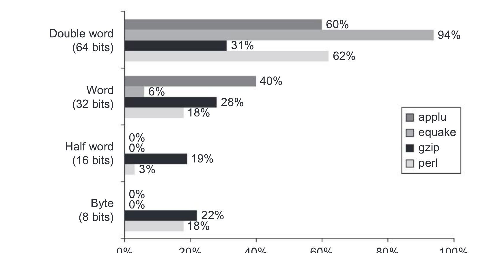

[图 A.28　RV64G 中绝大部分指令的一览表。这份列表也印在封底内侧。表中略去了系统指令、同步与原子指令、配置指令，以及复位和访问性能计数器的指令，总共约 10 条。]{#fig-a-28 .caption}

| 指令类型/操作码 | 指令含义 |
|---|---|
| *数据传送* | *在寄存器与存储器之间，或在整数寄存器与浮点寄存器之间传送数据；访存地址只有一种寻址方式，即 12 位偏移量加 GPR 的内容* |
| `lb, lbu, sb` | 取字节、无符号取字节、存字节（取入或存出整数寄存器） |
| `lh, lhu, sh` | 取半字、无符号取半字、存半字（取入或存出整数寄存器） |
| `lw, lwu, sw` | 取字、存字（取入或存出整数寄存器） |
| `ld, sd` | 取双字、存双字 |
| *算术/逻辑* | *对 GPR 中的数据做运算。字版本忽略高 32 位* |
| `add, addi, addw, addiw, sub, subi, subw, subiw` | 加法和减法，都有字版本和立即数版本 |
| `slt, sltu, slti, sltiu` | 小于则置位，有符号、无符号和立即数版本 |
| `and, or, xor, andi, ori, xori` | 与、或、异或，都有寄存器-寄存器和寄存器-立即数两种形式 |
| `lui` | 取高位立即数：把立即数装入寄存器的第 31..12 位，高 32 位置 0 |
| `auipc` | 把立即数与 PC 的高 20 位相加，结果写入寄存器；可用来构造跳到任意 32 位地址的转移 |
| `sll, srl, sra, slli, srli, srai, sllw, slliw, srlw, srliw, sraw, sraiw` | 移位：逻辑左移、逻辑右移和算术右移，都有立即数版本和字版本（字版本不改动高 32 位） |
| `mul, mulw, mulh, mulhsu, mulhu, div, divw, divu, rem, remu, remw, remuw` | 整数乘法、除法和求余，有符号和无符号，用两条指令支持 64 位乘积；也有字版本 |
| *控制* | *条件转移和跳转；相对于 PC 或通过寄存器* |
| `beq, bne, blt, bge, bltu, bgeu` | 根据两个寄存器的比较结果转移：相等、不等、小于、大于或等于，有符号和无符号 |
| `jal, jalr` | 跳转并链接，地址相对于某个寄存器或 PC |
| *浮点* | *所有浮点操作都有双精度（.d）和单精度（.s）两种* |
| `flw, fld, fsw, fsd` | 取、存字（单精度）和双字（双精度） |
| `fadd, fsub, fmul, fdiv, fsqrt, fmadd, fmsub, fnmadd, fnmsub, fmin, fmax, fsgnj, fsgnjn, fsgnjx` | 加、减、乘、除、平方根、乘加、乘减、取负乘加、取负乘减、最大值、最小值，以及替换符号位的指令。单精度操作码后加 .s，双精度加 .d，如 fadd.s、fadd.d |
| `feq, flt, fle` | 比较两个浮点寄存器，结果 0 或 1 存入一个 GPR |
| `fmv.x.*, fmv.*.x` | 在浮点寄存器和 GPR 之间传送数据，「\*」为 s 或 d |
| `fcvt.*.l, fcvt.l.*, fcvt.*.lu, fcvt.lu.*, fcvt.*.w, fcvt.w.*, fcvt.*.wu, fcvt.wu.*` | 在浮点寄存器和整数寄存器之间转换，「\*」为 S 或 D，分别表示单精度或双精度。有有符号和无符号版本，也有字和双字版本 |

[图 A.29　SPECint2006 程序在 RISC-V 上的动态指令组成。omnetpp 的指令中有 7% 是浮点 load、store、运算或比较；其他程序中，其他类型的指令连 1% 都不到。SPECint2006 中的 gcc 有所改动，造成了行为上的异常。典型的整数程序中，load 频度是 store 频度的 1/5 到 3 倍。而在 gcc 中，store 频度竟然比 load 频度还高！原因是 gcc 把很大一部分执行时间花在一个循环上，这个循环靠存入 x0 把存储器清零（而 gcc 这样的编译器，通常不会把大部分执行时间花在这种地方！）。另一些 RISC 指令系统设有一次存入一对寄存器的 store 指令，可以解决这个问题。]{#fig-a-29 .caption}

| 程序 | load | store | 转移 | 跳转 | ALU 操作 |
|---|---:|---:|---:|---:|---:|
| astar | 28% | 6% | 18% | 2% | 46% |
| bzip | 20% | 7% | 11% | 1% | 54% |
| gcc | 17% | 23% | 20% | 4% | 36% |
| gobmk | 21% | 12% | 14% | 2% | 50% |
| h264ref | 33% | 14% | 5% | 2% | 45% |
| hmmer | 28% | 9% | 17% | 0% | 46% |
| libquantum | 16% | 6% | 29% | 0% | 48% |
| mcf | 35% | 11% | 24% | 1% | 29% |
| omnetpp | 23% | 15% | 17% | 7% | 31% |
| perlbench | 25% | 14% | 15% | 7% | 39% |
| sjeng | 19% | 7% | 15% | 3% | 56% |
| xalancbmk | 30% | 8% | 27% | 3% | 31% |

### RISC-V 指令的使用情况 {-}

为了说明哪些指令常用，[图 A.29](#fig-a-29) 给出了 SPECint2006 程序在 RV32G 上各条指令和各类指令的使用频度。

## 谬误与陷阱 {#sec-a-10}

有些看法虽然常见，却是错误的，体系结构设计者曾一再因此失误。本节介绍其中几个。

**陷阱**　*专门面向某种高级语言结构，设计「高级」的指令系统特性。*

体系结构设计者曾试图把高级语言的特性纳入指令系统，于是提供了功能强大、灵活性很大的指令。但这些指令在常见情况下做的工作往往超出需要，或者与某些语言的要求并不完全吻合。许多这类努力的目标，是消除 20 世纪 70 年代所说的*语义鸿沟*（semantic gap）。设计者的本意是给指令系统增加一些内容，把硬件提升到语言的层次；但增加的内容可能造成 Wulf 等人（1981）所说的*语义冲突*（semantic clash）：

> ……计算机设计者赋予指令的语义内容过多，结果这条指令只能在有限的场合使用。[第 43 页]

更常见的情况是，这些指令功能过剩：对最常见的情况而言过于通用，结果做了不必要的工作，指令也更慢。VAX 的 `CALLS` 又是一个很好的例子。`CALLS` 采用被调用者保存策略，即由被调用者指定要保存的寄存器，*但*保存工作由调用者中的调用指令完成。`CALLS` 指令开始执行时，参数已经压入栈中，接着依次执行下列步骤：

1. 必要时对齐栈。
2. 把参数个数压入栈。
3. 把过程调用屏蔽码指定的寄存器保存到栈中（[A.8 节](#sec-a-8)提到过）。屏蔽码放在被调用过程的代码中，因此即使各过程分别编译，被调用者也能指定由调用者保存哪些寄存器。
4. 把返回地址压入栈，然后压入栈顶指针和栈底指针（用于活动记录）。
5. 清除条件码，从而把自陷允许位置成已知状态。
6. 把一个存放状态信息的字和一个全零字压入栈。
7. 更新两个栈指针。
8. 转移到过程的第一条指令。

实际程序中的绝大多数调用并不需要这么大的开销。大多数过程知道自己有几个参数，用寄存器而不是存储器中的栈来传递参数，就能建立快得多的链接约定。此外，`CALLS` 指令强制用两个寄存器来链接，而许多语言只需要一个链接寄存器。为支持过程调用和活动栈管理，人们做过的许多尝试都没能派上用场：要么与语言的需要不吻合，要么过于通用，因而用起来代价太高。

VAX 的设计者还提供了一条更简单的指令 `JSB`，它只把返回 PC 压入栈，然后跳转到过程，因此快得多。但大多数 VAX 编译器用的却是代价更高的 `CALLS` 指令。体系结构中设置这些调用指令，是为了统一过程链接约定。其他计算机则靠编译器编写者之间的约定来统一调用约定，不必承担一条复杂、非常通用的过程调用指令的开销。

**谬误**　*存在典型的程序。*

许多人愿意相信，存在单个「典型」的程序，可以据此设计出最优的指令系统，第 1 章讨论的合成基准测试程序就是一例。本附录的数据清楚地表明，不同程序使用指令系统的方式可能相差很大。例如，[图 A.30](#fig-a-30) 给出了 SPEC2000 中四个程序的数据传送宽度分布，从这四个程序很难说出哪一种是典型的。如果指令系统支持某一类应用专用、其他应用用不到的指令（例如十进制指令），程序之间的差别还会更大。

{#fig-a-30 width=90%}

**陷阱**　*在指令系统结构上创新以减小代码大小，却不考虑编译器的作用。*

[图 A.31](#fig-a-31) 给出了四种编译器在 MIPS 指令系统上生成代码的相对大小。体系结构设计者费尽力气想把代码减小 30%～40%，而换用不同的编译策略，代码大小的变化倍数要大得多。与性能优化技术一样，体系结构设计者应当以编译器所能生成的最紧凑的代码为起点，再提出节省空间的硬件创新。

[图 A.31　EEMBC 基准测试程序中电信（Telecom）应用的代码大小，以 Apogee Software 4.1 版 C 编译器为基准。几种指令系统结构几乎完全相同，代码大小却相差可达 2 倍。这些结果发表于 2000 年 2 月至 6 月。]{#fig-a-31 .caption}

| 编译器 | Apogee software 4.1 版 | Green Hills Multi2000 2.0 版 | Algorithmics SDE4.0B | IDT/c 7.2.1 |
|---|:---:|:---:|:---:|:---:|
| 体系结构 | MIPS IV | MIPS IV | MIPS 32 | MIPS 32 |
| 处理器 | NEC VR5432 | NEC VR5000 | IDT 32334 | IDT 79RC32364 |
| 自相关核心程序 | 1.0 | 2.1 | 1.1 | 2.7 |
| 卷积编码器核心程序 | 1.0 | 1.9 | 1.2 | 2.4 |
| 定点位分配核心程序 | 1.0 | 2.0 | 1.2 | 2.3 |
| 定点复数 FFT 核心程序 | 1.0 | 1.1 | 2.7 | 1.8 |
| Viterbi GSM 译码器核心程序 | 1.0 | 1.7 | 0.8 | 1.1 |
| 五个核心程序的几何平均值 | 1.0 | 1.7 | 1.4 | 2.0 |

**谬误**　*有缺陷的体系结构不可能成功。*

80x86 就是一个惊人的例子：它的指令系统结构恐怕只有它的创造者才会喜欢（见[附录 K](#app-k)）。一代又一代的 Intel 工程师都试图纠正当初设计 80x86 时那些不受欢迎的体系结构决策。例如，其他体系结构都选择了分页，80x86 却支持分段；其他处理器用通用寄存器存放整数数据，80x86 用的是扩展的累加器；其他体系结构早就抛弃了执行栈，80x86 却用栈存放浮点数据。

尽管有这些重大缺陷，80x86 体系结构却取得了巨大成功，原因有三。一是最初的 IBM PC 选用了它作为微处理器，于是与 80x86 二进制兼容变得极有价值。二是摩尔定律提供了足够的资源，80x86 微处理器可以先把指令翻译成内部的 RISC 指令集，再执行这些类似 RISC 的指令。这样既能与宝贵的 PC 软件基础保持二进制兼容，性能又能与 RISC 处理器相当。三是 PC 微处理器的产量极大，Intel 能够轻松负担硬件翻译增加的设计成本。此外，产量大还让制造商能够沿着学习曲线前进，从而降低产品成本。

翻译需要更大的晶片面积和更高的功耗，这在嵌入式应用中可能是个负担，但在桌面计算机上从经济上看完全值得。80x86 在桌面计算机上的性价比，也让它对服务器有吸引力。它用于服务器的主要弱点是只有 32 位地址，这个问题后来通过 64 位地址扩展解决了。

**谬误**　*可以设计出没有缺陷的体系结构。*

所有体系结构设计都要在一定的硬件和软件技术背景下权衡取舍。这些技术很可能随时间而变化，于是当初也许正确的决策，后来看就像是错误。例如，1975 年 VAX 的设计者过分强调代码大小的效率，低估了五年后易于译码和便于流水会变得多么重要。RISC 阵营的一个例子是延迟转移（见[附录 K](#app-k)）：在五级流水线中，用延迟转移控制流水线冒险很简单；但在流水线更长、每个时钟周期发射多条指令的处理器中，这就成了难题。此外，几乎所有体系结构最终都会因为地址空间不够而难以为继。这也是 RISC-V 预先为 128 位地址留出余地的原因之一，尽管真正需要这种能力可能还要几十年。

一般来说，要长期避免这类缺陷，短期内大概就得牺牲体系结构的效率。这样做很危险，因为一种新的指令系统结构必须先艰难地度过最初几年，才能生存下来。

## 结束语 {#sec-a-11}

最早的体系结构受当时硬件技术的限制，指令系统只能做得很简单。硬件技术一旦允许，计算机体系结构设计者就开始寻找支持高级语言的办法。围绕如何高效地支持程序，这种探索先后经历了三个思路截然不同的时期：

* 20 世纪 60 年代，栈体系结构流行起来。人们认为它与高级语言很匹配；以当时的编译技术而论，可能确实如此。
* 20 世纪 70 年代，体系结构设计者主要关心如何降低软件成本，办法主要是用硬件取代软件，或者提供能简化软件设计者工作的高级体系结构。结果一是出现了高级语言计算机体系结构运动，二是出现了 VAX 这样功能强大的体系结构：VAX 有大量寻址方式、多种数据类型，正交性也很高。
* 20 世纪 80 年代，编译技术更加成熟，人们又重新重视处理器性能，体系结构于是回归简单，主要采用 load-store 风格的计算机。

20 世纪 90 年代，指令系统结构出现了下列变化：

* *地址宽度加倍。*大多数桌面和服务器处理器的指令系统从 32 位地址扩展到 64 位地址，寄存器（以及其他一些部件）的宽度也随之扩展到 64 位。[附录 K](#app-k) 给出了三种从 32 位过渡到 64 位的体系结构实例。
* *用条件执行优化条件转移。*第 3 章将会看到，条件转移会限制采用激进设计的计算机的性能。因此，人们希望用操作的条件完成来取代条件转移，例如条件传送（见[附录 H](#app-h)），大多数指令系统都增加了这种指令。
* *用预取优化 Cache 性能。*第 2 章说明，存储层次对计算机性能的影响越来越大：在有些计算机上，一次 Cache 失效所花的指令时间，与早期计算机上一次缺页一样多。因此，指令系统增加了预取指令，试图用预取来掩盖 Cache 失效的代价（见第 2 章）。
* *支持多媒体。*大多数桌面和嵌入式指令系统都扩展了对多媒体应用的支持。
* *更快的浮点操作。*[附录 J](#app-j) 介绍了为提高浮点性能而增加的操作，例如一次完成乘法和加法的操作，以及成对单精度执行（paired single），这些都已纳入 RISC-V。

1970 年到 1985 年间，许多人认为计算机体系结构设计者的首要工作就是设计指令系统。因此，那个时代的教科书都强调指令系统设计，就像 20 世纪 50 年代和 60 年代的计算机体系结构教科书强调计算机算术一样。人们期望一位训练有素的体系结构设计者，对流行计算机的长处、尤其是短处有鲜明的看法。二进制兼容对指令系统设计上的创新有很强的抑制作用，但许多研究人员和教科书作者没有认识到这一点，于是给人一种印象：似乎许多体系结构设计者都有机会设计一套指令系统。

今天，计算机体系结构的定义已经扩展到整个计算机系统的设计和评价，不再只是指令系统的定义，也不再只限于处理器，因此体系结构设计者要研究的课题非常多。事实上，本附录的内容在 1990 年本书第 1 版中是全书的中心，现在却放进了附录，主要供参考！

对指令系统结构感兴趣的读者，可以阅读[附录 K](#app-k)。附录 K 介绍了多种指令系统，有的在今天的市场上很重要，有的在历史上很重要；附录 K 还把九种流行的 load-store 计算机与 RISC-V 作了比较。

## 历史回顾与参考文献 {#sec-a-12}

M.4 节（在网上提供，见[附录 M](#app-m)）讨论了指令系统的演变，并列出了参考文献，供进一步阅读和探索相关主题。

## 习题（Gregory D. Peterson） {- #sec-a-exercises}

A.1　[10] <A.9> 利用[图 A.29](#fig-a-29)，计算某种嵌入式 RISC-V CPU 实现的有效 CPI。假设我们测得各类指令的平均 CPI 如下：

| 指令 | 时钟周期数 |
|---|:---:|
| 所有 ALU 操作 | 1.0 |
| load | 5.0 |
| store | 3.0 |
| 转移 | |
| 　成功 | 5.0 |
| 　不成功 | 3.0 |
| 跳转 | 3.0 |

取 astar 和 gcc 两个程序指令频度的平均值作为指令组成。

A.2　[10] <A.9> 利用[图 A.29](#fig-a-29) 和上表，计算 RISC-V 的有效 CPI。取 bzip 和 hmmer 两个程序指令频度的平均值作为指令组成。可以假设其他所有指令（即图 A.29 中各类型没有涵盖的指令）每条需要 3.0 个时钟周期。

A.3　[10] <A.9> 利用[图 A.29](#fig-a-29)，计算某种 RISC-V CPU 实现的有效 CPI。假设我们测得各类指令的平均 CPI 如下：

| 指令 | 时钟周期数 |
|---|:---:|
| 所有 ALU 操作 | 1.0 |
| load | 3.5 |
| store | 2.8 |
| 转移 | |
| 　成功 | 4.0 |
| 　不成功 | 2.0 |
| 跳转 | 2.4 |

取 gobmk 和 mcf 两个程序指令频度的平均值作为指令组成。可以假设其他所有指令（即图 A.29 中各类型没有涵盖的指令）每条需要 3.0 个时钟周期。

A.4　[10] <A.9> 利用[图 A.29](#fig-a-29) 和上表，计算 RISC-V 的有效 CPI。取 perlbench 和 sjeng 两个程序指令频度的平均值作为指令组成。

A.5　[10] <A.8> 考虑下面这段由三条语句组成的高级语言代码：

```c
A = B + C;
B = A + C;
D = A - B;
```

用复制传播技术（见[图 A.20](#fig-a-20)）变换这段代码，直到没有一个操作数是计算出来的值为止。指出变换在哪些地方减少了语句的计算工作量，又在哪些地方增加了工作量。由此看来，要满足人们对优化编译器的期望，会面临什么样的技术挑战？

A.6　[30] <A.8> 编译器优化可能改进代码大小和/或性能。从 SPEC CPU2017 或 EEMBC 基准测试程序集中选取一个或多个程序，在 RISC-V 处理器或你能使用的其他处理器上，用 GNU C 编译器分别以不优化、-O1、-O2 和 -O3 编译这些程序，比较所得程序的性能和大小。再把你的结果与[图 A.21](#fig-a-21) 比较。

A.7　[20/20/20/25/10] <A.2, A.9> 考虑下面的 C 代码片段：

```c
for (i = 0; i < 100; i++) {
    A[i] = B[i] + C;
}
```

假设 A 和 B 是 64 位整数数组，C 和 i 是 64 位整数。除参与运算时以外，假设所有数据值及其地址都保存在存储器中（A、B、C、i 的地址分别是 1000、3000、5000 和 7000）。假设寄存器中的值在循环的两次迭代之间会丢失。假设所有地址和字都是 64 位。

a.　[20] <A.2, A.9> 写出 RISC-V 代码。动态执行需要多少条指令？要执行多少次存储器数据访问？代码有多少字节？

b.　[20] <A.2> 写出 x86 代码。动态执行需要多少条指令？要执行多少次存储器数据访问？代码有多少字节？

c.　[20] <A.2> 为栈式计算机写出代码。假设所有操作都在栈顶进行。只有压栈（push）和出栈（pop）指令访问存储器；其他指令都从栈中取出操作数，再把结果放回栈中。这种实现只有栈顶两项用硬件构成，因此处理器电路很小，成本很低。栈的其余位置放在存储器单元中，访问这些位置需要访问存储器。动态执行需要多少条指令？要执行多少次存储器数据访问？

d.　[25] <A.2, A.9> 不用上面的代码片段，另写一个例程，计算稠密单精度矩阵的乘法，这种运算也称为 SGEMM。输入矩阵大小为 100 × 100 时，动态执行需要多少条指令？要执行多少次存储器数据访问？

e.　[10] <A.2, A.9> 矩阵增大时，动态执行的指令数或存储器数据访问次数会怎样变化？

A.8　[25/25] <A.2, A.8, A.9> 考虑下面的 C 代码片段：

```c
for (p = 0; p < 8; p++) {
    Y[p] = (9798*R[p] + 19235*G[p] + 3736*B[p])/32768;
    U[p] = (-4784*R[p] - 9437*G[p] + 4221*B[p])/32768 + 128;
    V[p] = (20218*R[p] - 16941*G[p] - 3277*B[p])/32768 + 128;
}
```

假设 R、G、B、Y、U 和 V 是 64 位整数数组。除参与运算时以外，假设所有数据值及其地址都保存在存储器中（R、G、B、Y、U、V 的地址分别是 1000、2000、3000、4000、5000 和 6000）。假设寄存器中的值在循环的两次迭代之间会丢失。假设所有地址和字都是 64 位。

a.　[25] <A.2, A.9> 写出 RISC-V 代码。动态执行需要多少条指令？要执行多少次存储器数据访问？代码有多少字节？

b.　[25] <A.2> 写出 x86 代码。动态执行需要多少条指令？要执行多少次存储器数据访问？代码有多少字节？把你的结果与 [A.8 节](#sec-a-8)讨论的多媒体指令（MMX）实现和向量实现做比较。

A.9　[10/10/10/10] <A.2, A.7> 下面考虑指令系统结构中的指令编码问题。

a.　[10] <A.2, A.7> 设某处理器的指令长度为 14 位，有 64 个通用寄存器，因此地址字段为 6 位。能否为下列指令安排编码？

* 3 条二地址指令
* 63 条一地址指令
* 45 条零地址指令

b.　[10] <A.2, A.7> 指令长度和地址字段宽度同上，判断能否安排下列指令：

* 3 条二地址指令
* 65 条一地址指令
* 35 条零地址指令

说明理由。

c.　[10] <A.2, A.7> 指令长度和地址字段宽度同上。再假设已经有 3 条二地址指令和 24 条零地址指令。这个处理器最多还能编码多少条一地址指令？

d.　[10] <A.2, A.7> 指令长度和地址字段宽度同上。再假设已经有 3 条二地址指令和 65 条零地址指令。这个处理器最多还能编码多少条一地址指令？

A.10　[10/15] <A.2> 下面假设整数值 A、B、C、D、E 和 F 都存放在存储器中。再假设指令操作码用 8 位表示，存储器地址为 64 位，寄存器地址为 6 位。

a.　[10] <A.2> 对[图 A.2](#fig-a-2) 所示的每种指令系统结构，在计算 C = A + B 的代码中，每条指令出现几个地址（或名字）？代码总大小是多少？
