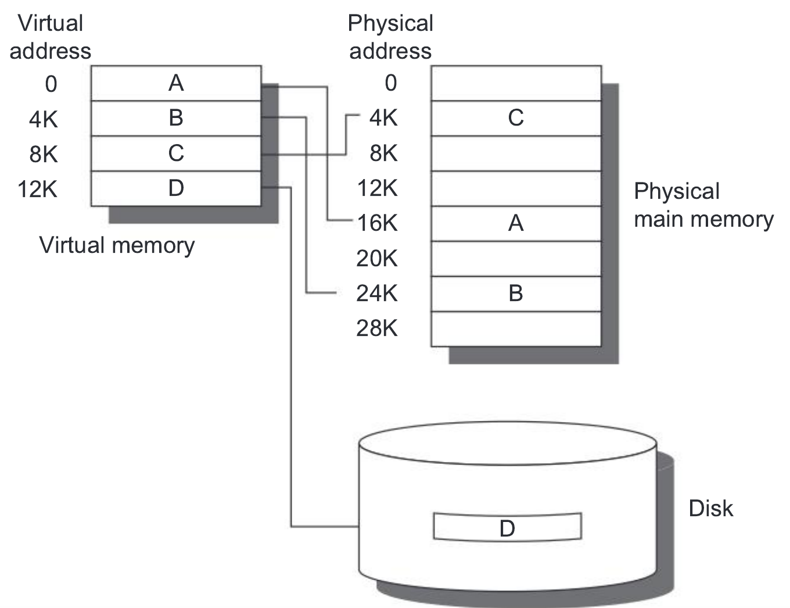
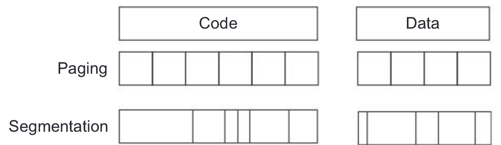
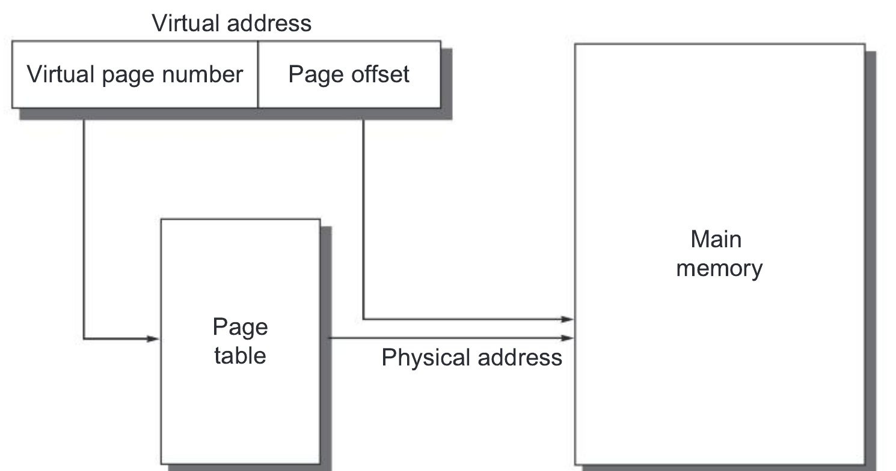

[图 B.18　本附录介绍的基本 Cache 优化技术小结，给出了各项技术对 Cache 性能和复杂度的影响。一般来说，一项技术只改善一个因素。+ 表示该技术改善这一因素，− 表示它对这一因素不利，空白表示没有影响。复杂度是主观评价，0 表示最容易，3 表示很有挑战性。]{#fig-b-18 .caption}

| 技术 | 命中时间 | 失效开销 | 失效率 | 硬件复杂度 | 说明 |
|---|:---:|:---:|:---:|:---:|---|
| 增大块 | | − | + | 0 | 很简单；Pentium 4 的 L2 采用 128 字节的块 |
| 增大 Cache 容量 | − | | + | 1 | 广泛采用，尤其是 L2 Cache |
| 提高相联度 | − | | + | 1 | 广泛采用 |
| 多级 Cache | | + | | 2 | 硬件代价高；L1 块大小 ≠ L2 块大小时更难；广泛采用 |
| 读优先于写 | | + | | 1 | 广泛采用 |
| 在 Cache 索引时避免地址转换 | + | | | 1 | 广泛采用 |

## 虚拟存储 {#sec-b-4}

> ……已经设计出一种系统，使磁芯—磁鼓组合在程序员看来就是一个单级存储器，其间必要的传送都自动进行。
>
> ——Kilburn 等（1962）

计算机在任何时刻都运行着多个进程，每个进程都有自己的地址空间（进程在下一节介绍）。如果给每个进程都配上与整个地址空间一样大的内存，代价太高，况且许多进程只用到地址空间中的一小部分。因此，必须有办法让许多进程共享数量较少的物理内存。

*虚拟存储*就是这样一种办法：它把物理内存分成若干块，分配给不同的进程。这样做必然要有*保护*机制，把每个进程限制在只属于它自己的块上。大多数形式的虚拟存储还能缩短程序的启动时间，因为程序不必等全部代码和数据都放进物理内存才开始运行。

今天的计算机离不开虚拟存储提供的保护，但当初发明虚拟存储并不是为了共享。那时，程序大到物理内存装不下，就得由程序员设法把它装进去。程序员先把程序分成若干片，找出其中互斥的片，再在执行过程中由用户程序控制，装入或卸下这些*覆盖段*（overlay）。程序员既要保证程序访问的物理主存永远不超过计算机实有的容量，又要保证在正确的时间装入正确的覆盖段。不难想象，这副担子大大降低了程序员的生产率。

虚拟存储正是为了卸下这副担子而发明的：它自动管理由主存和二级存储构成的两级存储层次。[图 B.19](#fig-b-19) 画出了一个 4 页的程序从虚拟存储映射到物理内存的情形。

虚拟存储除了让多个进程共享受保护的存储空间、自动管理存储层次，还简化了程序装入执行的过程。这一机制称为*重定位*，它让同一个程序能在物理内存的任何位置运行。以[图 B.19](#fig-b-19) 为例，只要改变程序与物理内存（或磁盘）之间的映射，就能把程序放在物理内存或磁盘的任何地方。（虚拟存储普及以前，处理器专门为此设有重定位寄存器。）不用硬件的话，也可以用软件在程序每次运行时修改其中的所有地址。

第 1 章讲过的关于 Cache 的若干存储层次的一般概念，在虚拟存储中也有对应，只是许多术语不同：块称为*页*或*段*，失效称为*缺页*或*地址故障*。在虚拟存储中，处理器产生*虚拟地址*，由硬件和软件共同把它转换成*物理地址*，再用物理地址访问主存。这个过程称为*存储映射*或*地址转换*。今天，虚拟存储管理的两级存储层次是 DRAM 和磁盘。[图 B.20](#fig-b-20) 给出了虚拟存储中各项存储层次参数的典型范围。

{#fig-b-19 width=70%}

[图 B.20　Cache 和虚拟存储的典型参数范围。虚拟存储的参数是 Cache 参数的 10～1 000 000 倍。一级 Cache 通常最多容纳 1 MiB 数据，而物理内存的容量为 256 MiB 到 1 TB。]{#fig-b-20 .caption}

| 参数 | 一级 Cache | 虚拟存储 |
|---|---|---|
| 块（页）大小 | 16～128 字节 | 4096～65 536 字节 |
| 命中时间 | 1～3 个时钟周期 | 100～200 个时钟周期 |
| 失效开销 | 8～200 个时钟周期 | 1 000 000～10 000 000 个时钟周期 |
| （访问时间） | （6～160 个时钟周期） | （800 000～8 000 000 个时钟周期） |
| （传送时间） | （2～40 个时钟周期） | （200 000～2 000 000 个时钟周期） |
| 失效率 | 0.1%～10% | 0.00001%～0.001% |
| 地址映射 | 25～45 位物理地址映射为 14～20 位 Cache 地址 | 32～64 位虚拟地址映射为 25～45 位物理地址 |

除了[图 B.20](#fig-b-20) 列出的这些数量上的差别，Cache 和虚拟存储还有以下不同：

* Cache 失效时的替换主要由硬件控制，虚拟存储的替换主要由操作系统控制。虚拟存储的失效开销长得多，替换决定做得好坏影响更大，因此可以让操作系统参与，花些时间决定替换哪一块。
* 虚拟存储的大小由处理器地址的位数决定，Cache 的容量则与处理器地址的位数无关。
* 二级存储除了在存储层次中充当主存的下一级后备存储，还用来存放文件系统。实际上，二级存储的大部分空间由文件系统占用，而文件系统通常不在地址空间之内。

虚拟存储还包括几种相关的技术。虚拟存储系统分为两类：一类使用固定大小的块，称为*页*；另一类使用大小可变的块，称为*段*。页的大小通常固定为 4096～8192 字节，段的大小则各不相同。各种处理器支持的最大段从 2^16^ 字节到 2^32^ 字节不等，最小的段是 1 字节。[图 B.21](#fig-b-21) 示意了这两种方法可能怎样划分代码和数据。

选用分页还是分段的虚拟存储，会影响处理器的设计。分页寻址用的是单个固定长度的地址，分成页号和页内偏移两部分，与 Cache 的寻址类似。分段地址无法用单个地址表示：段的大小可变，需要 1 个字表示段号、1 个字表示段内偏移，共 2 个字。不分段的地址空间对编译器来说更简单。

这两种方法各自的优缺点，操作系统教科书中已有充分论述，[图 B.22](#fig-b-22) 归纳了其中的论点。由于替换问题（图中第三行），今天很少有计算机采用纯分段。有些计算机采用一种折中方案，称为*段页式*（paged segments），即一个段由整数个页组成。这样替换就简单了，因为段在内存中不必连续，整个段也不必都在主存中。较新的一种折中方案是让计算机支持多种页大小，较大的页是最小页的 2 的幂次倍。例如，IBM 405CR 嵌入式处理器允许把 1 KiB、4 KiB（2^2^ × 1 KiB）、16 KiB（2^4^ × 1 KiB）、64 KiB（2^6^ × 1 KiB）、256 KiB（2^8^ × 1 KiB）、1024 KiB（2^10^ × 1 KiB）和 4096 KiB（2^12^ × 1 KiB）用作一页。

{#fig-b-21 width=70%}

[图 B.22　分页与分段的比较。两者都可能浪费内存，浪费多少取决于块的大小以及各段在主存中拼合得好不好。如果程序设计语言允许不受限制的指针，就既要传递段，也要传递地址。一种称为*段页式*的折中方法力图兼得两者之长：段由页组成，因此替换一块很容易，而段又可以作为一个逻辑单位来处理。]{#fig-b-22 .caption}

| | 页 | 段 |
|---|---|---|
| 每个地址的字数 | 一个 | 两个（段号和偏移） |
| 程序员是否可见 | 对应用程序员不可见 | 可能对应用程序员可见 |
| 替换一块 | 很简单（所有块大小相同） | 困难（必须在主存中找到一段连续的、大小合适的未用空间） |
| 内存使用的低效 | 内部碎片（页中未用的部分） | 外部碎片（主存中未用的零碎空间） |
| 磁盘传输是否高效 | 是（可调整页大小，平衡访问时间和传送时间） | 不一定（小段可能只传送几个字节） |

### 再谈存储层次的四个问题 {-}

现在可以针对虚拟存储回答存储层次的四个问题了。

#### 问题 1：块可以放在主存的什么位置？ {-}

虚拟存储失效时要访问旋转的磁存储设备，因此失效开销相当高。在较低的失效率和较简单的放置算法之间，操作系统设计者通常选择前者，因为失效开销实在太高。所以，操作系统允许块放在主存中的任何位置。按照[图 B.2](#fig-b-2) 的术语，这种策略称为全相联。

#### 问题 2：如果块在主存中，怎样找到它？ {-}

分页和分段都依靠一种以页号或段号为索引的数据结构，其中存放块的物理地址。分段时，把偏移加到段的物理地址上，得到最终的物理地址；分页时，只需把偏移拼接在物理页地址后面（见[图 B.23](#fig-b-23)）。

存放物理页地址的这种数据结构通常是*页表*。页表以虚拟页号为索引，表项数等于虚拟地址空间中的页数。假设虚拟地址为 32 位、页大小为 4 KiB、每个页表项（PTE）4 字节，则页表的大小为

$$
(2^{32}/2^{12}) \times 2^{2} = 2^{22}\ \text{字节，即 4 MiB}
$$

为了缩小这个数据结构，有些计算机对虚拟地址做散列。采用散列后，这个数据结构的长度只需等于主存中*物理*页的数目，而物理页数可能比虚拟页数小得多。这种结构称为*反向页表*（inverted page table）。仍用前面的例子，512 MiB 的物理内存只需要 1 MiB（8 × 512 MiB/4 KiB）的反向页表，每个页表项多出的 4 字节用来存放虚拟地址。HP/Intel IA-64 两种方式都支持：既提供传统页表，*也*提供反向页表，选用哪种机制由操作系统程序员决定。

{#fig-b-23 width=75%}

为了缩短地址转换的时间，计算机设有一个专门存放地址转换的 Cache，称为*转换后备缓冲器*（translation lookaside buffer），简称*转换缓冲器*，稍后详细介绍。

#### 问题 3：虚拟存储失效时应当替换哪一块？ {-}

前面讲过，操作系统的首要准则是尽量减少缺页。按照这一准则，几乎所有操作系统都尽量替换最近最少使用（LRU）的块：如果过去能预示未来，这一块再被用到的可能性最小。

为了帮助操作系统估计 LRU，许多处理器提供了*使用位*或*引用位*。从逻辑上讲，每访问一页，就把它的使用位置 1（为了减少工作量，实际上只在转换缓冲器失效时才置位，转换缓冲器失效稍后介绍）。操作系统定期把使用位清零，过一段时间再记录这些位，从而判断这段时间内访问过哪些页。这样跟踪访问情况，操作系统就能选出最近最少访问的页之一。

#### 问题 4：写操作时怎么办？ {-}

主存的下一级是旋转的磁盘，访问一次要花几百万个时钟周期。由于两者的访问时间相差悬殊，至今还没有人造出这样的虚拟存储操作系统：处理器每执行一次存数操作，就穿过主存写直达磁盘。（不要把这句话理解为：谁第一个造出来就能出名！）因此，虚拟存储的写策略总是写回。

多访问一次下一级存储的代价很高，因此虚拟存储系统通常设有脏位。有了脏位，只有从磁盘读入后被修改过的块才需要写回磁盘。

### 快速地址转换技术 {-}

页表通常很大，因此存放在主存中，有时页表本身也要分页。采用分页后，每次访存在逻辑上至少要花两倍的时间：第一次访存取得物理地址，第二次访存才取得数据。第 2 章讲过，我们利用局部性来避免这次额外的访存：把地址转换结果放在一个专门的 Cache 里，访存时就很少需要再访问一次存储器来转换地址。这个专门的地址转换 Cache 称为*转换后备缓冲器*（Translation Lookaside Buffer，TLB），也称为*转换缓冲器*（Translation Buffer，TB）。

TLB 项与 Cache 项类似：tag 部分存放虚拟地址的一部分，数据部分存放物理页帧号、保护字段、有效位，通常还有一个使用位和一个脏位。操作系统要修改页表中某一项的物理页帧号或保护信息，必须先确保旧的表项不在 TLB 中，否则系统就不能正常工作。注意，这里的脏位表示对应的*页*是脏的，既不是说 TLB 中的地址转换是脏的，也不是说数据 Cache 中的某个块是脏的。操作系统通过修改页表中的值来复位这些位，然后作废 TLB 中对应的项。这一项从页表重新装入后，TLB 就得到了这些位的准确副本。

[图 B.24](#fig-b-24) 是 Opteron 数据 TLB 的组成，图中标出了地址转换的每一步。这个 TLB 采用全相联放置，因此转换一开始就把虚拟地址送到所有 tag（步骤 1 和 2）。tag 必须标记为有效才能匹配。与此同时，还要根据 TLB 中的保护信息检查这次访存的类型是否违规（也在步骤 2）。

与 Cache 的道理相同，TLB 中不必存放 12 位的页内偏移。匹配的 tag 经过一个实际上是 40 选 1 的多路选择器，送出对应的物理地址（步骤 3）。最后把物理页帧和页内偏移拼起来，形成完整的 40 位物理地址（步骤 4）。

地址转换很容易处在决定处理器时钟周期的关键路径上，所以 Opteron 的 L1 Cache 采用虚拟寻址、物理 tag。

介绍 Opteron 页表项中的各个保护字段和访问字段。图内标注：Virtual page number，虚拟页号；Page offset，页内偏移；V，有效位；R/W，读/写；U/S，用户/管理者；D，脏位；A，访问位；Tag，tag；Physical address，物理地址；40:1 mux，40 选 1 多路选择器；Low-order 12 bits of address，地址的低 12 位；High-order 28 bits of address，地址的高 28 位；40-bit physical address，40 位物理地址。](images/appb/fig-b-24.png){#fig-b-24 width=90%}

### 页大小的选择 {-}

最明显的体系结构参数是页大小。选择页大小，要在有利于大页和有利于小页的两类因素之间求得平衡。有利于较大页的因素有：

* 页表大小与页大小成反比，因此把页做大，可以节省内存（或存储映射所用的其他资源）。
* [B.3 节](#sec-b-3)讲过，页较大时，Cache 可以做得更大，而命中时间仍然很短。
* 在二级存储和内存之间传送页（可能还要经过网络），传送大页比传送小页效率高。
* TLB 的项数有限，页越大，TLB 能高效映射的内存就越多，从而减少 TLB 失效次数。

近来的微处理器支持多种页大小，正是出于最后一个原因：在某些程序中，TLB 失效对 CPI 的影响可能和 Cache 失效一样大。

采用较小页的主要理由是节省存储空间。虚拟存储中一片连续区域的大小不等于页大小的整数倍时，页较小，浪费的存储空间就少。页中这部分未用的存储空间称为*内部碎片*。假设每个进程有三个主要的段（代码段、堆和栈），则每个进程平均浪费的存储空间是页大小的 1.5 倍。在内存有几百 MB、页大小为 4～8 KiB 的计算机上，这点浪费可以忽略不计。当然，页非常大（超过 32 KiB）时，就可能浪费存储空间（主存和二级存储都有）和 I/O 带宽。最后还要考虑进程的启动时间：许多进程都很小，页太大会延长启动一个进程的时间。

### 虚拟存储与 Cache 小结 {-}

有了虚拟存储，TLB、一级 Cache 和二级 Cache 各自映射虚拟地址空间和物理地址空间的一部分，地址中哪些位用在哪里，很容易弄混。[图 B.25](#fig-b-25) 给出一个假想的例子：从 64 位虚拟地址到 41 位物理地址，中间有两级 Cache。L1 Cache 和页的大小都是 8 KiB，因此 L1 Cache 可以采用虚拟索引、物理 tag。L2 Cache 为 4 MiB。两级 Cache 的块大小都是 64 字节。

64 位虚拟地址在逻辑上先分为虚拟页号和页内偏移两部分。虚拟页号送往 TLB，转换成物理地址；页内偏移的高位部分送往 L1 Cache 作为索引。如果 TLB 匹配命中，就把物理页号送去与 L1 Cache 的 tag 比较。两者匹配，就是 L1 Cache 命中，再由块内偏移为处理器选出所需的字。

如果 L1 Cache 失效，就用物理地址去访问 L2 Cache：物理地址的中间部分用作 4 MiB L2 Cache 的索引，读出的 L2 Cache tag 与物理地址的高位部分比较。两者匹配，就是 L2 Cache 命中，数据送往处理器，处理器用块内偏移选出所需的字。如果 L2 失效，就用物理地址从存储器中取出这一块。

![图 B.25　一个假想的存储层次从虚拟地址到访问 L2 Cache 的全貌。页大小为 8 KiB。TLB 采用直接映射，有 256 项。L1 Cache 是 8 KiB 的直接映射 Cache，L2 Cache 是 4 MiB 的直接映射 Cache，两者都使用 64 字节的块。虚拟地址为 64 位，物理地址为 41 位。这张简图和实际 Cache 的主要区别在于，实际 Cache 中图中的某些部分要重复多份。图内标注：Virtual address，虚拟地址；Virtual page number，虚拟页号；Page offset，页内偏移；TLB tag compare address，TLB tag 比较地址；TLB index，TLB 索引；TLB tag，TLB tag；TLB data，TLB 数据；L1 cache index，L1 Cache 索引；Block offset，块内偏移；L1 cache tag，L1 Cache tag；L1 data，L1 数据；L1 tag compare address，L1 tag 比较地址；Physical address，物理地址；L2 tag compare address，L2 tag 比较地址；L2 cache index，L2 Cache 索引；L2 cache tag，L2 Cache tag；L2 data，L2 数据；To CPU，送往 CPU；To L1 cache or CPU，送往 L1 Cache 或 CPU。](images/appb/fig-b-25.png){#fig-b-25 width=95%}

这个例子很简单，它和实际 Cache 的主要区别在于部件的重复。第一处简化是图中只有一个 L1 Cache。如果有两个 L1 Cache，图的上半部分就要再画一份。注意，这样就会有两个 TLB，这也是常见的做法：一组 Cache 和 TLB 供指令使用，由 PC 驱动；另一组 Cache 和 TLB 供数据使用，由有效地址驱动。

第二处简化是所有的 Cache 和 TLB 都采用直接映射。如果其中有 n 路组相联的，就要把每组的 tag 存储器、比较器和数据存储器都重复 n 份，并用一个 n 选 1 多路选择器连接各个数据存储器，选出命中的那一份。如果 Cache 的总容量不变，按[图 B.7](#fig-b-7) 中的公式，Cache 索引还要相应减少 $\log_2 n$ 位。

## 保护与虚拟存储实例 {#sec-b-5}

多道程序设计出现后，一台计算机由几个并发运行的程序共享，程序之间的保护和共享于是有了新的要求。在今天的计算机中，这些要求与虚拟存储密切相关，因此我们在这里讨论这个问题，并给出两个虚拟存储的实例。

多道程序设计引出了*进程*的概念。打个比方，进程是程序呼吸的空气和生存的空间，也就是一个正在运行的程序，加上继续运行它所需的全部状态。分时是多道程序设计的一种变形：几个交互用户同时共享处理器和内存，每个用户都觉得自己独占一台计算机。因此，必须能在任何时刻从一个进程切换到另一个进程，这种切换称为*进程切换*或*上下文切换*。

一个进程无论是从头到尾连续执行，还是反复被中断、与其他进程轮换执行，都必须正确运行。保证进程行为正确，是计算机设计者和操作系统设计者共同的责任：计算机设计者必须保证进程状态中属于处理器的那一部分能够保存和恢复；操作系统设计者必须保证各个进程不会干扰彼此的计算。

要保护一个进程的状态不受其他进程影响，最安全的办法是把当前信息复制到磁盘上。但这样一来，一次进程切换就要花几秒，对分时环境来说太长了。

操作系统的解决办法是划分主存，让几个不同的进程同时把各自的状态放在内存中。主存这样划分以后，操作系统设计者就需要计算机设计者帮忙提供保护，使一个进程不能修改另一个进程。除了保护，计算机还要支持进程之间共享代码和数据，以便进程之间通信，或者减少相同信息的副本数，从而节省内存。

### 进程保护 {-}

让每个进程拥有自己的页表，各自指向不同的内存页，进程之间就能互相保护。显然，必须禁止用户程序修改自己的页表，否则保护机制形同虚设。
