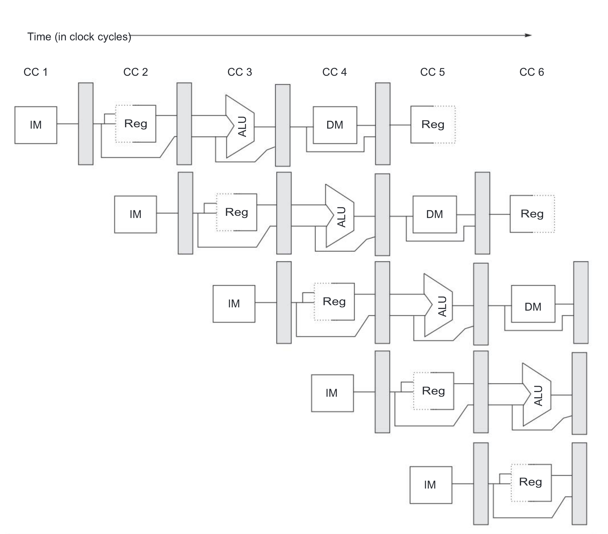

# 流水线：基本概念与进阶概念 {#app-c}

> 这可是个要抽三斗烟才能解决的问题。
>
> ——阿瑟·柯南·道尔爵士，《福尔摩斯探案集》

## 引言 {#sec-c-1}

许多读者已经在别的教材（例如我们写的更基础的《计算机组成与设计》）或别的课程中学过流水线的基础知识。第 3 章在很大程度上以这些内容为基础，因此在继续学习之前，读者应当先确认自己熟悉本附录讨论的概念。阅读第 3 章时，也可以随时翻回这里快速复习。

本附录先讲流水线的基础知识，包括流水线对数据通路的影响、冒险的概念，以及流水线的性能。本节介绍基本的五段 RISC 流水线，它是本附录其余部分的基础。[C.2 节](#sec-c-2)讨论冒险问题：冒险为什么会造成性能问题，又怎样处理。[C.3 节](#sec-c-3)讨论简单的五段流水线具体怎样实现，重点是控制和冒险的处理。

[C.4 节](#sec-c-4)讨论流水线与指令系统设计各方面的相互影响，其中包括异常这一重要问题，以及异常和流水线之间的影响。精确中断与非精确中断、异常发生后怎样恢复执行，这些概念是理解第 3 章中更高级方法的关键，不熟悉的读者会觉得这部分内容很有用。

[C.5 节](#sec-c-5)讨论怎样扩展五段流水线，以处理执行时间较长的浮点指令。[C.6 节](#sec-c-6)把这些概念综合起来，以深流水线处理器 MIPS R4000/4400 为案例，介绍它的八段整数流水线和浮点流水线。MIPS R4000 与单发射的嵌入式处理器相似，例如 2010 年面世的 ARM Cortex-A5，后者曾用于多款智能手机和平板电脑。

[C.7 节](#sec-c-7)介绍动态调度的概念，以及用记分牌实现动态调度的方法。动态调度放在交叉问题中介绍，是因为它可以作为第 3 章核心概念的入门，而第 3 章的重点正是动态调度方法。[C.7 节](#sec-c-7)也是学习第 3 章中更复杂的 Tomasulo 算法之前的一个平缓的铺垫。不讲记分牌也可以讲清楚、学明白 Tomasulo 算法，但记分牌方法更简单，也更容易理解。

### 什么是流水线 {-}

*流水线*是一种让多条指令重叠执行的实现技术，它利用的是执行一条指令所需的各个动作之间的并行性。今天，流水线是构造快速处理器的关键实现技术，就连价格不到 1 美元的处理器也采用了流水线。

流水线就像一条装配线。汽车装配线有许多步骤，每一步都为造好一辆车完成一部分工作。各个步骤同时进行，只是各自处理不同的车。计算机流水线也是这样：每一步完成一条指令的一部分工作，不同的步骤同时完成不同指令的不同部分。每一步称为一个*流水段*（pipe stage 或 pipe segment）。各个流水段首尾相连，构成一条管道：指令从一端进入，依次经过各个流水段，从另一端流出，就像汽车在装配线上那样。

汽车装配线的*吞吐率*定义为每小时生产的汽车数，它取决于多长时间有一辆装好的汽车从装配线上下来。同样，指令流水线的吞吐率取决于多长时间有一条指令从流水线中流出。由于各个流水段连在一起，所有流水段必须同时准备好才能向前推进，这一点和装配线的要求相同。指令在流水线中前进一步所需的时间称为一个*处理器周期*。所有流水段同时推进，因此处理器周期的长度由最慢的流水段所需的时间决定；在汽车装配线上，也是耗时最长的那一步决定了汽车前移的间隔。在计算机中，处理器周期几乎总是 1 个时钟周期。

流水线设计者的目标是平衡各个流水段的长度，就像装配线的设计者要设法平衡各道工序的时间。如果各个流水段完全平衡，那么在理想条件下，流水线处理器上每条指令的时间等于

$$
\frac{\text{非流水线机器上每条指令的时间}}{\text{流水段数}}
$$

在这样的条件下，流水线带来的加速比等于流水段数，正如一条有 $n$ 道工序的装配线在理想情况下生产汽车的速度是原来的 $n$ 倍。不过，各个流水段通常不会完全平衡，而且流水线本身也有一定的开销。因此，流水线处理器上每条指令的时间达不到可能的最小值，但可以很接近。

流水线减少了每条指令的平均执行时间。如果原来的处理器每条指令要花多个时钟周期，那么流水线降低的是 CPI。本附录主要从这个角度来看流水线。

流水线是一种实现技术，它利用的是顺序指令流中各条指令之间的并行性。与某些加速技术（见第 4 章）不同，流水线对程序员是透明的，这是它的一大优点。

### RISC-V 指令系统基础 {-}

本书始终用 RISC-V 这种 load-store 体系结构来说明基本概念。本书介绍的思想几乎都适用于其他处理器，但如果指令复杂，实现起来可能要复杂得多。本节用到的是 RISC-V 体系结构的核心部分，完整的描述见第 1 章。我们虽然用的是 RISC-V，但这些概念在各种 RISC 之间大体相通，适用于任何 RISC，包括 ARM 和 MIPS 的核心体系结构。所有 RISC 体系结构都有以下几个关键特点：

* 对数据的操作都以寄存器中的数据为对象，通常会改变整个寄存器（每个寄存器 32 位或 64 位）。
* 只有 load 和 store 操作会影响内存：load 把数据从内存送到寄存器，store 把数据从寄存器送到内存。往往还提供只读写寄存器一部分数据（如一个字节、16 位或 32 位）的 load 和 store 操作。
* 指令格式种类很少，所有指令通常长度相同。在 RISC-V 中，寄存器字段 rs1、rs2 和 rd 总是在相同的位置，从而简化了控制。

这几个简单的特点让流水线的实现大为简化，这也正是这些指令系统要这样设计的原因。第 1 章完整介绍了 RISC-V ISA，我们假定读者已经读过第 1 章。

### RISC 指令系统的一种简单实现 {-}

要弄清 RISC 指令系统怎样用流水线方式实现，先要弄清它在不用流水线时怎样实现。本节给出一种简单的实现，每条指令最多花 5 个时钟周期。后面我们再把这一基本实现扩展成流水线版本，CPI 会低得多。在不用流水线的各种实现中，这里给出的实现既不是最经济的，也不是性能最高的，它的设计目的是自然地过渡到流水线实现。实现这个指令系统，需要引入几个不属于体系结构的临时寄存器，本节引入它们是为了简化流水线。我们只为 RISC 体系结构的一个整数子集构造流水线，这个子集包括 load/store 字、转移和整数 ALU 操作。

这个 RISC 子集中的每条指令都可以在最多 5 个时钟周期内完成。这 5 个时钟周期如下。

1. 取指周期（IF）：

   把程序计数器（PC）送到存储器，从存储器取出当前指令。PC 加 4（因为每条指令 4 个字节），指向顺序的下一条指令。

2. 译码/读寄存器周期（ID）：

   对指令译码，并按照指令中的源寄存器号从寄存器堆中读出寄存器。读寄存器的同时对它们做相等比较，以备可能的转移之用。对指令中的偏移量字段做符号扩展，以备需要时使用。把符号扩展后的偏移量与加 4 后的 PC 相加，算出可能的转移目标地址。

   译码与读寄存器并行进行。之所以能这样做，是因为在 RISC 体系结构中寄存器号的位置固定，这种技术称为*固定字段译码*。注意，这样可能会读出一个用不到的寄存器，这对性能没有帮助，但也没有损害。（读不需要的寄存器确实浪费能量，对功耗敏感的设计可能会避免这样做。）load 和 ALU 立即数操作的立即数字段总是在相同的位置，因此很容易对它做符号扩展。（如果要更完整地实现 RISC-V，就需要算出两个不同的符号扩展值，因为 store 指令的立即数字段在另一个位置。）

3. 执行/有效地址周期（EX）：

   ALU 对上一周期准备好的操作数做运算，根据指令类型完成以下四种功能之一：

   * 访存指令：ALU 把基址寄存器与偏移量相加，形成有效地址。
   * 寄存器-寄存器 ALU 指令：ALU 对从寄存器堆读出的两个值执行 ALU 操作码指定的运算。
   * 寄存器-立即数 ALU 指令：ALU 对从寄存器堆读出的第一个值和符号扩展后的立即数执行 ALU 操作码指定的运算。
   * 条件转移：判断条件是否成立。

   在 load-store 体系结构中，有效地址周期和执行周期可以合并成一个时钟周期，因为没有哪条指令需要既计算数据地址又对数据做运算。

4. 访存周期（MEM）：

   如果是 load 指令，存储器用上一周期算出的有效地址进行读操作。如果是 store 指令，存储器按有效地址写入数据，数据来自从寄存器堆读出的第二个寄存器。

5. 写回周期（WB）：

   * 寄存器-寄存器 ALU 指令或 load 指令：

   把结果写入寄存器堆。结果可能来自存储系统（load 指令），也可能来自 ALU（ALU 指令）。

在这种实现中，转移指令需要 3 个周期，store 指令需要 4 个周期，其余指令都需要 5 个周期。假定转移指令占 12%，store 指令占 10%，按典型的指令分布，总的 CPI 为 4.66。不过，这种实现无论是从获得最高性能来看，还是从在给定性能下使用最少的硬件来看，都不是最优的。改进这一设计留给读者作为练习，下面我们集中讨论怎样把这个版本流水化。

### RISC 处理器的经典五段流水线 {-}

前一节描述的执行过程几乎不用改动就可以流水化，只要每个时钟周期启动一条新指令即可。（明白我们为什么选择这种设计了吧？）前一节的每个时钟周期都成为一个*流水段*，即流水线中的一个周期。这样就得到[图 C.1](#fig-c-1) 所示的执行模式，这也是流水线结构的典型画法。虽然每条指令要花 5 个时钟周期才能完成，但在每个时钟周期，硬件都会启动一条新指令，同时在执行 5 条不同指令各自的一部分。

[图 C.1　简单的 RISC 流水线。每个时钟周期取出一条新指令，开始它为期 5 个周期的执行。如果每个时钟周期都启动一条指令，性能最多可以达到非流水线处理器的 5 倍。流水线中各个流水段的名称与非流水线实现中各个周期的名称相同：IF 为取指，ID 为译码，EX 为执行，MEM 为访存，WB 为写回。]{#fig-c-1 .caption}

| 指令编号 | 时钟 1 | 时钟 2 | 时钟 3 | 时钟 4 | 时钟 5 | 时钟 6 | 时钟 7 | 时钟 8 | 时钟 9 |
|---|---|---|---|---|---|---|---|---|---|
| 指令 *i* | IF | ID | EX | MEM | WB | | | | |
| 指令 *i*+1 | | IF | ID | EX | MEM | WB | | | |
| 指令 *i*+2 | | | IF | ID | EX | MEM | WB | | |
| 指令 *i*+3 | | | | IF | ID | EX | MEM | WB | |
| 指令 *i*+4 | | | | | IF | ID | EX | MEM | WB |

读者也许很难相信流水线就这么简单。事实上并不简单。在本节和后面几节，我们要解决流水线带来的种种问题，让这条 RISC 流水线成为「真正」能用的流水线。

首先，必须确定处理器在每个时钟周期做什么，并保证不会在同一个时钟周期用同一个数据通路资源执行两种不同的操作。例如，不能要求一个 ALU 同时计算有效地址和做减法。因此，必须保证流水线中指令的重叠不会引起这样的冲突。好在 RISC 指令系统很简单，资源评估相对容易。[图 C.2](#fig-c-2) 给出了按流水线方式画出的简化 RISC 数据通路。可以看出，主要的功能部件在不同的周期使用，因此多条指令重叠执行引起的冲突相对较少。这一结论依据的是以下三点。

{#fig-c-2 width=90%}

一是使用分开的指令存储器和数据存储器，通常用分开的指令 Cache 和数据 Cache 来实现（第 2 章讨论过）。采用分开的 Cache，就消除了取指和数据访存争用同一个存储器的冲突。注意，如果流水线处理器的时钟周期与非流水线版本相同，存储系统就必须提供 5 倍的带宽。带宽需求的增加，是获得更高性能的代价之一。

二是寄存器堆在两个流水段中使用：在 ID 段读，在 WB 段写。这两种用途互不相同，所以图中干脆把寄存器堆画在两个地方。于是，每个时钟周期需要完成两次读和一次写。为了处理对同一个寄存器的读和写（还有另一个原因，稍后就会清楚），我们在时钟周期的前半个周期写寄存器，后半个周期读寄存器。

三是[图 C.2](#fig-c-2) 没有涉及 PC。为了每个时钟启动一条新指令，必须每个时钟都对 PC 加 4 并保存起来，而且这一操作必须在 IF 段完成，为下一条指令做好准备。此外，还必须有一个加法器，在 ID 段计算可能的转移目标地址。还有一个问题：我们需要在 ALU 段用 ALU 来判断转移条件。实际上，比较两个寄存器并不真的需要一个完整的 ALU，但需要足够多的 ALU 功能，所以这一比较必须在这个流水段进行。

保证流水线中的指令不同时使用同一个硬件资源固然至关重要，但还必须保证流水线不同段中的指令互不干扰。为此，在流水线相邻的段之间引入*流水线寄存器*：在一个时钟周期结束时，某一段的所有结果都存入一个寄存器，在下一个时钟周期作为下一段的输入。[图 C.3](#fig-c-3) 画出了加上这些流水线寄存器的流水线。

{#fig-c-3 width=90%}

许多图为了简洁省略了这些寄存器，但流水线要正常工作，它们必不可少。即使是不采用流水线的多周期数据通路，也需要类似的寄存器，因为只有寄存器中的值才能跨越时钟边界保存下来。在流水线处理器中，流水线寄存器还有一个关键作用：当源段和目的段不直接相邻时，由它们把中间结果从一个段带到另一个段。例如，store 指令要存储的寄存器值在 ID 段读出，但直到 MEM 段才真正使用；这个值要经过两个流水线寄存器，在 MEM 段才到达数据存储器。同样，ALU 指令的结果在 EX 段算出，但直到 WB 段才真正写入寄存器，中间也要经过两个流水线寄存器。有时需要给流水线寄存器命名，我们的惯例是用它们所连接的两个流水段来命名，因此这些寄存器分别称为 IF/ID、ID/EX、EX/MEM 和 MEM/WB。

### 流水线的基本性能问题 {-}

流水线提高了处理器的指令吞吐率，即单位时间内完成的指令数，但并不缩短单条指令的执行时间。事实上，由于流水线控制带来的开销，每条指令的执行时间通常还会略有增加。指令吞吐率提高了，程序就运行得更快，总执行时间更短，尽管没有哪一条指令本身执行得更快！

每条指令的执行时间不会缩短，这就限制了流水线实际能有多深，下一节会看到这一点。除了流水线延迟带来的限制，各流水段之间的不平衡和流水线开销也会带来限制。流水段之间不平衡会降低性能，因为时钟的周期不可能短于最慢的流水段所需的时间。流水线开销来自两部分：流水线寄存器的延迟和时钟偏斜。流水线寄存器给时钟周期增加了两部分时间：一是 Setup 时间，即在触发写操作的时钟信号到来之前寄存器输入必须保持稳定的时间；二是传播延迟。*时钟偏斜*是时钟到达任意两个寄存器的时刻之间的最大差值，它也是构成时钟周期下限的因素之一。一旦时钟周期缩短到时钟偏斜与锁存器开销之和，再细分流水线就没有用了，因为周期中已经没有时间留给有用的工作。感兴趣的读者可以参阅 Kunkel 和 Smith（1986）。

**例题**　考虑前一节的非流水线处理器。假定它的时钟频率为 4 GHz（即时钟周期为 0.5 ns），ALU 操作和转移需要 4 个周期，访存操作需要 5 个周期，这三类操作的相对频度分别为 40%、20% 和 40%。假定由于时钟偏斜和 Setup 时间，流水化之后时钟增加了 0.1 ns 的开销。不考虑延迟的影响，采用流水线后指令执行速率的加速比是多少？

**解答**　非流水线处理器上的平均指令执行时间为

$$
\begin{aligned}
\text{平均指令执行时间} &= \text{时钟周期} \times \text{平均 CPI} \\
&= 0.5\ \text{ns} \times [(40\% + 20\%) \times 4 + 40\% \times 5] \\
&= 0.5\ \text{ns} \times 4.4 \\
&= 2.2\ \text{ns}
\end{aligned}
$$

在流水线实现中，时钟必须按最慢的流水段加上开销来运行，即 0.5 + 0.1 = 0.6 ns，这也就是平均指令执行时间。因此，流水线带来的加速比为

$$
\begin{aligned}
\text{流水线加速比} &= \frac{\text{非流水线的平均指令时间}}{\text{流水线的平均指令时间}} \\
&= \frac{2.2\ \text{ns}}{0.6\ \text{ns}} = 3.7
\end{aligned}
$$

也就是说，采用流水线后指令执行速率是原来的 3.7 倍。0.1 ns 的开销实际上给流水线的效果设了一个上限。如果这一开销不随时钟周期变化，那么由 Amdahl 定律可知，加速比要受这一开销的限制。

如果流水线中的每条指令都与其他指令无关，这条简单的 RISC 流水线执行整数指令就毫无问题。但实际上，流水线中的指令可能彼此相关，下一节就讨论这个问题。

## 流水线的主要障碍——流水线冒险 {#sec-c-2}

有些情况会使指令流中的下一条指令无法在指定的时钟周期执行，这些情况称为*冒险*（hazard）。冒险使流水线的性能达不到理想的加速比。冒险分为三类：
