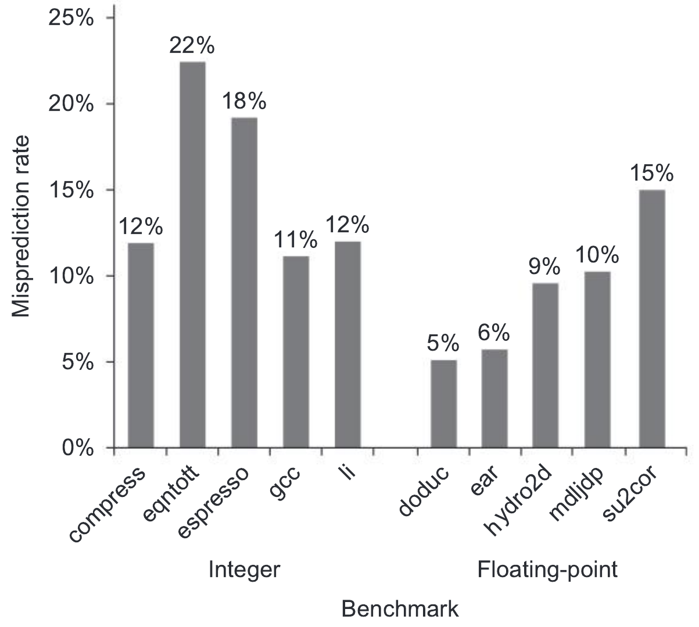

[图 C.11　无论转移成功与否，延迟转移的行为都相同。延迟槽中的指令都要执行（采用延迟转移的 RISC 体系结构大多只有一个延迟槽）。转移不成功时，从转移延迟指令的下一条指令继续执行；转移成功时，从转移目标继续执行。如果延迟槽中的指令本身也是转移指令，含义就不明确了：转移不成功时，延迟槽中的这条转移该怎么处理？为了避免这种混乱，采用延迟转移的体系结构往往不允许在延迟槽中放转移指令。]{#fig-c-11 .caption}

| 指令 | 时钟 1 | 时钟 2 | 时钟 3 | 时钟 4 | 时钟 5 | 时钟 6 | 时钟 7 | 时钟 8 | 时钟 9 |
|---|---|---|---|---|---|---|---|---|---|
| 不成功的转移指令 | IF | ID | EX | MEM | WB | | | | |
| 转移延迟指令（$i+1$） | | IF | ID | EX | MEM | WB | | | |
| 指令 $i+2$ | | | IF | ID | EX | MEM | WB | | |
| 指令 $i+3$ | | | | IF | ID | EX | MEM | WB | |
| 指令 $i+4$ | | | | | IF | ID | EX | MEM | WB |

| 指令 | 时钟 1 | 时钟 2 | 时钟 3 | 时钟 4 | 时钟 5 | 时钟 6 | 时钟 7 | 时钟 8 | 时钟 9 |
|---|---|---|---|---|---|---|---|---|---|
| 成功的转移指令 | IF | ID | EX | MEM | WB | | | | |
| 转移延迟指令（$i+1$） | | IF | ID | EX | MEM | WB | | | |
| 转移目标 | | | IF | ID | EX | MEM | WB | | |
| 转移目标 + 1 | | | | IF | ID | EX | MEM | WB | |
| 转移目标 + 2 | | | | | IF | ID | EX | MEM | WB |

转移频度和转移开销都可能同时包含无条件转移和条件转移两部分。条件转移出现得更频繁，因此占主要地位。

**例题**　MIPS R4000 及后来的 RISC 处理器采用更深的流水线，至少要经过三个流水段才能得到转移目标地址，还要再过一个周期才能求出转移条件（假定条件比较所用的寄存器不引起停顿）。有了三个流水段的延迟，三种最简单的预测方案的转移开销如[图 C.12](#fig-c-12) 所示。

假定各类转移的频度如下，求这种流水线中转移使 CPI 实际增加了多少。

| 转移类型 | 频度 |
|---|---|
| 无条件转移 | 4% |
| 条件转移，不成功 | 6% |
| 条件转移，成功 | 10% |

**解答**　无条件转移、不成功的条件转移和成功的条件转移，各自的相对频度乘以相应的开销，就得到各项 CPI，结果见[图 C.13](#fig-c-13)。

[图 C.12　较深流水线中三种最简单的预测方案的转移开销]{#fig-c-12 .caption}

| 转移方案 | 无条件转移的开销 | 不成功转移的开销 | 成功转移的开销 |
|---|---|---|---|
| 清空流水线 | 2 | 3 | 3 |
| 预测为成功 | 2 | 3 | 2 |
| 预测为不成功 | 2 | 0 | 3 |

[图 C.13　较深流水线中三种转移预测方案的 CPI 开销。表中后四列都是转移开销造成的 CPI 增量。]{#fig-c-13 .caption}

| 转移方案 | 无条件转移 | 不成功的条件转移 | 成功的条件转移 | 全部转移 |
|---|---|---|---|---|
| 事件频度 | 4% | 6% | 10% | 20% |
| 停顿流水线 | 0.08 | 0.18 | 0.30 | 0.56 |
| 预测为成功 | 0.08 | 0.18 | 0.20 | 0.46 |
| 预测为不成功 | 0.08 | 0.00 | 0.30 | 0.38 |

延迟变长以后，各方案之间的差距明显拉大。假定基本 CPI 为 1，并且转移是唯一的停顿来源，那么理想流水线的速度是停顿流水线方案的 1.56 倍；在同样的假定下，预测不成功方案的性能是停顿流水线方案的 1.13 倍。

### 用预测降低转移代价 {-}

流水线越来越深，转移的潜在开销随之增大，延迟转移之类的方案就不够用了，需要用更积极的手段来预测转移。这类方案分为两类：一类是低成本的静态方案，依靠编译时就能得到的信息；另一类是动态策略，根据程序运行时的行为预测转移。下面分别讨论。

#### 静态转移预测 {-}

提高编译时转移预测准确率的一个关键办法，是利用以前运行时收集的剖析（profile）信息。这种办法之所以有效，关键在于一个现象：转移的行为往往呈双峰分布，即单条转移指令往往明显偏向成功，或者明显偏向不成功。[图 C.14](#fig-c-14) 给出了用这种策略预测转移的效果，其中运行程序和收集剖析信息用的是同一组输入数据。其他研究表明，换一组输入，让剖析信息来自另一次运行，基于剖析信息的预测准确率只有很小的变化。

{#fig-c-14 width=70%}

任何转移预测方案的效果都取决于两点：一是方案本身的准确率，二是条件转移的频度。在 SPEC 中，条件转移的频度从 3% 到 24% 不等。整数程序的误预测率较高，而这类程序的转移频度通常也较高，这是静态转移预测的一个主要局限。下一节讨论动态转移预测器，近年来的处理器大多采用这种预测器。

#### 动态转移预测与转移预测缓冲 {-}

最简单的动态转移预测方案是*转移预测缓冲*，也称*转移历史表*。转移预测缓冲是一个小存储器，用转移指令地址的低位部分作索引，每项有一位，记录这条转移最近是否成功。这是最简单的一种缓冲，没有 tag（标签）。只有当转移延迟比计算可能的目标 PC 所需的时间更长时，这种缓冲才能减小转移延迟。

使用这种缓冲，我们其实并不知道预测是否正确，因为这一位可能是另一条低位地址相同的转移指令写进去的。但这并不要紧。预测只是一个提示：先假定它正确，按预测的方向开始取指令；如果后来发现提示是错的，就把预测位取反后写回。

这种缓冲实际上是一个每次访问都命中的 Cache。它的性能取决于两点：一是预测位在多大比例的情况下正好属于我们关心的那条转移，二是对得上时预测有多准确。分析性能之前，先对转移预测方案做一个小而重要的改进，以提高准确率。

这种简单的 1 位预测方案在性能上有一个缺点：一条转移即使几乎总是成功，在它偶尔不成功时，我们也很可能预测错两次，而不是一次，因为第一次误预测把预测位翻转了。

为了弥补这个缺点，常采用 2 位预测方案。在 2 位方案中，预测必须错两次才会改变。[图 C.15](#fig-c-15) 给出了 2 位预测方案的有限状态机。

{#fig-c-15 width=80%}

转移预测缓冲有两种实现方式：一是做成一个小的专用「Cache」，在 IF 段用指令地址访问；二是在指令 Cache 的每个块上附加两位，与指令一起取出。如果指令译码后是转移指令，并且预测转移成功，那么一旦知道目标 PC，就从目标处开始取指令；否则继续顺序取指令和执行。预测结果错了，就按[图 C.15](#fig-c-15) 修改预测位。

每项 2 位的转移预测缓冲，在实际应用中能达到多高的准确率？[图 C.16](#fig-c-16) 表明，对 SPEC89 基准测试程序，4096 项的转移预测缓冲的预测准确率从 99% 以上到 82% 不等，即*误预测率*为 1%～18%。这里所用的 4K 项缓冲按 2017 年的标准算是小的，缓冲再大一些，结果还会稍好一些。

{#fig-c-16 width=75%}

要开发更多的 ILP，转移预测的准确率就变得至关重要。从[图 C.16](#fig-c-16) 可以看出，整数程序的转移频度通常较高，预测器对它们的准确率却低于循环密集的科学计算程序。这个问题有两条解决途径：一是增大缓冲，二是提高每次预测所用方案的准确率。但[图 C.17](#fig-c-17) 表明，至少对 SPEC 这类基准测试程序，4K 项缓冲的性能与无限大缓冲相当。[图 C.17](#fig-c-17) 的数据清楚地说明，缓冲的命中率不是主要的限制因素。前面也提到，不改变预测器的结构、只增加每个预测器的位数，作用也不大。因此需要研究怎样提高每个预测器的准确率，第 3 章将讨论这个问题。

{#fig-c-17 width=75%}

## 流水线是怎样实现的 {#sec-c-3}

讨论基本流水线之前，先回顾 RISC-V 非流水线版本的一种简单实现。

### RISC-V 的简单实现 {-}

本节沿用 [C.1 节](#sec-c-1)的写法，先给出一种简单的非流水线实现，再给出流水线实现。不同的是，这一次的例子专门针对 RISC-V 体系结构。

这一小节讨论 RISC-V 一个整数子集的流水线，这个子集包括 load/store 字、相等转移和整数 ALU 操作，基本的浮点操作在本附录后面加入。虽然只讨论一个子集，但基本原理可以推广到全部指令。例如，加入 store 指令时，需要对立即数字段做一些额外的计算。转移指令先采用一种不那么激进的实现，本节最后再说明怎样实现更激进的版本。

每条 RISC-V 指令最多用 5 个时钟周期就能实现，这 5 个时钟周期如下。

1. *取指周期*（IF）：

   ```
   IR ← Mem[PC];
   NPC ← PC + 4;
   ```

   *操作*：送出 PC，从存储器取出指令，放进指令寄存器（IR）；PC 加 4，指向顺序的下一条指令。IR 保存后续时钟周期要用到的指令；同样，寄存器 NPC 保存顺序的下一个 PC。

2. *译码/读寄存器周期*（ID）：

   ```
   A ← Regs[rs1];
   B ← Regs[rs2];
   Imm ← sign-extended immediate field of IR;   // IR 中立即数字段的符号扩展
   ```

   *操作*：对指令译码，访问寄存器堆读出寄存器（rs1 和 rs2 是寄存器号）。两个通用寄存器的输出读入临时寄存器 A 和 B，供后面的时钟周期使用。同时，IR 的低 12 位做符号扩展后存入临时寄存器 Imm，供下一个周期使用。

   译码与读寄存器可以并行进行，因为这些字段在 RISC-V 指令格式中的位置是固定的。load 指令和 ALU 立即数指令的立即数部分在每条 RISC-V 指令中都位于相同的位置，所以这个周期也算出符号扩展后的立即数，以备下一个周期使用。store 指令的立即数字段分成两段，需要另做一次符号扩展。

3. *执行/有效地址周期*（EX）：

   ALU 对上一周期准备好的操作数做运算，按 RISC-V 指令的类型完成以下四种功能之一。

   * 访存指令：

     ```
     ALUOutput ← A + Imm;
     ```

     *操作*：ALU 把两个操作数相加，形成有效地址，结果放进寄存器 ALUOutput。

   * 寄存器-寄存器 ALU 指令：

     ```
     ALUOutput ← A func B;
     ```

     *操作*：ALU 对寄存器 A 和寄存器 B 中的值执行功能码（func3 字段和 func7 字段的组合）指定的运算，结果放进临时寄存器 ALUOutput。

   * 寄存器-立即数 ALU 指令：

     ```
     ALUOutput ← A op Imm;
     ```

     *操作*：ALU 对寄存器 A 和寄存器 Imm 中的值执行操作码指定的运算，结果放进临时寄存器 ALUOutput。

   * 转移指令：

     ```
     ALUOutput ← NPC + (Imm << 2);
     Cond ← (A == B)
     ```

     *操作*：Imm 中是符号扩展后的立即数，左移 2 位成为字偏移量，ALU 把它与 NPC 相加，算出转移目标地址。由于只考虑相等转移，判断转移是否成功的方法是比较上一周期读出的寄存器 A 和寄存器 B。

   RISC-V 是 load-store 体系结构，没有哪条指令需要同时计算数据地址、计算指令目标地址并对数据做运算，因此有效地址周期和执行周期可以合并成一个时钟周期。这里没有列出的其他整数指令是各种形式的跳转，与转移指令类似。

4. *访存/转移完成周期*（MEM）：

   所有指令都更新 PC：`PC ← NPC;`

   * 访存指令：

     ```
     LMD ← Mem[ALUOutput] or
     Mem[ALUOutput] ← B;
     ```

     *操作*：需要时访问存储器。load 指令从存储器取回数据，放进 LMD（load memory data，取存储器数据）寄存器；store 指令把 B 寄存器中的数据写入存储器。两种情况所用的地址，都是上一周期算出、存放在寄存器 ALUOutput 中的地址。

   * 转移指令：

     ```
     if (cond) PC ← ALUOutput
     ```

     *操作*：如果转移成功，就用寄存器 ALUOutput 中的转移目标地址替换 PC。

5. *写回周期*（WB）：

   * 寄存器-寄存器或寄存器-立即数 ALU 指令：

     ```
     Regs[rd] ← ALUOutput;
     ```

   * load 指令：

     ```
     Regs[rd] ← LMD;
     ```

   *操作*：把结果写入 rd 指定的寄存器。结果可能来自存储系统（在 LMD 中），也可能来自 ALU（在 ALUOutput 中）。

[图 C.18](#fig-c-18) 画出了一条指令怎样流过数据通路。每个时钟周期结束时，凡是本周期算出、后面的时钟周期还要用到的值（无论是本条指令用还是下一条指令用），都写进某个存储部件。存储部件可能是存储器、通用寄存器、PC，也可能是临时寄存器（即 LMD、Imm、A、B、IR、NPC、ALUOutput 或 Cond）。临时寄存器在同一条指令的各个时钟周期之间保存值；其他存储部件属于可见状态，在相继的指令之间保存值。

![图 C.18　按这种方式实现 RISC-V 数据通路，每条指令都能在 4 个或 5 个时钟周期内执行完。图中 PC 画在取指用的那部分数据通路中，寄存器画在译码/读寄存器用的那部分数据通路中，但指令对这两个功能部件既要读，也要写。图中按读这两个部件的周期来安排它们的位置，实际上 PC 在访存周期写入，寄存器在写回周期写入。这两处后面流水段的写操作，都用（访存段或写回段的）多路选择器输出表示，多路选择器把一个值送回 PC 或寄存器。这些反向流动的信号意味着可能出现冒险，流水线的复杂性大部分由此而来。图内标注：Instruction fetch，取指；Instruction decode/register fetch，译码/读寄存器；Execute/address calculation，执行/地址计算；Memory access，访存；Write-back，写回；Add，加法器；Instruction memory，指令存储器；Registers，寄存器堆；Sign-extend，符号扩展；Mux，多路选择器；Branch taken，转移成功；Data memory，数据存储器；ALU output，ALU 输出。](images/appc/fig-c-18.png){#fig-c-18 width=95%}

如今所有处理器都采用流水线，但早年大多数处理器的实现方式与这种多周期实现相当接近。控制部分可以按这里给出的五周期结构，用一个简单的有限状态机实现；复杂得多的处理器可以采用微码控制。无论哪种方式，控制的结构都由本节所述的这种指令序列决定。
