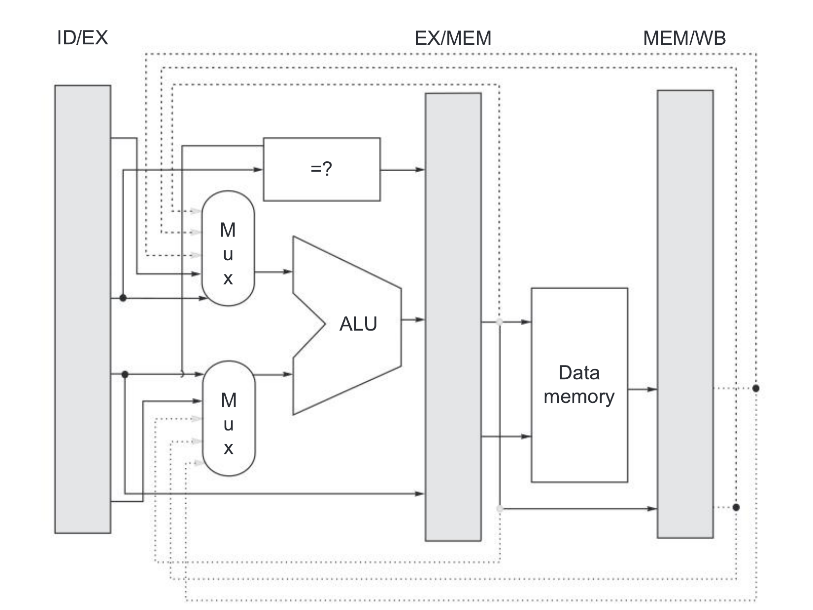

这个多周期实现中有些硬件是冗余的，可以去掉。例如，数据通路中有两个 ALU：一个用来递增 PC，另一个用来计算有效地址和完成 ALU 运算。两者不会在同一个时钟周期用到，因此可以增加几个多路选择器，把它们合并成一个 ALU。同样，数据访问和指令访问发生在不同的时钟周期，所以指令和数据也可以放在同一个存储器中。

我们不去优化这个简单的实现，[图 C.18](#fig-c-18) 的设计保持不变，因为它更适合作为流水线实现的基础。

### RISC-V 的基本流水线 {-}

和前面一样，只要每个时钟周期启动一条新指令，[图 C.18](#fig-c-18) 的数据通路几乎不用改动就能流水化。每个流水段在每个时钟周期都在工作，因此一个流水段中的所有操作必须在 1 个时钟周期内完成，而且各种操作无论怎样组合，都必须能够同时进行。此外，流水化之后，从一个流水段传给下一个流水段的值必须放在寄存器中。[图 C.19](#fig-c-19) 画出了 RISC-V 流水线，每两个流水段之间都加了一组寄存器，称为*流水线寄存器*或*流水线锁存器*，名字取自它们连接的两个流水段。从[图 C.19](#fig-c-19) 可以清楚地看出，各段之间是怎样经由流水线寄存器相连的。

一条指令在时钟周期之间需要暂存的值，现在全部放进这些流水线寄存器。指令寄存器（IR）属于 IF/ID 寄存器，IR 中提供寄存器名的字段在图中都标了出来。流水线寄存器把数据和控制信息从一个流水段带到下一个流水段。后面的流水段要用的值，都必须放进流水线寄存器，并逐级复制下去，直到不再需要为止。如果只沿用前面非流水线数据通路中的临时寄存器，一个值可能还没用完就被覆盖了。例如，load 或 ALU 操作写寄存器时，目的寄存器字段取自 MEM/WB 流水线寄存器，而不是 IF/ID 寄存器。因为我们要让 load 或 ALU 操作写它自己指定的寄存器，而不是此刻正从 IF 进入 ID 的那条指令所指定的寄存器！这个目的寄存器字段只是逐级复制，到 WB 段才用到。

{#fig-c-19 width=90%}

任一时刻，一条指令恰好处于流水线的一个段中，因此为这条指令所做的操作都发生在一对流水线寄存器之间。于是，我们也可以换个角度看流水线的活动：按指令类型，看每个流水段必须完成哪些操作。[图 C.20](#fig-c-20) 就是从这个角度画的，流水线寄存器各字段的名字反映了数据从一段流向下一段的过程。可以看出，前两个流水段的操作与当前指令的类型无关。它们也必须无关，因为指令要到 ID 段结束时才完成译码。IF 段的操作取决于 EX/MEM 中的指令是不是成功的转移：如果是，就在 IF 结束时把 EX/MEM 中这条转移指令的目标地址写入 PC；否则写回递增后的 PC。（前面说过，转移的这种影响会使流水线变得复杂，接下来几节就处理这个问题。）寄存器源操作数采用固定位置编码，这一点至关重要，正是靠它才能在 ID 段读取寄存器。

 的组成相同：在那里，PC 在 IF 段从两个来源中选一个来更新。在 ID 段，读取寄存器，对 IR 中的 12 位（立即数字段）做符号扩展，并把 IR 和 NPC 传下去。在 EX 段，执行 ALU 操作或地址计算，并把 IR 和 B 寄存器（如果是 store 指令）传下去；如果指令是成功的转移，还把 cond 置为 1。在 MEM 段，完成一次存储器访问，必要时写 PC，并把最后一个流水段需要的值传下去。最后，在 WB 段，用 ALU 的输出或 load 取回的值更新寄存器字段所指定的寄存器。为简单起见，我们总是把整个 IR 从一段传到下一段，尽管指令沿流水线前进时，用到的 IR 部分越来越少。图中标注：Stage 为流水段，Any instruction 为任意指令，ALU instruction 为 ALU 指令，Load instruction 为 load 指令，Branch instruction 为转移指令，or 为「或者」，For load only 为「仅对 load 指令」。](images/appc/fig-c-20.png){#fig-c-20 width=90%}

要控制这条简单的流水线，只需确定[图 C.19](#fig-c-19) 数据通路中四个多路选择器怎样设置：

* ALU 段的两个多路选择器按指令类型设置，指令类型由 ID/EX 寄存器的 IR 字段决定。ALU 上输入端的多路选择器看指令是不是转移，下输入端的多路选择器看指令是寄存器-寄存器 ALU 操作还是其他类型的操作；
* IF 段的多路选择器决定把递增后的 PC 还是 EX/MEM.ALUOutput（转移目标）写入 PC，由 EX/MEM.cond 字段控制；
* 第四个多路选择器看 WB 段中的指令是 load 还是 ALU 操作。

除了这四个，还需要一个多路选择器。它没有画在[图 C.19](#fig-c-19) 中，但看一下 ALU 操作的 WB 段就知道它必不可少：目的寄存器字段的位置随指令类型而不同，寄存器-寄存器 ALU 操作在一处，ALU 立即数操作和 load 在另一处。因此，如果指令要写寄存器，就需要一个多路选择器从 MEM/WB 寄存器的 IR 中选出正确的部分，作为目的寄存器字段。

### RISC-V 流水线控制的实现 {-}

在这条流水线中，指令从译码段（ID）进入执行段（EX）的过程通常称为*指令发射*（instruction issue），完成了这一步的指令称为*已发射*的指令。RISC-V 整数流水线的所有数据冒险都可以在 ID 段检查：如果存在数据冒险，指令在发射之前就停顿下来。同样，需要哪些前递也可以在 ID 段确定，并在这时设置好相应的控制。在流水线的早期检测互锁，可以降低硬件复杂度，因为这样一来，除非整个处理器停顿，硬件永远不必挂起一条已经更新了处理器状态的指令。另一种做法是在使用操作数的那个时钟周期（这条流水线中是 EX 和 MEM）开始时检测冒险或前递。为了说明两种做法的区别，下面举两个例子：一是在 ID 段做检查，实现源操作数来自 load 指令的写后读（RAW）冒险的互锁，这种互锁称为 *load 互锁*；二是在 EX 段实现通往 ALU 输入端的前递通路。[图 C.21](#fig-c-21) 列出了必须处理的各种情况。

[图 C.21　流水线冒险检测硬件比较相邻指令的目的寄存器和源寄存器时会遇到的各种情况。从表中可以看出，只需要把一条指令的目的寄存器与它后面两条指令的源寄存器相比较。发生停顿时，一旦恢复执行，流水线中的相关就和第三种情况（通过前递消除的相关）一样。当然，涉及 x0 的冒险可以忽略，因为 x0 的值总是 0，上述检测稍加扩展就能做到这一点。]{#fig-c-21 .caption}

| 情况 | 代码序列示例 | 动作 |
|---|---|---|
| 无相关 | `ld x1,45(x2)` `add x5,x6,x7` `sub x8,x6,x7` `or x9,x6,x7` | 紧随其后的三条指令都与 x1 无关，因此不可能有冒险 |
| 需要停顿的相关 | `ld x1,45(x2)` `add x5,x1,x7` `sub x8,x6,x7` `or x9,x6,x7` | 比较器检测到 `add` 使用 x1，在 `add` 开始 EX 之前让 `add`（以及 `sub` 和 `or`）停顿 |
| 通过前递消除的相关 | `ld x1,45(x2)` `add x5,x6,x7` `sub x8,x1,x7` `or x9,x6,x7` | 比较器检测到 `sub` 使用 x1，把 load 的结果及时前递给 ALU，使 `sub` 能按时开始 EX |
| 按序访问即可的相关 | `ld x1,45(x2)` `add x5,x6,x7` `sub x8,x6,x7` `or x9,x1,x7` | 不需要任何动作，因为 `or` 在 ID 段的后半周期读 x1，而 load 取回的数据在前半周期已经写入 |

先看 load 互锁的实现。如果存在 RAW 冒险，而且源指令是 load，那么需要 load 数据的指令处于 ID 段时，load 指令正处于 EX 段。因此，所有可能的冒险情况可以用一张小表描述，这张表可以直接转换成硬件实现。在使用 load 结果的指令处于 ID 段时，用[图 C.22](#fig-c-22) 这张表就能检测出所有的 load 互锁。

[图 C.22　在指令的 ID 段检测是否需要 load 互锁，需要做两次比较，每个可能的源操作数各一次。记住，IF/ID 寄存器保存的是 ID 段中指令的状态，这条指令可能用到 load 的结果；ID/EX 保存的是 EX 段中指令的状态，也就是那条 load 指令。]{#fig-c-22 .caption}

| ID/EX 的操作码字段（ID/EX.IR~0..5~） | IF/ID 的操作码字段（IF/ID.IR~0..6~） | 相匹配的操作数字段 |
|---|---|---|
| load | 寄存器-寄存器 ALU、load、store、ALU 立即数或转移 | `ID/EX.IR[rd] == IF/ID.IR[rs1]` |
| load | 寄存器-寄存器 ALU 或转移 | `ID/EX.IR[rd] == IF/ID.IR[rs2]` |

一旦检测到冒险，控制部件就必须插入流水线停顿，不让 IF 段和 ID 段中的指令前进。前面说过，所有控制信息都由流水线寄存器携带。（只带着指令本身就够了，因为所有控制都由指令导出。）因此，检测到冒险时，只需把 ID/EX 流水线寄存器的控制部分全部置 0，这恰好是一条空操作（no-op，即什么也不做的指令，如 `add x0,x0,x0`）。另外，只要让 IF/ID 寄存器的内容循环保持，就能留住被停顿的指令。冒险更复杂的流水线也是同样的思路：比较若干流水线寄存器来检测冒险，再移入空操作，防止错误执行。

前递逻辑的实现与此类似，只是要考虑的情况更多。实现前递逻辑的关键在于：流水线寄存器中既有要前递的数据，也有源寄存器和目的寄存器字段。从逻辑上讲，所有前递都是从 ALU 或数据存储器的输出，送到 ALU 的输入、数据存储器的输入或零检测部件。因此，只要把 EX/MEM 和 MEM/WB 中 IR 的目的寄存器，与 ID/EX 和 EX/MEM 中 IR 的源寄存器相比较，就能实现前递。前递结果送往 EX 段中指令的 ALU 输入时，需要哪些比较、可能有哪些前递操作，见[图 C.23](#fig-c-23)。

除了用比较器和组合逻辑判断何时启用前递通路，还必须扩大 ALU 输入端的多路选择器，并从流水线寄存器引出前递结果的连线。[图 C.24](#fig-c-24) 画出了流水线数据通路中的相关部分，新增的多路选择器和连线都已画上。

[图 C.23　送往两个 ALU 输入端（供 EX 段中的指令使用）的前递数据，可以来自 ALU 结果（在 EX/MEM 或 MEM/WB 中），也可以来自 MEM/WB 中的 load 结果。判断是否需要前递，要做 10 次独立的比较。ALU 的上输入和下输入分别对应 ALU 的第一个和第二个源操作数，第 C-30 页的[图 C.18](#fig-c-18) 和第 C-36 页的[图 C.24](#fig-c-24) 都明确画出了这两个输入。记住，EX 段中目的指令的流水线锁存器是 ID/EX，源值则来自 EX/MEM 或 MEM/WB 的 ALUOutput 部分，或者 MEM/WB 的 LMD 部分。这里的逻辑没有处理一个复杂情况：多条指令写同一个寄存器。例如，在代码序列 `add x1, x2, x3; addi x1, x1, 2; sub x4, x3, x1` 中，逻辑必须保证 `sub` 指令用的是 `addi` 指令的结果，而不是 `add` 指令的结果。把这里的逻辑稍加扩展就能处理这种情况：只有当同一个输入没有启用来自 EX/MEM 的前递时，才启用来自 MEM/WB 的前递。`addi` 的结果在 EX/MEM 中，因此前递的是它，而不是 MEM/WB 中 `add` 的结果。]{#fig-c-23 .caption}

| 源指令的流水线寄存器 | 源指令的操作码 | 目的指令的流水线寄存器 | 目的指令的操作码 | 前递结果的去向 | 比较（相等则前递） |
|---|---|---|---|---|---|
| EX/MEM | 寄存器-寄存器 ALU、ALU 立即数 | ID/EX | 寄存器-寄存器 ALU、ALU 立即数、load、store、转移 | ALU 上输入 | `EX/MEM.IR[rd] == ID/EX.IR[rs1]` |
| EX/MEM | 寄存器-寄存器 ALU、ALU 立即数 | ID/EX | 寄存器-寄存器 ALU | ALU 下输入 | `EX/MEM.IR[rd] == ID/EX.IR[rs2]` |
| MEM/WB | 寄存器-寄存器 ALU、ALU 立即数、load | ID/EX | 寄存器-寄存器 ALU、ALU 立即数、load、store、转移 | ALU 上输入 | `MEM/WB.IR[rd] == ID/EX.IR[rs1]` |
| MEM/WB | 寄存器-寄存器 ALU、ALU 立即数、load | ID/EX | 寄存器-寄存器 ALU | ALU 下输入 | `MEM/WB.IR[rd] == ID/EX.IR[rs2]` |

RISC-V 的冒险检测和前递硬件相当简单。后面会看到，把这条流水线扩展到浮点运算时，情况会复杂一些。在此之前，先要处理转移。

### 流水线中转移的处理 {-}

RISC-V 的条件转移要比较两个寄存器的值，我们假设比较在 EX 周期由 ALU 完成。此外还要计算转移目标地址。转移开销有多大，取决于转移条件的测试和下一个 PC 的确定在何时完成，因此我们希望在 EX 周期结束之前算出两个可能的 PC，并选出正确的那个。办法是增加一个单独的加法器，在 ID 段计算转移目标地址。这时指令还没有译码，所以只能把每条指令都当作转移指令，算出一个可能的目标地址。这样做很可能比在 EX 段既算目标地址又求转移条件要快，但能耗确实略高一些。

{#fig-c-24 width=70%}

[图 C.25](#fig-c-25) 画出了在 ID 段设加法器、在 EX 段求转移条件的流水线数据通路。与原来的流水线结构相比，这只是一处小改动。

 所述，PC 可以看作一个流水线寄存器（例如作为 ID/IF 的一部分），在每个 IF 周期结束时写入下一条指令的地址。图中标注：Instruction memory 为指令存储器，Registers 为寄存器堆，Sign-extend 为符号扩展，Data memory 为数据存储器，ADD 为加法器，Mux 为多路选择器，=? 为相等比较；IR~6..10~、IR~11..15~ 为 IR 中的两个源寄存器字段，16、32 为符号扩展前后的位数。](images/appc/fig-c-25.png){#fig-c-25 width=90%}

这条流水线的转移开销为两个周期。一些早期的 RISC 处理器（如 MIPS）限制了转移的条件测试，使测试能在 ID 段进行，从而把转移延迟缩短为一个周期。当然，这样一来，一条 ALU 操作写某个寄存器，紧接着一条条件转移依据这个寄存器做判断，就会产生数据冒险；在 EX 段求转移条件则没有这种冒险。

流水线加深，转移延迟随之增大，于是动态转移预测成为必需。例如，如果处理器把译码和读寄存器分成两个段，转移延迟很可能至少多出 1 个时钟周期。转移延迟不加处理，就会变成转移开销。许多实现较复杂指令系统的老处理器，转移延迟达到 4 个时钟周期甚至更多；大型深流水线处理器的转移开销常常是 6 或 7 个周期。激进的高端超标量处理器，如第 3 章讨论的 Intel i7，转移开销可能达到 10～15 个周期！一般来说，流水线越深，以时钟周期计的转移开销就越大，准确预测转移也就越关键。

## 流水线实现的难点 {#sec-c-4}

我们已经知道怎样检测和解决冒险，现在可以处理前面一直回避的一些复杂问题了。本节第一部分讨论异常情况带来的挑战，这时指令的执行顺序会以意想不到的方式改变；第二部分讨论不同的指令系统带来的一些挑战。

### 异常的处理 {-}

在流水线处理器中，异常情况更难处理，因为指令重叠执行，很难判断一条指令能否安全地改变处理器的状态。流水线处理器中的指令一段一段地执行，要经过若干个时钟周期才能完成。麻烦的是，流水线中的其他指令可能引发异常，迫使处理器在流水线中的指令完成之前就中止它们。详细讨论这些问题及其解决办法之前，先要弄清楚可能出现哪些类型的情况，以及支持这些情况对体系结构有哪些要求。

#### 异常的类型与要求 {-}

异常情况指的是指令的正常执行顺序被改变，不同处理器描述它所用的术语各不相同。*中断*（interrupt）、*故障*（fault）和*异常*（exception）这几个词都有人用，但用法并不统一。我们用*异常*一词统称所有这些机制，包括：

* I/O 设备请求；
* 用户程序调用操作系统服务；
* 跟踪指令执行；
* 断点（程序员请求的中断）；
* 整数算术运算溢出；
* 浮点算术运算异常；
* 缺页（页不在主存中）；
* 访存未对齐（如果要求对齐）；
* 违反存储保护；
* 使用未定义或未实现的指令；
* 硬件故障；
* 电源掉电。

要特指其中某一类异常时，我们使用更长的名称，如 I/O 中断、浮点异常或缺页。

我们虽然用「异常」统称所有这些事件，但各个事件有一些重要特征，硬件需要采取什么动作就由这些特征决定。对异常的要求可以从五个半独立的维度来刻画：

1. **同步与异步。** 如果程序每次用相同的数据和存储分配执行时，事件都在同一个地方发生，这个事件就是*同步*的。除硬件故障外，异步事件都由处理器和存储器以外的设备引起。异步事件通常可以等当前指令完成之后再处理，因此比较容易处理。
2. **用户请求与强制。** 用户任务直接请求的事件是*用户请求*的事件。从某种意义上说，用户请求的异常可以预知，并不是真正的异常。但是，这些事件同样要用到保存和恢复状态的机制，所以仍把它们当作异常。触发这种异常的指令，唯一的作用就是引发异常，因此用户请求的异常总可以等这条指令完成之后再处理。*强制*异常由某个不受用户程序控制的硬件事件引起。强制异常无法预知，因此更难实现。
3. **用户可屏蔽与用户不可屏蔽。** 如果用户任务可以屏蔽或禁止一个事件，这个事件就是*用户可屏蔽*的。屏蔽只控制硬件是否响应这个异常。
4. **指令内与指令间。** 这种分类看的是：事件是在指令执行中途发生（不管这段执行多么短暂），使指令无法完成，还是在指令之间被识别。指令内的异常通常是同步的，因为异常由指令本身触发。指令内的异常比指令间的异常更难实现，因为必须停止指令，然后重新启动它。指令内的异步异常源于灾难性的情况（如硬件故障），总是导致程序终止。
5. **恢复与终止。** 如果中断之后程序总是停止执行，这个事件就是*终止*型事件；如果中断之后程序继续执行，就是*恢复*型事件。终止执行的异常更容易实现，因为处理器处理完异常后，不必具备重新启动同一个程序的能力。

[图 C.26](#fig-c-26) 按这五类划分了上面列举的各种异常。最难实现的是发生在指令内、而且必须恢复执行该指令的中断。实现这类异常，必须调用另一个程序：先保存正在执行的程序的状态，再纠正引起异常的原因，然后恢复程序的状态，之后才能重新执行引起异常的那条指令。这个过程对正在执行的程序必须是实际上不可见的。如果流水线能让处理器处理异常、保存状态并重新启动，而不影响程序的执行，就称这条流水线或这个处理器是*可重启*的（restartable）。早期的超级计算机和微处理器往往不具备这一特性，但如今几乎所有处理器都支持它，至少整数流水线支持，因为实现虚拟存储需要这一特性（见第 2 章）。
